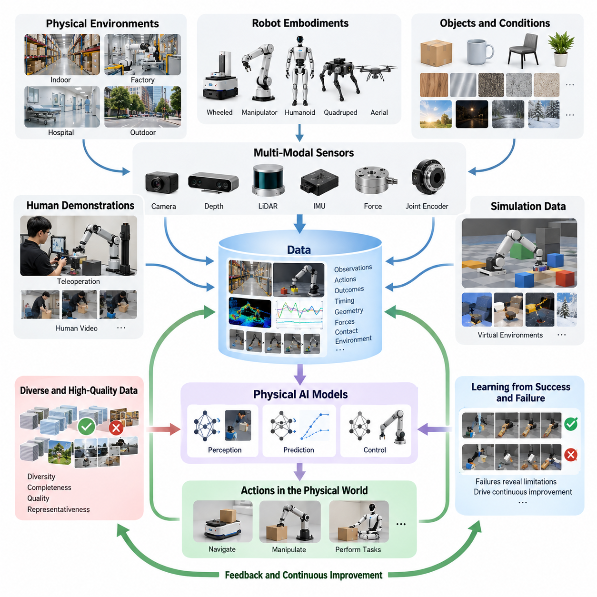
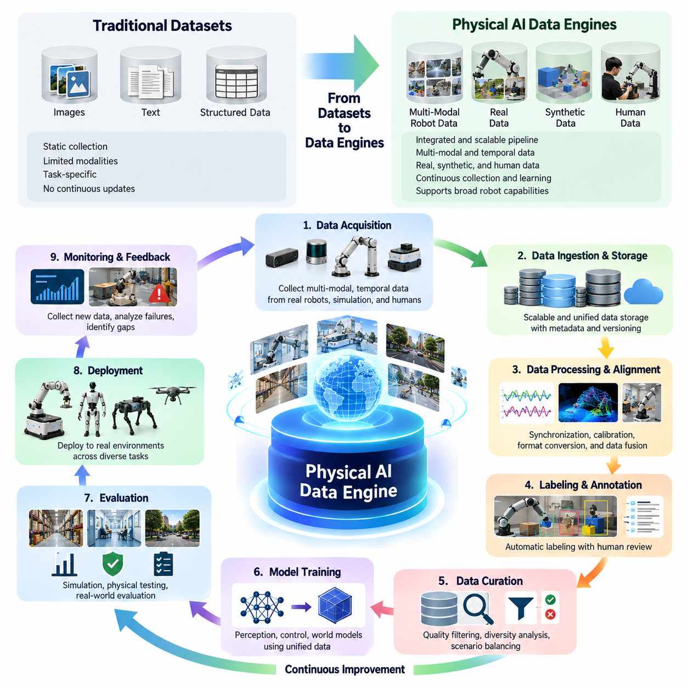
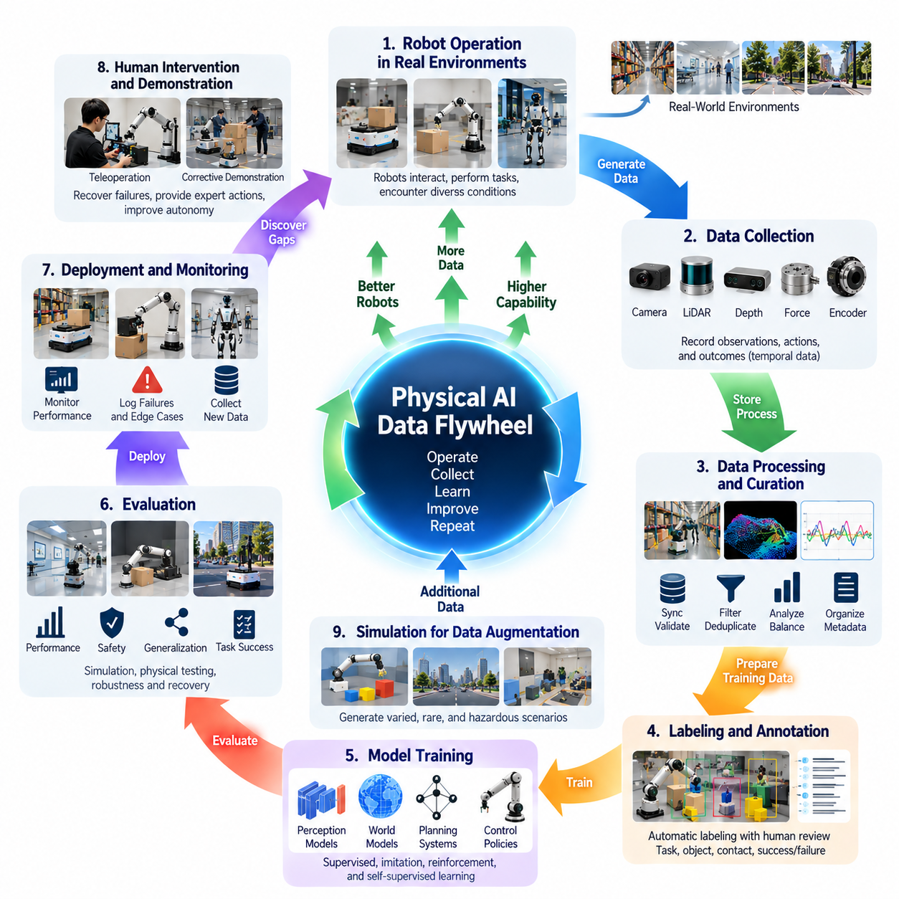
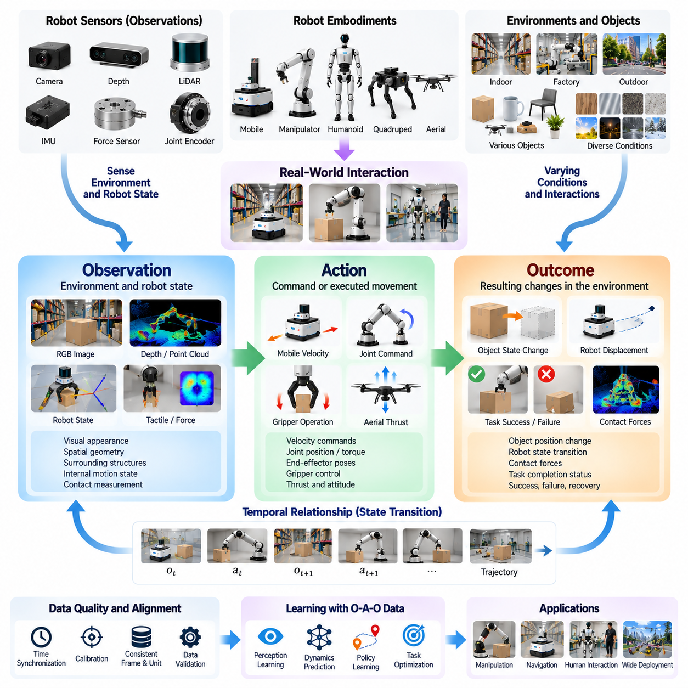
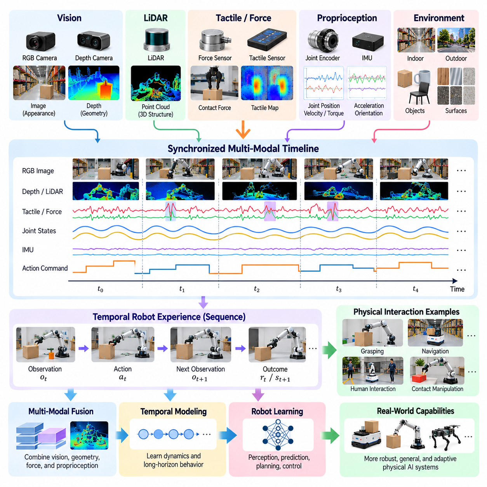
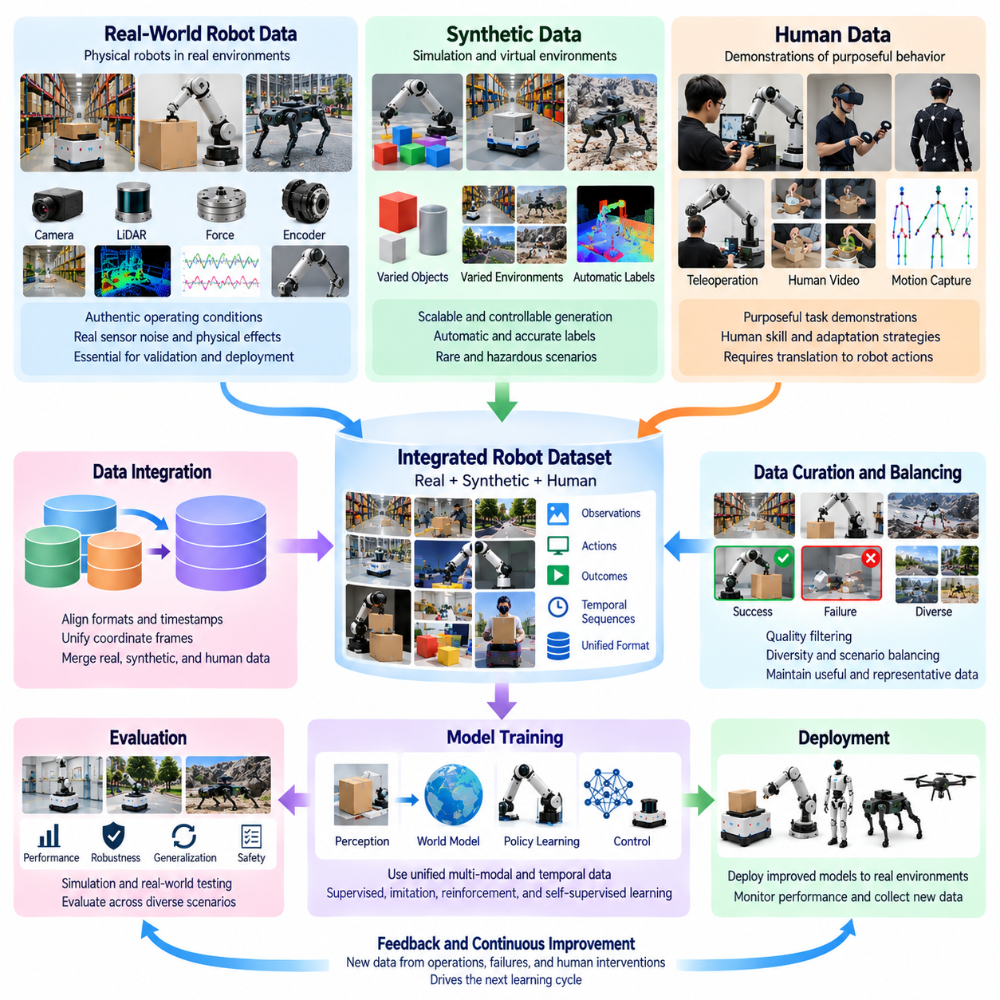
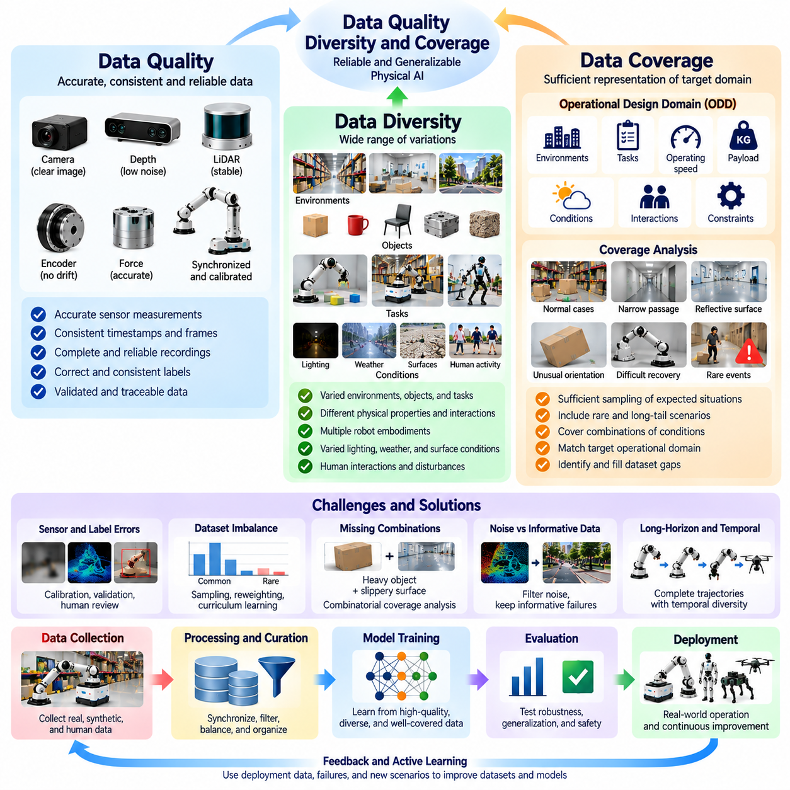
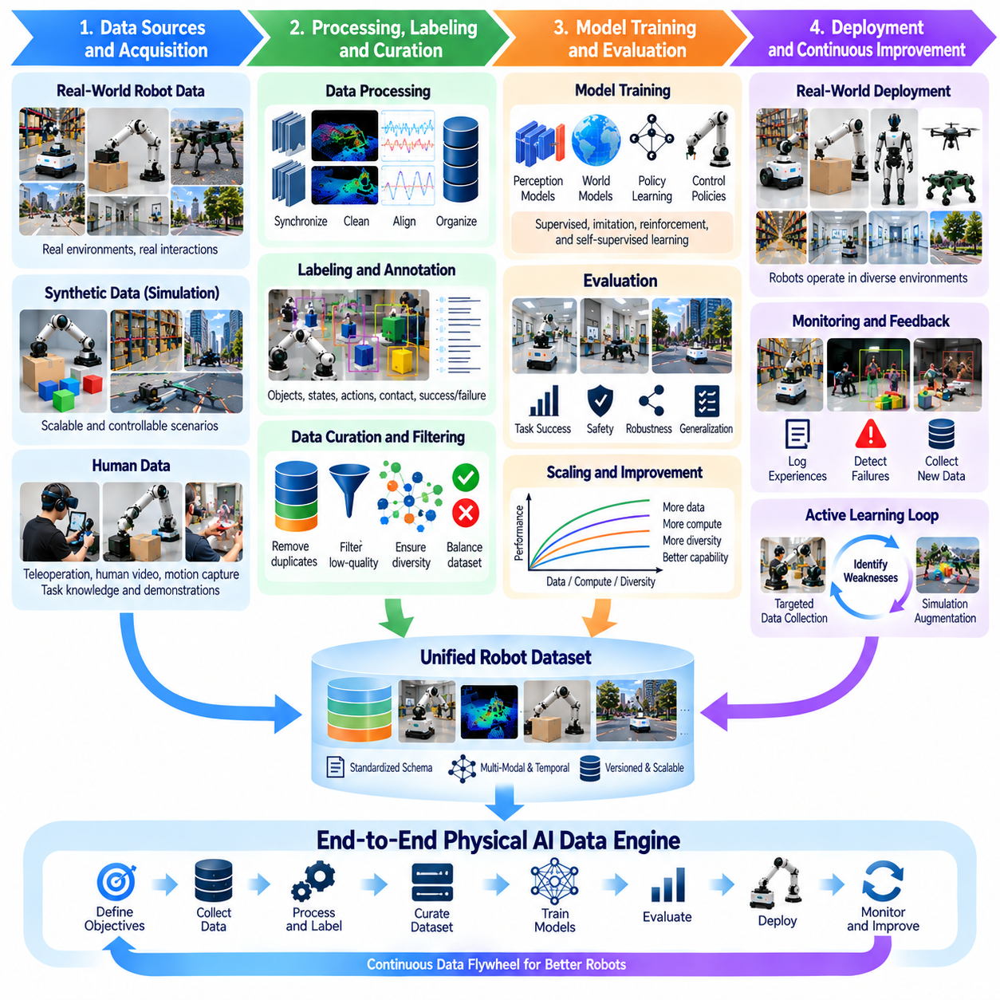

**Volume 04. Data Engines and Scaling for Physical AI**

# Chapter 00. Introduction

## 00.01. Why Data is Central to Physical AI

{width="7.268055555555556in" height="7.268055555555556in"}

Physical AI differs fundamentally from conventional artificial intelligence because its decisions directly influence the physical world. A robot must perceive its surroundings, interpret changing conditions, select appropriate actions, and execute movements under real-world constraints. Data provides the essential foundation connecting these capabilities, enabling intelligent systems to learn how physical environments behave and how actions produce measurable consequences.

In traditional digital AI, large collections of text, images, and structured records support prediction and reasoning. Physical AI requires additional information describing motion, geometry, forces, contact, timing, and environmental interactions. A robot cannot reliably learn manipulation or navigation from visual recognition alone. It must understand how objects respond to movement, how obstacles affect trajectories, and how physical constraints influence successful task execution.

The central role of data becomes apparent when examining the relationship between perception and action. Cameras, LiDAR, depth sensors, inertial measurement units, force sensors, and joint encoders continuously observe different aspects of the environment and robot state. These observations become meaningful when associated with actions and their outcomes. Such relationships allow learning systems to distinguish effective behaviors from unsuccessful or potentially hazardous movements.

Physical AI data is inherently temporal because intelligent behavior develops through sequences of interactions rather than isolated observations. A single image may reveal the location of an object, but it cannot fully describe how the object moves when pushed or grasped. Time-aligned observations, control commands, and resulting state transitions provide information about physical dynamics, allowing models to predict future conditions and select actions that support longer-term objectives.

An autonomous mobile robot illustrates why data is indispensable. Successful navigation requires more than identifying walls, people, and obstacles. The robot must learn how different surfaces affect traction, how pedestrians move through shared spaces, and how localization uncertainty influences safe motion. Operational data collected across warehouses, hospitals, factories, and outdoor environments helps navigation policies adapt to conditions that cannot be completely represented through manually programmed rules.

Robotic manipulation presents an even greater dependence on interaction data. Grasping an unfamiliar object requires knowledge of geometry, orientation, friction, compliance, and contact stability. Visual information can suggest possible grasp locations, but successful manipulation also depends on tactile feedback and the relationship between applied forces and object motion. Repeated demonstrations and interaction episodes provide the experience necessary to improve grasp selection, motion planning, and recovery behavior.

The diversity of physical environments creates a fundamental challenge for data-driven learning. Objects vary in size, material, weight, and appearance, while lighting, temperature, surface conditions, and human behavior change unpredictably. A model trained only on narrow operating conditions may perform well during evaluation but fail when deployed elsewhere. Broad environmental coverage is therefore essential for developing robust policies capable of operating beyond familiar training scenarios.

Data diversity must also extend to robot morphology and embodiment. Wheeled mobile robots, robotic manipulators, humanoids, quadrupeds, and aerial robots interact with their environments through different mechanical structures and action spaces. Their observations may share common semantic information, but their control requirements differ substantially. Learning across embodiments requires representations that preserve useful physical relationships while accommodating differences in sensing, movement, and actuation.

Human demonstrations provide an important source of physical knowledge because people routinely perform complex tasks involving perception, coordination, and adaptation. Teleoperation systems can capture expert actions directly through robot sensors and actuators, producing demonstrations suitable for imitation learning. Human video offers a complementary source of task understanding, although differences between human and robotic bodies require additional interpretation before observed behavior can be converted into executable actions.

Simulation-generated data expands the range of experiences available for training without requiring every interaction to occur on physical hardware. Virtual environments can generate controlled variations in object properties, lighting, terrain, robot dynamics, and task configurations. They can also expose learning systems to uncommon or hazardous situations. However, differences between simulated and real-world physics make validation and carefully designed combinations of synthetic and physical data necessary.

The quantity of collected data alone does not determine learning performance. Repeated recordings of nearly identical successful operations may contribute less useful information than a smaller collection containing diverse failures, recoveries, and unfamiliar conditions. Data quality, completeness, synchronization, and representativeness strongly influence the knowledge a model can acquire. Effective data engineering therefore emphasizes the information contained in each episode rather than simply maximizing storage volume.

Failures are especially valuable because they reveal limitations that successful demonstrations may conceal. A navigation failure can expose an overlooked obstacle configuration, while a dropped object may reveal weaknesses in grasp stability or force control. Recording the observations, actions, and conditions preceding such events allows engineers to identify missing capabilities. Corrective demonstrations and recovery trajectories can then provide targeted training examples for improving future behavior.

The relationship between data and model capability is not necessarily linear. Increasing training volume may improve performance initially, but additional examples can produce diminishing returns when they repeat already familiar conditions. Physical AI scaling must therefore consider task diversity, environmental coverage, embodiment variation, model capacity, and computational resources together. Understanding these relationships is essential for allocating data collection resources efficiently and developing increasingly general-purpose systems.

Data becomes particularly valuable when organized into a continuous improvement process rather than maintained as a static training resource. A data engine connects collection, ingestion, processing, labeling, curation, training, evaluation, and deployment into a coordinated workflow. New operational experiences reveal model weaknesses, which guide subsequent data acquisition and training. This closed-loop architecture transforms everyday robot operation into an opportunity for systematic capability improvement.

Fleet-scale deployment strengthens this process by allowing multiple robots to contribute observations from different locations and operating conditions. A failure encountered by one robot may provide useful training information for other systems with similar capabilities. Aggregating experiences across deployments can expose rare events that individual robots seldom encounter. Such shared learning requires reliable metadata, consistent representations, data provenance, and mechanisms for identifying the most informative experiences.

Multimodal synchronization is another essential requirement because physical understanding depends on relationships among different measurements. Camera frames, depth maps, joint positions, motor commands, force readings, and task descriptions must correspond to the same underlying events. Incorrect timestamps or missing sensor records can distort these relationships and produce misleading training examples. Precise synchronization and validation are therefore fundamental components of a trustworthy Physical AI data infrastructure.

Data labeling and semantic organization further determine whether collected experiences can support meaningful learning. Robot datasets may require object poses, contact states, action segments, task descriptions, success indicators, and failure classifications. These annotations connect low-level sensor measurements with higher-level behavioral objectives. Consistent labeling conventions also make it easier to compare experiments, combine datasets, evaluate model performance, and reuse experiences across different robot platforms.

The economic importance of data increases as robotic systems become more complex and widely deployed. Physical data collection requires hardware, operators, maintenance, safety supervision, and substantial operational time. Unlike digital information that can often be duplicated at negligible cost, physical interaction data may require expensive real-world execution. Efficient collection strategies, active learning, automated curation, and simulation-based augmentation help reduce these costs while preserving valuable training information.

Safety and reliability introduce additional requirements that distinguish Physical AI data from many conventional machine learning datasets. Training information must adequately represent hazardous conditions, unexpected interactions, sensor degradation, and control failures. Nevertheless, exposure to failure examples does not independently guarantee safe operation. Reliable deployment also requires independent safety mechanisms, runtime monitoring, constrained control, and systematic testing under conditions that challenge learned policies.

Data governance becomes increasingly important when robots operate around people, industrial facilities, and sensitive infrastructure. Cameras and other sensors may capture personal information, confidential manufacturing processes, or location-specific operational details. Responsible data management requires clear ownership, appropriate permissions, secure storage, controlled access, and documented retention policies. These practices support regulatory compliance while preserving the trust necessary for sustained real-world data collection.

The emergence of robot foundation models and vision-language-action architectures further increases the strategic importance of data. Such models seek to acquire reusable representations of objects, environments, tasks, and actions from diverse training experiences. Their effectiveness depends on combining semantic knowledge with physically grounded interaction information. Large-scale training may support broader transfer, but reliable action generation still requires sufficient coverage of relevant physical conditions and robot capabilities.

Ultimately, data is central to Physical AI because intelligence in the physical world must be grounded in observable interactions and their consequences. Models, algorithms, sensors, and actuators provide the mechanisms for intelligent behavior, but data connects these components through accumulated experience. The long-term development of capable Physical AI systems will therefore depend not merely on collecting more information, but on building scalable data engines that continuously convert physical experience into reliable, adaptable, and increasingly general intelligence.

## 00.02. From Datasets to Data Engines

{width="7.268055555555556in" height="7.268055555555556in"}

The evolution from datasets to data engines represents a fundamental transformation in how Physical AI systems acquire, organize, and improve their intelligence. Traditional machine learning often relies on static datasets collected before training begins. Physical AI requires a more dynamic approach because robots continuously encounter changing environments, unfamiliar objects, and unexpected interactions. A data engine transforms these experiences into an ongoing learning process rather than treating data as a fixed resource.

A dataset is generally a structured collection of observations, labels, demonstrations, or trajectories prepared for a particular learning objective. Once assembled, it may remain unchanged throughout multiple training experiments. This approach works well for controlled benchmarks but becomes restrictive when robots operate in diverse physical environments. New deployment conditions can expose gaps in the original dataset, requiring systematic mechanisms for collecting and incorporating additional experiences.

A data pipeline extends the dataset concept by automating activities such as ingestion, preprocessing, labeling, validation, and storage. However, a pipeline does not necessarily determine which new data should be collected or how deployed model failures should influence future training. A data engine introduces this feedback-driven intelligence by connecting operational performance, data selection, model development, and deployment into a continuously improving system.

The defining characteristic of a Physical AI data engine is its closed-loop architecture. Robots generate observations and action trajectories during operation, while monitoring systems identify successful behaviors, failures, and unusual conditions. Relevant experiences are transferred into processing and training infrastructure, where they become new learning examples. Updated models are evaluated and deployed, producing additional operational data that begins the next improvement cycle.

This transition changes the role of data collection from passive recording to purposeful acquisition. Instead of storing every available sensor stream indiscriminately, a data engine prioritizes experiences that address specific model weaknesses. Examples include unfamiliar obstacles, unstable grasps, localization failures, unexpected human behavior, and recovery situations. Targeted collection improves the information value of training data while reducing unnecessary storage and processing costs.

Data engines must support the complete lifecycle of robot interaction episodes. Each episode may contain synchronized camera images, depth measurements, joint states, control commands, task instructions, environmental conditions, and outcome indicators. Preserving the relationships among these elements is essential because physical behavior cannot be understood through isolated measurements. Episode-based organization allows engineers to reconstruct events and evaluate the consequences of individual actions.

The ingestion layer provides the connection between physical robots and centralized learning infrastructure. Data may originate from onboard storage, teleoperation stations, simulation environments, human demonstrations, or distributed robot fleets. Reliable ingestion requires timestamp preservation, format validation, integrity checks, and metadata registration. These mechanisms ensure that experiences collected under different operating conditions can be processed consistently without losing important contextual information.

Processing and curation convert raw operational recordings into reliable training resources. Sensor synchronization, calibration verification, noise filtering, duplicate detection, and trajectory segmentation improve the usability of collected data. Automated quality assessment can identify corrupted recordings, incomplete episodes, and inconsistent labels. By removing low-value information while preserving informative exceptions, the data engine increases the effectiveness of subsequent model training.

Labeling connects recorded physical experiences with meaningful learning objectives. Robot data may require annotations describing object positions, contact events, task phases, action intentions, success conditions, and failure causes. Manual labeling can provide detailed interpretation, while automated and AI-assisted methods improve throughput. A scalable data engine combines these approaches according to task complexity, annotation reliability, and the economic value of each training example.

Model evaluation plays a central role in determining how the data engine evolves. Performance measurements should extend beyond aggregate success rates to include robustness, recovery capability, task completion time, safety violations, and behavior under unfamiliar conditions. Evaluation results reveal which environments or interaction patterns remain poorly represented. These weaknesses can then be translated into targeted data collection requests, creating a direct connection between model errors and future learning experiences.

Active learning further strengthens this connection by identifying observations that are likely to improve model performance. Uncertainty estimates, prediction errors, and disagreement between models can help prioritize candidate episodes. A navigation model may request additional examples of reflective surfaces, while a manipulation policy may benefit from demonstrations involving deformable objects. Such strategies direct collection resources toward situations where additional information is most valuable.

Simulation becomes an integrated component of the data engine rather than a separate experimental tool. When real-world failures reveal missing scenarios, virtual environments can reproduce related conditions and generate controlled variations. Domain randomization introduces differences in lighting, geometry, friction, and dynamics to broaden training coverage. Nevertheless, simulated experiences must be evaluated against real-world behavior because inaccurate physics or unrealistic observations can introduce systematic learning errors.

Teleoperation provides another mechanism for closing capability gaps. When autonomous robots encounter situations beyond their current competence, human operators can intervene and demonstrate appropriate behavior. Recording these interventions produces examples of difficult tasks, corrective actions, and recovery strategies. The data engine can identify recurring intervention patterns and prioritize them for training, gradually reducing dependence on human assistance where reliable autonomy becomes achievable.

At fleet scale, the data engine benefits from experiences generated by many robots operating across different sites. Distributed deployments expose models to variations in layouts, equipment, lighting, human activity, and operational procedures. Aggregated data can reveal rare failure patterns that remain invisible within individual deployments. Fleet-wide learning therefore creates opportunities for shared improvement, provided that differences in robot configurations and data distributions are properly managed.

Efficient fleet data engines cannot rely on transferring every recorded sensor stream to centralized storage. Communication bandwidth, energy consumption, storage capacity, and privacy restrictions impose practical limitations. Edge filtering, compression, event-triggered recording, and prioritized uploading help select valuable information before transmission. These mechanisms allow large robot fleets to contribute useful experiences without making data infrastructure costs grow uncontrollably.

Data lineage and version control become essential as continuous learning introduces frequent dataset and model updates. Engineers must know which robots produced particular recordings, which processing operations modified them, and which training runs consumed them. Traceability supports reproducibility, error investigation, and performance comparisons across model versions. It also enables teams to identify whether unexpected behavior originates from data changes, labeling inconsistencies, or modifications to learning algorithms.

A mature data engine requires coordinated management of data quality, diversity, and coverage. Large collections dominated by routine successful operations may fail to represent rare but operationally important situations. Sampling strategies must therefore balance common behaviors with difficult examples, environmental variation, and safety-critical events. The objective is not simply to maximize dataset size but to construct training distributions that support reliable performance across intended deployment conditions.

The transition to data engines also changes the economics of Physical AI development. Traditional dataset production often involves substantial collection and annotation costs before model training. Continuous data engines distribute these activities across the operational lifecycle and automate repetitive processing tasks. Their value depends on whether additional learning improves task performance, reduces intervention requirements, and lowers the cost of deploying and maintaining intelligent robotic systems.

Governance must be integrated into the data engine architecture from the beginning. Physical robots may collect personal images, location information, industrial process details, and other sensitive records. Data ownership, consent, access permissions, retention policies, and security controls must remain enforceable throughout collection, processing, training, and sharing. Responsible governance enables continuous learning while limiting inappropriate use and protecting confidential operational information.

Continuous deployment introduces additional responsibilities because improved training metrics do not guarantee better real-world behavior. Candidate models require controlled evaluation, regression testing, and safety validation before broad deployment. Shadow testing and limited canary releases can provide evidence about operational performance while restricting exposure to potential failures. Monitoring deployed models then supplies the feedback needed to detect degradation, distribution shifts, and unexpected behaviors.

The effectiveness of a data engine ultimately depends on the quality of its feedback mechanisms. Operational failures must be translated into understandable data requirements, collected experiences must become reliable training examples, and model updates must demonstrate measurable improvements. Weaknesses anywhere in this cycle can prevent accumulated data from producing meaningful progress. Successful systems therefore optimize the entire learning process rather than treating collection, training, and deployment as independent activities.

The movement from datasets to data engines establishes the foundation for continuously improving Physical AI. Static datasets remain valuable for initial training, benchmarking, and reproducible evaluation, but they cannot independently address the full diversity of real-world robotic operation. Data engines connect physical experience with model development through systematic feedback, targeted collection, scalable processing, and controlled deployment. This transformation makes data infrastructure a central driver of adaptable, reliable, and increasingly capable robotic intelligence.

## 00.03. The Physical AI Data Flywheel

{width="7.268055555555556in" height="7.268055555555556in"}

The Physical AI data flywheel describes a continuous learning mechanism in which robot operation generates data, data improves models, and improved models enable further operational experience. Unlike conventional training workflows that terminate after deployment, the flywheel establishes a recurring relationship between physical interaction and intelligence development. Its effectiveness depends on transforming everyday robot activities into structured opportunities for learning, evaluation, and systematic improvement.

The flywheel begins when robots interact with real environments and generate observations, actions, and outcomes. Cameras, LiDAR, force sensors, joint encoders, and control systems capture complementary aspects of these interactions. Each recorded episode represents a sequence of physical events rather than an isolated measurement. Preserving temporal relationships among sensor readings, control commands, and environmental changes allows learning systems to understand how actions influence subsequent states.

Operational data becomes especially valuable when it reveals limitations in existing robot capabilities. Navigation failures, unstable grasps, unexpected obstacles, human interventions, and incomplete tasks expose situations that training datasets may not adequately represent. A data flywheel systematically identifies these events and converts them into learning opportunities. This process shifts development from collecting large amounts of routine data toward discovering experiences that can meaningfully improve model behavior.

The collection stage requires intelligent recording strategies because continuous high-resolution sensor logging can generate enormous data volumes. Event-triggered recording, uncertainty-based sampling, and selective trajectory storage help prioritize informative experiences. Routine successful operations may be sampled to preserve representative coverage, while unusual events receive greater attention. This balance reduces communication and storage costs without eliminating the operational context needed for effective learning.

After collection, raw recordings enter a processing infrastructure responsible for synchronization, validation, segmentation, and metadata organization. Camera frames, depth measurements, robot states, and action commands must be aligned to reconstruct meaningful interaction episodes. Corrupted records, missing timestamps, and inconsistent sensor calibration can undermine learning quality. Reliable preprocessing therefore determines whether operational experiences become trustworthy training resources or misleading examples.

Data curation transforms processed episodes into strategically useful training collections. Duplicate detection, quality scoring, diversity analysis, and failure classification help distinguish informative experiences from redundant recordings. Rare events and difficult examples may receive higher sampling priority, but common operating conditions must remain adequately represented. Effective curation maintains a balanced learning distribution that reflects both routine tasks and the challenging situations robots must handle.

Labeling and semantic interpretation connect physical recordings with learning objectives. An episode may require annotations describing task instructions, object poses, contact states, action phases, success conditions, or failure causes. Automated labeling systems can process large data volumes, while human reviewers resolve ambiguous or safety-critical cases. Consistent annotations allow the flywheel to connect low-level sensor measurements with higher-level task understanding and behavioral improvement.

The training stage uses curated experiences to update perception models, world models, planning systems, and robot control policies. Supervised learning, imitation learning, reinforcement learning, and self-supervised learning may contribute different capabilities depending on the available data. Training objectives should reflect operational weaknesses identified during deployment. The flywheel becomes more effective when model updates address measurable deficiencies rather than simply increasing training volume.

Model evaluation provides the evidence needed to determine whether newly trained systems actually improve. Offline benchmarks, simulation tests, controlled physical trials, and safety assessments examine performance across relevant operating conditions. Success rates alone are insufficient because improvements in familiar tasks may conceal regressions elsewhere. Evaluation must consider robustness, recovery behavior, generalization, task completion efficiency, and safety before models are approved for deployment.

Deployment closes the learning loop by returning improved models to physical robots. Updated policies encounter real environments containing variations that cannot be fully reproduced during training. Monitoring systems observe their behavior and compare performance against established baselines. Newly discovered errors and unfamiliar conditions become candidates for subsequent data collection. Through repeated deployment and feedback, the flywheel converts operational experience into successive model improvements.

Human intervention plays an important role when autonomous behavior encounters situations beyond current capabilities. Teleoperators or supervisors can recover failed tasks, demonstrate corrective actions, and identify unsafe decisions. Recording the circumstances surrounding intervention provides valuable examples of difficult states and effective recovery strategies. Over time, these demonstrations can improve autonomous competence and reduce intervention frequency, provided that the learned behavior is independently validated.

Simulation can accelerate the flywheel by generating additional experiences around weaknesses discovered in real-world operation. A failed grasp may motivate virtual experiments involving variations in friction, object geometry, and contact conditions. A navigation incident may lead to simulated obstacle configurations and pedestrian behaviors. Synthetic data expands scenario coverage, but its contribution must be verified through real-world testing to prevent simulation inaccuracies from propagating into deployed policies.

Fleet-scale operation increases the potential learning rate by collecting experiences from many robots across different environments. Warehouses, factories, hospitals, and outdoor facilities expose systems to distinct layouts, objects, lighting conditions, and human activities. Aggregating these experiences enables discovery of rare failure patterns that individual robots may seldom encounter. Shared learning can improve fleet-wide performance when differences in hardware, sensors, and operating contexts are carefully managed.

The flywheel also requires mechanisms for detecting changes in operational data distributions. New equipment, modified layouts, seasonal conditions, and evolving human behavior can create distribution shifts that reduce model reliability. Drift monitoring compares current observations and outcomes against established reference distributions. Significant deviations can trigger targeted collection, evaluation, or retraining, allowing the system to respond to changing environments rather than relying indefinitely on historical experience.

Data lineage and version management are essential for maintaining control over repeated learning cycles. Every training episode should retain information about its source robot, operating environment, collection time, processing history, and annotation version. Model versions must remain linked to the datasets and configurations used during training. This traceability supports reproducibility, failure investigation, rollback decisions, and reliable comparisons between successive iterations of the flywheel.

The efficiency of a Physical AI data flywheel depends on how quickly useful operational evidence becomes validated model improvement. Collection latency, labeling throughput, training time, evaluation cost, and deployment frequency influence the overall cycle. Faster iteration is valuable only when data quality and safety assurance remain sufficient. Optimizing the flywheel therefore requires coordinated improvements across infrastructure, automation, model development, and operational monitoring.

Data quality creates a critical distinction between a productive flywheel and an ineffective accumulation process. Repeatedly collecting similar successful trajectories may increase storage volume without substantially improving generalization. Conversely, poorly labeled failures or incorrectly synchronized observations can introduce harmful learning signals. A productive flywheel measures the contribution of collected experiences to model performance and continuously adjusts collection and curation strategies accordingly.

The relationship between data volume and capability improvement also introduces scaling challenges. As models become more competent, common failures may disappear while remaining weaknesses become increasingly rare and difficult to reproduce. Collecting additional informative examples can require broader deployments, targeted experiments, or sophisticated simulation. The flywheel must therefore evolve from general experience accumulation toward increasingly selective discovery of long-tail scenarios and capability gaps.

Economic sustainability is another requirement for continuous learning. Physical data collection involves hardware wear, operator time, communication bandwidth, storage, computational resources, and validation expenses. A successful flywheel should generate measurable operational benefits that justify these costs. Reduced intervention rates, improved task completion, fewer failures, and better adaptability provide practical indicators of whether continuous data-driven improvement creates sufficient value.

Safety, privacy, and governance must remain integrated throughout the flywheel. Operational recordings may contain personal information, confidential industrial details, or safety-sensitive events. Access control, data minimization, secure storage, retention policies, and documented provenance protect collected information. Model updates also require controlled validation and deployment procedures so that continuous learning does not introduce unacceptable operational risks or undermine established safety requirements.

The Physical AI data flywheel ultimately transforms robotic intelligence from a capability established primarily during initial development into a system that can improve through accumulated physical experience. Its central principle is the continuous conversion of observations, actions, outcomes, and failures into better models and more reliable behavior. When supported by scalable infrastructure, targeted data acquisition, rigorous evaluation, and responsible deployment, the flywheel becomes a foundation for increasingly adaptive and capable Physical AI systems.

## 00.04. Observation Action Outcome Data

{width="7.268055555555556in" height="7.268055555555556in"}

Observation, action, and outcome data form the fundamental structure through which Physical AI systems learn relationships between perception, behavior, and physical consequences. An observation describes the environment and robot state, an action represents a command or executed movement, and an outcome captures the resulting changes. Connecting these elements enables learning systems to move beyond recognizing objects toward understanding how intelligent behavior affects the physical world.

Observations originate from sensors that measure different aspects of the robot and its surroundings. Cameras provide visual appearance, depth sensors describe spatial geometry, LiDAR measures surrounding structures, and force sensors detect physical interaction. Joint encoders and inertial sensors reveal internal motion states. Combining these measurements creates a richer representation of the conditions under which a robot selects and executes an action.

Action data records how a robot attempts to influence its environment. Depending on the platform, actions may include wheel velocity commands, joint position targets, torque requests, gripper operations, or aerial thrust adjustments. These commands must be distinguished from the movements actually achieved because actuator limitations, delays, and environmental forces can alter execution. Accurate learning requires both intended commands and measured responses.

Outcome data describes the consequences of executed actions. Outcomes may include changes in object position, robot displacement, contact forces, task completion status, collision events, or recovery behavior. A successful grasp may be represented by stable object retention, while a navigation failure may involve unexpected stopping or localization loss. Outcome measurements connect physical behavior with the objectives that motivated the action.

The relationship among observation, action, and outcome is inherently temporal. A robot observes a state at one moment, applies an action, and experiences a subsequent state influenced by its behavior and external disturbances. Learning from these transitions requires accurate timestamps and consistent sampling intervals. Without temporal alignment, a model may associate an action with an unrelated consequence and develop incorrect assumptions about physical dynamics.

A common representation organizes robot experience into state transitions containing an observation, an action, a subsequent observation, and optional reward or termination information. Repeated transitions form trajectories that describe complete interactions over time. Such structures support imitation learning, reinforcement learning, dynamics prediction, and policy evaluation. They also provide a consistent foundation for storing experiences from different robots and tasks.

Observations and states are related but not identical concepts. Observations contain information directly available through sensors, while the underlying physical state may include quantities that cannot be measured completely. Occluded objects, unknown friction coefficients, and hidden contact conditions introduce partial observability. Physical AI models must therefore infer relevant state information from observation histories rather than assuming that every important property is immediately visible.

Action representations introduce additional complexity because robots operate with different mechanical structures and control interfaces. A mobile robot may use linear and angular velocity commands, while a manipulator may control joint positions, end-effector poses, or torques. Humanoids require coordinated whole-body actions, and aerial robots control thrust and attitude. Standardized metadata must describe these action spaces so recorded commands can be interpreted correctly.

Outcome representation must distinguish immediate physical changes from longer-term task success. Moving a gripper toward an object may produce a valid intermediate state without completing the grasping task. Similarly, avoiding an obstacle may be locally successful while delaying arrival at the destination. Hierarchical outcome descriptions help learning systems evaluate individual transitions, intermediate objectives, and complete task episodes without confusing short-term progress with overall success.

Contact-rich manipulation illustrates the importance of combining all three data categories. Before grasping an object, a robot observes its shape, position, and orientation. During execution, it records gripper motion, joint commands, tactile measurements, and contact forces. Afterward, the system determines whether the object was lifted, retained, or dropped. This complete interaction history provides substantially more learning information than visual images or action commands alone.

Autonomous navigation provides another example of observation-action-outcome relationships. A mobile robot observes obstacles, free space, localization estimates, and nearby human movement before selecting a velocity command. Subsequent observations reveal actual displacement, obstacle clearance, and deviations from the planned path. Recording these transitions supports learning of traversability, motion prediction, collision avoidance, and recovery strategies under changing environmental conditions.

Data quality is particularly important when connecting actions with their consequences. Sensor delays, inconsistent coordinate frames, actuator latency, and timestamp errors can distort the relationship between recorded commands and measured outcomes. Calibration and synchronization procedures must therefore be integrated into the recording infrastructure. Accurate coordinate transformations and consistent physical units are essential for reconstructing reliable trajectories.

Observation-action-outcome data can support different learning objectives depending on how it is processed. Behavioral cloning learns mappings from observations to demonstrated actions, while dynamics models estimate how actions change physical states. Reinforcement learning evaluates actions through rewards and future consequences. World models combine these relationships to predict possible outcomes before execution, enabling planning systems to compare alternative behaviors.

Human demonstrations provide valuable observation-action-outcome sequences when recorded through teleoperation. An operator observes the environment, selects control inputs, and adjusts behavior according to the resulting robot response. These demonstrations capture both successful execution and corrective decisions. Including failed attempts, interventions, and recovery actions can help models learn how to respond when real-world conditions differ from expected situations.

Simulation environments can generate structured transitions with access to information that may be difficult to measure physically. Object velocities, contact states, friction parameters, and collision events can be recorded directly from simulation engines. This additional information supports supervised dynamics learning and detailed evaluation. However, simulated action-outcome relationships may differ from reality, making physical validation necessary before relying on learned behavior.

The organization of observation-action-outcome data also affects scalability. Continuous recordings from cameras, proprioceptive sensors, and control systems can generate large volumes of information. Episode-based storage, efficient compression, event indexing, and metadata management make these records searchable and reusable. Preserving synchronization and action semantics during compression is essential because losing temporal relationships can reduce the usefulness of the entire dataset.

Failure analysis benefits from complete interaction histories rather than isolated error reports. When a robot drops an object, engineers need to examine the preceding observations, selected actions, contact changes, and final outcome. Similar analysis applies to collisions, unstable locomotion, and navigation interruptions. These histories reveal whether failures originate from perception errors, incorrect decisions, actuator limitations, or unexpected environmental dynamics.

Outcome labels should capture uncertainty and ambiguity rather than forcing every episode into a simple success-or-failure classification. A manipulation attempt may partially complete a task, while a navigation episode may succeed despite requiring human intervention. Confidence estimates, partial completion indicators, and detailed failure categories provide richer supervisory information. Such representations support more precise evaluation and targeted improvements in robot behavior.

At fleet scale, consistent observation-action-outcome schemas enable experiences from multiple robots to contribute to shared learning. Differences in sensor configurations, action frequencies, coordinate systems, and actuator capabilities must be represented explicitly. Cross-robot datasets may require normalization or embodiment-specific transformations. Properly structured records allow models to identify transferable physical relationships without assuming that all robots execute identical actions.

The value of these data structures extends beyond model training into monitoring, debugging, and continuous improvement. Deployed robots can record selected transitions when uncertainty increases, unexpected outcomes occur, or safety thresholds are approached. Data engines can prioritize these episodes for inspection, labeling, and retraining. This feedback mechanism connects operational evidence directly to model weaknesses and future data collection priorities.

Observation-action-outcome data ultimately provides the causal and temporal foundation for learning intelligent physical behavior, although observational records alone do not always establish causality. By preserving what a robot perceived, what it attempted and executed, and what subsequently occurred, data engines create reusable representations of physical experience. These structured relationships support prediction, planning, control, evaluation, and the continuous development of increasingly reliable and adaptable Physical AI systems.

## 00.05. Multimodal and Temporal Robot Data

{width="7.268055555555556in" height="7.268055555555556in"}

Multimodal and temporal robot data provides the foundation for understanding physical environments through multiple sensing channels and continuous sequences of interaction. Unlike conventional datasets containing isolated images or text, robotic experiences combine visual observations, spatial measurements, internal states, actions, and outcomes. Their relationships across time allow Physical AI systems to interpret changing conditions, estimate hidden states, and learn behaviors grounded in physical dynamics.

Multimodal data refers to information collected from different sensor types and representation formats. Cameras capture appearance and texture, depth sensors measure geometric structure, LiDAR provides spatial distances, and tactile sensors detect physical contact. Inertial sensors and joint encoders describe robot motion and configuration. Each modality contributes complementary information, enabling models to construct richer environmental representations than any individual sensor can provide.

Temporal data describes how observations, actions, and physical states evolve through time. A single image may reveal an object\'s location but cannot fully explain its velocity, acceleration, or response to external forces. Sequential observations reveal movement patterns, interaction dynamics, and changes in environmental conditions. Temporal reasoning therefore enables robots to distinguish stationary objects from moving obstacles and predict how their surroundings may evolve.

The combination of multimodal and temporal information is essential because physical interactions occur continuously and involve several interconnected processes. During grasping, a robot observes an object visually, moves its manipulator, detects contact, and adjusts gripping force. These events must be interpreted as a coordinated sequence. Learning from synchronized sensor streams allows models to associate visual conditions with physical contact and subsequent manipulation outcomes.

Robot sensors operate at different sampling frequencies, creating challenges for data integration. Cameras may capture tens of frames per second, while joint encoders and motor controllers can produce measurements at hundreds or thousands of samples per second. LiDAR, force sensors, and inertial measurement units follow their own acquisition schedules. Accurate synchronization is necessary to establish which measurements correspond to the same physical event.

Timestamp management is therefore a fundamental requirement of multimodal robot datasets. Each observation and command should retain a reliable time reference, preferably derived from synchronized clocks. Hardware timestamps, clock synchronization protocols, and latency compensation help reduce alignment errors. Without consistent timing, models may incorrectly associate a motor command with sensor measurements recorded before or long after the corresponding physical movement.

Temporal alignment often requires interpolation, resampling, or event-based synchronization. High-frequency joint measurements may be aggregated around camera frames, while lower-frequency spatial observations may be associated with nearby control intervals. However, these operations must preserve physically meaningful transitions. Excessive smoothing can hide sudden contacts, collisions, or control instabilities that are important for learning accurate robot behavior.

Coordinate systems introduce another layer of complexity when combining multimodal observations. Cameras, LiDAR units, robot joints, and end effectors measure information relative to different reference frames. Calibration determines the transformations needed to express these measurements consistently. Incorrect extrinsic calibration can cause spatial misalignment even when timestamps are accurate, reducing the reliability of perception, manipulation, and navigation models.

Visual data provides important semantic and geometric information about the surrounding environment. RGB images support object recognition, scene interpretation, and visual tracking, while depth images and point clouds describe three-dimensional structure. Combining these representations helps robots estimate object poses, identify free space, and understand spatial relationships. Temporal visual sequences further support motion estimation, object tracking, and prediction of future scene configurations.

Proprioceptive data describes the robot\'s internal physical condition. Joint positions, velocities, motor currents, actuator torques, and inertial measurements reveal how the mechanical system responds to commands and external forces. These signals are particularly important for locomotion, manipulation, and contact-rich control. When combined with external observations, proprioception allows models to connect environmental conditions with the robot\'s actual physical behavior.

Force and tactile measurements provide information that visual sensors cannot reliably capture. Contact pressure, shear forces, vibration, and grip stability reveal interactions occurring at physical interfaces. A manipulator may visually appear to grasp an object correctly while tactile data indicates slipping or unstable contact. Integrating these measurements over time supports adaptive force control, contact detection, and recovery from unexpected interaction conditions.

Action data must remain synchronized with sensor observations to preserve the relationship between control decisions and physical consequences. Robot commands may specify joint targets, velocities, torques, or end-effector movements, while measured actuator responses reveal actual execution. Delays between command generation and mechanical response must be represented accurately. Otherwise, learned models may misunderstand how particular actions influence subsequent observations and outcomes.

Multimodal robot data is commonly organized into episodes and trajectories that represent continuous task execution. An episode may begin with an initial observation and task instruction, continue through multiple action and sensing cycles, and terminate when the task succeeds, fails, or reaches a stopping condition. Structured trajectories preserve event ordering and contextual information. This organization supports imitation learning, reinforcement learning, world modeling, and systematic evaluation.

Temporal representations must also accommodate different timescales of robot behavior. Low-level control loops operate over milliseconds, manipulation actions may unfold over seconds, and complex tasks can require minutes or longer. A hierarchical representation can connect rapid motor responses with intermediate skills and long-horizon task objectives. Such structures help models understand both immediate physical dynamics and the broader sequence of actions required to complete meaningful tasks.

Missing observations and sensor degradation are unavoidable challenges in real-world operation. Cameras may experience occlusion, LiDAR measurements can become unreliable around reflective surfaces, and wireless communication may interrupt data transmission. Multimodal learning can improve robustness by exploiting complementary sensors, but only when models recognize uncertainty and missing information. Explicit validity indicators and sensor health metadata help prevent unreliable measurements from being treated as accurate observations.

Multimodal fusion can occur at different stages of the learning architecture. Early fusion combines synchronized sensor features before substantial processing, while late fusion integrates predictions or representations produced by separate modality-specific models. Intermediate fusion uses learned representations to exchange information across sensing channels. The appropriate strategy depends on sensor characteristics, computational constraints, task requirements, and the importance of preserving temporal relationships.

Temporal learning architectures use observation histories to infer motion, interaction patterns, and partially hidden environmental states. Recurrent networks, temporal convolutional models, transformers, and state-space models can process sequential information with different computational tradeoffs. Their effectiveness depends on sequence length, sampling consistency, and the quality of training data. Long histories provide broader context but increase memory requirements and processing costs.

World models particularly benefit from synchronized multimodal trajectories because they attempt to predict how physical environments evolve under different actions. Visual observations describe scene appearance, proprioceptive measurements reveal robot dynamics, and contact signals identify interaction events. Action-conditioned prediction models combine these signals to estimate future states. Such capabilities support planning, simulation-based reasoning, and evaluation of alternative actions before execution.

Data storage and processing infrastructure must accommodate the considerable size and complexity of multimodal recordings. High-resolution video, point clouds, tactile arrays, and high-frequency control logs can generate substantial data volumes during continuous operation. Compression, chunked storage, efficient indexing, and selective recording reduce infrastructure requirements. Nevertheless, these techniques must preserve timing, calibration metadata, and rare events that are important for training.

Data quality assessment should examine both individual modalities and their relationships. A camera stream may be visually clear but temporally misaligned with control commands, while accurate joint measurements may use an incorrect coordinate convention. Validation procedures should therefore inspect timestamp consistency, sensor calibration, missing intervals, physical units, and trajectory continuity. Reliable multimodal datasets require cross-sensor coherence rather than isolated signal quality alone.

The long-term value of multimodal and temporal robot data lies in its ability to represent physical experience as coordinated sequences of perception, action, and consequence. By preserving synchronized observations, internal states, control commands, and outcomes, data engines create training resources that support increasingly sophisticated robot intelligence. These structured experiences enable Physical AI systems to learn dynamic relationships, generalize across environments, and improve the reliability of real-world behavior.

## 00.06. Real Synthetic and Human Data

{width="7.268055555555556in" height="7.268055555555556in"}

Physical AI development depends on combining real-world, synthetic, and human-generated data to build robots capable of operating reliably in diverse environments. Each data source contributes different forms of knowledge about perception, action, and physical interaction. Real data captures authentic operating conditions, synthetic data expands controllable experience, and human data provides demonstrations of purposeful behavior. Their integration forms a foundation for scalable robot learning.

Real-world robot data originates from physical systems interacting with actual environments. Cameras, depth sensors, joint encoders, force sensors, and control systems record observations, actions, and outcomes during operation. These recordings capture physical effects such as friction, vibration, sensor noise, actuator delays, and unexpected disturbances. Such details are difficult to reproduce perfectly in simulation, making real data essential for validating learned behavior.

The primary advantage of real-world data is its direct connection to deployment conditions. A warehouse robot encounters irregular floor surfaces, moving workers, changing illumination, and unpredictable obstacles. A manipulation robot experiences variations in object weight, material properties, and contact dynamics. Recording these interactions enables models to learn from authentic physical complexity and identify limitations that simplified training environments may overlook.

However, real-world data collection introduces substantial operational costs and constraints. Robots require hardware maintenance, supervised operation, communication infrastructure, and secure data storage. Collecting rare failures may require long operating periods, while deliberately reproducing dangerous situations can be unacceptable. These limitations motivate the use of complementary data sources that expand learning coverage without requiring every experience to occur physically.

Synthetic data is generated through simulation engines, procedural environments, physics models, and other computational methods. Virtual robots can execute actions in simulated warehouses, factories, homes, and outdoor environments. Researchers can vary object geometry, lighting, friction, obstacles, and task configurations while recording complete interaction histories. This controllability makes synthetic data valuable for systematic experimentation and large-scale scenario generation.

One major benefit of synthetic data is the availability of automatically generated labels. Simulation systems can provide object poses, segmentation masks, depth measurements, collision states, contact forces, and precise robot trajectories. Such annotations may be expensive or difficult to obtain from real sensors. Automated labeling enables large training datasets to be produced efficiently, particularly for perception, geometric reasoning, and dynamics prediction.

Synthetic environments also support the exploration of rare and potentially hazardous situations. Robots can encounter simulated collisions, unstable grasps, slippery surfaces, or unexpected pedestrian movements without risking physical equipment or human safety. Repeated experiments reveal how control policies respond to changing conditions. Nevertheless, simulated failures must represent physically plausible behavior if the resulting experience is to support reliable real-world learning.

The simulation-to-reality gap remains a central limitation of synthetic training data. Physics engines approximate contact dynamics, material behavior, sensor characteristics, and environmental variability. Differences between simulated and actual conditions can cause policies that perform well virtually to fail after deployment. Domain randomization, system identification, and real-world calibration help reduce this gap, but physical testing remains necessary to establish operational reliability.

Human-generated data provides another essential source of learning experience. People demonstrate purposeful behavior, adapt to unexpected situations, and use contextual knowledge when selecting actions. Human demonstrations can be captured through teleoperation, motion capture, wearable sensors, video recordings, and direct robot guidance. These recordings offer examples of task execution that may be difficult for robots to discover through autonomous exploration alone.

Teleoperation data connects human decision-making with robot-specific actions. An operator observes the environment and controls a robot through joysticks, haptic devices, or specialized interfaces. The resulting recordings contain sensor observations, control commands, and task outcomes. Because actions are executed through the robot\'s physical structure, teleoperation provides demonstrations closely aligned with the embodiment and control requirements of the target platform.

Human video data offers a broader but less directly transferable source of experience. Videos of people performing household tasks, assembling objects, or manipulating tools contain information about task structure, object interactions, and action sequences. However, human bodies differ substantially from robotic mechanisms. Translating human movements into executable robot actions requires correspondence modeling, motion retargeting, and reasoning about embodiment differences.

Human demonstrations also contain imperfections that must be considered during training. Operators may make mistakes, use inefficient movements, or perform actions that depend on capabilities unavailable to a particular robot. Video recordings may omit forces, contact conditions, or precise control commands. Quality assessment and contextual labeling are therefore necessary to distinguish useful demonstrations from behaviors that should not be directly reproduced.

The three data sources complement one another because their strengths address different learning requirements. Real data establishes physical validity, synthetic data provides scalable variation, and human data introduces task knowledge and behavioral guidance. A manipulation system may learn object recognition from synthetic images, acquire grasp strategies from demonstrations, and refine contact control through real-world interaction. This combination can reduce dependence on any single collection method.

Data mixing strategies determine how these sources contribute to model training. Simply combining all available recordings may create imbalances because synthetic datasets can greatly exceed real-world collections in volume. Sampling weights, curriculum learning, source-specific objectives, and staged training can help manage these differences. The appropriate mixture depends on task complexity, model architecture, embodiment, and the reliability of each source.

A common development strategy begins with broad pretraining using synthetic environments and human demonstrations, followed by adaptation using robot-specific real data. Pretraining establishes useful visual representations, task patterns, and preliminary control behaviors. Physical interaction then reveals inaccuracies and platform-specific limitations. Iterative fine-tuning uses these experiences to improve reliability under actual deployment conditions.

Cross-source alignment is essential when combining heterogeneous data. Real robots, simulated platforms, and human demonstrations may use different coordinate systems, action representations, observation frequencies, and task descriptions. Consistent metadata and transformation procedures help connect these recordings. Without careful alignment, models may learn incompatible relationships or confuse differences in data collection methods with meaningful physical behavior.

Data provenance must identify whether each experience originated from a physical robot, simulation, or human demonstration. Records should preserve information about collection conditions, sensor configurations, simulator versions, operator involvement, and annotation methods. This traceability supports reproducibility and enables performance analysis across data sources. It also helps engineers identify whether model failures arise from simulation inaccuracies, demonstration quality, or insufficient real-world coverage.

Active learning can coordinate data acquisition across all three sources. When a deployed robot encounters uncertainty, engineers may request additional real-world recordings, generate targeted simulation scenarios, or collect corrective human demonstrations. Each method addresses the same capability gap from a different perspective. Selecting the most informative and cost-effective source makes the data engine more efficient than indiscriminate data accumulation.

Evaluation must distinguish improvements demonstrated in synthetic environments from those verified through physical operation. Simulation benchmarks provide repeatable testing, while human demonstrations establish reference behaviors and real-world trials measure practical reliability. A model trained on mixed data should be evaluated across familiar and unfamiliar conditions. Robustness, safety, task success, and recovery performance are more informative than training accuracy alone.

The economic value of combining data sources depends on balancing collection expense against capability improvement. Synthetic generation can reduce physical experimentation costs, while human demonstrations may accelerate learning for complex tasks. Real-world data remains necessary for identifying operational weaknesses and confirming performance. An effective data engine continuously adjusts its acquisition strategy according to information value, development priorities, and deployment constraints.

Real-world, synthetic, and human-generated data ultimately form an interconnected learning ecosystem for Physical AI. Their coordinated use allows models to acquire broad experience, learn purposeful behavior, and adapt to authentic physical conditions. By maintaining data quality, source traceability, temporal consistency, and rigorous validation, Physical AI data engines can transform heterogeneous experiences into increasingly capable, generalizable, and reliable robotic intelligence.

## 00.07. Data Quality Diversity and Coverage

{width="7.268055555555556in" height="7.268055555555556in"}

Data quality, diversity, and coverage determine whether Physical AI systems can learn reliable behaviors that generalize beyond their training environments. Large datasets alone do not guarantee strong performance because redundant, inaccurate, or narrowly distributed experiences may reinforce existing limitations. Effective robot learning requires trustworthy measurements, varied interactions, and sufficient representation of relevant operating conditions. These three dimensions jointly determine the practical value of a Physical AI data engine.

Data quality refers to the accuracy, consistency, completeness, and reliability of recorded experiences. Robot datasets contain sensor observations, control commands, physical states, timestamps, and task outcomes that must remain mutually consistent. Errors in any component can distort learned relationships between actions and consequences. High-quality data preserves the physical meaning of interactions and provides dependable evidence for training, evaluation, and failure analysis.

Sensor quality is a fundamental component of reliable robot data. Camera blur, depth noise, LiDAR artifacts, encoder drift, and inaccurate force measurements can introduce misleading observations. Calibration errors may cause spatial inconsistencies between sensing modalities, while synchronization failures can associate actions with incorrect outcomes. Data validation procedures must therefore assess sensor integrity, coordinate transformations, temporal alignment, and measurement uncertainty.

Label quality also influences the effectiveness of supervised robot learning. Incorrect object annotations, ambiguous task descriptions, inconsistent success criteria, and incomplete failure labels can create conflicting training signals. Automated labeling improves throughput but may propagate systematic errors across large collections. Human review, confidence scoring, annotation guidelines, and disagreement analysis help establish consistent labels that reflect actual physical events.

Data diversity describes the range of environments, objects, tasks, behaviors, and physical conditions represented in a dataset. A manipulation system trained only on similar objects under fixed lighting may perform poorly when encountering unfamiliar materials or geometries. A navigation robot trained in one warehouse may struggle with different layouts or pedestrian patterns. Diverse experiences expose models to variations that support adaptation and generalization.

Diversity must extend beyond visual appearance to include meaningful differences in physical interaction. Object mass, friction, compliance, contact geometry, actuator response, and environmental disturbances can change the consequences of identical commands. Training data should represent these variations when they are relevant to the target tasks. Otherwise, models may learn superficial visual correlations without understanding the physical relationships required for reliable control.

Coverage measures how adequately a dataset represents the situations a robot is expected to encounter. While diversity describes variation, coverage evaluates whether important regions of the operational domain are sufficiently sampled. A dataset may contain many different scenes but still omit narrow passages, reflective surfaces, unusual object orientations, or difficult recovery conditions. Coverage analysis identifies these gaps and guides targeted collection.

The operational design domain provides a practical reference for measuring data coverage. It specifies the environments, tasks, operating speeds, payloads, environmental conditions, and interaction constraints under which a robot is intended to function. Dataset evaluation should compare collected experiences against this defined domain. Coverage outside the intended operating range may be useful for robustness, but it cannot compensate for missing examples of essential operating conditions.

Rare events and long-tail scenarios present particular challenges for data coverage. Collisions, unexpected human interventions, unstable grasps, sensor failures, and unusual environmental disturbances may occur infrequently during normal operation. Their scarcity makes them difficult to capture through passive collection. Targeted experiments, simulation, and selective event recording can increase representation of these cases without requiring excessive routine data accumulation.

Dataset imbalance can cause models to prioritize common situations while neglecting difficult or safety-critical cases. Thousands of successful navigation episodes may overwhelm a small number of collision-avoidance failures. Similarly, frequently encountered objects may dominate manipulation training while uncommon materials remain poorly represented. Sampling strategies, loss weighting, and curriculum learning can address imbalance, although excessive oversampling may introduce new biases.

Quality and diversity sometimes create competing collection priorities. Strict filtering removes corrupted recordings but may also discard difficult episodes containing valuable failure information. Conversely, retaining every unusual example can introduce excessive noise and unreliable labels. Effective curation distinguishes genuinely informative complexity from unusable data. Difficult experiences should be preserved when their physical meaning can be reconstructed and their uncertainty appropriately documented.

Coverage should be assessed across combinations of conditions rather than isolated variables alone. A robot may have extensive experience with heavy objects and slippery surfaces separately but little experience handling heavy objects on slippery surfaces. Such interactions can produce failures that are not predicted from individual factors. Combinatorial coverage analysis helps identify missing combinations of objects, environments, actions, and disturbances.

Temporal diversity is another important requirement because robotic behavior unfolds through sequences rather than isolated observations. Datasets should include task initiation, normal execution, unexpected interruptions, recovery actions, and completion outcomes. Short successful demonstrations may not capture delayed failures or long-horizon dependencies. Recording complete trajectories across different task durations supports learning of planning, adaptation, and robust recovery behavior.

Data quality metrics should reflect the intended learning objective. Perception datasets may emphasize image clarity, geometric accuracy, and annotation consistency, while control datasets require accurate timestamps, action measurements, and state transitions. Manipulation tasks may prioritize contact information and force calibration. A single universal quality score cannot adequately describe every dataset, making task-specific validation criteria essential.

Diversity and coverage metrics can be developed using metadata, feature distributions, clustering, and scenario taxonomies. Engineers may examine the frequency of task categories, environmental conditions, object properties, and failure types. Embedding-based analysis can reveal redundant experiences or underrepresented regions in learned feature spaces. However, statistical diversity does not always correspond to meaningful physical variation, so domain knowledge remains necessary.

Active learning improves data efficiency by directing collection toward uncertain or poorly represented situations. Models can identify unfamiliar observations, inconsistent predictions, or repeated failure patterns during deployment. These signals help prioritize new robot demonstrations, targeted simulation scenarios, or additional physical trials. The objective is to acquire experiences that reduce capability gaps rather than merely increase dataset size.

Fleet-scale data collection can expand diversity by exposing robots to multiple facilities, operators, tasks, and environmental conditions. However, larger fleets also introduce variations in hardware calibration, sensor configuration, software versions, and operating procedures. Without standardized metadata and validation, these differences may reduce dataset consistency. Fleet data engines must balance broad experience collection with reliable normalization and source traceability.

Synthetic data provides a controlled method for improving coverage where physical examples are scarce. Simulation can generate variations in lighting, object geometry, friction, obstacle placement, and failure conditions. Domain randomization broadens the training distribution, while targeted scenario generation addresses known weaknesses. Nevertheless, synthetic diversity must be evaluated against physical realism because unrealistic variations can produce misleading learning signals.

Evaluation datasets should be separated from training data and designed to reveal weaknesses in generalization. Random splitting alone may allow highly similar trajectories or environments to appear in both sets, producing overly optimistic results. Testing across unseen facilities, objects, conditions, and task configurations provides stronger evidence of transferability. Safety-critical and long-tail scenarios deserve explicit evaluation even when their natural occurrence is rare.

Continuous monitoring is necessary because data quality and coverage change as robots encounter new operating conditions. Equipment modifications, seasonal effects, evolving workflows, and changes in human behavior can shift the deployment distribution. Drift detection and performance monitoring help identify when existing datasets no longer represent current operations. These findings should trigger targeted collection, dataset revision, and controlled model updates.

Data governance supports quality by preserving provenance, version history, annotation policies, and reproducible processing procedures. Each recording should retain information about its source, collection conditions, calibration status, and transformation history. Documented dataset versions enable engineers to connect model improvements or regressions to specific data changes. Traceability also supports auditing, privacy protection, and systematic investigation of operational failures.

The ultimate objective is not to maximize dataset volume but to maximize useful learning information per unit of collection and processing effort. High-quality records establish trustworthy physical relationships, diversity exposes models to meaningful variation, and coverage ensures that important operating situations are represented. When these dimensions are managed together, Physical AI data engines can produce more reliable generalization, efficient learning, and sustained improvements in real-world robotic performance.

## 00.08. Roadmap of Physical AI Data Engines

{width="7.268055555555556in" height="7.268055555555556in"}

The roadmap of Physical AI data engines describes the evolution from isolated data collection pipelines toward integrated learning infrastructures that continuously improve robotic intelligence. This transformation requires coordinated advances in data acquisition, processing, labeling, model training, evaluation, and deployment. Rather than treating datasets as static resources, the roadmap establishes data as a continuously evolving asset that connects physical experience with increasingly capable autonomous behavior.

The first stage establishes reliable foundations for collecting and organizing robot experiences. Cameras, depth sensors, LiDAR, joint encoders, force sensors, and control systems must produce synchronized observations, actions, and outcomes. Standardized data schemas preserve timestamps, coordinate frames, task identifiers, and hardware configurations. These foundations allow heterogeneous recordings to become consistent training resources rather than disconnected collections of sensor measurements.

A practical data engine begins with clearly defined learning objectives and operational requirements. Engineers must identify the tasks robots are expected to perform, the environments they will encounter, and the failure conditions that matter most. These requirements determine which data should be collected and how its usefulness will be evaluated. Connecting acquisition strategies with measurable capability gaps prevents expensive accumulation of recordings that contribute little to actual robot performance.

Teleoperation provides an important early source of robot-specific demonstrations. Human operators control physical robots while synchronized sensors record observations, actions, and task outcomes. These trajectories establish initial examples of successful behavior and recovery strategies. As autonomous policies improve, teleoperation increasingly focuses on difficult situations, intervention events, and tasks that remain beyond current robotic capabilities.

Human video data expands the learning foundation beyond experiences recorded directly through robot hardware. Videos of people manipulating objects, navigating environments, and completing everyday tasks contain valuable information about goals and action sequences. However, human movements cannot be transferred directly to robots with different mechanical structures. The roadmap therefore includes methods for extracting task knowledge and aligning human behavior with executable robot actions.

Simulation-generated data introduces scalability and controlled experimentation into the data engine. Virtual environments can reproduce common tasks while generating variations in object geometry, lighting, friction, obstacles, and interaction conditions. Simulation also enables rare or hazardous scenarios to be explored without exposing physical equipment to unnecessary risks. Its effectiveness depends on maintaining sufficient physical realism and validating learned behaviors against real-world observations.

The next development stage integrates real, synthetic, and human-generated experiences into unified training datasets. These sources differ in sensor configurations, action representations, physical fidelity, and annotation quality. Data transformation and metadata standards establish relationships among them while preserving their origins. Effective integration enables broad pretraining followed by robot-specific adaptation without confusing simulated behavior with verified physical experience.

Data labeling becomes increasingly automated as collection volumes expand. Object identities, spatial relationships, contact events, task phases, success conditions, and failure categories must be represented consistently. Automated perception models and simulation metadata can generate preliminary annotations, while human reviewers address ambiguous cases. A scalable labeling infrastructure combines annotation efficiency with quality assurance and traceability.

Data curation and filtering represent a transition from collecting everything toward selecting experiences that improve learning. Duplicate recordings, corrupted sensor streams, and low-information trajectories can consume substantial storage and training resources. Quality scoring, diversity analysis, and failure classification help identify valuable examples. The objective is to maintain representative datasets while emphasizing difficult interactions and underrepresented operating conditions.

Active learning introduces a feedback mechanism that directs new data acquisition toward identified model weaknesses. Uncertain predictions, repeated intervention events, and unexpected outcomes indicate where additional experience may be useful. The data engine can respond by requesting targeted teleoperation, generating simulation scenarios, or collecting further physical trials. This approach connects data collection decisions directly to measurable improvements in robotic capabilities.

Model training infrastructure must evolve alongside the data pipeline. Large multimodal datasets require distributed storage, efficient data loading, scalable computation, and reproducible training configurations. Perception models, control policies, and world models may use different learning objectives while sharing underlying experience records. Versioned datasets and experiment tracking allow engineers to understand which data changes produce meaningful improvements.

Scaling laws provide a framework for investigating how robot capabilities respond to increasing data, model capacity, and computational resources. Unlike language-only learning, Physical AI depends on diverse interactions, accurate action labels, and physically meaningful outcomes. Additional data may provide diminishing benefits when experiences are redundant or narrowly distributed. Scaling strategies must therefore consider information quality and embodiment diversity alongside dataset size.

Evaluation infrastructure becomes essential as learning cycles accelerate. Offline benchmarks, simulation tests, controlled physical experiments, and deployment monitoring examine different aspects of model behavior. Evaluation should include unfamiliar environments, rare failures, long-horizon tasks, and safety-critical conditions. A model should advance to broader deployment only when improvements are supported by evidence and unacceptable regressions have been excluded.

Continuous deployment transforms the data engine into a closed-loop operational system. Updated models are introduced through controlled releases, monitored during real-world operation, and compared against established performance baselines. Unexpected failures and difficult interactions are recorded for subsequent analysis. This process connects model development with actual operating outcomes and supports repeated improvement without sacrificing operational reliability.

Fleet-scale learning represents a major expansion of the data engine roadmap. Robots operating across warehouses, factories, hospitals, and outdoor facilities encounter different tasks and environmental conditions. Aggregated experiences can reveal rare failure patterns and improve shared model capabilities. However, hardware differences, software versions, communication limitations, and inconsistent calibration require standardized metadata and careful management.

Edge-cloud architectures support the practical operation of large robotic data engines. Robots can perform local inference, detect unusual events, and selectively store informative episodes, while centralized infrastructure manages aggregation, labeling, training, and evaluation. Bandwidth limitations and privacy requirements influence which information can be transferred. Efficient partitioning between edge and cloud resources reduces infrastructure costs while maintaining useful learning feedback.

Data governance must develop alongside technical capabilities. Operational recordings may contain personal information, confidential industrial processes, or safety-sensitive events. Access control, encryption, retention policies, provenance tracking, and audit procedures help protect these resources. Governance also defines accountability for annotation decisions, model updates, and dataset reuse, ensuring that scaling does not undermine privacy, security, or operational trust.

The roadmap also requires reliable measurement of data engine effectiveness. Useful indicators include collection cost, labeling throughput, training efficiency, intervention frequency, task success, failure recovery, and deployment stability. These metrics should be connected to specific learning cycles so that improvements can be attributed to data and model changes. Operational value provides a stronger measure of progress than raw dataset volume alone.

Future data engines are expected to become increasingly autonomous in identifying learning needs and coordinating data acquisition. Models may detect capability gaps, propose simulation scenarios, request demonstrations, and prioritize evaluation cases with reduced human supervision. World models and generative simulation may expand the range of experiences available for training. Nevertheless, physical validation and controlled deployment remain necessary to ensure that automated learning produces reliable behavior.

A mature Physical AI data engine combines technical scalability with economic sustainability. Data acquisition, storage, computation, annotation, and physical validation all introduce costs that must be justified by improved robotic performance. Efficient systems prioritize experiences with high expected learning value and reuse validated data across compatible tasks. This creates a sustainable relationship between operational deployment, learning investment, and measurable capability improvement.

The long-term roadmap culminates in a continuously improving ecosystem connecting robot fleets, human expertise, simulation environments, and foundation models. Real-world experiences reveal operational limitations, synthetic data expands scenario coverage, and human demonstrations provide corrective knowledge. Through rigorous curation, evaluation, governance, and feedback, these sources form a scalable learning infrastructure that supports increasingly general, adaptive, and reliable Physical AI systems.
