**Volume 04. Data Engines and Scaling for Physical AI**

# Chapter 01. Data Engine Fundamentals

## 01.01. What is a Data Engine

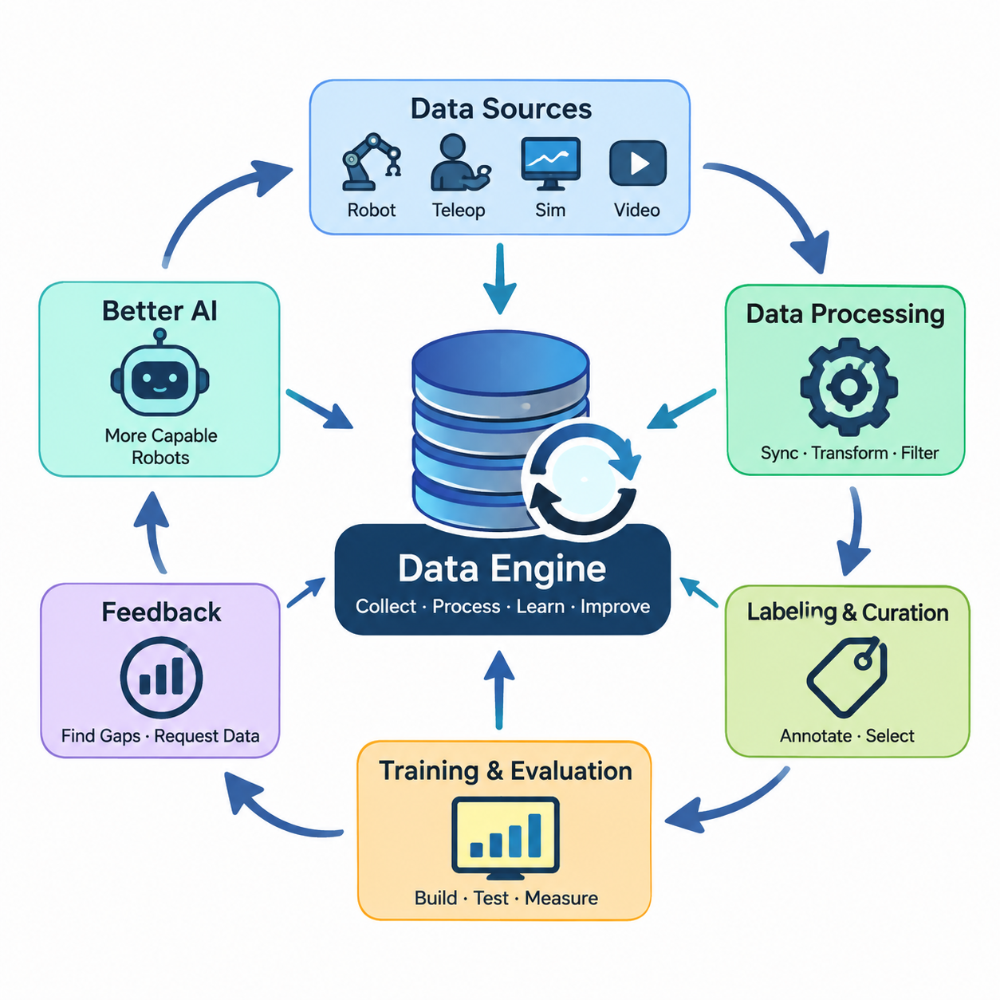{width="7.268055555555556in" height="7.268055555555556in"}

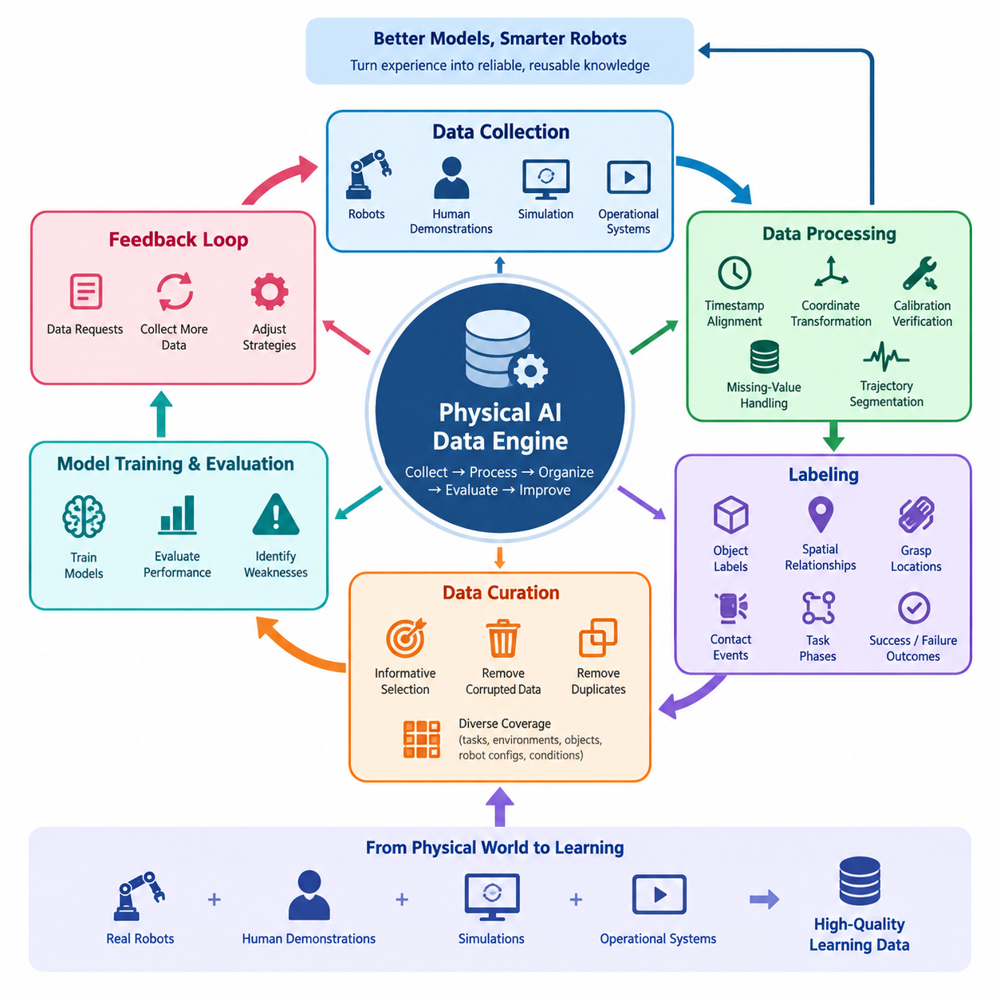{width="7.268055555555556in" height="7.268055555555556in"}

A data engine is an integrated system that continuously collects, processes, organizes, evaluates, and improves data to support the development of artificial intelligence models. Unlike a static dataset, a data engine operates as an evolving infrastructure in which information generated during training and deployment becomes a resource for subsequent learning. Its primary purpose is to transform raw experience into reliable, reusable knowledge that improves intelligent system performance.

In Physical AI, a data engine connects interactions with the physical world to computational learning processes. Robots observe environments, execute actions, encounter uncertainty, and produce measurable outcomes. These experiences contain information about perception, motion, contact, dynamics, and task completion. A data engine captures these relationships and converts them into structured learning examples that support increasingly capable robotic behavior.

The fundamental distinction between conventional data management and a data engine is the presence of continuous feedback. Traditional data systems primarily store and retrieve information, whereas a data engine uses model performance to determine which information should be collected next. Training failures, prediction errors, unexpected environmental conditions, and operational interventions reveal deficiencies in existing knowledge and guide subsequent data acquisition.

A Physical AI data engine therefore functions as a closed-loop learning infrastructure. Data is collected from robots, human demonstrations, simulation environments, and operational systems before undergoing validation, synchronization, labeling, and filtering. The resulting information supports model training and evaluation. Newly deployed models then generate additional experiences, allowing the engine to repeat the improvement cycle with progressively better information.

Physical interaction data differs fundamentally from ordinary digital information because actions influence subsequent observations. A robot moving an object changes its position, orientation, contact conditions, and surrounding environment. Consequently, useful training records must preserve temporal relationships between observations, internal states, executed actions, and resulting outcomes. Without these relationships, learning systems cannot reliably reconstruct the physical consequences of decisions.

A typical robotic experience is represented as an episode containing a sequence of observations, actions, and state transitions. Observations may include camera images, depth measurements, LiDAR scans, and tactile signals, while internal states describe joint positions, velocities, and actuator conditions. Actions represent commands issued to the robot, and outcomes describe their effects. Maintaining these connections enables models to learn behavior rather than isolated visual patterns.

Data collection is the entry point of the engine and may involve several complementary sources. Physical robots provide authentic operational experiences, teleoperation systems capture human-guided behavior, and simulation environments generate controlled interactions at scale. Human videos can contribute knowledge about tasks and object manipulation, although translating such information into executable robot actions requires additional interpretation and alignment.

The usefulness of collected information depends on its quality, diversity, and relevance rather than its volume alone. Repeated recordings of simple successful operations may contribute less learning value than a smaller collection of difficult or unusual situations. Effective data engines therefore identify informative experiences, remove corrupted records, detect duplication, and maintain coverage across different tasks, environments, objects, robot configurations, and operating conditions.

Data processing transforms heterogeneous sensor recordings into consistent representations suitable for machine learning. This process includes timestamp alignment, coordinate transformation, sensor calibration verification, missing-value handling, and trajectory segmentation. Since physical systems operate through synchronized perception and action, even small timing inconsistencies can distort causal relationships and degrade the quality of learned control policies.

Labeling adds semantic and operational meaning to recorded experiences. Labels may identify objects, spatial relationships, grasp locations, contact events, task phases, intervention conditions, and success or failure outcomes. Some labels originate from human annotation, while others can be derived from robot telemetry, simulation ground truth, or automated inference. Reliable labeling requires consistent definitions and verification procedures.

Data curation determines which experiences should contribute to particular learning objectives. A manipulation model may require detailed contact and grasp trajectories, while an autonomous mobile robot may benefit from obstacle encounters, navigation failures, and recovery behavior. Selection strategies can emphasize uncertain predictions, rare events, difficult examples, and underrepresented environments, ensuring that training resources address meaningful capability gaps.

Model evaluation provides the feedback signals that make the data engine adaptive. Performance measurements reveal where a robot succeeds, where it fails, and where its predictions remain unreliable. These observations can be converted into targeted data requests, such as collecting more demonstrations of difficult grasps or recording navigation episodes under unusual lighting. The engine thereby connects measurable weaknesses to corrective learning activities.

An important characteristic of a mature data engine is the ability to coordinate real-world and synthetic experiences. Simulation can generate large quantities of controlled data, including rare or potentially hazardous scenarios that would be expensive or unsafe to reproduce physically. However, synthetic observations may differ from real sensor measurements and physical interactions, making validation against real-world behavior essential.

The data engine also provides the foundation for scalable robot learning across multiple platforms. Experiences collected from different robots can contribute to shared learning resources when their sensor configurations, action representations, and operating contexts are properly documented. Standardized metadata and transformation procedures make it possible to compare, combine, or selectively transfer information across heterogeneous robotic embodiments.

At fleet scale, deployed robots become distributed sources of operational intelligence. Each robot encounters different environments, objects, obstacles, and human interactions, creating opportunities to discover situations absent from centralized training collections. Event-triggered recording and prioritized uploading can reduce communication and storage requirements while preserving episodes associated with failures, uncertainty, interventions, and unusual operating conditions.

A data engine must maintain traceability throughout the learning lifecycle. Data provenance identifies where information originated, how it was collected, which transformations were applied, and which models used it during training. Dataset versioning, annotation histories, and reproducible processing configurations allow developers to investigate performance changes, identify problematic records, and compare experimental results under controlled conditions.

Governance is equally important because physical robots may capture information about people, workplaces, industrial processes, and private environments. Responsible data-engine design incorporates access restrictions, retention policies, anonymization procedures, and appropriate usage permissions. These controls must operate throughout collection, storage, processing, training, and sharing rather than being treated as independent administrative requirements.

The effectiveness of a data engine can be assessed through both data-related and model-related indicators. Data quality, task coverage, annotation consistency, collection efficiency, and processing latency describe infrastructure performance. Task success rates, generalization, robustness, recovery capability, and deployment reliability indicate whether the accumulated experiences actually improve the intelligence and usefulness of robotic systems.

Building a data engine requires coordinated development across robotics hardware, software infrastructure, machine learning, and operational management. Sensors and controllers must expose meaningful observations and actions, while data services must support ingestion, storage, indexing, and retrieval. Training infrastructure must consume curated experiences, and evaluation systems must return actionable feedback that influences subsequent collection priorities.

A minimal Physical AI data engine may begin with a single robot recording synchronized observations, commands, and task outcomes. As the system matures, automated validation, metadata indexing, dataset versioning, model evaluation, and targeted data collection can be introduced. This incremental architecture allows developers to establish reliable learning feedback before expanding toward distributed storage, simulation integration, and fleet-scale operation.

The long-term value of a data engine lies in its ability to convert accumulated physical experience into sustained improvements in robotic capability. As collection, curation, training, evaluation, and deployment become increasingly connected, the development process shifts from isolated model updates toward systematic learning from operation. A well-designed data engine thus becomes a foundational infrastructure for scalable, adaptive, and increasingly general Physical AI.

## 01.02. Data Engine vs Dataset and Pipeline

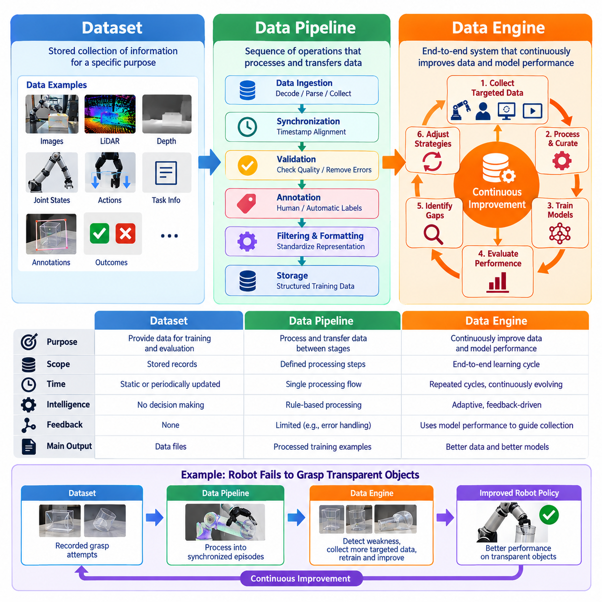{width="7.268055555555556in" height="7.268055555555556in"}

A dataset, a data pipeline, and a data engine represent three different levels of data infrastructure used in artificial intelligence development. Although these terms are sometimes used interchangeably, they describe distinct capabilities. A dataset is an organized collection of information, a pipeline processes and transfers that information, and a data engine coordinates the entire learning cycle to continuously improve data quality and model performance.

A dataset is fundamentally a stored representation of observations, measurements, annotations, or experiences collected for a particular purpose. In Physical AI, datasets may contain camera images, LiDAR measurements, joint states, robot actions, task descriptions, and execution outcomes. These records provide the information required for training and evaluation, but the dataset itself does not determine how new experiences should be collected or how learning deficiencies should be addressed.

Datasets can be static or periodically updated, depending on their intended application. A static dataset provides a fixed collection of examples that supports reproducible experiments and consistent benchmarking. However, physical environments continuously change, and robots encounter conditions that may not be represented in existing records. Consequently, even a large dataset can become insufficient when deployed systems face unfamiliar objects, environments, tasks, or interaction patterns.

A data pipeline is a sequence of computational operations that moves and transforms information between different stages of processing. Typical operations include ingestion, decoding, synchronization, validation, annotation, filtering, formatting, and storage. Pipelines convert raw robot recordings into structured training examples while enforcing consistency across data sources. Their primary responsibility is reliable information processing rather than deciding the overall direction of learning.

In robotics, data pipelines must handle complex multimodal and temporal relationships. Camera frames, depth images, inertial measurements, joint positions, force readings, and motor commands frequently operate at different sampling rates. A pipeline aligns these streams using timestamps, coordinate transformations, and calibration parameters. Without such processing, recorded actions may become incorrectly associated with observations, reducing the reliability of learned behaviors.

The principal limitation of a conventional pipeline is that its processing logic generally follows predefined rules. It may automatically reject corrupted recordings or convert sensor formats, but it does not necessarily determine which missing experiences would most improve a robot policy. A pipeline can operate efficiently without understanding whether the resulting training data addresses important weaknesses in perception, manipulation, navigation, or control.

A data engine extends beyond storage and processing by connecting data operations to measurable learning objectives. It integrates collection, transformation, curation, training, evaluation, deployment, and feedback into a coordinated system. Model performance influences subsequent data acquisition, while operational experiences reveal new learning requirements. This adaptive relationship distinguishes a data engine from an isolated dataset or a conventional processing pipeline.

The distinction becomes clear when considering a robot that repeatedly fails to grasp transparent objects. A dataset may contain recorded grasping attempts, while a pipeline can process those recordings into synchronized observation-action sequences. A data engine goes further by detecting the performance weakness, identifying missing examples, prioritizing additional transparent-object interactions, and incorporating the resulting experiences into subsequent training.

Feedback is therefore the defining operational characteristic of a mature data engine. Evaluation results, prediction uncertainty, task failures, human interventions, and deployment anomalies can generate targeted requests for additional information. Instead of collecting data indiscriminately, the system directs resources toward experiences expected to improve performance. This approach transforms data acquisition from a passive recording activity into an active learning process.

The three concepts also differ in their relationship to time. A dataset represents information available at a particular version or collection stage. A pipeline describes the operations applied as information moves through processing stages. A data engine operates across repeated development and deployment cycles, continuously adapting its collection priorities and processing strategies according to observed model behavior and changing operational requirements.

Data quality management illustrates another important distinction. A dataset may contain quality indicators, and a pipeline may enforce validation rules such as timestamp consistency or missing-value thresholds. A data engine evaluates whether these quality controls produce better learning outcomes. It can modify sampling priorities, labeling procedures, and dataset composition when evaluation reveals that technically valid data remains insufficient for robust robotic behavior.

A data engine also coordinates multiple pipelines rather than replacing them. Separate processing workflows may handle teleoperation demonstrations, autonomous robot logs, simulation trajectories, and human video recordings. Each source requires different transformations and validation procedures. The engine integrates their outputs into a coherent learning strategy while maintaining source information, compatibility requirements, and task-specific data selection criteria.

In Physical AI, the importance of this integration increases because different data sources capture different aspects of physical intelligence. Human demonstrations provide examples of intended behavior, autonomous execution reveals real operational limitations, and simulation supports controlled exploration. A dataset stores these experiences, pipelines standardize their representations, and the data engine determines how their combined information contributes to improved perception and action.

Dataset versioning and data lineage are necessary across all three levels but serve different purposes. A dataset version identifies a reproducible collection of records. A pipeline records the transformations and processing configurations used to produce those records. A data engine connects dataset versions, processing histories, model checkpoints, evaluation results, and deployment feedback, enabling developers to understand how particular data changes affect robot capabilities.

The distinction is especially significant when developing general-purpose robotic systems. A single dataset may cover a limited collection of tasks, objects, and environments, while a pipeline can efficiently process additional examples using established procedures. A data engine must continuously assess coverage gaps and allocate collection resources across diverse behaviors. Its objective is not merely to increase data volume but to expand the range of capabilities that robots can reliably perform.

At fleet scale, a data engine can coordinate experiences from hundreds or thousands of deployed robots. Individual platforms generate operational records, local pipelines perform filtering and compression, and centralized infrastructure organizes selected episodes for analysis. The engine identifies recurring failures, rare situations, and distribution changes across locations. These discoveries guide subsequent data collection, training priorities, and controlled model deployment.

Operational efficiency provides another reason to distinguish these concepts. Maintaining a large dataset does not guarantee that its information is useful, and operating a fast pipeline does not guarantee that the processed data improves model performance. A data engine evaluates the relationship between collection cost, processing expense, training requirements, and resulting capability gains. This broader perspective supports more effective allocation of computational and operational resources.

The effectiveness of a dataset is commonly assessed through size, completeness, diversity, annotation quality, and representativeness. Pipeline performance is evaluated through throughput, processing latency, reliability, error rates, and resource consumption. Data-engine effectiveness requires additional measurements connecting data operations to learning outcomes, including improvement per collected episode, reduction in failure rates, generalization gains, and deployment reliability.

These distinctions do not imply that datasets and pipelines are independent or unnecessary once a data engine exists. Instead, they form complementary architectural layers. Reliable datasets provide reproducible learning resources, robust pipelines ensure consistent information transformation, and the data engine coordinates these components through feedback-driven decisions. Weaknesses at any layer can limit the effectiveness of the overall Physical AI development process.

An organization may initially build a dataset by recording demonstrations from a single robot. As data volume increases, automated pipelines become necessary to manage synchronization, validation, labeling, and storage. When evaluation results begin influencing which experiences are collected and how training resources are allocated, the infrastructure develops data-engine characteristics. This progression reflects increasing integration rather than a requirement to replace existing components.

Ultimately, the difference between a dataset, a pipeline, and a data engine is the transition from storing information to processing information and finally to systematically improving intelligence through information. A dataset preserves experience, a pipeline transforms experience, and a data engine organizes experience into a continuous learning process. For Physical AI, this final capability is essential because reliable robotic intelligence depends on repeatedly learning from interactions with the changing physical world.

## 01.03. Closed Loop Data Engine Architecture

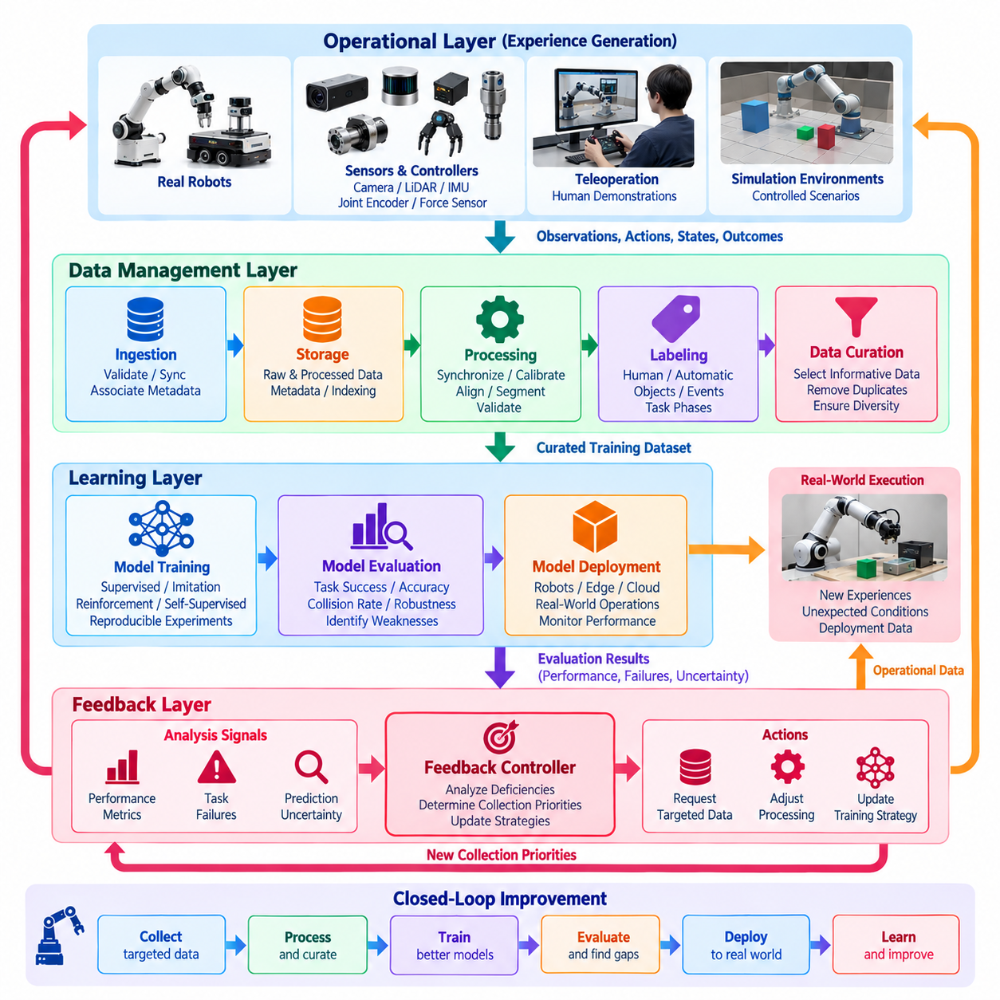{width="7.268055555555556in" height="7.268055555555556in"}

A closed-loop data engine architecture is a continuously operating learning system that connects data collection, processing, model training, evaluation, and deployment through feedback. Unlike linear data pipelines, which terminate after producing training datasets, closed-loop architectures use the results of model execution to influence future data acquisition. This feedback mechanism allows Physical AI systems to improve through repeated interactions with real and simulated environments.

The central principle of closed-loop architecture is that every stage contributes information to subsequent learning cycles. Robots generate observations and actions, processing systems transform recordings into structured datasets, and learning algorithms produce updated models. Evaluation identifies remaining weaknesses, while deployment reveals unexpected operating conditions. These findings are returned to the data engine as new collection priorities and training requirements.

A typical architecture consists of interconnected operational, data management, learning, and feedback layers. The operational layer includes physical robots, sensors, controllers, and simulation environments. The data management layer handles ingestion, storage, synchronization, labeling, and curation. The learning layer trains and evaluates models, while the feedback layer converts observed performance deficiencies into actionable improvements across the entire system.

The operational layer is responsible for generating experience through interaction with physical environments. Cameras, LiDAR sensors, inertial measurement units, joint encoders, and force sensors provide observations of external conditions and internal robot states. Controllers generate movement commands, and execution outcomes reveal whether intended behaviors were achieved. Recording these relationships preserves the temporal structure required for learning perception-action policies.

Data ingestion connects distributed recording systems to centralized or federated data infrastructure. Robot logs may contain high-frequency sensor measurements, control commands, diagnostic events, and task metadata. Ingestion services validate recording formats, verify timestamps, detect incomplete transmissions, and associate incoming information with robot identities and software versions. Reliable ingestion prevents corrupted or ambiguous experiences from entering subsequent learning stages.

Storage architecture must support large multimodal datasets while preserving efficient access to individual experiences. Raw sensor recordings, processed trajectories, annotations, and metadata may be maintained in separate but linked storage structures. Episode identifiers connect related information across processing stages. Indexing by task, environment, robot configuration, and failure type enables targeted retrieval without repeatedly scanning entire data collections.

The processing layer transforms heterogeneous recordings into consistent representations suitable for machine learning. Sensor streams are synchronized, coordinate frames are aligned, and trajectories are segmented into meaningful episodes. Calibration information and action conventions are preserved to maintain physical consistency. Automated validation detects missing observations, corrupted frames, inconsistent timestamps, and implausible state transitions before training data is assembled.

Data curation determines which processed experiences provide the greatest value for current learning objectives. Redundant recordings may be reduced, while difficult examples, rare events, and underrepresented conditions receive greater attention. Selection criteria can incorporate model uncertainty, task failures, environmental diversity, and trajectory quality. This mechanism helps the architecture prioritize informative data rather than maximizing collection volume indiscriminately.

The training layer converts curated experiences into improved perception, prediction, planning, or control models. Supervised learning, imitation learning, reinforcement learning, and self-supervised learning may be applied depending on the available information and target capabilities. Training configurations reference specific dataset versions, preprocessing procedures, and model parameters, enabling reproducible experiments and systematic comparison between successive learning cycles.

Evaluation forms the primary connection between model development and feedback-driven data acquisition. Models are tested against held-out datasets, simulation scenarios, and controlled physical experiments. Measurements may include task success, trajectory accuracy, collision frequency, recovery performance, and robustness under environmental variation. Evaluation must identify not only aggregate performance but also specific conditions where the model remains unreliable.

A feedback controller within the data engine translates evaluation findings into collection and processing decisions. For example, repeated navigation failures near reflective surfaces may trigger requests for additional sensor recordings under similar conditions. Manipulation failures involving deformable objects may prioritize new demonstrations or simulation scenarios. The feedback controller therefore acts as a coordination mechanism between learning objectives and data-generation resources.

Active data acquisition improves efficiency by selecting experiences according to expected learning value. Uncertainty estimation, prediction disagreement, failure frequency, and coverage analysis can identify situations where additional observations may be useful. Collection policies may request targeted teleoperation sessions, initiate simulation experiments, or adjust robot logging behavior. Such decisions must balance information value against operational cost and safety constraints.

Deployment introduces trained models into real operating environments, where their behavior can be monitored under practical conditions. Runtime systems record task outcomes, confidence indicators, interventions, and unexpected events. Deployment may use staged rollouts, shadow evaluation, or limited robot groups before broader adoption. These procedures reduce operational risk while generating evidence about model reliability outside controlled training environments.

Field monitoring closes the learning loop by comparing actual robot behavior with expected performance. Distribution shifts may occur when lighting, object properties, human activity, or operating environments change. Monitoring services identify recurring errors, unusual state transitions, and deteriorating task performance. Selected episodes are returned to the data infrastructure, where they become candidates for analysis, labeling, and subsequent model improvement.

Human intervention provides an additional feedback channel when autonomous systems encounter difficult situations. Operators may correct trajectories, recover failed tasks, or demonstrate alternative strategies. These interventions can be recorded with contextual information describing the original failure and successful correction. The resulting examples are particularly valuable because they capture behavior near the limits of the current model\'s capabilities.

Simulation can be integrated into the feedback loop to investigate failures without repeatedly exposing physical robots to risk. Real-world observations can guide the construction of representative simulated scenarios, while controlled experiments explore variations in geometry, friction, lighting, and object dynamics. Simulation-generated experiences may supplement physical recordings, but their contribution must be verified through real-world evaluation to prevent misleading improvements.

At fleet scale, closed-loop architecture coordinates information from multiple robots operating across different locations. Edge devices perform local recording and preliminary filtering, while centralized services aggregate selected experiences and analyze recurring patterns. Shared learning resources enable improvements discovered by one robot to benefit others with compatible configurations. Fleet-level feedback also reveals rare events that individual robots encounter too infrequently.

Data lineage and version control provide traceability across successive learning cycles. Every trained model should be associated with identifiable datasets, processing configurations, evaluation results, and deployment records. This relationship allows engineers to investigate unexpected regressions and determine whether performance changes originate from new data, altered labels, preprocessing modifications, or model architecture updates. Reproducibility is essential for reliable iterative development.

Safety and governance constraints must remain active throughout the closed-loop architecture. Data collection should respect privacy, operational permissions, and retention requirements, while automated learning must not bypass established safety controls. Candidate models require validation before deployment, and monitoring systems should support rollback when performance deteriorates. Continuous learning therefore refers to an iterative improvement process rather than unrestricted autonomous model replacement.

Architectural efficiency depends on coordinating collection bandwidth, storage capacity, annotation effort, training compute, and evaluation resources. Excessive logging may overwhelm infrastructure without improving learning, while aggressive filtering can discard valuable rare experiences. Effective systems establish priorities based on expected capability gains, data quality, and operational constraints. Resource allocation becomes part of the feedback process rather than a fixed infrastructure decision.

The maturity of a closed-loop data engine can be assessed through the speed and effectiveness of its improvement cycles. Relevant measures include the time between failure discovery and corrective training, the proportion of useful collected episodes, and the reduction of recurring operational errors. A successful architecture consistently converts field evidence into validated capability improvements while maintaining reproducibility, safety, and efficient resource utilization.

Ultimately, closed-loop data engine architecture transforms Physical AI development from a sequence of isolated training projects into a coordinated process of continuous improvement. Robots generate experience, data infrastructure organizes knowledge, learning systems develop new capabilities, and evaluation determines what should be learned next. By repeatedly connecting physical interaction with computational learning, the architecture establishes a scalable foundation for increasingly adaptive and reliable robotic intelligence.

## 01.04. Data Collection Ingestion and Storage

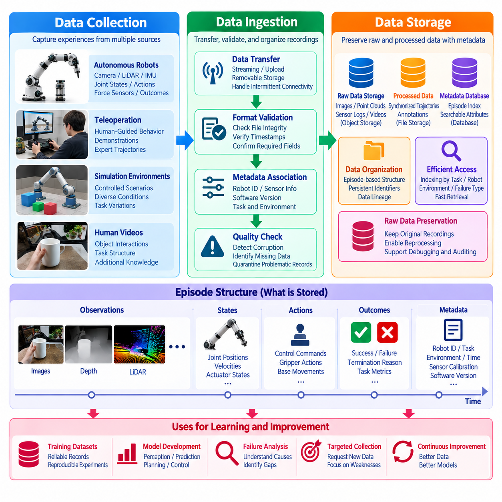{width="7.268055555555556in" height="7.268055555555556in"}

Data collection, ingestion, and storage form the foundational infrastructure of a Physical AI data engine. Collection captures experiences generated by robots, humans, and simulation environments, while ingestion transfers and validates these recordings for downstream processing. Storage preserves raw observations, actions, outcomes, and metadata in accessible structures. Together, these functions determine whether physical experiences can be reliably transformed into reusable learning resources.

Data collection begins with identifying the information required to understand robot behavior and environmental interactions. Relevant signals include camera images, depth measurements, LiDAR scans, joint positions, actuator commands, force measurements, and task outcomes. Recording these signals together allows learning systems to reconstruct how observations influence actions and how actions change the physical world over time.

Physical AI data sources extend beyond autonomous robot operation. Teleoperation systems capture human-guided trajectories, demonstration platforms record successful task execution, and simulation environments generate controlled experiences. Human videos may contribute information about object interactions and task structure. Each source provides different learning opportunities and requires collection procedures appropriate to its sensing and action representations.

Robot data collection must preserve temporal relationships among observations, internal states, and executed commands. Sensors frequently operate at different sampling frequencies, while controllers may update at much higher rates than cameras. Accurate timestamps and synchronized clocks allow downstream systems to associate actions with relevant observations. Without temporal consistency, training examples may misrepresent physical dynamics and introduce errors into learned policies.

Collection architecture must also account for bandwidth, computing resources, and onboard storage limitations. High-resolution cameras and dense point clouds can generate substantial data volumes, particularly during continuous operation. Selective recording, compression, and event-triggered logging can reduce unnecessary information while preserving important experiences. Collection policies should prioritize learning value without compromising operational reliability.

Event-triggered collection is particularly useful for identifying rare and informative situations. Recording may be activated by task failures, unexpected obstacles, human interventions, abnormal sensor readings, or high model uncertainty. These events often reveal weaknesses that routine successful operation does not expose. Preserving contextual observations before and after an event helps developers understand its causes and consequences.

Data ingestion transfers collected information into the infrastructure responsible for validation, organization, and subsequent processing. Ingestion may occur through direct network streaming, periodic uploads, removable storage, or local synchronization services. Different deployment environments require different transfer strategies. Reliable ingestion must accommodate intermittent connectivity, variable data rates, and temporary communication failures.

An ingestion service should verify that incoming recordings conform to expected formats and contain sufficient information for interpretation. Validation may examine file integrity, timestamps, sensor identifiers, robot configuration, and episode boundaries. Corrupted or incomplete records should be identified before entering production training datasets. However, potentially valuable failure episodes should be quarantined for investigation rather than automatically discarded.

Metadata provides the contextual information required to interpret collected robot experiences. Important attributes include robot identity, hardware configuration, software version, sensor calibration, task description, environment, collection time, and operating conditions. Metadata allows recordings from different platforms and deployments to be compared appropriately. It also supports targeted retrieval, dataset construction, and reproducible model development.

Data ingestion systems should preserve the relationship between raw recordings and subsequent processing results. Each recording can receive a persistent identifier linking its original files, validation status, derived trajectories, annotations, and dataset membership. This relationship establishes data lineage and allows engineers to trace training examples back to their physical sources. Such traceability becomes increasingly important as collection scales across robots and locations.

Storage infrastructure must accommodate heterogeneous data formats and access patterns. Video recordings, point clouds, joint trajectories, control commands, and structured metadata differ substantially in size and organization. Object storage is suitable for large binary recordings, while databases can maintain searchable metadata and episode references. Combining complementary storage technologies enables efficient management without requiring every data type to use an identical representation.

Raw data preservation is important because preprocessing requirements may change as learning algorithms evolve. Original sensor measurements allow engineers to repeat calibration, synchronization, annotation, and feature extraction using improved methods. Processed datasets can be regenerated without repeating expensive physical experiments. Maintaining immutable raw records also supports debugging, auditing, and investigation of unexpected model behavior.

Episode-oriented storage provides a practical organizational structure for robot learning. An episode represents a bounded interaction sequence containing observations, states, actions, and outcomes. Episode boundaries may correspond to task initiation, completion, failure, or operator intervention. Organizing recordings into episodes simplifies trajectory retrieval, temporal analysis, and construction of training examples for imitation learning and other sequential models.

Efficient storage requires indexing mechanisms that support selective retrieval of relevant experiences. Engineers may need to locate manipulation failures involving particular objects, navigation episodes under poor lighting, or trajectories collected with specific hardware configurations. Searchable metadata and event annotations reduce the need to inspect entire recording archives. Indexing therefore connects storage infrastructure directly to data curation and model improvement.

Storage systems should distinguish between raw, validated, processed, and training-ready information. Raw recordings preserve original evidence, validated records satisfy integrity requirements, processed data contains synchronized and transformed representations, and training datasets contain selected examples. Maintaining these stages separately reduces accidental modification and supports reproducibility. Clear transitions between stages also simplify quality assurance and operational monitoring.

Distributed Physical AI deployments often require hierarchical storage across robot devices, local servers, and cloud infrastructure. Onboard storage supports immediate recording, edge systems perform preliminary filtering, and centralized platforms maintain shared learning resources. Data movement between these layers depends on connectivity, latency, privacy requirements, and operational cost. Local retention policies can preserve important information when network access is unavailable.

Data security and governance must be incorporated into collection, ingestion, and storage design. Robots may capture identifiable individuals, confidential industrial processes, or sensitive environmental information. Encryption, authentication, access controls, retention policies, and appropriate anonymization help protect these records. Governance metadata should identify permitted uses and restrictions so that downstream learning processes respect the conditions under which data was collected.

Scalability requires storage and ingestion infrastructure to handle increasing numbers of robots, sensors, and operating hours. As deployment expands, data generation may grow faster than available communication or processing capacity. Partitioned storage, asynchronous ingestion, distributed processing, and automated lifecycle management can reduce bottlenecks. Capacity planning must consider not only total storage volume but also retrieval frequency and processing demand.

Operational monitoring provides visibility into the health of the data infrastructure. Useful indicators include collection completeness, upload success rates, ingestion latency, storage utilization, corrupted-record frequency, and metadata consistency. Monitoring these measurements helps identify failures before they compromise training datasets. Automated alerts and recovery procedures improve reliability when large fleets generate data continuously across distributed environments.

The effectiveness of collection, ingestion, and storage should ultimately be evaluated through their contribution to learning. Large archives offer limited value if experiences cannot be located, interpreted, or associated with correct actions and outcomes. A successful infrastructure preserves high-quality information, enables efficient retrieval, and supports targeted dataset construction. Its design should therefore connect technical reliability with measurable improvements in robotic capabilities.

Data collection, ingestion, and storage together establish the memory infrastructure of a Physical AI system. Collection captures physical experience, ingestion converts distributed recordings into manageable information, and storage preserves the relationships needed for future learning. When integrated with processing, curation, training, and evaluation, these capabilities enable a continuous flow of knowledge from robot operation back into model development, supporting scalable and increasingly adaptive Physical AI.

## 01.05. Data Processing Labeling and Curation

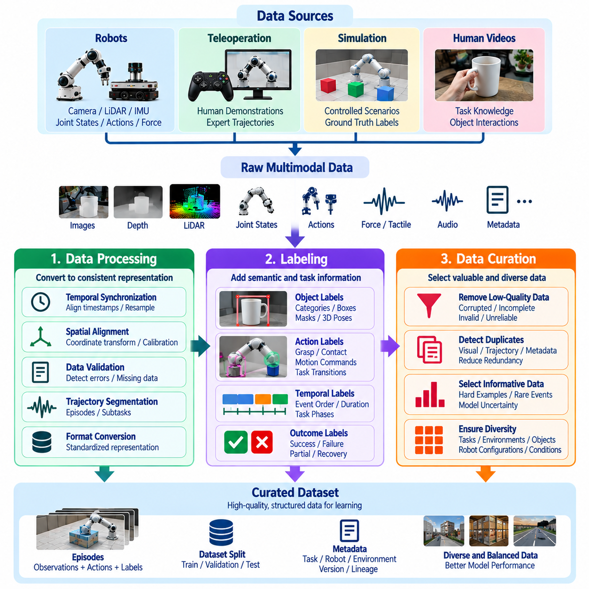{width="7.268055555555556in" height="7.268055555555556in"}

Data processing, labeling, and curation transform raw robotic experiences into reliable learning resources for Physical AI. Processing converts heterogeneous recordings into consistent representations, labeling assigns meaningful descriptions to observations and actions, and curation selects experiences that contribute to model improvement. Together, these functions determine whether collected data becomes useful knowledge rather than an accumulation of unstructured sensor recordings.

Raw robot data frequently contains synchronization errors, missing measurements, sensor noise, inconsistent formats, and incomplete trajectories. Processing systems must identify and correct these problems before constructing training examples. Camera images, LiDAR scans, joint states, force measurements, and control commands require coordinated handling because their relationships describe how robotic actions influence physical environments.

Temporal synchronization is essential because robotic behavior depends on the sequence of observations, decisions, and physical responses. Sensors operate at different frequencies, while control systems may produce commands at substantially higher rates. Processing pipelines align timestamps, interpolate appropriate state measurements, and preserve action timing. Incorrect synchronization can create misleading relationships between observed conditions and executed movements.

Spatial consistency is equally important when combining measurements from multiple sensors and robot components. Coordinate transformations connect camera frames, robot bases, manipulators, and world reference frames. Calibration parameters describe sensor positions and orientations, allowing measurements to be interpreted within a common geometric representation. Processing must preserve these relationships to support accurate perception, planning, and manipulation learning.

Data validation examines whether recordings satisfy predefined integrity and consistency requirements. Automated checks may identify corrupted images, invalid timestamps, missing sensor streams, discontinuous trajectories, or physically implausible measurements. Validation results should distinguish recoverable defects from records that cannot be reliably interpreted. Potentially informative failure episodes may require investigation rather than automatic removal.

Trajectory segmentation organizes continuous recordings into meaningful interaction episodes. An episode may begin when a robot receives a task instruction and end after successful completion, failure, or operator intervention. Longer episodes can be divided into subtasks such as approaching an object, establishing contact, manipulating it, and verifying the outcome. This structure supports sequential learning and detailed analysis of task execution.

Data labeling assigns semantic, geometric, temporal, and behavioral information to processed experiences. Perception labels may describe object categories, bounding boxes, segmentation masks, and three-dimensional poses. Action labels identify commanded movements, grasp attempts, contact events, and task transitions. Outcome labels distinguish successful execution, partial completion, failure, and recovery behavior, providing supervision for different learning objectives.

Labeling methods range from manual annotation to automated inference and simulation-generated ground truth. Human annotators can interpret complex interactions and ambiguous task outcomes, while automated systems provide scalable labeling for repetitive patterns. AI-assisted annotation combines machine-generated predictions with human verification. The appropriate method depends on label complexity, required accuracy, available resources, and the consequences of annotation errors.

Temporal labeling is particularly important for learning physical interactions because individual frames rarely explain complete actions. Contact initiation, object displacement, grasp stabilization, and task completion occur across sequences of observations. Labels must preserve event order and duration to represent meaningful behavior. Incorrect temporal boundaries can distort learned action dependencies and reduce the reliability of sequential prediction models.

Label quality depends on consistent definitions, clear annotation instructions, and systematic verification. Different annotators may interpret ambiguous events differently, particularly when distinguishing failed grasps from incomplete attempts or successful recovery from partial progress. Quality control can include repeated annotation, agreement measurements, expert review, and automated consistency checks. Reliable labels are essential for meaningful model evaluation.

Data curation determines which processed and labeled experiences should enter training, validation, and evaluation datasets. Large collections often contain redundant demonstrations, low-information trajectories, corrupted records, and uneven task distributions. Curation identifies valuable examples while maintaining representative coverage of operating conditions. Its purpose is to improve learning efficiency without removing important behavioral diversity.

Duplicate detection prevents repeated recordings from dominating training distributions. Similar trajectories may arise when robots perform routine operations under nearly identical conditions. Excessive duplication can bias models toward frequently observed behaviors while limiting exposure to unusual situations. Curation systems may compare metadata, trajectory characteristics, visual similarity, or learned embeddings to identify redundant experiences.

Rare-event preservation is especially important for Physical AI because infrequent situations may carry significant safety or performance implications. Unexpected obstacles, unstable grasps, sensor failures, collisions, and emergency interventions may occur too rarely to appear in ordinary random samples. Curation strategies should preserve these events and their surrounding context, enabling models to learn recovery strategies and recognize operational hazards.

Model-guided curation uses evaluation results to identify experiences that address current performance weaknesses. Prediction uncertainty, disagreement between models, repeated task failures, and distribution gaps can guide example selection. Difficult cases may receive greater training priority when they provide meaningful corrective information. However, selection policies must avoid excessive concentration on narrow failure categories that reduces generalization.

Dataset balancing controls the relative representation of tasks, objects, environments, robot configurations, and outcomes. A collection dominated by successful navigation on smooth floors may provide insufficient information about cluttered spaces or changing terrain. Balancing does not necessarily require equal proportions across categories. Instead, dataset composition should reflect learning objectives, deployment conditions, and the importance of underrepresented behaviors.

Curation must also preserve distinctions between real-world, teleoperation, human-video, and simulation-generated experiences. These sources differ in observation quality, action availability, physical realism, and annotation reliability. Combining them without source awareness may introduce misleading correlations or incompatible representations. Source metadata and appropriate sampling strategies help maintain useful diversity while controlling domain-related biases.

Training, validation, and test datasets require carefully designed separation procedures. Randomly splitting individual frames from the same trajectory can introduce information leakage because adjacent observations are highly correlated. Splitting by episode, environment, collection session, or robot configuration may provide more meaningful evaluation. The chosen strategy should reflect whether the objective is generalization across time, tasks, environments, or embodiments.

Data lineage connects processing operations, annotation decisions, and curation outcomes to original recordings. Each derived example should retain references to its source episode, transformation parameters, label versions, and selection history. This traceability enables engineers to reproduce datasets, investigate labeling mistakes, and understand performance changes. Versioned data preparation is essential for comparing models across iterative training cycles.

Automation improves processing and curation scalability but requires continuous monitoring. Automated systems may introduce systematic labeling errors, incorrectly reject unusual experiences, or overrepresent examples favored by existing models. Periodic audits, human review, and independent evaluation help identify these weaknesses. A reliable data engine treats automated processing decisions as measurable operations rather than unquestionable ground truth.

The effectiveness of processing, labeling, and curation should be evaluated through both data quality and downstream learning performance. Relevant indicators include synchronization accuracy, annotation consistency, dataset diversity, processing throughput, and the proportion of useful episodes. More importantly, curated data should produce measurable improvements in task success, robustness, recovery capability, and generalization across unfamiliar physical conditions.

Ultimately, data processing, labeling, and curation establish the transformation layer between physical experience and machine intelligence. Processing ensures that observations and actions remain technically consistent, labeling makes their meaning accessible to learning algorithms, and curation determines which experiences deserve attention. Integrated within a closed-loop data engine, these functions convert growing collections of robotic experience into progressively more effective and reliable Physical AI models.

## 01.06. Training Evaluation and Feedback Loops

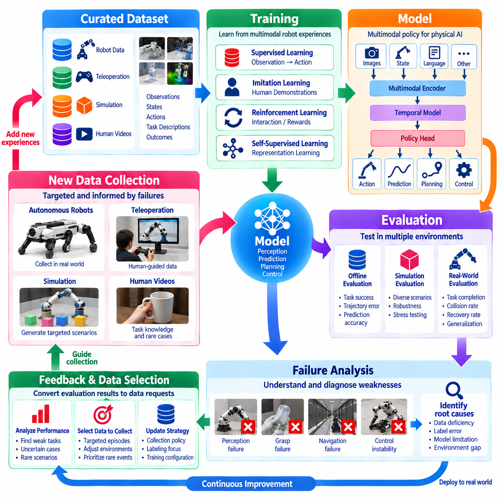{width="7.268055555555556in" height="7.268055555555556in"}

Training, evaluation, and feedback loops form the learning core of a Physical AI data engine. Training converts collected experiences into models capable of perception, prediction, planning, and control. Evaluation measures whether these models perform reliably across physical conditions, while feedback identifies weaknesses and guides subsequent data collection. Together, these processes transform isolated training experiments into a continuous system of robotic capability improvement.

Training begins with datasets containing observations, robot states, actions, task descriptions, and execution outcomes. These elements provide the relationships needed to learn how robots should respond to changing environments. Dataset preparation must preserve temporal consistency, coordinate conventions, and action semantics. Errors in these relationships can produce policies that appear effective during offline training but behave unpredictably during physical execution.

Physical AI training may combine supervised learning, imitation learning, reinforcement learning, and self-supervised learning. Supervised learning establishes mappings between observations and target outputs, while imitation learning reproduces demonstrated behavior. Reinforcement learning improves decisions through interaction and reward signals. Self-supervised learning extracts useful representations from large quantities of unlabeled sensor and interaction data.

Model architecture influences how physical experiences are converted into learned capabilities. Vision encoders process images and spatial information, temporal models represent evolving observations, and policy networks generate actions. Multimodal architectures may combine visual, proprioceptive, tactile, and language inputs. Training must align these modalities so that learned representations reflect physically meaningful relationships rather than accidental correlations.

Training objectives should correspond to the capabilities required during deployment. A manipulation policy may optimize action prediction, grasp success, and contact stability, while a navigation model may prioritize collision avoidance and goal achievement. Auxiliary objectives can improve state estimation or future prediction. However, improvements in training losses do not automatically establish that a robot will perform more reliably in unfamiliar environments.

Dataset composition strongly influences training outcomes because models learn from the experiences represented in their training distributions. Excessive successful demonstrations may provide insufficient information about failure recovery, while narrow environmental coverage can limit generalization. Balanced exposure to tasks, objects, operating conditions, and outcomes improves robustness. Data curation therefore remains closely connected to model optimization.

Training infrastructure must support reproducible experiments across datasets, algorithms, and computing resources. Each experiment should record dataset versions, model configurations, optimization parameters, software dependencies, and random seeds. Distributed training can accelerate learning from large multimodal datasets, but synchronization and numerical differences may affect reproducibility. Experiment tracking enables systematic comparisons between successive models.

Evaluation determines whether training improvements translate into useful robotic behavior. Offline evaluation measures performance using held-out recordings, while simulation evaluation tests models through interactive scenarios. Physical evaluation observes execution on actual robots under controlled conditions. These methods provide complementary evidence, but none should be treated as a complete substitute for deployment-relevant testing in the real world.

Evaluation metrics must reflect both task performance and operational reliability. Relevant measures include task success rate, trajectory accuracy, collision frequency, completion time, energy consumption, and recovery effectiveness. Safety-critical systems may require additional measurements of intervention frequency and constraint violations. Aggregate scores should be accompanied by performance analysis across environments, objects, and task difficulty levels.

Generalization evaluation examines whether models can operate beyond the conditions represented during training. Test scenarios may introduce unfamiliar objects, changing lighting, different surface properties, sensor disturbances, or altered robot configurations. Performance under these variations reveals whether models have learned transferable relationships. Evaluation should distinguish genuine generalization from success caused by overlap between training and test experiences.

Simulation provides a controlled environment for evaluating rare, difficult, or potentially hazardous situations. Scenario parameters can be varied systematically to examine sensitivity to friction, geometry, perception noise, and external disturbances. Repeated trials support statistical comparison between candidate models. Nevertheless, simulation results require physical validation because imperfect dynamics and sensing models may conceal real-world weaknesses.

Failure analysis transforms evaluation results into information that can guide future learning. A failed manipulation task may originate from incorrect object detection, inaccurate state estimation, poor grasp selection, or unstable control. Identifying the underlying cause is more useful than recording failure alone. Structured failure categories and diagnostic trajectories help determine whether improvements require additional data, revised labels, or model changes.

Feedback loops connect identified weaknesses to targeted data acquisition. Repeated navigation failures in reflective corridors may trigger collection under similar lighting and geometric conditions. Manipulation errors involving flexible materials may motivate new teleoperation demonstrations or simulation experiments. Feedback priorities can be based on failure severity, occurrence frequency, uncertainty, and expected improvement relative to collection cost.

Active learning improves feedback efficiency by selecting experiences expected to provide substantial information. Model uncertainty, prediction disagreement, and distribution coverage can indicate where new observations may be valuable. Targeted collection reduces reliance on indiscriminate logging and repeated demonstrations. However, uncertainty estimates must be calibrated, and selection strategies should preserve diversity to avoid reinforcing existing model biases.

Deployment feedback provides evidence from conditions that cannot be fully reproduced during development. Robots may encounter changing layouts, unexpected human behavior, equipment degradation, and previously unseen objects. Runtime monitoring records outcomes, interventions, abnormal states, and selected sensor histories. These observations reveal distribution shifts and emerging failure patterns, allowing the data engine to update its learning priorities.

Human feedback is valuable when autonomous behavior becomes unreliable or ambiguous. Operators may intervene to prevent unsafe actions, correct trajectories, or demonstrate successful recovery strategies. Recording these interventions alongside preceding observations provides examples of both failure conditions and corrective behavior. Human assessments can also identify task quality issues that automated success metrics fail to capture.

A complete feedback loop requires clear mechanisms for converting observations into validated model updates. New experiences are ingested, processed, labeled, curated, and incorporated into versioned datasets. Candidate models are trained and compared against established baselines before deployment. Promotion decisions should consider task improvement, safety constraints, regression tests, and uncertainty rather than relying on a single performance metric.

Continuous evaluation protects against regressions introduced by new training data or optimization procedures. A model that improves performance on one object category may become less reliable on previously mastered tasks. Fixed benchmark suites, historical failure collections, and targeted regression tests help identify these tradeoffs. Maintaining consistent evaluation protocols allows engineers to distinguish meaningful capability gains from fluctuations in experimental results.

Feedback cycles must operate at timescales appropriate to their functions. Runtime safety monitoring may require immediate responses, while data ingestion and automated analysis may occur continuously or periodically. Model retraining and physical validation typically require longer intervals. Separating these timescales prevents experimental learning updates from interfering with real-time robot control and established safety mechanisms.

The effectiveness of a learning loop depends on how efficiently it converts operational evidence into measurable improvement. Useful indicators include failure discovery time, data acquisition cost, training turnaround, evaluation coverage, and reduction in recurring errors. Faster cycles are beneficial only when data quality and validation remain sufficient. A mature system optimizes the reliability and value of each iteration rather than simply maximizing update frequency.

Ultimately, training, evaluation, and feedback loops establish the mechanism through which Physical AI systems improve from experience. Training creates new capabilities, evaluation establishes their strengths and limitations, and feedback determines which experiences should shape subsequent learning. When these functions operate as an integrated closed-loop process, robotic intelligence can progressively adapt to diverse tasks and environments while maintaining safety, traceability, and operational reliability.

## 01.07. Robot Episodes and Trajectories

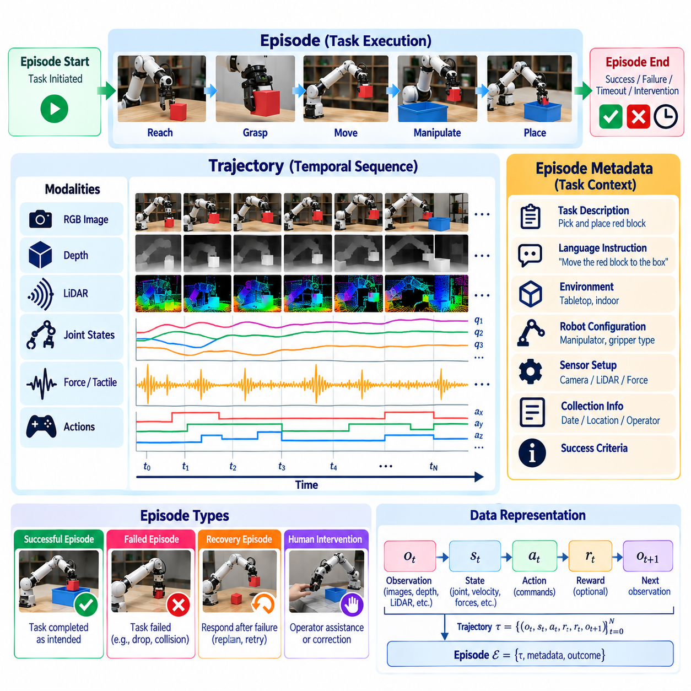{width="7.268055555555556in" height="7.268055555555556in"}

Robot episodes and trajectories provide the fundamental temporal structure for organizing Physical AI experiences. An episode represents a bounded sequence of interaction between a robot and its environment, while a trajectory describes the evolution of observations, states, actions, and outcomes within that sequence. Together, they transform continuous sensor recordings into meaningful units for learning, evaluation, and behavioral analysis.

An episode typically begins when a task is initiated and ends when a termination condition is reached. Termination may result from successful completion, task failure, timeout, safety intervention, or operator cancellation. Each episode contains contextual information describing the task, environment, robot configuration, and execution conditions. These boundaries allow data engines to distinguish complete interactions from unrelated segments of continuous operation.

A trajectory represents an ordered sequence of robot experiences indexed by time. At each step, the robot receives observations, maintains or estimates its state, and executes an action that influences subsequent conditions. The resulting sequence captures the relationship between perception, decision-making, and physical consequences. Preserving this ordering is essential because robot learning depends on how actions change the environment over time.

Trajectory representations may contain camera images, depth maps, joint positions, velocities, forces, control commands, and task-specific measurements. Observations describe information available to the robot, while states represent physical variables relevant to its dynamics. Actions may correspond to joint torques, velocity commands, or higher-level motion targets. Outcomes indicate whether the intended task was achieved and what physical changes occurred.

Episode boundaries require careful definition because different tasks operate at different temporal scales. A robotic grasp may last only a few seconds, while warehouse navigation or industrial inspection may continue for several minutes. Complex activities can be divided into shorter subtasks without losing their relationship to the original episode. Hierarchical segmentation supports both low-level control learning and high-level task planning.

Temporal sampling determines how accurately trajectories represent physical interactions. Cameras may operate at tens of frames per second, while motor controllers generate commands at much higher frequencies. Data engines must preserve timestamps and associate measurements across asynchronous streams. Appropriate interpolation or resampling can support model training, but excessive temporal simplification may remove important contact events or control transitions.

Trajectory quality depends on synchronization, sensor calibration, and consistent action definitions. Misaligned observations and commands can create incorrect causal associations, particularly during fast manipulation or dynamic movement. Missing frames, communication delays, and discontinuous state measurements must be identified during preprocessing. Reliable trajectory reconstruction requires preserving both measurement timing and the physical meaning of recorded variables.

Successful trajectories demonstrate behaviors that achieve intended objectives under particular conditions. They provide valuable examples for imitation learning and behavioral cloning, where models learn to reproduce demonstrated actions. However, successful execution alone does not guarantee that every recorded action was efficient or safe. Trajectory evaluation should consider completion quality, energy consumption, collision avoidance, and operational constraints.

Failed trajectories are equally important because they reveal limitations in perception, planning, and control. A manipulation failure may involve inaccurate object localization, unstable contact, or incorrect force application. Navigation failures may arise from unexpected obstacles, localization drift, or unsuitable motion decisions. Preserving failure context allows learning systems to identify corrective behaviors rather than relying exclusively on successful demonstrations.

Recovery trajectories describe how robots or human operators respond after an unexpected event. These sequences may include stopping, replanning, repositioning, adjusting contact forces, or requesting assistance. Recovery data is especially useful for improving robustness because real deployments inevitably encounter conditions absent from ideal demonstrations. Recording the transition from failure to recovery provides supervision for adaptive behavior.

Robot episodes can be represented using structured records that associate observations, actions, rewards, and termination indicators. Reinforcement learning commonly uses transitions containing a state, action, reward, next state, and completion flag. Imitation learning may emphasize observation-action pairs and demonstrated action sequences. A flexible data engine should preserve sufficient information to support multiple learning methods without repeatedly collecting the same experiences.

Task context gives trajectories meaning beyond their numerical measurements. Language instructions, target objects, environmental conditions, and success criteria explain why particular actions were performed. Two visually similar movements may represent different intentions depending on the assigned task. Contextual metadata enables conditional policy learning, task-specific evaluation, and retrieval of relevant experiences from large robotic datasets.

Episode identifiers and trajectory metadata provide the foundation for scalable data organization. Each episode can reference its source robot, collection session, software version, sensor configuration, and processing history. Trajectory segments may retain links to their parent episodes and associated annotations. These relationships support data lineage, reproducible dataset construction, and investigation of unexpected model behavior.

Trajectory segmentation can be performed using task events, motion patterns, contact transitions, or learned temporal representations. Rule-based approaches identify boundaries from explicit signals, while machine learning methods infer meaningful behavioral phases. For example, a pick-and-place episode may contain approach, grasp, lift, transport, and release segments. Accurate segmentation improves the interpretation of complex actions and supports hierarchical learning.

Trajectory diversity determines whether learned policies can generalize across changing conditions. Repeated demonstrations from identical starting positions may produce narrow behavioral coverage, even when thousands of episodes are collected. Variation in object geometry, initial state, environmental layout, and operator strategy provides broader experience. Data curation should preserve useful diversity while reducing redundant sequences that contribute little additional information.

Trajectory comparison enables systematic analysis of behavior across episodes. Engineers may examine differences in motion smoothness, path length, task duration, force profiles, and success outcomes. Alignment techniques can compare trajectories with different durations or execution speeds. Such analysis helps identify inefficient strategies, unstable behaviors, and recurring failure patterns that may be obscured by aggregate success metrics.

Simulation-generated episodes expand the range of experiences available for training and evaluation. Simulated environments can produce trajectories under controlled variations in geometry, friction, lighting, and disturbances. They may also provide accurate state information and automatically generated labels. However, differences between simulated and physical dynamics must be considered when combining trajectories from both sources.

At fleet scale, episode-oriented data organization supports learning from many robots operating across different locations. Distributed recording systems can upload selected episodes according to task relevance, failure severity, or model uncertainty. Centralized infrastructure indexes these experiences and identifies patterns shared across deployments. This approach transforms geographically distributed robot activity into a coordinated source of training evidence.

Episode and trajectory datasets require careful separation during model evaluation. Splitting adjacent frames from the same episode between training and testing can introduce information leakage and exaggerate generalization performance. Evaluation partitions should consider complete episodes, collection sessions, environments, and robot configurations. Proper separation provides more reliable evidence of whether a model can handle unfamiliar situations.

The usefulness of episode and trajectory data depends on more than recording volume. Important quality measures include temporal completeness, synchronization accuracy, action consistency, metadata coverage, and diversity of outcomes. Training value also depends on whether trajectories capture meaningful decisions and physical consequences. Data engines should prioritize interpretable and informative experiences rather than accumulating recordings without clear learning objectives.

Ultimately, robot episodes and trajectories establish the connection between continuous physical activity and structured machine learning. Episodes define meaningful interaction boundaries, while trajectories preserve the temporal relationships through which observations lead to actions and outcomes. By organizing successful, failed, and recovered behaviors into traceable learning units, Physical AI data engines create the foundation for scalable training, rigorous evaluation, and continuous improvement of robotic intelligence.

## 01.08. Observation State Action and Outcome Representation

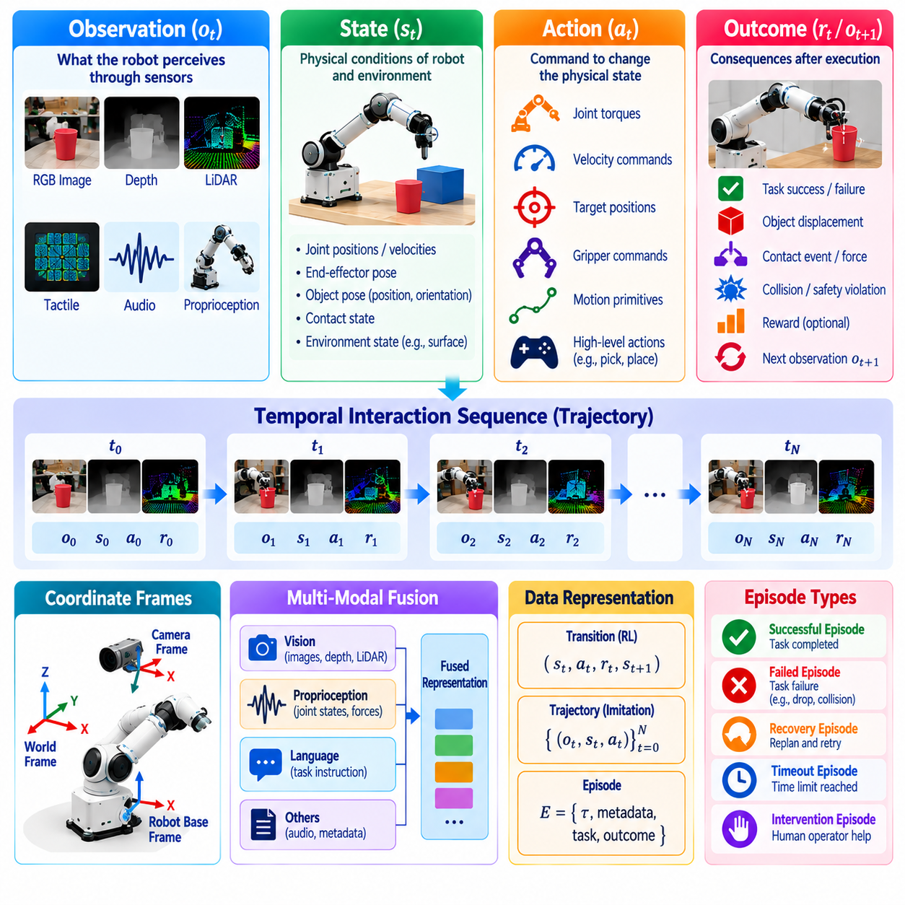{width="7.268055555555556in" height="7.268055555555556in"}

Observation, state, action, and outcome representations form the fundamental information structure of Physical AI learning systems. Observations describe what a robot perceives, states represent relevant physical conditions, actions specify how the robot influences its environment, and outcomes describe the consequences of execution. Together, these elements establish the relationships required for learning perception, prediction, planning, and control from physical experience.

An observation represents information available to a robot through its sensing systems at a particular time. It may include camera images, depth measurements, LiDAR scans, tactile readings, audio signals, and proprioceptive measurements. Observations are not necessarily complete descriptions of the environment because sensors have limited coverage, resolution, and accuracy. Learning systems must therefore operate with incomplete and potentially noisy information.

State represents the physical variables needed to describe the robot and its environment for a particular modeling purpose. Robot states may include joint positions, velocities, end-effector poses, and actuator conditions. Environmental states may describe object locations, orientations, contact relationships, and motion. Unlike observations, which are directly measured signals, states may contain estimated or latent quantities that cannot be observed directly.

The distinction between observation and state is important because physical environments are often partially observable. A camera may reveal an object\'s visible surface without identifying its mass, friction, or hidden geometry. State estimation combines available measurements with prior knowledge and temporal information to infer relevant conditions. This distinction supports models that reason about uncertainty rather than assuming every important variable is directly measurable.

Actions describe commands or decisions through which a robot changes its physical state or surrounding environment. Depending on the control architecture, actions may represent joint torques, motor currents, velocity commands, target positions, or higher-level motion primitives. Their interpretation depends on the robot embodiment and controller interface. A consistent action representation must specify units, coordinate frames, timing, and execution semantics.

Outcome representations describe the consequences of actions relative to task objectives and physical constraints. An outcome may indicate task completion, object displacement, grasp stability, collision occurrence, or recovery success. Outcomes can include continuous measurements and discrete success indicators. Representing outcomes separately from commanded actions allows learning systems to distinguish intended behavior from what actually happened during execution.

A complete interaction record connects observations, states, actions, and outcomes through time. At each step, the robot receives observations, estimates relevant conditions, selects an action, and experiences subsequent changes. These relationships are stored as ordered transitions or trajectories. Temporal organization allows learning algorithms to model how current decisions influence future observations, physical states, and task performance.

Representation design must preserve temporal consistency across sensors and control systems operating at different frequencies. Camera frames, joint measurements, tactile signals, and actuator commands may arrive asynchronously. Accurate timestamps and synchronization procedures connect observations with the actions that produced subsequent effects. Incorrect alignment can create misleading training examples and weaken learned relationships between decisions and physical consequences.

Spatial representations require consistent coordinate conventions to connect perception and movement. Camera coordinates, robot-base frames, tool frames, and world coordinates describe different reference systems. Transformations between these frames allow models to relate observed objects to executable actions. Calibration information must accompany recorded data so that spatial relationships remain interpretable across sensors, robots, and collection sessions.

Robot embodiment strongly influences state and action representation. A wheeled mobile robot may use planar velocity commands and localization states, while a manipulator requires joint-space or Cartesian motion descriptions. Humanoid and quadruped robots may additionally represent contact states, balance, and whole-body dynamics. Shared learning architectures must distinguish transferable task information from hardware-specific control variables.

Multimodal representations combine information from visual, geometric, proprioceptive, tactile, and language sources. Images describe appearance, depth sensors provide spatial structure, and proprioception reveals internal robot motion. Tactile measurements indicate contact conditions, while language specifies goals and constraints. Effective fusion preserves the meaning and timing of each modality rather than simply concatenating unrelated measurements.

Representation granularity determines the level of detail available for learning. Low-level representations preserve individual sensor samples and actuator commands, while higher-level representations describe object relationships, task phases, and behavioral intentions. Fine-grained data supports precise control learning, whereas abstract representations can simplify planning. Data engines should retain sufficient detail to support multiple levels of robotic reasoning.

Outcome information is particularly important for distinguishing successful behavior from ineffective demonstrations. Two trajectories may contain similar actions but produce different results because of object properties, environmental disturbances, or contact conditions. Recording final success alone may hide intermediate failures and recovery attempts. Rich outcome representations capture progress, constraint violations, and meaningful physical changes throughout execution.

Uncertainty should be represented whenever observations or estimated states are incomplete or unreliable. Sensor confidence, localization covariance, object-pose uncertainty, and model prediction confidence can help identify ambiguous conditions. Learning systems may use these quantities to request additional observations or select safer actions. Explicit uncertainty information also supports targeted data collection and evaluation of failure-prone situations.

Representation consistency becomes challenging when datasets originate from different robots, simulators, and teleoperation systems. Hardware platforms may use different units, joint conventions, action frequencies, and sensor configurations. Standardized schemas and documented transformations can establish compatible interfaces. However, normalization must preserve distinctions that affect physical execution, including actuator limits and control response characteristics.

Data schemas provide machine-readable definitions of observation, state, action, and outcome fields. Each field should specify its data type, units, coordinate frame, sampling characteristics, and interpretation. Schema validation can detect incompatible recordings before they enter training datasets. Versioned schemas also allow representation formats to evolve while maintaining traceability between original experiences and derived learning examples.

Learning methods use these representations differently according to their objectives. Imitation learning primarily learns mappings from observations or estimated states to demonstrated actions. Reinforcement learning associates state transitions with rewards and long-term consequences. World models predict future observations or states under candidate actions. A flexible data engine should support these approaches without losing the underlying relationships among recorded variables.

Evaluation depends on the accuracy and completeness of the same representations used during training. Incorrect action units, missing termination indicators, or inconsistent outcome labels can distort performance measurements. Evaluation datasets should preserve execution context and clearly distinguish commanded actions from observed physical responses. This separation supports reliable analysis of perception errors, planning failures, and control limitations.

Representation quality can be assessed through synchronization accuracy, calibration consistency, missing-data frequency, semantic clarity, and compatibility across platforms. More importantly, representations should support reliable prediction and effective control under changing physical conditions. Excessive compression may remove important interaction details, while unnecessarily complex representations increase processing costs. Design choices must balance fidelity, scalability, and learning utility.

Ultimately, observation, state, action, and outcome representations establish the common language through which Physical AI systems convert experience into intelligence. Observations provide sensory evidence, states describe relevant conditions, actions express physical decisions, and outcomes reveal their consequences. When these elements are consistently connected across episodes and trajectories, data engines can support scalable learning, rigorous evaluation, and continuous improvement of robotic behavior.

## 01.09. Multimodal Data Synchronization

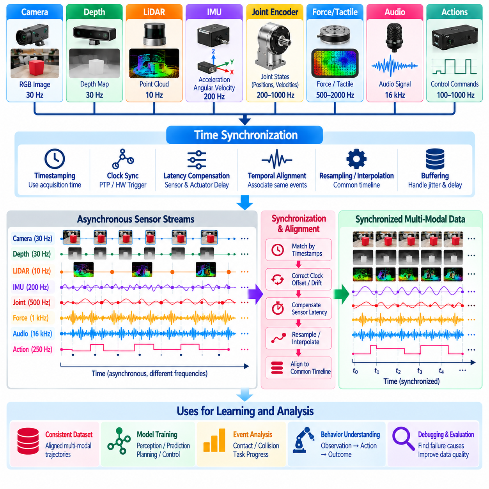{width="7.268055555555556in" height="7.268055555555556in"}

Multimodal data synchronization is a fundamental requirement for Physical AI systems that learn from diverse sensor and control streams. Robots continuously generate visual, depth, tactile, proprioceptive, audio, and action data at different frequencies. Synchronization establishes the temporal relationships among these signals, allowing learning algorithms to interpret observations and actions as components of the same physical interaction.

Each sensing modality operates according to its own acquisition characteristics and timing constraints. Cameras capture discrete image frames, LiDAR sensors generate spatial measurements, and joint encoders report mechanical positions. Force sensors and motor controllers may operate at substantially higher frequencies. Without synchronization, measurements recorded under different physical conditions may be incorrectly treated as simultaneous observations.

Timestamping provides the primary mechanism for organizing asynchronous robotic data. Each measurement should include a timestamp associated with its acquisition or execution time rather than only its arrival at a processing computer. Acquisition timestamps help distinguish actual physical events from communication and buffering delays. Consistent timestamp conventions allow data engines to reconstruct meaningful temporal relationships across distributed devices.

Clock synchronization becomes essential when sensors and controllers maintain independent hardware clocks. Differences in clock offset, drift, and measurement resolution can gradually distort temporal alignment. Synchronization mechanisms may include hardware triggering, Precision Time Protocol, or carefully managed software clock correction. The appropriate method depends on timing accuracy requirements, network conditions, and available hardware support.

Temporal alignment connects observations and actions according to when they occurred in the physical world. A camera image captured before a grasp command should not be associated with a tactile response measured after contact without preserving their temporal separation. Correct alignment enables models to distinguish anticipation, execution, and consequence. This distinction is particularly important for contact-rich manipulation and dynamic robot control.

Sampling-rate differences require explicit handling during dataset preparation. A camera may capture thirty frames per second while joint encoders and control commands operate at hundreds of hertz. Resampling can establish a common training timeline, but it should not imply that all measurements were originally simultaneous. The selected reference frequency must preserve important dynamics while controlling storage and computational costs.

Interpolation estimates intermediate values when continuous signals are sampled at different times. Linear interpolation may be suitable for smoothly changing joint positions, while orientation data requires geometry-aware interpolation. Discrete events, categorical states, and abrupt contact transitions should not be interpolated as ordinary continuous quantities. Every interpolation method introduces assumptions that must remain consistent with the underlying physics.

Data buffering allows synchronization systems to temporarily retain measurements until related streams become available. Buffer sizes must accommodate expected communication latency, sensor jitter, and processing variation. Excessively small buffers can cause missing associations, while large buffers increase memory requirements and processing delay. Real-time systems must balance synchronization accuracy against operational latency constraints.

Sensor latency differs from clock offset because it represents the delay between a physical event and its recorded or delivered measurement. Camera exposure, image processing, network transmission, and driver buffering can contribute separate delays. Actuator commands also experience execution latency. Accurate synchronization requires understanding these delays so that recorded command times are not confused with the actual onset of physical motion.

Spatial calibration and temporal synchronization must operate together to create physically consistent multimodal records. Camera images and depth measurements may refer to the same object from different coordinate frames and acquisition times. Robot motion between measurements can introduce apparent geometric disagreement. Combining timestamp alignment with coordinate transformations enables more accurate reconstruction of moving objects and robot interactions.

Event-based synchronization is useful when precise physical transitions matter more than uniform sampling intervals. Contact detection, gripper closure, object release, collision, and task completion can define important temporal landmarks. These events may be identified through force thresholds, controller states, or learned detectors. Event timestamps help organize trajectories around meaningful changes and support analysis of cause-and-effect relationships.

Multimodal synchronization becomes more challenging when data is collected through teleoperation systems. Human input devices, communication networks, robot controllers, and onboard sensors may operate on separate clocks. Operator commands can experience variable transmission delays before execution. Recording both command generation and robot execution times helps distinguish human intention from the robot\'s delayed physical response.

Simulation environments provide opportunities for deterministic synchronization because sensor generation and control updates can share a common simulation clock. However, simulated sensors may intentionally reproduce realistic delays, noise, and asynchronous sampling. Data exported from simulation should retain these timing characteristics when relevant. Otherwise, models may learn unrealistic assumptions about sensor availability and action responsiveness.

Synchronization errors can directly affect machine learning performance. A policy trained on delayed observations may produce commands appropriate for an earlier state rather than the current environment. Misaligned tactile and visual data can obscure the relationship between contact and object motion. Such errors may appear as model weaknesses even when their actual cause lies in data preparation. Temporal validation is therefore essential before training.

Quality assessment should measure timestamp completeness, clock drift, synchronization residuals, missing samples, and end-to-end latency. Diagnostic procedures can compare known physical events observed by multiple sensors. Repeated timing tests help identify systematic offsets and intermittent communication problems. These measurements should accompany datasets as metadata so that downstream users understand the reliability of temporal alignment.

Synchronization pipelines must also handle dropped frames, duplicated messages, out-of-order packets, and interrupted sensor streams. Missing observations should be explicitly identified rather than silently replaced with misleading values. Sequence numbers and monotonic timestamps can help detect recording inconsistencies. Recovery procedures should preserve valid data while preventing corrupted temporal relationships from entering training datasets.

Large-scale data engines require standardized synchronization conventions across different robot platforms and collection environments. Shared timestamp definitions, sensor identifiers, clock-domain metadata, and alignment policies improve interoperability. Dataset versions should document changes to synchronization algorithms and calibration parameters. Such practices support reproducible training and prevent hidden timing differences from contaminating cross-platform comparisons.

Ultimately, multimodal data synchronization establishes the temporal coherence required to transform heterogeneous robotic recordings into reliable learning experiences. Accurate timestamps, calibrated clocks, latency compensation, and validated alignment preserve the relationships among perception, action, and physical consequences. When synchronization is integrated into the data engine architecture, Physical AI systems can learn more effectively from complex real-world interactions.

## 01.10. Sensor Proprioception and Action Data

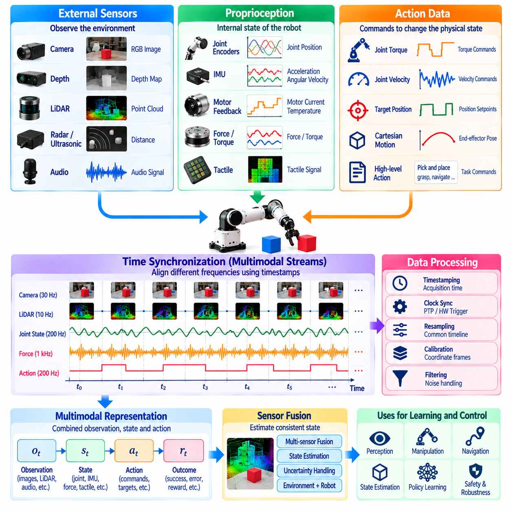{width="7.268055555555556in" height="7.268055555555556in"}

Sensor, proprioception, and action data form the essential information foundation for learning how robots perceive and interact with physical environments. External sensors describe surrounding conditions, proprioceptive measurements reveal the robot\'s internal configuration and motion, and action records capture commanded behavior. Their integration enables Physical AI systems to connect environmental observations with physical decisions and measurable consequences.

External sensing provides information about objects, surfaces, obstacles, and environmental changes. Cameras capture appearance and visual motion, depth sensors estimate geometric structure, and LiDAR measures surrounding distances. Radar and ultrasonic sensors may provide additional information under challenging conditions. Each sensing technology has distinct limitations involving range, resolution, noise, and environmental sensitivity.

Proprioception describes a robot\'s awareness of its own physical configuration and movement. Joint encoders measure angular or linear positions, while velocity estimates describe motion rates. Inertial measurement units provide acceleration and angular velocity, and motor feedback reveals actuator behavior. These measurements support state estimation, motion control, balance regulation, and detection of unexpected mechanical conditions.

Joint position and velocity data are particularly important for articulated robots. Manipulators require accurate joint measurements to determine end-effector position and execute coordinated movements. Humanoid and quadruped robots use joint feedback to maintain posture and coordinate multiple contacts. Measurement resolution, calibration offsets, and sampling frequency influence how accurately learned models can represent robot dynamics.

Force and torque measurements provide information about mechanical interaction with the environment. Joint torque sensors estimate actuator loading, while wrist force-torque sensors measure forces and moments transmitted through an end-effector. These signals help identify contact, resistance, and unexpected disturbances. They are essential for learning compliant manipulation, controlled insertion, and safe interaction with delicate objects.

Tactile sensing captures local contact information that cameras and joint encoders cannot directly provide. Pressure distributions, shear forces, and contact transitions reveal how objects interact with grippers or robotic surfaces. Tactile measurements can support slip detection, grasp adjustment, and manipulation of deformable materials. Their learning value depends on sensor placement, spatial resolution, and temporal responsiveness.

Action data records the commands issued by a robot controller or generated by a learned policy. Actions may specify joint torques, motor currents, velocity targets, position setpoints, or Cartesian motion objectives. Higher-level actions can describe navigation goals, grasp primitives, or task execution requests. Every action record should identify the control interface, units, coordinate conventions, and intended execution interval.

Commanded actions must be distinguished from executed physical behavior. A controller may request a particular joint velocity, but friction, actuator saturation, communication delay, or external contact can produce a different response. Recording both commands and measured motion reveals these discrepancies. This distinction allows learning algorithms to model actual system dynamics instead of assuming perfect command execution.

Sensor and action data operate at different temporal resolutions. Motor controllers may update at hundreds or thousands of hertz, while cameras provide images at much lower rates. Accurate timestamps and synchronized acquisition preserve the sequence between observation, command generation, and physical response. Incorrect alignment can introduce misleading relationships and degrade the performance of learned control policies.

Data representation should preserve the physical meaning of measurements across different robot platforms. Joint angles may use radians, linear positions may use meters, and force measurements may use newtons. Coordinate frames, joint ordering, sign conventions, and actuator limits must be documented. Standardized schemas enable cross-platform analysis while retaining information needed to interpret embodiment-specific behavior.

Sensor calibration is necessary to ensure that recorded measurements correspond to meaningful physical quantities. Camera calibration establishes imaging geometry, encoder calibration corrects positional offsets, and force sensor calibration addresses bias and scaling. Temperature variation, mechanical wear, and sensor drift can gradually affect accuracy. Calibration metadata should therefore accompany recordings and support long-term quality monitoring.

Noise and uncertainty are unavoidable characteristics of physical sensing. Camera images may be affected by illumination, inertial sensors accumulate estimation errors, and force measurements can contain vibration-induced noise. Filtering and sensor fusion can improve state estimates, but aggressive processing may remove useful transient information. Data engines should preserve raw signals when practical and document transformations applied to derived measurements.

Sensor fusion combines complementary measurements to estimate variables that individual sensors cannot reliably determine. Visual observations may locate objects, proprioception may determine robot configuration, and tactile signals may confirm contact. State estimators integrate these sources while accounting for uncertainty and timing differences. The resulting representations support robust perception, manipulation, navigation, and whole-body control.

Action histories provide information about how a robot reached its current physical condition. A single observation may be insufficient to infer velocity, contact stability, or actuator response. Sequences of previous commands and measured states reveal temporal dependencies. Policies that incorporate action history can better compensate for delays, partial observability, and dynamic effects that are not visible in instantaneous sensor measurements.

Data collection systems should record both normal operation and unusual physical events. Successful motions establish examples of effective behavior, while collisions, slips, actuator saturation, and recovery attempts reveal operational limitations. Event markers can identify important transitions within continuous recordings. Preserving these experiences supports failure analysis, targeted retraining, and development of more reliable control strategies.

The diversity of sensor and action data strongly influences policy generalization. Repeated trajectories under identical conditions may not prepare a model for changing loads, surface friction, lighting, or actuator performance. Collection strategies should include representative variations in tasks, objects, robot states, and disturbances. Balanced datasets help models learn transferable physical relationships rather than memorizing narrow operating conditions.

Simulation can generate sensor and action data under controlled physical conditions. Virtual cameras, joint sensors, contact models, and simulated controllers provide structured training experiences. Domain randomization introduces variations in geometry, dynamics, noise, and latency. However, simulated measurements may differ from physical sensors, requiring validation before combining synthetic trajectories with real-world recordings.

At fleet scale, sensor and action records require efficient storage, indexing, and selective transmission. High-frequency measurements and multimodal streams can generate substantial data volumes. Compression, event-triggered logging, and prioritized uploads reduce infrastructure costs while preserving valuable experiences. Metadata describing robot identity, sensor configuration, task context, and software versions supports reliable retrieval and comparison.

Data quality assessment should examine completeness, synchronization, calibration consistency, physical plausibility, and action execution fidelity. Missing encoder samples, saturated force readings, incorrect coordinate transformations, or undocumented controller changes can undermine training. Automated validation can detect many such problems before dataset publication. Reliable data pipelines maintain traceability from original measurements to processed learning examples.

Ultimately, sensor, proprioception, and action data establish the connection between robotic perception and physical control. External sensors describe the environment, proprioception reveals internal motion and configuration, and action records document the decisions that influence subsequent states. When these streams are accurately synchronized, calibrated, and organized, Physical AI data engines can support robust learning, systematic evaluation, and continuous improvement of robot behavior.

## 01.11. Task Language and Context Metadata

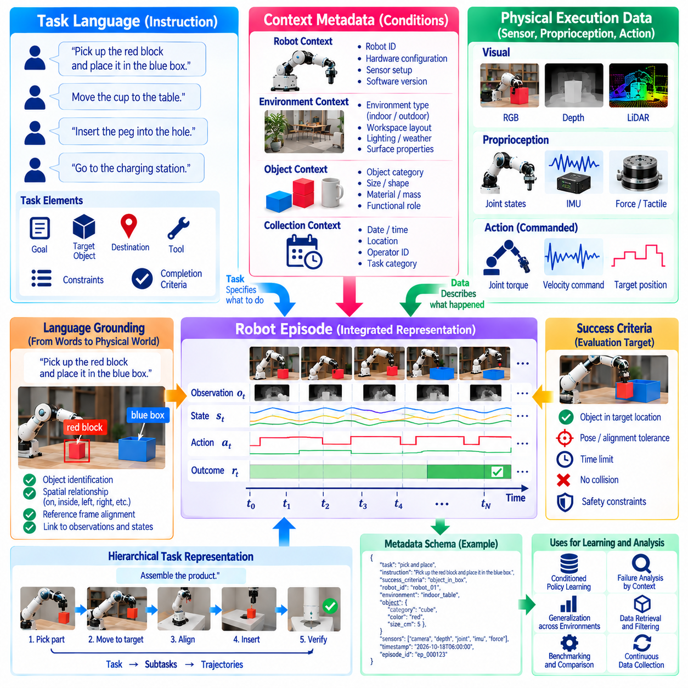{width="7.268055555555556in" height="7.268055555555556in"}

Task language and context metadata provide the semantic foundation that connects robotic experience with intended behavior. Sensor measurements describe what occurred during execution, but they do not necessarily explain why an action was performed. Language instructions express goals and constraints, while contextual metadata records the conditions surrounding each episode. Together, they transform raw trajectories into interpretable learning experiences.

Task language represents objectives in forms that humans and machine learning systems can interpret. Instructions may describe navigation destinations, manipulation targets, assembly operations, or inspection requirements. A command such as placing a component into a designated container specifies an intended result rather than individual motor movements. This abstraction enables robots to associate high-level goals with sequences of physical actions.

Natural language instructions provide flexibility because similar objectives can be expressed using different words and sentence structures. A robot may receive requests to pick up, grasp, retrieve, or move an object, depending on the operator and application. Language-conditioned learning must identify the underlying intention while preserving distinctions between genuinely different tasks. Diverse linguistic examples improve robustness to unfamiliar instructions.

Task descriptions should contain sufficient information to distinguish the intended objective from surrounding environmental details. Relevant attributes may include target objects, destination locations, required tools, ordering constraints, and completion criteria. Ambiguous instructions can produce inconsistent demonstrations and unreliable labels. Structured task specifications can complement natural language by making important operational requirements explicit.

Context metadata describes the circumstances in which robotic data was collected. It may include robot identity, hardware configuration, sensor arrangement, environment type, task category, and operating conditions. Collection timestamps, software versions, and operator identifiers provide additional provenance information. These attributes help distinguish behavioral differences caused by task requirements from those caused by changes in equipment or environment.

Environmental context strongly influences the interpretation of robot actions. Identical movements may produce different outcomes depending on object geometry, surface friction, lighting, obstacle placement, or workspace constraints. Recording these conditions allows models to learn relationships between context and performance. It also enables engineers to identify operating environments where additional training or evaluation is required.

Object metadata provides semantic information about entities involved in robotic tasks. Object categories, dimensions, material properties, estimated mass, and functional roles can influence manipulation strategies. A robot handling a fragile container should behave differently from one moving a rigid industrial component. Such metadata supports task-conditioned learning and analysis of performance across object properties.

Task language and physical observations must be aligned to create meaningful supervision. An instruction referring to a particular object should correspond to the correct entity in images, depth measurements, or scene representations. Temporal alignment is also necessary when instructions change during execution. Incorrect grounding can teach models to associate language with unrelated actions, weakening instruction-following capabilities.

Language grounding connects symbolic descriptions with physical entities, spatial relationships, and executable behaviors. Terms such as left, behind, inside, or adjacent depend on reference frames and environmental context. A robot must interpret these relationships relative to the scene and task. Grounded representations enable policies to translate instructions into actions while accounting for actual object positions and physical constraints.

Complex tasks often require hierarchical language representations. A high-level instruction may describe assembling a product, while subordinate descriptions specify locating parts, grasping components, aligning surfaces, and completing insertion. Associating language with task phases supports hierarchical planning and reusable skills. It also allows learning systems to identify which subtasks succeeded or failed within longer episodes.

Success criteria should be represented separately from task instructions whenever possible. An instruction describes what the robot should accomplish, while evaluation criteria define how completion will be measured. Criteria may involve object placement tolerance, assembly alignment, collision avoidance, or time limits. Explicit success definitions reduce annotation ambiguity and support consistent comparisons across demonstrations and robot platforms.

Context metadata is particularly valuable for interpreting failed trajectories. A failed grasp may result from an unsuitable policy, an unfamiliar material, inaccurate calibration, or an unexpected environmental disturbance. Without contextual records, these explanations may be difficult to distinguish. Linking failure events to task descriptions and operating conditions supports targeted data collection, diagnosis, and corrective model training.

Metadata schemas establish consistent definitions for task and context information across datasets. Fields should specify accepted values, units, identifiers, optional attributes, and relationships to episode records. Controlled vocabularies can reduce inconsistencies in object categories and failure labels. Versioned schemas preserve compatibility as task descriptions and robot capabilities evolve across development cycles.

Language annotations may originate from operators, automated transcription, task planning systems, or post-execution labeling. Each source introduces different uncertainties and potential errors. Human descriptions may be incomplete, while automatically generated labels may misidentify objects or intentions. Annotation pipelines should retain source information, confidence indicators, and review status to support reliable training.

Large-scale datasets benefit from combining free-form language with structured metadata. Natural language captures flexible human intentions, while structured fields support filtering, indexing, and statistical analysis. A dataset can therefore retrieve episodes involving particular objects, task goals, environmental conditions, or failure categories. This combination improves data curation and enables targeted construction of training and evaluation subsets.

Context-aware evaluation examines whether a policy succeeds under the conditions specified by its instructions. Performance should be analyzed across language variations, object categories, workspace layouts, and task complexity. Evaluation splits must prevent closely related demonstrations from creating misleading generalization results. Such testing reveals whether models understand task meaning or merely reproduce familiar action patterns.

Privacy and governance considerations also apply to task language and contextual records. Operator names, spoken instructions, location descriptions, and recorded workplace details may contain sensitive information. Data engines should minimize unnecessary identifiers, apply appropriate access controls, and document permitted uses. These safeguards support responsible data sharing without removing contextual information essential for learning.

Ultimately, task language and context metadata connect physical execution with semantic understanding. Language specifies intentions, contextual records explain operating conditions, and structured annotations establish relationships between goals, actions, and outcomes. When these elements are consistently integrated with robot episodes and trajectories, Physical AI data engines can support instruction-conditioned learning, reliable evaluation, and scalable adaptation to diverse tasks.

## 01.12. Data Lineage Provenance and Versioning

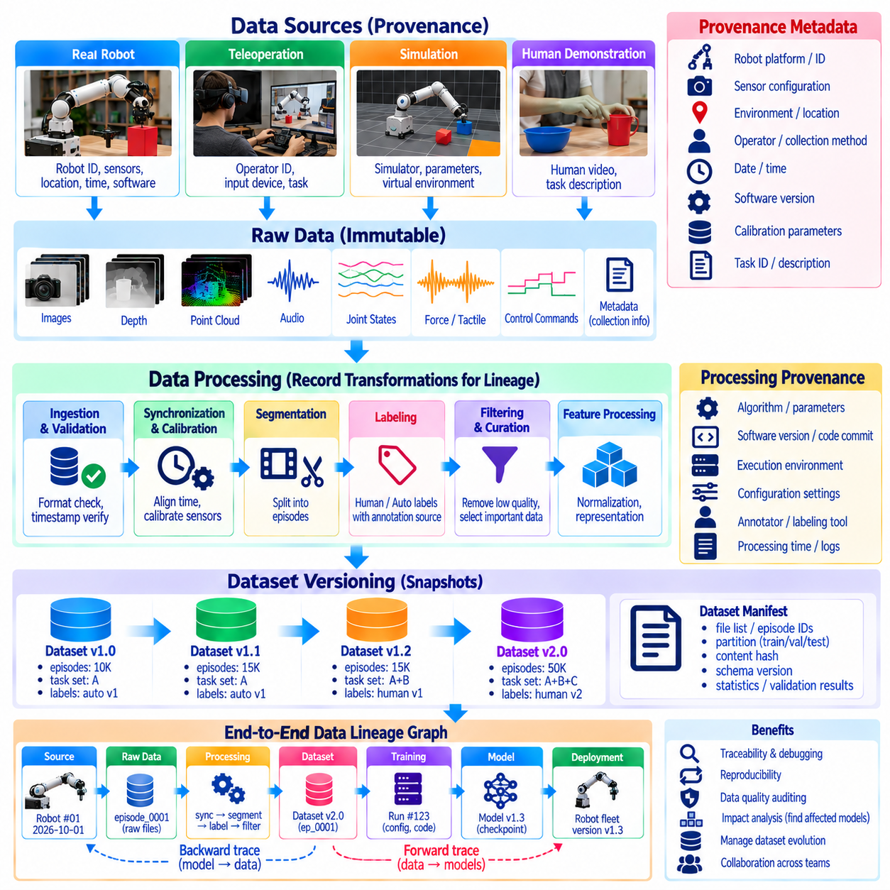{width="7.268055555555556in" height="7.268055555555556in"}

Data lineage, provenance, and versioning establish the traceability required for reliable Physical AI data engines. Data lineage describes how information moves and changes across processing stages, provenance identifies its origins and collection conditions, and versioning preserves distinct states of datasets and artifacts. Together, these mechanisms allow engineers to understand how robotic experiences become training data and how that data influences deployed models.

Physical AI datasets originate from diverse sources, including robot fleets, teleoperation sessions, simulation environments, and human demonstrations. Each source introduces different assumptions, sensor characteristics, and collection procedures. Provenance records identify where, when, and how an experience was generated. Without this information, similar trajectories may be incorrectly treated as equivalent despite important differences in their physical conditions.

Data lineage captures the transformation history connecting raw recordings to processed learning examples. A trajectory may undergo timestamp correction, sensor calibration, segmentation, annotation, filtering, and normalization before training. Each operation can alter the information available to a model. Recording these transformations enables engineers to reconstruct dataset preparation and investigate whether processing decisions introduced errors or unintended biases.

Provenance metadata should describe the robot platform, sensor configuration, software revision, operating environment, and collection method. Additional information may include task identifiers, operator roles, calibration references, and simulation parameters. These attributes provide essential context for interpreting observations and actions. They also help determine whether data collected under particular conditions is suitable for a new training objective.

Dataset versioning creates identifiable snapshots of data collections as they evolve. New episodes may be added, incorrect labels corrected, corrupted trajectories removed, or filtering rules modified. Each meaningful change should produce a traceable dataset revision. Version identifiers allow experiments to reference precisely defined data inputs, preventing ambiguity when different teams train models using datasets with similar names.

Immutable raw data provides a stable foundation for reproducibility and forensic analysis. Original sensor recordings should remain distinguishable from corrected, compressed, or transformed derivatives. When storage limitations require selective retention, preservation policies should document what was discarded and why. Maintaining trustworthy source records allows later processing methods to be applied without relying exclusively on earlier interpretations.

Lineage relationships can be represented as a directed graph connecting source recordings, processing jobs, derived datasets, training runs, and model artifacts. Each node identifies an information asset or operation, while connections describe dependencies. This structure supports backward tracing from a deployed model to its training sources and forward tracing from a problematic recording to all affected outputs.

Processing provenance includes the algorithms, configuration parameters, software dependencies, and execution environments used during transformation. Calibration matrices, synchronization settings, annotation models, and filtering thresholds may materially change the resulting dataset. Recording code revisions and parameter values helps reproduce these transformations. It also distinguishes changes caused by new data from those introduced by revised processing procedures.

Annotation provenance is particularly important because labels may originate from human operators, automated systems, or simulation ground truth. Different sources have different reliability characteristics and potential biases. Annotation records should preserve label origin, review status, confidence information, and correction history. These details support quality assessment and allow training pipelines to prioritize verified labels when necessary.

Versioning should extend beyond datasets to include schemas, task definitions, evaluation benchmarks, and model configurations. A dataset may retain the same recordings while changing its action representation or success criteria. Such changes can affect training and evaluation even without adding new episodes. Coordinated version management prevents incompatible interpretations from being silently combined across experiments.

Reproducible model training requires an explicit relationship between dataset versions and experimental configurations. Training records should reference data manifests, model architecture, optimization settings, random seeds, and software environments. Distributed computation may introduce additional nondeterminism, so exact numerical reproduction is not always guaranteed. Nevertheless, complete records make experimental comparisons and systematic debugging substantially more reliable.

Data manifests provide structured descriptions of the files, episodes, partitions, and metadata belonging to a dataset release. Content hashes can help detect accidental modification or corruption, while stable identifiers preserve references across storage systems. A manifest may also document collection statistics, excluded samples, and validation results. These mechanisms support integrity checking without requiring every dataset to be stored as a single immutable file.

Lineage becomes essential when data quality problems are discovered after model deployment. An incorrect coordinate transformation may affect thousands of trajectories and several trained policies. Dependency records allow engineers to identify impacted dataset versions, experiments, and deployed artifacts. Corrected processing can then generate replacement datasets, while regression testing determines whether affected models require retraining or withdrawal.

Governance requirements depend on the ability to trace data ownership, permissions, and permitted uses. Human demonstrations and workplace recordings may contain personal or commercially sensitive information. Provenance records should document relevant consent, licensing, access restrictions, and retention policies. If deletion or restricted-use obligations arise, lineage information helps locate affected derivatives and determine the appropriate remediation.

Fleet-scale data engines require lineage systems that remain practical across distributed collection and processing infrastructure. Robots may upload data intermittently, edge devices may preprocess recordings, and cloud services may create multiple derived datasets. Globally unique identifiers, consistent metadata schemas, and durable processing logs help preserve relationships. Automated lineage capture reduces the burden of manually documenting every transformation.

Versioning policies should distinguish experimental datasets from validated releases. Development branches may incorporate provisional labels and rapidly changing preprocessing methods, while production datasets require stronger quality controls. Release procedures can include schema validation, integrity checks, benchmark coverage, and approval records. This separation supports rapid experimentation without compromising the reliability of established training baselines.

Data lineage also improves the efficiency of continuous learning loops. When evaluation reveals failures under particular environmental conditions, engineers can retrieve related episodes and identify their collection sources. New data can be compared with historical versions to measure changes in coverage and quality. Lineage-aware analysis helps determine whether performance improvements arise from additional experiences, better annotations, or revised algorithms.

Ultimately, data lineage, provenance, and versioning provide the accountability and reproducibility needed to scale Physical AI learning. Provenance explains where experiences originated, lineage reveals how they were transformed, and versioning identifies the exact artifacts used in each experiment. When these mechanisms are integrated throughout the data engine, robotic development becomes more transparent, auditable, and resilient to data quality failures.

## 01.13. Minimal Physical AI Data Pipeline [w/Code]

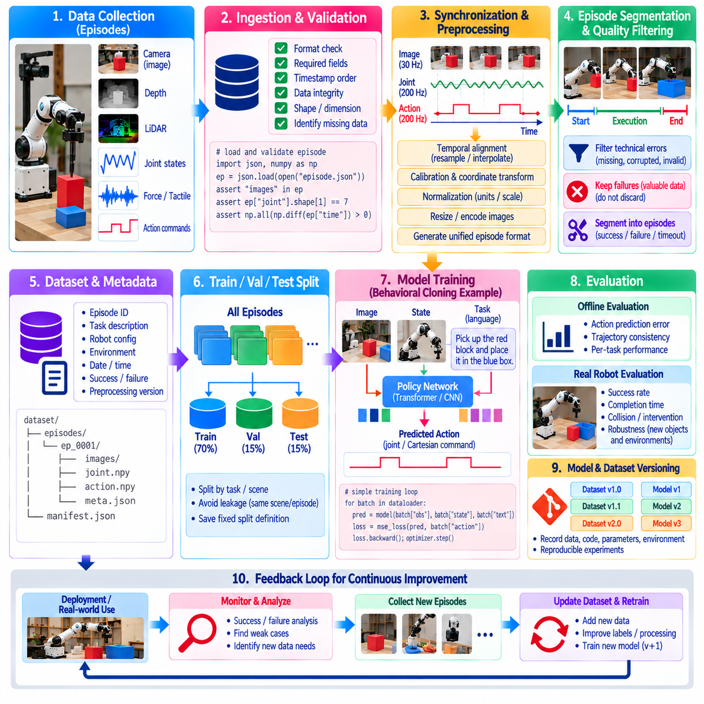{width="7.268055555555556in" height="7.268055555555556in"}

A minimal Physical AI data pipeline provides a practical foundation for transforming robot experiences into reusable machine learning datasets. Its purpose is to connect data collection, validation, preprocessing, storage, training, and evaluation through a reproducible workflow. Unlike a large-scale production data engine, a minimal pipeline emphasizes simplicity, transparent interfaces, and reliable execution while preserving the essential relationships between observations, actions, and outcomes.

The pipeline begins by defining a consistent representation for robot episodes. Each episode contains a sequence of observations, actions, timestamps, and task outcomes recorded during one execution attempt. Observations may include camera images, joint positions, velocities, and force measurements. Actions describe controller commands, while outcomes indicate success, failure, or termination conditions. This structure provides a common interface for downstream processing.

Data acquisition should capture sensor measurements and action commands with sufficient temporal accuracy. A robot controller can publish joint states and commanded actions, while perception processes record images or depth measurements. Each message should contain a timestamp and sensor identifier. A lightweight recording application can assemble these streams into episodes, preserving the temporal relationships necessary for learning robot behavior.

A practical implementation can use Python with NumPy for numerical arrays and a structured serialization format for episode metadata. Images may be stored as compressed files, while joint states and actions can be represented as multidimensional arrays. JSON provides a readable format for task descriptions and configuration parameters. Separating large sensor payloads from metadata improves organization and simplifies inspection.

The ingestion stage converts recorded messages into a standardized episode representation. It checks required fields, verifies timestamp ordering, and confirms that numerical arrays have expected dimensions. Missing measurements should be explicitly identified rather than silently replaced with arbitrary values. Invalid episodes can be quarantined for review. These basic checks prevent common recording problems from contaminating training datasets.

Temporal alignment establishes correspondence between observations and actions sampled at different frequencies. Camera frames may arrive at tens of hertz, while joint states and controller commands are updated much faster. A reference timeline can be constructed from action timestamps or fixed sampling intervals. Interpolation may be appropriate for continuous measurements, but discrete commands and contact events require careful handling.

Preprocessing transforms raw measurements into representations suitable for learning. Joint positions may be converted into standardized units, images resized to consistent dimensions, and action vectors normalized using training-set statistics. Coordinate transformations should follow documented reference frames. Preprocessing parameters must be stored because different normalization choices can significantly change model behavior and reproducibility.

Episode segmentation identifies meaningful boundaries within continuous robot recordings. A task begins when an execution request is accepted and ends when completion, failure, timeout, or operator intervention occurs. Segmentation should preserve the final observation and termination reason. Consistent boundaries prevent unrelated actions from being combined into misleading trajectories and support accurate calculation of task success rates.

Data quality filtering removes or flags episodes that cannot support reliable learning. Examples include missing action commands, corrupted images, inconsistent timestamps, and invalid sensor values. However, unsuccessful task attempts should not automatically be discarded because they may contain valuable recovery information. Filtering policies should distinguish technical corruption from legitimate physical failure and document all exclusions.

A dataset manifest provides an inventory of validated episodes and their associated metadata. Each entry can identify an episode path, robot configuration, task category, duration, sample count, and outcome. The manifest also records dataset versions and preprocessing settings. This lightweight indexing mechanism supports reproducible loading, efficient filtering, and identification of the exact examples used in each experiment.

Training datasets should be divided into training, validation, and test partitions before model development. Episodes from closely related executions should be grouped when necessary to prevent information leakage. The training partition supports parameter optimization, validation data guides model selection, and test data provides an independent assessment. Stable partition definitions make comparisons between successive policies more meaningful.

A minimal learning experiment can train a behavioral cloning model that predicts robot actions from observations and task context. Input features may combine visual embeddings with joint states, while targets represent recorded controller commands. A simple neural network can minimize prediction error over demonstration trajectories. Although action prediction alone does not guarantee task success, it provides a useful initial test of dataset integrity.

Evaluation should measure both offline prediction quality and physical task performance whenever safe testing is available. Offline metrics may include action error, trajectory consistency, and performance across task categories. Closed-loop testing reveals whether small prediction errors accumulate into unstable behavior. Success rates, collision events, intervention frequency, and recovery performance provide more meaningful indicators of practical reliability.

The pipeline should preserve traceability between source episodes, preprocessing operations, training configurations, and model checkpoints. Each experiment can record a dataset version, configuration file, random seed, and software revision. Automated logging enables engineers to reproduce training conditions and investigate unexpected results. Even a minimal implementation benefits from systematic documentation because uncontrolled changes quickly undermine experimental comparisons.

A simple feedback loop completes the minimal data pipeline. Evaluation results identify tasks or environmental conditions where the learned policy performs poorly. Engineers can collect additional demonstrations, review failed episodes, and adjust data filtering or annotation procedures. The revised dataset is then used for another training cycle. This iterative process establishes the foundation of a continuously improving Physical AI data engine.
