**Volume 04. Data Engines and Scaling for Physical AI**


# Chapter 02. Teleoperation Data Collection

##  

## 02.01. Teleoperation as a Data Source

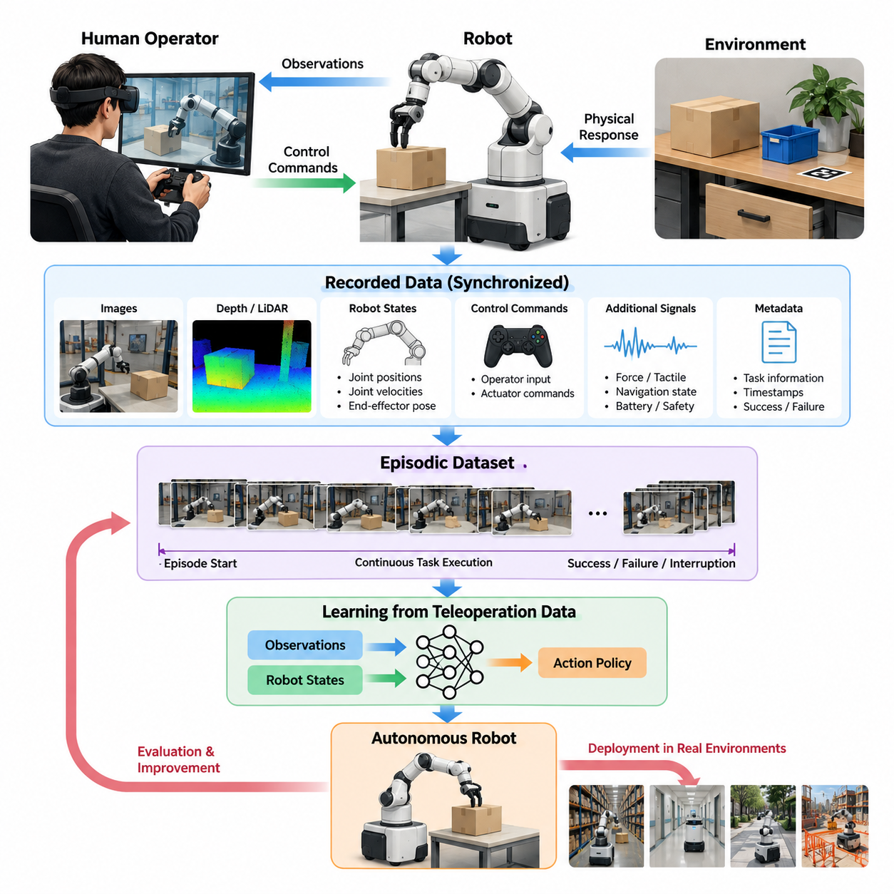{width="7.268055555555556in" height="7.268055555555556in"}

Teleoperation is a fundamental data source for Physical AI because it enables human operators to control robotic systems while generating structured records of perception, action, and environmental response. Unlike passive observation datasets, teleoperation captures decisions directly connected to physical execution. These records provide valuable supervision for training robots to perform complex tasks in real environments.

In a teleoperation system, a human operator observes the robot\'s surroundings through cameras, depth sensors, LiDAR, or other sensing devices and issues control commands through an interface. The robot executes these commands while recording its internal states and external observations. This process produces synchronized sequences that describe how human decisions translate into physical actions and measurable outcomes.

The primary value of teleoperation data lies in its ability to connect observations with meaningful actions. A camera image alone may reveal the position of an object, but it does not explain how the robot should approach, grasp, or manipulate that object. Teleoperated demonstrations provide the missing relationship between environmental conditions, operator decisions, actuator commands, and the resulting changes in the physical world.

A typical teleoperation dataset contains visual observations, robot joint positions, joint velocities, end-effector poses, control commands, timestamps, and task-related metadata. Depending on the robot platform, additional information may include force measurements, tactile signals, navigation states, battery conditions, and safety events. Together, these modalities form a comprehensive representation of robot behavior during task execution.

Teleoperation data is commonly organized into episodes, where each episode represents a continuous attempt to complete a particular task. An episode may begin when the operator receives a task instruction and end when the robot succeeds, fails, or encounters an interruption. This episodic structure preserves temporal relationships and supports learning algorithms that require complete trajectories rather than isolated observation-action pairs.

The relationship between human intention and robot action is particularly important in imitation learning. A learning model can use teleoperated trajectories to estimate a policy that maps robot observations to appropriate actions. Through behavior cloning, the model learns to reproduce demonstrated behavior without explicitly programming every movement. The resulting policy can subsequently be evaluated and improved through additional interaction.

Teleoperation provides a practical method for collecting demonstrations of manipulation tasks that are difficult to specify using conventional programming. Examples include grasping irregular objects, opening drawers, inserting components, folding materials, and operating tools. Human operators naturally adapt their movements to changing object positions, contact conditions, and task constraints, creating demonstrations of context-dependent physical behavior.

For mobile robots, teleoperation can capture navigation decisions in crowded warehouses, hospitals, construction sites, and outdoor environments. Operators may guide robots around temporary obstacles, negotiate narrow passages, or recover from localization uncertainty. These demonstrations contain useful information about traversability, obstacle avoidance, route selection, and interactions with dynamic environments that autonomous systems may not yet handle reliably.

Teleoperation also supports data collection for humanoid robots and mobile manipulators, where coordinated whole-body behavior is required. Human demonstrations can expose relationships between locomotion, balance, reaching, grasping, and object transportation. However, transferring human intentions into robot movements requires consideration of differences in kinematics, degrees of freedom, actuator limitations, and physical stability.

The effectiveness of teleoperation as a data source depends strongly on the control interface. Joysticks, game controllers, virtual reality devices, motion capture systems, and specialized master manipulators provide different levels of control precision and operator immersion. Each interface introduces characteristic limitations, including command resolution, response delay, fatigue, and differences between intended and executed motion.

Communication latency is another critical consideration because delayed feedback can alter operator behavior and reduce demonstration quality. When visual observations arrive late, operators may issue excessive corrections or adopt unusually slow movements. Such behavior can become embedded in training data. Recording communication delays and command execution timestamps helps distinguish genuine task strategies from artifacts introduced by the teleoperation system.

Reliable data collection requires accurate synchronization between observations, robot states, and operator commands. Even small timing discrepancies can cause a learning model to associate an action with the wrong environmental condition. Timestamp alignment, consistent sampling policies, calibrated sensors, and clearly defined command semantics are therefore essential for constructing datasets suitable for high-frequency robotic control.

Teleoperation demonstrations should preserve the distinction between commanded actions and executed actions. A requested joint movement may differ from the actual motion because of actuator saturation, collision constraints, controller filtering, or mechanical compliance. Recording both signals allows researchers to identify control limitations and prevents learning systems from incorrectly interpreting commands as physically achieved movements.

Data diversity is as important as demonstration accuracy. Repeatedly collecting successful trajectories in identical environments may produce models that perform well under familiar conditions but fail when objects, lighting, surfaces, or task arrangements change. Effective teleoperation campaigns therefore vary environmental configurations, object properties, initial robot states, and task difficulties to improve coverage of relevant operating conditions.

Operator diversity also influences the statistical characteristics of collected demonstrations. Experienced operators may execute tasks efficiently with smooth trajectories, while less experienced operators may introduce hesitation, corrections, or alternative strategies. These differences are not universally beneficial or harmful. Their usefulness depends on whether the learning objective prioritizes optimal execution, behavioral robustness, or recovery from imperfect actions.

Successful demonstrations provide examples of desirable behavior, but failed attempts can also contribute important learning signals. A failed grasp may reveal unsuitable contact geometry, while a navigation failure may expose an obstacle configuration that requires additional perception. When failures are recorded with clear outcome labels and surrounding context, they help identify limitations that successful trajectories alone cannot reveal.

Corrective demonstrations are particularly valuable when an autonomous policy encounters unfamiliar conditions. A human operator can temporarily assume control, resolve the situation, and return authority to the autonomous system. The resulting intervention sequence captures behavior near the model\'s operational boundary, providing targeted examples for improving future performance in similar situations.

This intervention-based approach connects teleoperation with closed-loop data engines. Autonomous robots generate operational experience, performance monitoring identifies difficult situations, and human operators supply corrective trajectories. These trajectories enter a processing and training pipeline, producing updated policies that can be evaluated and deployed. Repeating the cycle gradually concentrates data collection on weaknesses revealed by actual operation.

Teleoperation datasets can also support the development of Vision-Language-Action models. When demonstrations include natural-language task descriptions, visual observations, and robot actions, they establish relationships between semantic instructions and physical execution. A model can learn that commands such as placing an object into a container correspond to sequences of perception, reaching, grasping, transportation, and release.

However, collecting teleoperation data does not automatically guarantee generalizable robot intelligence. Demonstrations are constrained by the robot embodiment, control interface, operator expertise, and environments represented in the dataset. Models trained on a narrow distribution may imitate familiar behaviors without understanding broader physical constraints. Careful evaluation is necessary to determine whether learned capabilities transfer to unseen situations.

The cost of teleoperation is a major challenge for large-scale Physical AI development. Each demonstration requires robot hardware, an operational environment, human attention, and data infrastructure. Equipment failures, operator fatigue, maintenance requirements, and repeated task resets further increase collection costs. Scaling therefore requires improving the amount of useful learning information obtained from each hour of human operation.

Data collection efficiency can be improved through standardized task protocols, automated episode segmentation, continuous sensor logging, and streamlined environment resets. Remote operation facilities may allow trained operators to control multiple robot platforms across different sites, although simultaneous direct control remains limited by human attention. Shared control and supervisory interfaces can reduce manual effort when partial autonomy is available.

Quality assurance must be integrated into the collection process rather than postponed until model training. Automated checks can identify missing sensor streams, invalid timestamps, incomplete episodes, excessive communication delays, and inconsistent action representations. Human reviewers can assess task completion, demonstration clarity, and unusual behavior. Combining automated validation with selective review helps maintain dataset reliability.

Metadata provides the context necessary to interpret demonstrations correctly. Useful metadata includes task identifiers, robot configuration, operator interface, environment conditions, calibration versions, software versions, and episode outcomes. Without this information, visually similar trajectories may represent different tasks or operating constraints. Consistent metadata also supports dataset filtering, comparison, reproducibility, and future reuse.

Safety remains essential because teleoperation involves real physical systems capable of causing damage or injury. Emergency stopping, collision avoidance, workspace restrictions, and independent safety monitoring should remain effective even when the human operator has direct control. Demonstrations should distinguish actions performed under normal operating conditions from movements modified or interrupted by safety mechanisms.

Privacy and governance requirements also apply to teleoperation datasets. Camera recordings may capture workers, customers, confidential equipment, or sensitive facility layouts. Operator identifiers and performance records may introduce additional privacy concerns. Appropriate consent, access restrictions, retention policies, and data minimization procedures are necessary when demonstrations are collected in workplaces or publicly accessible environments.

As Physical AI systems expand across robot platforms, teleoperation data becomes an important resource for cross-embodiment learning. Demonstrations from different manipulators, mobile bases, and humanoid robots can reveal common task structures despite differences in action spaces. Shared representations of object interactions, task goals, and outcomes may support knowledge transfer, although embodiment-specific control constraints must still be respected.

Ultimately, teleoperation transforms human physical expertise into machine-readable experience. Its significance extends beyond producing examples for imitation learning because it establishes a systematic connection between human guidance, robotic execution, and continuous model improvement. When combined with rigorous synchronization, quality control, diverse task coverage, and closed-loop training, teleoperation becomes a foundational component of scalable Physical AI data engines.

원격조작(Teleoperation)은 인간 작업자가 로봇 시스템을 제어하면서 인식(Perception), 행동(Action), 환경 반응(Environmental Response)에 대한 구조화된 기록을 생성할 수 있기 때문에 피지컬 인공지능(Physical AI)의 핵심 데이터 소스(Data Source)이다. 수동적인 관찰 데이터셋(Passive Observation Dataset)과 달리 원격조작은 물리적 실행과 직접 연결된 의사결정을 기록한다. 이러한 기록은 실제 환경에서 복잡한 작업을 수행하도록 로봇을 학습시키는 데 중요한 지도 정보(Supervision)를 제공한다.

원격조작 시스템(Teleoperation System)에서 인간 작업자는 카메라(Camera), 깊이 센서(Depth Sensor), 라이다(LiDAR) 또는 기타 감지 장치를 통해 로봇 주변 환경을 관찰하고 제어 인터페이스(Control Interface)를 사용하여 명령을 전달한다. 로봇은 이러한 명령을 실행하면서 내부 상태(Internal State)와 외부 관측 정보(External Observation)를 기록한다. 이 과정에서는 인간의 의사결정이 물리적 행동과 측정 가능한 결과로 변환되는 과정을 설명하는 동기화된 시퀀스(Synchronized Sequence)가 생성된다.

원격조작 데이터(Teleoperation Data)의 핵심 가치는 관측 정보(Observation)를 의미 있는 행동(Action)과 연결할 수 있다는 점에 있다. 카메라 영상만으로도 물체의 위치를 파악할 수 있지만, 로봇이 해당 물체에 어떻게 접근하고 파지하며 조작해야 하는지는 설명하지 못한다. 원격조작 시연(Teleoperated Demonstration)은 환경 조건(Environmental Condition), 작업자 의사결정(Operator Decision), 구동기 명령(Actuator Command), 물리적 환경 변화 사이의 관계를 제공한다.

일반적인 원격조작 데이터셋(Teleoperation Dataset)에는 시각적 관측 정보(Visual Observation), 로봇 관절 위치(Joint Position), 관절 속도(Joint Velocity), 말단효과기 자세(End-Effector Pose), 제어 명령(Control Command), 타임스탬프(Timestamp), 작업 관련 메타데이터(Task Metadata)가 포함된다. 로봇 플랫폼에 따라 힘 측정값(Force Measurement), 촉각 신호(Tactile Signal), 내비게이션 상태(Navigation State), 배터리 상태(Battery Condition), 안전 이벤트(Safety Event) 등이 추가될 수 있다. 이러한 다중 모달리티(Multimodality)는 작업 수행 중 로봇 행동을 종합적으로 표현한다.

원격조작 데이터는 일반적으로 에피소드(Episode) 단위로 구성되며, 각 에피소드는 특정 작업을 완료하기 위한 연속적인 시도를 나타낸다. 에피소드는 작업자가 작업 지시(Task Instruction)를 받는 시점에 시작하여 로봇이 성공하거나 실패하거나 작업이 중단되는 시점에 종료될 수 있다. 이러한 에피소드 구조(Episodic Structure)는 시간적 관계(Temporal Relationship)를 보존하며, 개별 관측-행동 쌍(Observation-Action Pair)이 아닌 완전한 궤적(Trajectory)을 요구하는 학습 알고리즘을 지원한다.

인간의 의도(Human Intention)와 로봇 행동(Robot Action) 사이의 관계는 모방학습(Imitation Learning)에서 특히 중요하다. 학습 모델(Learning Model)은 원격조작 궤적을 사용하여 로봇의 관측 정보를 적절한 행동으로 변환하는 정책(Policy)을 추정할 수 있다. 행동 복제(Behavior Cloning)를 통해 모델은 모든 움직임을 명시적으로 프로그래밍하지 않고도 시연된 행동을 재현하도록 학습한다. 이후 생성된 정책은 추가적인 상호작용을 통해 평가하고 개선할 수 있다.

원격조작은 기존 프로그래밍(Conventional Programming)으로 명확하게 정의하기 어려운 조작 작업(Manipulation Task)의 시연 데이터를 수집하는 실용적인 방법을 제공한다. 대표적인 예로 불규칙한 물체 파지, 서랍 열기, 부품 삽입, 재료 접기, 도구 조작 등이 있다. 인간 작업자는 물체 위치, 접촉 조건(Contact Condition), 작업 제약(Task Constraint)의 변화에 자연스럽게 적응하며, 이를 통해 상황에 따라 달라지는 물리적 행동(Context-Dependent Physical Behavior)의 시연 데이터를 생성한다.

이동로봇(Mobile Robot)의 경우 원격조작을 통해 혼잡한 창고, 병원, 건설 현장, 실외 환경에서의 내비게이션 의사결정(Navigation Decision)을 기록할 수 있다. 작업자는 로봇을 임시 장애물 주변으로 유도하거나 좁은 통로를 통과시키고 위치추정 불확실성(Localization Uncertainty)에서 복구하도록 지원할 수 있다. 이러한 시연에는 자율 시스템(Autonomous System)이 아직 안정적으로 처리하지 못하는 주행 가능성(Traversability), 장애물 회피(Obstacle Avoidance), 경로 선택(Route Selection), 동적 환경 상호작용(Dynamic Environment Interaction)에 관한 유용한 정보가 포함된다.

원격조작은 전신 협응 행동(Whole-Body Coordinated Behavior)이 필요한 휴머노이드 로봇(Humanoid Robot)과 이동형 매니퓰레이터(Mobile Manipulator)의 데이터 수집도 지원한다. 인간 시연은 이동(Locomotion), 균형(Balance), 도달 동작(Reaching), 파지(Grasping), 물체 운반(Object Transportation) 사이의 관계를 보여준다. 그러나 인간의 의도를 로봇 움직임으로 변환하려면 운동학(Kinematics), 자유도(Degrees of Freedom), 구동기 한계(Actuator Limitation), 물리적 안정성(Physical Stability)의 차이를 고려해야 한다.

데이터 소스로서 원격조작의 효과는 제어 인터페이스(Control Interface)에 크게 좌우된다. 조이스틱(Joystick), 게임 컨트롤러(Game Controller), 가상현실 장치(Virtual Reality Device), 모션 캡처 시스템(Motion Capture System), 전용 마스터 매니퓰레이터(Master Manipulator)는 서로 다른 제어 정밀도(Control Precision)와 작업자 몰입도(Operator Immersion)를 제공한다. 각 인터페이스에는 명령 해상도(Command Resolution), 응답 지연(Response Delay), 피로(Fatigue), 의도한 움직임과 실제 실행된 움직임 사이의 차이와 같은 고유한 한계가 존재한다.

통신 지연(Communication Latency)은 작업자 행동을 변화시키고 시연 품질(Demonstration Quality)을 저하시킬 수 있기 때문에 중요한 고려 사항이다. 시각적 관측 정보가 늦게 전달되면 작업자는 과도한 보정 명령을 내리거나 비정상적으로 느린 움직임을 선택할 수 있다. 이러한 행동은 학습 데이터에 그대로 반영될 수 있다. 통신 지연과 명령 실행 타임스탬프(Command Execution Timestamp)를 기록하면 실제 작업 전략(Task Strategy)과 원격조작 시스템에서 발생한 인위적 영향(System Artifact)을 구분하는 데 도움이 된다.

신뢰할 수 있는 데이터 수집을 위해서는 관측 정보(Observation), 로봇 상태(Robot State), 작업자 명령(Operator Command) 사이의 정확한 동기화(Synchronization)가 필요하다. 작은 시간 불일치(Timing Discrepancy)만으로도 학습 모델이 잘못된 환경 조건과 행동을 연결할 수 있다. 따라서 타임스탬프 정렬(Timestamp Alignment), 일관된 샘플링 정책(Sampling Policy), 보정된 센서(Calibrated Sensor), 명확하게 정의된 명령 의미(Command Semantics)는 고주파 로봇 제어(High-Frequency Robotic Control)에 적합한 데이터셋을 구축하는 데 필수적이다.

원격조작 시연에서는 명령된 행동(Commanded Action)과 실제 실행된 행동(Executed Action)을 구분하여 보존해야 한다. 요청된 관절 움직임은 구동기 포화(Actuator Saturation), 충돌 제약(Collision Constraint), 제어기 필터링(Controller Filtering), 기계적 유연성(Mechanical Compliance) 때문에 실제 움직임과 다를 수 있다. 두 신호를 모두 기록하면 제어 한계를 식별할 수 있으며, 학습 시스템이 명령을 실제로 달성된 물리적 움직임으로 잘못 해석하는 문제를 방지할 수 있다.

데이터 다양성(Data Diversity)은 시연 정확도(Demonstration Accuracy)만큼 중요하다. 동일한 환경에서 성공적인 궤적을 반복적으로 수집하면 익숙한 조건에서는 우수한 성능을 보이지만 물체, 조명, 표면, 작업 배치가 달라지면 실패하는 모델이 만들어질 수 있다. 따라서 효과적인 원격조작 데이터 수집에서는 환경 구성(Environment Configuration), 물체 특성(Object Property), 초기 로봇 상태(Initial Robot State), 작업 난이도(Task Difficulty)를 다양하게 변화시켜 관련 작동 조건(Operating Condition)의 포괄 범위(Coverage)를 확대해야 한다.

작업자 다양성(Operator Diversity)도 수집된 시연의 통계적 특성(Statistical Characteristic)에 영향을 미친다. 숙련된 작업자는 부드러운 궤적(Smooth Trajectory)을 사용하여 효율적으로 작업을 수행하는 반면, 경험이 부족한 작업자는 망설임(Hesitation), 보정 동작(Correction), 대안적 전략(Alternative Strategy)을 보일 수 있다. 이러한 차이는 항상 유익하거나 해로운 것은 아니다. 학습 목표가 최적 실행(Optimal Execution), 행동 강건성(Behavioral Robustness), 불완전한 행동으로부터의 복구(Recovery) 중 무엇을 우선하는지에 따라 활용 가치가 달라진다.

성공적인 시연(Successful Demonstration)은 바람직한 행동의 사례를 제공하지만, 실패한 시도(Failed Attempt)도 중요한 학습 신호(Learning Signal)를 제공할 수 있다. 파지 실패(Grasp Failure)는 부적절한 접촉 기하학(Contact Geometry)을 드러낼 수 있으며, 내비게이션 실패(Navigation Failure)는 추가적인 인식 기능이 필요한 장애물 배치를 보여줄 수 있다. 실패가 명확한 결과 레이블(Outcome Label) 및 주변 상황(Context)과 함께 기록되면 성공 궤적만으로는 발견하기 어려운 한계를 식별하는 데 도움이 된다.

교정 시연(Corrective Demonstration)은 자율 정책(Autonomous Policy)이 익숙하지 않은 조건에 직면했을 때 특히 가치가 높다. 인간 작업자는 일시적으로 제어권(Control Authority)을 인수하여 문제 상황을 해결한 다음 자율 시스템에 다시 제어권을 반환할 수 있다. 이 과정에서 생성된 개입 시퀀스(Intervention Sequence)는 모델의 운용 경계(Operational Boundary) 부근에서 발생하는 행동을 기록하며, 유사한 상황에서 향후 성능을 개선하기 위한 목표 지향적 학습 사례(Targeted Training Example)를 제공한다.

이러한 개입 기반 접근법(Intervention-Based Approach)은 원격조작을 폐루프 데이터 엔진(Closed-Loop Data Engine)과 연결한다. 자율로봇은 운용 경험(Operational Experience)을 생성하고, 성능 모니터링(Performance Monitoring)은 어려운 상황을 식별하며, 인간 작업자는 교정 궤적(Corrective Trajectory)을 제공한다. 이러한 궤적은 데이터 처리 및 학습 파이프라인(Processing and Training Pipeline)에 입력되어 평가와 배포가 가능한 개선된 정책을 생성한다. 이 순환을 반복하면 실제 운용에서 발견된 취약점에 데이터 수집을 점진적으로 집중할 수 있다.

원격조작 데이터셋은 시각-언어-행동 모델(Vision-Language-Action Model, VLA)의 개발도 지원할 수 있다. 시연에 자연어 작업 설명(Natural-Language Task Description), 시각적 관측 정보(Visual Observation), 로봇 행동(Robot Action)이 포함되면 의미적 지시(Semantic Instruction)와 물리적 실행(Physical Execution) 사이의 관계가 형성된다. 모델은 물체를 용기에 넣으라는 명령이 인식, 도달, 파지, 운반, 놓기 등의 연속적인 행동과 연결된다는 사실을 학습할 수 있다.

그러나 원격조작 데이터를 수집한다고 해서 일반화 가능한 로봇 지능(Generalizable Robot Intelligence)이 자동으로 보장되는 것은 아니다. 시연은 로봇의 신체 구조(Embodiment), 제어 인터페이스(Control Interface), 작업자 숙련도(Operator Expertise), 데이터셋에 포함된 환경에 의해 제약된다. 제한된 데이터 분포(Data Distribution)로 학습한 모델은 광범위한 물리적 제약을 이해하지 못한 채 익숙한 행동만 모방할 수 있다. 따라서 학습된 능력이 새로운 상황으로 전이(Transfer)되는지 확인하기 위한 신중한 평가가 필요하다.

원격조작 비용(Teleoperation Cost)은 대규모 피지컬 인공지능 개발에서 중요한 과제이다. 각 시연에는 로봇 하드웨어(Robot Hardware), 운용 환경(Operational Environment), 인간의 주의와 작업 시간(Human Attention), 데이터 인프라(Data Infrastructure)가 필요하다. 장비 고장(Equipment Failure), 작업자 피로(Operator Fatigue), 유지보수 요구(Maintenance Requirement), 반복적인 작업 초기화(Task Reset)는 수집 비용을 더욱 증가시킨다. 따라서 확장성(Scalability)을 확보하려면 인간의 작업 시간당 얻을 수 있는 유용한 학습 정보의 양을 높여야 한다.

데이터 수집 효율성(Data Collection Efficiency)은 표준화된 작업 프로토콜(Standardized Task Protocol), 자동 에피소드 분할(Automated Episode Segmentation), 연속적인 센서 로깅(Continuous Sensor Logging), 간소화된 환경 초기화(Environment Reset)를 통해 개선할 수 있다. 원격 운영 시설(Remote Operation Facility)을 활용하면 숙련된 작업자가 여러 현장의 다양한 로봇 플랫폼을 제어할 수 있지만, 동시 직접 제어(Simultaneous Direct Control)는 인간의 주의력에 의해 제한된다. 부분 자율성(Partial Autonomy)이 제공되는 경우 공유 제어(Shared Control)와 감독 제어 인터페이스(Supervisory Interface)를 통해 수동 작업 부담을 줄일 수 있다.

품질 보증(Quality Assurance)은 모델 학습 단계까지 미루지 않고 데이터 수집 과정에 통합해야 한다. 자동화된 검사(Automated Check)는 누락된 센서 스트림(Missing Sensor Stream), 유효하지 않은 타임스탬프(Invalid Timestamp), 불완전한 에피소드(Incomplete Episode), 과도한 통신 지연(Communication Delay), 일관되지 않은 행동 표현(Action Representation)을 식별할 수 있다. 인간 검토자(Human Reviewer)는 작업 완료 여부, 시연의 명확성, 비정상적인 행동을 평가할 수 있다. 자동 검증(Automated Validation)과 선택적 검토(Selective Review)를 결합하면 데이터셋의 신뢰성을 유지하는 데 도움이 된다.

메타데이터(Metadata)는 시연을 올바르게 해석하는 데 필요한 맥락 정보를 제공한다. 유용한 메타데이터에는 작업 식별자(Task Identifier), 로봇 구성(Robot Configuration), 작업자 인터페이스(Operator Interface), 환경 조건(Environment Condition), 보정 버전(Calibration Version), 소프트웨어 버전(Software Version), 에피소드 결과(Episode Outcome)가 포함된다. 이러한 정보가 없으면 시각적으로 유사한 궤적이 서로 다른 작업이나 운용 제약을 나타낼 수 있다. 일관된 메타데이터는 데이터셋 필터링(Dataset Filtering), 비교(Comparison), 재현성(Reproducibility), 향후 재사용(Reuse)도 지원한다.

원격조작은 손상이나 부상을 일으킬 수 있는 실제 물리적 시스템을 다루기 때문에 안전성(Safety)이 필수적이다. 비상 정지(Emergency Stop), 충돌 회피(Collision Avoidance), 작업 공간 제한(Workspace Restriction), 독립적인 안전 모니터링(Independent Safety Monitoring)은 인간 작업자가 직접 제어하는 상황에서도 정상적으로 작동해야 한다. 시연 데이터에서는 정상 작동 조건(Normal Operating Condition)에서 수행된 행동과 안전 메커니즘(Safety Mechanism)에 의해 수정되거나 중단된 움직임을 구분해야 한다.

개인정보 보호(Privacy)와 데이터 거버넌스(Data Governance) 요구사항도 원격조작 데이터셋에 적용된다. 카메라 기록에는 근로자, 고객, 기밀 장비(Confidential Equipment), 민감한 시설 배치(Sensitive Facility Layout)가 포함될 수 있다. 작업자 식별 정보(Operator Identifier)와 성과 기록(Performance Record)은 추가적인 개인정보 보호 문제를 발생시킬 수 있다. 따라서 작업장이나 공공 접근 환경에서 시연을 수집할 때는 적절한 동의(Consent), 접근 제한(Access Restriction), 보존 정책(Retention Policy), 데이터 최소화(Data Minimization) 절차가 필요하다.

피지컬 인공지능 시스템이 다양한 로봇 플랫폼으로 확장됨에 따라 원격조작 데이터는 서로 다른 신체 구조 간 학습(Cross-Embodiment Learning)을 위한 중요한 자원이 된다. 서로 다른 매니퓰레이터(Manipulator), 이동 플랫폼(Mobile Base), 휴머노이드 로봇의 시연은 행동 공간(Action Space)의 차이에도 불구하고 공통적인 작업 구조(Task Structure)를 보여줄 수 있다. 물체 상호작용(Object Interaction), 작업 목표(Task Goal), 결과(Outcome)에 대한 공유 표현(Shared Representation)은 지식 전이(Knowledge Transfer)를 지원할 수 있지만, 신체 구조별 제어 제약(Embodiment-Specific Control Constraint)은 여전히 고려해야 한다.

궁극적으로 원격조작(Teleoperation)은 인간의 물리적 전문성(Human Physical Expertise)을 기계가 읽을 수 있는 경험(Machine-Readable Experience)으로 변환한다. 원격조작의 중요성은 모방학습(Imitation Learning)을 위한 사례 생성에 그치지 않고 인간의 지도(Human Guidance), 로봇 실행(Robotic Execution), 지속적인 모델 개선(Continuous Model Improvement)을 체계적으로 연결한다는 데 있다. 엄격한 동기화(Synchronization), 품질 관리(Quality Control), 다양한 작업 범위(Task Coverage), 폐루프 학습(Closed-Loop Training)과 결합될 때 원격조작은 확장 가능한 피지컬 인공지능 데이터 엔진(Scalable Physical AI Data Engine)의 핵심 구성 요소가 된다.

##  

## 02.02. Human Demonstration and Robot Learning

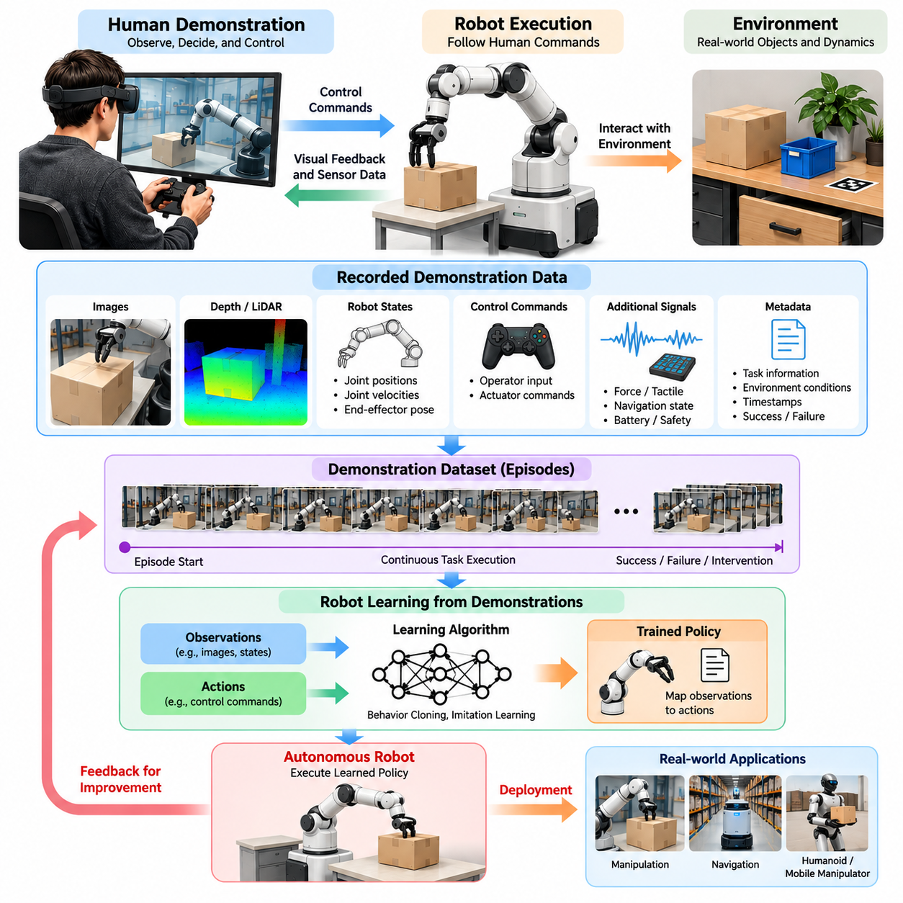{width="7.268055555555556in" height="7.268055555555556in"}

Human demonstration is a fundamental mechanism for transferring practical knowledge from people to robotic systems. Instead of requiring engineers to specify every movement through explicit programming, robots can learn from examples of human behavior. Demonstrations provide information about task objectives, action sequences, environmental constraints, and successful outcomes, establishing an important foundation for data-driven Physical AI.

Robot learning from human demonstration is commonly associated with imitation learning, also known as learning from demonstration. In this framework, a robot observes or records human-guided behavior and uses the resulting trajectories to develop an executable policy. The objective is not simply to reproduce individual movements but to acquire behavioral patterns that remain effective when environmental conditions change.

A demonstration typically consists of sequential observations, actions, robot states, and task outcomes. Observations describe the environment through cameras, depth sensors, or other perception devices, while actions represent commands applied to the robot. When these signals are synchronized, the dataset captures how particular decisions influence physical interactions and subsequent environmental states.

Human demonstrations can be collected through direct teleoperation, kinesthetic teaching, motion capture, wearable sensors, and immersive control interfaces. Each approach provides different relationships between human motion and robot execution. Teleoperation records commands executed through the robot itself, whereas human motion capture often requires additional transformation before the demonstrated behavior becomes executable.

The learning process begins by defining the task and identifying the information required for successful execution. For a robotic grasping task, demonstrations may include object observations, end-effector trajectories, gripper commands, and contact events. For mobile navigation, the relevant information may include obstacle positions, robot velocities, steering commands, and route decisions.

Behavior cloning is one of the most direct approaches to learning from demonstrations. A neural network is trained to predict an expert action from the corresponding observation or state. During training, the model minimizes differences between predicted actions and demonstrated actions. After training, the learned policy generates commands directly from incoming observations without requiring continuous human control.

Although behavior cloning is conceptually straightforward, it is vulnerable to distribution shift. Small prediction errors can move the robot into states that were rarely encountered during demonstration collection. Once the robot enters these unfamiliar states, additional prediction errors may accumulate. This problem becomes particularly serious during long-horizon manipulation or navigation tasks.

Interactive imitation learning addresses this limitation by incorporating feedback during policy execution. In approaches such as Dataset Aggregation, or DAgger, the learner visits states under its developing policy while an expert provides corrective action labels. The newly labeled states are added to the training dataset, helping the model learn appropriate responses beyond the original demonstration distribution.

Human demonstrations can also support inverse reinforcement learning, where the objective is to infer a reward function that explains expert behavior. Instead of directly copying demonstrated actions, the robot attempts to identify the underlying preferences or objectives. This approach can support adaptation when multiple action sequences achieve the same goal, although reward inference introduces additional computational complexity.

Demonstration quality strongly influences the resulting robot policy. Skilled operators generally provide precise, consistent, and efficient trajectories, while inexperienced operators may introduce unnecessary corrections or unstable movements. However, imperfect demonstrations can also reveal recovery strategies and alternative solutions. Dataset design must therefore distinguish undesirable noise from potentially valuable behavioral diversity.

Task diversity is another important factor in learning generalizable behavior. Repeated demonstrations under identical conditions may encourage memorization rather than robust adaptation. Varying object geometry, initial positions, lighting, workspace layouts, and environmental disturbances exposes the robot to broader operating conditions. Such diversity helps the learned policy respond to variations that arise during deployment.

Temporal structure plays a central role in human demonstration learning. Many robotic tasks require coordinated sequences of actions rather than isolated decisions. Opening a container, retrieving an object, and placing it elsewhere involves multiple dependent subtasks. Learning systems must capture these relationships to avoid locally reasonable actions that prevent successful completion of the overall objective.

Hierarchical imitation learning addresses long-horizon tasks by representing behavior at multiple levels of abstraction. High-level policies select goals or subtasks, while low-level controllers generate executable movements. Human demonstrations can provide supervision for both levels, allowing the robot to learn task organization alongside motor control. This separation can improve reuse of learned skills across related tasks.

The correspondence between human motion and robot embodiment introduces additional challenges. Human hands, arms, and bodies differ significantly from robotic mechanisms in joint structure, workspace, actuation, and physical constraints. Consequently, directly reproducing human motion may be impossible or unsafe. Motion retargeting and embodiment-aware representations are needed to translate demonstrations into feasible robot actions.

Contact-rich manipulation presents a particularly demanding learning problem because successful execution depends on forces, friction, compliance, and precise timing. Visual trajectories alone may not explain why an insertion or grasp succeeds. Combining demonstrations with tactile sensing, force measurements, and proprioceptive feedback allows learning systems to represent interactions that are otherwise difficult to infer.

Multimodal demonstrations can further improve learning by combining visual observations, robot states, language instructions, and action trajectories. Language provides semantic context describing what the robot should accomplish, while sensor and action data explain how the task is physically executed. This combination is especially relevant to Vision-Language-Action models that connect instructions with embodied behavior.

Learning from demonstration can also serve as an initialization strategy for reinforcement learning. An imitation-trained policy begins with useful behavior rather than relying entirely on random exploration. Reinforcement learning can then refine the policy through environmental feedback, potentially improving efficiency, robustness, or task success. This combination is particularly valuable when unrestricted physical exploration is expensive or unsafe.

Demonstrations should include information about success, failure, and corrective behavior whenever possible. Successful trajectories establish examples of desired execution, while failures reveal conditions associated with poor outcomes. Corrective demonstrations show how an operator recovers from unexpected states. Together, these examples provide a richer representation of task boundaries and operational uncertainty.

Human intervention during autonomous execution creates a continuous source of targeted training data. When a robot encounters a difficult situation, an operator can temporarily take control and demonstrate an appropriate response. Recording the preceding observations, intervention actions, and resulting outcomes enables subsequent training to address the specific weaknesses revealed during deployment.

A scalable demonstration-learning system requires consistent episode definitions, synchronized sensor streams, reliable timestamps, and standardized action representations. Metadata should identify the task, robot configuration, operator, environment, and execution outcome. These records support reproducibility, dataset filtering, model evaluation, and comparison across different collection campaigns or robotic platforms.

Data curation is necessary because collecting more demonstrations does not automatically produce better learning results. Redundant trajectories may contribute little new information, while corrupted or poorly synchronized episodes can degrade model performance. Quality assessment should consider task relevance, behavioral consistency, environmental coverage, and the presence of informative corrections or unusual situations.

Evaluation must measure whether a learned policy can execute tasks autonomously under conditions not represented directly in its training examples. Relevant measures include task success rate, completion time, intervention frequency, recovery performance, and safety violations. Testing across unfamiliar objects, environments, and initial states provides stronger evidence of generalization than performance on previously demonstrated scenarios.

The economic efficiency of human demonstration learning depends on how effectively human effort is converted into reusable robotic capability. Collecting demonstrations requires skilled operators, functioning hardware, and carefully managed environments. Active learning and uncertainty-based data collection can prioritize situations where additional demonstrations are most likely to improve the policy, reducing unnecessary collection effort.

Human demonstration learning also raises important safety and governance considerations. Robots must remain within appropriate physical operating limits during collection and autonomous execution. Recorded demonstrations may contain identifiable operator information or sensitive workplace observations. Responsible dataset management requires access controls, appropriate permissions, traceable provenance, and procedures for handling unsafe or unsuitable demonstrations.

Cross-embodiment learning expands the potential value of human demonstrations beyond a single robot platform. Shared representations of task goals, object relationships, and interaction outcomes may allow knowledge collected on one robot to benefit another. However, differences in morphology, sensing, and control capabilities require careful adaptation, and successful transfer must be established through physical evaluation.

Ultimately, human demonstration connects human expertise with autonomous robotic intelligence by transforming purposeful physical behavior into structured learning signals. Its effectiveness depends on demonstration quality, environmental diversity, temporal consistency, suitable learning algorithms, and rigorous evaluation. Integrated into a closed-loop data engine, demonstration learning provides a practical pathway toward increasingly capable, adaptable, and scalable Physical AI systems.

인간 시연(Human Demonstration)은 인간의 실용적 지식(Practical Knowledge)을 로봇 시스템(Robotic System)에 전달하는 핵심적인 메커니즘이다. 엔지니어가 모든 움직임을 명시적 프로그래밍(Explicit Programming)으로 지정하는 대신, 로봇은 인간 행동(Human Behavior)의 사례를 통해 학습할 수 있다. 시연 데이터는 작업 목표(Task Objective), 행동 시퀀스(Action Sequence), 환경 제약(Environmental Constraint), 성공 결과(Successful Outcome)에 관한 정보를 제공하며, 데이터 기반 피지컬 인공지능(Data-Driven Physical AI)의 중요한 기반을 형성한다.

인간 시연을 통한 로봇 학습(Robot Learning from Human Demonstration)은 일반적으로 시연 기반 학습(Learning from Demonstration)이라고도 하는 모방학습(Imitation Learning)과 관련된다. 이 체계에서 로봇은 인간이 지도한 행동(Human-Guided Behavior)을 관찰하거나 기록하고, 생성된 궤적(Trajectory)을 사용하여 실행 가능한 정책(Executable Policy)을 개발한다. 목표는 개별 움직임을 단순히 재현하는 것이 아니라 환경 조건(Environmental Condition)이 변화하더라도 효과적으로 작동하는 행동 패턴(Behavioral Pattern)을 습득하는 것이다.

시연 데이터(Demonstration Data)는 일반적으로 순차적인 관측 정보(Observation), 행동(Action), 로봇 상태(Robot State), 작업 결과(Task Outcome)로 구성된다. 관측 정보는 카메라(Camera), 깊이 센서(Depth Sensor) 또는 기타 인식 장치(Perception Device)를 통해 환경을 설명하며, 행동은 로봇에 적용되는 명령을 나타낸다. 이러한 신호가 동기화(Synchronization)되면 데이터셋은 특정 의사결정이 물리적 상호작용(Physical Interaction)과 이후 환경 상태(Environmental State)에 어떤 영향을 미치는지 기록한다.

인간 시연은 직접 원격조작(Direct Teleoperation), 직접 교시(Kinesthetic Teaching), 모션 캡처(Motion Capture), 웨어러블 센서(Wearable Sensor), 몰입형 제어 인터페이스(Immersive Control Interface)를 통해 수집할 수 있다. 각 방식은 인간의 움직임(Human Motion)과 로봇 실행(Robot Execution) 사이에 서로 다른 관계를 제공한다. 원격조작은 로봇 자체를 통해 실행된 명령을 기록하는 반면, 인간 모션 캡처는 시연된 행동을 실행 가능한 로봇 동작으로 변환하기 위한 추가적인 과정이 필요한 경우가 많다.

학습 과정(Learning Process)은 작업을 정의하고 성공적인 실행에 필요한 정보를 식별하는 단계에서 시작된다. 로봇 파지 작업(Robotic Grasping Task)의 경우 시연 데이터에는 물체 관측 정보(Object Observation), 말단효과기 궤적(End-Effector Trajectory), 그리퍼 명령(Gripper Command), 접촉 이벤트(Contact Event)가 포함될 수 있다. 이동 내비게이션(Mobile Navigation)의 경우 관련 정보에는 장애물 위치(Obstacle Position), 로봇 속도(Robot Velocity), 조향 명령(Steering Command), 경로 의사결정(Route Decision)이 포함될 수 있다.

행동 복제(Behavior Cloning)는 시연을 통한 학습에서 가장 직접적인 접근법 중 하나이다. 신경망(Neural Network)은 해당 관측 정보 또는 상태에 대응하는 전문가 행동(Expert Action)을 예측하도록 학습된다. 학습 과정에서 모델은 예측 행동(Predicted Action)과 시연 행동(Demonstrated Action) 사이의 차이를 최소화한다. 학습이 완료되면 학습된 정책(Learned Policy)은 지속적인 인간 제어 없이 입력되는 관측 정보로부터 직접 명령을 생성한다.

행동 복제는 개념적으로 간단하지만 분포 이동(Distribution Shift)에 취약하다. 작은 예측 오류(Prediction Error)만으로도 로봇은 시연 수집 과정에서 거의 경험하지 못한 상태로 이동할 수 있다. 로봇이 이러한 익숙하지 않은 상태(Unfamiliar State)에 진입하면 추가적인 예측 오류가 누적될 수 있다. 이 문제는 특히 장기 시간 범위 조작(Long-Horizon Manipulation)이나 내비게이션 작업(Navigation Task)에서 심각해진다.

상호작용형 모방학습(Interactive Imitation Learning)은 정책 실행(Policy Execution) 과정에서 피드백(Feedback)을 통합하여 이러한 한계를 해결한다. 데이터셋 집계(Dataset Aggregation, DAgger)와 같은 접근법에서는 학습 중인 정책이 실제로 방문하는 상태에 대해 전문가가 교정 행동 레이블(Corrective Action Label)을 제공한다. 새롭게 레이블이 부여된 상태는 학습 데이터셋(Training Dataset)에 추가되며, 이를 통해 모델은 기존 시연 분포(Demonstration Distribution)를 벗어난 상황에서도 적절하게 대응하는 방법을 학습한다.

인간 시연은 전문가 행동(Expert Behavior)을 설명하는 보상 함수(Reward Function)를 추론하는 역강화학습(Inverse Reinforcement Learning)도 지원할 수 있다. 로봇은 시연된 행동을 직접 복제하는 대신 그 행동에 내재된 선호(Preference)나 목표(Objective)를 식별하려고 시도한다. 이러한 접근법은 여러 행동 시퀀스(Action Sequence)가 동일한 목표를 달성할 수 있는 상황에서 적응(Adaptation)을 지원하지만, 보상 추론(Reward Inference)에는 추가적인 계산 복잡성(Computational Complexity)이 수반된다.

시연 품질(Demonstration Quality)은 학습된 로봇 정책(Robot Policy)에 큰 영향을 미친다. 숙련된 작업자(Skilled Operator)는 일반적으로 정밀하고 일관되며 효율적인 궤적을 제공하는 반면, 경험이 부족한 작업자는 불필요한 보정 동작(Unnecessary Correction)이나 불안정한 움직임(Unstable Movement)을 발생시킬 수 있다. 그러나 불완전한 시연(Imperfect Demonstration)도 복구 전략(Recovery Strategy)과 대안적 해결 방법(Alternative Solution)을 보여줄 수 있다. 따라서 데이터셋 설계(Dataset Design)에서는 바람직하지 않은 잡음(Undesirable Noise)과 잠재적으로 유용한 행동 다양성(Behavioral Diversity)을 구분해야 한다.

작업 다양성(Task Diversity)은 일반화 가능한 행동(Generalizable Behavior)을 학습하는 데 중요한 또 다른 요소이다. 동일한 조건에서 반복된 시연은 강건한 적응(Robust Adaptation)보다 암기(Memorization)를 유도할 수 있다. 물체 형상(Object Geometry), 초기 위치(Initial Position), 조명(Lighting), 작업 공간 배치(Workspace Layout), 환경 교란(Environmental Disturbance)을 다양하게 변화시키면 로봇은 더 넓은 운용 조건(Operating Condition)을 경험할 수 있다. 이러한 다양성은 배포 이후 발생하는 변화에 학습된 정책이 대응하는 데 도움이 된다.

시간적 구조(Temporal Structure)는 인간 시연 학습(Human Demonstration Learning)에서 핵심적인 역할을 한다. 많은 로봇 작업은 독립적인 의사결정이 아니라 조정된 행동 시퀀스(Coordinated Action Sequence)를 요구한다. 용기를 열고 물체를 꺼낸 다음 다른 위치에 놓는 작업에는 서로 의존하는 여러 하위 작업(Subtask)이 포함된다. 학습 시스템은 전체 목표의 성공을 방해하는 국소적으로 합리적인 행동(Locally Reasonable Action)을 피하기 위해 이러한 관계를 학습해야 한다.

계층적 모방학습(Hierarchical Imitation Learning)은 행동을 여러 추상화 수준(Abstraction Level)으로 표현하여 장기 시간 범위 작업(Long-Horizon Task)을 처리한다. 상위 수준 정책(High-Level Policy)은 목표나 하위 작업을 선택하고, 하위 수준 제어기(Low-Level Controller)는 실행 가능한 움직임을 생성한다. 인간 시연은 두 수준 모두에 지도 정보(Supervision)를 제공할 수 있으므로 로봇은 운동 제어(Motor Control)와 함께 작업 구성(Task Organization)을 학습할 수 있다. 이러한 분리는 관련 작업 전반에서 학습된 기술(Skill)의 재사용성을 향상시킬 수 있다.

인간 움직임(Human Motion)과 로봇 신체 구조(Robot Embodiment) 사이의 대응 관계(Correspondence)는 추가적인 과제를 발생시킨다. 인간의 손, 팔, 신체는 관절 구조(Joint Structure), 작업 공간(Workspace), 구동 방식(Actuation), 물리적 제약(Physical Constraint) 측면에서 로봇 메커니즘(Robotic Mechanism)과 상당한 차이가 있다. 따라서 인간 움직임을 직접 재현하는 것이 불가능하거나 안전하지 않을 수 있다. 시연을 실행 가능한 로봇 행동으로 변환하려면 동작 재매핑(Motion Retargeting)과 신체 구조 인식 표현(Embodiment-Aware Representation)이 필요하다.

접촉이 많은 조작(Contact-Rich Manipulation)은 성공적인 실행이 힘(Force), 마찰(Friction), 유연성(Compliance), 정밀한 타이밍(Precise Timing)에 의존하기 때문에 특히 어려운 학습 문제이다. 시각적 궤적(Visual Trajectory)만으로는 삽입(Insertion)이나 파지(Grasping)가 성공한 이유를 설명하지 못할 수 있다. 시연 데이터에 촉각 센싱(Tactile Sensing), 힘 측정(Force Measurement), 고유수용감각 피드백(Proprioceptive Feedback)을 결합하면 다른 방법으로 추론하기 어려운 상호작용을 학습 시스템이 표현할 수 있다.

다중모달 시연(Multimodal Demonstration)은 시각적 관측 정보(Visual Observation), 로봇 상태(Robot State), 언어 지시(Language Instruction), 행동 궤적(Action Trajectory)을 결합하여 학습 성능을 더욱 향상시킬 수 있다. 언어는 로봇이 달성해야 할 목표를 설명하는 의미적 맥락(Semantic Context)을 제공하고, 센서 및 행동 데이터는 작업이 물리적으로 어떻게 실행되는지 설명한다. 이러한 조합은 지시와 신체화된 행동(Embodied Behavior)을 연결하는 시각-언어-행동 모델(Vision-Language-Action Model, VLA)과 특히 관련성이 높다.

시연 기반 학습(Learning from Demonstration)은 강화학습(Reinforcement Learning)의 초기화 전략(Initialization Strategy)으로도 활용할 수 있다. 모방학습으로 사전 학습된 정책(Imitation-Trained Policy)은 무작위 탐색(Random Exploration)에 전적으로 의존하지 않고 유용한 행동에서 시작할 수 있다. 이후 강화학습은 환경 피드백(Environmental Feedback)을 통해 정책을 개선하여 효율성(Efficiency), 강건성(Robustness), 작업 성공률(Task Success Rate)을 향상시킬 수 있다. 이러한 결합은 제한 없는 물리적 탐색이 비용이 많이 들거나 위험한 경우 특히 유용하다.

가능한 경우 시연 데이터에는 성공(Success), 실패(Failure), 교정 행동(Corrective Behavior)에 관한 정보를 포함해야 한다. 성공 궤적(Successful Trajectory)은 바람직한 실행의 사례를 제공하고, 실패는 좋지 않은 결과와 관련된 조건을 보여준다. 교정 시연(Corrective Demonstration)은 작업자가 예상하지 못한 상태에서 어떻게 복구하는지를 보여준다. 이러한 사례를 결합하면 작업 경계(Task Boundary)와 운용 불확실성(Operational Uncertainty)을 더욱 풍부하게 표현할 수 있다.

자율 실행(Autonomous Execution) 중 인간 개입(Human Intervention)은 목표 지향적 학습 데이터(Targeted Training Data)를 지속적으로 생성하는 원천이 된다. 로봇이 어려운 상황에 직면하면 작업자는 일시적으로 제어권을 인수하여 적절한 대응 방법을 시연할 수 있다. 개입 이전의 관측 정보(Pre-Intervention Observation), 개입 행동(Intervention Action), 결과(Outcome)를 기록하면 이후 학습 과정에서 실제 배포 중 드러난 특정 취약점(Weakness)을 개선할 수 있다.

확장 가능한 시연 학습 시스템(Scalable Demonstration-Learning System)을 구축하려면 일관된 에피소드 정의(Episode Definition), 동기화된 센서 스트림(Synchronized Sensor Stream), 신뢰할 수 있는 타임스탬프(Reliable Timestamp), 표준화된 행동 표현(Standardized Action Representation)이 필요하다. 메타데이터(Metadata)에는 작업(Task), 로봇 구성(Robot Configuration), 작업자(Operator), 환경(Environment), 실행 결과(Execution Outcome)를 식별할 수 있는 정보가 포함되어야 한다. 이러한 기록은 재현성(Reproducibility), 데이터셋 필터링(Dataset Filtering), 모델 평가(Model Evaluation), 서로 다른 수집 작업이나 로봇 플랫폼 간 비교를 지원한다.

더 많은 시연을 수집한다고 해서 반드시 더 좋은 학습 결과가 생성되는 것은 아니므로 데이터 정제(Data Curation)가 필요하다. 중복 궤적(Redundant Trajectory)은 새로운 정보를 거의 제공하지 못할 수 있으며, 손상되거나 동기화가 불량한 에피소드(Corrupted or Poorly Synchronized Episode)는 모델 성능을 저하시킬 수 있다. 품질 평가(Quality Assessment)에서는 작업 관련성(Task Relevance), 행동 일관성(Behavioral Consistency), 환경 포괄 범위(Environmental Coverage), 유용한 교정 행동이나 비정상 상황의 포함 여부를 고려해야 한다.

평가(Evaluation)는 학습된 정책(Learned Policy)이 학습 사례에 직접 포함되지 않은 조건에서도 자율적으로 작업을 수행할 수 있는지 측정해야 한다. 관련 평가 지표(Evaluation Metric)에는 작업 성공률(Task Success Rate), 완료 시간(Completion Time), 개입 빈도(Intervention Frequency), 복구 성능(Recovery Performance), 안전 위반(Safety Violation)이 포함된다. 익숙하지 않은 물체, 환경, 초기 상태에서 수행하는 테스트는 기존에 시연된 상황에서의 성능보다 일반화(Generalization)에 대한 더 강력한 근거를 제공한다.

인간 시연 학습(Human Demonstration Learning)의 경제적 효율성(Economic Efficiency)은 인간의 노력이 재사용 가능한 로봇 능력(Reusable Robotic Capability)으로 얼마나 효과적으로 전환되는지에 따라 결정된다. 시연 수집에는 숙련된 작업자(Skilled Operator), 정상적으로 작동하는 하드웨어(Functional Hardware), 체계적으로 관리되는 환경(Managed Environment)이 필요하다. 능동학습(Active Learning)과 불확실성 기반 데이터 수집(Uncertainty-Based Data Collection)은 추가 시연이 정책 개선에 가장 크게 기여할 가능성이 높은 상황을 우선하여 불필요한 수집 노력을 줄일 수 있다.

인간 시연 학습은 중요한 안전성(Safety) 및 거버넌스(Governance) 문제도 수반한다. 로봇은 데이터 수집과 자율 실행 과정에서 적절한 물리적 운용 한계(Physical Operating Limit)를 준수해야 한다. 기록된 시연에는 식별 가능한 작업자 정보(Identifiable Operator Information)나 민감한 작업장 관측 정보(Sensitive Workplace Observation)가 포함될 수 있다. 책임 있는 데이터셋 관리(Responsible Dataset Management)를 위해서는 접근 제어(Access Control), 적절한 사용 권한(Permission), 추적 가능한 데이터 출처(Provenance), 안전하지 않거나 부적절한 시연을 처리하는 절차가 필요하다.

신체 구조 간 학습(Cross-Embodiment Learning)은 인간 시연의 잠재적 가치를 단일 로봇 플랫폼을 넘어 확장한다. 작업 목표(Task Goal), 물체 관계(Object Relationship), 상호작용 결과(Interaction Outcome)에 대한 공유 표현(Shared Representation)을 활용하면 한 로봇에서 수집한 지식이 다른 로봇에도 도움이 될 수 있다. 그러나 형태(Morphology), 센싱(Sensing), 제어 능력(Control Capability)의 차이로 인해 신중한 적응(Adaptation)이 필요하며, 성공적인 전이(Transfer)는 실제 물리적 평가(Physical Evaluation)를 통해 검증해야 한다.

궁극적으로 인간 시연(Human Demonstration)은 목적을 가진 물리적 행동(Purposeful Physical Behavior)을 구조화된 학습 신호(Structured Learning Signal)로 변환함으로써 인간의 전문성(Human Expertise)과 자율 로봇 지능(Autonomous Robotic Intelligence)을 연결한다. 그 효과는 시연 품질(Demonstration Quality), 환경 다양성(Environmental Diversity), 시간적 일관성(Temporal Consistency), 적절한 학습 알고리즘(Learning Algorithm), 엄격한 평가(Rigorous Evaluation)에 달려 있다. 폐루프 데이터 엔진(Closed-Loop Data Engine)에 통합된 시연 학습은 더욱 높은 능력과 적응성, 확장성을 갖춘 피지컬 인공지능(Physical AI) 시스템으로 발전하기 위한 실용적인 경로를 제공한다.

##  

## 02.03. Teleoperation System Architectures

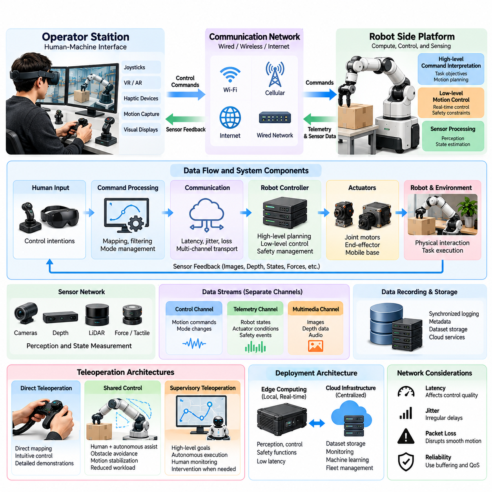{width="7.268055555555556in" height="7.268055555555556in"}

Teleoperation system architecture defines how human operators, communication networks, robotic controllers, and sensing devices interact to enable remote physical control. A well-designed architecture must support reliable command transmission, timely feedback, operational safety, and synchronized data collection. These capabilities are essential for both effective human control and the generation of high-quality Physical AI training datasets.

A typical teleoperation system consists of an operator station, communication infrastructure, robot-side computing platform, control subsystem, and sensor network. The operator station converts human inputs into control commands, while the robot-side platform interprets and executes them. Sensor feedback returns information about the robot and its environment, forming a continuous closed-loop interaction between human intention and physical execution.

The operator station serves as the human-machine interface through which remote control decisions are made. It may include joysticks, virtual reality headsets, motion capture devices, haptic controllers, and visual displays. Interface design determines how effectively operators perceive environmental conditions and express intended actions. Ergonomics, feedback quality, command precision, and cognitive workload directly influence operational performance.

The robot-side architecture typically separates high-level command interpretation from low-level motion control. High-level components translate operator instructions into target positions, velocities, or task-level objectives. Low-level controllers regulate actuators using sensor feedback and real-time control algorithms. This separation allows human commands to remain flexible while maintaining stable execution under physical constraints.

Communication architecture determines how control commands and sensor feedback travel between the operator and robot. Local wired networks generally provide predictable latency and high bandwidth, while wireless networks enable mobility and geographically distributed operation. Remote teleoperation may use Wi-Fi, private cellular networks, or internet connections, each introducing different characteristics in latency, jitter, packet loss, and availability.

Latency is a critical architectural constraint because teleoperation depends on timely feedback. Delays between operator commands and robot responses can produce overshoot, oscillation, hesitation, or unstable interactions. The acceptable delay depends on task dynamics and control frequency. Precision manipulation and contact-rich operations generally require more careful latency management than slow supervisory navigation.

Network jitter and packet loss introduce additional uncertainty into command execution. Irregular message arrival can disrupt smooth motion even when average latency remains acceptable. Communication systems therefore require sequence numbering, timestamps, buffering policies, and appropriate transport mechanisms. Safety-critical commands should be handled separately from bandwidth-intensive sensor streams whenever necessary.

Teleoperation systems commonly employ different communication channels for control, telemetry, and multimedia data. Control channels transmit motion commands and mode changes, while telemetry channels report robot states, actuator conditions, and safety events. Multimedia channels carry camera images, depth information, or audio. Separating these streams allows independent prioritization according to bandwidth, reliability, and timing requirements.

The choice between centralized and distributed architectures affects scalability and resilience. In centralized systems, a primary computing platform manages command processing, monitoring, and data recording. Distributed architectures allocate perception, control, safety, and communication functions across multiple processors. Distribution can reduce computational bottlenecks but introduces additional requirements for synchronization and fault management.

Edge computing plays an important role in modern teleoperation architectures. Processing visual observations, estimating robot states, and enforcing safety constraints close to the robot reduces dependence on remote communication. Edge controllers can continue essential stabilization and collision prevention even when network connectivity deteriorates. This separation is especially important for mobile robots and manipulators operating near people.

Cloud infrastructure can complement edge computing by providing centralized monitoring, dataset storage, operator coordination, and machine learning services. However, cloud systems should not be responsible for control functions that require deterministic real-time execution. A practical architecture assigns time-critical control and safety functions to local computing resources while using cloud services for scalable data processing and operational management.

Direct teleoperation architectures map operator inputs into robot commands with limited autonomous interpretation. This approach provides intuitive control and preserves detailed human decision-making behavior. However, operators must continuously manage the robot\'s movements and respond to environmental changes. Direct control is useful for collecting demonstrations but can become demanding during complex or prolonged operations.

Shared-control architectures combine human commands with autonomous assistance. The robot may provide obstacle avoidance, motion stabilization, grasp alignment, or workspace constraint enforcement while the operator specifies movement intentions. This arrangement can improve safety and reduce workload. Nevertheless, training datasets must distinguish human-generated commands from autonomous corrections to preserve accurate behavioral interpretation.

Supervisory teleoperation operates at a higher level of abstraction. Instead of continuously commanding individual movements, operators assign goals, approve plans, or intervene when autonomous execution encounters difficulties. The robot performs routine actions independently while maintaining communication with the operator. This architecture supports scalable fleet supervision but generates different forms of demonstration data than direct control.

Control authority management is essential when multiple control sources influence the same robot. Human commands, autonomous policies, safety controllers, and recovery mechanisms may issue conflicting instructions. The architecture must define explicit priorities, ownership transitions, and arbitration rules. Recording these transitions is also important for identifying whether observed actions originated from human decisions or autonomous control.

Sensor architecture determines the quality and completeness of feedback available to the operator. Cameras provide visual context, depth sensors estimate spatial geometry, and proprioceptive sensors report internal robot motion. Force and tactile sensors become important during contact-rich manipulation. Combining these modalities can improve situational awareness, although additional sensing increases bandwidth, processing, and synchronization requirements.

Visual feedback architecture must balance image quality against communication delay. High-resolution video improves object recognition and manipulation precision but requires substantial bandwidth. Compression, adaptive resolution, selective streaming, and region-of-interest processing can reduce transmission demands. However, aggressive compression may remove visual details needed for precise contact or obstacle assessment.

Haptic feedback introduces a bidirectional physical interaction channel between the operator and robot. Force measurements from the robot can be transformed into resistance or vibration at the operator interface. This improves perception of contact conditions but creates additional stability challenges when communication is delayed. Passivity-based control, local damping, and appropriate feedback filtering can help maintain stable interaction.

Real-time control architecture must distinguish between hard timing requirements and best-effort communication. Joint stabilization, actuator protection, and emergency responses may require deterministic execution, while video visualization and cloud logging can tolerate variable delays. Scheduling critical functions independently prevents communication congestion or data recording workloads from interfering with essential robot behavior.

Time synchronization is particularly important when teleoperation serves as a training data source. Sensor observations, operator inputs, controller outputs, and executed robot states must share a consistent temporal reference. Hardware timestamps, synchronized clocks, and calibrated communication delays help reconstruct the correct causal sequence. Without reliable alignment, collected trajectories may contain misleading observation-action relationships.

Data recording architecture should capture both the operator\'s intended commands and the robot\'s actual responses. Useful records include raw interface inputs, transformed control targets, actuator measurements, sensor observations, and task outcomes. Recording control modes and safety interventions provides additional context. These distinctions allow downstream learning systems to separate demonstrated intentions from execution limitations.

Safety architecture must remain operational independently of remote human supervision. Emergency stopping, collision monitoring, joint limits, velocity restrictions, and protective zones should be enforced locally. When communication fails, the robot should transition to a predefined safe behavior appropriate to its operating environment. A simple universal stop command may not be sufficient for dynamically unstable platforms.

Fault tolerance is necessary because teleoperation involves interconnected components that can fail independently. Network interruptions, sensor faults, operator interface failures, and controller crashes require explicit detection and recovery procedures. Heartbeat monitoring, watchdog timers, communication timeout policies, and controlled reconnection mechanisms can reduce operational risk while preserving information about failure events.

Cybersecurity is another architectural requirement because teleoperation exposes physical control systems to communication networks. Authentication, encrypted communication, access control, and command validation help prevent unauthorized operation. Software updates and remote maintenance interfaces require additional protection. Security incidents must be treated as potential physical safety risks rather than merely information technology failures.

Scalable teleoperation architectures must also support multiple robots, operators, and operational sites. Centralized scheduling can allocate available operators to robots requiring assistance, while fleet management systems track connectivity, task progress, and intervention requests. Standardized interfaces and common data formats simplify integration across heterogeneous platforms, although robot-specific control capabilities must remain explicitly represented.

Ultimately, teleoperation system architecture connects human intelligence, communication technology, robotic control, and data infrastructure into a coordinated operational framework. Its effectiveness depends on latency management, distributed computation, multimodal feedback, safety enforcement, and accurate recording. A carefully designed architecture enables reliable remote operation while producing structured, reusable data for continuous Physical AI learning.

원격조작 시스템 아키텍처(Teleoperation System Architecture)는 인간 작업자(Human Operator), 통신 네트워크(Communication Network), 로봇 제어기(Robotic Controller), 센싱 장치(Sensing Device)가 상호작용하여 원격 물리적 제어(Remote Physical Control)를 수행하는 방식을 정의한다. 잘 설계된 아키텍처는 신뢰할 수 있는 명령 전송(Command Transmission), 적시 피드백(Timely Feedback), 운용 안전성(Operational Safety), 동기화된 데이터 수집(Synchronized Data Collection)을 지원해야 한다. 이러한 기능은 효과적인 인간 제어와 고품질 피지컬 인공지능(Physical AI) 학습 데이터셋 생성에 필수적이다.

일반적인 원격조작 시스템(Teleoperation System)은 작업자 스테이션(Operator Station), 통신 인프라(Communication Infrastructure), 로봇 측 컴퓨팅 플랫폼(Robot-Side Computing Platform), 제어 하위 시스템(Control Subsystem), 센서 네트워크(Sensor Network)로 구성된다. 작업자 스테이션은 인간의 입력을 제어 명령(Control Command)으로 변환하고, 로봇 측 플랫폼은 이를 해석하고 실행한다. 센서 피드백(Sensor Feedback)은 로봇과 주변 환경에 관한 정보를 반환하여 인간의 의도와 물리적 실행 사이에 지속적인 폐루프 상호작용(Closed-Loop Interaction)을 형성한다.

작업자 스테이션(Operator Station)은 원격 제어 의사결정(Remote Control Decision)이 이루어지는 인간-기계 인터페이스(Human-Machine Interface) 역할을 한다. 여기에는 조이스틱(Joystick), 가상현실 헤드셋(Virtual Reality Headset), 모션 캡처 장치(Motion Capture Device), 햅틱 제어기(Haptic Controller), 시각적 디스플레이(Visual Display)가 포함될 수 있다. 인터페이스 설계(Interface Design)는 작업자가 환경 조건을 얼마나 효과적으로 인식하고 의도한 행동을 표현할 수 있는지를 결정한다. 인간공학(Ergonomics), 피드백 품질(Feedback Quality), 명령 정밀도(Command Precision), 인지 부하(Cognitive Workload)는 운용 성능에 직접적인 영향을 미친다.

로봇 측 아키텍처(Robot-Side Architecture)는 일반적으로 상위 수준 명령 해석(High-Level Command Interpretation)과 하위 수준 동작 제어(Low-Level Motion Control)를 분리한다. 상위 수준 구성 요소는 작업자 지시를 목표 위치(Target Position), 속도(Velocity), 작업 수준 목표(Task-Level Objective)로 변환한다. 하위 수준 제어기(Low-Level Controller)는 센서 피드백과 실시간 제어 알고리즘(Real-Time Control Algorithm)을 사용하여 구동기(Actuator)를 제어한다. 이러한 분리는 인간 명령의 유연성을 유지하면서 물리적 제약(Physical Constraint) 내에서 안정적인 실행을 가능하게 한다.

통신 아키텍처(Communication Architecture)는 제어 명령과 센서 피드백이 작업자와 로봇 사이에서 전달되는 방식을 결정한다. 로컬 유선 네트워크(Local Wired Network)는 일반적으로 예측 가능한 지연 시간(Latency)과 높은 대역폭(Bandwidth)을 제공하는 반면, 무선 네트워크(Wireless Network)는 이동성과 지리적으로 분산된 운용을 가능하게 한다. 원격조작에는 와이파이(Wi-Fi), 사설 셀룰러 네트워크(Private Cellular Network), 인터넷 연결(Internet Connection)이 사용될 수 있으며, 각각 지연 시간, 지터(Jitter), 패킷 손실(Packet Loss), 가용성(Availability) 측면에서 서로 다른 특성을 가진다.

지연 시간(Latency)은 원격조작이 적시에 제공되는 피드백에 의존하기 때문에 핵심적인 아키텍처 제약(Architectural Constraint)이다. 작업자 명령과 로봇 응답 사이의 지연은 오버슈트(Overshoot), 진동(Oscillation), 주저하는 동작(Hesitation), 불안정한 상호작용(Unstable Interaction)을 유발할 수 있다. 허용 가능한 지연 시간은 작업 동역학(Task Dynamics)과 제어 주파수(Control Frequency)에 따라 달라진다. 정밀 조작(Precision Manipulation)과 접촉이 많은 작업(Contact-Rich Operation)은 일반적으로 저속 감독형 내비게이션(Supervisory Navigation)보다 더욱 세심한 지연 관리(Latency Management)가 필요하다.

네트워크 지터(Network Jitter)와 패킷 손실(Packet Loss)은 명령 실행(Command Execution)에 추가적인 불확실성(Uncertainty)을 발생시킨다. 평균 지연 시간이 허용 가능한 수준이더라도 불규칙한 메시지 도착(Irregular Message Arrival)은 부드러운 움직임을 방해할 수 있다. 따라서 통신 시스템에는 시퀀스 번호(Sequence Number), 타임스탬프(Timestamp), 버퍼링 정책(Buffering Policy), 적절한 전송 메커니즘(Transport Mechanism)이 필요하다. 필요한 경우 안전 필수 명령(Safety-Critical Command)은 대역폭을 많이 사용하는 센서 스트림(Sensor Stream)과 분리하여 처리해야 한다.

원격조작 시스템은 일반적으로 제어(Control), 텔레메트리(Telemetry), 멀티미디어 데이터(Multimedia Data)를 위한 서로 다른 통신 채널(Communication Channel)을 사용한다. 제어 채널(Control Channel)은 동작 명령(Motion Command)과 모드 변경(Mode Change)을 전송하고, 텔레메트리 채널(Telemetry Channel)은 로봇 상태(Robot State), 구동기 상태(Actuator Condition), 안전 이벤트(Safety Event)를 보고한다. 멀티미디어 채널(Multimedia Channel)은 카메라 영상(Camera Image), 깊이 정보(Depth Information), 오디오(Audio)를 전달한다. 이러한 스트림을 분리하면 대역폭, 신뢰성, 타이밍 요구사항(Timing Requirement)에 따라 독립적인 우선순위 설정(Prioritization)이 가능하다.

중앙집중형 아키텍처(Centralized Architecture)와 분산형 아키텍처(Distributed Architecture)의 선택은 확장성(Scalability)과 복원력(Resilience)에 영향을 미친다. 중앙집중형 시스템에서는 주요 컴퓨팅 플랫폼(Primary Computing Platform)이 명령 처리(Command Processing), 모니터링(Monitoring), 데이터 기록(Data Recording)을 관리한다. 분산형 아키텍처는 인식(Perception), 제어(Control), 안전(Safety), 통신(Communication) 기능을 여러 프로세서(Processor)에 분산한다. 분산 처리는 계산 병목 현상(Computational Bottleneck)을 줄일 수 있지만 동기화(Synchronization)와 장애 관리(Fault Management)에 대한 추가 요구사항을 발생시킨다.

엣지 컴퓨팅(Edge Computing)은 현대적인 원격조작 아키텍처에서 중요한 역할을 한다. 로봇 가까이에서 시각적 관측 정보(Visual Observation)를 처리하고, 로봇 상태를 추정하며, 안전 제약(Safety Constraint)을 적용하면 원격 통신에 대한 의존도를 줄일 수 있다. 엣지 제어기(Edge Controller)는 네트워크 연결 상태가 악화되더라도 필수적인 안정화(Stabilization)와 충돌 방지(Collision Prevention)를 지속할 수 있다. 이러한 분리는 사람 근처에서 작동하는 이동로봇(Mobile Robot)과 매니퓰레이터(Manipulator)에 특히 중요하다.

클라우드 인프라(Cloud Infrastructure)는 중앙집중형 모니터링(Centralized Monitoring), 데이터셋 저장(Dataset Storage), 작업자 조정(Operator Coordination), 머신러닝 서비스(Machine Learning Service)를 제공하여 엣지 컴퓨팅을 보완할 수 있다. 그러나 클라우드 시스템이 결정론적 실시간 실행(Deterministic Real-Time Execution)이 필요한 제어 기능을 담당해서는 안 된다. 실용적인 아키텍처는 시간에 민감한 제어 및 안전 기능(Time-Critical Control and Safety Function)을 로컬 컴퓨팅 자원(Local Computing Resource)에 배치하고, 확장 가능한 데이터 처리와 운용 관리를 위해 클라우드 서비스를 활용한다.

직접 원격조작 아키텍처(Direct Teleoperation Architecture)는 제한적인 자율 해석(Autonomous Interpretation)만을 적용하여 작업자 입력을 로봇 명령으로 매핑(Mapping)한다. 이 접근법은 직관적인 제어(Intuitive Control)를 제공하고 인간의 상세한 의사결정 행동(Human Decision-Making Behavior)을 보존한다. 그러나 작업자는 로봇 움직임을 지속적으로 관리하고 환경 변화에 대응해야 한다. 직접 제어(Direct Control)는 시연 데이터 수집(Demonstration Data Collection)에 유용하지만 복잡하거나 장시간 수행되는 작업에서는 부담이 커질 수 있다.

공유 제어 아키텍처(Shared-Control Architecture)는 인간 명령(Human Command)과 자율 보조 기능(Autonomous Assistance)을 결합한다. 로봇은 작업자가 이동 의도(Movement Intention)를 지정하는 동안 장애물 회피(Obstacle Avoidance), 동작 안정화(Motion Stabilization), 파지 정렬(Grasp Alignment), 작업 공간 제약 적용(Workspace Constraint Enforcement)을 수행할 수 있다. 이러한 구성은 안전성을 높이고 작업 부담(Workload)을 줄일 수 있다. 그러나 학습 데이터셋에서는 행동을 정확하게 해석할 수 있도록 인간이 생성한 명령과 자율 시스템의 보정 동작(Autonomous Correction)을 구분해야 한다.

감독형 원격조작(Supervisory Teleoperation)은 더 높은 추상화 수준(Abstraction Level)에서 작동한다. 작업자는 개별 움직임을 지속적으로 명령하는 대신 목표를 할당하고, 계획을 승인하거나, 자율 실행 중 문제가 발생했을 때 개입한다. 로봇은 작업자와 통신을 유지하면서 일상적인 행동을 독립적으로 수행한다. 이러한 아키텍처는 확장 가능한 로봇 군집 감독(Fleet Supervision)을 지원하지만 직접 제어와는 다른 형태의 시연 데이터(Demonstration Data)를 생성한다.

여러 제어 소스(Control Source)가 동일한 로봇에 영향을 미치는 경우 제어 권한 관리(Control Authority Management)가 필수적이다. 인간 명령(Human Command), 자율 정책(Autonomous Policy), 안전 제어기(Safety Controller), 복구 메커니즘(Recovery Mechanism)은 서로 충돌하는 지시를 생성할 수 있다. 아키텍처는 명확한 우선순위(Priority), 제어권 전환(Ownership Transition), 중재 규칙(Arbitration Rule)을 정의해야 한다. 이러한 전환을 기록하는 것은 관측된 행동이 인간의 의사결정에서 비롯되었는지 자율 제어에서 비롯되었는지 식별하는 데도 중요하다.

센서 아키텍처(Sensor Architecture)는 작업자가 사용할 수 있는 피드백의 품질(Feedback Quality)과 완전성(Completeness)을 결정한다. 카메라(Camera)는 시각적 맥락(Visual Context)을 제공하고, 깊이 센서(Depth Sensor)는 공간 기하학(Spatial Geometry)을 추정하며, 고유수용감각 센서(Proprioceptive Sensor)는 로봇 내부 움직임을 보고한다. 힘 센서(Force Sensor)와 촉각 센서(Tactile Sensor)는 접촉이 많은 조작(Contact-Rich Manipulation)에서 중요하다. 이러한 모달리티(Modality)를 결합하면 상황 인식(Situational Awareness)을 향상시킬 수 있지만 추가적인 센싱은 대역폭, 처리, 동기화 요구사항을 증가시킨다.

시각적 피드백 아키텍처(Visual Feedback Architecture)는 영상 품질(Image Quality)과 통신 지연(Communication Delay) 사이의 균형을 유지해야 한다. 고해상도 영상(High-Resolution Video)은 물체 인식(Object Recognition)과 조작 정밀도(Manipulation Precision)를 향상시키지만 상당한 대역폭이 필요하다. 압축(Compression), 적응형 해상도(Adaptive Resolution), 선택적 스트리밍(Selective Streaming), 관심 영역 처리(Region-of-Interest Processing)는 전송 요구량을 줄일 수 있다. 그러나 과도한 압축은 정밀한 접촉이나 장애물 평가에 필요한 시각적 세부 정보를 제거할 수 있다.

햅틱 피드백(Haptic Feedback)은 작업자와 로봇 사이에 양방향 물리적 상호작용 채널(Bidirectional Physical Interaction Channel)을 도입한다. 로봇에서 측정된 힘(Force Measurement)은 작업자 인터페이스에서 저항(Resistance)이나 진동(Vibration)으로 변환될 수 있다. 이는 접촉 조건(Contact Condition)에 대한 인식을 향상시키지만 통신 지연이 발생하면 추가적인 안정성 문제(Stability Challenge)를 유발한다. 수동성 기반 제어(Passivity-Based Control), 로컬 감쇠(Local Damping), 적절한 피드백 필터링(Feedback Filtering)은 안정적인 상호작용을 유지하는 데 도움이 된다.

실시간 제어 아키텍처(Real-Time Control Architecture)는 엄격한 타이밍 요구사항(Hard Timing Requirement)과 최선형 통신(Best-Effort Communication)을 구분해야 한다. 관절 안정화(Joint Stabilization), 구동기 보호(Actuator Protection), 비상 대응(Emergency Response)은 결정론적 실행(Deterministic Execution)이 필요할 수 있지만 영상 표시(Video Visualization)와 클라우드 로깅(Cloud Logging)은 가변적인 지연을 허용할 수 있다. 핵심 기능을 독립적으로 스케줄링(Scheduling)하면 통신 혼잡(Communication Congestion)이나 데이터 기록 작업이 필수적인 로봇 행동을 방해하는 것을 방지할 수 있다.

원격조작이 학습 데이터 소스(Training Data Source)로 사용되는 경우 시간 동기화(Time Synchronization)는 특히 중요하다. 센서 관측 정보(Sensor Observation), 작업자 입력(Operator Input), 제어기 출력(Controller Output), 실제 실행된 로봇 상태(Executed Robot State)는 일관된 시간 기준(Temporal Reference)을 공유해야 한다. 하드웨어 타임스탬프(Hardware Timestamp), 동기화된 클록(Synchronized Clock), 보정된 통신 지연(Calibrated Communication Delay)은 올바른 인과적 시퀀스(Causal Sequence)를 재구성하는 데 도움이 된다. 신뢰할 수 있는 정렬(Alignment)이 없으면 수집된 궤적에 잘못된 관측-행동 관계(Observation-Action Relationship)가 포함될 수 있다.

데이터 기록 아키텍처(Data Recording Architecture)는 작업자가 의도한 명령(Intended Command)과 로봇의 실제 응답(Actual Response)을 모두 기록해야 한다. 유용한 기록에는 원시 인터페이스 입력(Raw Interface Input), 변환된 제어 목표(Transformed Control Target), 구동기 측정값(Actuator Measurement), 센서 관측 정보(Sensor Observation), 작업 결과(Task Outcome)가 포함된다. 제어 모드(Control Mode)와 안전 개입(Safety Intervention)을 기록하면 추가적인 맥락 정보를 제공할 수 있다. 이러한 구분을 통해 후속 학습 시스템(Downstream Learning System)은 시연된 의도(Demonstrated Intention)와 실행 한계(Execution Limitation)를 분리할 수 있다.

안전 아키텍처(Safety Architecture)는 원격 인간 감독(Remote Human Supervision)과 독립적으로 작동해야 한다. 비상 정지(Emergency Stop), 충돌 모니터링(Collision Monitoring), 관절 제한(Joint Limit), 속도 제한(Velocity Restriction), 보호 구역(Protective Zone)은 로컬에서 적용되어야 한다. 통신 장애(Communication Failure)가 발생하면 로봇은 운용 환경에 적합한 사전 정의된 안전 행동(Predefined Safe Behavior)으로 전환해야 한다. 동적으로 불안정한 플랫폼(Dynamically Unstable Platform)의 경우 단순한 범용 정지 명령(Universal Stop Command)만으로는 충분하지 않을 수 있다.

원격조작은 독립적으로 고장 날 수 있는 여러 구성 요소가 연결된 시스템이므로 내결함성(Fault Tolerance)이 필요하다. 네트워크 중단(Network Interruption), 센서 장애(Sensor Fault), 작업자 인터페이스 고장(Operator Interface Failure), 제어기 충돌(Controller Crash)에 대해 명확한 감지 및 복구 절차(Detection and Recovery Procedure)가 마련되어야 한다. 하트비트 모니터링(Heartbeat Monitoring), 워치독 타이머(Watchdog Timer), 통신 타임아웃 정책(Communication Timeout Policy), 제어된 재연결 메커니즘(Controlled Reconnection Mechanism)은 장애 이벤트(Failure Event)에 관한 정보를 보존하면서 운용 위험을 줄일 수 있다.

사이버보안(Cybersecurity)은 원격조작이 물리적 제어 시스템(Physical Control System)을 통신 네트워크에 연결하기 때문에 또 다른 아키텍처 요구사항이다. 인증(Authentication), 암호화 통신(Encrypted Communication), 접근 제어(Access Control), 명령 검증(Command Validation)은 무단 조작(Unauthorized Operation)을 방지하는 데 도움이 된다. 소프트웨어 업데이트(Software Update)와 원격 유지보수 인터페이스(Remote Maintenance Interface)에는 추가적인 보호가 필요하다. 보안 사고(Security Incident)는 단순한 정보기술 장애가 아니라 잠재적인 물리적 안전 위험(Physical Safety Risk)으로 취급해야 한다.

확장 가능한 원격조작 아키텍처(Scalable Teleoperation Architecture)는 여러 로봇, 작업자, 운용 현장(Operational Site)을 지원해야 한다. 중앙집중형 스케줄링(Centralized Scheduling)은 지원이 필요한 로봇에 가용 작업자를 할당할 수 있으며, 로봇 군집 관리 시스템(Fleet Management System)은 연결 상태(Connectivity), 작업 진행 상황(Task Progress), 개입 요청(Intervention Request)을 추적한다. 표준화된 인터페이스(Standardized Interface)와 공통 데이터 형식(Common Data Format)은 이기종 플랫폼(Heterogeneous Platform) 간 통합을 단순화하지만 로봇별 제어 능력(Robot-Specific Control Capability)은 명시적으로 표현되어야 한다.

궁극적으로 원격조작 시스템 아키텍처(Teleoperation System Architecture)는 인간 지능(Human Intelligence), 통신 기술(Communication Technology), 로봇 제어(Robotic Control), 데이터 인프라(Data Infrastructure)를 조정된 운용 체계(Coordinated Operational Framework)로 연결한다. 그 효과는 지연 관리(Latency Management), 분산 컴퓨팅(Distributed Computing), 다중모달 피드백(Multimodal Feedback), 안전 기능 적용(Safety Enforcement), 정확한 데이터 기록(Accurate Data Recording)에 달려 있다. 신중하게 설계된 아키텍처는 신뢰할 수 있는 원격 운용(Remote Operation)을 가능하게 하면서 지속적인 피지컬 인공지능 학습(Continuous Physical AI Learning)을 위한 구조화되고 재사용 가능한 데이터(Structured and Reusable Data)를 생성한다.

##  

## 02.04. Direct Shared and Supervisory Control

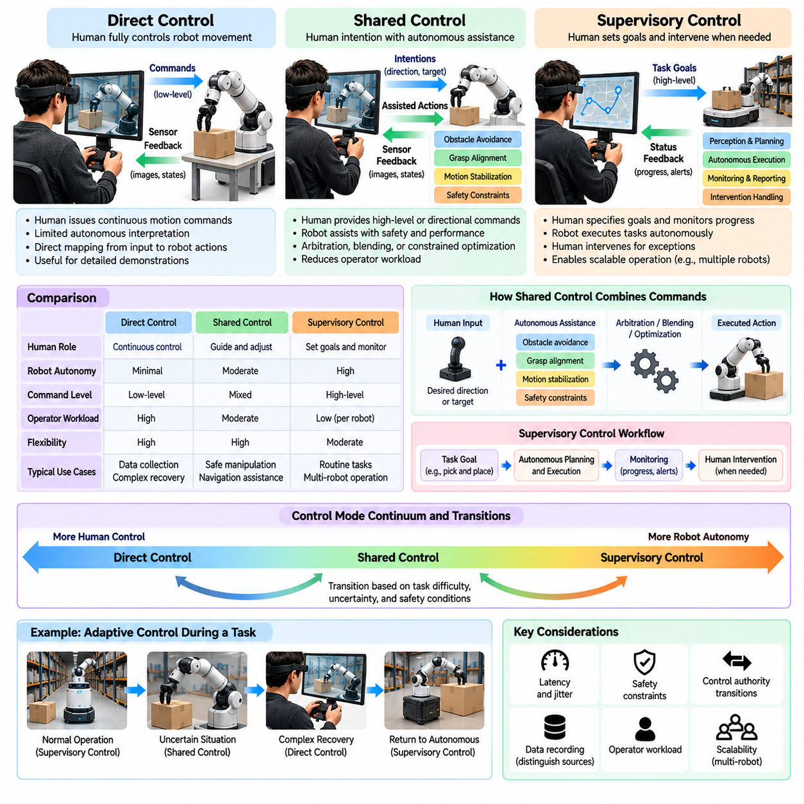{width="7.268055555555556in" height="7.268055555555556in"}

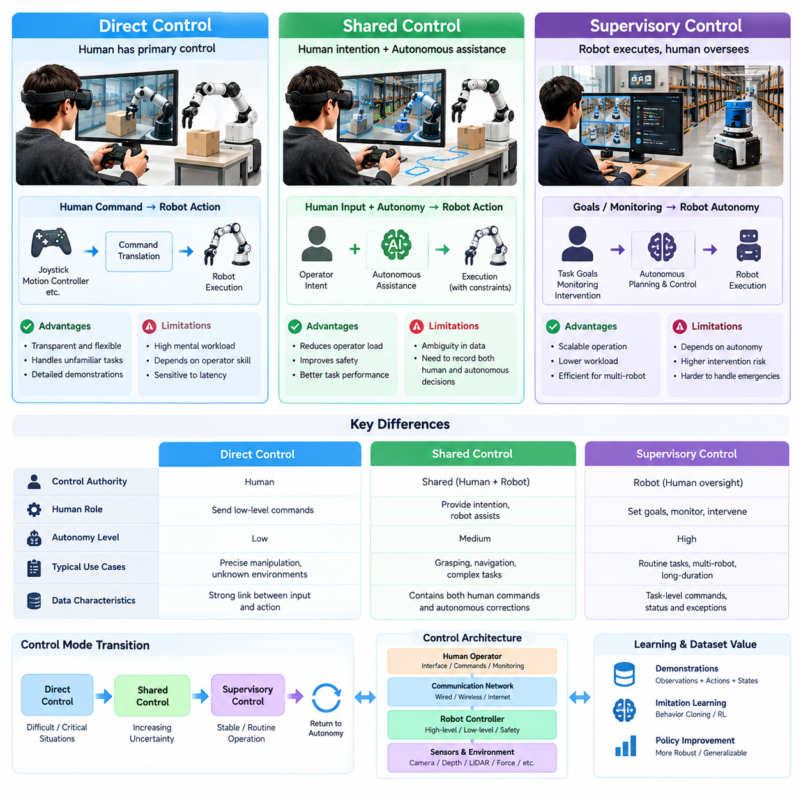{width="7.268055555555556in" height="7.268055555555556in"}

Direct, shared, and supervisory control represent three fundamental approaches to distributing decision-making authority between human operators and robotic systems. These control modes differ in the level of autonomy assigned to the robot, the frequency of human intervention, and the nature of operator commands. Understanding their characteristics is essential for designing teleoperation systems and collecting meaningful Physical AI training data.

Direct control places primary responsibility for robot movement and task execution on the human operator. Commands generated through joysticks, motion controllers, or other interfaces are translated into robot actions with limited autonomous interpretation. The operator continuously observes feedback and adjusts commands according to environmental conditions, creating a close relationship between human decisions and physical behavior.

In direct teleoperation, commands may specify joint positions, end-effector velocities, steering angles, or other motion variables. Low-level controllers still regulate actuators and enforce mechanical constraints, but the human determines the intended movement. This arrangement is especially valuable when collecting detailed demonstrations for imitation learning because operator decisions remain closely associated with executed actions.

The main advantage of direct control is its transparency and flexibility. Skilled operators can perform unfamiliar tasks without requiring a fully developed autonomous policy. They can respond to unusual object arrangements, unexpected obstacles, and changing contact conditions. However, continuous manual control increases cognitive workload and makes performance sensitive to operator expertise, interface quality, and communication latency.

Shared control distributes responsibility between human intention and autonomous assistance. The operator provides directional commands, movement targets, or task preferences, while the robot modifies execution to satisfy safety and performance constraints. Autonomous functions may include obstacle avoidance, grasp alignment, motion stabilization, and collision prevention, reducing the burden of precise low-level control.

A shared-control system commonly combines human input with autonomous control through arbitration, blending, or constrained optimization. Arbitration selects between competing commands, while blending combines them according to predefined or adaptive weights. Constrained optimization seeks actions that respect safety limits while remaining close to operator intentions. Each approach produces different relationships between requested and executed behavior.

Shared control is particularly useful when the operator understands the task objective but cannot reliably manage every physical detail. During robotic grasping, a human may identify the target object while autonomous assistance adjusts the gripper orientation. In mobile navigation, the operator may indicate a desired direction while local planning prevents collisions. Such cooperation improves usability without eliminating human guidance.

However, shared control introduces ambiguity into demonstration datasets. The executed robot action may differ significantly from the operator\'s original command because of autonomous corrections. If these differences are not recorded, learning algorithms may incorrectly attribute assisted behavior to human expertise. High-quality datasets should preserve operator inputs, autonomous proposals, arbitration decisions, and final executed commands.

Supervisory control assigns routine motion execution and local decision-making to the robot while retaining human oversight of objectives and exceptional situations. Instead of continuously commanding movement, the operator specifies goals, approves plans, monitors progress, and intervenes when necessary. This approach is suitable for robots with sufficient autonomy to execute meaningful task sequences independently.

In supervisory teleoperation, communication occurs primarily through task-level commands and status feedback. An operator may instruct a mobile robot to deliver materials, request inspection of a particular location, or authorize a manipulation sequence. The robot determines the detailed trajectory and executes the task using onboard perception, planning, and control, while reporting progress and exceptions.

Supervisory control can substantially improve operational scalability because one operator may monitor multiple robots when intervention demands are sufficiently low. However, the achievable supervision ratio depends on task complexity, autonomy reliability, intervention frequency, and human attention. Simultaneous emergencies can overwhelm a single operator, making workload prediction and intervention scheduling important architectural considerations.

The three control modes form a continuum rather than completely separate categories. A robot may operate autonomously under supervision, transition to shared control when uncertainty increases, and enter direct control during difficult recovery operations. After the problem is resolved, authority can return to the autonomous system. This flexibility enables efficient operation while preserving access to human expertise.

Control authority transitions require explicit rules to avoid conflicting commands or unsafe behavior. The system must identify which controller currently owns each motion function and establish conditions for requesting, granting, and releasing authority. Transitions should consider robot velocity, actuator state, environmental hazards, and operator readiness. Abrupt switching without appropriate synchronization can produce unstable motion.

Adaptive autonomy extends this concept by adjusting control allocation according to environmental difficulty, model confidence, and operator workload. When perception is reliable and the task is familiar, the robot can execute more independently. When uncertainty increases or safety margins decrease, additional human guidance may be requested. Such adaptation requires trustworthy monitoring rather than relying exclusively on model confidence scores.

Communication latency affects the three modes differently. Direct control is highly sensitive to delayed feedback because the operator continuously closes the control loop. Shared control can tolerate some delays when local autonomy maintains stabilization and obstacle avoidance. Supervisory control generally permits longer communication intervals, provided the robot can safely manage execution and unexpected conditions independently.

From a data collection perspective, direct control produces dense human-guided action trajectories that are useful for behavior cloning and low-level skill acquisition. Shared control generates interaction records showing how human intentions are transformed by autonomous assistance. Supervisory control produces task-level decisions, intervention events, and autonomous execution histories. These datasets support different learning objectives and should not be treated as interchangeable.

Direct-control demonstrations are particularly valuable when learning precise manipulation behaviors, coordinated joint movements, and unfamiliar motor skills. Their effectiveness depends on accurate synchronization between observations and operator commands. However, operator hesitation, communication artifacts, and control-interface limitations can introduce behavioral patterns that are undesirable for autonomous execution.

Shared-control demonstrations can support learning from human preferences and assisted task execution. By comparing operator requests with autonomous corrections, learning systems may identify situations where safety constraints or physical feasibility modify intended actions. Nevertheless, separating human intention from controller-generated behavior is necessary to avoid training policies on incorrectly attributed supervision signals.

Supervisory-control data is useful for learning task decomposition, goal selection, intervention timing, and recovery strategies. Records of operator decisions can reveal when autonomous execution should continue and when human assistance is appropriate. Such information supports higher-level policies that coordinate multiple skills over extended time horizons rather than predicting individual actuator commands.

Intervention data provides an important connection between these control modes and closed-loop Physical AI learning. When an autonomous robot encounters an unfamiliar condition, the system can request human assistance and record the transition into shared or direct control. The resulting corrective trajectory can be incorporated into training, allowing future policies to improve specifically where autonomous behavior was insufficient.

Reliable training data requires detailed records of control ownership and command transformation. Each episode should identify the active mode, operator input, autonomous controller output, safety modifications, executed robot state, and task outcome. Accurate timestamps and consistent action representations allow researchers to reconstruct how decisions were made and determine which components contributed to successful or failed execution.

Safety constraints must remain effective across every control mode. Direct human authority should not automatically override collision limits, actuator protection, or emergency stopping mechanisms. Shared-control arbitration must prioritize safety without creating unpredictable motion. Supervisory systems require local fallback behavior when communication fails or autonomous execution exceeds approved operational boundaries.

Human factors also influence the effectiveness of control allocation. Direct control can create sustained mental and physical workload, while supervisory control may produce reduced situational awareness during long periods of passive monitoring. Shared control can reduce effort but may create confusion when autonomous corrections conflict with operator expectations. Clear feedback about active control authority helps maintain operator understanding and trust.

The appropriate control strategy depends on robot capability, task difficulty, environmental uncertainty, communication quality, and operational objectives. Precision assembly may require direct or shared control during difficult contact operations, while warehouse transportation may rely primarily on supervisory control. Effective systems select control modes according to measurable requirements rather than assuming that greater autonomy is always preferable.

Ultimately, direct, shared, and supervisory control provide complementary mechanisms for integrating human intelligence with robotic autonomy. Their combined use supports reliable operation, efficient intervention, and diverse demonstration collection. By preserving control authority, operator intentions, autonomous corrections, and physical outcomes, teleoperation systems can transform human assistance into structured data that continuously improves Physical AI capabilities.

직접 제어(Direct Control), 공유 제어(Shared Control), 감독형 제어(Supervisory Control)는 인간 작업자(Human Operator)와 로봇 시스템(Robotic System) 사이에서 의사결정 권한(Decision-Making Authority)을 분배하는 세 가지 기본적인 접근 방식이다. 이러한 제어 모드(Control Mode)는 로봇에 부여되는 자율성 수준(Autonomy Level), 인간 개입 빈도(Human Intervention Frequency), 작업자 명령(Operator Command)의 특성에서 차이가 있다. 각 방식의 특성을 이해하는 것은 원격조작 시스템(Teleoperation System)을 설계하고 의미 있는 피지컬 인공지능(Physical AI) 학습 데이터를 수집하는 데 필수적이다.

직접 제어(Direct Control)는 로봇 움직임(Robot Movement)과 작업 실행(Task Execution)에 대한 주요 책임을 인간 작업자에게 부여한다. 조이스틱(Joystick), 모션 컨트롤러(Motion Controller), 기타 인터페이스를 통해 생성된 명령은 제한적인 자율 해석(Autonomous Interpretation)을 거쳐 로봇 행동(Robot Action)으로 변환된다. 작업자는 피드백(Feedback)을 지속적으로 관찰하고 환경 조건(Environmental Condition)에 따라 명령을 조정함으로써 인간의 의사결정과 물리적 행동 사이에 긴밀한 관계를 형성한다.

직접 원격조작(Direct Teleoperation)에서 명령은 관절 위치(Joint Position), 말단효과기 속도(End-Effector Velocity), 조향각(Steering Angle), 기타 동작 변수(Motion Variable)를 지정할 수 있다. 하위 수준 제어기(Low-Level Controller)는 여전히 구동기(Actuator)를 제어하고 기계적 제약(Mechanical Constraint)을 적용하지만, 의도한 움직임은 인간이 결정한다. 이러한 구성은 작업자 의사결정이 실제 실행된 행동과 밀접하게 연결되므로 모방학습(Imitation Learning)을 위한 상세한 시연 데이터(Demonstration Data)를 수집할 때 특히 유용하다.

직접 제어의 주요 장점은 투명성(Transparency)과 유연성(Flexibility)이다. 숙련된 작업자(Skilled Operator)는 완전히 개발된 자율 정책(Autonomous Policy)이 없어도 익숙하지 않은 작업을 수행할 수 있다. 작업자는 비정상적인 물체 배치(Unusual Object Arrangement), 예상하지 못한 장애물(Unexpected Obstacle), 변화하는 접촉 조건(Contact Condition)에 대응할 수 있다. 그러나 지속적인 수동 제어(Manual Control)는 인지 부하(Cognitive Workload)를 증가시키고 작업자 숙련도(Operator Expertise), 인터페이스 품질(Interface Quality), 통신 지연(Communication Latency)에 따라 성능이 달라지게 한다.

공유 제어(Shared Control)는 인간의 의도(Human Intention)와 자율 보조 기능(Autonomous Assistance) 사이에 책임을 분배한다. 작업자는 방향 명령(Directional Command), 이동 목표(Movement Target), 작업 선호도(Task Preference)를 제공하고, 로봇은 안전 및 성능 제약(Safety and Performance Constraint)을 충족하도록 실행 동작을 수정한다. 자율 기능에는 장애물 회피(Obstacle Avoidance), 파지 정렬(Grasp Alignment), 동작 안정화(Motion Stabilization), 충돌 방지(Collision Prevention)가 포함될 수 있으며, 이를 통해 정밀한 하위 수준 제어에 대한 부담을 줄일 수 있다.

공유 제어 시스템(Shared-Control System)은 일반적으로 중재(Arbitration), 혼합(Blending), 제약 최적화(Constrained Optimization)를 통해 인간 입력(Human Input)과 자율 제어(Autonomous Control)를 결합한다. 중재는 서로 경쟁하는 명령 중 하나를 선택하고, 혼합은 사전에 정의되거나 적응적으로 조정되는 가중치(Adaptive Weight)에 따라 명령을 결합한다. 제약 최적화는 작업자 의도에 최대한 근접하면서 안전 한계(Safety Limit)를 준수하는 행동을 탐색한다. 각 접근 방식은 요청된 행동(Requested Behavior)과 실제 실행된 행동(Executed Behavior) 사이에 서로 다른 관계를 형성한다.

공유 제어는 작업자가 작업 목표(Task Objective)를 이해하지만 모든 물리적 세부 사항을 안정적으로 관리하기 어려운 경우 특히 유용하다. 로봇 파지(Robotic Grasping) 과정에서 인간은 목표 물체(Target Object)를 식별하고 자율 보조 기능은 그리퍼 방향(Gripper Orientation)을 조정할 수 있다. 이동 내비게이션(Mobile Navigation)에서는 작업자가 원하는 방향을 지정하는 동안 로컬 경로 계획(Local Planning)이 충돌을 방지할 수 있다. 이러한 협력은 인간의 지도를 유지하면서 사용성(Usability)을 향상시킨다.

그러나 공유 제어는 시연 데이터셋(Demonstration Dataset)에 모호성(Ambiguity)을 발생시킨다. 자율 보정(Autonomous Correction)으로 인해 실제 실행된 로봇 행동은 작업자의 원래 명령과 상당히 달라질 수 있다. 이러한 차이가 기록되지 않으면 학습 알고리즘(Learning Algorithm)은 보조된 행동(Assisted Behavior)을 인간의 전문성(Human Expertise)에 잘못 귀속시킬 수 있다. 고품질 데이터셋은 작업자 입력(Operator Input), 자율 제어 제안(Autonomous Proposal), 중재 결정(Arbitration Decision), 최종 실행 명령(Final Executed Command)을 보존해야 한다.

감독형 제어(Supervisory Control)는 일상적인 동작 실행(Routine Motion Execution)과 로컬 의사결정(Local Decision-Making)을 로봇에 맡기면서 인간이 목표와 예외 상황(Exceptional Situation)을 감독하도록 한다. 작업자는 움직임을 지속적으로 명령하는 대신 목표를 지정하고, 계획을 승인하며, 진행 상황을 모니터링하고, 필요한 경우 개입한다. 이 접근 방식은 의미 있는 작업 시퀀스(Task Sequence)를 독립적으로 실행할 수 있을 만큼 충분한 자율성(Autonomy)을 갖춘 로봇에 적합하다.

감독형 원격조작(Supervisory Teleoperation)에서는 주로 작업 수준 명령(Task-Level Command)과 상태 피드백(Status Feedback)을 통해 통신이 이루어진다. 작업자는 이동로봇에 자재 운반을 지시하거나 특정 위치의 검사를 요청하거나 조작 시퀀스(Manipulation Sequence)를 승인할 수 있다. 로봇은 온보드 인식(Onboard Perception), 계획(Planning), 제어(Control)를 사용하여 상세한 궤적(Detailed Trajectory)을 결정하고 작업을 실행하면서 진행 상황과 예외 사항(Exception)을 보고한다.

감독형 제어는 개입 요구(Intervention Demand)가 충분히 낮은 경우 한 명의 작업자가 여러 로봇을 모니터링할 수 있으므로 운용 확장성(Operational Scalability)을 크게 향상시킬 수 있다. 그러나 달성 가능한 감독 비율(Supervision Ratio)은 작업 복잡도(Task Complexity), 자율성 신뢰도(Autonomy Reliability), 개입 빈도(Intervention Frequency), 인간의 주의력(Human Attention)에 따라 달라진다. 여러 비상 상황(Simultaneous Emergency)이 동시에 발생하면 한 명의 작업자가 감당하기 어려울 수 있으므로 작업 부하 예측(Workload Prediction)과 개입 스케줄링(Intervention Scheduling)이 중요한 아키텍처 고려 사항이 된다.

세 가지 제어 모드는 완전히 분리된 범주가 아니라 연속적인 스펙트럼(Continuum)을 형성한다. 로봇은 감독하에서 자율적으로 작동하다가 불확실성(Uncertainty)이 증가하면 공유 제어로 전환하고, 어려운 복구 작업(Recovery Operation)에서는 직접 제어로 진입할 수 있다. 문제가 해결되면 제어 권한(Control Authority)은 다시 자율 시스템으로 반환될 수 있다. 이러한 유연성은 인간의 전문성을 활용할 수 있는 가능성을 유지하면서 효율적인 운용을 지원한다.

제어 권한 전환(Control Authority Transition)에는 명령 충돌(Conflicting Command)이나 안전하지 않은 행동(Unsafe Behavior)을 방지하기 위한 명확한 규칙이 필요하다. 시스템은 각 동작 기능(Motion Function)을 현재 어떤 제어기가 소유하고 있는지 식별하고, 권한 요청(Request), 부여(Grant), 해제(Release)에 대한 조건을 설정해야 한다. 전환 과정에서는 로봇 속도(Robot Velocity), 구동기 상태(Actuator State), 환경 위험(Environmental Hazard), 작업자 준비 상태(Operator Readiness)를 고려해야 한다. 적절한 동기화(Synchronization) 없이 갑작스럽게 전환하면 불안정한 움직임이 발생할 수 있다.

적응형 자율성(Adaptive Autonomy)은 환경 난이도(Environmental Difficulty), 모델 신뢰도(Model Confidence), 작업자 부하(Operator Workload)에 따라 제어 권한 배분(Control Allocation)을 조정함으로써 이러한 개념을 확장한다. 인식(Perception)이 신뢰할 수 있고 작업이 익숙한 경우 로봇은 더 독립적으로 실행할 수 있다. 불확실성이 증가하거나 안전 여유(Safety Margin)가 감소하면 추가적인 인간 지도를 요청할 수 있다. 이러한 적응에는 모델 신뢰도 점수(Confidence Score)에만 의존하지 않는 신뢰할 수 있는 모니터링(Trustworthy Monitoring)이 필요하다.

통신 지연(Communication Latency)은 세 가지 제어 모드에 서로 다른 영향을 미친다. 직접 제어는 작업자가 제어 루프(Control Loop)를 지속적으로 닫아야 하므로 지연된 피드백(Delayed Feedback)에 매우 민감하다. 공유 제어는 로컬 자율 기능(Local Autonomy)이 안정화(Stabilization)와 장애물 회피를 유지하는 경우 일정 수준의 지연을 허용할 수 있다. 감독형 제어는 로봇이 작업 실행과 예상하지 못한 상황을 독립적으로 안전하게 관리할 수 있다면 일반적으로 더 긴 통신 간격(Communication Interval)을 허용한다.

데이터 수집(Data Collection) 관점에서 직접 제어는 행동 복제(Behavior Cloning)와 하위 수준 기술 습득(Low-Level Skill Acquisition)에 유용한 고밀도 인간 지도 행동 궤적(Dense Human-Guided Action Trajectory)을 생성한다. 공유 제어는 인간의 의도가 자율 보조 기능에 의해 어떻게 변환되는지를 보여주는 상호작용 기록(Interaction Record)을 생성한다. 감독형 제어는 작업 수준 의사결정(Task-Level Decision), 개입 이벤트(Intervention Event), 자율 실행 이력(Autonomous Execution History)을 생성한다. 이러한 데이터셋은 서로 다른 학습 목표(Learning Objective)를 지원하므로 상호 교환 가능한 것으로 취급해서는 안 된다.

직접 제어 시연(Direct-Control Demonstration)은 정밀 조작 행동(Precision Manipulation Behavior), 협응된 관절 움직임(Coordinated Joint Movement), 익숙하지 않은 운동 기술(Motor Skill)을 학습할 때 특히 가치가 높다. 그 효과는 관측 정보(Observation)와 작업자 명령(Operator Command) 사이의 정확한 동기화에 달려 있다. 그러나 작업자의 주저하는 동작(Operator Hesitation), 통신으로 인한 인위적 영향(Communication Artifact), 제어 인터페이스 한계(Control-Interface Limitation)는 자율 실행에 바람직하지 않은 행동 패턴(Behavioral Pattern)을 유발할 수 있다.

공유 제어 시연(Shared-Control Demonstration)은 인간 선호도(Human Preference)와 보조된 작업 실행(Assisted Task Execution)으로부터의 학습을 지원할 수 있다. 작업자 요청(Operator Request)과 자율 보정(Autonomous Correction)을 비교하면 학습 시스템은 안전 제약(Safety Constraint)이나 물리적 실행 가능성(Physical Feasibility)이 의도한 행동을 수정하는 상황을 식별할 수 있다. 그러나 잘못 귀속된 지도 신호(Incorrectly Attributed Supervision Signal)로 정책을 학습하는 것을 방지하려면 인간의 의도와 제어기가 생성한 행동을 분리해야 한다.

감독형 제어 데이터(Supervisory-Control Data)는 작업 분해(Task Decomposition), 목표 선택(Goal Selection), 개입 시점 결정(Intervention Timing), 복구 전략(Recovery Strategy)을 학습하는 데 유용하다. 작업자 의사결정 기록(Operator Decision Record)은 자율 실행을 언제 지속해야 하고 언제 인간의 지원이 필요한지를 보여줄 수 있다. 이러한 정보는 개별 구동기 명령(Actuator Command)을 예측하는 대신 긴 시간 범위(Long Time Horizon)에 걸쳐 여러 기술(Skill)을 조정하는 상위 수준 정책(High-Level Policy)을 지원한다.

개입 데이터(Intervention Data)는 이러한 제어 모드와 폐루프 피지컬 인공지능 학습(Closed-Loop Physical AI Learning)을 연결하는 중요한 역할을 한다. 자율로봇이 익숙하지 않은 조건에 직면하면 시스템은 인간의 지원을 요청하고 공유 제어 또는 직접 제어로 전환하는 과정을 기록할 수 있다. 그 결과 생성된 교정 궤적(Corrective Trajectory)은 학습에 통합될 수 있으며, 이를 통해 향후 정책은 자율 행동이 충분하지 않았던 상황에서 구체적으로 성능을 개선할 수 있다.

신뢰할 수 있는 학습 데이터(Reliable Training Data)를 확보하려면 제어 권한(Control Ownership)과 명령 변환(Command Transformation)에 대한 상세한 기록이 필요하다. 각 에피소드(Episode)에는 활성 제어 모드(Active Control Mode), 작업자 입력(Operator Input), 자율 제어기 출력(Autonomous Controller Output), 안전 보정(Safety Modification), 실제 실행된 로봇 상태(Executed Robot State), 작업 결과(Task Outcome)가 포함되어야 한다. 정확한 타임스탬프(Accurate Timestamp)와 일관된 행동 표현(Consistent Action Representation)은 연구자가 의사결정 과정을 재구성하고 어떤 구성 요소가 성공 또는 실패에 기여했는지 판단할 수 있도록 한다.

안전 제약(Safety Constraint)은 모든 제어 모드에서 지속적으로 유효해야 한다. 인간의 직접 제어 권한(Direct Human Authority)이 충돌 제한(Collision Limit), 구동기 보호(Actuator Protection), 비상 정지 메커니즘(Emergency Stopping Mechanism)을 자동으로 무시해서는 안 된다. 공유 제어 중재(Shared-Control Arbitration)는 예측할 수 없는 움직임을 발생시키지 않으면서 안전을 우선해야 한다. 감독형 시스템(Supervisory System)은 통신 장애(Communication Failure)가 발생하거나 자율 실행이 승인된 운용 경계(Approved Operational Boundary)를 초과하는 경우 로컬 대체 행동(Local Fallback Behavior)을 수행할 수 있어야 한다.

인적 요인(Human Factor)도 제어 권한 배분(Control Allocation)의 효과에 영향을 미친다. 직접 제어는 지속적인 정신적·신체적 작업 부하(Mental and Physical Workload)를 발생시킬 수 있으며, 감독형 제어는 장시간 수동적인 모니터링(Passive Monitoring)으로 인해 상황 인식(Situational Awareness)이 저하될 수 있다. 공유 제어는 작업 부담을 줄일 수 있지만 자율 보정이 작업자의 기대와 충돌하면 혼란을 발생시킬 수 있다. 활성 제어 권한(Active Control Authority)에 대한 명확한 피드백은 작업자의 이해와 신뢰(Trust)를 유지하는 데 도움이 된다.

적절한 제어 전략(Control Strategy)은 로봇 능력(Robot Capability), 작업 난이도(Task Difficulty), 환경 불확실성(Environmental Uncertainty), 통신 품질(Communication Quality), 운용 목표(Operational Objective)에 따라 달라진다. 정밀 조립(Precision Assembly)은 어려운 접촉 작업(Contact Operation)에서 직접 제어 또는 공유 제어가 필요할 수 있는 반면, 창고 운송(Warehouse Transportation)은 주로 감독형 제어에 의존할 수 있다. 효과적인 시스템은 높은 자율성이 항상 바람직하다고 가정하기보다 측정 가능한 요구사항(Measurable Requirement)에 따라 제어 모드를 선택한다.

궁극적으로 직접 제어(Direct Control), 공유 제어(Shared Control), 감독형 제어(Supervisory Control)는 인간 지능(Human Intelligence)과 로봇 자율성(Robotic Autonomy)을 통합하기 위한 상호보완적인 메커니즘을 제공한다. 이들을 결합하여 활용하면 신뢰할 수 있는 운용(Reliable Operation), 효율적인 개입(Efficient Intervention), 다양한 시연 데이터 수집(Diverse Demonstration Collection)을 지원할 수 있다. 제어 권한(Control Authority), 작업자 의도(Operator Intention), 자율 보정(Autonomous Correction), 물리적 결과(Physical Outcome)를 보존함으로써 원격조작 시스템은 인간의 지원을 피지컬 인공지능(Physical AI)의 능력을 지속적으로 향상시키는 구조화된 데이터(Structured Data)로 변환할 수 있다.

##  

## 02.05. Joystick VR and Motion Capture Interfaces

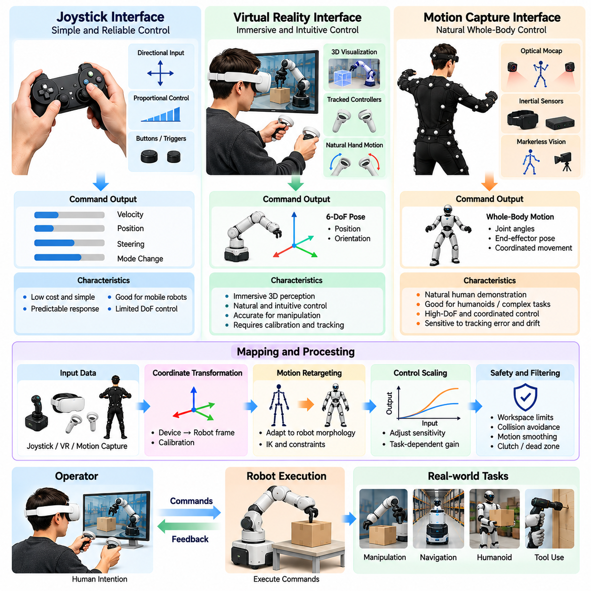{width="7.268055555555556in" height="7.268055555555556in"}

Joystick, virtual reality, and motion capture interfaces provide different mechanisms for translating human intentions into executable robot commands. Each interface offers distinct advantages in precision, intuitiveness, mobility, and data collection efficiency. Selecting an appropriate interface requires understanding robot morphology, task complexity, operator capabilities, and the quality of demonstrations needed for Physical AI learning.

Joystick interfaces represent one of the most established methods for controlling remote robotic systems. They convert directional movements, button presses, and trigger inputs into velocity, steering, or position commands. Their relatively simple hardware architecture, low cost, and predictable response make them suitable for mobile robots, inspection platforms, and basic manipulator operations in structured environments.

Joystick control commonly uses proportional mappings between input displacement and commanded robot motion. Small movements produce low velocities, while larger displacements generate faster responses. Dead zones prevent unintended motion near the neutral position, and nonlinear scaling improves precision during delicate tasks. Proper calibration is essential for maintaining consistent behavior across operators and devices.

Despite their simplicity, joysticks have limitations when controlling robots with many degrees of freedom. A two-axis joystick cannot directly express complex arm configurations or coordinated whole-body movements. Operators may need to switch control modes or combine multiple input devices. These additional interactions increase cognitive workload and can introduce discontinuities into recorded demonstration trajectories.

Virtual reality interfaces provide immersive control by combining head-mounted displays, tracked hand controllers, and three-dimensional visualization. Operators can perceive the robot\'s workspace from a spatial perspective and issue commands through natural hand movements. This approach is especially useful for manipulation tasks requiring accurate end-effector positioning, object orientation, and coordinated bimanual actions.

A VR teleoperation system typically tracks the position and orientation of operator controllers within a defined coordinate frame. These measurements are transformed into robot target poses using calibrated mappings. Inverse kinematics converts desired end-effector poses into feasible joint configurations. Workspace limits, collision constraints, and motion smoothing help prevent unsafe or physically impossible commands.

VR interfaces may display live stereo camera streams, reconstructed depth maps, or digital representations of the robot environment. Accurate visual registration is important because mismatches between displayed geometry and physical robot coordinates can produce positioning errors. Rendering latency, tracking drift, and limited camera coverage may also affect operator performance during precise manipulation.

Motion capture interfaces record human body movements using optical tracking systems, inertial measurement units, wearable sensors, or markerless computer vision. These systems estimate body poses and joint trajectories that can guide robotic motion. Unlike joystick control, motion capture allows operators to demonstrate coordinated movements naturally, making it attractive for humanoid robots and complex manipulation research.

Optical motion capture systems use cameras and tracked markers or visual features to reconstruct three-dimensional movement. They can provide detailed spatial measurements in calibrated environments but may suffer from occlusion and restricted capture volumes. Markerless approaches reduce equipment requirements but introduce uncertainty associated with pose estimation, lighting conditions, and unusual body configurations.

Inertial motion capture uses wearable inertial measurement units to estimate body orientation and movement. Such systems can operate without fixed external camera infrastructure, enabling more flexible collection environments. However, accumulated drift and imperfect position estimation can reduce long-duration accuracy. Combining inertial measurements with optical tracking or robot feedback can improve robustness.

Mapping human motion to robotic embodiment is a central challenge for motion capture teleoperation. Human and robot bodies differ in joint arrangements, limb lengths, reachable workspaces, and actuator capabilities. Motion retargeting algorithms must preserve task-relevant intentions while satisfying robot kinematic constraints. Directly copying human joint angles is rarely sufficient for reliable execution across different morphologies.

Coordinate transformation is equally important across joystick, VR, and motion capture interfaces. Operator inputs may be expressed in device, camera, world, or robot coordinate frames. Incorrect transformations can reverse movement directions or produce unintended rotations. Calibration procedures should establish consistent reference frames and verify that commanded movements correspond to operator expectations.

Control scaling determines how human input magnitude translates into robot movement. Precision manipulation may benefit from reduced motion gain, allowing large operator movements to produce small robot adjustments. Rapid navigation may require higher gain for efficient travel. Adaptive scaling can change sensitivity according to task context, but abrupt gain changes may confuse operators and degrade demonstration consistency.

Clutching mechanisms allow operators to temporarily disconnect interface movement from robot motion. This enables repositioning of hand controllers or body posture without generating unintended commands. Clutch states should be explicitly recorded because they alter the relationship between human movement and robot action. Similar considerations apply to mode switching, recentering, and interface recalibration.

Human factors strongly influence interface effectiveness. Joysticks are familiar and compact but may require substantial mental transformation between control axes and robot movements. VR interfaces improve spatial intuition but can introduce visual fatigue or simulator sickness. Motion capture supports natural movement but may cause physical fatigue during extended sessions. Interface selection should consider sustainable operator performance.

Feedback design is essential for maintaining situational awareness during teleoperation. Visual displays communicate robot pose, environmental geometry, and task progress, while audio and haptic signals can indicate contact events or warnings. Operators should also receive clear information about control modes, motion limits, and communication status. Ambiguous feedback increases the likelihood of incorrect commands.

Communication latency affects each interface differently. Joystick control can become difficult when delayed video causes operators to overcorrect steering or positioning. VR interfaces are particularly sensitive to inconsistencies between head motion and displayed imagery. Motion capture systems may generate high-frequency pose streams that require filtering and prediction. Local robot controllers should maintain safety independently of network timing.

Interface sampling frequency and signal filtering influence demonstration quality. High-frequency measurements preserve detailed movements but can contain sensor noise and operator tremor. Low-frequency sampling reduces data volume but may miss brief contact adjustments or rapid corrections. Appropriate filtering must balance smooth execution against the preservation of meaningful human actions and task dynamics.

For Physical AI training, raw interface signals should be recorded alongside transformed robot commands and measured execution states. This separation makes it possible to identify whether motion patterns originated from operator intention, interface mapping, controller limitations, or autonomous assistance. Without such records, learned policies may reproduce interface-specific artifacts rather than transferable task behavior.

Dataset consistency requires standardized calibration, coordinate conventions, action units, and metadata. Demonstrations collected using different joysticks, VR devices, or motion capture systems may otherwise have incompatible representations. Recording device characteristics, control gains, operator identity, and task configuration supports normalization and comparative evaluation across collection campaigns.

Interface choice also affects the diversity of behaviors represented in training datasets. Joysticks may encourage smooth directional navigation, while VR supports spatial manipulation and coordinated hand movements. Motion capture can provide whole-body trajectories and natural task sequencing. Combining complementary interfaces may increase coverage, provided differences in action representation are carefully managed.

Safety considerations extend beyond robot motion to operator interaction with control equipment. VR users may lose awareness of their physical surroundings, while motion capture participants require sufficient movement space. Emergency stopping, command validation, workspace limits, and operator monitoring should remain active. Human interface failures must not disable independent robot-side safety mechanisms.

Scalable data collection systems benefit from interfaces that are easy to calibrate, maintain, and operate consistently. Operator training, automated calibration checks, session diagnostics, and standardized recording procedures reduce variability. The most sophisticated interface is not necessarily the most productive; practical efficiency depends on demonstration throughput, task success, operator fatigue, and resulting data quality.

Ultimately, joystick, VR, and motion capture interfaces connect human motor intelligence with robotic execution through different control representations. Their effectiveness depends on accurate mapping, reliable feedback, manageable latency, ergonomic operation, and synchronized recording. A well-designed interface strategy improves teleoperation performance while generating diverse, high-quality demonstrations for scalable Physical AI learning.

조이스틱(Joystick), 가상현실(Virtual Reality, VR), 모션 캡처(Motion Capture) 인터페이스는 인간의 의도(Human Intention)를 실행 가능한 로봇 명령(Executable Robot Command)으로 변환하는 서로 다른 메커니즘을 제공한다. 각 인터페이스는 정밀도(Precision), 직관성(Intuitiveness), 이동성(Mobility), 데이터 수집 효율성(Data Collection Efficiency) 측면에서 고유한 장점을 가진다. 적절한 인터페이스를 선택하려면 로봇 형태(Robot Morphology), 작업 복잡도(Task Complexity), 작업자 능력(Operator Capability), 피지컬 인공지능(Physical AI) 학습에 필요한 시연 품질(Demonstration Quality)을 이해해야 한다.

조이스틱 인터페이스(Joystick Interface)는 원격 로봇 시스템(Remote Robotic System)을 제어하는 가장 오래되고 널리 사용되는 방법 중 하나이다. 조이스틱은 방향 이동(Directional Movement), 버튼 입력(Button Press), 트리거 입력(Trigger Input)을 속도(Velocity), 조향(Steering), 위치 명령(Position Command)으로 변환한다. 비교적 단순한 하드웨어 구조(Hardware Architecture), 낮은 비용(Low Cost), 예측 가능한 응답(Predictable Response) 덕분에 이동로봇(Mobile Robot), 검사 플랫폼(Inspection Platform), 구조화된 환경(Structured Environment)에서의 기본적인 매니퓰레이터(Manipulator) 운용에 적합하다.

조이스틱 제어(Joystick Control)는 일반적으로 입력 변위(Input Displacement)와 로봇 동작 명령(Commanded Robot Motion) 사이에 비례 매핑(Proportional Mapping)을 사용한다. 작은 조작은 낮은 속도를 생성하고, 큰 조작은 빠른 응답을 발생시킨다. 데드존(Dead Zone)은 중립 위치(Neutral Position) 근처에서 의도하지 않은 움직임을 방지하며, 비선형 스케일링(Nonlinear Scaling)은 섬세한 작업에서 정밀도를 향상시킨다. 적절한 보정(Calibration)은 작업자와 장치가 달라지더라도 일관된 동작을 유지하는 데 필수적이다.

조이스틱은 단순하다는 장점이 있지만 자유도(Degrees of Freedom)가 많은 로봇을 제어할 때 한계가 있다. 2축 조이스틱(Two-Axis Joystick)은 복잡한 로봇 팔 구성(Arm Configuration)이나 협응된 전신 움직임(Coordinated Whole-Body Movement)을 직접 표현할 수 없다. 작업자는 제어 모드(Control Mode)를 전환하거나 여러 입력 장치(Input Device)를 결합해야 할 수 있다. 이러한 추가적인 조작은 인지 부하(Cognitive Workload)를 증가시키고 기록된 시연 궤적(Demonstration Trajectory)에 불연속성(Discontinuity)을 발생시킬 수 있다.

가상현실 인터페이스(Virtual Reality Interface)는 머리 착용형 디스플레이(Head-Mounted Display), 위치 추적 핸드 컨트롤러(Tracked Hand Controller), 3차원 시각화(Three-Dimensional Visualization)를 결합하여 몰입형 제어(Immersive Control)를 제공한다. 작업자는 공간적 관점(Spatial Perspective)에서 로봇의 작업 공간(Workspace)을 인식하고 자연스러운 손 움직임(Natural Hand Movement)을 통해 명령을 전달할 수 있다. 이러한 방식은 정확한 말단효과기 위치(End-Effector Positioning), 물체 방향(Object Orientation), 협응된 양손 동작(Coordinated Bimanual Action)이 필요한 조작 작업(Manipulation Task)에 특히 유용하다.

가상현실 원격조작 시스템(VR Teleoperation System)은 일반적으로 정의된 좌표계(Coordinate Frame) 내에서 작업자 컨트롤러의 위치(Position)와 방향(Orientation)을 추적한다. 이러한 측정값은 보정된 매핑(Calibrated Mapping)을 통해 로봇 목표 자세(Target Pose)로 변환된다. 역기구학(Inverse Kinematics)은 원하는 말단효과기 자세(End-Effector Pose)를 실행 가능한 관절 구성(Joint Configuration)으로 변환한다. 작업 공간 제한(Workspace Limit), 충돌 제약(Collision Constraint), 동작 평활화(Motion Smoothing)는 안전하지 않거나 물리적으로 실행 불가능한 명령을 방지하는 데 도움이 된다.

가상현실 인터페이스는 실시간 스테레오 카메라 영상(Live Stereo Camera Stream), 재구성된 깊이 지도(Reconstructed Depth Map), 로봇 환경의 디지털 표현(Digital Representation)을 표시할 수 있다. 표시된 기하학적 정보(Displayed Geometry)와 실제 로봇 좌표(Physical Robot Coordinate) 사이의 불일치는 위치 오차(Positioning Error)를 발생시킬 수 있으므로 정확한 시각적 정합(Visual Registration)이 중요하다. 렌더링 지연(Rendering Latency), 추적 드리프트(Tracking Drift), 제한된 카메라 시야(Camera Coverage)도 정밀 조작 중 작업자 성능에 영향을 미칠 수 있다.

모션 캡처 인터페이스(Motion Capture Interface)는 광학 추적 시스템(Optical Tracking System), 관성 측정 장치(Inertial Measurement Unit, IMU), 웨어러블 센서(Wearable Sensor), 마커리스 컴퓨터 비전(Markerless Computer Vision)을 사용하여 인간의 신체 움직임(Body Movement)을 기록한다. 이러한 시스템은 로봇 동작을 안내할 수 있는 신체 자세(Body Pose)와 관절 궤적(Joint Trajectory)을 추정한다. 조이스틱 제어와 달리 모션 캡처는 작업자가 협응된 움직임을 자연스럽게 시연할 수 있도록 하므로 휴머노이드 로봇(Humanoid Robot)과 복잡한 조작 연구(Complex Manipulation Research)에 적합하다.

광학 모션 캡처 시스템(Optical Motion Capture System)은 카메라와 추적 마커(Tracked Marker) 또는 시각적 특징(Visual Feature)을 사용하여 3차원 움직임(Three-Dimensional Movement)을 재구성한다. 보정된 환경(Calibrated Environment)에서는 상세한 공간 측정(Spatial Measurement)을 제공할 수 있지만 가림 현상(Occlusion)과 제한된 캡처 공간(Capture Volume)의 영향을 받을 수 있다. 마커리스 방식(Markerless Approach)은 장비 요구사항을 줄이지만 자세 추정(Pose Estimation), 조명 조건(Lighting Condition), 비정상적인 신체 구성(Unusual Body Configuration)에 따른 불확실성을 발생시킨다.

관성 모션 캡처(Inertial Motion Capture)는 착용형 관성 측정 장치(Wearable Inertial Measurement Unit)를 사용하여 신체 방향(Body Orientation)과 움직임을 추정한다. 이러한 시스템은 고정된 외부 카메라 인프라(External Camera Infrastructure) 없이 작동할 수 있으므로 더욱 유연한 데이터 수집 환경(Collection Environment)을 제공한다. 그러나 누적 드리프트(Accumulated Drift)와 불완전한 위치 추정(Position Estimation)은 장시간 정확도(Long-Duration Accuracy)를 저하시킬 수 있다. 관성 측정값을 광학 추적(Optical Tracking) 또는 로봇 피드백(Robot Feedback)과 결합하면 강건성(Robustness)을 향상시킬 수 있다.

인간 움직임(Human Motion)을 로봇 신체 구조(Robotic Embodiment)에 매핑하는 것은 모션 캡처 원격조작(Motion Capture Teleoperation)의 핵심 과제이다. 인간과 로봇의 신체는 관절 배열(Joint Arrangement), 팔다리 길이(Limb Length), 도달 가능한 작업 공간(Reachable Workspace), 구동기 능력(Actuator Capability)에서 차이가 있다. 동작 재매핑 알고리즘(Motion Retargeting Algorithm)은 로봇의 기구학적 제약(Kinematic Constraint)을 충족하면서 작업과 관련된 의도(Task-Relevant Intention)를 보존해야 한다. 인간 관절각(Human Joint Angle)을 직접 복제하는 것만으로는 서로 다른 형태(Morphology)의 로봇에서 신뢰할 수 있는 실행을 구현하기 어렵다.

좌표 변환(Coordinate Transformation)은 조이스틱, 가상현실, 모션 캡처 인터페이스 전반에서 동일하게 중요하다. 작업자 입력(Operator Input)은 장치 좌표계(Device Coordinate Frame), 카메라 좌표계(Camera Coordinate Frame), 세계 좌표계(World Coordinate Frame), 로봇 좌표계(Robot Coordinate Frame)로 표현될 수 있다. 잘못된 좌표 변환은 이동 방향을 반전시키거나 의도하지 않은 회전(Unintended Rotation)을 발생시킬 수 있다. 보정 절차(Calibration Procedure)는 일관된 기준 좌표계(Reference Frame)를 설정하고 명령된 움직임이 작업자의 기대와 일치하는지 검증해야 한다.

제어 스케일링(Control Scaling)은 인간 입력의 크기(Input Magnitude)가 로봇 움직임으로 변환되는 비율을 결정한다. 정밀 조작(Precision Manipulation)에서는 낮은 동작 이득(Motion Gain)을 사용하여 작업자의 큰 움직임이 로봇의 작은 위치 조정으로 변환되도록 할 수 있다. 빠른 내비게이션(Rapid Navigation)에서는 효율적인 이동을 위해 높은 이득(Higher Gain)이 필요할 수 있다. 적응형 스케일링(Adaptive Scaling)은 작업 맥락(Task Context)에 따라 민감도(Sensitivity)를 변경할 수 있지만 갑작스러운 이득 변화(Gain Change)는 작업자를 혼란스럽게 하고 시연 일관성(Demonstration Consistency)을 저하시킬 수 있다.

클러칭 메커니즘(Clutching Mechanism)은 작업자가 인터페이스 움직임(Interface Movement)과 로봇 동작(Robot Motion)의 연결을 일시적으로 해제할 수 있도록 한다. 이를 통해 의도하지 않은 명령을 생성하지 않으면서 핸드 컨트롤러(Hand Controller)의 위치나 신체 자세(Body Posture)를 다시 조정할 수 있다. 클러치 상태(Clutch State)는 인간 움직임과 로봇 행동 사이의 관계를 변경하므로 명시적으로 기록해야 한다. 제어 모드 전환(Mode Switching), 중심 위치 재설정(Recentering), 인터페이스 재보정(Interface Recalibration)에도 유사한 고려가 필요하다.

인적 요인(Human Factor)은 인터페이스의 효과에 큰 영향을 미친다. 조이스틱은 익숙하고 크기가 작지만 제어 축(Control Axis)과 로봇 움직임 사이에서 상당한 정신적 좌표 변환(Mental Transformation)이 필요할 수 있다. 가상현실 인터페이스는 공간적 직관성(Spatial Intuition)을 향상시키지만 시각적 피로(Visual Fatigue)나 시뮬레이터 멀미(Simulator Sickness)를 유발할 수 있다. 모션 캡처는 자연스러운 움직임을 지원하지만 장시간 작업에서는 신체적 피로(Physical Fatigue)가 발생할 수 있다. 인터페이스 선택에서는 작업자가 지속적으로 유지할 수 있는 운용 성능(Sustainable Operator Performance)을 고려해야 한다.

피드백 설계(Feedback Design)는 원격조작 중 상황 인식(Situational Awareness)을 유지하는 데 필수적이다. 시각적 디스플레이(Visual Display)는 로봇 자세(Robot Pose), 환경 기하학(Environmental Geometry), 작업 진행 상황(Task Progress)을 전달하며, 오디오(Audio)와 햅틱 신호(Haptic Signal)는 접촉 이벤트(Contact Event)나 경고(Warning)를 알릴 수 있다. 작업자는 제어 모드(Control Mode), 동작 제한(Motion Limit), 통신 상태(Communication Status)에 관한 명확한 정보도 제공받아야 한다. 모호한 피드백(Ambiguous Feedback)은 잘못된 명령(Incorrect Command)이 발생할 가능성을 높인다.

통신 지연(Communication Latency)은 각 인터페이스에 서로 다른 영향을 미친다. 조이스틱 제어는 지연된 영상(Delayed Video)으로 인해 작업자가 조향(Steering)이나 위치 조정(Positioning)을 과도하게 보정할 때 어려워질 수 있다. 가상현실 인터페이스는 머리 움직임(Head Motion)과 표시 영상(Displayed Imagery) 사이의 불일치에 특히 민감하다. 모션 캡처 시스템은 필터링(Filtering)과 예측(Prediction)이 필요한 고주파 자세 스트림(High-Frequency Pose Stream)을 생성할 수 있다. 로컬 로봇 제어기(Local Robot Controller)는 네트워크 타이밍(Network Timing)과 독립적으로 안전을 유지해야 한다.

인터페이스 샘플링 주파수(Interface Sampling Frequency)와 신호 필터링(Signal Filtering)은 시연 품질(Demonstration Quality)에 영향을 미친다. 고주파 측정(High-Frequency Measurement)은 상세한 움직임을 보존하지만 센서 잡음(Sensor Noise)과 작업자 떨림(Operator Tremor)을 포함할 수 있다. 저주파 샘플링(Low-Frequency Sampling)은 데이터 양을 줄이지만 짧은 접촉 조정(Contact Adjustment)이나 빠른 교정 동작(Rapid Correction)을 놓칠 수 있다. 적절한 필터링은 부드러운 실행(Smooth Execution)과 의미 있는 인간 행동(Meaningful Human Action) 및 작업 동역학(Task Dynamics)의 보존 사이에서 균형을 유지해야 한다.

피지컬 인공지능(Physical AI) 학습을 위해서는 원시 인터페이스 신호(Raw Interface Signal)를 변환된 로봇 명령(Transformed Robot Command) 및 측정된 실행 상태(Measured Execution State)와 함께 기록해야 한다. 이러한 분리는 움직임 패턴(Motion Pattern)이 작업자 의도(Operator Intention), 인터페이스 매핑(Interface Mapping), 제어기 한계(Controller Limitation), 자율 보조 기능(Autonomous Assistance) 중 어디에서 비롯되었는지 식별할 수 있도록 한다. 이러한 기록이 없으면 학습된 정책(Learned Policy)이 전이 가능한 작업 행동(Transferable Task Behavior) 대신 인터페이스 고유의 인위적 특성(Interface-Specific Artifact)을 재현할 수 있다.

데이터셋 일관성(Dataset Consistency)을 확보하려면 표준화된 보정(Standardized Calibration), 좌표 규약(Coordinate Convention), 행동 단위(Action Unit), 메타데이터(Metadata)가 필요하다. 서로 다른 조이스틱, 가상현실 장치, 모션 캡처 시스템으로 수집된 시연 데이터는 그렇지 않으면 호환되지 않는 표현(Incompatible Representation)을 가질 수 있다. 장치 특성(Device Characteristic), 제어 이득(Control Gain), 작업자 식별 정보(Operator Identity), 작업 구성(Task Configuration)을 기록하면 서로 다른 데이터 수집 작업(Collection Campaign) 간 정규화(Normalization)와 비교 평가(Comparative Evaluation)를 지원할 수 있다.

인터페이스 선택은 학습 데이터셋(Training Dataset)에 표현되는 행동 다양성(Behavioral Diversity)에도 영향을 미친다. 조이스틱은 부드러운 방향성 내비게이션(Smooth Directional Navigation)을 유도할 수 있으며, 가상현실은 공간 조작(Spatial Manipulation)과 협응된 손 움직임(Coordinated Hand Movement)을 지원한다. 모션 캡처는 전신 궤적(Whole-Body Trajectory)과 자연스러운 작업 시퀀스(Natural Task Sequencing)를 제공할 수 있다. 상호보완적인 인터페이스를 결합하면 행동 표현(Action Representation)의 차이를 신중하게 관리한다는 조건에서 데이터의 포괄 범위(Coverage)를 확대할 수 있다.

안전 고려사항(Safety Consideration)은 로봇 움직임뿐 아니라 작업자와 제어 장비(Control Equipment) 사이의 상호작용까지 포함한다. 가상현실 사용자는 실제 주변 환경(Physical Surroundings)에 대한 인식이 저하될 수 있으며, 모션 캡처 참여자는 충분한 움직임 공간(Movement Space)이 필요하다. 비상 정지(Emergency Stopping), 명령 검증(Command Validation), 작업 공간 제한(Workspace Limit), 작업자 모니터링(Operator Monitoring)은 지속적으로 활성화되어 있어야 한다. 인간 인터페이스 장애(Human Interface Failure)가 독립적인 로봇 측 안전 메커니즘(Robot-Side Safety Mechanism)을 비활성화해서는 안 된다.

확장 가능한 데이터 수집 시스템(Scalable Data Collection System)은 보정(Calibration), 유지보수(Maintenance), 일관된 운용(Consistent Operation)이 쉬운 인터페이스를 활용할 때 유리하다. 작업자 교육(Operator Training), 자동 보정 검사(Automated Calibration Check), 세션 진단(Session Diagnostics), 표준화된 기록 절차(Standardized Recording Procedure)는 변동성(Variability)을 줄인다. 가장 정교한 인터페이스가 반드시 가장 높은 생산성을 제공하는 것은 아니다. 실제 효율성(Practical Efficiency)은 시연 처리량(Demonstration Throughput), 작업 성공률(Task Success Rate), 작업자 피로(Operator Fatigue), 최종 데이터 품질(Resulting Data Quality)에 따라 결정된다.

궁극적으로 조이스틱(Joystick), 가상현실(Virtual Reality), 모션 캡처(Motion Capture) 인터페이스는 서로 다른 제어 표현(Control Representation)을 통해 인간의 운동 지능(Human Motor Intelligence)과 로봇 실행(Robotic Execution)을 연결한다. 그 효과는 정확한 매핑(Accurate Mapping), 신뢰할 수 있는 피드백(Reliable Feedback), 관리 가능한 지연 시간(Manageable Latency), 인간공학적 운용(Ergonomic Operation), 동기화된 기록(Synchronized Recording)에 달려 있다. 잘 설계된 인터페이스 전략(Interface Strategy)은 원격조작 성능(Teleoperation Performance)을 향상시키는 동시에 확장 가능한 피지컬 인공지능 학습(Scalable Physical AI Learning)을 위한 다양하고 고품질의 시연 데이터(High-Quality Demonstration Data)를 생성한다.

##  

## 02.06. Haptic and Force Feedback

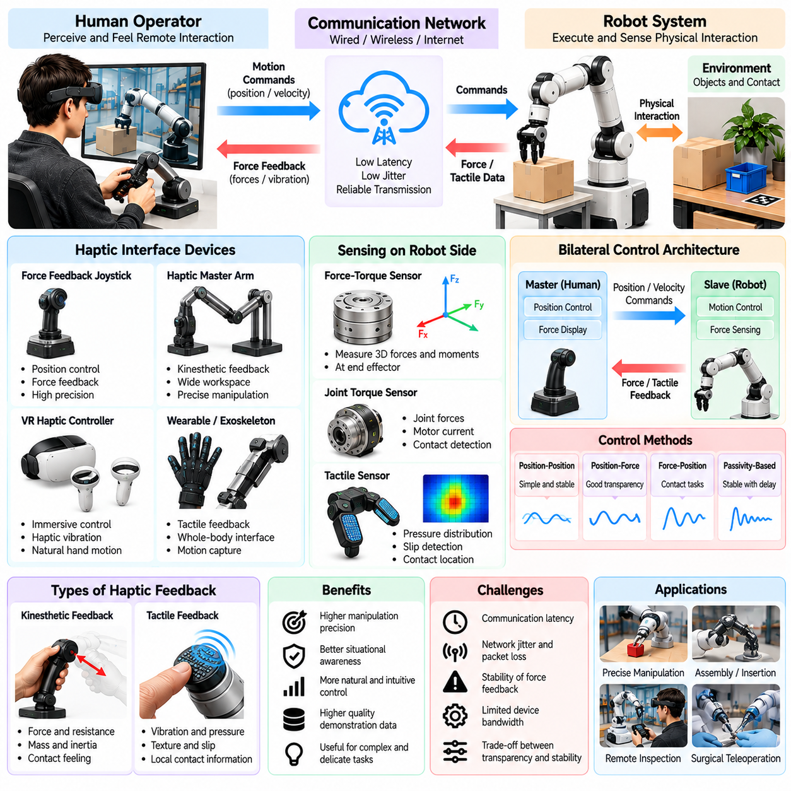{width="7.268055555555556in" height="7.268055555555556in"}

Haptic and force feedback are essential components of teleoperation systems that allow human operators to perceive physical interactions beyond visual observation. Haptic feedback communicates sensations such as vibration, resistance, and contact, while force feedback reproduces mechanical forces generated during robot interaction. Together, they improve manipulation precision, situational awareness, and the quality of demonstrations collected for Physical AI learning.

Conventional teleoperation often relies primarily on visual information, requiring operators to infer contact forces from object movement and robot behavior. This indirect perception becomes unreliable during delicate manipulation, insertion, or surface interaction. Haptic interfaces provide additional sensory information that helps operators recognize contact events, estimate resistance, and adjust movements before excessive forces damage objects or equipment.

A typical bilateral teleoperation architecture consists of a master interface operated by a human and a slave robotic system interacting with the environment. The master generates position or velocity commands, while the slave measures interaction forces through sensors. These measurements are transmitted back to the operator interface, creating a bidirectional control loop that connects human movement with remote physical contact.

Force feedback devices commonly use electric motors, cable mechanisms, or other actuators to generate resistance against operator movement. When the remote robot encounters an obstacle, the interface can reproduce an opposing force. This allows the operator to perceive environmental constraints directly. The accuracy of this sensation depends on actuator bandwidth, force resolution, mechanical friction, and control-loop stability.

Haptic feedback includes both kinesthetic and tactile sensations. Kinesthetic feedback communicates forces and movements associated with muscles and joints, while tactile feedback represents localized skin sensations such as pressure, vibration, or texture. These modalities provide complementary information. Kinesthetic feedback supports force regulation, whereas tactile feedback helps detect contact location, slipping, and surface characteristics.

Force and torque sensors are important sources of feedback in robotic manipulation. Six-axis force-torque sensors can measure forces and moments along multiple directions, providing information about contact conditions at the end effector. Joint torque sensors and motor current estimates may provide additional measurements. However, indirect force estimates require careful calibration because friction and actuator dynamics can introduce uncertainty.

Tactile sensing extends feedback beyond global contact forces by measuring pressure distributions across robotic fingers or contact surfaces. Sensor arrays can reveal whether an object is slipping, rotating, or being grasped unevenly. This information is particularly valuable for handling fragile or deformable objects. Translating high-dimensional tactile measurements into meaningful operator sensations remains an important interface design challenge.

Bilateral control architectures must coordinate the forward transmission of motion commands with the backward transmission of force information. Position-position, position-force, and force-position control structures provide different relationships between operator movement and robot response. Architecture selection depends on task requirements, robot dynamics, interface capabilities, and communication conditions.

Transparency describes how accurately a teleoperation system reproduces the remote environment\'s mechanical behavior at the operator interface. An ideally transparent system allows the operator to experience contact forces and motion resistance as though interacting directly with the environment. In practice, sensor noise, actuator limitations, communication delays, and controller dynamics reduce transparency and introduce perceptual distortions.

Stability is a fundamental challenge in force-reflecting teleoperation because delayed feedback can cause oscillations or excessive interaction forces. A control loop that behaves safely under local communication may become unstable when network latency increases. Passivity-based control, wave-variable transformations, energy monitoring, and damping mechanisms are commonly investigated to preserve stable bilateral interaction.

Passivity-based approaches limit the possibility that the teleoperation system generates uncontrolled energy during interaction. By monitoring energy exchange between the operator, robot, and environment, controllers can introduce damping when necessary. These techniques can improve robustness under communication delays, although additional damping may reduce the fidelity of force sensations and make remote manipulation feel less responsive.

Communication architecture strongly influences haptic performance. Force feedback often requires frequent updates and predictable timing, while visual streams can tolerate different transmission characteristics. Network jitter, packet loss, and asynchronous measurements may create discontinuities in perceived resistance. Local interpolation, predictive models, and carefully designed communication protocols can reduce these effects without guaranteeing perfect transparency.

Virtual fixtures provide software-generated haptic constraints that guide operator movement. A virtual fixture may create resistance near restricted regions, encourage alignment with a desired path, or prevent motion beyond a safe workspace boundary. These mechanisms are useful for precision assembly, surgical manipulation, and industrial inspection. They must be designed carefully to avoid masking important environmental forces.

Shared haptic control combines human intention with autonomous assistance through force-based guidance. Rather than directly overriding an operator\'s command, the system can generate directional cues or resistance that encourages safer movement. This approach preserves some human authority while reducing errors. However, operators must understand whether a sensation originates from physical contact or software-generated guidance.

Contact-rich manipulation benefits significantly from force feedback because successful execution often depends on maintaining appropriate contact pressure. Inserting a connector, turning a valve, or aligning a mechanical component may require subtle adjustments that are difficult to judge visually. Force feedback helps operators identify contact transitions and avoid excessive loading, potentially improving task completion and reducing mechanical damage.

Force control must account for the mechanical compliance of the robot, tool, and environment. Rigid position control can generate large contact forces when small alignment errors occur. Impedance control regulates the relationship between motion deviations and interaction forces, while admittance control converts measured forces into motion commands. Both approaches can support safer physical interaction when properly tuned.

Haptic interfaces introduce important ergonomic considerations. Continuous force resistance can produce operator fatigue, while poorly calibrated feedback may encourage excessive gripping or unnatural posture. Device workspace, maximum force output, comfort, and motion range should match the intended task. Long collection sessions require attention to repetitive strain, operator adaptation, and consistency of demonstrated behavior.

For Physical AI data collection, force and haptic signals provide information that visual demonstrations alone cannot capture. Recording contact forces, joint torques, tactile measurements, operator inputs, and robot actions enables learning systems to associate physical interaction conditions with appropriate responses. Such datasets are particularly useful for manipulation policies that must regulate contact rather than merely reproduce geometric trajectories.

Temporal synchronization is essential because contact events may occur over short intervals. Force measurements, tactile signals, camera observations, and actuator commands must be aligned accurately to reconstruct interaction sequences. Incorrect timestamps can associate a corrective movement with the wrong contact condition. Hardware synchronization and calibrated sensor delays help preserve meaningful observation-action relationships.

Haptic data quality depends on sensor calibration, sampling frequency, filtering, and mechanical consistency. Excessive filtering may remove brief impact events, while insufficient filtering can introduce noise into training signals. Sensor saturation and thermal drift may also distort measurements. Recording calibration parameters and uncertainty estimates supports reliable dataset curation and comparison across different robotic platforms.

Learning from force-rich demonstrations can improve contact-aware policies and multimodal robot foundation models. Neural networks may learn relationships between visual observations, proprioceptive states, tactile measurements, and force-regulated actions. However, successful learning requires sufficient diversity in object properties, contact geometry, and environmental conditions. Force feedback data alone does not guarantee robust physical generalization.

Safety remains essential because force-reflecting interfaces can transmit unexpected mechanical disturbances to human operators. Hardware force limits, emergency disengagement, velocity restrictions, and independent robot-side protection should remain active. Communication failures must trigger controlled fallback behavior rather than uncontrolled force generation. Safety requirements should consider both the remote robot and the human interface.

Scalable haptic data collection requires standardized force representations, calibrated coordinate frames, and consistent metadata. Different sensors and feedback devices may produce incompatible units, reference directions, or response characteristics. Recording device specifications, controller parameters, operator conditions, and task outcomes enables more meaningful comparisons and supports the development of reusable Physical AI datasets.

Ultimately, haptic and force feedback transform teleoperation from primarily visual remote control into a richer form of physical interaction. Their effectiveness depends on sensing accuracy, bilateral control stability, communication reliability, ergonomic design, and synchronized data recording. Properly integrated, these technologies improve human manipulation performance while supplying valuable contact-aware demonstrations for increasingly capable Physical AI systems.

햅틱 피드백(Haptic Feedback)과 힘 피드백(Force Feedback)은 인간 작업자가 시각적 관측(Visual Observation)을 넘어 물리적 상호작용(Physical Interaction)을 인지할 수 있도록 하는 원격조작 시스템(Teleoperation System)의 핵심 구성 요소이다. 햅틱 피드백은 진동(Vibration), 저항(Resistance), 접촉(Contact)과 같은 감각을 전달하고, 힘 피드백은 로봇의 상호작용 과정에서 발생하는 기계적 힘(Mechanical Force)을 재현한다. 두 기술은 함께 조작 정밀도(Manipulation Precision), 상황 인식(Situational Awareness), 피지컬 인공지능(Physical AI) 학습을 위한 시연 데이터(Demonstration Data)의 품질을 향상시킨다.

기존 원격조작(Conventional Teleoperation)은 주로 시각 정보(Visual Information)에 의존하기 때문에 작업자는 물체의 움직임(Object Movement)과 로봇 행동(Robot Behavior)을 통해 접촉력(Contact Force)을 추론해야 한다. 이러한 간접적 인식(Indirect Perception)은 섬세한 조작(Delicate Manipulation), 삽입(Insertion), 표면 상호작용(Surface Interaction) 과정에서 신뢰성이 낮아진다. 햅틱 인터페이스(Haptic Interface)는 작업자가 접촉 이벤트(Contact Event)를 인식하고 저항을 추정하며, 과도한 힘이 물체나 장비를 손상시키기 전에 움직임을 조정할 수 있도록 추가적인 감각 정보를 제공한다.

일반적인 양방향 원격조작 아키텍처(Bilateral Teleoperation Architecture)는 인간이 조작하는 마스터 인터페이스(Master Interface)와 환경과 상호작용하는 슬레이브 로봇 시스템(Slave Robotic System)으로 구성된다. 마스터는 위치 또는 속도 명령(Position or Velocity Command)을 생성하고, 슬레이브는 센서를 통해 상호작용 힘(Interaction Force)을 측정한다. 이러한 측정값은 작업자 인터페이스로 다시 전송되어 인간의 움직임과 원격 물리적 접촉을 연결하는 양방향 제어 루프(Bidirectional Control Loop)를 형성한다.

힘 피드백 장치(Force Feedback Device)는 일반적으로 전기 모터(Electric Motor), 케이블 메커니즘(Cable Mechanism), 기타 구동기(Actuator)를 사용하여 작업자의 움직임에 저항하는 힘을 생성한다. 원격 로봇이 장애물(Obstacle)에 접촉하면 인터페이스는 반대 방향의 힘(Opposing Force)을 재현할 수 있다. 이를 통해 작업자는 환경 제약(Environmental Constraint)을 직접 감지할 수 있다. 이러한 감각의 정확도는 구동기 대역폭(Actuator Bandwidth), 힘 분해능(Force Resolution), 기계적 마찰(Mechanical Friction), 제어 루프 안정성(Control-Loop Stability)에 따라 달라진다.

햅틱 피드백에는 운동감각(Kinesthetic Sensation)과 촉각(Tactile Sensation)이 모두 포함된다. 운동감각 피드백(Kinesthetic Feedback)은 근육과 관절에 관련된 힘과 움직임을 전달하고, 촉각 피드백(Tactile Feedback)은 압력(Pressure), 진동(Vibration), 질감(Texture)과 같은 국소적인 피부 감각(Localized Skin Sensation)을 표현한다. 이러한 감각 양식(Modality)은 상호보완적인 정보를 제공한다. 운동감각 피드백은 힘 조절(Force Regulation)을 지원하고, 촉각 피드백은 접촉 위치(Contact Location), 미끄러짐(Slipping), 표면 특성(Surface Characteristic)을 감지하는 데 도움이 된다.

힘 및 토크 센서(Force and Torque Sensor)는 로봇 조작(Robotic Manipulation)에서 중요한 피드백 정보원이다. 6축 힘-토크 센서(Six-Axis Force-Torque Sensor)는 여러 방향의 힘과 모멘트(Moment)를 측정하여 말단효과기(End Effector)의 접촉 조건(Contact Condition)에 관한 정보를 제공한다. 관절 토크 센서(Joint Torque Sensor)와 모터 전류 추정값(Motor Current Estimate)도 추가적인 측정 정보를 제공할 수 있다. 그러나 간접적인 힘 추정(Indirect Force Estimation)은 마찰과 구동기 동역학(Actuator Dynamics)이 불확실성을 발생시킬 수 있으므로 세심한 보정(Calibration)이 필요하다.

촉각 센싱(Tactile Sensing)은 로봇 손가락이나 접촉 표면(Contact Surface)에 분포하는 압력(Pressure Distribution)을 측정함으로써 전체 접촉력(Global Contact Force)을 넘어서는 피드백을 제공한다. 센서 배열(Sensor Array)은 물체가 미끄러지는지, 회전하는지, 불균일하게 파지되는지를 파악할 수 있도록 한다. 이러한 정보는 깨지기 쉽거나 변형 가능한 물체(Fragile or Deformable Object)를 취급할 때 특히 중요하다. 고차원 촉각 측정값(High-Dimensional Tactile Measurement)을 작업자가 이해할 수 있는 감각으로 변환하는 것은 여전히 중요한 인터페이스 설계 과제(Interface Design Challenge)이다.

양방향 제어 아키텍처(Bilateral Control Architecture)는 동작 명령(Motion Command)의 정방향 전송(Forward Transmission)과 힘 정보(Force Information)의 역방향 전송(Backward Transmission)을 조정해야 한다. 위치-위치 제어(Position-Position Control), 위치-힘 제어(Position-Force Control), 힘-위치 제어(Force-Position Control) 구조는 작업자 움직임과 로봇 응답 사이에 서로 다른 관계를 제공한다. 아키텍처 선택은 작업 요구사항(Task Requirement), 로봇 동역학(Robot Dynamics), 인터페이스 능력(Interface Capability), 통신 조건(Communication Condition)에 따라 달라진다.

투명성(Transparency)은 원격조작 시스템이 원격 환경(Remote Environment)의 기계적 거동(Mechanical Behavior)을 작업자 인터페이스에서 얼마나 정확하게 재현하는지를 나타낸다. 이상적인 투명 시스템(Ideally Transparent System)은 작업자가 환경과 직접 상호작용하는 것처럼 접촉력과 운동 저항(Motion Resistance)을 경험할 수 있도록 한다. 실제로는 센서 잡음(Sensor Noise), 구동기 한계(Actuator Limitation), 통신 지연(Communication Delay), 제어기 동역학(Controller Dynamics)이 투명성을 감소시키고 지각 왜곡(Perceptual Distortion)을 발생시킨다.

안정성(Stability)은 힘 반영 원격조작(Force-Reflecting Teleoperation)의 근본적인 과제이다. 지연된 피드백(Delayed Feedback)이 진동(Oscillation)이나 과도한 상호작용 힘(Excessive Interaction Force)을 발생시킬 수 있기 때문이다. 로컬 통신 환경에서는 안전하게 작동하던 제어 루프(Control Loop)도 네트워크 지연(Network Latency)이 증가하면 불안정해질 수 있다. 안정적인 양방향 상호작용(Bilateral Interaction)을 유지하기 위해 수동성 기반 제어(Passivity-Based Control), 파동 변수 변환(Wave-Variable Transformation), 에너지 모니터링(Energy Monitoring), 감쇠 메커니즘(Damping Mechanism) 등이 연구되고 있다.

수동성 기반 접근법(Passivity-Based Approach)은 상호작용 과정에서 원격조작 시스템이 제어되지 않은 에너지(Uncontrolled Energy)를 생성할 가능성을 제한한다. 작업자, 로봇, 환경 사이의 에너지 교환(Energy Exchange)을 모니터링함으로써 제어기는 필요한 경우 감쇠(Damping)를 도입할 수 있다. 이러한 기술은 통신 지연 상황에서 강건성(Robustness)을 향상시킬 수 있지만, 추가적인 감쇠는 힘 감각의 충실도(Force Sensation Fidelity)를 낮추고 원격 조작의 응답성(Responsiveness)을 감소시킬 수 있다.

통신 아키텍처(Communication Architecture)는 햅틱 성능(Haptic Performance)에 큰 영향을 미친다. 힘 피드백은 일반적으로 빈번한 갱신(Frequent Update)과 예측 가능한 타이밍(Predictable Timing)이 필요하지만, 시각적 스트림(Visual Stream)은 서로 다른 전송 특성을 허용할 수 있다. 네트워크 지터(Network Jitter), 패킷 손실(Packet Loss), 비동기 측정(Asynchronous Measurement)은 작업자가 느끼는 저항에 불연속성(Discontinuity)을 발생시킬 수 있다. 로컬 보간(Local Interpolation), 예측 모델(Predictive Model), 신중하게 설계된 통신 프로토콜(Communication Protocol)은 이러한 영향을 줄일 수 있지만 완벽한 투명성을 보장하지는 못한다.

가상 구속 장치(Virtual Fixture)는 작업자의 움직임을 안내하는 소프트웨어 기반 햅틱 제약(Software-Generated Haptic Constraint)을 제공한다. 가상 구속 장치는 제한 구역(Restricted Region) 근처에서 저항을 생성하거나, 원하는 경로(Desired Path)에 정렬되도록 유도하거나, 안전한 작업 공간 경계(Safe Workspace Boundary)를 벗어나는 움직임을 방지할 수 있다. 이러한 메커니즘은 정밀 조립(Precision Assembly), 수술 조작(Surgical Manipulation), 산업 검사(Industrial Inspection)에 유용하다. 다만 중요한 환경 힘(Environmental Force)을 가리지 않도록 신중하게 설계해야 한다.

공유 햅틱 제어(Shared Haptic Control)는 힘 기반 안내(Force-Based Guidance)를 통해 인간의 의도(Human Intention)와 자율 보조 기능(Autonomous Assistance)을 결합한다. 시스템은 작업자 명령을 직접 덮어쓰는 대신 더 안전한 움직임을 유도하는 방향성 신호(Directional Cue)나 저항을 생성할 수 있다. 이러한 접근법은 오류를 줄이면서 인간의 제어 권한(Human Authority)을 일정 부분 유지한다. 그러나 작업자는 감지된 힘이 실제 물리적 접촉(Physical Contact)에서 발생한 것인지 소프트웨어가 생성한 안내(Software-Generated Guidance)에서 발생한 것인지 이해할 수 있어야 한다.

접촉이 많은 조작(Contact-Rich Manipulation)은 성공적인 실행이 적절한 접촉 압력(Contact Pressure)을 유지하는 데 의존하는 경우가 많으므로 힘 피드백의 이점을 크게 얻는다. 커넥터 삽입(Connector Insertion), 밸브 회전(Valve Turning), 기계 부품 정렬(Mechanical Component Alignment)에는 시각적으로 판단하기 어려운 미세한 조정(Subtle Adjustment)이 필요할 수 있다. 힘 피드백은 작업자가 접촉 상태 전환(Contact Transition)을 식별하고 과도한 하중(Excessive Loading)을 방지하도록 지원하여 작업 완료율을 높이고 기계적 손상(Mechanical Damage)을 줄일 수 있다.

힘 제어(Force Control)는 로봇, 도구, 환경의 기계적 유연성(Mechanical Compliance)을 고려해야 한다. 강체 위치 제어(Rigid Position Control)는 작은 정렬 오차(Alignment Error)만으로도 큰 접촉력을 발생시킬 수 있다. 임피던스 제어(Impedance Control)는 동작 편차(Motion Deviation)와 상호작용 힘(Interaction Force) 사이의 관계를 조절하며, 어드미턴스 제어(Admittance Control)는 측정된 힘을 동작 명령(Motion Command)으로 변환한다. 두 접근법 모두 적절하게 조정되면 더욱 안전한 물리적 상호작용을 지원할 수 있다.

햅틱 인터페이스(Haptic Interface)는 중요한 인간공학적 고려사항(Ergonomic Consideration)을 수반한다. 지속적인 힘 저항(Continuous Force Resistance)은 작업자 피로(Operator Fatigue)를 발생시킬 수 있으며, 부정확하게 보정된 피드백(Poorly Calibrated Feedback)은 과도한 파지(Excessive Gripping)나 부자연스러운 자세(Unnatural Posture)를 유도할 수 있다. 장치 작업 공간(Device Workspace), 최대 힘 출력(Maximum Force Output), 착용 및 사용 편의성(Comfort), 동작 범위(Motion Range)는 목표 작업에 적합해야 한다. 장시간 데이터 수집 세션(Collection Session)에서는 반복적 긴장(Repetitive Strain), 작업자 적응(Operator Adaptation), 시연 행동의 일관성(Demonstrated Behavior Consistency)을 고려해야 한다.

피지컬 인공지능(Physical AI) 데이터 수집에서 힘 및 햅틱 신호(Force and Haptic Signal)는 시각적 시연(Visual Demonstration)만으로는 확보할 수 없는 정보를 제공한다. 접촉력(Contact Force), 관절 토크(Joint Torque), 촉각 측정값(Tactile Measurement), 작업자 입력(Operator Input), 로봇 행동(Robot Action)을 기록하면 학습 시스템이 물리적 상호작용 조건(Physical Interaction Condition)과 적절한 대응 행동을 연결할 수 있다. 이러한 데이터셋은 기하학적 궤적(Geometric Trajectory)을 단순히 재현하는 것이 아니라 접촉을 조절해야 하는 조작 정책(Manipulation Policy)에 특히 유용하다.

접촉 이벤트(Contact Event)는 짧은 시간 간격(Short Interval) 동안 발생할 수 있으므로 시간 동기화(Temporal Synchronization)가 필수적이다. 힘 측정값(Force Measurement), 촉각 신호(Tactile Signal), 카메라 관측 정보(Camera Observation), 구동기 명령(Actuator Command)은 상호작용 시퀀스(Interaction Sequence)를 재구성할 수 있도록 정확하게 정렬되어야 한다. 잘못된 타임스탬프(Incorrect Timestamp)는 교정 동작(Corrective Movement)을 잘못된 접촉 조건과 연결할 수 있다. 하드웨어 동기화(Hardware Synchronization)와 보정된 센서 지연(Calibrated Sensor Delay)은 의미 있는 관측-행동 관계(Observation-Action Relationship)를 보존하는 데 도움이 된다.

햅틱 데이터 품질(Haptic Data Quality)은 센서 보정(Sensor Calibration), 샘플링 주파수(Sampling Frequency), 필터링(Filtering), 기계적 일관성(Mechanical Consistency)에 따라 달라진다. 과도한 필터링(Excessive Filtering)은 짧은 충격 이벤트(Impact Event)를 제거할 수 있으며, 불충분한 필터링(Insufficient Filtering)은 학습 신호(Training Signal)에 잡음을 유입시킬 수 있다. 센서 포화(Sensor Saturation)와 열 드리프트(Thermal Drift)도 측정값을 왜곡할 수 있다. 보정 매개변수(Calibration Parameter)와 불확실성 추정값(Uncertainty Estimate)을 기록하면 신뢰할 수 있는 데이터셋 정제(Dataset Curation)와 서로 다른 로봇 플랫폼(Robotic Platform) 간 비교를 지원할 수 있다.

힘 정보가 풍부한 시연(Force-Rich Demonstration)을 통한 학습은 접촉 인식 정책(Contact-Aware Policy)과 다중모달 로봇 파운데이션 모델(Multimodal Robot Foundation Model)을 개선할 수 있다. 신경망(Neural Network)은 시각적 관측 정보(Visual Observation), 고유수용감각 상태(Proprioceptive State), 촉각 측정값(Tactile Measurement), 힘 조절 행동(Force-Regulated Action) 사이의 관계를 학습할 수 있다. 그러나 성공적인 학습을 위해서는 물체 특성(Object Property), 접촉 기하학(Contact Geometry), 환경 조건(Environmental Condition)에 충분한 다양성이 필요하다. 힘 피드백 데이터만으로 강건한 물리적 일반화(Robust Physical Generalization)가 보장되는 것은 아니다.

힘 반영 인터페이스(Force-Reflecting Interface)는 예상하지 못한 기계적 교란(Mechanical Disturbance)을 인간 작업자에게 전달할 수 있으므로 안전성(Safety)이 필수적이다. 하드웨어 힘 제한(Hardware Force Limit), 비상 연결 해제(Emergency Disengagement), 속도 제한(Velocity Restriction), 독립적인 로봇 측 보호 기능(Independent Robot-Side Protection)은 항상 활성화되어 있어야 한다. 통신 장애(Communication Failure)가 발생하면 제어되지 않은 힘 생성(Uncontrolled Force Generation)이 아니라 제어된 대체 동작(Controlled Fallback Behavior)이 실행되어야 한다. 안전 요구사항(Safety Requirement)은 원격 로봇과 인간 인터페이스 모두를 고려해야 한다.

확장 가능한 햅틱 데이터 수집(Scalable Haptic Data Collection)을 위해서는 표준화된 힘 표현(Standardized Force Representation), 보정된 좌표계(Calibrated Coordinate Frame), 일관된 메타데이터(Consistent Metadata)가 필요하다. 서로 다른 센서와 피드백 장치는 호환되지 않는 단위(Unit), 기준 방향(Reference Direction), 응답 특성(Response Characteristic)을 생성할 수 있다. 장치 사양(Device Specification), 제어기 매개변수(Controller Parameter), 작업자 조건(Operator Condition), 작업 결과(Task Outcome)를 기록하면 더욱 의미 있는 비교가 가능해지고 재사용 가능한 피지컬 인공지능 데이터셋(Reusable Physical AI Dataset)의 개발을 지원할 수 있다.

궁극적으로 햅틱 피드백(Haptic Feedback)과 힘 피드백(Force Feedback)은 원격조작을 주로 시각 정보에 의존하는 원격 제어(Visual Remote Control)에서 더욱 풍부한 물리적 상호작용(Physical Interaction) 방식으로 발전시킨다. 그 효과는 센싱 정확도(Sensing Accuracy), 양방향 제어 안정성(Bilateral Control Stability), 통신 신뢰성(Communication Reliability), 인간공학적 설계(Ergonomic Design), 동기화된 데이터 기록(Synchronized Data Recording)에 달려 있다. 이러한 기술을 적절하게 통합하면 인간의 조작 성능(Human Manipulation Performance)을 향상시키는 동시에 더욱 높은 능력을 갖춘 피지컬 인공지능 시스템(Physical AI System)을 위한 가치 있는 접촉 인식 시연 데이터(Contact-Aware Demonstration Data)를 제공할 수 있다.

##  

## 02.07. Teleoperation for Mobile Robots

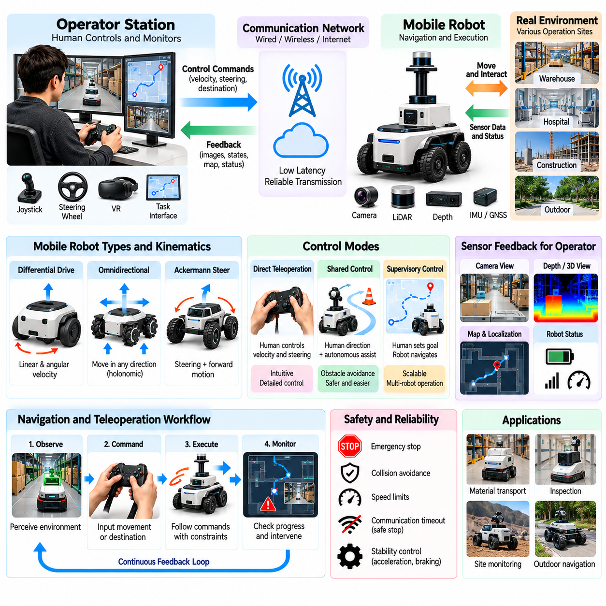{width="7.268055555555556in" height="7.268055555555556in"}

Teleoperation for mobile robots enables human operators to control robotic platforms across warehouses, factories, hospitals, construction sites, and outdoor environments. Unlike stationary manipulators, mobile robots must continuously navigate changing spatial conditions while maintaining safe movement. Teleoperation provides direct human guidance when autonomous navigation is unavailable, uncertain, or insufficient, while generating valuable demonstrations for Physical AI learning.

Mobile robot teleoperation typically combines an operator interface, wireless communication network, onboard navigation controller, and environmental sensors. Operators issue velocity, steering, or destination commands while receiving visual and positional feedback. The robot translates these inputs into executable motion through its drive system. Reliable integration between communication, perception, and control is essential for maintaining predictable movement.

Different mobile robot configurations require different teleoperation strategies. Differential-drive robots are controlled through linear and angular velocities, while omnidirectional platforms can move laterally without changing orientation. Ackermann-steered vehicles require coordinated steering and forward motion. Control interfaces must respect these kinematic constraints to prevent commands that cannot be physically executed.

Joystick control remains common because it provides intuitive directional commands and rapid operator response. Input displacement can be mapped to forward velocity, rotational speed, or steering angle. Adjustable speed limits and nonlinear response curves improve maneuverability in narrow spaces. However, excessive sensitivity can produce abrupt movements, making calibration and command smoothing important for safe operation.

Visual feedback allows operators to interpret obstacles, corridors, intersections, and dynamic objects. Forward-facing cameras provide navigation context, while panoramic or multiple-camera configurations reduce blind spots. Depth cameras and LiDAR can supplement video with geometric information. Combining these sources improves situational awareness, particularly when the robot operates beyond the operator\'s direct line of sight.

Localization feedback helps operators understand the robot\'s position relative to its environment. Maps generated through simultaneous localization and mapping can display robot pose, obstacles, and planned routes. However, localization estimates may become unreliable in repetitive corridors, reflective environments, or changing construction sites. Teleoperation interfaces should communicate uncertainty rather than presenting estimated positions as exact measurements.

Communication latency directly affects driving precision and operator confidence. Delayed camera images can cause overcorrection during steering, while delayed motion commands increase stopping distance. Wireless interference, network congestion, and temporary signal loss introduce additional uncertainty. Local velocity limits and collision prevention mechanisms help reduce risks when communication performance deteriorates.

Shared-control navigation combines human directional guidance with autonomous obstacle avoidance. Operators select the desired movement direction, while onboard planners modify trajectories to maintain clearance from obstacles. This reduces collision risk and operator workload. Nevertheless, excessive autonomous correction can make the robot feel unpredictable, requiring clear feedback about how operator commands are being modified.

Supervisory teleoperation allows operators to specify destinations or navigation goals rather than continuously controlling velocity. The robot uses onboard localization, global planning, and local obstacle avoidance to execute the route. Human intervention becomes necessary when navigation encounters blocked passages, localization failures, or unfamiliar conditions. This approach supports scalable operation across larger robot fleets.

Recovery from navigation failures is a particularly valuable application of teleoperation. Robots may become trapped near obstacles, encounter unexpected barriers, or fail to interpret temporary environmental changes. Human operators can identify alternative paths and guide the robot toward a recoverable state. Recording these interventions creates targeted training data for improving future autonomous navigation policies.

Safety architecture must account for both static and moving obstacles. Emergency stopping, protective sensing, speed restrictions, and local collision monitoring should operate independently of remote communication. A communication timeout should trigger an appropriate controlled response. Robots carrying heavy payloads or operating near pedestrians may require more conservative speed and stopping policies.

Mobile robot dynamics influence how teleoperation commands should be executed. Acceleration limits, braking performance, wheel slip, and payload distribution affect motion stability. Sudden commands may produce unsafe behavior on slippery floors or uneven terrain. Motion controllers should enforce feasible acceleration and turning rates while preserving the operator\'s intended navigation direction.

Outdoor mobile robot teleoperation introduces additional challenges associated with terrain, weather, lighting, and communication coverage. Gravel, slopes, mud, and uneven surfaces can reduce traction and alter vehicle response. Rain, dust, and strong sunlight may degrade sensors. Operators require feedback about terrain conditions and robot health to avoid commands that exceed the platform\'s mobility capabilities.

Teleoperation for autonomous mobile robots is often integrated with fleet management systems. A remote operator may assist multiple robots by responding to intervention requests rather than continuously driving a single platform. Task queues, robot status dashboards, and operator assignment mechanisms support efficient coordination. However, simultaneous failures can create workload peaks that must be considered during system design.

Human intervention policies determine when autonomous navigation should request assistance. Triggers may include localization uncertainty, repeated planning failures, prolonged obstacle blockage, or safety-related events. Appropriate thresholds balance autonomous independence against operational risk. Excessively frequent intervention reduces scalability, while delayed intervention may increase downtime or expose the robot to unsafe conditions.

Mobile robot demonstrations typically contain synchronized camera observations, LiDAR scans, robot poses, velocity commands, and navigation outcomes. Additional records may include operator inputs, planned trajectories, obstacle distances, and control-mode transitions. These signals provide the context needed to understand why particular navigation decisions were made and how they affected subsequent robot movement.

Accurate temporal alignment is essential when recording mobile navigation demonstrations. Sensor observations and control commands must correspond to the same physical events. Network delay can cause recorded operator inputs to appear associated with outdated images. Using synchronized timestamps and distinguishing command generation from execution time helps prevent misleading training examples.

Demonstration datasets should represent diverse navigation environments rather than repeating identical routes. Useful variation includes corridor width, obstacle placement, pedestrian movement, floor conditions, lighting, and initial robot orientation. Such diversity helps learning systems generalize beyond specific maps. However, safety-critical scenarios should be collected under controlled conditions with appropriate protective measures.

Human driving behavior introduces both useful expertise and potential bias into navigation datasets. Experienced operators may anticipate obstacles and select efficient paths, while inexperienced operators may oversteer or hesitate. Different joystick settings can also produce inconsistent trajectories. Data curation should preserve informative recovery behavior while identifying unnecessary oscillations and interface-induced artifacts.

Behavior cloning can use teleoperated navigation trajectories to train policies that predict velocity or steering commands from sensor observations. However, small control errors may accumulate and move the robot into unfamiliar states. Interactive imitation learning can address this limitation by collecting corrective demonstrations during policy execution. Evaluation must determine whether the learned behavior remains safe outside the original demonstration distribution.

Navigation learning can also benefit from hierarchical representations that separate destination selection from local movement control. Human demonstrations may reveal preferred routes, obstacle avoidance strategies, and recovery decisions. High-level policies can learn goal selection, while low-level policies generate feasible motion commands. This separation supports reuse across environments with different layouts and navigation objectives.

Data quality assessment should examine route completion, collision avoidance, command smoothness, intervention frequency, and environmental coverage. Successful trajectories alone may not reveal how robots should recover from blocked paths or localization errors. Including failure and corrective episodes provides more complete operational knowledge. Dataset labels should distinguish intentional operator decisions from autonomous safety interventions.

Privacy and security considerations arise when mobile robots collect video and spatial information in occupied environments. Recorded observations may contain identifiable individuals, sensitive facility layouts, or restricted operational details. Access controls, appropriate retention policies, and secure communication protect these datasets. Remote control authorization must also prevent unauthorized commands from affecting physical robot behavior.

Ultimately, mobile robot teleoperation combines human navigation expertise with onboard perception, motion control, and communication infrastructure. Its value extends beyond temporary manual driving to failure recovery, fleet supervision, and systematic demonstration collection. By recording diverse environments, control decisions, safety interventions, and execution outcomes, teleoperation becomes a scalable data source for increasingly autonomous Physical AI navigation systems.

이동로봇 원격조작(Teleoperation for Mobile Robots)은 인간 작업자(Human Operator)가 창고(Warehouse), 공장(Factory), 병원(Hospital), 건설 현장(Construction Site), 실외 환경(Outdoor Environment)에서 로봇 플랫폼(Robotic Platform)을 제어할 수 있도록 한다. 고정형 매니퓰레이터(Stationary Manipulator)와 달리 이동로봇(Mobile Robot)은 안전한 이동을 유지하면서 지속적으로 변화하는 공간 조건(Spatial Condition)을 탐색해야 한다. 원격조작(Teleoperation)은 자율 내비게이션(Autonomous Navigation)을 사용할 수 없거나 불확실하거나 충분하지 않을 때 인간의 직접적인 지도를 제공하며, 피지컬 인공지능(Physical AI) 학습을 위한 가치 있는 시연 데이터(Demonstration Data)를 생성한다.

이동로봇 원격조작(Mobile Robot Teleoperation)은 일반적으로 작업자 인터페이스(Operator Interface), 무선 통신 네트워크(Wireless Communication Network), 온보드 내비게이션 제어기(Onboard Navigation Controller), 환경 센서(Environmental Sensor)를 결합한다. 작업자는 시각 및 위치 피드백(Visual and Positional Feedback)을 수신하면서 속도(Velocity), 조향(Steering), 목적지 명령(Destination Command)을 전달한다. 로봇은 구동 시스템(Drive System)을 통해 이러한 입력을 실행 가능한 움직임으로 변환한다. 예측 가능한 이동을 유지하려면 통신(Communication), 인식(Perception), 제어(Control) 사이의 신뢰할 수 있는 통합이 필수적이다.

서로 다른 이동로봇 구성(Mobile Robot Configuration)에는 서로 다른 원격조작 전략(Teleoperation Strategy)이 필요하다. 차동구동 로봇(Differential-Drive Robot)은 선속도(Linear Velocity)와 각속도(Angular Velocity)를 통해 제어되는 반면, 전방향 이동 플랫폼(Omnidirectional Platform)은 방향을 변경하지 않고 측면으로 이동할 수 있다. 애커먼 조향 차량(Ackermann-Steered Vehicle)은 조향과 전진 운동(Forward Motion)의 협응이 필요하다. 제어 인터페이스(Control Interface)는 물리적으로 실행할 수 없는 명령을 방지하기 위해 이러한 기구학적 제약(Kinematic Constraint)을 준수해야 한다.

조이스틱 제어(Joystick Control)는 직관적인 방향 명령(Directional Command)과 빠른 작업자 응답(Operator Response)을 제공하므로 널리 사용된다. 입력 변위(Input Displacement)는 전진 속도(Forward Velocity), 회전 속도(Rotational Speed), 조향각(Steering Angle)으로 매핑될 수 있다. 조정 가능한 속도 제한(Adjustable Speed Limit)과 비선형 응답 곡선(Nonlinear Response Curve)은 좁은 공간에서의 기동성(Maneuverability)을 향상시킨다. 그러나 지나치게 높은 민감도(Sensitivity)는 갑작스러운 움직임을 발생시킬 수 있으므로 안전한 운용을 위해 보정(Calibration)과 명령 평활화(Command Smoothing)가 중요하다.

시각적 피드백(Visual Feedback)은 작업자가 장애물(Obstacle), 복도(Corridor), 교차로(Intersection), 동적 객체(Dynamic Object)를 해석할 수 있도록 한다. 전방 카메라(Forward-Facing Camera)는 내비게이션 맥락(Navigation Context)을 제공하고, 파노라마 카메라(Panoramic Camera) 또는 다중 카메라 구성(Multiple-Camera Configuration)은 사각지대(Blind Spot)를 줄인다. 깊이 카메라(Depth Camera)와 라이다(LiDAR)는 영상에 기하학적 정보(Geometric Information)를 추가할 수 있다. 이러한 정보원을 결합하면 특히 로봇이 작업자의 직접적인 시야(Line of Sight) 밖에서 작동할 때 상황 인식(Situational Awareness)을 향상시킬 수 있다.

위치 추정 피드백(Localization Feedback)은 작업자가 환경에 대한 로봇의 상대적 위치를 이해하는 데 도움이 된다. 동시적 위치 추정 및 지도 작성(Simultaneous Localization and Mapping, SLAM)을 통해 생성된 지도(Map)는 로봇 자세(Robot Pose), 장애물(Obstacle), 계획된 경로(Planned Route)를 표시할 수 있다. 그러나 반복적인 복도(Repetitive Corridor), 반사 환경(Reflective Environment), 변화하는 건설 현장(Changing Construction Site)에서는 위치 추정값(Localization Estimate)의 신뢰성이 낮아질 수 있다. 원격조작 인터페이스는 추정 위치를 정확한 측정값처럼 표시하기보다 불확실성(Uncertainty)을 전달해야 한다.

통신 지연(Communication Latency)은 주행 정밀도(Driving Precision)와 작업자 신뢰도(Operator Confidence)에 직접적인 영향을 미친다. 지연된 카메라 영상(Delayed Camera Image)은 조향 과정에서 과도한 보정(Overcorrection)을 유발할 수 있으며, 지연된 동작 명령(Delayed Motion Command)은 정지 거리(Stopping Distance)를 증가시킨다. 무선 간섭(Wireless Interference), 네트워크 혼잡(Network Congestion), 일시적인 신호 손실(Temporary Signal Loss)은 추가적인 불확실성을 발생시킨다. 로컬 속도 제한(Local Velocity Limit)과 충돌 방지 메커니즘(Collision Prevention Mechanism)은 통신 성능이 저하될 때 위험을 줄이는 데 도움이 된다.

공유 제어 내비게이션(Shared-Control Navigation)은 인간의 방향 지시(Human Directional Guidance)와 자율 장애물 회피(Autonomous Obstacle Avoidance)를 결합한다. 작업자는 원하는 이동 방향(Desired Movement Direction)을 선택하고, 온보드 경로 계획기(Onboard Planner)는 장애물과의 안전거리(Clearance)를 유지하도록 궤적(Trajectory)을 수정한다. 이는 충돌 위험(Collision Risk)과 작업자 부하(Operator Workload)를 줄인다. 그러나 과도한 자율 보정(Autonomous Correction)은 로봇의 움직임을 예측하기 어렵게 만들 수 있으므로 작업자 명령이 어떻게 수정되는지 명확한 피드백이 필요하다.

감독형 원격조작(Supervisory Teleoperation)은 작업자가 속도를 지속적으로 제어하는 대신 목적지(Destination)나 내비게이션 목표(Navigation Goal)를 지정할 수 있도록 한다. 로봇은 온보드 위치 추정(Onboard Localization), 전역 경로 계획(Global Planning), 로컬 장애물 회피(Local Obstacle Avoidance)를 사용하여 경로를 실행한다. 통로 차단(Blocked Passage), 위치 추정 실패(Localization Failure), 익숙하지 않은 환경 조건(Unfamiliar Condition)이 발생하면 인간의 개입(Human Intervention)이 필요해진다. 이러한 접근법은 대규모 로봇 군집(Robot Fleet)에서 확장 가능한 운용(Scalable Operation)을 지원한다.

내비게이션 실패 복구(Navigation Failure Recovery)는 원격조작의 특히 가치 있는 응용 분야이다. 로봇은 장애물 근처에 갇히거나 예상하지 못한 장벽(Unexpected Barrier)을 만나거나 일시적인 환경 변화(Temporary Environmental Change)를 해석하지 못할 수 있다. 인간 작업자는 대체 경로(Alternative Path)를 식별하고 로봇을 복구 가능한 상태(Recoverable State)로 안내할 수 있다. 이러한 개입을 기록하면 향후 자율 내비게이션 정책(Autonomous Navigation Policy)을 개선하기 위한 목표 지향적 학습 데이터(Targeted Training Data)가 생성된다.

안전 아키텍처(Safety Architecture)는 정적 장애물(Static Obstacle)과 이동 장애물(Moving Obstacle)을 모두 고려해야 한다. 비상 정지(Emergency Stopping), 보호 센싱(Protective Sensing), 속도 제한(Speed Restriction), 로컬 충돌 모니터링(Local Collision Monitoring)은 원격 통신(Remote Communication)과 독립적으로 작동해야 한다. 통신 타임아웃(Communication Timeout)이 발생하면 적절하게 제어된 대응(Controlled Response)이 실행되어야 한다. 무거운 적재물(Heavy Payload)을 운반하거나 보행자(Pedestrian) 근처에서 작동하는 로봇에는 더욱 보수적인 속도 및 정지 정책(Speed and Stopping Policy)이 필요할 수 있다.

이동로봇 동역학(Mobile Robot Dynamics)은 원격조작 명령이 실행되는 방식에 영향을 미친다. 가속도 제한(Acceleration Limit), 제동 성능(Braking Performance), 바퀴 미끄러짐(Wheel Slip), 적재물 분포(Payload Distribution)는 이동 안정성(Motion Stability)에 영향을 준다. 갑작스러운 명령(Sudden Command)은 미끄러운 바닥(Slippery Floor)이나 고르지 않은 지형(Uneven Terrain)에서 안전하지 않은 행동을 발생시킬 수 있다. 동작 제어기(Motion Controller)는 작업자가 의도한 내비게이션 방향(Intended Navigation Direction)을 유지하면서 실행 가능한 가속도와 회전 속도(Feasible Acceleration and Turning Rate)를 적용해야 한다.

실외 이동로봇 원격조작(Outdoor Mobile Robot Teleoperation)은 지형(Terrain), 날씨(Weather), 조명(Lighting), 통신 범위(Communication Coverage)와 관련된 추가적인 과제를 수반한다. 자갈(Gravel), 경사면(Slope), 진흙(Mud), 고르지 않은 표면(Uneven Surface)은 접지력(Traction)을 감소시키고 차량 응답(Vehicle Response)을 변화시킬 수 있다. 비(Rain), 먼지(Dust), 강한 햇빛(Strong Sunlight)은 센서 성능을 저하시킬 수 있다. 작업자는 플랫폼의 이동 능력(Mobility Capability)을 초과하는 명령을 피하기 위해 지형 조건(Terrain Condition)과 로봇 상태(Robot Health)에 관한 피드백을 받아야 한다.

자율이동로봇(Autonomous Mobile Robot, AMR)의 원격조작은 로봇 군집 관리 시스템(Fleet Management System)과 통합되는 경우가 많다. 원격 작업자(Remote Operator)는 하나의 플랫폼을 지속적으로 주행시키는 대신 개입 요청(Intervention Request)에 대응하여 여러 로봇을 지원할 수 있다. 작업 대기열(Task Queue), 로봇 상태 대시보드(Robot Status Dashboard), 작업자 할당 메커니즘(Operator Assignment Mechanism)은 효율적인 협업을 지원한다. 그러나 여러 장애가 동시에 발생하면 작업 부하가 급증(Workload Peak)할 수 있으므로 시스템 설계 과정에서 이를 고려해야 한다.

인간 개입 정책(Human Intervention Policy)은 자율 내비게이션이 언제 지원을 요청해야 하는지를 결정한다. 개입 조건(Intervention Trigger)에는 위치 추정 불확실성(Localization Uncertainty), 반복적인 경로 계획 실패(Repeated Planning Failure), 장시간 장애물 차단(Prolonged Obstacle Blockage), 안전 관련 이벤트(Safety-Related Event)가 포함될 수 있다. 적절한 임계값(Threshold)은 자율적 독립성(Autonomous Independence)과 운용 위험(Operational Risk) 사이의 균형을 유지한다. 지나치게 빈번한 개입은 확장성(Scalability)을 저하시키고, 지연된 개입은 가동 중단 시간(Downtime)을 증가시키거나 로봇을 위험한 상황에 노출시킬 수 있다.

이동로봇 시연 데이터(Mobile Robot Demonstration Data)에는 일반적으로 동기화된 카메라 관측 정보(Camera Observation), 라이다 스캔(LiDAR Scan), 로봇 자세(Robot Pose), 속도 명령(Velocity Command), 내비게이션 결과(Navigation Outcome)가 포함된다. 추가 기록에는 작업자 입력(Operator Input), 계획된 궤적(Planned Trajectory), 장애물 거리(Obstacle Distance), 제어 모드 전환(Control-Mode Transition)이 포함될 수 있다. 이러한 신호는 특정 내비게이션 의사결정이 이루어진 이유와 이후 로봇 움직임에 미친 영향을 이해하는 데 필요한 맥락 정보를 제공한다.

이동 내비게이션 시연(Mobile Navigation Demonstration)을 기록할 때 정확한 시간 정렬(Temporal Alignment)은 필수적이다. 센서 관측 정보(Sensor Observation)와 제어 명령(Control Command)은 동일한 물리적 이벤트(Physical Event)에 대응해야 한다. 네트워크 지연(Network Delay)으로 인해 기록된 작업자 입력이 오래된 영상(Outdated Image)과 연결된 것처럼 나타날 수 있다. 동기화된 타임스탬프(Synchronized Timestamp)를 사용하고 명령 생성 시점(Command Generation Time)과 실행 시점(Execution Time)을 구분하면 잘못된 학습 사례(Misleading Training Example)를 방지하는 데 도움이 된다.

시연 데이터셋(Demonstration Dataset)은 동일한 경로를 반복하기보다 다양한 내비게이션 환경(Navigation Environment)을 표현해야 한다. 유용한 변형 요소에는 복도 폭(Corridor Width), 장애물 배치(Obstacle Placement), 보행자 이동(Pedestrian Movement), 바닥 조건(Floor Condition), 조명(Lighting), 초기 로봇 방향(Initial Robot Orientation)이 포함된다. 이러한 다양성은 학습 시스템이 특정 지도(Specific Map)를 넘어 일반화(Generalization)하는 데 도움이 된다. 그러나 안전 필수 시나리오(Safety-Critical Scenario)는 적절한 보호 조치(Protective Measure)를 갖춘 통제된 조건(Controlled Condition)에서 수집해야 한다.

인간의 주행 행동(Human Driving Behavior)은 유용한 전문성(Expertise)과 잠재적인 편향(Potential Bias)을 모두 내비게이션 데이터셋에 도입한다. 숙련된 작업자(Experienced Operator)는 장애물을 예측하고 효율적인 경로(Efficient Path)를 선택할 수 있지만, 경험이 부족한 작업자(Inexperienced Operator)는 과도하게 조향(Oversteering)하거나 주저할 수 있다. 서로 다른 조이스틱 설정(Joystick Setting)도 일관되지 않은 궤적(Inconsistent Trajectory)을 생성할 수 있다. 데이터 정제(Data Curation)는 유용한 복구 행동(Informative Recovery Behavior)을 보존하면서 불필요한 진동(Unnecessary Oscillation)과 인터페이스로 인한 인위적 특성(Interface-Induced Artifact)을 식별해야 한다.

행동 복제(Behavior Cloning)는 원격조작 내비게이션 궤적(Teleoperated Navigation Trajectory)을 사용하여 센서 관측 정보(Sensor Observation)로부터 속도 또는 조향 명령(Velocity or Steering Command)을 예측하는 정책(Policy)을 학습할 수 있다. 그러나 작은 제어 오류(Control Error)가 누적되면 로봇이 익숙하지 않은 상태(Unfamiliar State)로 이동할 수 있다. 상호작용형 모방학습(Interactive Imitation Learning)은 정책 실행 중 교정 시연(Corrective Demonstration)을 수집하여 이러한 한계를 해결할 수 있다. 평가(Evaluation)는 학습된 행동이 기존 시연 분포(Original Demonstration Distribution)를 벗어난 상황에서도 안전하게 유지되는지 확인해야 한다.

내비게이션 학습(Navigation Learning)은 목적지 선택(Destination Selection)과 로컬 이동 제어(Local Movement Control)를 분리하는 계층적 표현(Hierarchical Representation)을 통해서도 이점을 얻을 수 있다. 인간 시연(Human Demonstration)은 선호 경로(Preferred Route), 장애물 회피 전략(Obstacle Avoidance Strategy), 복구 의사결정(Recovery Decision)을 보여줄 수 있다. 상위 수준 정책(High-Level Policy)은 목표 선택(Goal Selection)을 학습하고, 하위 수준 정책(Low-Level Policy)은 실행 가능한 동작 명령(Feasible Motion Command)을 생성할 수 있다. 이러한 분리는 서로 다른 배치(Layout)와 내비게이션 목표(Navigation Objective)를 가진 환경에서도 기술을 재사용할 수 있도록 지원한다.

데이터 품질 평가(Data Quality Assessment)는 경로 완료(Route Completion), 충돌 회피(Collision Avoidance), 명령 평활성(Command Smoothness), 개입 빈도(Intervention Frequency), 환경 포괄 범위(Environmental Coverage)를 검토해야 한다. 성공 궤적(Successful Trajectory)만으로는 로봇이 차단된 경로(Blocked Path)나 위치 추정 오류(Localization Error)에서 어떻게 복구해야 하는지 충분히 설명하지 못할 수 있다. 실패 및 교정 에피소드(Failure and Corrective Episode)를 포함하면 더욱 완전한 운용 지식(Operational Knowledge)을 제공할 수 있다. 데이터셋 레이블(Dataset Label)은 의도적인 작업자 의사결정(Intentional Operator Decision)과 자율 안전 개입(Autonomous Safety Intervention)을 구분해야 한다.

이동로봇이 사람이 있는 환경(Occupied Environment)에서 영상과 공간 정보(Spatial Information)를 수집할 때 개인정보 보호(Privacy)와 보안(Security) 문제가 발생한다. 기록된 관측 정보(Recorded Observation)에는 식별 가능한 개인(Identifiable Individual), 민감한 시설 배치(Sensitive Facility Layout), 접근이 제한된 운용 정보(Restricted Operational Detail)가 포함될 수 있다. 접근 제어(Access Control), 적절한 데이터 보존 정책(Data Retention Policy), 보안 통신(Secure Communication)은 이러한 데이터셋을 보호한다. 원격 제어 권한 관리(Remote Control Authorization)는 승인되지 않은 명령(Unauthorized Command)이 로봇의 물리적 행동에 영향을 미치지 못하도록 해야 한다.

궁극적으로 이동로봇 원격조작(Mobile Robot Teleoperation)은 인간의 내비게이션 전문성(Human Navigation Expertise)을 온보드 인식(Onboard Perception), 동작 제어(Motion Control), 통신 인프라(Communication Infrastructure)와 결합한다. 그 가치는 일시적인 수동 주행(Manual Driving)을 넘어 장애 복구(Failure Recovery), 로봇 군집 감독(Fleet Supervision), 체계적인 시연 데이터 수집(Systematic Demonstration Collection)으로 확장된다. 다양한 환경, 제어 의사결정(Control Decision), 안전 개입(Safety Intervention), 실행 결과(Execution Outcome)를 기록함으로써 원격조작은 점점 더 높은 자율성을 갖추는 피지컬 인공지능 내비게이션 시스템(Physical AI Navigation System)을 위한 확장 가능한 데이터 소스(Scalable Data Source)가 된다.

##  

## 02.08. Teleoperation for Manipulators and Humanoids

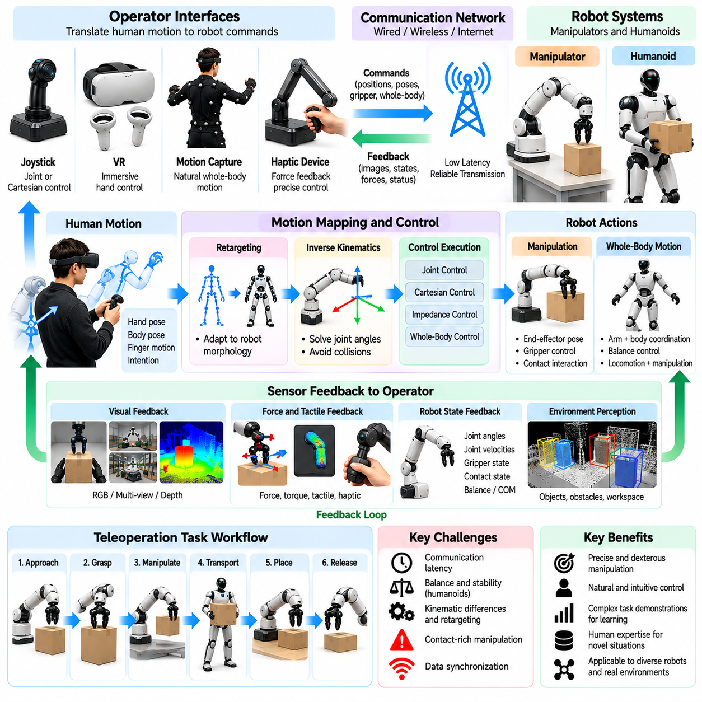{width="7.268055555555556in" height="7.268055555555556in"}

Teleoperation for manipulators and humanoid robots enables human operators to demonstrate complex physical skills through robotic systems with multiple degrees of freedom. Unlike mobile navigation, manipulation requires precise control of hand position, orientation, grasping force, and contact dynamics. Humanoid robots introduce additional challenges involving coordinated arm movements, whole-body balance, and interaction with environments designed for human activities.

Manipulator teleoperation commonly uses master devices, joysticks, virtual reality controllers, or motion capture systems to translate human movements into robot commands. Operators may control joint positions directly or specify desired end-effector poses. Cartesian control simplifies spatial manipulation, while joint-level control provides access to individual degrees of freedom. Interface selection depends on robot configuration, task requirements, and operator expertise.

Human-to-robot motion mapping is a central challenge because robotic arms rarely share the exact geometry of human limbs. Differences in link lengths, joint limits, and reachable workspaces require motion retargeting algorithms. These algorithms preserve task-relevant movements while satisfying robot kinematic constraints. Poor retargeting can produce unnatural trajectories, singular configurations, or unexpected contact with surrounding objects.

Inverse kinematics converts desired end-effector positions and orientations into feasible joint configurations. Redundant manipulators may have multiple solutions for the same target pose, requiring optimization of joint limits, collision avoidance, and motion smoothness. Humanoid robots introduce additional constraints because arm movements can influence balance. Whole-body inverse kinematics coordinates multiple joints while maintaining physically feasible postures.

Bimanual manipulation requires synchronized control of two robotic arms and their interaction with shared objects. Tasks such as folding fabric, assembling components, or carrying large items depend on coordinated motion and force distribution. Operators must understand the relative positions of both hands and the object. Independent arm control can introduce conflicting forces, making coordinated planning and feedback essential.

Grasping control involves more than opening and closing robotic fingers. Successful manipulation requires selecting contact points, regulating grip force, and adapting to object geometry and material properties. Parallel grippers provide relatively simple control, while dexterous robotic hands introduce many additional degrees of freedom. Teleoperation interfaces must balance expressive control with manageable operator workload.

Humanoid teleoperation extends manipulation to coordinated whole-body behavior. Reaching toward distant objects may require torso rotation, stepping, or repositioning the center of mass. The robot must maintain balance while executing the intended task. Human demonstrations therefore need to be transformed through controllers that respect support contacts, joint limits, and dynamic stability constraints.

Balance control is particularly important when humanoids manipulate heavy objects or interact with external forces. Changes in payload distribution can shift the center of mass and alter ground reaction forces. Local balance controllers should respond independently of communication delays. Teleoperation systems must distinguish operator intentions from autonomous stabilization actions to preserve accurate training records.

Visual feedback supports object localization, hand positioning, and spatial reasoning during remote manipulation. Wrist-mounted cameras provide detailed views of contact regions, while external cameras offer broader workspace awareness. Stereo vision and depth sensing can improve three-dimensional interpretation. However, occlusion, calibration errors, and delayed images may cause operators to misjudge object distances or contact conditions.

Force and tactile feedback provide additional information during contact-rich manipulation. Operators can use resistance cues to recognize insertion forces, grasp instability, or collisions. Tactile sensing helps identify slipping and uneven pressure distributions. When physical haptic devices are unavailable, visual force indicators may provide partial alternatives, although they cannot reproduce the complete sensation of physical interaction.

Communication latency affects precision manipulation differently from mobile navigation. Small delays can produce overshoot during insertion or contact adjustment, particularly when operators rely on force feedback. Local impedance control, motion filtering, and predictive displays can improve responsiveness. Safety-critical contact regulation should remain onboard rather than depending entirely on remote operator reactions.

Shared autonomy reduces the burden of controlling numerous joints simultaneously. Operators may specify object targets or desired grasp poses while autonomous controllers handle inverse kinematics, collision avoidance, and grip stabilization. This division allows humans to focus on task intent. However, excessive automation can obscure which actions originate from human decisions and which result from robotic assistance.

Task demonstrations should capture meaningful manipulation phases, including approach, grasp, transport, placement, release, and recovery. Each phase involves different control requirements and contact conditions. Segmenting demonstrations into interpretable stages supports hierarchical policy learning. Nevertheless, transitions between phases must remain synchronized because critical decisions often occur near contact events.

Humanoid demonstrations may additionally include locomotion, posture adjustment, and coordinated hand-object interaction. A robot might approach a workstation, reposition its feet, reach toward a tool, and manipulate an object. These actions require coordination across perception, navigation, and manipulation systems. Recording only hand trajectories would omit important whole-body decisions necessary for reproducing the task.

Sensor recording should include synchronized camera streams, joint positions, velocities, torques, end-effector poses, and gripper states. Humanoid systems may additionally require inertial measurements, foot contact information, and balance controller outputs. Operator inputs and transformed robot commands should be stored separately. This distinction helps identify whether observed behavior reflects human intention, control limitations, or autonomous corrections.

Contact events require particularly accurate temporal alignment because grasp transitions and insertion forces may change rapidly. Sensor delays can cause force measurements to appear associated with incorrect visual frames or motion commands. Hardware timestamps and calibrated synchronization improve consistency. Reliable alignment allows learning algorithms to associate observations, actions, and physical consequences correctly.

Operator skill strongly influences manipulation demonstration quality. Experienced operators may anticipate contact, minimize unnecessary motion, and recover efficiently from grasp failures. Less experienced operators may generate hesitation, repeated corrections, or excessive force. These differences should be documented rather than ignored. Dataset curation can preserve useful recovery behavior while identifying patterns caused by interface difficulty.

Demonstration diversity is necessary for robust manipulation learning. Training datasets should include variations in object size, shape, weight, surface friction, initial pose, and workspace arrangement. Humanoid tasks should also vary support conditions and approach configurations. Repeated demonstrations under identical conditions may improve local performance but provide limited generalization to unfamiliar environments.

Behavior cloning can train manipulation policies to predict robot actions from multimodal observations. However, small positioning errors may accumulate during long tasks, especially when contact changes the environment. Interactive imitation learning introduces corrective demonstrations when learned policies encounter unfamiliar states. Combining successful, failed, and recovery episodes improves coverage of realistic manipulation outcomes.

Learning from humanoid teleoperation requires distinguishing embodiment-specific movements from transferable task intentions. Joint trajectories collected on one humanoid may not execute correctly on another with different proportions or actuator capabilities. Representations based on object relationships, end-effector goals, and contact constraints may improve transfer. Nevertheless, robot-specific control adaptation remains necessary for safe execution.

Safety mechanisms must protect operators, nearby humans, robots, and manipulated objects. Joint limits, collision detection, force thresholds, emergency stopping, and workspace restrictions should remain active during teleoperation. Humanoids require additional protection against falls and unstable contact configurations. Remote communication failures must not disable local stabilization or protective control functions.

Scalable collection of manipulation demonstrations benefits from standardized task definitions, calibration procedures, and recording formats. Operator training and automated quality checks reduce inconsistencies between sessions. Dataset metadata should identify robot morphology, gripper type, control mode, object properties, and task outcomes. These records support comparison, filtering, and reuse across different Physical AI training pipelines.

Ultimately, manipulator and humanoid teleoperation connects human dexterity with robotic execution through motion mapping, feedback, and coordinated control. Its importance extends beyond completing individual tasks to generating structured demonstrations of grasping, contact regulation, bimanual coordination, and whole-body behavior. High-quality recordings provide essential foundations for scalable imitation learning and increasingly general-purpose Physical AI systems.

매니퓰레이터 및 휴머노이드 로봇 원격조작(Teleoperation for Manipulators and Humanoid Robots)은 인간 작업자(Human Operator)가 다자유도(Multiple Degrees of Freedom)를 가진 로봇 시스템을 통해 복잡한 물리적 기술(Physical Skill)을 시연할 수 있도록 한다. 이동 내비게이션(Mobile Navigation)과 달리 조작(Manipulation)에는 손의 위치(Hand Position), 방향(Orientation), 파지력(Grasping Force), 접촉 동역학(Contact Dynamics)에 대한 정밀한 제어가 필요하다. 휴머노이드 로봇(Humanoid Robot)은 협응된 팔 움직임(Coordinated Arm Movement), 전신 균형(Whole-Body Balance), 인간 활동을 위해 설계된 환경과의 상호작용에서 추가적인 과제를 수반한다.

매니퓰레이터 원격조작(Manipulator Teleoperation)은 일반적으로 마스터 장치(Master Device), 조이스틱(Joystick), 가상현실 컨트롤러(Virtual Reality Controller), 모션 캡처 시스템(Motion Capture System)을 사용하여 인간의 움직임을 로봇 명령(Robot Command)으로 변환한다. 작업자는 관절 위치(Joint Position)를 직접 제어하거나 원하는 말단효과기 자세(End-Effector Pose)를 지정할 수 있다. 데카르트 좌표계 제어(Cartesian Control)는 공간 조작(Spatial Manipulation)을 단순화하며, 관절 수준 제어(Joint-Level Control)는 개별 자유도(Degree of Freedom)에 대한 접근을 제공한다. 인터페이스 선택(Interface Selection)은 로봇 구성(Robot Configuration), 작업 요구사항(Task Requirement), 작업자 전문성(Operator Expertise)에 따라 달라진다.

인간-로봇 동작 매핑(Human-to-Robot Motion Mapping)은 로봇 팔(Robotic Arm)이 인간 팔과 정확히 동일한 기하학적 구조(Geometry)를 갖는 경우가 드물기 때문에 핵심 과제이다. 링크 길이(Link Length), 관절 제한(Joint Limit), 도달 가능한 작업 공간(Reachable Workspace)의 차이로 인해 동작 재매핑 알고리즘(Motion Retargeting Algorithm)이 필요하다. 이러한 알고리즘은 로봇의 기구학적 제약(Kinematic Constraint)을 충족하면서 작업과 관련된 움직임(Task-Relevant Movement)을 보존한다. 부적절한 동작 재매핑(Poor Retargeting)은 부자연스러운 궤적(Unnatural Trajectory), 특이점 구성(Singular Configuration), 주변 물체와의 예상하지 못한 접촉(Unexpected Contact)을 발생시킬 수 있다.

역기구학(Inverse Kinematics)은 원하는 말단효과기의 위치와 방향(End-Effector Position and Orientation)을 실행 가능한 관절 구성(Feasible Joint Configuration)으로 변환한다. 여유 자유도를 가진 매니퓰레이터(Redundant Manipulator)는 동일한 목표 자세(Target Pose)에 대해 여러 해를 가질 수 있으므로 관절 제한(Joint Limit), 충돌 회피(Collision Avoidance), 동작 평활성(Motion Smoothness)을 최적화해야 한다. 휴머노이드 로봇은 팔 움직임이 균형(Balance)에 영향을 미칠 수 있으므로 추가적인 제약이 발생한다. 전신 역기구학(Whole-Body Inverse Kinematics)은 물리적으로 실행 가능한 자세(Physically Feasible Posture)를 유지하면서 여러 관절을 협응시킨다.

양팔 조작(Bimanual Manipulation)은 두 로봇 팔의 동기화된 제어(Synchronized Control)와 공동으로 취급하는 물체와의 상호작용을 필요로 한다. 천 접기(Fabric Folding), 부품 조립(Component Assembly), 대형 물체 운반(Large Item Carrying)과 같은 작업은 협응된 움직임(Coordinated Motion)과 힘 분배(Force Distribution)에 의존한다. 작업자는 양손과 물체 사이의 상대적 위치(Relative Position)를 이해해야 한다. 독립적인 팔 제어(Independent Arm Control)는 서로 충돌하는 힘(Conflicting Force)을 발생시킬 수 있으므로 협응된 계획(Coordinated Planning)과 피드백(Feedback)이 필수적이다.

파지 제어(Grasping Control)는 단순히 로봇 손가락(Robotic Finger)을 열고 닫는 것 이상의 기능을 포함한다. 성공적인 조작에는 접촉점(Contact Point) 선택, 파지력(Grip Force) 조절, 물체의 기하학적 구조(Object Geometry)와 재료 특성(Material Property)에 대한 적응이 필요하다. 평행 그리퍼(Parallel Gripper)는 비교적 단순한 제어를 제공하지만, 정교한 로봇 손(Dexterous Robotic Hand)은 훨씬 많은 자유도를 가진다. 원격조작 인터페이스(Teleoperation Interface)는 풍부한 제어 표현 능력(Expressive Control)과 관리 가능한 작업자 부하(Operator Workload) 사이의 균형을 유지해야 한다.

휴머노이드 원격조작(Humanoid Teleoperation)은 조작을 협응된 전신 행동(Coordinated Whole-Body Behavior)으로 확장한다. 멀리 있는 물체에 손을 뻗으려면 몸통 회전(Torso Rotation), 발걸음 이동(Stepping), 질량중심(Center of Mass)의 재배치가 필요할 수 있다. 로봇은 의도한 작업을 수행하면서 균형(Balance)을 유지해야 한다. 따라서 인간 시연(Human Demonstration)은 지지 접촉(Support Contact), 관절 제한(Joint Limit), 동적 안정성 제약(Dynamic Stability Constraint)을 준수하는 제어기를 통해 변환되어야 한다.

균형 제어(Balance Control)는 휴머노이드가 무거운 물체(Heavy Object)를 조작하거나 외력(External Force)과 상호작용할 때 특히 중요하다. 적재물 분포(Payload Distribution)의 변화는 질량중심(Center of Mass)을 이동시키고 지면 반력(Ground Reaction Force)을 변화시킬 수 있다. 로컬 균형 제어기(Local Balance Controller)는 통신 지연(Communication Delay)과 독립적으로 대응해야 한다. 원격조작 시스템은 정확한 학습 기록(Training Record)을 보존하기 위해 작업자 의도(Operator Intention)와 자율 안정화 동작(Autonomous Stabilization Action)을 구분해야 한다.

시각적 피드백(Visual Feedback)은 원격 조작 중 물체 위치 추정(Object Localization), 손 위치 조정(Hand Positioning), 공간 추론(Spatial Reasoning)을 지원한다. 손목 장착 카메라(Wrist-Mounted Camera)는 접촉 영역(Contact Region)의 상세한 영상을 제공하고, 외부 카메라(External Camera)는 더 넓은 작업 공간 인식(Workspace Awareness)을 제공한다. 스테레오 비전(Stereo Vision)과 깊이 센싱(Depth Sensing)은 3차원 해석(Three-Dimensional Interpretation)을 개선할 수 있다. 그러나 가림 현상(Occlusion), 보정 오차(Calibration Error), 지연된 영상(Delayed Image)은 작업자가 물체 거리(Object Distance)나 접촉 조건(Contact Condition)을 잘못 판단하게 만들 수 있다.

힘 및 촉각 피드백(Force and Tactile Feedback)은 접촉이 많은 조작(Contact-Rich Manipulation) 과정에서 추가적인 정보를 제공한다. 작업자는 저항 신호(Resistance Cue)를 사용하여 삽입력(Insertion Force), 파지 불안정성(Grasp Instability), 충돌(Collision)을 인식할 수 있다. 촉각 센싱(Tactile Sensing)은 미끄러짐(Slipping)과 불균일한 압력 분포(Uneven Pressure Distribution)를 식별하는 데 도움이 된다. 물리적 햅틱 장치(Physical Haptic Device)를 사용할 수 없는 경우 시각적 힘 표시기(Visual Force Indicator)가 부분적인 대안이 될 수 있지만, 물리적 상호작용의 완전한 감각을 재현할 수는 없다.

통신 지연(Communication Latency)은 정밀 조작(Precision Manipulation)에 이동 내비게이션(Mobile Navigation)과는 다른 영향을 미친다. 작은 지연이라도 삽입(Insertion)이나 접촉 조정(Contact Adjustment) 과정에서 오버슈트(Overshoot)를 발생시킬 수 있으며, 특히 작업자가 힘 피드백(Force Feedback)에 의존할 때 이러한 문제가 두드러진다. 로컬 임피던스 제어(Local Impedance Control), 동작 필터링(Motion Filtering), 예측 디스플레이(Predictive Display)는 응답성(Responsiveness)을 향상시킬 수 있다. 안전 필수 접촉 조절(Safety-Critical Contact Regulation)은 원격 작업자의 반응에 전적으로 의존하지 않고 온보드 시스템(Onboard System)에서 수행되어야 한다.

공유 자율성(Shared Autonomy)은 수많은 관절을 동시에 제어해야 하는 부담을 줄인다. 작업자는 물체 목표(Object Target)나 원하는 파지 자세(Desired Grasp Pose)를 지정하고, 자율 제어기(Autonomous Controller)는 역기구학(Inverse Kinematics), 충돌 회피(Collision Avoidance), 파지 안정화(Grip Stabilization)를 처리할 수 있다. 이러한 역할 분담(Division of Control)은 인간이 작업 의도(Task Intent)에 집중할 수 있도록 한다. 그러나 과도한 자동화(Excessive Automation)는 어떤 행동이 인간의 의사결정(Human Decision)에서 비롯되었고 어떤 행동이 로봇의 보조 기능(Robotic Assistance)에서 발생했는지 불명확하게 만들 수 있다.

작업 시연(Task Demonstration)은 접근(Approach), 파지(Grasp), 운반(Transport), 배치(Placement), 해제(Release), 복구(Recovery)를 포함하는 의미 있는 조작 단계(Manipulation Phase)를 기록해야 한다. 각 단계에는 서로 다른 제어 요구사항(Control Requirement)과 접촉 조건(Contact Condition)이 존재한다. 시연을 해석 가능한 단계(Interpretable Stage)로 분할하면 계층적 정책 학습(Hierarchical Policy Learning)을 지원할 수 있다. 그러나 중요한 의사결정이 접촉 이벤트(Contact Event) 근처에서 자주 발생하므로 단계 사이의 전환(Transition)은 동기화된 상태로 유지되어야 한다.

휴머노이드 시연(Humanoid Demonstration)에는 이동(Locomotion), 자세 조정(Posture Adjustment), 협응된 손-물체 상호작용(Coordinated Hand-Object Interaction)이 추가로 포함될 수 있다. 로봇은 작업대(Workstation)에 접근하고, 발 위치(Foot Position)를 조정하고, 도구(Tool)를 향해 손을 뻗은 다음 물체를 조작할 수 있다. 이러한 행동에는 인식(Perception), 내비게이션(Navigation), 조작 시스템(Manipulation System) 사이의 협응이 필요하다. 손 궤적(Hand Trajectory)만 기록하면 작업 재현(Task Reproduction)에 필요한 중요한 전신 의사결정(Whole-Body Decision)이 누락된다.

센서 기록(Sensor Recording)에는 동기화된 카메라 스트림(Camera Stream), 관절 위치(Joint Position), 속도(Velocity), 토크(Torque), 말단효과기 자세(End-Effector Pose), 그리퍼 상태(Gripper State)가 포함되어야 한다. 휴머노이드 시스템(Humanoid System)에는 관성 측정값(Inertial Measurement), 발 접촉 정보(Foot Contact Information), 균형 제어기 출력(Balance Controller Output)이 추가로 필요할 수 있다. 작업자 입력(Operator Input)과 변환된 로봇 명령(Transformed Robot Command)은 별도로 저장해야 한다. 이러한 구분은 관측된 행동(Observed Behavior)이 인간 의도(Human Intention), 제어 한계(Control Limitation), 자율 보정(Autonomous Correction) 중 무엇을 반영하는지 식별하는 데 도움이 된다.

접촉 이벤트(Contact Event)는 파지 전환(Grasp Transition)과 삽입력(Insertion Force)이 빠르게 변화할 수 있으므로 특히 정확한 시간 정렬(Temporal Alignment)이 필요하다. 센서 지연(Sensor Delay)은 힘 측정값(Force Measurement)이 잘못된 영상 프레임(Visual Frame)이나 동작 명령(Motion Command)과 연결된 것처럼 나타나게 할 수 있다. 하드웨어 타임스탬프(Hardware Timestamp)와 보정된 동기화(Calibrated Synchronization)는 일관성(Consistency)을 향상시킨다. 신뢰할 수 있는 시간 정렬은 학습 알고리즘(Learning Algorithm)이 관측(Observation), 행동(Action), 물리적 결과(Physical Consequence)를 올바르게 연결할 수 있도록 한다.

작업자 숙련도(Operator Skill)는 조작 시연 품질(Manipulation Demonstration Quality)에 큰 영향을 미친다. 숙련된 작업자(Experienced Operator)는 접촉을 예측하고 불필요한 움직임(Unnecessary Motion)을 최소화하며 파지 실패(Grasp Failure)에서 효율적으로 복구할 수 있다. 경험이 부족한 작업자(Less Experienced Operator)는 주저함(Hesitation), 반복적인 보정(Repeated Correction), 과도한 힘(Excessive Force)을 발생시킬 수 있다. 이러한 차이는 무시하기보다 문서화해야 한다. 데이터셋 정제(Dataset Curation)는 인터페이스 사용의 어려움(Interface Difficulty)으로 발생한 패턴을 식별하면서 유용한 복구 행동(Useful Recovery Behavior)을 보존할 수 있다.

강건한 조작 학습(Robust Manipulation Learning)을 위해서는 시연 다양성(Demonstration Diversity)이 필요하다. 학습 데이터셋(Training Dataset)에는 물체 크기(Object Size), 형상(Shape), 무게(Weight), 표면 마찰(Surface Friction), 초기 자세(Initial Pose), 작업 공간 배치(Workspace Arrangement)의 변화가 포함되어야 한다. 휴머노이드 작업(Humanoid Task)에서는 지지 조건(Support Condition)과 접근 구성(Approach Configuration)도 다양화해야 한다. 동일한 조건에서 반복된 시연은 특정 조건에서의 성능(Local Performance)을 향상시킬 수 있지만, 익숙하지 않은 환경(Unfamiliar Environment)에 대한 일반화(Generalization)는 제한적일 수 있다.

행동 복제(Behavior Cloning)는 다중모달 관측 정보(Multimodal Observation)로부터 로봇 행동(Robot Action)을 예측하도록 조작 정책(Manipulation Policy)을 학습할 수 있다. 그러나 작은 위치 오차(Positioning Error)는 특히 접촉으로 인해 환경이 변화하는 긴 작업(Long Task)에서 누적될 수 있다. 상호작용형 모방학습(Interactive Imitation Learning)은 학습된 정책(Learned Policy)이 익숙하지 않은 상태(Unfamiliar State)에 직면했을 때 교정 시연(Corrective Demonstration)을 도입한다. 성공(Success), 실패(Failure), 복구 에피소드(Recovery Episode)를 결합하면 현실적인 조작 결과(Realistic Manipulation Outcome)에 대한 데이터 포괄 범위(Data Coverage)를 향상시킬 수 있다.

휴머노이드 원격조작 학습(Learning from Humanoid Teleoperation)에서는 로봇 신체 구조에 종속적인 움직임(Embodiment-Specific Movement)과 전이 가능한 작업 의도(Transferable Task Intention)를 구분해야 한다. 한 휴머노이드에서 수집된 관절 궤적(Joint Trajectory)은 신체 비율(Body Proportion)이나 구동기 능력(Actuator Capability)이 다른 휴머노이드에서 올바르게 실행되지 않을 수 있다. 물체 관계(Object Relationship), 말단효과기 목표(End-Effector Goal), 접촉 제약(Contact Constraint)에 기반한 표현은 전이(Transfer)를 개선할 수 있다. 그러나 안전한 실행을 위해서는 여전히 로봇별 제어 적응(Robot-Specific Control Adaptation)이 필요하다.

안전 메커니즘(Safety Mechanism)은 작업자(Operator), 주변 사람(Nearby Human), 로봇(Robot), 조작 대상 물체(Manipulated Object)를 보호해야 한다. 관절 제한(Joint Limit), 충돌 감지(Collision Detection), 힘 임계값(Force Threshold), 비상 정지(Emergency Stopping), 작업 공간 제한(Workspace Restriction)은 원격조작 중에도 활성화되어 있어야 한다. 휴머노이드에는 낙상(Fall)과 불안정한 접촉 구성(Unstable Contact Configuration)에 대한 추가적인 보호가 필요하다. 원격 통신 장애(Remote Communication Failure)가 로컬 안정화(Local Stabilization)나 보호 제어 기능(Protective Control Function)을 비활성화해서는 안 된다.

조작 시연의 확장 가능한 수집(Scalable Collection of Manipulation Demonstrations)은 표준화된 작업 정의(Standardized Task Definition), 보정 절차(Calibration Procedure), 기록 형식(Recording Format)을 통해 효율성을 높일 수 있다. 작업자 교육(Operator Training)과 자동 품질 검사(Automated Quality Check)는 세션(Session) 간 불일치를 줄인다. 데이터셋 메타데이터(Dataset Metadata)에는 로봇 형태(Robot Morphology), 그리퍼 유형(Gripper Type), 제어 모드(Control Mode), 물체 특성(Object Property), 작업 결과(Task Outcome)가 명시되어야 한다. 이러한 기록은 서로 다른 피지컬 인공지능 학습 파이프라인(Physical AI Training Pipeline) 간 비교(Comparison), 필터링(Filtering), 재사용(Reuse)을 지원한다.

궁극적으로 매니퓰레이터 및 휴머노이드 원격조작(Manipulator and Humanoid Teleoperation)은 동작 매핑(Motion Mapping), 피드백(Feedback), 협응 제어(Coordinated Control)를 통해 인간의 손재주(Human Dexterity)와 로봇 실행(Robotic Execution)을 연결한다. 그 중요성은 개별 작업의 완료를 넘어 파지(Grasping), 접촉 조절(Contact Regulation), 양팔 협응(Bimanual Coordination), 전신 행동(Whole-Body Behavior)에 대한 구조화된 시연(Structured Demonstration)을 생성하는 데 있다. 고품질 기록(High-Quality Recording)은 확장 가능한 모방학습(Scalable Imitation Learning)과 점점 더 범용화되는 피지컬 인공지능 시스템(General-Purpose Physical AI System)을 위한 필수적인 기반을 제공한다.

##  

## 02.09. Teleoperation for Quadrupeds and Aerial Robots

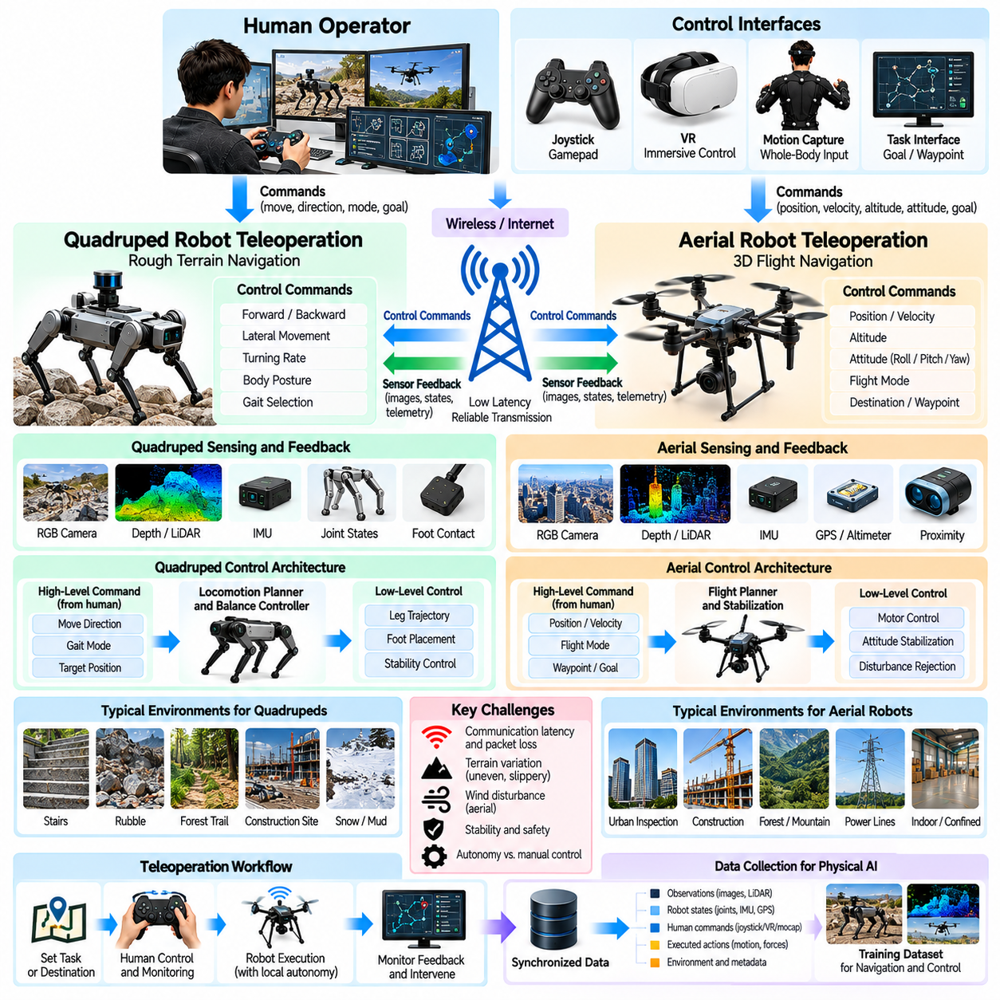{width="7.268055555555556in" height="7.268055555555556in"}

Teleoperation for quadruped and aerial robots enables human operators to guide robotic platforms through environments where conventional wheeled navigation is difficult or impossible. Quadrupeds traverse stairs, rubble, and uneven terrain, while aerial robots operate in three-dimensional spaces with continuous flight dynamics. Both platforms require specialized control interfaces, reliable feedback, and autonomous stabilization to support safe operation and high-quality Physical AI data collection.

Quadruped teleoperation commonly separates high-level movement commands from low-level locomotion control. Operators specify desired forward velocity, lateral movement, turning rate, or body orientation, while onboard controllers coordinate individual leg movements. This separation reduces the burden of controlling multiple joints simultaneously. It also allows human demonstrations to focus on navigation decisions rather than detailed gait execution.

Legged locomotion introduces challenges involving ground contact, balance, and terrain adaptation. Each step requires coordinated joint motion and appropriate force distribution across supporting legs. Uneven surfaces can change contact conditions unexpectedly, causing slipping or instability. Local locomotion controllers must respond rapidly to these disturbances because remote operators cannot reliably manage individual foot contacts through delayed communication.

Quadruped robots may support walking, trotting, climbing, and other locomotion modes depending on their mechanical capabilities. Teleoperation interfaces can expose gait selection and body posture adjustments alongside directional commands. However, inappropriate gait transitions may destabilize the robot. Recording selected gait modes, transition timing, and terrain conditions helps learning systems understand the relationship between movement strategy and environmental constraints.

Visual perception is essential when quadrupeds operate in cluttered or unfamiliar environments. Forward cameras, depth sensors, and LiDAR provide information about obstacles, slopes, stairs, and traversable surfaces. Operators may also receive terrain maps and estimated foothold locations. Combining geometric perception with robot posture information improves situational awareness and supports safer navigation decisions.

Proprioceptive feedback provides additional information about quadruped stability and movement execution. Joint encoders, inertial measurement units, foot contact sensors, and actuator torque estimates reveal body motion and interaction forces. These measurements help identify slipping, unexpected impacts, and unstable support conditions. Teleoperation systems should present critical stability information without overwhelming operators with excessive sensor details.

Shared autonomy is particularly valuable for quadrupeds because terrain negotiation requires rapid local decisions. Operators can select a destination or preferred direction while onboard systems choose footholds, regulate balance, and avoid unsafe terrain. This architecture combines human environmental understanding with robotic reaction speed. Nevertheless, autonomous modifications to commanded motion should be recorded to distinguish operator intent from stabilization behavior.

Aerial robot teleoperation presents different control challenges because flight requires continuous regulation of position, attitude, and thrust. Multirotor platforms generate motion by adjusting rotor speeds, while fixed-wing aircraft depend on aerodynamic lift and forward velocity. Control interfaces must reflect these physical differences. Commands that are appropriate for hovering drones may be unsuitable for aircraft that cannot remain stationary.

Multirotor teleoperation typically uses remote controllers, joysticks, or ground control stations to specify velocity, altitude, yaw, or attitude commands. Flight controllers convert these inputs into motor commands while maintaining stabilization. Position-hold and altitude-hold modes reduce operator workload. However, operators must understand the active flight mode because identical control inputs can produce different behavior under different control configurations.

Aerial navigation requires awareness of obstacles in three dimensions. Buildings, trees, power lines, and moving objects create hazards that may not be visible from a single camera perspective. Forward cameras, stereo vision, LiDAR, and proximity sensors can improve environmental perception. Operators benefit from altitude indicators, spatial maps, and collision warnings that complement live video feedback.

Communication reliability is especially important for aerial robots because loss of control may rapidly create hazardous conditions. Wireless interference, limited coverage, and network latency can delay commands or video feedback. Flight controllers should maintain independent stabilization and implement appropriate failsafe behavior. Depending on the operational context, communication loss may trigger controlled hovering, landing, or return-to-home procedures.

Wind disturbances introduce uncertainty into aerial teleoperation by changing vehicle motion independently of operator commands. Gusts can produce position errors, attitude changes, and increased energy consumption. Onboard estimators and flight controllers compensate for disturbances within their operating limits. Recording wind estimates, controller corrections, and actual trajectories helps distinguish environmental effects from human control decisions.

Quadruped and aerial teleoperation share a need for hierarchical control architectures. Human operators typically specify task-level goals or movement intentions, while onboard controllers execute fast stabilization loops. This separation is necessary because communication delays prevent reliable remote regulation of high-frequency dynamics. Training datasets should preserve both operator-level commands and robot-level execution signals.

Inspection tasks illustrate the complementary capabilities of quadruped and aerial robots. Quadrupeds can approach equipment through narrow passages or traverse uneven industrial surfaces, while aerial platforms can inspect elevated structures and inaccessible areas. Teleoperation allows operators to adapt viewpoints and movement strategies to changing conditions. Recorded demonstrations can support learning of inspection routes, observation poses, and safe approach behaviors.

Quadruped manipulation introduces additional complexity when a robotic arm or sensor mast is mounted on the body. Manipulator movements alter the center of mass and may affect locomotion stability. Operators must coordinate base positioning, body posture, and tool interaction. Shared-control systems can maintain balance while executing manipulation commands, but the resulting demonstrations should record these autonomous compensations.

Aerial manipulation and payload transport create similar coupling between task execution and platform dynamics. Carrying objects changes mass distribution, inertia, and flight response. Contact with external structures can introduce unexpected forces. Teleoperation systems should account for payload limitations and interaction risks. Specialized controllers may be necessary to maintain stability during grasping, delivery, or suspended-load transport.

Data collection for quadrupeds should capture camera observations, terrain geometry, body pose, joint states, foot contacts, commanded velocities, and locomotion outcomes. Gait modes, balance corrections, and intervention events provide additional context. These signals allow learning systems to associate terrain conditions with successful movement strategies and recognize circumstances that require changes in locomotion behavior.

Aerial robot datasets should include synchronized video, depth observations, vehicle position, attitude, velocity, angular rates, and control commands. Flight mode, battery condition, estimated wind, and safety interventions are also relevant. Recording both desired and executed trajectories reveals how onboard controllers respond to disturbances. Such information is important for learning navigation behavior that remains compatible with flight dynamics.

Temporal synchronization is essential because quadruped foot contacts and aerial stabilization responses occur rapidly. Delayed timestamps can associate corrective commands with incorrect terrain observations or flight states. Hardware-based timing, consistent clocks, and measured communication delays improve data integrity. Accurate alignment supports learning algorithms that model action consequences and dynamic transitions.

Demonstration diversity should reflect realistic operational conditions. Quadruped datasets benefit from variations in slope, surface friction, obstacle height, terrain compliance, and gait selection. Aerial datasets require variation in altitude, wind, lighting, obstacle density, and flight configuration. Collecting only smooth trajectories in controlled environments may produce policies that fail when encountering unfamiliar disturbances.

Human operator skill influences both locomotion and flight demonstration quality. Experienced operators anticipate hazards and select conservative movement strategies, while inexperienced operators may introduce oscillatory commands or unnecessary corrections. Interface sensitivity and control modes also affect behavior. Dataset metadata should document these factors so learning systems do not confuse interface artifacts with effective navigation strategies.

Safety requirements differ between terrestrial and aerial platforms. Quadrupeds must manage falls, unstable footholds, and collisions with nearby people or equipment. Aerial robots must additionally consider airspace restrictions, falling hazards, rotor contact, and emergency landing conditions. Independent safety controllers, operational boundaries, and emergency procedures should remain active throughout teleoperation and data collection.

Learning from teleoperated quadruped and aerial demonstrations can support imitation learning, reinforcement learning initialization, and world-model training. High-level policies may learn terrain selection, waypoint decisions, or inspection strategies, while low-level controllers maintain physical stability. Separating transferable task intentions from platform-specific dynamics improves the potential for reuse across different robotic embodiments.

Ultimately, teleoperation for quadrupeds and aerial robots combines human decision-making with autonomous control of complex physical dynamics. Its effectiveness depends on reliable perception, stable onboard controllers, communication resilience, safety mechanisms, and synchronized data recording. Well-designed collection pipelines transform operator demonstrations and recovery interventions into valuable datasets for scalable Physical AI mobility and autonomous operation.

사족보행 로봇(Quadruped Robot)과 항공 로봇(Aerial Robot)의 원격조작(Teleoperation)은 인간 작업자(Human Operator)가 기존 바퀴형 내비게이션(Wheeled Navigation)으로 이동하기 어렵거나 불가능한 환경에서 로봇 플랫폼(Robotic Platform)을 제어할 수 있도록 한다. 사족보행 로봇은 계단(Stairs), 잔해(Rubble), 불규칙한 지형(Uneven Terrain)을 이동하며, 항공 로봇은 연속적인 비행 동역학(Flight Dynamics)이 작용하는 3차원 공간(Three-Dimensional Space)에서 운용된다. 두 플랫폼 모두 안전한 운용과 고품질 피지컬 인공지능(Physical AI) 데이터 수집을 위해 특화된 제어 인터페이스(Control Interface), 신뢰할 수 있는 피드백(Feedback), 자율 안정화(Autonomous Stabilization)가 필요하다.

사족보행 로봇 원격조작(Quadruped Teleoperation)은 일반적으로 상위 수준 이동 명령(High-Level Movement Command)과 하위 수준 보행 제어(Low-Level Locomotion Control)를 분리한다. 작업자는 원하는 전진 속도(Forward Velocity), 측면 이동(Lateral Movement), 회전 속도(Turning Rate), 몸체 방향(Body Orientation)을 지정하고, 온보드 제어기(Onboard Controller)는 개별 다리의 움직임을 협응시킨다. 이러한 분리는 여러 관절을 동시에 제어해야 하는 부담을 줄인다. 또한 인간 시연(Human Demonstration)이 세부적인 보행 실행(Gait Execution)보다 내비게이션 의사결정(Navigation Decision)에 집중할 수 있도록 한다.

다리 기반 이동(Legged Locomotion)은 지면 접촉(Ground Contact), 균형(Balance), 지형 적응(Terrain Adaptation)과 관련된 과제를 수반한다. 각 걸음(Step)에는 협응된 관절 운동(Coordinated Joint Motion)과 지지 다리(Supporting Leg) 사이의 적절한 힘 분배(Force Distribution)가 필요하다. 불규칙한 표면(Uneven Surface)은 접촉 조건(Contact Condition)을 예상하지 못하게 변화시켜 미끄러짐(Slipping)이나 불안정성(Instability)을 발생시킬 수 있다. 원격 작업자는 지연된 통신(Delayed Communication)을 통해 개별 발 접촉(Foot Contact)을 안정적으로 관리하기 어렵기 때문에 로컬 보행 제어기(Local Locomotion Controller)가 이러한 교란(Disturbance)에 신속하게 대응해야 한다.

사족보행 로봇(Quadruped Robot)은 기계적 능력(Mechanical Capability)에 따라 걷기(Walking), 트로트 보행(Trotting), 등반(Climbing), 기타 이동 모드(Locomotion Mode)를 지원할 수 있다. 원격조작 인터페이스(Teleoperation Interface)는 방향 명령(Directional Command)과 함께 보행 패턴 선택(Gait Selection) 및 몸체 자세 조정(Body Posture Adjustment) 기능을 제공할 수 있다. 그러나 부적절한 보행 전환(Gait Transition)은 로봇을 불안정하게 만들 수 있다. 선택된 보행 모드(Gait Mode), 전환 시점(Transition Timing), 지형 조건(Terrain Condition)을 기록하면 학습 시스템이 이동 전략(Movement Strategy)과 환경 제약(Environmental Constraint) 사이의 관계를 이해하는 데 도움이 된다.

시각적 인식(Visual Perception)은 사족보행 로봇이 복잡하거나 익숙하지 않은 환경에서 작동할 때 필수적이다. 전방 카메라(Forward Camera), 깊이 센서(Depth Sensor), 라이다(LiDAR)는 장애물(Obstacle), 경사면(Slope), 계단(Stairs), 주행 가능한 표면(Traversable Surface)에 관한 정보를 제공한다. 작업자는 지형 지도(Terrain Map)와 추정된 발 디딤 위치(Estimated Foothold Location)도 제공받을 수 있다. 기하학적 인식(Geometric Perception)과 로봇 자세 정보(Robot Posture Information)를 결합하면 상황 인식(Situational Awareness)을 향상시키고 더욱 안전한 내비게이션 의사결정(Navigation Decision)을 지원할 수 있다.

고유수용감각 피드백(Proprioceptive Feedback)은 사족보행 로봇의 안정성(Stability)과 이동 실행(Movement Execution)에 관한 추가적인 정보를 제공한다. 관절 엔코더(Joint Encoder), 관성 측정 장치(Inertial Measurement Unit, IMU), 발 접촉 센서(Foot Contact Sensor), 구동기 토크 추정값(Actuator Torque Estimate)은 몸체 움직임(Body Motion)과 상호작용 힘(Interaction Force)을 나타낸다. 이러한 측정값은 미끄러짐(Slipping), 예상하지 못한 충격(Unexpected Impact), 불안정한 지지 조건(Unstable Support Condition)을 식별하는 데 도움이 된다. 원격조작 시스템은 과도한 센서 정보로 작업자에게 부담을 주지 않으면서 중요한 안정성 정보를 제공해야 한다.

공유 자율성(Shared Autonomy)은 지형 통과(Terrain Negotiation)에 신속한 로컬 의사결정(Local Decision)이 필요하므로 사족보행 로봇에 특히 유용하다. 작업자는 목적지(Destination)나 선호 이동 방향(Preferred Direction)을 선택하고, 온보드 시스템(Onboard System)은 발 디딤 위치(Foothold)를 결정하고 균형(Balance)을 조절하며 위험한 지형(Unsafe Terrain)을 회피할 수 있다. 이러한 아키텍처는 인간의 환경 이해(Environmental Understanding)와 로봇의 반응 속도(Robotic Reaction Speed)를 결합한다. 그러나 작업자 의도(Operator Intent)와 안정화 행동(Stabilization Behavior)을 구분하기 위해 명령된 움직임에 대한 자율 수정(Autonomous Modification)을 기록해야 한다.

항공 로봇 원격조작(Aerial Robot Teleoperation)은 비행(Flight)에 위치(Position), 자세(Attitude), 추력(Thrust)의 지속적인 조절이 필요하므로 서로 다른 제어 과제를 가진다. 멀티로터 플랫폼(Multirotor Platform)은 로터 속도(Rotor Speed)를 조절하여 움직임을 생성하지만, 고정익 항공기(Fixed-Wing Aircraft)는 공기역학적 양력(Aerodynamic Lift)과 전진 속도(Forward Velocity)에 의존한다. 제어 인터페이스(Control Interface)는 이러한 물리적 차이를 반영해야 한다. 제자리 비행(Hovering)이 가능한 드론에 적합한 명령은 정지 상태를 유지할 수 없는 항공기에는 적합하지 않을 수 있다.

멀티로터 원격조작(Multirotor Teleoperation)은 일반적으로 원격 조종기(Remote Controller), 조이스틱(Joystick), 지상 관제소(Ground Control Station)를 사용하여 속도(Velocity), 고도(Altitude), 요각(Yaw), 자세 명령(Attitude Command)을 지정한다. 비행 제어기(Flight Controller)는 안정화를 유지하면서 이러한 입력을 모터 명령(Motor Command)으로 변환한다. 위치 유지 모드(Position-Hold Mode)와 고도 유지 모드(Altitude-Hold Mode)는 작업자 부하(Operator Workload)를 줄인다. 그러나 동일한 제어 입력(Control Input)도 제어 구성(Control Configuration)에 따라 서로 다른 동작을 생성할 수 있으므로 작업자는 활성화된 비행 모드(Active Flight Mode)를 이해해야 한다.

항공 내비게이션(Aerial Navigation)에는 3차원 공간의 장애물(Three-Dimensional Obstacle)에 대한 인식이 필요하다. 건물(Building), 나무(Tree), 전력선(Power Line), 이동 물체(Moving Object)는 단일 카메라 시점(Single Camera Perspective)에서 보이지 않을 수 있는 위험 요소를 형성한다. 전방 카메라(Forward Camera), 스테레오 비전(Stereo Vision), 라이다(LiDAR), 근접 센서(Proximity Sensor)는 환경 인식(Environmental Perception)을 향상시킬 수 있다. 작업자는 실시간 영상 피드백(Live Video Feedback)을 보완하는 고도 표시기(Altitude Indicator), 공간 지도(Spatial Map), 충돌 경고(Collision Warning)를 통해 도움을 받을 수 있다.

통신 신뢰성(Communication Reliability)은 제어 상실(Loss of Control)이 빠르게 위험한 상황을 발생시킬 수 있으므로 항공 로봇에서 특히 중요하다. 무선 간섭(Wireless Interference), 제한된 통신 범위(Limited Coverage), 네트워크 지연(Network Latency)은 명령이나 영상 피드백을 지연시킬 수 있다. 비행 제어기(Flight Controller)는 독립적인 안정화(Independent Stabilization)를 유지하고 적절한 비상 안전 동작(Failsafe Behavior)을 구현해야 한다. 운용 상황(Operational Context)에 따라 통신 손실(Communication Loss)은 제어된 제자리 비행(Controlled Hovering), 착륙(Landing), 자동 복귀(Return-to-Home) 절차를 실행할 수 있다.

바람에 의한 교란(Wind Disturbance)은 작업자 명령(Operator Command)과 독립적으로 기체 움직임(Vehicle Motion)을 변화시켜 항공 원격조작(Aerial Teleoperation)에 불확실성을 발생시킨다. 돌풍(Gust)은 위치 오차(Position Error), 자세 변화(Attitude Change), 에너지 소비 증가(Increased Energy Consumption)를 유발할 수 있다. 온보드 상태 추정기(Onboard Estimator)와 비행 제어기(Flight Controller)는 운용 한계(Operating Limit) 내에서 이러한 교란을 보상한다. 바람 추정값(Wind Estimate), 제어기 보정(Controller Correction), 실제 궤적(Actual Trajectory)을 기록하면 환경적 영향(Environmental Effect)과 인간의 제어 의사결정(Human Control Decision)을 구분하는 데 도움이 된다.

사족보행 로봇과 항공 로봇의 원격조작은 모두 계층적 제어 아키텍처(Hierarchical Control Architecture)를 필요로 한다. 인간 작업자(Human Operator)는 일반적으로 작업 수준 목표(Task-Level Goal)나 이동 의도(Movement Intention)를 지정하고, 온보드 제어기(Onboard Controller)는 고속 안정화 루프(Fast Stabilization Loop)를 실행한다. 통신 지연(Communication Delay)으로 인해 고주파 동역학(High-Frequency Dynamics)을 원격에서 안정적으로 조절하기 어렵기 때문에 이러한 분리가 필요하다. 학습 데이터셋(Training Dataset)은 작업자 수준 명령(Operator-Level Command)과 로봇 수준 실행 신호(Robot-Level Execution Signal)를 모두 보존해야 한다.

검사 작업(Inspection Task)은 사족보행 로봇과 항공 로봇의 상호보완적인 능력(Complementary Capability)을 보여준다. 사족보행 로봇은 좁은 통로(Narrow Passage)를 통해 장비에 접근하거나 불규칙한 산업 현장 표면(Uneven Industrial Surface)을 이동할 수 있으며, 항공 플랫폼(Aerial Platform)은 높은 구조물(Elevated Structure)과 접근하기 어려운 구역(Inaccessible Area)을 검사할 수 있다. 원격조작은 작업자가 변화하는 조건에 맞춰 관측 시점(Viewpoint)과 이동 전략(Movement Strategy)을 조정할 수 있도록 한다. 기록된 시연(Recorded Demonstration)은 검사 경로(Inspection Route), 관측 자세(Observation Pose), 안전한 접근 행동(Safe Approach Behavior)의 학습을 지원할 수 있다.

사족보행 로봇 조작(Quadruped Manipulation)은 로봇 팔(Robotic Arm)이나 센서 마스트(Sensor Mast)가 몸체에 장착될 때 추가적인 복잡성을 수반한다. 매니퓰레이터 움직임(Manipulator Movement)은 질량중심(Center of Mass)을 변화시키고 이동 안정성(Locomotion Stability)에 영향을 미칠 수 있다. 작업자는 베이스 위치 조정(Base Positioning), 몸체 자세(Body Posture), 도구 상호작용(Tool Interaction)을 협응해야 한다. 공유 제어 시스템(Shared-Control System)은 조작 명령(Manipulation Command)을 실행하면서 균형을 유지할 수 있지만, 생성된 시연 데이터에는 이러한 자율 보상 동작(Autonomous Compensation)이 기록되어야 한다.

항공 조작(Aerial Manipulation)과 적재물 운송(Payload Transport)은 작업 실행(Task Execution)과 플랫폼 동역학(Platform Dynamics) 사이에 유사한 결합 관계(Coupling)를 발생시킨다. 물체를 운반하면 질량 분포(Mass Distribution), 관성(Inertia), 비행 응답(Flight Response)이 변화한다. 외부 구조물(External Structure)과의 접촉은 예상하지 못한 힘(Unexpected Force)을 발생시킬 수 있다. 원격조작 시스템은 적재물 한계(Payload Limitation)와 상호작용 위험(Interaction Risk)을 고려해야 한다. 파지(Grasping), 배송(Delivery), 매달린 하중 운송(Suspended-Load Transport) 중 안정성을 유지하기 위해 특수 제어기(Specialized Controller)가 필요할 수 있다.

사족보행 로봇 데이터 수집(Quadruped Data Collection)에는 카메라 관측 정보(Camera Observation), 지형 기하학(Terrain Geometry), 몸체 자세(Body Pose), 관절 상태(Joint State), 발 접촉(Foot Contact), 명령 속도(Commanded Velocity), 이동 결과(Locomotion Outcome)가 포함되어야 한다. 보행 모드(Gait Mode), 균형 보정(Balance Correction), 개입 이벤트(Intervention Event)는 추가적인 맥락 정보를 제공한다. 이러한 신호를 통해 학습 시스템은 지형 조건(Terrain Condition)을 성공적인 이동 전략(Successful Movement Strategy)과 연결하고 보행 행동(Locomotion Behavior)의 변경이 필요한 상황을 인식할 수 있다.

항공 로봇 데이터셋(Aerial Robot Dataset)에는 동기화된 영상(Synchronized Video), 깊이 관측 정보(Depth Observation), 기체 위치(Vehicle Position), 자세(Attitude), 속도(Velocity), 각속도(Angular Rate), 제어 명령(Control Command)이 포함되어야 한다. 비행 모드(Flight Mode), 배터리 상태(Battery Condition), 추정 풍속(Estimated Wind), 안전 개입(Safety Intervention)도 중요한 정보이다. 목표 궤적(Desired Trajectory)과 실행 궤적(Executed Trajectory)을 모두 기록하면 온보드 제어기가 교란(Disturbance)에 어떻게 대응하는지 파악할 수 있다. 이러한 정보는 비행 동역학(Flight Dynamics)과 호환되는 내비게이션 행동(Navigation Behavior)을 학습하는 데 중요하다.

사족보행 로봇의 발 접촉(Foot Contact)과 항공 로봇의 안정화 응답(Stabilization Response)은 빠르게 발생하므로 시간 동기화(Temporal Synchronization)가 필수적이다. 지연된 타임스탬프(Delayed Timestamp)는 교정 명령(Corrective Command)을 잘못된 지형 관측 정보(Terrain Observation)나 비행 상태(Flight State)와 연결할 수 있다. 하드웨어 기반 타이밍(Hardware-Based Timing), 일관된 시계(Consistent Clock), 측정된 통신 지연(Measured Communication Delay)은 데이터 무결성(Data Integrity)을 향상시킨다. 정확한 시간 정렬(Accurate Alignment)은 행동 결과(Action Consequence)와 동적 상태 전환(Dynamic Transition)을 모델링하는 학습 알고리즘(Learning Algorithm)을 지원한다.

시연 다양성(Demonstration Diversity)은 현실적인 운용 조건(Realistic Operational Condition)을 반영해야 한다. 사족보행 로봇 데이터셋은 경사도(Slope), 표면 마찰(Surface Friction), 장애물 높이(Obstacle Height), 지형 순응성(Terrain Compliance), 보행 선택(Gait Selection)의 변화로부터 이점을 얻는다. 항공 데이터셋(Aerial Dataset)에는 고도(Altitude), 바람(Wind), 조명(Lighting), 장애물 밀도(Obstacle Density), 비행 구성(Flight Configuration)의 다양성이 필요하다. 통제된 환경(Controlled Environment)에서 부드러운 궤적(Smooth Trajectory)만 수집하면 익숙하지 않은 교란(Unfamiliar Disturbance)에 직면했을 때 실패하는 정책(Policy)이 학습될 수 있다.

인간 작업자 숙련도(Human Operator Skill)는 보행 및 비행 시연 품질(Locomotion and Flight Demonstration Quality)에 영향을 미친다. 숙련된 작업자(Experienced Operator)는 위험 요소(Hazard)를 예측하고 보수적인 이동 전략(Conservative Movement Strategy)을 선택하지만, 경험이 부족한 작업자(Inexperienced Operator)는 진동성 명령(Oscillatory Command)이나 불필요한 보정(Unnecessary Correction)을 발생시킬 수 있다. 인터페이스 민감도(Interface Sensitivity)와 제어 모드(Control Mode)도 행동에 영향을 미친다. 학습 시스템이 인터페이스 인위적 특성(Interface Artifact)을 효과적인 내비게이션 전략(Effective Navigation Strategy)과 혼동하지 않도록 데이터셋 메타데이터(Dataset Metadata)에 이러한 요소를 기록해야 한다.

안전 요구사항(Safety Requirement)은 지상 플랫폼(Terrestrial Platform)과 항공 플랫폼(Aerial Platform) 사이에 차이가 있다. 사족보행 로봇은 낙상(Fall), 불안정한 발 디딤 위치(Unstable Foothold), 주변 사람이나 장비와의 충돌(Collision)을 관리해야 한다. 항공 로봇은 추가로 공역 제한(Airspace Restriction), 추락 위험(Falling Hazard), 로터 접촉(Rotor Contact), 비상 착륙 조건(Emergency Landing Condition)을 고려해야 한다. 독립적인 안전 제어기(Independent Safety Controller), 운용 경계(Operational Boundary), 비상 절차(Emergency Procedure)는 원격조작과 데이터 수집 전 과정에서 활성화되어 있어야 한다.

원격조작으로 수집한 사족보행 및 항공 로봇 시연(Teleoperated Quadruped and Aerial Demonstration)을 활용하면 모방학습(Imitation Learning), 강화학습 초기화(Reinforcement Learning Initialization), 월드 모델 학습(World-Model Training)을 지원할 수 있다. 상위 수준 정책(High-Level Policy)은 지형 선택(Terrain Selection), 경유점 의사결정(Waypoint Decision), 검사 전략(Inspection Strategy)을 학습하고, 하위 수준 제어기(Low-Level Controller)는 물리적 안정성(Physical Stability)을 유지할 수 있다. 전이 가능한 작업 의도(Transferable Task Intention)와 플랫폼 고유 동역학(Platform-Specific Dynamics)을 분리하면 서로 다른 로봇 신체 구조(Robotic Embodiment) 사이에서 재사용 가능성을 높일 수 있다.

궁극적으로 사족보행 로봇과 항공 로봇의 원격조작(Teleoperation for Quadrupeds and Aerial Robots)은 인간의 의사결정(Human Decision-Making)과 복잡한 물리적 동역학(Complex Physical Dynamics)에 대한 자율 제어(Autonomous Control)를 결합한다. 그 효과는 신뢰할 수 있는 인식(Reliable Perception), 안정적인 온보드 제어기(Stable Onboard Controller), 통신 복원력(Communication Resilience), 안전 메커니즘(Safety Mechanism), 동기화된 데이터 기록(Synchronized Data Recording)에 달려 있다. 잘 설계된 데이터 수집 파이프라인(Data Collection Pipeline)은 작업자 시연(Operator Demonstration)과 복구 개입(Recovery Intervention)을 확장 가능한 피지컬 인공지능 이동성(Scalable Physical AI Mobility) 및 자율 운용(Autonomous Operation)을 위한 가치 있는 데이터셋(Dataset)으로 변환한다.

##  

## 02.10. Demonstration Episode Design

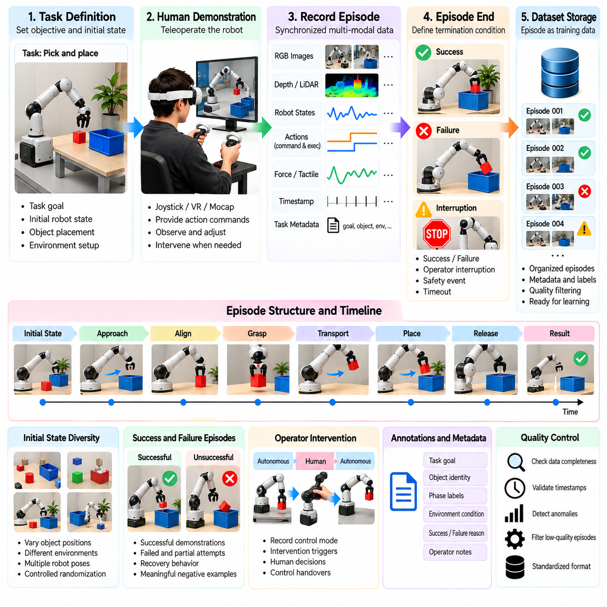{width="7.268055555555556in" height="7.268055555555556in"}

Demonstration episode design defines how human-guided robot interactions are organized into structured training examples for Physical AI systems. An episode represents a bounded sequence of observations, actions, and outcomes associated with a particular task objective. Careful design ensures that recorded demonstrations capture meaningful behavior rather than arbitrary motion fragments, supporting reliable imitation learning and scalable dataset construction.

An effective episode begins with a clearly defined task objective and an identifiable initial state. The objective may involve grasping an object, navigating to a destination, opening a door, or recovering from an unexpected obstacle. Initial conditions should specify robot configuration, object placement, environmental constraints, and relevant task parameters. These definitions establish the context needed to interpret subsequent actions.

Episode boundaries determine where a demonstration starts and ends. Recording may begin before the first intentional movement to capture perception and planning behavior. Termination can occur after successful completion, confirmed failure, operator interruption, or a safety event. Consistent boundary rules prevent important transitions from being omitted and make comparisons between demonstrations more meaningful.

Task decomposition provides a useful foundation for designing complex demonstration episodes. A manipulation task may include approach, alignment, grasp, transport, placement, and release phases. Navigation tasks may involve localization, route selection, obstacle avoidance, and goal confirmation. These phases should be represented without unnecessarily fragmenting continuous behavior, preserving the causal relationships between actions.

Episode duration influences both learning efficiency and data management. Short episodes simplify labeling and reduce the accumulation of unrelated behavior, but they may omit long-term dependencies. Extended episodes capture multi-stage planning and recovery but introduce greater variation in task progression. Duration limits should reflect task structure rather than arbitrary recording convenience.

Initial-state diversity is essential for preventing learned policies from depending on narrowly repeated configurations. Object positions, robot orientations, obstacle layouts, lighting, and environmental conditions can be varied systematically. However, variations must remain within feasible and safe operating boundaries. Controlled randomization helps distinguish task-relevant skills from incidental features of a particular demonstration setup.

Successful demonstrations provide examples of desired task execution, but success alone is insufficient for robust learning. Episodes should also capture unsuccessful attempts, partial completion, and corrective behavior when appropriate. These examples reveal the consequences of poor decisions and the strategies used to recover. Failure labels must distinguish task-level failure from recording errors or equipment malfunctions.

Recovery episodes deserve explicit design because autonomous robots frequently encounter states absent from ideal demonstrations. Operators may correct an unstable grasp, reposition a robot after localization failure, or select an alternative route around an obstruction. Recording the state before intervention, corrective commands, and resulting recovery outcome enables policies to learn how to return toward successful execution.

Operator intervention should be represented as a meaningful event rather than an unexplained change in robot behavior. Episode metadata can identify whether control was manual, autonomous, or shared at each stage. Intervention triggers, operator decisions, and control handovers should be recorded. This separation helps learning systems distinguish intentional demonstrations from autonomous controller corrections.

Observation design determines what information is available to the learning system at each step. Camera images, depth measurements, joint states, force readings, and task instructions may provide complementary context. Sensor selection should reflect the intended deployment configuration. Training policies on observations unavailable during actual operation can create unrealistic dependencies and poor transfer.

Action representation is equally important because teleoperation interfaces may generate commands in different coordinate frames and control spaces. Joint positions, Cartesian poses, velocities, and gripper commands describe different aspects of behavior. Episodes should preserve raw operator inputs and executed robot actions separately. Standardized units and coordinate conventions support consistent learning across devices.

Temporal structure determines how observations and actions are associated throughout an episode. Sensor streams may operate at different sampling rates, while commands experience processing and communication delays. Reliable timestamps allow reconstruction of action consequences and contact events. Resampling should preserve meaningful transitions rather than smoothing away brief but important corrections.

Episode annotations should describe task goals, object identities, environmental conditions, operator actions, and final outcomes. Phase labels can identify approach, contact, manipulation, and recovery segments. Additional annotations may describe unexpected obstacles or safety interventions. Annotation detail should be sufficient for training and evaluation without making large-scale collection prohibitively expensive.

Quality control begins during recording rather than after dataset completion. Automated checks can identify missing sensor frames, timestamp discontinuities, invalid robot states, and incomplete task metadata. Operators may receive immediate feedback when a session becomes unusable. Early detection reduces wasted collection effort and prevents corrupted demonstrations from entering training pipelines.

Episode acceptance criteria should combine technical validity with behavioral relevance. A technically complete recording may still contain ambiguous objectives, excessive hesitation, or uncontrolled motion. Conversely, a failed attempt may provide valuable recovery information. Quality assessment should therefore distinguish recording integrity, task performance, and learning usefulness rather than relying on a single success indicator.

Demonstration consistency requires standardized instructions and operator preparation. Different operators may interpret the same objective differently or choose incompatible completion criteria. Written task definitions, practice sessions, and calibrated interfaces reduce unnecessary variation. At the same time, useful diversity in execution strategies should be preserved rather than forcing all operators to reproduce identical trajectories.

Episode metadata should include robot morphology, sensor configuration, control mode, software version, task identifier, and environmental setup. Operator experience and calibration status may also influence behavior. These records support filtering, reproducibility, and comparisons across collection campaigns. Without adequate metadata, apparently similar demonstrations may represent substantially different operating conditions.

Balanced dataset construction requires attention to the distribution of episode types. Repeatedly collecting easy successful tasks may produce large datasets with limited behavioral coverage. Difficult initial states, unusual object configurations, and recoverable failures often provide additional learning value. Sampling strategies should prioritize informative variation while respecting operational safety and collection costs.

Curriculum-based episode design organizes demonstrations from simpler tasks toward more demanding interactions. Early episodes may use fixed object positions and predictable environments, while later episodes introduce clutter, disturbances, and longer action sequences. This progression supports systematic skill acquisition. Nevertheless, training curricula should include sufficient overlap between difficulty levels to avoid abrupt distribution changes.

Episode design should also support hierarchical learning by preserving relationships between high-level intentions and low-level motor actions. A long task can contain meaningful subgoals without losing its overall objective. Recording subgoal transitions allows models to learn task planning alongside execution. Such structure is especially valuable for humanoid manipulation and multi-stage mobile robot operations.

Evaluation episodes should be separated from training episodes according to clearly defined rules. Randomly splitting nearly identical trajectories may exaggerate generalization performance. More informative evaluations vary object instances, environments, initial conditions, or operators. Dataset provenance and episode identifiers help prevent accidental overlap between training and testing, supporting credible performance measurement.

Privacy and safety constraints must be integrated into episode design from the beginning. Recording boundaries may exclude unnecessary personal information or restricted environmental details. Safety events should trigger appropriate protective actions and be labeled accurately. Data retention, access permissions, and operator consent requirements should be reflected in collection procedures rather than addressed only after recording.

Scalable demonstration pipelines benefit from automated episode initialization, event marking, termination detection, and validation. Standardized schemas allow recordings from different robots and collection sites to enter shared storage and processing systems. Human review can then focus on ambiguous or high-value examples. This combination improves throughput while maintaining traceability and dataset quality.

Ultimately, demonstration episode design transforms continuous teleoperation activity into interpretable units of robot learning. Well-defined objectives, controlled initial conditions, reliable boundaries, synchronized observations, and meaningful outcome labels preserve the structure of physical behavior. By incorporating successful actions, failures, interventions, and recovery, episode design establishes a foundation for scalable and generalizable Physical AI training.

시연 에피소드 설계(Demonstration Episode Design)는 인간이 유도하는 로봇 상호작용(Human-Guided Robot Interaction)을 피지컬 인공지능(Physical AI) 시스템을 위한 구조화된 학습 사례(Structured Training Example)로 구성하는 방법을 정의한다. 에피소드(Episode)는 특정 작업 목표(Task Objective)와 관련된 관측(Observation), 행동(Action), 결과(Outcome)의 경계가 명확한 시퀀스(Bounded Sequence)를 의미한다. 신중한 설계는 기록된 시연(Recorded Demonstration)이 임의의 동작 조각(Arbitrary Motion Fragment)이 아니라 의미 있는 행동(Meaningful Behavior)을 포착하도록 하며, 신뢰할 수 있는 모방학습(Imitation Learning)과 확장 가능한 데이터셋 구축(Scalable Dataset Construction)을 지원한다.

효과적인 에피소드(Effective Episode)는 명확하게 정의된 작업 목표(Task Objective)와 식별 가능한 초기 상태(Initial State)에서 시작된다. 목표에는 물체 파지(Object Grasping), 목적지 이동(Destination Navigation), 문 열기(Door Opening), 예상하지 못한 장애물로부터의 복구(Obstacle Recovery) 등이 포함될 수 있다. 초기 조건(Initial Condition)에는 로봇 구성(Robot Configuration), 물체 배치(Object Placement), 환경 제약(Environmental Constraint), 관련 작업 매개변수(Task Parameter)가 명시되어야 한다. 이러한 정의는 이후 행동(Subsequent Action)을 해석하는 데 필요한 맥락(Context)을 제공한다.

에피소드 경계(Episode Boundary)는 시연(Demonstration)이 시작되고 종료되는 시점을 결정한다. 기록(Recording)은 인식(Perception)과 계획 행동(Planning Behavior)을 포착하기 위해 최초의 의도적인 움직임(Intentional Movement) 이전에 시작될 수 있다. 종료(Termination)는 성공적인 작업 완료(Successful Completion), 확인된 실패(Confirmed Failure), 작업자 중단(Operator Interruption), 안전 이벤트(Safety Event) 이후에 발생할 수 있다. 일관된 경계 규칙(Consistent Boundary Rule)은 중요한 상태 전환(Transition)의 누락을 방지하고 시연 간 비교(Comparison)를 더욱 의미 있게 만든다.

작업 분해(Task Decomposition)는 복잡한 시연 에피소드(Complex Demonstration Episode)를 설계하는 데 유용한 기반을 제공한다. 조작 작업(Manipulation Task)은 접근(Approach), 정렬(Alignment), 파지(Grasp), 운반(Transport), 배치(Placement), 해제(Release) 단계로 구성될 수 있다. 내비게이션 작업(Navigation Task)에는 위치 추정(Localization), 경로 선택(Route Selection), 장애물 회피(Obstacle Avoidance), 목표 도달 확인(Goal Confirmation)이 포함될 수 있다. 이러한 단계는 연속적인 행동(Continuous Behavior)을 불필요하게 분할하지 않으면서 표현되어야 하며, 행동 사이의 인과관계(Causal Relationship)를 보존해야 한다.

에피소드 지속시간(Episode Duration)은 학습 효율성(Learning Efficiency)과 데이터 관리(Data Management)에 모두 영향을 미친다. 짧은 에피소드(Short Episode)는 라벨링(Labeling)을 단순화하고 관련 없는 행동(Unrelated Behavior)의 누적을 줄이지만, 장기 의존성(Long-Term Dependency)을 누락할 수 있다. 긴 에피소드(Extended Episode)는 다단계 계획(Multi-Stage Planning)과 복구(Recovery)를 포착하지만 작업 진행(Task Progression)의 변동성을 증가시킨다. 지속시간 제한(Duration Limit)은 임의적인 기록 편의성(Recording Convenience)이 아니라 작업 구조(Task Structure)를 반영해야 한다.

초기 상태 다양성(Initial-State Diversity)은 학습된 정책(Learned Policy)이 좁은 범위에서 반복되는 구성(Repeated Configuration)에 의존하지 않도록 하는 데 필수적이다. 물체 위치(Object Position), 로봇 방향(Robot Orientation), 장애물 배치(Obstacle Layout), 조명(Lighting), 환경 조건(Environmental Condition)을 체계적으로 변화시킬 수 있다. 그러나 이러한 변화는 실행 가능하고 안전한 운용 경계(Feasible and Safe Operating Boundary) 내에서 유지되어야 한다. 통제된 무작위화(Controlled Randomization)는 작업 관련 기술(Task-Relevant Skill)과 특정 시연 환경의 부수적 특성(Incidental Feature)을 구분하는 데 도움이 된다.

성공적인 시연(Successful Demonstration)은 바람직한 작업 실행(Desired Task Execution)의 사례를 제공하지만, 성공 사례만으로는 강건한 학습(Robust Learning)에 충분하지 않다. 에피소드에는 적절한 경우 실패한 시도(Unsuccessful Attempt), 부분 완료(Partial Completion), 교정 행동(Corrective Behavior)도 포함되어야 한다. 이러한 사례는 잘못된 의사결정(Poor Decision)의 결과와 복구 전략(Recovery Strategy)을 보여준다. 실패 라벨(Failure Label)은 작업 수준 실패(Task-Level Failure)를 기록 오류(Recording Error)나 장비 오작동(Equipment Malfunction)과 구분해야 한다.

복구 에피소드(Recovery Episode)는 자율 로봇(Autonomous Robot)이 이상적인 시연(Ideal Demonstration)에 포함되지 않은 상태를 자주 마주치기 때문에 명시적으로 설계할 필요가 있다. 작업자는 불안정한 파지(Unstable Grasp)를 교정하거나 위치 추정 실패(Localization Failure) 이후 로봇 위치를 다시 조정하거나 장애물 주변의 대체 경로(Alternative Route)를 선택할 수 있다. 개입 이전 상태(Pre-Intervention State), 교정 명령(Corrective Command), 복구 결과(Recovery Outcome)를 기록하면 정책(Policy)이 성공적인 실행 상태로 복귀하는 방법을 학습할 수 있다.

작업자 개입(Operator Intervention)은 설명되지 않은 로봇 행동 변화(Unexplained Robot Behavior Change)가 아니라 의미 있는 이벤트(Meaningful Event)로 표현되어야 한다. 에피소드 메타데이터(Episode Metadata)는 각 단계에서 제어가 수동(Manual), 자율(Autonomous), 공유(Shared) 방식 중 어느 형태였는지 식별할 수 있다. 개입 유발 조건(Intervention Trigger), 작업자 의사결정(Operator Decision), 제어권 전환(Control Handover)을 기록해야 한다. 이러한 구분은 학습 시스템이 의도적인 시연(Intentional Demonstration)과 자율 제어기 보정(Autonomous Controller Correction)을 구별하는 데 도움이 된다.

관측 설계(Observation Design)는 각 단계에서 학습 시스템(Learning System)이 사용할 수 있는 정보를 결정한다. 카메라 영상(Camera Image), 깊이 측정값(Depth Measurement), 관절 상태(Joint State), 힘 측정값(Force Reading), 작업 지시(Task Instruction)는 상호보완적인 맥락 정보를 제공할 수 있다. 센서 선택(Sensor Selection)은 실제 배포 구성(Deployment Configuration)을 반영해야 한다. 실제 운용(Actual Operation) 중 사용할 수 없는 관측 정보로 정책을 학습하면 비현실적인 의존성(Unrealistic Dependency)이 형성되어 전이 성능(Transfer Performance)이 저하될 수 있다.

행동 표현(Action Representation)도 중요하다. 원격조작 인터페이스(Teleoperation Interface)는 서로 다른 좌표계(Coordinate Frame)와 제어 공간(Control Space)에서 명령을 생성할 수 있기 때문이다. 관절 위치(Joint Position), 데카르트 좌표계 자세(Cartesian Pose), 속도(Velocity), 그리퍼 명령(Gripper Command)은 행동의 서로 다른 측면을 설명한다. 에피소드는 원시 작업자 입력(Raw Operator Input)과 실제 실행된 로봇 행동(Executed Robot Action)을 별도로 보존해야 한다. 표준화된 단위(Standardized Unit)와 좌표계 규약(Coordinate Convention)은 장치 간 일관된 학습(Consistent Learning)을 지원한다.

시간적 구조(Temporal Structure)는 에피소드 전반에서 관측(Observation)과 행동(Action)이 어떻게 연결되는지 결정한다. 센서 스트림(Sensor Stream)은 서로 다른 샘플링 속도(Sampling Rate)로 작동할 수 있으며, 명령(Command)에는 처리 지연(Processing Delay)과 통신 지연(Communication Delay)이 발생한다. 신뢰할 수 있는 타임스탬프(Reliable Timestamp)는 행동 결과(Action Consequence)와 접촉 이벤트(Contact Event)를 재구성할 수 있도록 한다. 재샘플링(Resampling)은 짧지만 중요한 교정 동작(Brief Corrective Action)을 평활화(Smoothing) 과정에서 제거하지 않고 의미 있는 상태 전환(Meaningful Transition)을 보존해야 한다.

에피소드 주석(Episode Annotation)은 작업 목표(Task Goal), 물체 식별 정보(Object Identity), 환경 조건(Environmental Condition), 작업자 행동(Operator Action), 최종 결과(Final Outcome)를 설명해야 한다. 단계 라벨(Phase Label)은 접근(Approach), 접촉(Contact), 조작(Manipulation), 복구(Recovery) 구간을 식별할 수 있다. 추가 주석(Additional Annotation)은 예상하지 못한 장애물(Unexpected Obstacle)이나 안전 개입(Safety Intervention)을 설명할 수 있다. 주석의 상세 수준(Annotation Detail)은 대규모 데이터 수집(Large-Scale Data Collection)에 과도한 비용을 발생시키지 않으면서 학습과 평가에 충분해야 한다.

품질 관리(Quality Control)는 데이터셋 완성(Dataset Completion) 이후가 아니라 기록 과정(Recording Process)에서 시작된다. 자동 검사(Automated Check)는 누락된 센서 프레임(Missing Sensor Frame), 타임스탬프 불연속(Timestamp Discontinuity), 유효하지 않은 로봇 상태(Invalid Robot State), 불완전한 작업 메타데이터(Incomplete Task Metadata)를 식별할 수 있다. 세션(Session)을 사용할 수 없게 된 경우 작업자에게 즉각적인 피드백(Immediate Feedback)을 제공할 수 있다. 조기 감지(Early Detection)는 불필요한 수집 노력(Wasted Collection Effort)을 줄이고 손상된 시연(Corrupted Demonstration)이 학습 파이프라인(Training Pipeline)에 유입되는 것을 방지한다.

에피소드 수용 기준(Episode Acceptance Criteria)은 기술적 유효성(Technical Validity)과 행동 관련성(Behavioral Relevance)을 결합해야 한다. 기술적으로 완전한 기록(Technically Complete Recording)이라도 모호한 목표(Ambiguous Objective), 과도한 주저함(Excessive Hesitation), 제어되지 않은 움직임(Uncontrolled Motion)을 포함할 수 있다. 반대로 실패한 시도(Failed Attempt)는 가치 있는 복구 정보(Recovery Information)를 제공할 수 있다. 따라서 품질 평가(Quality Assessment)는 단일 성공 지표(Success Indicator)에 의존하기보다 기록 무결성(Recording Integrity), 작업 성능(Task Performance), 학습 유용성(Learning Usefulness)을 구분해야 한다.

시연 일관성(Demonstration Consistency)을 확보하려면 표준화된 지침(Standardized Instruction)과 작업자 준비(Operator Preparation)가 필요하다. 서로 다른 작업자는 동일한 목표(Objective)를 다르게 해석하거나 일치하지 않는 완료 기준(Completion Criteria)을 선택할 수 있다. 문서화된 작업 정의(Written Task Definition), 연습 세션(Practice Session), 보정된 인터페이스(Calibrated Interface)는 불필요한 변동성(Unnecessary Variation)을 줄인다. 동시에 모든 작업자가 동일한 궤적(Identical Trajectory)을 재현하도록 강제하기보다 실행 전략(Execution Strategy)의 유용한 다양성(Useful Diversity)을 보존해야 한다.

에피소드 메타데이터(Episode Metadata)에는 로봇 형태(Robot Morphology), 센서 구성(Sensor Configuration), 제어 모드(Control Mode), 소프트웨어 버전(Software Version), 작업 식별자(Task Identifier), 환경 설정(Environmental Setup)이 포함되어야 한다. 작업자 경험(Operator Experience)과 보정 상태(Calibration Status)도 행동에 영향을 미칠 수 있다. 이러한 기록은 필터링(Filtering), 재현성(Reproducibility), 데이터 수집 캠페인(Collection Campaign) 간 비교를 지원한다. 충분한 메타데이터가 없으면 겉으로 유사한 시연도 실제로는 상당히 다른 운용 조건(Operating Condition)을 나타낼 수 있다.

균형 잡힌 데이터셋 구축(Balanced Dataset Construction)을 위해서는 에피소드 유형(Episode Type)의 분포(Distribution)에 주의를 기울여야 한다. 쉬운 성공 작업(Easy Successful Task)만 반복적으로 수집하면 행동 범위(Behavioral Coverage)가 제한된 대규모 데이터셋이 생성될 수 있다. 어려운 초기 상태(Difficult Initial State), 특이한 물체 구성(Unusual Object Configuration), 복구 가능한 실패(Recoverable Failure)는 추가적인 학습 가치(Learning Value)를 제공하는 경우가 많다. 샘플링 전략(Sampling Strategy)은 운용 안전성(Operational Safety)과 수집 비용(Collection Cost)을 고려하면서 정보 가치가 높은 다양성(Informative Variation)을 우선해야 한다.

커리큘럼 기반 에피소드 설계(Curriculum-Based Episode Design)는 단순한 작업에서 더 어려운 상호작용으로 시연을 체계적으로 구성한다. 초기 에피소드(Early Episode)는 고정된 물체 위치(Fixed Object Position)와 예측 가능한 환경(Predictable Environment)을 사용할 수 있으며, 이후 에피소드(Later Episode)는 복잡한 장애물 배치(Clutter), 교란(Disturbance), 더 긴 행동 시퀀스(Longer Action Sequence)를 도입한다. 이러한 진행 과정(Progression)은 체계적인 기술 습득(Systematic Skill Acquisition)을 지원한다. 그러나 학습 커리큘럼(Training Curriculum)은 급격한 분포 변화(Abrupt Distribution Change)를 방지하기 위해 난이도 수준(Difficulty Level) 사이에 충분한 중첩(Overlap)을 포함해야 한다.

에피소드 설계(Episode Design)는 상위 수준 의도(High-Level Intention)와 하위 수준 운동 행동(Low-Level Motor Action) 사이의 관계를 보존하여 계층적 학습(Hierarchical Learning)도 지원해야 한다. 긴 작업(Long Task)은 전체 목표(Overall Objective)를 잃지 않으면서 의미 있는 하위 목표(Subgoal)를 포함할 수 있다. 하위 목표 전환(Subgoal Transition)을 기록하면 모델(Model)이 실행(Execution)과 함께 작업 계획(Task Planning)을 학습할 수 있다. 이러한 구조는 휴머노이드 조작(Humanoid Manipulation)과 다단계 이동로봇 운용(Multi-Stage Mobile Robot Operation)에서 특히 유용하다.

평가 에피소드(Evaluation Episode)는 명확하게 정의된 규칙(Clearly Defined Rule)에 따라 학습 에피소드(Training Episode)와 분리되어야 한다. 거의 동일한 궤적(Nearly Identical Trajectory)을 무작위로 분할하면 일반화 성능(Generalization Performance)이 실제보다 높게 평가될 수 있다. 더 유의미한 평가(Evaluation)는 물체 인스턴스(Object Instance), 환경(Environment), 초기 조건(Initial Condition), 작업자(Operator)를 변화시킨다. 데이터셋 출처 정보(Dataset Provenance)와 에피소드 식별자(Episode Identifier)는 학습 데이터와 시험 데이터(Training and Testing Data) 사이의 의도하지 않은 중복(Accidental Overlap)을 방지하고 신뢰할 수 있는 성능 측정(Credible Performance Measurement)을 지원한다.

개인정보 보호(Privacy)와 안전 제약(Safety Constraint)은 에피소드 설계 초기부터 통합되어야 한다. 기록 경계(Recording Boundary)를 설정하여 불필요한 개인정보(Personal Information)나 접근이 제한된 환경 정보(Restricted Environmental Detail)를 제외할 수 있다. 안전 이벤트(Safety Event)는 적절한 보호 동작(Protective Action)을 유발해야 하며 정확하게 라벨링되어야 한다. 데이터 보존(Data Retention), 접근 권한(Access Permission), 작업자 동의 요구사항(Operator Consent Requirement)은 기록 이후에만 처리할 문제가 아니라 데이터 수집 절차(Collection Procedure)에 반영되어야 한다.

확장 가능한 시연 파이프라인(Scalable Demonstration Pipeline)은 자동화된 에피소드 초기화(Automated Episode Initialization), 이벤트 표시(Event Marking), 종료 감지(Termination Detection), 검증(Validation)을 통해 효율성을 높일 수 있다. 표준화된 스키마(Standardized Schema)를 사용하면 서로 다른 로봇과 수집 장소(Collection Site)의 기록을 공통 저장 및 처리 시스템(Shared Storage and Processing System)에 통합할 수 있다. 이후 인간 검토(Human Review)는 모호하거나 가치가 높은 사례(Ambiguous or High-Value Example)에 집중할 수 있다. 이러한 결합은 추적 가능성(Traceability)과 데이터셋 품질(Dataset Quality)을 유지하면서 처리량(Throughput)을 향상시킨다.

궁극적으로 시연 에피소드 설계(Demonstration Episode Design)는 연속적인 원격조작 활동(Continuous Teleoperation Activity)을 로봇 학습(Robot Learning)을 위한 해석 가능한 단위(Interpretable Unit)로 변환한다. 명확하게 정의된 목표(Well-Defined Objective), 통제된 초기 조건(Controlled Initial Condition), 신뢰할 수 있는 경계(Reliable Boundary), 동기화된 관측 정보(Synchronized Observation), 의미 있는 결과 라벨(Meaningful Outcome Label)은 물리적 행동(Physical Behavior)의 구조를 보존한다. 성공적인 행동(Successful Action), 실패(Failure), 개입(Intervention), 복구(Recovery)를 통합함으로써 에피소드 설계는 확장 가능하고 일반화할 수 있는 피지컬 인공지능 학습(Scalable and Generalizable Physical AI Training)을 위한 기반을 구축한다.

##  

## 02.11. Sensor Action Time Alignment

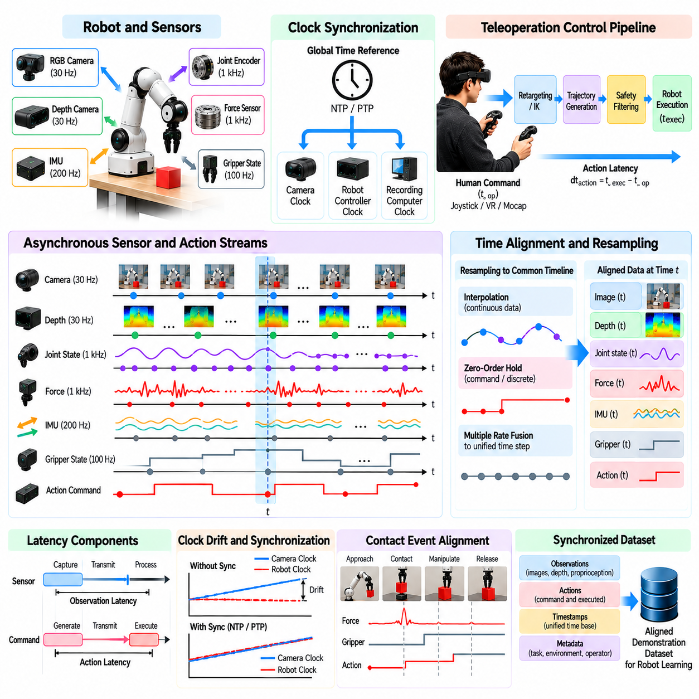{width="7.268055555555556in" height="7.268055555555556in"}

Sensor-action time alignment is a fundamental requirement for constructing reliable teleoperation datasets in Physical AI systems. Robot learning depends on correctly associating observations with the actions that produced subsequent changes in the environment. When sensor measurements and control commands are temporally misaligned, learning algorithms may infer incorrect causal relationships, reducing policy accuracy, stability, and generalization.

Teleoperation systems typically combine cameras, depth sensors, joint encoders, force sensors, inertial measurement units, and operator interfaces. These components operate at different frequencies and may use independent internal clocks. Camera streams may update at relatively low rates, while motor controllers execute commands at much higher frequencies. A unified temporal representation is therefore necessary to reconstruct robot behavior accurately.

Time alignment begins with a clear distinction between measurement time, transmission time, reception time, and processing time. A camera frame may represent a scene captured before the image reaches the recording computer. Similarly, a robot command may be generated before it is executed by an actuator. Recording only arrival timestamps can introduce systematic errors because communication and processing delays vary across devices.

Hardware timestamping provides a reliable foundation for synchronizing sensor and action streams. Sensors or interface controllers assign timestamps close to the moment of measurement or command generation. These timestamps reduce uncertainty introduced by operating system scheduling and communication buffers. However, hardware timestamps remain useful only when the clocks generating them share a known temporal reference.

Clock synchronization ensures that timestamps from different devices can be compared consistently. Network Time Protocol can provide approximate synchronization across networked computers, while Precision Time Protocol supports tighter synchronization when compatible hardware is available. Dedicated trigger signals may align camera exposures directly. The required synchronization accuracy depends on task dynamics and the timing sensitivity of relevant events.

Clock drift introduces gradual alignment errors when independent device clocks run at slightly different rates. Even when clocks are synchronized initially, their timestamps may diverge during extended recording sessions. Periodic synchronization and drift estimation help maintain consistency. Long-duration datasets should preserve synchronization diagnostics so downstream processing can identify intervals with unreliable timing.

Sensor sampling rates vary because different measurements have different physical requirements. Visual perception may operate at tens of frames per second, while joint feedback and force measurements may update hundreds or thousands of times per second. Aligning these streams requires careful treatment of missing intermediate samples. Simply matching observations by array index can create misleading relationships between robot states and actions.

Resampling converts asynchronous measurements into a common temporal structure suitable for model training. Continuous variables such as joint positions and velocities may be interpolated between valid measurements. Discrete signals such as gripper states or control modes often require different handling. Interpolation should not invent physical transitions or obscure sudden changes that are essential for understanding task execution.

Zero-order hold is commonly used for command signals that remain active until replaced by a new command. Under this representation, each command is associated with the interval during which it applies. Linear interpolation may be appropriate for selected continuous state variables but can distort discontinuities. Resampling methods should reflect the semantics of each signal rather than applying a universal procedure.

Action latency must be distinguished from observation latency because they affect learning in different ways. Observation latency delays information reaching the operator, while action latency delays the robot response to operator commands. Their combined effect can create apparent phase shifts between perception and movement. Accurate datasets should preserve both the operator-issued command and the actual robot execution timing.

Teleoperation control pipelines may introduce additional delays through motion retargeting, inverse kinematics, trajectory generation, and safety filtering. A human command may therefore differ from the action ultimately executed by the robot. Recording intermediate command stages improves traceability. It also allows learning systems to distinguish operator intention from transformations introduced by the control architecture.

Contact-rich manipulation requires particularly precise alignment because critical physical events occur over short intervals. During grasping, insertion, or surface interaction, forces can change rapidly while visual appearance changes only slightly. Misaligned force measurements may incorrectly associate contact with an earlier or later movement. High-resolution timestamps help preserve the sequence of approach, contact, force response, and release.

Mobile robots and legged platforms introduce timing challenges related to localization and stabilization. Wheel odometry, inertial measurements, camera observations, and control commands may arrive asynchronously. Quadruped foot contacts can change within individual gait cycles. Reliable alignment allows learning systems to associate terrain observations with movement decisions and the resulting balance corrections.

Aerial robots require accurate synchronization between flight commands, inertial states, and visual observations. Rapid attitude corrections may occur between consecutive camera frames. If control commands are aligned only with delayed images, learned policies may misunderstand the relationship between movement and stabilization. High-frequency flight telemetry should therefore be retained alongside lower-frequency perception data.

Temporal alignment also affects the construction of observation-action training pairs. In imitation learning, the target action should correspond to the information available when the decision was made. Pairing an action with observations captured after execution introduces future information into the training example. Such leakage can produce misleading evaluation results and policies that fail during real-time deployment.

Sequence-based learning models require consistent temporal ordering across extended observation and action histories. Transformer policies, recurrent networks, and diffusion-based action models may consume multiple frames and predict future action sequences. Irregular sampling and missing timestamps can distort these temporal patterns. Explicit time intervals and validity masks help models interpret asynchronous information.

Buffering strategies influence both real-time control and offline recording. Small buffers reduce delay but may expose the system to packet jitter or missing frames. Larger buffers improve ordering consistency but increase latency. Recording pipelines should preserve original timestamps before applying buffering or synchronization transformations. This enables later reconstruction without permanently embedding processing delays into the dataset.

Missing data requires explicit treatment because sensors may drop frames or temporarily lose communication. Repeating the last available observation can maintain fixed-size training inputs, but it may conceal important changes. Missing-data indicators and validity masks provide additional context. Long gaps should generally be identified separately from ordinary sampling intervals rather than silently interpolated.

Alignment validation should use measurable events shared across multiple signals. A commanded gripper closure may be compared with encoder motion and force onset. Camera-visible movements can be checked against joint trajectories, while synchronization pulses provide controlled references. Residual timing errors should be quantified because visually plausible alignment may still be inadequate for precision manipulation.

Quality metrics can characterize timestamp jitter, clock drift, missing samples, sensor latency, and command execution delay. These measurements help determine whether an episode meets the timing requirements of its intended learning task. Acceptance thresholds should reflect the robot platform and operational dynamics. A slow inspection task may tolerate errors that would be unacceptable for dynamic balancing or contact control.

Dataset storage formats should preserve original timestamps, synchronized timestamps, clock identifiers, and calibration metadata. Raw streams should remain accessible when practical so alignment procedures can be improved without repeating physical demonstrations. Versioned synchronization parameters support reproducibility. This separation between acquisition data and processed training samples is important for scalable data engineering.

Multi-robot and fleet-scale collection introduces further challenges because devices may operate across different computers, networks, and geographic locations. Local synchronization can preserve accurate timing within each robot, while shared references support comparisons across systems. Network outages and clock resets should be documented. Fleet datasets benefit from consistent timing conventions even when perfect global synchronization is unnecessary.

Automated alignment pipelines can estimate clock offsets, detect discontinuities, resample streams, and generate synchronized episode representations. However, automatic processing should not conceal uncertainty or replace invalid measurements with apparently precise values. Diagnostic reports and exception flags help identify problematic recordings. Human review can then focus on episodes containing ambiguous contact events or unusual timing behavior.

Ultimately, sensor-action time alignment preserves the causal structure of robotic experience. Accurate synchronization connects perception, operator intention, controller execution, physical interaction, and observed outcomes within a consistent temporal framework. By combining reliable timestamps, clock synchronization, latency measurement, appropriate resampling, and systematic validation, Physical AI data engines can produce trustworthy demonstrations for scalable robot learning.

센서-행동 시간 정렬(Sensor-Action Time Alignment)은 피지컬 인공지능(Physical AI) 시스템에서 신뢰할 수 있는 원격조작 데이터셋(Teleoperation Dataset)을 구축하기 위한 기본 요구사항이다. 로봇 학습(Robot Learning)은 관측 정보(Observation)를 이후 환경 변화(Environmental Change)를 발생시킨 행동(Action)과 올바르게 연결하는 데 의존한다. 센서 측정값(Sensor Measurement)과 제어 명령(Control Command)이 시간적으로 정렬되지 않으면 학습 알고리즘(Learning Algorithm)이 잘못된 인과관계(Causal Relationship)를 추론할 수 있으며, 이는 정책 정확도(Policy Accuracy), 안정성(Stability), 일반화 성능(Generalization)을 저하시킨다.

원격조작 시스템(Teleoperation System)은 일반적으로 카메라(Camera), 깊이 센서(Depth Sensor), 관절 엔코더(Joint Encoder), 힘 센서(Force Sensor), 관성 측정 장치(Inertial Measurement Unit), 작업자 인터페이스(Operator Interface)를 결합한다. 이러한 구성요소는 서로 다른 주파수(Frequency)로 작동하며 독립적인 내부 시계(Internal Clock)를 사용할 수 있다. 카메라 스트림(Camera Stream)은 상대적으로 낮은 속도로 갱신되는 반면, 모터 제어기(Motor Controller)는 훨씬 높은 주파수에서 명령을 실행한다. 따라서 로봇 행동(Robot Behavior)을 정확하게 재구성하려면 통합된 시간 표현(Unified Temporal Representation)이 필요하다.

시간 정렬(Time Alignment)은 측정 시각(Measurement Time), 전송 시각(Transmission Time), 수신 시각(Reception Time), 처리 시각(Processing Time)을 명확하게 구분하는 것에서 시작된다. 카메라 프레임(Camera Frame)은 영상이 기록 컴퓨터(Recording Computer)에 도착하기 전에 촬영된 장면을 나타낼 수 있다. 마찬가지로 로봇 명령(Robot Command)은 구동기(Actuator)가 실행하기 전에 생성될 수 있다. 도착 타임스탬프(Arrival Timestamp)만 기록하면 장치마다 통신 지연(Communication Delay)과 처리 지연(Processing Delay)이 달라지므로 체계적인 오차(Systematic Error)가 발생할 수 있다.

하드웨어 타임스탬프(Hardware Timestamping)는 센서 및 행동 스트림(Sensor and Action Stream)을 동기화하기 위한 신뢰할 수 있는 기반을 제공한다. 센서(Sensor) 또는 인터페이스 제어기(Interface Controller)는 측정이나 명령 생성이 발생하는 시점에 가까운 타임스탬프(Timestamp)를 부여한다. 이러한 타임스탬프는 운영체제 스케줄링(Operating System Scheduling)과 통신 버퍼(Communication Buffer)로 인해 발생하는 불확실성(Uncertainty)을 줄인다. 그러나 하드웨어 타임스탬프는 이를 생성하는 시계들이 알려진 시간 기준(Temporal Reference)을 공유할 때만 유용하다.

시계 동기화(Clock Synchronization)는 서로 다른 장치의 타임스탬프(Timestamp)를 일관되게 비교할 수 있도록 한다. 네트워크 시간 프로토콜(Network Time Protocol, NTP)은 네트워크로 연결된 컴퓨터 사이에 대략적인 동기화를 제공할 수 있으며, 정밀 시간 프로토콜(Precision Time Protocol, PTP)은 호환되는 하드웨어가 있을 때 더욱 정밀한 동기화를 지원한다. 전용 트리거 신호(Dedicated Trigger Signal)는 카메라 노출(Camera Exposure)을 직접 정렬할 수 있다. 필요한 동기화 정확도(Synchronization Accuracy)는 작업 동역학(Task Dynamics)과 관련 이벤트의 시간 민감도(Timing Sensitivity)에 따라 달라진다.

시계 드리프트(Clock Drift)는 독립적인 장치 시계(Device Clock)가 약간 서로 다른 속도로 작동할 때 점진적인 정렬 오차(Alignment Error)를 발생시킨다. 시계가 처음에 동기화되었더라도 장시간 기록 세션(Extended Recording Session)에서는 타임스탬프가 점차 어긋날 수 있다. 주기적인 동기화(Periodic Synchronization)와 드리프트 추정(Drift Estimation)은 일관성을 유지하는 데 도움이 된다. 장시간 데이터셋(Long-Duration Dataset)은 후속 처리(Downstream Processing)에서 시간 신뢰성이 낮은 구간을 식별할 수 있도록 동기화 진단 정보(Synchronization Diagnostics)를 보존해야 한다.

센서 샘플링 속도(Sensor Sampling Rate)는 측정 대상마다 물리적 요구사항(Physical Requirement)이 다르기 때문에 차이가 발생한다. 시각적 인식(Visual Perception)은 초당 수십 프레임으로 작동할 수 있지만, 관절 피드백(Joint Feedback)과 힘 측정(Force Measurement)은 초당 수백 또는 수천 번 갱신될 수 있다. 이러한 스트림을 정렬하려면 중간 샘플(Intermediate Sample)의 누락을 신중하게 처리해야 한다. 단순히 배열 인덱스(Array Index)로 관측값을 대응시키면 로봇 상태(Robot State)와 행동(Action) 사이에 잘못된 관계가 형성될 수 있다.

재샘플링(Resampling)은 비동기 측정값(Asynchronous Measurement)을 모델 학습(Model Training)에 적합한 공통 시간 구조(Common Temporal Structure)로 변환한다. 관절 위치(Joint Position)와 속도(Velocity) 같은 연속 변수(Continuous Variable)는 유효한 측정값 사이에서 보간(Interpolation)할 수 있다. 그리퍼 상태(Gripper State)나 제어 모드(Control Mode)와 같은 이산 신호(Discrete Signal)는 다른 처리 방식이 필요한 경우가 많다. 보간은 실제로 발생하지 않은 물리적 상태 전환(Physical Transition)을 만들어내거나 작업 실행(Task Execution)을 이해하는 데 필수적인 급격한 변화를 가려서는 안 된다.

영차 유지(Zero-Order Hold)는 새로운 명령으로 대체될 때까지 기존 명령이 유지되는 명령 신호(Command Signal)에 일반적으로 사용된다. 이 표현 방식에서는 각 명령이 적용되는 시간 구간(Time Interval)과 연결된다. 선형 보간(Linear Interpolation)은 일부 연속 상태 변수(Continuous State Variable)에 적합할 수 있지만 불연속성(Discontinuity)을 왜곡할 수 있다. 재샘플링 방법(Resampling Method)은 모든 신호에 동일한 절차를 적용하기보다 각 신호의 의미적 특성(Signal Semantics)을 반영해야 한다.

행동 지연(Action Latency)은 관측 지연(Observation Latency)과 구분해야 한다. 두 지연은 학습에 서로 다른 영향을 미치기 때문이다. 관측 지연은 정보가 작업자(Operator)에게 전달되는 시점을 늦추고, 행동 지연은 작업자 명령(Operator Command)에 대한 로봇 응답(Robot Response)을 늦춘다. 이 두 지연의 결합 효과(Combined Effect)는 인식(Perception)과 움직임(Movement) 사이에 겉보기 위상 차이(Apparent Phase Shift)를 발생시킬 수 있다. 정확한 데이터셋은 작업자가 발행한 명령(Operator-Issued Command)과 실제 로봇 실행 시점(Actual Robot Execution Timing)을 모두 보존해야 한다.

원격조작 제어 파이프라인(Teleoperation Control Pipeline)은 동작 재매핑(Motion Retargeting), 역기구학(Inverse Kinematics), 궤적 생성(Trajectory Generation), 안전 필터링(Safety Filtering)을 통해 추가적인 지연을 발생시킬 수 있다. 따라서 인간 명령(Human Command)은 로봇이 최종적으로 실행한 행동(Executed Action)과 다를 수 있다. 중간 명령 단계(Intermediate Command Stage)를 기록하면 추적 가능성(Traceability)이 향상된다. 또한 학습 시스템이 작업자 의도(Operator Intention)와 제어 아키텍처(Control Architecture)에 의해 도입된 변환(Transformation)을 구분할 수 있도록 한다.

접촉 중심 조작(Contact-Rich Manipulation)은 중요한 물리적 이벤트(Physical Event)가 짧은 시간 간격에서 발생하므로 특히 정밀한 시간 정렬(Precise Time Alignment)이 필요하다. 파지(Grasping), 삽입(Insertion), 표면 상호작용(Surface Interaction) 중에는 시각적 외관(Visual Appearance)이 거의 변하지 않더라도 힘(Force)이 빠르게 변화할 수 있다. 정렬되지 않은 힘 측정값(Misaligned Force Measurement)은 접촉을 이전 또는 이후 움직임과 잘못 연결할 수 있다. 고해상도 타임스탬프(High-Resolution Timestamp)는 접근(Approach), 접촉(Contact), 힘 응답(Force Response), 해제(Release)의 순서를 보존하는 데 도움이 된다.

이동로봇(Mobile Robot)과 다족보행 플랫폼(Legged Platform)은 위치 추정(Localization)과 안정화(Stabilization)에 관련된 시간적 과제를 수반한다. 바퀴 주행 거리 측정(Wheel Odometry), 관성 측정(Inertial Measurement), 카메라 관측(Camera Observation), 제어 명령(Control Command)은 비동기적으로 도착할 수 있다. 사족보행 로봇(Quadruped Robot)의 발 접촉(Foot Contact)은 개별 보행 주기(Gait Cycle) 내에서도 변화할 수 있다. 신뢰할 수 있는 정렬은 학습 시스템이 지형 관측(Terrain Observation)을 이동 의사결정(Movement Decision) 및 그에 따른 균형 보정(Balance Correction)과 연결할 수 있도록 한다.

항공 로봇(Aerial Robot)은 비행 명령(Flight Command), 관성 상태(Inertial State), 시각적 관측(Visual Observation) 사이의 정확한 동기화(Synchronization)가 필요하다. 빠른 자세 보정(Attitude Correction)은 연속된 카메라 프레임(Consecutive Camera Frame) 사이에서 발생할 수 있다. 제어 명령을 지연된 영상(Delayed Image)에만 정렬하면 학습된 정책(Learned Policy)이 움직임과 안정화 사이의 관계를 잘못 이해할 수 있다. 따라서 고주파 비행 텔레메트리(High-Frequency Flight Telemetry)는 저주파 인식 데이터(Lower-Frequency Perception Data)와 함께 보존되어야 한다.

시간 정렬(Temporal Alignment)은 관측-행동 학습 쌍(Observation-Action Training Pair)의 구성에도 영향을 미친다. 모방학습(Imitation Learning)에서 목표 행동(Target Action)은 의사결정이 이루어진 시점에 이용 가능했던 정보와 대응해야 한다. 행동 실행 이후에 수집된 관측 정보를 해당 행동과 연결하면 학습 사례(Training Example)에 미래 정보(Future Information)가 유입된다. 이러한 정보 누출(Information Leakage)은 잘못된 평가 결과(Misleading Evaluation Result)를 생성하고 실시간 배포(Real-Time Deployment)에서 실패하는 정책을 만들어낼 수 있다.

시퀀스 기반 학습 모델(Sequence-Based Learning Model)은 확장된 관측 및 행동 이력(Observation and Action History) 전반에 걸쳐 일관된 시간적 순서(Temporal Ordering)가 필요하다. 트랜스포머 정책(Transformer Policy), 순환 신경망(Recurrent Network), 확산 기반 행동 모델(Diffusion-Based Action Model)은 여러 프레임을 입력으로 사용하고 미래 행동 시퀀스(Future Action Sequence)를 예측할 수 있다. 불규칙한 샘플링(Irregular Sampling)과 누락된 타임스탬프(Missing Timestamp)는 이러한 시간적 패턴(Temporal Pattern)을 왜곡할 수 있다. 명시적인 시간 간격(Explicit Time Interval)과 유효성 마스크(Validity Mask)는 모델이 비동기 정보(Asynchronous Information)를 해석하는 데 도움이 된다.

버퍼링 전략(Buffering Strategy)은 실시간 제어(Real-Time Control)와 오프라인 기록(Offline Recording)에 모두 영향을 미친다. 작은 버퍼(Small Buffer)는 지연을 줄이지만 패킷 지터(Packet Jitter)나 프레임 누락(Missing Frame)에 시스템이 더 민감해질 수 있다. 큰 버퍼(Large Buffer)는 순서 일관성(Ordering Consistency)을 개선하지만 지연(Latency)을 증가시킨다. 기록 파이프라인(Recording Pipeline)은 버퍼링이나 동기화 변환(Synchronization Transformation)을 적용하기 전에 원본 타임스탬프(Original Timestamp)를 보존해야 한다. 이를 통해 처리 지연을 데이터셋에 영구적으로 포함하지 않고도 이후 데이터를 재구성할 수 있다.

누락 데이터(Missing Data)는 센서가 프레임을 손실하거나 일시적으로 통신이 끊어질 수 있으므로 명시적인 처리가 필요하다. 마지막으로 사용 가능한 관측값(Last Available Observation)을 반복하면 고정 크기 학습 입력(Fixed-Size Training Input)을 유지할 수 있지만 중요한 변화를 숨길 수 있다. 누락 데이터 표시기(Missing-Data Indicator)와 유효성 마스크(Validity Mask)는 추가적인 맥락 정보를 제공한다. 긴 데이터 공백(Long Gap)은 조용히 보간하기보다 일반적인 샘플링 간격(Ordinary Sampling Interval)과 별도로 식별해야 한다.

정렬 검증(Alignment Validation)은 여러 신호에서 공통으로 관측할 수 있는 측정 가능한 이벤트(Measurable Event)를 활용해야 한다. 명령된 그리퍼 닫힘(Commanded Gripper Closure)은 엔코더 움직임(Encoder Motion)과 힘 발생 시점(Force Onset)을 비교하여 검증할 수 있다. 카메라에서 관측되는 움직임(Camera-Visible Movement)은 관절 궤적(Joint Trajectory)과 대조할 수 있으며, 동기화 펄스(Synchronization Pulse)는 통제된 기준 신호(Controlled Reference)를 제공한다. 잔여 시간 오차(Residual Timing Error)는 시각적으로 그럴듯한 정렬도 정밀 조작(Precision Manipulation)에는 충분하지 않을 수 있으므로 정량화해야 한다.

품질 지표(Quality Metric)는 타임스탬프 지터(Timestamp Jitter), 시계 드리프트(Clock Drift), 누락 샘플(Missing Sample), 센서 지연(Sensor Latency), 명령 실행 지연(Command Execution Delay)을 특성화할 수 있다. 이러한 측정값은 에피소드(Episode)가 의도된 학습 작업(Learning Task)의 시간 요구사항(Timing Requirement)을 충족하는지 판단하는 데 도움이 된다. 수용 임계값(Acceptance Threshold)은 로봇 플랫폼(Robot Platform)과 운용 동역학(Operational Dynamics)을 반영해야 한다. 느린 검사 작업(Slow Inspection Task)에서 허용 가능한 오차도 동적 균형 제어(Dynamic Balancing)나 접촉 제어(Contact Control)에서는 허용되지 않을 수 있다.

데이터셋 저장 형식(Dataset Storage Format)은 원본 타임스탬프(Original Timestamp), 동기화된 타임스탬프(Synchronized Timestamp), 시계 식별자(Clock Identifier), 보정 메타데이터(Calibration Metadata)를 보존해야 한다. 가능한 경우 원시 스트림(Raw Stream)을 계속 사용할 수 있도록 유지하여 물리적 시연(Physical Demonstration)을 다시 수행하지 않고도 정렬 절차(Alignment Procedure)를 개선할 수 있어야 한다. 버전 관리된 동기화 매개변수(Versioned Synchronization Parameter)는 재현성(Reproducibility)을 지원한다. 수집 데이터(Acquisition Data)와 처리된 학습 샘플(Processed Training Sample)의 이러한 분리는 확장 가능한 데이터 엔지니어링(Scalable Data Engineering)에 중요하다.

다중 로봇 및 플릿 규모 데이터 수집(Multi-Robot and Fleet-Scale Data Collection)은 장치가 서로 다른 컴퓨터(Computer), 네트워크(Network), 지리적 위치(Geographic Location)에서 작동할 수 있으므로 추가적인 과제를 발생시킨다. 로컬 동기화(Local Synchronization)는 각 로봇 내부의 정확한 타이밍을 보존하고, 공유 시간 기준(Shared Time Reference)은 시스템 간 비교를 지원한다. 네트워크 장애(Network Outage)와 시계 재설정(Clock Reset)은 문서화해야 한다. 완벽한 전역 동기화(Perfect Global Synchronization)가 필요하지 않은 경우에도 플릿 데이터셋(Fleet Dataset)은 일관된 시간 규약(Consistent Timing Convention)을 통해 이점을 얻는다.

자동화된 정렬 파이프라인(Automated Alignment Pipeline)은 시계 오프셋(Clock Offset)을 추정하고, 불연속성(Discontinuity)을 감지하고, 스트림을 재샘플링(Resampling)하고, 동기화된 에피소드 표현(Synchronized Episode Representation)을 생성할 수 있다. 그러나 자동 처리(Automatic Processing)는 불확실성(Uncertainty)을 숨기거나 유효하지 않은 측정값(Invalid Measurement)을 겉으로 정밀해 보이는 값으로 대체해서는 안 된다. 진단 보고서(Diagnostic Report)와 예외 플래그(Exception Flag)는 문제가 있는 기록(Problematic Recording)을 식별하는 데 도움이 된다. 이후 인간 검토(Human Review)는 모호한 접촉 이벤트(Ambiguous Contact Event)나 비정상적인 시간 동작(Unusual Timing Behavior)이 포함된 에피소드에 집중할 수 있다.

궁극적으로 센서-행동 시간 정렬(Sensor-Action Time Alignment)은 로봇 경험(Robotic Experience)의 인과적 구조(Causal Structure)를 보존한다. 정확한 동기화(Accurate Synchronization)는 인식(Perception), 작업자 의도(Operator Intention), 제어기 실행(Controller Execution), 물리적 상호작용(Physical Interaction), 관측된 결과(Observed Outcome)를 일관된 시간 프레임워크(Consistent Temporal Framework) 안에서 연결한다. 신뢰할 수 있는 타임스탬프(Reliable Timestamp), 시계 동기화(Clock Synchronization), 지연 측정(Latency Measurement), 적절한 재샘플링(Appropriate Resampling), 체계적인 검증(Systematic Validation)을 결합함으로써 피지컬 인공지능 데이터 엔진(Physical AI Data Engine)은 확장 가능한 로봇 학습(Scalable Robot Learning)을 위한 신뢰성 높은 시연 데이터(Trustworthy Demonstration Data)를 생성할 수 있다.

##  

## 02.12. Operator Skill Bias and Data Quality

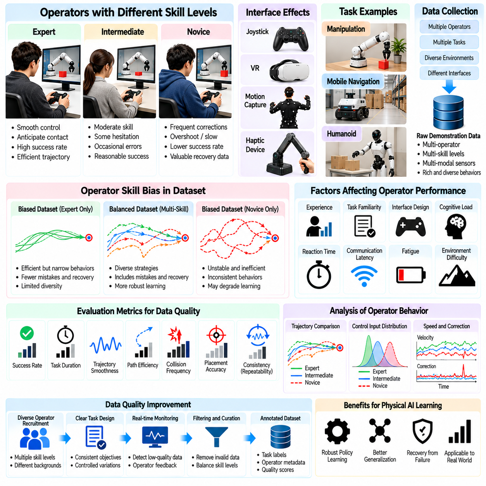{width="7.268055555555556in" height="7.268055555555556in"}

Operator skill bias is a major factor influencing the quality and representativeness of teleoperation datasets for Physical AI systems. Human operators differ in experience, coordination, reaction speed, spatial reasoning, and familiarity with robotic interfaces. These differences shape recorded actions and task outcomes. Without systematic evaluation, learning algorithms may reproduce individual operator habits rather than acquire robust and transferable robotic skills.

Operator expertise affects how efficiently demonstrations are executed. Experienced operators often produce smooth trajectories, anticipate contact events, and minimize unnecessary corrections. Novice operators may hesitate, overshoot targets, or repeatedly adjust movements. Although expert demonstrations can accelerate imitation learning, novice behavior may reveal useful recovery strategies and operational difficulties that expert-only datasets fail to capture.

Skill bias emerges when collected demonstrations disproportionately reflect particular operators or experience levels. A dataset dominated by highly trained specialists may contain efficient behavior but limited exposure to common mistakes. Conversely, excessive novice data may introduce unstable or inconsistent actions. Balanced collection strategies should consider the intended learning objective rather than assuming that all demonstrations contribute equal value.

Teleoperation interface design can amplify differences between operators. Joystick sensitivity, motion scaling, camera placement, control latency, and haptic feedback influence how users execute identical tasks. An operator who performs well with a virtual reality interface may struggle with direct joint control. Dataset metadata should therefore distinguish human skill differences from limitations introduced by interface configuration.

Individual operators often develop consistent movement preferences that create identifiable behavioral patterns. Some favor conservative approaches and slow contact transitions, while others use faster trajectories and larger corrections. These preferences can influence learned policies when demonstrations are treated as equally optimal. Capturing operator identifiers and behavioral statistics supports analysis of style diversity without requiring models to imitate personal habits.

Task familiarity is distinct from general teleoperation proficiency. An experienced operator may understand robotic controls but remain unfamiliar with a particular assembly sequence or object interaction. Repeated exposure to the same task can improve execution speed and reduce hesitation. Recording practice history and task-specific experience helps distinguish genuine skill differences from temporary learning effects.

Operator fatigue can gradually degrade demonstration quality during extended collection sessions. Reduced attention, slower reactions, and inconsistent control inputs may appear even among experienced operators. Long sessions can also introduce repetitive behavior or increased correction frequency. Collection procedures should include appropriate breaks, session-duration limits, and monitoring of performance trends without treating fatigue as a fixed personal characteristic.

Cognitive workload influences how operators allocate attention between perception, planning, and control. Complex tasks involving multiple cameras, robotic arms, or simultaneous navigation demands can exceed comfortable monitoring capacity. Operators may then prioritize immediate safety over optimal task execution. Interface simplification and shared autonomy can reduce workload, but their contributions should be documented when evaluating demonstration quality.

Reaction time and communication latency interact to shape teleoperation behavior. Operators may compensate for delayed feedback by slowing movements, anticipating future states, or issuing larger corrective commands. These adaptations are reasonable within a particular interface but may be undesirable when transferred to autonomous control. Training pipelines should distinguish delay-compensation behavior from task-essential movement strategies.

Skill assessment should use measurable indicators rather than subjective judgments alone. Completion rate, task duration, trajectory smoothness, collision frequency, intervention count, and recovery success provide complementary information. For manipulation, contact force and placement accuracy may be relevant. However, individual metrics should be interpreted within task context because faster execution does not necessarily indicate better performance.

Trajectory efficiency can reveal differences in operator control strategies. Excessive path length, repeated reversals, and unnecessary joint motion may indicate uncertainty or interface difficulty. Nevertheless, longer trajectories may be appropriate when operators avoid hazards or preserve stability. Quality evaluation should therefore consider safety margins, environmental constraints, and final outcomes rather than minimizing movement distance indiscriminately.

Demonstration consistency describes how reliably an operator reproduces successful behavior under comparable conditions. High consistency may indicate stable control skill, while substantial variation can reflect uncertainty or changing environmental conditions. Repeated trials with controlled initial states help estimate within-operator variability. Comparisons across operators require similar task difficulty and consistent measurement procedures.

Inter-operator variability can provide useful behavioral diversity when different strategies achieve the same objective safely. Multiple valid grasp approaches, navigation routes, or recovery sequences may improve policy generalization. However, conflicting demonstrations can also create ambiguous action targets. Learning systems may require task-conditioned representations or multimodal policies to model alternative successful behaviors.

Operator selection introduces sampling bias when participants are recruited from a narrow experience group. Laboratory researchers, professional robot operators, and occasional users may interact differently with identical systems. Datasets collected from only one population may not represent the broader operational environment. Recruitment and collection plans should reflect deployment requirements while maintaining consistent safety and training standards.

Demonstration quality should be separated into technical validity, task effectiveness, and learning usefulness. A recording may have accurate timestamps and complete sensor data but contain inefficient behavior. Another episode may fail its objective yet demonstrate valuable corrective actions. Multidimensional quality labels allow downstream training pipelines to select examples according to specific learning goals instead of applying simplistic success-only filtering.

Data filtering can improve average demonstration quality by removing corrupted recordings, uncontrolled collisions, or irrelevant movements. However, aggressive filtering may eliminate difficult situations and rare recovery behaviors. Such removal can produce overly idealized datasets that perform poorly outside controlled environments. Filtering policies should preserve informative failures while clearly identifying unsafe or invalid actions.

Quality weighting offers an alternative to treating every demonstration equally. Episodes may receive weights based on task completion, safety, precision, or confidence in the recorded labels. Expert demonstrations can receive greater influence for nominal task execution, while recovery examples remain available for robustness training. Weighting schemes require validation because poorly chosen scores can reinforce existing operator biases.

Dataset balancing should consider operator identity, skill level, task difficulty, and environmental variation simultaneously. Equal episode counts do not guarantee equal behavioral coverage if some operators repeatedly encounter easier conditions. Stratified sampling and controlled task assignments can reduce confounding factors. Distribution reports help reveal whether apparent performance differences arise from operators or collection conditions.

Learning algorithms can become sensitive to operator-specific action styles, particularly when training data is limited. Behavior cloning may reproduce hesitation, abrupt corrections, or unnecessarily cautious movement. Temporal smoothing can reduce some artifacts but may also remove meaningful contact adjustments. Robust policy learning requires distinguishing transferable task structure from incidental characteristics of human control.

Interactive imitation learning can reduce dependence on idealized expert demonstrations by collecting corrections in states visited by the learned policy. Operators intervene when the robot deviates from desirable behavior and demonstrate appropriate recovery. These interventions often provide highly informative examples. However, differences in intervention timing and operator judgment should be recorded to avoid introducing inconsistent supervision.

Operator calibration and training protocols improve data comparability across collection sessions. Standardized practice tasks, interface familiarization, and clear completion criteria reduce avoidable variation. Periodic calibration checks can detect changes in control sensitivity or sensor configuration. These procedures should establish a common baseline without suppressing legitimate diversity in safe and effective task strategies.

Quality assurance should monitor changes in demonstration statistics throughout data collection. Sudden increases in failure rate, command oscillation, or completion time may indicate fatigue, interface malfunction, or environmental changes. Automated dashboards can identify unusual patterns for investigation. Human reviewers should examine contextual evidence before attributing degraded performance to operator skill.

Privacy and fairness considerations are relevant when collecting operator performance information. Skill labels, behavioral statistics, and session histories may reveal individual work patterns. Access controls and appropriate anonymization can reduce unnecessary exposure. Evaluation procedures should focus on dataset suitability and training objectives rather than converting research metrics into unsupported judgments about individual capability.

Ultimately, managing operator skill bias requires balancing demonstration expertise, behavioral diversity, and systematic quality evaluation. Standardized interfaces, transparent metadata, multidimensional quality metrics, and carefully designed sampling strategies improve dataset reliability. By separating human-specific habits from transferable robotic competence, Physical AI data engines can transform heterogeneous teleoperation experiences into robust learning resources.

작업자 숙련도 편향(Operator Skill Bias)은 피지컬 인공지능(Physical AI) 시스템을 위한 원격조작 데이터셋(Teleoperation Dataset)의 품질(Quality)과 대표성(Representativeness)에 영향을 미치는 주요 요인이다. 인간 작업자(Human Operator)는 경험(Experience), 협응 능력(Coordination), 반응 속도(Reaction Speed), 공간 추론(Spatial Reasoning), 로봇 인터페이스(Robotic Interface)에 대한 숙련도에서 차이를 보인다. 이러한 차이는 기록된 행동(Recorded Action)과 작업 결과(Task Outcome)를 형성한다. 체계적인 평가(Systematic Evaluation)가 없으면 학습 알고리즘(Learning Algorithm)은 강건하고 전이 가능한 로봇 기술(Robust and Transferable Robotic Skill)을 습득하기보다 개별 작업자의 습관(Individual Operator Habit)을 재현할 수 있다.

작업자 전문성(Operator Expertise)은 시연(Demonstration)이 얼마나 효율적으로 수행되는지에 영향을 미친다. 숙련된 작업자(Experienced Operator)는 일반적으로 부드러운 궤적(Smooth Trajectory)을 생성하고 접촉 이벤트(Contact Event)를 예측하며 불필요한 보정(Unnecessary Correction)을 최소화한다. 초보 작업자(Novice Operator)는 주저하거나 목표를 지나치는 오버슈트(Overshoot)를 발생시키거나 움직임을 반복적으로 조정할 수 있다. 전문가 시연(Expert Demonstration)은 모방학습(Imitation Learning)을 가속할 수 있지만, 초보자의 행동(Novice Behavior)은 전문가 데이터만으로 구성된 데이터셋(Expert-Only Dataset)에서는 포착하기 어려운 유용한 복구 전략(Recovery Strategy)과 운용상의 어려움(Operational Difficulty)을 보여줄 수 있다.

숙련도 편향(Skill Bias)은 수집된 시연(Collected Demonstration)이 특정 작업자나 경험 수준(Experience Level)을 불균형하게 반영할 때 발생한다. 고도로 훈련된 전문가(Highly Trained Specialist)가 대부분을 차지하는 데이터셋은 효율적인 행동(Efficient Behavior)을 포함할 수 있지만 일반적인 실수(Common Mistake)에 대한 노출이 제한될 수 있다. 반대로 초보자 데이터(Novice Data)가 지나치게 많으면 불안정하거나 일관되지 않은 행동(Unstable or Inconsistent Action)이 포함될 수 있다. 균형 잡힌 수집 전략(Balanced Collection Strategy)은 모든 시연이 동일한 가치(Equal Value)를 제공한다고 가정하기보다 의도된 학습 목표(Learning Objective)를 고려해야 한다.

원격조작 인터페이스 설계(Teleoperation Interface Design)는 작업자 사이의 차이를 증폭시킬 수 있다. 조이스틱 민감도(Joystick Sensitivity), 동작 스케일링(Motion Scaling), 카메라 배치(Camera Placement), 제어 지연(Control Latency), 햅틱 피드백(Haptic Feedback)은 사용자가 동일한 작업을 수행하는 방식에 영향을 미친다. 가상현실 인터페이스(Virtual Reality Interface)를 능숙하게 사용하는 작업자도 직접 관절 제어(Direct Joint Control)에서는 어려움을 겪을 수 있다. 따라서 데이터셋 메타데이터(Dataset Metadata)는 인간의 숙련도 차이(Human Skill Difference)와 인터페이스 구성(Interface Configuration)에서 발생하는 한계를 구분해야 한다.

개별 작업자(Individual Operator)는 식별 가능한 행동 패턴(Identifiable Behavioral Pattern)을 형성하는 일관된 움직임 선호도(Movement Preference)를 발전시키는 경우가 많다. 일부 작업자는 보수적인 접근(Conservative Approach)과 느린 접촉 전환(Slow Contact Transition)을 선호하는 반면, 다른 작업자는 빠른 궤적(Fast Trajectory)과 큰 보정 동작(Large Correction)을 사용한다. 이러한 선호도는 시연을 모두 동일하게 최적이라고 간주할 때 학습된 정책(Learned Policy)에 영향을 미칠 수 있다. 작업자 식별자(Operator Identifier)와 행동 통계(Behavioral Statistics)를 기록하면 모델이 개인적인 습관(Personal Habit)을 모방하도록 요구하지 않으면서 행동 스타일 다양성(Style Diversity)을 분석할 수 있다.

작업 친숙도(Task Familiarity)는 일반적인 원격조작 숙련도(General Teleoperation Proficiency)와 구별된다. 숙련된 작업자라도 로봇 제어(Robotic Control)는 잘 이해하지만 특정 조립 순서(Assembly Sequence)나 물체 상호작용(Object Interaction)에는 익숙하지 않을 수 있다. 동일한 작업에 반복적으로 노출되면 실행 속도(Execution Speed)가 향상되고 주저함(Hesitation)이 감소할 수 있다. 연습 이력(Practice History)과 작업별 경험(Task-Specific Experience)을 기록하면 실제 숙련도 차이(Genuine Skill Difference)와 일시적인 학습 효과(Temporary Learning Effect)를 구분하는 데 도움이 된다.

작업자 피로(Operator Fatigue)는 장시간 데이터 수집 세션(Extended Collection Session)에서 시연 품질(Demonstration Quality)을 점진적으로 저하시킬 수 있다. 숙련된 작업자에게도 주의력 감소(Reduced Attention), 느린 반응(Slower Reaction), 일관되지 않은 제어 입력(Inconsistent Control Input)이 나타날 수 있다. 긴 세션은 반복적인 행동(Repetitive Behavior)이나 보정 빈도(Correction Frequency)의 증가를 유발할 수도 있다. 데이터 수집 절차(Collection Procedure)에는 적절한 휴식(Appropriate Break), 세션 지속시간 제한(Session-Duration Limit), 성능 추세 모니터링(Performance Trend Monitoring)이 포함되어야 하며, 피로를 개인의 고정된 특성(Fixed Personal Characteristic)으로 취급해서는 안 된다.

인지 부하(Cognitive Workload)는 작업자가 인식(Perception), 계획(Planning), 제어(Control) 사이에 주의력(Attention)을 어떻게 배분하는지에 영향을 미친다. 여러 카메라(Multiple Camera), 로봇 팔(Robotic Arm), 동시 내비게이션 요구사항(Simultaneous Navigation Demand)을 포함하는 복잡한 작업은 편안하게 감시할 수 있는 인지 능력(Monitoring Capacity)을 초과할 수 있다. 이 경우 작업자는 최적의 작업 실행(Optimal Task Execution)보다 즉각적인 안전(Immediate Safety)을 우선할 수 있다. 인터페이스 단순화(Interface Simplification)와 공유 자율성(Shared Autonomy)은 인지 부하를 줄일 수 있지만, 시연 품질을 평가할 때 이러한 기능의 기여도(Contribution)를 문서화해야 한다.

반응 시간(Reaction Time)과 통신 지연(Communication Latency)은 상호작용하여 원격조작 행동(Teleoperation Behavior)을 형성한다. 작업자는 지연된 피드백(Delayed Feedback)을 보상하기 위해 움직임을 느리게 하거나 미래 상태(Future State)를 예측하거나 더 큰 교정 명령(Corrective Command)을 내릴 수 있다. 이러한 적응(Adaptation)은 특정 인터페이스에서는 합리적이지만 자율 제어(Autonomous Control)로 전이할 때는 바람직하지 않을 수 있다. 학습 파이프라인(Training Pipeline)은 지연 보상 행동(Delay-Compensation Behavior)과 작업 수행에 필수적인 이동 전략(Task-Essential Movement Strategy)을 구분해야 한다.

숙련도 평가(Skill Assessment)는 주관적인 판단(Subjective Judgment)에만 의존하기보다 측정 가능한 지표(Measurable Indicator)를 활용해야 한다. 완료율(Completion Rate), 작업 지속시간(Task Duration), 궤적 평활성(Trajectory Smoothness), 충돌 빈도(Collision Frequency), 개입 횟수(Intervention Count), 복구 성공률(Recovery Success)은 상호보완적인 정보를 제공한다. 조작 작업(Manipulation Task)에서는 접촉력(Contact Force)과 배치 정확도(Placement Accuracy)가 중요할 수 있다. 그러나 빠른 실행(Faster Execution)이 반드시 우수한 성능(Better Performance)을 의미하지는 않으므로 개별 지표는 작업 맥락(Task Context) 안에서 해석해야 한다.

궤적 효율성(Trajectory Efficiency)은 작업자 제어 전략(Operator Control Strategy)의 차이를 보여줄 수 있다. 과도한 경로 길이(Excessive Path Length), 반복적인 방향 반전(Repeated Reversal), 불필요한 관절 움직임(Unnecessary Joint Motion)은 불확실성(Uncertainty)이나 인터페이스 사용의 어려움(Interface Difficulty)을 나타낼 수 있다. 그러나 작업자가 위험 요소(Hazard)를 회피하거나 안정성(Stability)을 유지할 때는 더 긴 궤적(Longer Trajectory)이 적절할 수 있다. 따라서 품질 평가(Quality Evaluation)는 이동 거리(Movement Distance)를 무조건 최소화하기보다 안전 여유(Safety Margin), 환경 제약(Environmental Constraint), 최종 결과(Final Outcome)를 고려해야 한다.

시연 일관성(Demonstration Consistency)은 유사한 조건(Comparable Condition)에서 작업자가 성공적인 행동(Successful Behavior)을 얼마나 안정적으로 재현하는지를 설명한다. 높은 일관성(High Consistency)은 안정적인 제어 숙련도(Stable Control Skill)를 나타낼 수 있으며, 큰 변동성(Substantial Variation)은 불확실성이나 변화하는 환경 조건(Changing Environmental Condition)을 반영할 수 있다. 통제된 초기 상태(Controlled Initial State)에서 반복 실험(Repeated Trial)을 수행하면 작업자 내부 변동성(Within-Operator Variability)을 추정하는 데 도움이 된다. 작업자 간 비교(Inter-Operator Comparison)에는 유사한 작업 난이도(Task Difficulty)와 일관된 측정 절차(Consistent Measurement Procedure)가 필요하다.

작업자 간 변동성(Inter-Operator Variability)은 서로 다른 전략(Different Strategy)이 동일한 목표(Objective)를 안전하게 달성할 때 유용한 행동 다양성(Behavioral Diversity)을 제공할 수 있다. 여러 가지 유효한 파지 접근 방식(Valid Grasp Approach), 내비게이션 경로(Navigation Route), 복구 시퀀스(Recovery Sequence)는 정책 일반화(Policy Generalization)를 향상시킬 수 있다. 그러나 상충하는 시연(Conflicting Demonstration)은 모호한 행동 목표(Ambiguous Action Target)를 생성할 수도 있다. 학습 시스템(Learning System)은 대안적인 성공 행동(Alternative Successful Behavior)을 모델링하기 위해 작업 조건부 표현(Task-Conditioned Representation)이나 다중모달 정책(Multimodal Policy)이 필요할 수 있다.

작업자 선정(Operator Selection)은 참여자(Participant)가 제한된 경험 집단(Narrow Experience Group)에서 모집될 때 표본 편향(Sampling Bias)을 발생시킨다. 연구실 연구원(Laboratory Researcher), 전문 로봇 작업자(Professional Robot Operator), 비정기 사용자(Occasional User)는 동일한 시스템과도 서로 다르게 상호작용할 수 있다. 하나의 집단(Population)에서만 수집된 데이터셋은 더 넓은 운용 환경(Broader Operational Environment)을 대표하지 못할 수 있다. 참여자 모집(Recruitment)과 수집 계획(Collection Plan)은 일관된 안전 및 교육 기준(Safety and Training Standard)을 유지하면서 실제 배포 요구사항(Deployment Requirement)을 반영해야 한다.

시연 품질(Demonstration Quality)은 기술적 유효성(Technical Validity), 작업 효과성(Task Effectiveness), 학습 유용성(Learning Usefulness)으로 구분해야 한다. 기록(Recording)은 정확한 타임스탬프(Accurate Timestamp)와 완전한 센서 데이터(Complete Sensor Data)를 갖추고도 비효율적인 행동(Inefficient Behavior)을 포함할 수 있다. 다른 에피소드(Episode)는 목표 달성에 실패하더라도 가치 있는 교정 행동(Corrective Action)을 보여줄 수 있다. 다차원 품질 라벨(Multidimensional Quality Label)을 사용하면 후속 학습 파이프라인(Downstream Training Pipeline)이 단순한 성공 사례 필터링(Success-Only Filtering) 대신 구체적인 학습 목표(Specific Learning Goal)에 따라 사례를 선택할 수 있다.

데이터 필터링(Data Filtering)은 손상된 기록(Corrupted Recording), 제어되지 않은 충돌(Uncontrolled Collision), 관련 없는 움직임(Irrelevant Movement)을 제거하여 평균적인 시연 품질(Average Demonstration Quality)을 향상시킬 수 있다. 그러나 과도한 필터링(Aggressive Filtering)은 어려운 상황(Difficult Situation)과 드문 복구 행동(Rare Recovery Behavior)을 제거할 수 있다. 이러한 제거는 통제된 환경(Controlled Environment) 밖에서 성능이 저하되는 지나치게 이상화된 데이터셋(Overly Idealized Dataset)을 생성할 수 있다. 필터링 정책(Filtering Policy)은 위험하거나 유효하지 않은 행동(Unsafe or Invalid Action)을 명확히 식별하면서 정보 가치가 있는 실패(Informative Failure)를 보존해야 한다.

품질 가중치(Quality Weighting)는 모든 시연을 동일하게 취급하는 방식의 대안이다. 에피소드(Episode)는 작업 완료(Task Completion), 안전성(Safety), 정밀도(Precision), 기록된 라벨의 신뢰도(Label Confidence)에 따라 가중치(Weight)를 부여받을 수 있다. 전문가 시연(Expert Demonstration)은 정상적인 작업 실행(Nominal Task Execution) 학습에서 더 큰 영향력을 가질 수 있으며, 복구 사례(Recovery Example)는 강건성 학습(Robustness Training)을 위해 계속 활용할 수 있다. 가중치 부여 방식(Weighting Scheme)은 잘못 설계된 점수(Poorly Chosen Score)가 기존 작업자 편향(Operator Bias)을 강화할 수 있으므로 검증이 필요하다.

데이터셋 균형화(Dataset Balancing)는 작업자 식별 정보(Operator Identity), 숙련도 수준(Skill Level), 작업 난이도(Task Difficulty), 환경 다양성(Environmental Variation)을 동시에 고려해야 한다. 일부 작업자가 반복적으로 더 쉬운 조건(Easier Condition)을 경험한다면 동일한 에피소드 수(Equal Episode Count)만으로 동일한 행동 범위(Behavioral Coverage)가 보장되지는 않는다. 층화 샘플링(Stratified Sampling)과 통제된 작업 배정(Controlled Task Assignment)은 교란 요인(Confounding Factor)을 줄일 수 있다. 분포 보고서(Distribution Report)는 겉으로 드러나는 성능 차이(Apparent Performance Difference)가 작업자 때문인지 수집 조건(Collection Condition) 때문인지 파악하는 데 도움이 된다.

학습 알고리즘(Learning Algorithm)은 특히 학습 데이터(Training Data)가 제한적일 때 작업자별 행동 스타일(Operator-Specific Action Style)에 민감해질 수 있다. 행동 복제(Behavior Cloning)는 주저함(Hesitation), 급격한 보정(Abrupt Correction), 불필요하게 신중한 움직임(Unnecessarily Cautious Movement)을 재현할 수 있다. 시간적 평활화(Temporal Smoothing)는 일부 인위적 특성(Artifact)을 줄일 수 있지만 의미 있는 접촉 조정(Meaningful Contact Adjustment)도 제거할 수 있다. 강건한 정책 학습(Robust Policy Learning)을 위해서는 전이 가능한 작업 구조(Transferable Task Structure)와 인간 제어의 부수적 특성(Incidental Characteristic)을 구분해야 한다.

상호작용형 모방학습(Interactive Imitation Learning)은 학습된 정책(Learned Policy)이 실제로 방문하는 상태(Visited State)에서 교정 행동(Correction)을 수집함으로써 이상화된 전문가 시연(Idealized Expert Demonstration)에 대한 의존도를 줄일 수 있다. 작업자는 로봇이 바람직한 행동(Desirable Behavior)에서 벗어날 때 개입하여 적절한 복구(Appropriate Recovery)를 시연한다. 이러한 개입(Intervention)은 정보 가치가 매우 높은 사례(Highly Informative Example)를 제공하는 경우가 많다. 그러나 일관되지 않은 지도 신호(Inconsistent Supervision)가 도입되지 않도록 개입 시점(Intervention Timing)과 작업자 판단(Operator Judgment)의 차이를 기록해야 한다.

작업자 보정 및 교육 프로토콜(Operator Calibration and Training Protocol)은 데이터 수집 세션(Collection Session) 간 비교 가능성(Data Comparability)을 향상시킨다. 표준화된 연습 작업(Standardized Practice Task), 인터페이스 적응 교육(Interface Familiarization), 명확한 완료 기준(Clear Completion Criteria)은 피할 수 있는 변동성(Avoidable Variation)을 줄인다. 주기적인 보정 검사(Periodic Calibration Check)는 제어 민감도(Control Sensitivity)나 센서 구성(Sensor Configuration)의 변화를 감지할 수 있다. 이러한 절차는 안전하고 효과적인 작업 전략(Safe and Effective Task Strategy)의 정당한 다양성(Legitimate Diversity)을 억제하지 않으면서 공통 기준선(Common Baseline)을 확립해야 한다.

품질 보증(Quality Assurance)은 데이터 수집(Data Collection) 전반에 걸쳐 시연 통계(Demonstration Statistics)의 변화를 모니터링해야 한다. 실패율(Failure Rate), 명령 진동(Command Oscillation), 완료 시간(Completion Time)이 갑자기 증가하면 피로(Fatigue), 인터페이스 오작동(Interface Malfunction), 환경 변화(Environmental Change)를 나타낼 수 있다. 자동화된 대시보드(Automated Dashboard)는 조사할 필요가 있는 비정상적인 패턴(Unusual Pattern)을 식별할 수 있다. 인간 검토자(Human Reviewer)는 성능 저하(Degraded Performance)를 작업자 숙련도(Operator Skill)의 문제로 판단하기 전에 맥락적 증거(Contextual Evidence)를 검토해야 한다.

개인정보 보호(Privacy)와 공정성(Fairness)은 작업자 성능 정보(Operator Performance Information)를 수집할 때 중요한 고려사항이다. 숙련도 라벨(Skill Label), 행동 통계(Behavioral Statistics), 세션 이력(Session History)은 개인의 작업 패턴(Individual Work Pattern)을 드러낼 수 있다. 접근 제어(Access Control)와 적절한 익명화(Anonymization)는 불필요한 정보 노출(Unnecessary Exposure)을 줄일 수 있다. 평가 절차(Evaluation Procedure)는 연구 지표(Research Metric)를 개인 능력(Individual Capability)에 대한 근거 없는 판단(Unsupported Judgment)으로 전환하기보다 데이터셋 적합성(Dataset Suitability)과 학습 목표(Training Objective)에 집중해야 한다.

궁극적으로 작업자 숙련도 편향(Operator Skill Bias)을 관리하려면 시연 전문성(Demonstration Expertise), 행동 다양성(Behavioral Diversity), 체계적인 품질 평가(Systematic Quality Evaluation) 사이의 균형이 필요하다. 표준화된 인터페이스(Standardized Interface), 투명한 메타데이터(Transparent Metadata), 다차원 품질 지표(Multidimensional Quality Metric), 신중하게 설계된 샘플링 전략(Sampling Strategy)은 데이터셋 신뢰성(Dataset Reliability)을 향상시킨다. 인간 고유의 습관(Human-Specific Habit)과 전이 가능한 로봇 역량(Transferable Robotic Competence)을 분리함으로써 피지컬 인공지능 데이터 엔진(Physical AI Data Engine)은 다양한 원격조작 경험(Heterogeneous Teleoperation Experience)을 강건한 학습 자원(Robust Learning Resource)으로 변환할 수 있다.

##  

## 02.13. Success Failure and Corrective Demonstrations

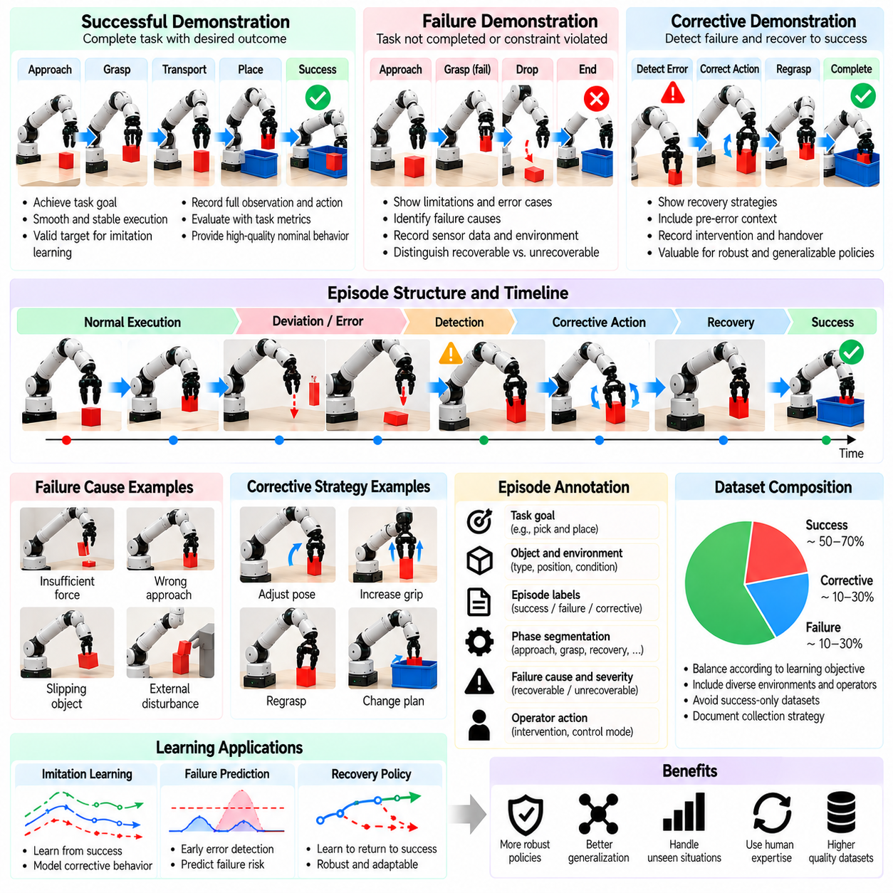{width="7.268055555555556in" height="7.268055555555556in"}

Successful, failed, and corrective demonstrations provide complementary forms of supervision for Physical AI learning. Successful episodes show how desired objectives can be achieved, while failures reveal limitations, unexpected conditions, and unsafe action patterns. Corrective demonstrations connect these experiences by showing how operators recognize deviations and restore progress. Together, they create richer training datasets than successful trajectories alone.

A successful demonstration represents an episode in which the robot satisfies predefined task completion criteria. Success may involve placing an object accurately, navigating to a destination, or completing an assembly operation. However, reaching the goal does not automatically imply optimal behavior. Execution time, energy consumption, contact forces, and safety margins provide additional information about demonstration quality.

Failure demonstrations capture situations where the intended objective is not achieved or operational constraints are violated. Examples include dropped objects, missed grasps, navigation collisions, unstable locomotion, and unsuccessful insertions. These episodes reveal conditions under which existing strategies become unreliable. Accurate failure classification helps learning systems distinguish recoverable errors from fundamental task limitations.

Failure causes should be documented separately from observable failure outcomes. A dropped object may result from insufficient grip force, incorrect contact geometry, delayed feedback, or unexpected acceleration. Identical outcomes can therefore arise through different mechanisms. Recording sensor evidence, operator commands, and environmental conditions supports causal analysis and prevents learning systems from treating every failure as equivalent.

Corrective demonstrations show how an operator responds after detecting an undesirable state. The operator may adjust a grasp, reposition a manipulator, modify a navigation route, or reduce movement speed. These corrections provide direct examples of actions that improve task progress from imperfect conditions. They are particularly valuable because autonomous policies frequently encounter states absent from ideal expert trajectories.

Corrective behavior can occur before or after an observable failure. Preventive corrections address emerging risks, such as object slipping or approaching an obstacle too closely. Reactive corrections begin after a failure has already occurred. Distinguishing these cases allows learning systems to separate early risk mitigation from recovery execution and supports more effective intervention policies.

Demonstration episodes should preserve the transition from normal execution to deviation detection and corrective action. Recording only the successful portion after recovery removes important information about why intervention became necessary. A complete sequence should include the preceding observations, the problematic action, the resulting state, and the correction. This continuity supports learning of error detection and recovery behavior.

Outcome labeling requires clearly defined task-specific criteria. Binary success and failure labels provide simple supervision but may conceal meaningful differences in partial completion. A robot may grasp an object successfully yet fail during placement. Phase-level labels and progress indicators reveal where execution diverged from the objective, enabling more precise evaluation and targeted learning.

Failure severity is another important dimension of demonstration annotation. Minor positioning errors may be recoverable without interrupting the task, while collisions or unstable movements can create significant safety risks. Severity labels should reflect physical consequences and operational constraints. Unsafe actions must be identified explicitly rather than treated as ordinary exploration examples.

Human intervention data provides a practical mechanism for collecting corrective demonstrations. During shared autonomy, an operator may take control when the robot approaches an unsafe or unfamiliar state. The intervention trigger, control handover, corrective commands, and recovery result should be recorded. This information supports learning when intervention is necessary and which actions can restore reliable operation.

Recovery demonstrations often contain greater learning value than repetitive successful episodes because they expose the policy to unusual states. A robot that only observes perfect grasps may struggle when an object shifts unexpectedly. Demonstrations of regrasping and repositioning expand the training distribution. However, recovery data should be selected for relevance rather than assuming every failure produces useful supervision.

Dataset construction should balance successful, failed, and corrective episodes according to the intended training objective. Excessive success-only data can produce brittle policies, while excessive failure data may distort action distributions. Task execution policies, failure predictors, and recovery controllers may require different sampling strategies. Dataset composition should therefore be documented and evaluated systematically.

Behavior cloning typically learns to reproduce actions observed in demonstration data. Successful trajectories provide direct targets for nominal task execution, but failed actions should not automatically receive identical imitation objectives. Corrective actions may be valuable when conditioned on the states that triggered them. Training pipelines must distinguish desirable recovery behavior from the preceding actions that caused the problem.

Preference-based learning can use comparisons between successful and unsuccessful trajectories to infer desirable behavior. Human evaluators or task metrics may identify which execution better satisfies safety, precision, and efficiency requirements. These comparisons provide supervision beyond direct action imitation. Nevertheless, preference labels should remain consistent with clearly specified objectives and operational constraints.

Reward learning can incorporate success, failure, and corrective demonstrations to estimate task progress and undesirable outcomes. Successful episodes identify goal-reaching behavior, while failures provide evidence about ineffective or unsafe transitions. Corrective demonstrations reveal transitions toward improved states. Learned reward models require careful validation because imperfect labels and biased sampling can produce misleading incentives.

Interactive imitation learning provides a structured approach to collecting corrections from states visited by a developing policy. The robot executes its current policy while an operator monitors performance and intervenes when necessary. Corrective demonstrations expand coverage of states induced by model errors. This process can reduce compounding mistakes that occur when a policy operates outside the distribution of its original training data.

Counterfactual analysis examines whether alternative actions could have prevented observed failures. A collision might have been avoided through earlier braking, while a failed grasp might have succeeded with different contact placement. Such alternatives can guide targeted data collection. However, counterfactual labels should be distinguished from physically executed demonstrations because hypothetical outcomes remain uncertain without validation.

Temporal alignment is essential for interpreting failure and correction sequences. Contact forces, visual observations, operator commands, and executed actions must be associated with their actual occurrence times. Misalignment can make a correction appear to precede the error it addresses. Accurate timestamps preserve the causal sequence required for learning intervention timing and recovery policies.

Operator expertise influences the quality of corrective demonstrations. Skilled operators may detect subtle deviations and intervene early, while less experienced operators may respond after errors become severe. Both behaviors reveal useful aspects of task difficulty, but their supervision quality differs. Recording operator experience and intervention context helps prevent inconsistent recovery strategies from being treated as interchangeable.

Automated failure detection can assist demonstration collection by identifying abnormal forces, trajectory deviations, unstable postures, or task progress interruptions. Detection systems may trigger event markers or request operator review. However, automated classifications can generate false positives and miss subtle failures. Combining sensor-based indicators with human validation improves the reliability of failure annotations.

Safety constraints must govern the collection of unsuccessful demonstrations. Deliberately inducing dangerous collisions, falls, or uncontrolled motions is unnecessary when safer alternatives can provide relevant information. Simulation, controlled disturbances, and naturally occurring failures can supply useful negative examples. Protective controllers and emergency stopping mechanisms should remain active throughout physical data collection.

Evaluation should measure not only nominal task success but also failure recognition, intervention timing, recovery success, and safety preservation. A policy that completes ideal tasks efficiently may still perform poorly when unexpected disturbances occur. Recovery benchmarks should introduce controlled deviations and measure whether the robot returns to acceptable operation. Separate metrics help identify weaknesses hidden by aggregate success rates.

Scalable data engines can prioritize informative failures and corrections through automated event detection, uncertainty estimation, and targeted episode selection. Rare but recoverable situations may receive higher collection priority than repeated routine successes. Metadata should preserve failure categories, intervention sources, and recovery outcomes. These records enable systematic filtering and reuse across imitation learning and policy improvement pipelines.

Ultimately, successful, failed, and corrective demonstrations describe different aspects of physical competence. Success teaches goal-directed execution, failure reveals limitations, and correction demonstrates adaptation when expectations are violated. Integrating these experiences through accurate labeling, temporal alignment, safety-aware collection, and balanced training enables Physical AI systems to develop more resilient and generalizable robotic behavior.

성공 시연(Successful Demonstration), 실패 시연(Failed Demonstration), 교정 시연(Corrective Demonstration)은 피지컬 인공지능(Physical AI) 학습을 위한 상호보완적인 지도 정보(Supervision)를 제공한다. 성공 에피소드(Successful Episode)는 원하는 목표(Desired Objective)를 달성하는 방법을 보여주며, 실패(Failure)는 한계(Limitation), 예상하지 못한 조건(Unexpected Condition), 안전하지 않은 행동 패턴(Unsafe Action Pattern)을 드러낸다. 교정 시연은 작업자(Operator)가 이탈(Deviation)을 인식하고 작업 진행(Task Progress)을 회복하는 방법을 보여줌으로써 이러한 경험을 연결한다. 이 세 가지를 결합하면 성공 궤적(Successful Trajectory)만으로 구성된 데이터셋보다 풍부한 학습 데이터셋(Training Dataset)을 구축할 수 있다.

성공 시연(Successful Demonstration)은 로봇이 사전에 정의된 작업 완료 기준(Task Completion Criteria)을 충족한 에피소드(Episode)를 의미한다. 성공은 물체를 정확하게 배치하거나, 목적지까지 이동하거나, 조립 작업(Assembly Operation)을 완료하는 형태로 나타날 수 있다. 그러나 목표 달성(Goal Achievement)이 자동으로 최적의 행동(Optimal Behavior)을 의미하지는 않는다. 실행 시간(Execution Time), 에너지 소비(Energy Consumption), 접촉력(Contact Force), 안전 여유(Safety Margin)는 시연 품질(Demonstration Quality)에 관한 추가적인 정보를 제공한다.

실패 시연(Failure Demonstration)은 의도한 목표(Intended Objective)를 달성하지 못하거나 운용 제약(Operational Constraint)을 위반한 상황을 기록한다. 대표적인 사례로 물체 낙하(Dropped Object), 파지 실패(Missed Grasp), 주행 중 충돌(Navigation Collision), 불안정한 보행(Unstable Locomotion), 삽입 실패(Unsuccessful Insertion)가 있다. 이러한 에피소드는 기존 전략(Existing Strategy)의 신뢰성이 저하되는 조건을 보여준다. 정확한 실패 분류(Failure Classification)는 학습 시스템(Learning System)이 복구 가능한 오류(Recoverable Error)와 근본적인 작업 한계(Fundamental Task Limitation)를 구분하는 데 도움이 된다.

실패 원인(Failure Cause)은 관측 가능한 실패 결과(Observable Failure Outcome)와 구분하여 문서화해야 한다. 물체 낙하(Dropped Object)는 부족한 파지력(Insufficient Grip Force), 잘못된 접촉 기하구조(Incorrect Contact Geometry), 지연된 피드백(Delayed Feedback), 예상하지 못한 가속도(Unexpected Acceleration)로 인해 발생할 수 있다. 따라서 동일한 결과(Identical Outcome)도 서로 다른 메커니즘(Different Mechanism)에서 발생할 수 있다. 센서 증거(Sensor Evidence), 작업자 명령(Operator Command), 환경 조건(Environmental Condition)을 기록하면 인과 분석(Causal Analysis)을 지원하고 학습 시스템이 모든 실패를 동일하게 취급하는 문제를 방지할 수 있다.

교정 시연(Corrective Demonstration)은 작업자가 바람직하지 않은 상태(Undesirable State)를 감지한 이후 어떻게 대응하는지를 보여준다. 작업자는 파지(Grasp)를 조정하거나, 매니퓰레이터(Manipulator)의 위치를 변경하거나, 내비게이션 경로(Navigation Route)를 수정하거나, 이동 속도(Movement Speed)를 줄일 수 있다. 이러한 교정(Correction)은 불완전한 조건(Imperfect Condition)에서 작업 진행을 개선하는 행동(Action)의 직접적인 사례를 제공한다. 자율 정책(Autonomous Policy)은 이상적인 전문가 궤적(Ideal Expert Trajectory)에 포함되지 않은 상태를 자주 경험하므로 교정 시연은 특히 가치가 높다.

교정 행동(Corrective Behavior)은 관측 가능한 실패(Observable Failure)가 발생하기 전이나 이후에 수행될 수 있다. 예방적 교정(Preventive Correction)은 물체 미끄러짐(Object Slipping)이나 장애물에 지나치게 가까이 접근하는 상황처럼 새롭게 나타나는 위험(Emerging Risk)에 대응한다. 반응적 교정(Reactive Correction)은 실패가 이미 발생한 이후에 시작된다. 이러한 사례를 구분하면 학습 시스템이 초기 위험 완화(Early Risk Mitigation)와 복구 실행(Recovery Execution)을 분리할 수 있으며, 더욱 효과적인 개입 정책(Intervention Policy)을 개발하는 데 도움이 된다.

시연 에피소드(Demonstration Episode)는 정상 실행(Normal Execution)에서 이탈 감지(Deviation Detection)와 교정 행동(Corrective Action)으로 이어지는 전환 과정(Transition)을 보존해야 한다. 복구 이후의 성공적인 부분(Successful Portion)만 기록하면 개입(Intervention)이 필요해진 이유에 관한 중요한 정보가 제거된다. 완전한 시퀀스(Complete Sequence)에는 이전 관측(Preceding Observation), 문제가 된 행동(Problematic Action), 그 결과 발생한 상태(Resulting State), 교정(Correction)이 포함되어야 한다. 이러한 연속성(Continuity)은 오류 감지(Error Detection)와 복구 행동(Recovery Behavior)의 학습을 지원한다.

결과 라벨링(Outcome Labeling)에는 명확하게 정의된 작업별 기준(Task-Specific Criteria)이 필요하다. 이진 성공 및 실패 라벨(Binary Success and Failure Label)은 간단한 지도 정보(Simple Supervision)를 제공하지만 부분 완료(Partial Completion)에서 나타나는 의미 있는 차이를 숨길 수 있다. 로봇은 물체 파지(Object Grasping)에 성공하더라도 배치(Placement) 과정에서 실패할 수 있다. 단계별 라벨(Phase-Level Label)과 진행 지표(Progress Indicator)는 실행이 목표(Objective)에서 벗어난 지점을 보여주므로 더욱 정밀한 평가(Precise Evaluation)와 표적 학습(Targeted Learning)을 가능하게 한다.

실패 심각도(Failure Severity)는 시연 주석(Demonstration Annotation)의 또 다른 중요한 차원이다. 경미한 위치 오차(Minor Positioning Error)는 작업을 중단하지 않고 복구할 수 있지만, 충돌(Collision)이나 불안정한 움직임(Unstable Movement)은 상당한 안전 위험(Safety Risk)을 초래할 수 있다. 심각도 라벨(Severity Label)은 물리적 결과(Physical Consequence)와 운용 제약(Operational Constraint)을 반영해야 한다. 안전하지 않은 행동(Unsafe Action)은 일반적인 탐색 사례(Ordinary Exploration Example)로 취급하지 않고 명시적으로 식별해야 한다.

인간 개입 데이터(Human Intervention Data)는 교정 시연(Corrective Demonstration)을 수집하기 위한 실용적인 메커니즘(Mechanism)을 제공한다. 공유 자율성(Shared Autonomy) 환경에서 작업자는 로봇이 안전하지 않거나 익숙하지 않은 상태(Unsafe or Unfamiliar State)에 접근할 때 제어권(Control)을 넘겨받을 수 있다. 개입 트리거(Intervention Trigger), 제어권 인계(Control Handover), 교정 명령(Corrective Command), 복구 결과(Recovery Result)를 기록해야 한다. 이러한 정보는 개입이 필요한 시점과 신뢰할 수 있는 운용(Reliable Operation)을 회복하는 행동을 학습하는 데 도움이 된다.

복구 시연(Recovery Demonstration)은 정책(Policy)을 비정상적인 상태(Unusual State)에 노출하므로 반복적인 성공 에피소드(Repetitive Successful Episode)보다 높은 학습 가치(Learning Value)를 갖는 경우가 많다. 완벽한 파지(Perfect Grasp)만 관측한 로봇은 물체가 예상하지 못하게 이동하면 어려움을 겪을 수 있다. 재파지(Regrasping)와 재배치(Repositioning)에 관한 시연은 학습 분포(Training Distribution)를 확장한다. 그러나 모든 실패가 유용한 지도 정보(Useful Supervision)를 제공한다고 가정하기보다 관련성(Relevance)에 따라 복구 데이터를 선택해야 한다.

데이터셋 구축(Dataset Construction)은 의도된 학습 목표(Training Objective)에 따라 성공, 실패, 교정 에피소드(Successful, Failed, and Corrective Episode)의 균형을 맞추어야 한다. 성공 데이터(Success-Only Data)가 지나치게 많으면 취약한 정책(Brittle Policy)이 만들어질 수 있으며, 실패 데이터(Failure Data)가 지나치게 많으면 행동 분포(Action Distribution)가 왜곡될 수 있다. 작업 실행 정책(Task Execution Policy), 실패 예측기(Failure Predictor), 복구 제어기(Recovery Controller)는 서로 다른 샘플링 전략(Sampling Strategy)이 필요할 수 있다. 따라서 데이터셋 구성(Dataset Composition)은 체계적으로 문서화하고 평가해야 한다.

행동 복제(Behavior Cloning)는 일반적으로 시연 데이터(Demonstration Data)에서 관측된 행동(Action)을 재현하도록 학습한다. 성공 궤적(Successful Trajectory)은 정상적인 작업 실행(Nominal Task Execution)을 위한 직접적인 목표 행동(Target Action)을 제공하지만, 실패한 행동(Failed Action)에 자동으로 동일한 모방 목표(Imitation Objective)를 부여해서는 안 된다. 교정 행동(Corrective Action)은 이를 유발한 상태(Triggering State)를 조건으로 사용할 때 가치가 높을 수 있다. 학습 파이프라인(Training Pipeline)은 바람직한 복구 행동(Desirable Recovery Behavior)과 문제를 일으킨 이전 행동(Preceding Action)을 구분해야 한다.

선호도 기반 학습(Preference-Based Learning)은 성공 궤적(Successful Trajectory)과 실패 궤적(Unsuccessful Trajectory)을 비교하여 바람직한 행동(Desirable Behavior)을 추론할 수 있다. 인간 평가자(Human Evaluator) 또는 작업 지표(Task Metric)는 어떤 실행이 안전성(Safety), 정밀도(Precision), 효율성(Efficiency) 요구사항을 더 잘 충족하는지 판단할 수 있다. 이러한 비교(Comparison)는 직접적인 행동 모방(Direct Action Imitation)을 넘어서는 지도 정보(Supervision)를 제공한다. 다만 선호도 라벨(Preference Label)은 명확하게 정의된 목표(Objective)와 운용 제약(Operational Constraint)에 일관되게 부합해야 한다.

보상 학습(Reward Learning)은 성공, 실패, 교정 시연을 통합하여 작업 진행(Task Progress)과 바람직하지 않은 결과(Undesirable Outcome)를 추정할 수 있다. 성공 에피소드(Successful Episode)는 목표 도달 행동(Goal-Reaching Behavior)을 식별하고, 실패(Failure)는 비효율적이거나 안전하지 않은 상태 전이(Ineffective or Unsafe Transition)에 관한 증거를 제공한다. 교정 시연(Corrective Demonstration)은 개선된 상태(Improved State)로 이동하는 전이(Transition)를 보여준다. 학습된 보상 모델(Learned Reward Model)은 불완전한 라벨(Imperfect Label)과 편향된 샘플링(Biased Sampling)이 잘못된 유인(Misleading Incentive)을 생성할 수 있으므로 신중하게 검증해야 한다.

상호작용형 모방학습(Interactive Imitation Learning)은 개발 중인 정책(Developing Policy)이 방문한 상태(Visited State)에서 교정(Correction)을 수집하기 위한 구조화된 접근 방식(Structured Approach)을 제공한다. 로봇은 현재 정책(Current Policy)을 실행하고, 작업자(Operator)는 성능(Performance)을 감시하면서 필요한 경우 개입한다. 교정 시연(Corrective Demonstration)은 모델 오류(Model Error)로 인해 발생한 상태에 대한 학습 범위(Coverage)를 확장한다. 이러한 과정은 정책이 기존 학습 데이터 분포(Original Training Data Distribution)를 벗어나 작동할 때 발생하는 누적 오류(Compounding Error)를 줄일 수 있다.

반사실적 분석(Counterfactual Analysis)은 관측된 실패(Observed Failure)를 다른 행동(Alternative Action)으로 예방할 수 있었는지를 검토한다. 충돌(Collision)은 더 이른 제동(Earlier Braking)으로 방지할 수 있었을 수 있으며, 파지 실패(Failed Grasp)는 다른 접촉 위치(Contact Placement)를 사용했다면 성공했을 수 있다. 이러한 대안(Alternative)은 표적 데이터 수집(Targeted Data Collection)의 방향을 제시할 수 있다. 그러나 가상의 결과(Hypothetical Outcome)는 검증되지 않으면 불확실하므로 반사실적 라벨(Counterfactual Label)은 실제로 실행된 물리적 시연(Physically Executed Demonstration)과 구분해야 한다.

시간 정렬(Temporal Alignment)은 실패 및 교정 시퀀스(Failure and Correction Sequence)를 해석하는 데 필수적이다. 접촉력(Contact Force), 시각적 관측(Visual Observation), 작업자 명령(Operator Command), 실행된 행동(Executed Action)은 실제 발생 시각(Actual Occurrence Time)과 연결되어야 한다. 시간 정렬 오류(Misalignment)는 교정(Correction)이 대응하려는 오류(Error)보다 먼저 발생한 것처럼 보이게 할 수 있다. 정확한 타임스탬프(Accurate Timestamp)는 개입 시점(Intervention Timing)과 복구 정책(Recovery Policy)을 학습하는 데 필요한 인과적 순서(Causal Sequence)를 보존한다.

작업자 전문성(Operator Expertise)은 교정 시연(Corrective Demonstration)의 품질에 영향을 미친다. 숙련된 작업자(Skilled Operator)는 미세한 이탈(Subtle Deviation)을 감지하고 조기에 개입할 수 있지만, 경험이 적은 작업자(Less Experienced Operator)는 오류(Error)가 심각해진 이후에 대응할 수 있다. 두 행동 모두 작업 난이도(Task Difficulty)에 관한 유용한 정보를 제공하지만 지도 정보의 품질(Supervision Quality)은 서로 다르다. 작업자 경험(Operator Experience)과 개입 맥락(Intervention Context)을 기록하면 일관되지 않은 복구 전략(Inconsistent Recovery Strategy)을 동일하게 취급하는 문제를 방지할 수 있다.

자동화된 실패 감지(Automated Failure Detection)는 비정상적인 힘(Abnormal Force), 궤적 이탈(Trajectory Deviation), 불안정한 자세(Unstable Posture), 작업 진행 중단(Task Progress Interruption)을 식별하여 시연 데이터 수집(Demonstration Collection)을 지원할 수 있다. 감지 시스템(Detection System)은 이벤트 마커(Event Marker)를 생성하거나 작업자 검토(Operator Review)를 요청할 수 있다. 그러나 자동 분류(Automated Classification)는 거짓 양성(False Positive)을 발생시키거나 미세한 실패(Subtle Failure)를 놓칠 수 있다. 센서 기반 지표(Sensor-Based Indicator)와 인간 검증(Human Validation)을 결합하면 실패 주석(Failure Annotation)의 신뢰성이 향상된다.

안전 제약(Safety Constraint)은 실패 시연(Unsuccessful Demonstration)의 수집 과정을 관리해야 한다. 더 안전한 대안(Safer Alternative)으로 관련 정보를 얻을 수 있다면 위험한 충돌(Dangerous Collision), 낙상(Fall), 제어되지 않은 움직임(Uncontrolled Motion)을 의도적으로 유발할 필요가 없다. 시뮬레이션(Simulation), 통제된 외란(Controlled Disturbance), 자연적으로 발생하는 실패(Naturally Occurring Failure)는 유용한 부정 사례(Negative Example)를 제공할 수 있다. 보호 제어기(Protective Controller)와 비상 정지 메커니즘(Emergency Stopping Mechanism)은 실제 로봇 데이터 수집(Physical Data Collection) 전반에 걸쳐 활성 상태로 유지되어야 한다.

평가(Evaluation)는 정상적인 작업 성공(Nominal Task Success)뿐 아니라 실패 인식(Failure Recognition), 개입 시점(Intervention Timing), 복구 성공(Recovery Success), 안전 유지(Safety Preservation)도 측정해야 한다. 이상적인 작업(Ideal Task)을 효율적으로 완료하는 정책(Policy)도 예상하지 못한 외란(Unexpected Disturbance)이 발생하면 성능이 저하될 수 있다. 복구 벤치마크(Recovery Benchmark)는 통제된 이탈(Controlled Deviation)을 도입하고 로봇이 허용 가능한 운용 상태(Acceptable Operation)로 복귀하는지를 측정해야 한다. 별도의 평가 지표(Separate Metric)는 종합 성공률(Aggregate Success Rate)에 가려진 취약점(Weakness)을 식별하는 데 도움이 된다.

확장 가능한 데이터 엔진(Scalable Data Engine)은 자동화된 이벤트 감지(Automated Event Detection), 불확실성 추정(Uncertainty Estimation), 표적 에피소드 선택(Targeted Episode Selection)을 통해 정보 가치가 높은 실패(Informative Failure)와 교정(Correction)을 우선적으로 수집할 수 있다. 드물지만 복구 가능한 상황(Rare but Recoverable Situation)은 반복적인 일상 성공(Repeated Routine Success)보다 높은 수집 우선순위(Collection Priority)를 부여받을 수 있다. 메타데이터(Metadata)는 실패 범주(Failure Category), 개입 출처(Intervention Source), 복구 결과(Recovery Outcome)를 보존해야 한다. 이러한 기록은 모방학습(Imitation Learning)과 정책 개선 파이프라인(Policy Improvement Pipeline) 전반에서 체계적인 필터링(Systematic Filtering)과 재사용(Reuse)을 가능하게 한다.

궁극적으로 성공 시연(Successful Demonstration), 실패 시연(Failed Demonstration), 교정 시연(Corrective Demonstration)은 물리적 역량(Physical Competence)의 서로 다른 측면을 설명한다. 성공(Success)은 목표 지향적 실행(Goal-Directed Execution)을 가르치고, 실패(Failure)는 한계(Limitation)를 드러내며, 교정(Correction)은 예상과 다른 상황에서 적응(Adaptation)하는 방법을 보여준다. 이러한 경험을 정확한 라벨링(Accurate Labeling), 시간 정렬(Temporal Alignment), 안전을 고려한 수집(Safety-Aware Collection), 균형 잡힌 학습(Balanced Training)을 통해 통합하면 피지컬 인공지능(Physical AI) 시스템은 더욱 회복탄력적이고 일반화 가능한 로봇 행동(Resilient and Generalizable Robotic Behavior)을 개발할 수 있다.

##  

## 02.14. Intervention Recovery and Rare Event Data

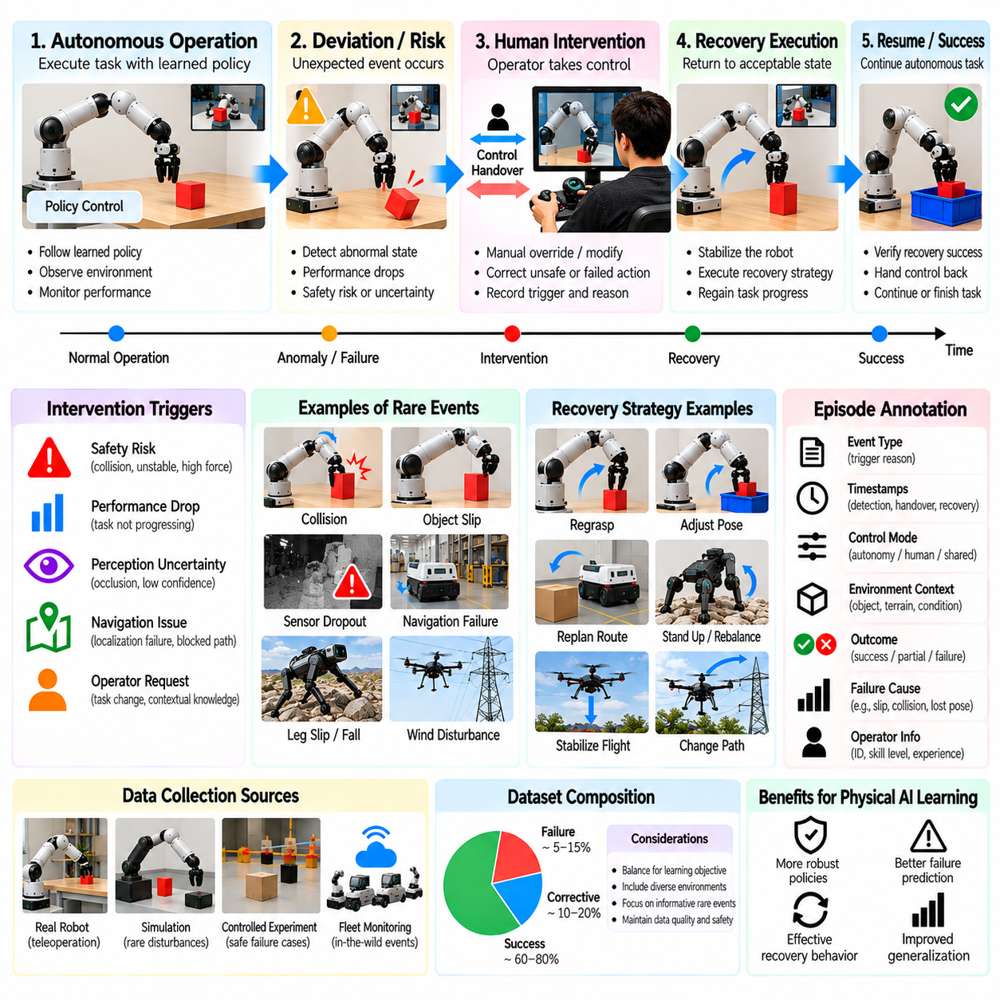{width="7.268055555555556in" height="7.268055555555556in"}

Intervention, recovery, and rare-event data are essential for developing Physical AI systems that operate reliably beyond ideal training conditions. Autonomous robots inevitably encounter unexpected obstacles, perception errors, unstable contacts, and unfamiliar environmental states. Teleoperation provides a mechanism for capturing human responses to these situations. Such recordings reveal how failures are detected, controlled, and resolved before normal operation resumes.

An intervention occurs when a human operator modifies, overrides, or temporarily replaces autonomous robot control. Interventions may be triggered by safety concerns, declining task performance, uncertain perception, or unexpected physical interactions. The resulting data contains information about both the autonomous policy\'s limitations and the operator\'s corrective decisions. Accurate intervention records should identify why control was transferred and what changed afterward.

Recovery refers to the process of returning a robot from an undesirable or degraded state to acceptable operation. A manipulator may need to regrasp a displaced object, while a mobile robot may need to escape a blocked passage. Legged robots may require balance restoration after slipping. Recovery demonstrations are especially valuable because they describe state transitions that successful nominal trajectories rarely contain.

Rare events are situations that occur infrequently during ordinary operation but may have significant consequences. Examples include unexpected collisions, sensor dropouts, sudden object movement, localization failures, and unusual contact dynamics. Their low frequency makes random data collection inefficient. Targeted recording strategies are therefore necessary to obtain sufficient examples without exposing physical systems to unnecessary danger.

Intervention data should preserve the conditions preceding human takeover. Observations, policy predictions, confidence estimates, control commands, and safety indicators provide context for understanding why intervention became necessary. Recording only the human-controlled recovery segment removes information about the developing problem. Complete temporal histories enable models to learn early warning signals rather than reacting after failure occurs.

Intervention triggers can be classified according to their underlying causes. Safety interventions prevent hazardous motion, performance interventions address declining task progress, and uncertainty interventions respond to unreliable perception or planning. Operator-requested interventions may reflect contextual knowledge unavailable to the robot. Distinguishing these categories supports targeted training and more interpretable autonomy evaluation.

Control handover introduces technical challenges because autonomous and human commands may differ substantially. Abrupt switching can produce discontinuous velocities, unexpected forces, or unstable robot behavior. Shared-control systems may use command blending, motion limits, and transition controllers to maintain stability. Recording handover timestamps and control authority helps separate intervention decisions from the dynamics of the transition itself.

Recovery episodes should capture the complete sequence from deviation detection to restored operation. Important stages include recognizing the abnormal state, stabilizing the robot, selecting a corrective strategy, executing recovery actions, and verifying success. Some recoveries require returning to an earlier task phase rather than continuing immediately. These distinctions support hierarchical policies that coordinate task execution and recovery.

Recovery success must be evaluated using explicit operational criteria. A robot that avoids a collision but remains immobilized has not necessarily recovered. Similarly, a manipulator that regains contact with an object may still fail to restore a stable grasp. Evaluation should consider safety, task progress, state stability, and readiness to resume autonomous execution. Partial recovery outcomes should remain distinguishable from complete recovery.

Rare-event datasets often suffer from severe class imbalance because normal operation generates far more examples than exceptional conditions. A model trained without appropriate balancing may achieve high average accuracy while missing critical failures. Event-focused sampling, importance weighting, and stratified evaluation can improve coverage. However, artificial balancing should not conceal the actual frequency of events in deployment environments.

Active data collection can prioritize situations where current policies exhibit uncertainty or repeated errors. Fleet monitoring systems may identify unusual sensor patterns, intervention clusters, or frequently unsuccessful recovery attempts. These signals can guide additional teleoperation sessions. The objective is to increase information gained per demonstration rather than maximize recording volume without considering learning value.

Simulation provides a controlled environment for generating rare disturbances that would be unsafe or expensive to reproduce physically. Object slips, sensor interruptions, actuator limitations, and unusual terrain conditions can be introduced systematically. Human operators can demonstrate recovery responses under these conditions. Nevertheless, simulated examples require validation because physical contact, latency, and sensor behavior may differ from reality.

Controlled physical experiments can complement simulation when realistic recovery behavior is essential. Low-speed disturbances, compliant objects, restricted workspaces, and protective mechanisms allow selected failure conditions to be studied safely. Experimental limits should be established before collection begins. The goal is to observe meaningful corrective behavior without deliberately creating uncontrolled collisions or hazardous robot states.

Temporal synchronization is particularly important for intervention and rare-event analysis. Sensor measurements, autonomous commands, operator inputs, and executed actions must share a consistent time reference. Small timing errors can reverse the apparent order of failure detection and corrective response. High-resolution timestamps and latency measurements help determine whether interventions occurred before, during, or after critical events.

Rare-event annotation should describe both observable outcomes and probable contributing factors. Useful labels include event onset, affected subsystem, severity, intervention type, recovery strategy, and final operational state. Causal explanations should be distinguished from directly observed evidence. This separation prevents uncertain interpretations from becoming misleading ground-truth labels in downstream learning pipelines.

Intervention timing provides supervision for learning when autonomous control should request assistance. Early interventions may prevent dangerous states, while delayed interventions reveal the consequences of insufficient monitoring. Training a takeover predictor requires distinguishing justified interventions from unnecessary operator overrides. Decision thresholds should reflect task-specific risk and the reliability of available perception and control signals.

Recovery policy learning uses corrective demonstrations to map degraded states into actions that restore acceptable conditions. Behavior cloning can reproduce demonstrated recovery sequences, while reinforcement learning may refine strategies through controlled interaction. Hierarchical architectures can select between nominal execution, stabilization, and recovery modes. Reliable switching requires explicit conditions for entering and leaving each mode.

Learning from interventions also presents selection bias because operators typically intervene only when they recognize a problem. Undetected failures and successful autonomous recoveries may be underrepresented. Operator expertise, workload, and interface latency further influence intervention frequency. Dataset analysis should therefore consider the observation process that determines which exceptional situations are actually recorded.

Quality assurance must verify that recovery demonstrations contain valid sensor streams, accurate control labels, and complete event boundaries. Missing observations during an intervention can obscure the cause of a corrective action. Automated checks may detect timestamp discontinuities, incomplete handovers, and inconsistent recovery outcomes. Human review remains important for ambiguous events involving contact, safety, or task intent.

Safety constraints must remain active throughout rare-event collection. Emergency stops, speed limits, collision monitoring, and workspace restrictions reduce the consequences of unexpected behavior. Human intervention should not be treated as a substitute for independent protective systems. Collection procedures should define escalation paths for situations that cannot be recovered safely through ordinary teleoperation.

Evaluation frameworks should test both the ability to avoid failures and the ability to recover after disturbances. Relevant metrics include intervention frequency, detection delay, recovery duration, recovery success rate, and residual safety risk. Rare-event performance should be reported separately from average task success. Controlled scenario testing helps reveal weaknesses that routine demonstrations may not expose.

Fleet-scale data engines can aggregate intervention and recovery experiences across robots operating in different environments. Event metadata enables clustering of recurring failure modes and identification of emerging operational risks. Selected episodes can be reviewed, relabeled, and incorporated into updated training datasets. Version tracking is necessary to determine whether policy changes reduce previously observed intervention requirements.

Ultimately, intervention, recovery, and rare-event data extend robot learning from routine task execution toward resilient autonomy. They reveal how systems approach operational boundaries, how humans recognize developing problems, and which actions restore safe behavior. Through targeted collection, accurate event annotation, controlled experimentation, and systematic evaluation, Physical AI data engines can transform exceptional experiences into transferable robotic competence.

개입(Intervention), 복구(Recovery), 희귀 이벤트 데이터(Rare-Event Data)는 이상적인 학습 조건(Ideal Training Conditions)을 벗어난 환경에서도 신뢰성 있게 작동하는 피지컬 인공지능(Physical AI) 시스템을 개발하는 데 필수적이다. 자율 로봇(Autonomous Robot)은 예상하지 못한 장애물(Unexpected Obstacle), 인식 오류(Perception Error), 불안정한 접촉(Unstable Contact), 익숙하지 않은 환경 상태(Unfamiliar Environmental State)를 필연적으로 경험한다. 원격조작(Teleoperation)은 이러한 상황에 대한 인간의 대응(Human Response)을 수집하는 메커니즘(Mechanism)을 제공한다. 이러한 기록은 정상 운용(Normal Operation)이 재개되기 전에 실패(Failure)가 어떻게 감지되고 제어되며 해결되는지를 보여준다.

개입(Intervention)은 인간 작업자(Human Operator)가 자율 로봇 제어(Autonomous Robot Control)를 수정하거나, 우선적으로 제어권을 행사하거나, 일시적으로 대체하는 상황을 의미한다. 개입은 안전 문제(Safety Concern), 작업 성능 저하(Declining Task Performance), 불확실한 인식(Uncertain Perception), 예상하지 못한 물리적 상호작용(Unexpected Physical Interaction)에 의해 발생할 수 있다. 그 결과 생성되는 데이터에는 자율 정책(Autonomous Policy)의 한계와 작업자의 교정 의사결정(Corrective Decision)에 관한 정보가 모두 포함된다. 정확한 개입 기록(Intervention Record)은 제어권(Control Authority)이 이전된 이유와 이후 발생한 변화를 식별해야 한다.

복구(Recovery)는 로봇을 바람직하지 않거나 성능이 저하된 상태(Undesirable or Degraded State)에서 허용 가능한 운용 상태(Acceptable Operation)로 되돌리는 과정이다. 매니퓰레이터(Manipulator)는 위치가 변한 물체(Displaced Object)를 다시 파지(Regrasp)해야 할 수 있으며, 이동로봇(Mobile Robot)은 막힌 통로(Blocked Passage)에서 벗어나야 할 수 있다. 다족보행 로봇(Legged Robot)은 미끄러짐(Slipping) 이후 균형 복원(Balance Restoration)이 필요할 수 있다. 복구 시연(Recovery Demonstration)은 정상적인 성공 궤적(Successful Nominal Trajectory)에 거의 포함되지 않는 상태 전이(State Transition)를 설명하므로 특히 가치가 높다.

희귀 이벤트(Rare Event)는 일반적인 운용(Ordinary Operation)에서는 드물게 발생하지만 중대한 결과(Significant Consequence)를 초래할 수 있는 상황이다. 대표적인 사례로 예상하지 못한 충돌(Unexpected Collision), 센서 데이터 손실(Sensor Dropout), 갑작스러운 물체 움직임(Sudden Object Movement), 위치 추정 실패(Localization Failure), 비정상적인 접촉 동역학(Unusual Contact Dynamics)이 있다. 발생 빈도(Low Frequency)가 낮기 때문에 무작위 데이터 수집(Random Data Collection)은 비효율적이다. 따라서 물리적 시스템(Physical System)을 불필요한 위험에 노출하지 않으면서 충분한 사례를 확보하려면 표적 기록 전략(Targeted Recording Strategy)이 필요하다.

개입 데이터(Intervention Data)는 인간이 제어권을 인수하기 이전의 조건(Pre-Takeover Conditions)을 보존해야 한다. 관측 정보(Observation), 정책 예측(Policy Prediction), 신뢰도 추정(Confidence Estimate), 제어 명령(Control Command), 안전 지표(Safety Indicator)는 개입이 필요해진 이유를 이해하는 데 필요한 맥락 정보(Context)를 제공한다. 인간이 제어한 복구 구간(Human-Controlled Recovery Segment)만 기록하면 문제가 발생하고 발전하는 과정(Developing Problem)에 관한 정보가 제거된다. 완전한 시간 이력(Complete Temporal History)은 모델이 실패 발생 이후에 반응하는 대신 조기 경고 신호(Early Warning Signal)를 학습할 수 있도록 한다.

개입 트리거(Intervention Trigger)는 근본적인 원인(Underlying Cause)에 따라 분류할 수 있다. 안전 개입(Safety Intervention)은 위험한 움직임(Hazardous Motion)을 방지하고, 성능 개입(Performance Intervention)은 작업 진행 저하(Declining Task Progress)에 대응하며, 불확실성 개입(Uncertainty Intervention)은 신뢰할 수 없는 인식 또는 계획(Unreliable Perception or Planning)에 대응한다. 작업자 요청 개입(Operator-Requested Intervention)은 로봇이 이용할 수 없는 상황적 지식(Contextual Knowledge)을 반영할 수 있다. 이러한 범주를 구분하면 표적 학습(Targeted Training)과 해석 가능한 자율성 평가(Interpretable Autonomy Evaluation)를 지원할 수 있다.

제어권 인계(Control Handover)는 자율 제어 명령(Autonomous Command)과 인간 명령(Human Command)이 크게 다를 수 있기 때문에 기술적인 과제(Technical Challenge)를 발생시킨다. 갑작스러운 제어 전환(Abrupt Switching)은 불연속적인 속도(Discontinuous Velocity), 예상하지 못한 힘(Unexpected Force), 불안정한 로봇 행동(Unstable Robot Behavior)을 초래할 수 있다. 공유 제어 시스템(Shared-Control System)은 안정성(Stability)을 유지하기 위해 명령 혼합(Command Blending), 동작 제한(Motion Limit), 전환 제어기(Transition Controller)를 사용할 수 있다. 인계 타임스탬프(Handover Timestamp)와 제어 권한(Control Authority)을 기록하면 개입 의사결정(Intervention Decision)과 전환 자체의 동역학(Transition Dynamics)을 구분하는 데 도움이 된다.

복구 에피소드(Recovery Episode)는 이탈 감지(Deviation Detection)부터 정상 운용 복원(Restored Operation)까지의 완전한 시퀀스(Complete Sequence)를 기록해야 한다. 중요한 단계에는 비정상 상태 인식(Abnormal State Recognition), 로봇 안정화(Robot Stabilization), 교정 전략 선택(Corrective Strategy Selection), 복구 행동 실행(Recovery Action Execution), 성공 검증(Success Verification)이 포함된다. 일부 복구 과정에서는 즉시 작업을 계속하기보다 이전 작업 단계(Earlier Task Phase)로 돌아가야 한다. 이러한 구분은 작업 실행(Task Execution)과 복구(Recovery)를 조정하는 계층적 정책(Hierarchical Policy)의 학습을 지원한다.

복구 성공(Recovery Success)은 명시적인 운용 기준(Explicit Operational Criteria)을 사용하여 평가해야 한다. 충돌(Collision)을 피했지만 움직이지 못하는 상태(Immobile State)에 남아 있는 로봇이 반드시 복구에 성공한 것은 아니다. 마찬가지로 물체와 다시 접촉한 매니퓰레이터(Manipulator)도 안정적인 파지(Stable Grasp)를 복원하지 못할 수 있다. 평가(Evaluation)는 안전성(Safety), 작업 진행(Task Progress), 상태 안정성(State Stability), 자율 실행 재개 준비 상태(Readiness to Resume Autonomous Execution)를 고려해야 한다. 부분 복구 결과(Partial Recovery Outcome)는 완전한 복구(Complete Recovery)와 구별할 수 있어야 한다.

희귀 이벤트 데이터셋(Rare-Event Dataset)은 정상 운용(Normal Operation)이 예외적인 조건(Exceptional Condition)보다 훨씬 많은 사례를 생성하기 때문에 심각한 클래스 불균형(Class Imbalance)을 겪는 경우가 많다. 적절한 균형화(Balancing) 없이 학습된 모델은 높은 평균 정확도(Average Accuracy)를 달성하면서도 중요한 실패(Critical Failure)를 놓칠 수 있다. 이벤트 중심 샘플링(Event-Focused Sampling), 중요도 가중치(Importance Weighting), 층화 평가(Stratified Evaluation)는 데이터 범위(Coverage)를 개선할 수 있다. 그러나 인위적인 균형화(Artificial Balancing)가 실제 배포 환경(Deployment Environment)에서의 이벤트 발생 빈도(Actual Event Frequency)를 숨겨서는 안 된다.

능동적 데이터 수집(Active Data Collection)은 현재 정책(Current Policy)이 불확실성(Uncertainty)이나 반복적인 오류(Repeated Error)를 보이는 상황에 우선순위를 부여할 수 있다. 플릿 모니터링 시스템(Fleet Monitoring System)은 비정상적인 센서 패턴(Unusual Sensor Pattern), 개입 군집(Intervention Cluster), 반복적으로 실패하는 복구 시도(Unsuccessful Recovery Attempt)를 식별할 수 있다. 이러한 신호는 추가적인 원격조작 세션(Teleoperation Session)을 계획하는 데 활용할 수 있다. 목표는 학습 가치(Learning Value)를 고려하지 않고 기록량(Recording Volume)을 극대화하는 것이 아니라 시연당 정보 획득량(Information Gained per Demonstration)을 증가시키는 것이다.

시뮬레이션(Simulation)은 실제 환경에서 재현하기에 위험하거나 비용이 많이 드는 희귀 외란(Rare Disturbance)을 생성할 수 있는 통제된 환경(Controlled Environment)을 제공한다. 물체 미끄러짐(Object Slip), 센서 중단(Sensor Interruption), 구동기 제한(Actuator Limitation), 비정상적인 지형 조건(Unusual Terrain Condition)을 체계적으로 도입할 수 있다. 인간 작업자(Human Operator)는 이러한 조건에서 복구 대응(Recovery Response)을 시연할 수 있다. 그러나 물리적 접촉(Physical Contact), 지연(Latency), 센서 동작(Sensor Behavior)이 현실과 다를 수 있으므로 시뮬레이션 사례(Simulated Example)는 검증(Validation)이 필요하다.

통제된 물리적 실험(Controlled Physical Experiment)은 현실적인 복구 행동(Realistic Recovery Behavior)이 필수적인 경우 시뮬레이션을 보완할 수 있다. 저속 외란(Low-Speed Disturbance), 유연한 물체(Compliant Object), 제한된 작업 공간(Restricted Workspace), 보호 메커니즘(Protective Mechanism)을 활용하면 선택된 실패 조건(Failure Condition)을 안전하게 연구할 수 있다. 실험 한계(Experimental Limit)는 데이터 수집이 시작되기 전에 설정해야 한다. 목표는 제어되지 않은 충돌(Uncontrolled Collision)이나 위험한 로봇 상태(Hazardous Robot State)를 의도적으로 생성하지 않으면서 의미 있는 교정 행동(Meaningful Corrective Behavior)을 관측하는 것이다.

시간 동기화(Temporal Synchronization)는 개입 및 희귀 이벤트 분석(Intervention and Rare-Event Analysis)에서 특히 중요하다. 센서 측정값(Sensor Measurement), 자율 제어 명령(Autonomous Command), 작업자 입력(Operator Input), 실행된 행동(Executed Action)은 일관된 시간 기준(Consistent Time Reference)을 공유해야 한다. 작은 시간 오차(Timing Error)도 실패 감지(Failure Detection)와 교정 대응(Corrective Response)의 겉보기 발생 순서(Apparent Order)를 뒤바꿀 수 있다. 고해상도 타임스탬프(High-Resolution Timestamp)와 지연 측정(Latency Measurement)은 개입이 중요한 이벤트(Critical Event)의 이전, 도중, 이후 중 언제 발생했는지 판단하는 데 도움이 된다.

희귀 이벤트 주석(Rare-Event Annotation)은 관측 가능한 결과(Observable Outcome)와 추정되는 기여 요인(Probable Contributing Factor)을 모두 설명해야 한다. 유용한 라벨(Label)에는 이벤트 시작 시점(Event Onset), 영향을 받은 하위 시스템(Affected Subsystem), 심각도(Severity), 개입 유형(Intervention Type), 복구 전략(Recovery Strategy), 최종 운용 상태(Final Operational State)가 포함된다. 인과적 설명(Causal Explanation)은 직접 관측된 증거(Directly Observed Evidence)와 구분해야 한다. 이러한 분리는 불확실한 해석(Uncertain Interpretation)이 후속 학습 파이프라인(Downstream Learning Pipeline)에서 잘못된 정답 라벨(Misleading Ground-Truth Label)로 사용되는 문제를 방지한다.

개입 시점(Intervention Timing)은 자율 제어(Autonomous Control)가 언제 지원(Assistance)을 요청해야 하는지를 학습하기 위한 지도 정보(Supervision)를 제공한다. 조기 개입(Early Intervention)은 위험한 상태(Dangerous State)를 예방할 수 있으며, 지연된 개입(Delayed Intervention)은 불충분한 모니터링(Insufficient Monitoring)의 결과를 보여준다. 제어권 인수 예측기(Takeover Predictor)를 학습하려면 정당한 개입(Justified Intervention)과 불필요한 작업자 제어권 우선 행사(Unnecessary Operator Override)를 구분해야 한다. 의사결정 임계값(Decision Threshold)은 작업별 위험(Task-Specific Risk)과 사용 가능한 인식 및 제어 신호(Perception and Control Signal)의 신뢰성을 반영해야 한다.

복구 정책 학습(Recovery Policy Learning)은 교정 시연(Corrective Demonstration)을 사용하여 성능이 저하된 상태(Degraded State)를 허용 가능한 조건(Acceptable Condition)을 복원하는 행동(Action)에 대응시킨다. 행동 복제(Behavior Cloning)는 시연된 복구 시퀀스(Demonstrated Recovery Sequence)를 재현할 수 있으며, 강화학습(Reinforcement Learning)은 통제된 상호작용(Controlled Interaction)을 통해 전략을 개선할 수 있다. 계층적 아키텍처(Hierarchical Architecture)는 정상 실행(Nominal Execution), 안정화(Stabilization), 복구 모드(Recovery Mode) 사이에서 선택할 수 있다. 신뢰할 수 있는 전환(Reliable Switching)을 위해서는 각 모드의 진입 조건(Entry Condition)과 종료 조건(Exit Condition)을 명시해야 한다.

개입을 통한 학습(Learning from Interventions)에는 작업자가 일반적으로 문제를 인식한 경우에만 개입한다는 점에서 선택 편향(Selection Bias)도 존재한다. 감지되지 않은 실패(Undetected Failure)와 성공적인 자율 복구(Successful Autonomous Recovery)는 데이터셋에서 충분히 대표되지 않을 수 있다. 작업자 전문성(Operator Expertise), 인지 부하(Workload), 인터페이스 지연(Interface Latency)도 개입 빈도(Intervention Frequency)에 영향을 미친다. 따라서 데이터셋 분석(Dataset Analysis)은 실제로 어떤 예외 상황(Exceptional Situation)이 기록되는지를 결정하는 관측 과정(Observation Process)을 고려해야 한다.

품질 보증(Quality Assurance)은 복구 시연(Recovery Demonstration)에 유효한 센서 스트림(Valid Sensor Stream), 정확한 제어 라벨(Accurate Control Label), 완전한 이벤트 경계(Complete Event Boundary)가 포함되어 있는지 검증해야 한다. 개입 도중 관측 정보(Observation)가 누락되면 교정 행동(Corrective Action)의 원인이 불명확해질 수 있다. 자동화된 검사(Automated Check)는 타임스탬프 불연속성(Timestamp Discontinuity), 불완전한 제어권 인계(Incomplete Handover), 일관되지 않은 복구 결과(Inconsistent Recovery Outcome)를 감지할 수 있다. 접촉(Contact), 안전(Safety), 작업 의도(Task Intent)가 관련된 모호한 이벤트(Ambiguous Event)에서는 인간 검토(Human Review)가 여전히 중요하다.

안전 제약(Safety Constraint)은 희귀 이벤트 수집(Rare-Event Collection) 전반에 걸쳐 활성 상태로 유지되어야 한다. 비상 정지(Emergency Stop), 속도 제한(Speed Limit), 충돌 모니터링(Collision Monitoring), 작업 공간 제한(Workspace Restriction)은 예상하지 못한 행동(Unexpected Behavior)의 결과를 줄인다. 인간 개입(Human Intervention)을 독립적인 보호 시스템(Independent Protective System)의 대체 수단으로 취급해서는 안 된다. 데이터 수집 절차(Collection Procedure)는 일반적인 원격조작(Ordinary Teleoperation)으로 안전하게 복구할 수 없는 상황에 대한 단계별 대응 경로(Escalation Path)를 정의해야 한다.

평가 프레임워크(Evaluation Framework)는 실패 회피 능력(Failure Avoidance Capability)과 외란 이후 복구 능력(Recovery Capability)을 모두 시험해야 한다. 관련 지표(Related Metric)에는 개입 빈도(Intervention Frequency), 감지 지연(Detection Delay), 복구 소요시간(Recovery Duration), 복구 성공률(Recovery Success Rate), 잔여 안전 위험(Residual Safety Risk)이 포함된다. 희귀 이벤트 성능(Rare-Event Performance)은 평균 작업 성공률(Average Task Success)과 별도로 보고해야 한다. 통제된 시나리오 시험(Controlled Scenario Testing)은 일상적인 시연(Routine Demonstration)에서 드러나지 않는 취약점(Weakness)을 발견하는 데 도움이 된다.

플릿 규모 데이터 엔진(Fleet-Scale Data Engine)은 서로 다른 환경에서 작동하는 여러 로봇(Robot)의 개입 및 복구 경험(Intervention and Recovery Experience)을 통합할 수 있다. 이벤트 메타데이터(Event Metadata)는 반복되는 실패 유형(Recurring Failure Mode)을 군집화하고 새롭게 나타나는 운용 위험(Emerging Operational Risk)을 식별할 수 있도록 한다. 선택된 에피소드(Selected Episode)는 검토(Review), 재라벨링(Relabeling)을 거쳐 갱신된 학습 데이터셋(Updated Training Dataset)에 포함될 수 있다. 정책 변경(Policy Change)이 이전에 관측된 개입 요구사항(Intervention Requirement)을 감소시키는지 판단하려면 버전 추적(Version Tracking)이 필요하다.

궁극적으로 개입(Intervention), 복구(Recovery), 희귀 이벤트 데이터(Rare-Event Data)는 로봇 학습(Robot Learning)을 일상적인 작업 실행(Routine Task Execution)에서 회복탄력적인 자율성(Resilient Autonomy)으로 확장한다. 이러한 데이터는 시스템이 운용 한계(Operational Boundary)에 어떻게 접근하는지, 인간이 발생 중인 문제(Developing Problem)를 어떻게 인식하는지, 어떤 행동(Action)이 안전한 동작(Safe Behavior)을 복원하는지를 보여준다. 표적 데이터 수집(Targeted Collection), 정확한 이벤트 주석(Accurate Event Annotation), 통제된 실험(Controlled Experimentation), 체계적인 평가(Systematic Evaluation)를 통해 피지컬 인공지능 데이터 엔진(Physical AI Data Engine)은 예외적인 경험(Exceptional Experience)을 전이 가능한 로봇 역량(Transferable Robotic Competence)으로 변환할 수 있다.

##  

## 02.15. Teleoperation Data Recording Pipeline [w/Code]

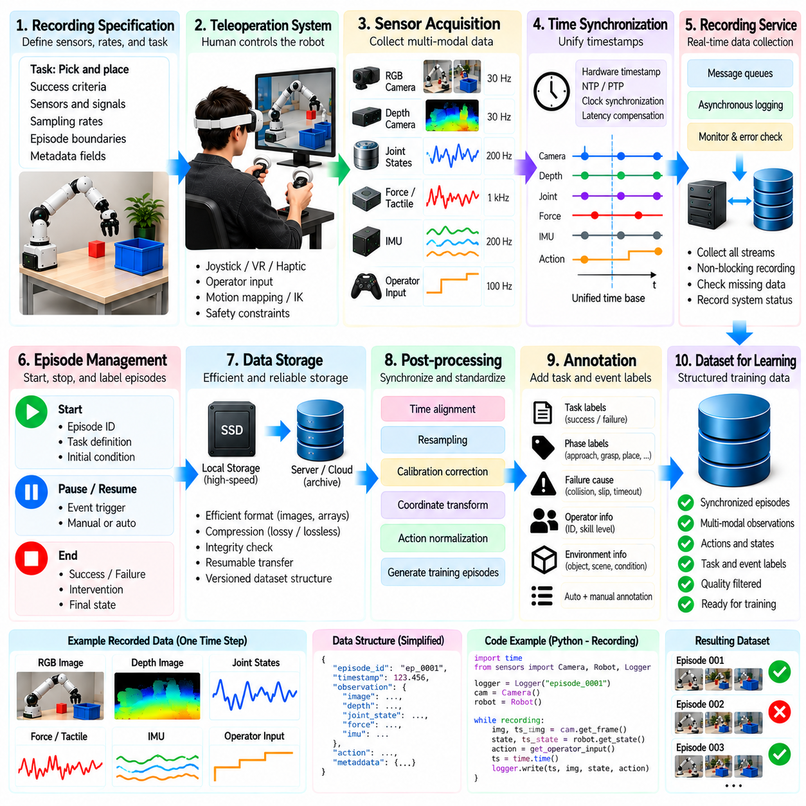{width="7.268055555555556in" height="7.268055555555556in"}

A teleoperation data recording pipeline transforms human-controlled robot activity into structured datasets suitable for Physical AI training. The pipeline must capture observations, operator commands, robot states, and task outcomes while preserving their temporal relationships. Reliable recording requires coordinated acquisition, synchronization, validation, storage, and quality control. Each stage contributes to the reproducibility and learning value of collected demonstrations.

The pipeline begins with a recording specification that defines required sensors, control signals, sampling rates, and episode boundaries. Camera images, depth measurements, joint positions, force readings, and operator inputs may be collected simultaneously. Task objectives and success criteria should also be documented. A consistent specification prevents different recording sessions from producing incompatible data representations.

Sensor acquisition modules connect individual devices to a common recording infrastructure. Each module receives measurements, attaches timestamps, and forwards data to a collection service. Devices may operate at different frequencies and communication rates. Acquisition software should preserve native measurement timing while monitoring packet loss, communication failures, and sensor availability throughout each demonstration.

Action recording must distinguish operator intention from commands executed by the robot. A joystick movement or virtual reality controller pose may first pass through motion mapping, inverse kinematics, and safety constraints. The resulting actuator commands can differ from the original input. Recording these stages enables learning systems to reconstruct control decisions and identify transformations introduced by the teleoperation architecture.

Time synchronization establishes a consistent relationship between asynchronous sensor and action streams. Hardware timestamps, synchronized device clocks, and communication latency measurements support accurate alignment. Raw timestamps should remain available even when data is resampled for training. This allows future processing pipelines to reconstruct the original sequence of events and investigate timing errors.

A central recording service aggregates sensor measurements and control messages without unnecessarily delaying robot operation. Real-time control loops should remain independent from expensive disk writing or data compression tasks. Asynchronous queues and bounded buffers can isolate recording workloads. Monitoring queue occupancy and dropped messages helps identify situations where acquisition exceeds available processing capacity.

Episode management determines when a demonstration begins, pauses, resumes, and ends. Each episode should contain a unique identifier, task definition, initial conditions, and completion status. Recording triggers may originate from an operator interface or automated task controller. Explicit episode boundaries prevent unrelated actions from being mixed into training sequences and simplify later dataset indexing.

Metadata provides the context needed to interpret recorded trajectories. Relevant fields include robot configuration, sensor calibration, software versions, operator identifiers, environment conditions, and control modes. Task-specific metadata may describe object properties or workspace arrangements. Structured metadata supports reproducibility, dataset filtering, and comparisons across collection sessions and robot platforms.

Data serialization converts acquired streams into persistent representations while retaining their original meaning. Images may use compressed formats, whereas numerical states and actions can be stored as structured arrays. Storage choices should balance fidelity, throughput, and accessibility. Versioned schemas and documented units prevent ambiguity when datasets are processed by different learning frameworks.

Storage architecture must accommodate high-bandwidth sensor streams and long recording sessions. Local solid-state storage can reduce dependence on network connectivity during collection. Completed episodes may subsequently be transferred to centralized repositories or object storage. Integrity checks and resumable transfers help prevent corrupted or incomplete recordings from entering the training dataset.

Compression reduces storage and transfer requirements but can alter information important for learning. Lossy image compression may remove subtle visual features, while aggressive temporal reduction can obscure contact events. Numerical measurements may require lossless preservation when precision is critical. Compression policies should therefore reflect task dynamics, sensor characteristics, and intended model requirements.

Quality validation should begin during acquisition rather than after an entire recording campaign. Automated checks can detect missing frames, invalid timestamps, disconnected sensors, and abnormal measurement ranges. Operator interfaces may display recording health indicators and warnings. Early detection allows defective sessions to be repeated before valuable environmental conditions or demonstration opportunities are lost.

Post-processing converts raw recordings into synchronized and standardized training episodes. Processing may include timestamp alignment, coordinate transformations, sensor calibration correction, and action normalization. Each transformation should be reproducible and documented. Preserving raw data separately from processed outputs allows improved algorithms to regenerate training datasets without repeating physical collection.

Annotation connects recorded behavior to task meaning and learning objectives. Episode labels may describe success, failure, corrective intervention, task phases, and unusual events. Some annotations can be generated automatically from controller states or task measurements. Human review remains necessary when outcomes depend on ambiguous visual evidence or complex physical interactions.

Dataset indexing enables efficient retrieval of demonstrations by task, robot, operator, environment, and quality attributes. Searchable metadata allows engineers to identify underrepresented conditions and construct balanced training subsets. Indexes should also reference recording locations and processing versions. This organization becomes increasingly important as data collection expands across multiple robots and facilities.

Privacy and security controls must protect sensitive information captured during teleoperation. Cameras may record people, confidential workspaces, or proprietary equipment. Operator identifiers and performance histories may also require protection. Access permissions, encryption, retention policies, and selective anonymization should be incorporated into the recording pipeline rather than added after deployment.

Operational reliability requires explicit handling of recording failures. Disk exhaustion, network interruptions, process crashes, and sensor resets can produce incomplete episodes. Transactional file writing, periodic checkpoints, and recovery logs reduce the risk of losing entire sessions. The system should clearly distinguish valid partial recordings from corrupted data that cannot support reliable training.

Scalable collection systems benefit from automated configuration and standardized deployment procedures. Robot-specific adapters can translate different hardware interfaces into a common dataset schema. Centralized configuration management helps maintain consistent sampling and metadata conventions. Automated diagnostics reduce operator workload and support repeatable recording quality across geographically distributed installations.

Pipeline performance should be measured using acquisition completeness, timestamp accuracy, recording throughput, storage efficiency, and episode acceptance rates. These indicators reveal whether infrastructure limitations are affecting dataset quality. Metrics should be monitored across individual sessions and longer collection campaigns. Quality trends can guide hardware upgrades, software optimization, and operational improvements.

Training dataset generation should preserve traceability between processed samples and their original demonstrations. Each training example should reference its source episode, preprocessing configuration, and annotation version. This lineage supports debugging when a learned policy exhibits unexpected behavior. It also allows engineers to remove defective source recordings and regenerate affected datasets systematically.

Integration with learning workflows closes the loop between teleoperation and autonomous policy improvement. Training results can identify tasks, states, or failure modes requiring additional demonstrations. These findings inform new recording campaigns and targeted operator interventions. The resulting feedback loop converts data collection from a one-time activity into a continuously improving engineering process.

A minimal implementation can begin with synchronized sensor capture, command logging, episode identifiers, and reliable local storage. Subsequent stages can introduce automated validation, metadata indexing, centralized repositories, and dataset versioning. This incremental approach limits early infrastructure complexity while preserving essential data integrity. Expansion should follow demonstrated learning needs and collection bottlenecks.

Ultimately, a teleoperation data recording pipeline is the operational foundation of demonstration-driven Physical AI development. Its value depends not only on recording large amounts of information but also on preserving timing, meaning, quality, and provenance. By integrating reliable acquisition, structured storage, automated validation, and learning feedback, the pipeline converts human robot interaction into reusable assets for scalable autonomous intelligence.

원격조작 데이터 기록 파이프라인(Teleoperation Data Recording Pipeline)은 인간이 제어하는 로봇 활동(Human-Controlled Robot Activity)을 피지컬 인공지능(Physical AI) 학습에 적합한 구조화된 데이터셋(Structured Dataset)으로 변환한다. 이 파이프라인은 관측 정보(Observation), 작업자 명령(Operator Command), 로봇 상태(Robot State), 작업 결과(Task Outcome)를 수집하면서 이들 사이의 시간적 관계(Temporal Relationship)를 보존해야 한다. 신뢰할 수 있는 기록(Reliable Recording)을 위해서는 조정된 데이터 획득(Coordinated Acquisition), 동기화(Synchronization), 검증(Validation), 저장(Storage), 품질 관리(Quality Control)가 필요하다. 각 단계는 수집된 시연(Demonstration)의 재현성(Reproducibility)과 학습 가치(Learning Value)에 기여한다.

파이프라인은 필요한 센서(Required Sensor), 제어 신호(Control Signal), 샘플링 속도(Sampling Rate), 에피소드 경계(Episode Boundary)를 정의하는 기록 명세(Recording Specification)에서 시작된다. 카메라 영상(Camera Image), 깊이 측정값(Depth Measurement), 관절 위치(Joint Position), 힘 측정값(Force Reading), 작업자 입력(Operator Input)을 동시에 수집할 수 있다. 작업 목표(Task Objective)와 성공 기준(Success Criteria)도 문서화해야 한다. 일관된 명세(Consistent Specification)는 서로 다른 기록 세션(Recording Session)에서 호환되지 않는 데이터 표현(Incompatible Data Representation)이 생성되는 문제를 방지한다.

센서 데이터 획득 모듈(Sensor Acquisition Module)은 개별 장치(Individual Device)를 공통 기록 인프라(Common Recording Infrastructure)에 연결한다. 각 모듈은 측정값(Measurement)을 수신하고 타임스탬프(Timestamp)를 부여한 다음 수집 서비스(Collection Service)로 데이터를 전달한다. 장치는 서로 다른 주파수(Frequency)와 통신 속도(Communication Rate)로 작동할 수 있다. 데이터 획득 소프트웨어(Acquisition Software)는 각 센서의 고유한 측정 시각(Native Measurement Timing)을 보존하면서 모든 시연 과정에서 패킷 손실(Packet Loss), 통신 장애(Communication Failure), 센서 가용성(Sensor Availability)을 모니터링해야 한다.

행동 기록(Action Recording)은 작업자 의도(Operator Intention)와 로봇이 실제로 실행한 명령(Executed Command)을 구분해야 한다. 조이스틱 움직임(Joystick Movement)이나 가상현실 제어기 자세(Virtual Reality Controller Pose)는 먼저 동작 매핑(Motion Mapping), 역기구학(Inverse Kinematics), 안전 제약(Safety Constraint)을 거칠 수 있다. 그 결과 생성된 구동기 명령(Actuator Command)은 원래 입력(Original Input)과 다를 수 있다. 이러한 단계를 기록하면 학습 시스템(Learning System)이 제어 의사결정(Control Decision)을 재구성하고 원격조작 아키텍처(Teleoperation Architecture)에 의해 도입된 변환(Transformation)을 식별할 수 있다.

시간 동기화(Time Synchronization)는 비동기 센서 및 행동 스트림(Asynchronous Sensor and Action Stream) 사이에 일관된 관계를 설정한다. 하드웨어 타임스탬프(Hardware Timestamp), 동기화된 장치 시계(Synchronized Device Clock), 통신 지연 측정(Communication Latency Measurement)은 정확한 시간 정렬(Accurate Alignment)을 지원한다. 학습을 위해 데이터를 재샘플링(Resampling)하더라도 원본 타임스탬프(Raw Timestamp)는 계속 사용할 수 있어야 한다. 이를 통해 향후 처리 파이프라인(Processing Pipeline)이 원래 이벤트 시퀀스(Original Event Sequence)를 재구성하고 시간 오차(Timing Error)를 조사할 수 있다.

중앙 기록 서비스(Central Recording Service)는 로봇 운용(Robot Operation)을 불필요하게 지연시키지 않으면서 센서 측정값(Sensor Measurement)과 제어 메시지(Control Message)를 통합한다. 실시간 제어 루프(Real-Time Control Loop)는 많은 자원을 소비하는 디스크 기록(Disk Writing)이나 데이터 압축(Data Compression) 작업과 독립적으로 유지되어야 한다. 비동기 큐(Asynchronous Queue)와 크기가 제한된 버퍼(Bounded Buffer)는 기록 작업 부하(Recording Workload)를 분리할 수 있다. 큐 점유율(Queue Occupancy)과 손실된 메시지(Dropped Message)를 모니터링하면 데이터 획득량(Acquisition Volume)이 사용 가능한 처리 용량(Processing Capacity)을 초과하는 상황을 식별하는 데 도움이 된다.

에피소드 관리(Episode Management)는 시연(Demonstration)이 언제 시작되고, 일시 정지되고, 재개되고, 종료되는지를 결정한다. 각 에피소드(Episode)에는 고유 식별자(Unique Identifier), 작업 정의(Task Definition), 초기 조건(Initial Condition), 완료 상태(Completion Status)가 포함되어야 한다. 기록 트리거(Recording Trigger)는 작업자 인터페이스(Operator Interface) 또는 자동화된 작업 제어기(Automated Task Controller)에서 발생할 수 있다. 명시적인 에피소드 경계(Explicit Episode Boundary)는 관련 없는 행동(Unrelated Action)이 학습 시퀀스(Training Sequence)에 혼합되는 문제를 방지하고 이후 데이터셋 인덱싱(Dataset Indexing)을 단순화한다.

메타데이터(Metadata)는 기록된 궤적(Recorded Trajectory)을 해석하는 데 필요한 맥락 정보(Context)를 제공한다. 관련 항목에는 로봇 구성(Robot Configuration), 센서 보정(Sensor Calibration), 소프트웨어 버전(Software Version), 작업자 식별자(Operator Identifier), 환경 조건(Environmental Condition), 제어 모드(Control Mode)가 포함된다. 작업별 메타데이터(Task-Specific Metadata)는 물체 특성(Object Property)이나 작업 공간 배치(Workspace Arrangement)를 설명할 수 있다. 구조화된 메타데이터(Structured Metadata)는 재현성(Reproducibility), 데이터셋 필터링(Dataset Filtering), 수집 세션과 로봇 플랫폼 간 비교(Comparison)를 지원한다.

데이터 직렬화(Data Serialization)는 수집된 스트림(Acquired Stream)을 원래 의미(Original Meaning)를 유지하면서 영구적인 데이터 표현(Persistent Representation)으로 변환한다. 영상(Image)은 압축 형식(Compressed Format)을 사용할 수 있으며, 수치 상태(Numerical State)와 행동(Action)은 구조화된 배열(Structured Array)로 저장할 수 있다. 저장 방식(Storage Choice)은 충실도(Fidelity), 처리량(Throughput), 접근성(Accessibility) 사이의 균형을 고려해야 한다. 버전 관리된 스키마(Versioned Schema)와 문서화된 단위(Documented Unit)는 서로 다른 학습 프레임워크(Learning Framework)에서 데이터셋을 처리할 때 발생할 수 있는 모호성(Ambiguity)을 방지한다.

저장 아키텍처(Storage Architecture)는 고대역폭 센서 스트림(High-Bandwidth Sensor Stream)과 장시간 기록 세션(Long Recording Session)을 수용할 수 있어야 한다. 로컬 솔리드 스테이트 저장장치(Local Solid-State Storage)는 데이터 수집 중 네트워크 연결(Network Connectivity)에 대한 의존도를 줄일 수 있다. 완료된 에피소드(Completed Episode)는 이후 중앙 저장소(Centralized Repository)나 객체 저장소(Object Storage)로 전송할 수 있다. 무결성 검사(Integrity Check)와 재개 가능한 전송(Resumable Transfer)은 손상되거나 불완전한 기록(Corrupted or Incomplete Recording)이 학습 데이터셋(Training Dataset)에 포함되는 문제를 방지하는 데 도움이 된다.

압축(Compression)은 저장 및 전송 요구사항(Storage and Transfer Requirement)을 줄이지만 학습에 중요한 정보(Important Information)를 변경할 수 있다. 손실 영상 압축(Lossy Image Compression)은 미세한 시각적 특징(Subtle Visual Feature)을 제거할 수 있으며, 과도한 시간 해상도 감소(Aggressive Temporal Reduction)는 접촉 이벤트(Contact Event)를 식별하기 어렵게 만들 수 있다. 정밀도(Precision)가 중요한 경우 수치 측정값(Numerical Measurement)은 무손실 보존(Lossless Preservation)이 필요할 수 있다. 따라서 압축 정책(Compression Policy)은 작업 동역학(Task Dynamics), 센서 특성(Sensor Characteristic), 의도된 모델 요구사항(Model Requirement)을 반영해야 한다.

품질 검증(Quality Validation)은 전체 기록 캠페인(Recording Campaign)이 완료된 이후가 아니라 데이터 획득(Acquisition) 과정에서 시작되어야 한다. 자동화된 검사(Automated Check)는 누락된 프레임(Missing Frame), 유효하지 않은 타임스탬프(Invalid Timestamp), 연결이 끊어진 센서(Disconnected Sensor), 비정상적인 측정 범위(Abnormal Measurement Range)를 감지할 수 있다. 작업자 인터페이스(Operator Interface)는 기록 상태 지표(Recording Health Indicator)와 경고(Warning)를 표시할 수 있다. 조기 감지(Early Detection)는 중요한 환경 조건(Environmental Condition)이나 시연 기회(Demonstration Opportunity)가 사라지기 전에 결함이 있는 세션(Defective Session)을 다시 수행할 수 있도록 한다.

후처리(Post-Processing)는 원시 기록(Raw Recording)을 동기화되고 표준화된 학습 에피소드(Synchronized and Standardized Training Episode)로 변환한다. 처리 과정에는 타임스탬프 정렬(Timestamp Alignment), 좌표 변환(Coordinate Transformation), 센서 보정값 수정(Sensor Calibration Correction), 행동 정규화(Action Normalization)가 포함될 수 있다. 각 변환(Transformation)은 재현 가능(Reproducible)해야 하며 문서화되어야 한다. 원시 데이터(Raw Data)를 처리된 출력(Processed Output)과 별도로 보존하면 물리적 데이터 수집(Physical Collection)을 반복하지 않고도 개선된 알고리즘(Improved Algorithm)으로 학습 데이터셋을 다시 생성할 수 있다.

주석(Annotation)은 기록된 행동(Recorded Behavior)을 작업 의미(Task Meaning)와 학습 목표(Learning Objective)에 연결한다. 에피소드 라벨(Episode Label)은 성공(Success), 실패(Failure), 교정 개입(Corrective Intervention), 작업 단계(Task Phase), 비정상 이벤트(Unusual Event)를 설명할 수 있다. 일부 주석은 제어기 상태(Controller State)나 작업 측정값(Task Measurement)을 통해 자동으로 생성할 수 있다. 결과(Outcome)가 모호한 시각적 증거(Ambiguous Visual Evidence)나 복잡한 물리적 상호작용(Complex Physical Interaction)에 의존하는 경우에는 인간 검토(Human Review)가 여전히 필요하다.

데이터셋 인덱싱(Dataset Indexing)은 작업(Task), 로봇(Robot), 작업자(Operator), 환경(Environment), 품질 속성(Quality Attribute)에 따라 시연(Demonstration)을 효율적으로 검색할 수 있도록 한다. 검색 가능한 메타데이터(Searchable Metadata)를 활용하면 엔지니어가 충분히 대표되지 않은 조건(Underrepresented Condition)을 식별하고 균형 잡힌 학습 부분집합(Balanced Training Subset)을 구성할 수 있다. 인덱스(Index)는 기록 위치(Recording Location)와 처리 버전(Processing Version)도 참조해야 한다. 이러한 체계화(Organization)는 여러 로봇과 시설(Facility)로 데이터 수집이 확장될수록 더욱 중요해진다.

개인정보 보호 및 보안 제어(Privacy and Security Control)는 원격조작(Teleoperation) 중 수집되는 민감한 정보(Sensitive Information)를 보호해야 한다. 카메라(Camera)는 사람(People), 기밀 작업 공간(Confidential Workspace), 독점 장비(Proprietary Equipment)를 기록할 수 있다. 작업자 식별자(Operator Identifier)와 성능 이력(Performance History)도 보호가 필요할 수 있다. 접근 권한(Access Permission), 암호화(Encryption), 보존 정책(Retention Policy), 선택적 익명화(Selective Anonymization)는 배포(Deployment) 이후에 추가하기보다 기록 파이프라인(Recording Pipeline)에 처음부터 통합해야 한다.

운용 신뢰성(Operational Reliability)을 확보하려면 기록 실패(Recording Failure)를 명시적으로 처리해야 한다. 디스크 용량 부족(Disk Exhaustion), 네트워크 중단(Network Interruption), 프로세스 충돌(Process Crash), 센서 재설정(Sensor Reset)은 불완전한 에피소드(Incomplete Episode)를 생성할 수 있다. 트랜잭션 기반 파일 기록(Transactional File Writing), 주기적인 체크포인트(Periodic Checkpoint), 복구 로그(Recovery Log)는 전체 세션(Entire Session)을 손실할 위험을 줄인다. 시스템은 유효한 부분 기록(Valid Partial Recording)과 신뢰할 수 있는 학습에 사용할 수 없는 손상 데이터(Corrupted Data)를 명확하게 구분해야 한다.

확장 가능한 데이터 수집 시스템(Scalable Collection System)은 자동화된 구성(Automated Configuration)과 표준화된 배포 절차(Standardized Deployment Procedure)를 통해 이점을 얻는다. 로봇별 어댑터(Robot-Specific Adapter)는 서로 다른 하드웨어 인터페이스(Hardware Interface)를 공통 데이터셋 스키마(Common Dataset Schema)로 변환할 수 있다. 중앙 집중식 구성 관리(Centralized Configuration Management)는 일관된 샘플링(Sampling)과 메타데이터 규약(Metadata Convention)을 유지하는 데 도움이 된다. 자동화된 진단(Automated Diagnostics)은 작업자 부담(Operator Workload)을 줄이고 지리적으로 분산된 설치 환경(Geographically Distributed Installation) 전반에서 반복 가능한 기록 품질(Repeatable Recording Quality)을 지원한다.

파이프라인 성능(Pipeline Performance)은 데이터 획득 완전성(Acquisition Completeness), 타임스탬프 정확도(Timestamp Accuracy), 기록 처리량(Recording Throughput), 저장 효율성(Storage Efficiency), 에피소드 수용률(Episode Acceptance Rate)을 사용하여 측정해야 한다. 이러한 지표(Indicator)는 인프라 한계(Infrastructure Limitation)가 데이터셋 품질(Dataset Quality)에 영향을 미치는지 보여준다. 지표는 개별 세션(Individual Session)과 장기간 수집 캠페인(Longer Collection Campaign) 모두에서 모니터링해야 한다. 품질 추세(Quality Trend)는 하드웨어 업그레이드(Hardware Upgrade), 소프트웨어 최적화(Software Optimization), 운용 개선(Operational Improvement)의 방향을 제시할 수 있다.

학습 데이터셋 생성(Training Dataset Generation)은 처리된 샘플(Processed Sample)과 원본 시연(Original Demonstration) 사이의 추적 가능성(Traceability)을 보존해야 한다. 각 학습 사례(Training Example)는 원본 에피소드(Source Episode), 전처리 구성(Preprocessing Configuration), 주석 버전(Annotation Version)을 참조해야 한다. 이러한 데이터 계보(Data Lineage)는 학습된 정책(Learned Policy)이 예상하지 못한 행동(Unexpected Behavior)을 보일 때 디버깅(Debugging)을 지원한다. 또한 엔지니어가 결함이 있는 원본 기록(Defective Source Recording)을 제거하고 영향을 받은 데이터셋(Affected Dataset)을 체계적으로 다시 생성할 수 있도록 한다.

학습 워크플로(Training Workflow)와의 통합(Integration)은 원격조작(Teleoperation)과 자율 정책 개선(Autonomous Policy Improvement) 사이의 피드백 루프(Feedback Loop)를 완성한다. 학습 결과(Training Result)는 추가적인 시연(Additional Demonstration)이 필요한 작업(Task), 상태(State), 실패 유형(Failure Mode)을 식별할 수 있다. 이러한 결과는 새로운 기록 캠페인(Recording Campaign)과 표적 작업자 개입(Targeted Operator Intervention)을 계획하는 데 활용된다. 그 결과 형성되는 피드백 루프는 데이터 수집(Data Collection)을 일회성 활동(One-Time Activity)에서 지속적으로 개선되는 엔지니어링 프로세스(Continuously Improving Engineering Process)로 전환한다.

최소 구현(Minimal Implementation)은 동기화된 센서 데이터 수집(Synchronized Sensor Capture), 명령 로깅(Command Logging), 에피소드 식별자(Episode Identifier), 신뢰할 수 있는 로컬 저장소(Reliable Local Storage)로 시작할 수 있다. 이후 단계에서는 자동화된 검증(Automated Validation), 메타데이터 인덱싱(Metadata Indexing), 중앙 저장소(Centralized Repository), 데이터셋 버전 관리(Dataset Versioning)를 도입할 수 있다. 이러한 점진적 접근 방식(Incremental Approach)은 필수적인 데이터 무결성(Data Integrity)을 유지하면서 초기 인프라 복잡성(Infrastructure Complexity)을 제한한다. 시스템 확장(Expansion)은 확인된 학습 요구사항(Learning Need)과 데이터 수집 병목 현상(Collection Bottleneck)에 따라 진행되어야 한다.

궁극적으로 원격조작 데이터 기록 파이프라인(Teleoperation Data Recording Pipeline)은 시연 기반 피지컬 인공지능 개발(Demonstration-Driven Physical AI Development)의 운용 기반(Operational Foundation)이다. 그 가치는 대량의 정보(Large Amounts of Information)를 기록하는 것뿐 아니라 시간 정보(Timing), 의미(Meaning), 품질(Quality), 데이터 출처(Provenance)를 보존하는 데 달려 있다. 신뢰할 수 있는 데이터 획득(Reliable Acquisition), 구조화된 저장(Structured Storage), 자동화된 검증(Automated Validation), 학습 피드백(Learning Feedback)을 통합함으로써 이 파이프라인은 인간과 로봇의 상호작용(Human-Robot Interaction)을 확장 가능한 자율 지능(Scalable Autonomous Intelligence)을 위한 재사용 가능한 자산(Reusable Asset)으로 변환한다.
