**Volume 04. Data Engines and Scaling for Physical AI**

# Chapter 03. Human Video Data

## 03.01. Human Video as Embodied Knowledge

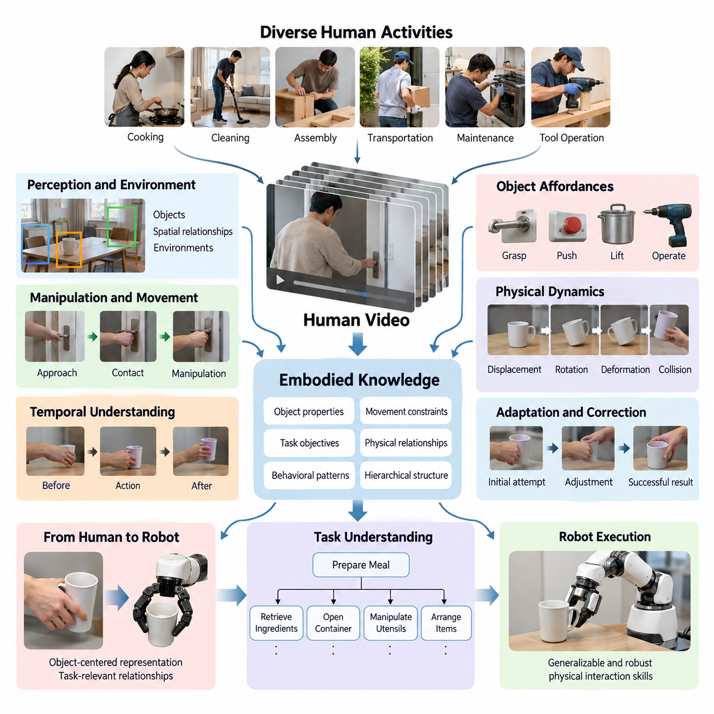{width="7.268055555555556in" height="7.268055555555556in"}

인간 영상 데이터(Human Video Data)는 인간이 환경을 인식하고, 물체를 조작하며, 움직임을 조정하고, 실제 목표를 달성하는 과정을 기록하기 때문에 피지컬 인공지능(Physical AI)을 위한 가장 풍부한 체화 지식(Embodied Knowledge)의 원천 중 하나이다. 정적인 이미지(Static Image)나 기호적 명령(Symbolic Instruction)과 달리 영상은 인식(Perception), 행동(Action), 환경 변화(Environmental Change) 사이의 시간적 관계(Temporal Relationship)를 보존하여 물리적 세계에서 지능적 행동이 어떻게 전개되는지 보여준다.

체화 지식(Embodied Knowledge)은 추상적인 설명만으로 습득하는 것이 아니라 환경과의 상호작용(Interaction)을 통해 획득하는 실용적 이해를 의미한다. 인간의 활동에는 물체의 특성(Object Properties), 공간적 관계(Spatial Relationships), 운동 제약(Motion Constraints), 작업 목표(Task Objectives)에 관한 암묵적 정보가 포함되어 있다. 영상 기록은 이러한 지식의 관찰 가능한 측면을 보존하여 모든 물리적 상호작용을 명시적으로 프로그래밍하지 않고도 학습 시스템(Learning System)이 행동 패턴(Behavioral Patterns)을 발견하도록 지원한다.

사람이 문을 여는 행동은 단순히 눈에 보이는 움직임의 연속 이상을 보여준다. 이 활동에는 손잡이에 접근하는 방법, 접촉이 발생하는 위치, 물체가 움직이는 방식, 문이 열리는 동안 행동을 조정하는 과정이 포함된다. 힘(Force)과 의도(Intention)를 직접 관찰할 수 없더라도 시간적으로 연결된 시각적 증거(Temporal Visual Evidence)는 성공적인 상호작용을 지배하는 물리적 관계(Physical Relationships)를 이해하는 데 유용한 단서를 제공한다.

인간 영상 데이터(Human Video Data)가 특히 중요한 이유는 일상적인 인간 활동이 매우 다양한 작업(Task), 환경(Environment), 물체(Object), 상호작용 방식(Interaction Styles)을 포함하기 때문이다. 요리, 청소, 조립, 운송, 유지보수, 도구 조작은 구조화된 물리적 행동(Structured Physical Behavior)의 사례를 제공한다. 이러한 다양성은 피지컬 인공지능(Physical AI) 시스템이 제한적인 로봇 시연(Robot Demonstration)과 통제된 실험실 환경을 넘어 일반화(Generalization)할 수 있는 표현(Representation)을 학습하도록 지원한다.

전통적인 로봇 학습(Robot Learning)은 특수한 로봇 하드웨어(Robotic Hardware)를 사용하여 수집한 시연 데이터(Demonstration Data)에 의존하는 경우가 많다. 이러한 시연은 정확한 관측값(Observations)과 행동 측정값(Action Measurements)을 제공하지만 대규모 수집에는 상당한 비용이 발생한다. 인간 영상은 기존 영상 기록이나 전용 촬영 시스템(Capture System)에서 수집할 수 있는 보완적인 경험 데이터로서, 동일한 수준의 로봇 운용 없이도 학습 데이터의 범위를 확대할 가능성을 제공한다.

인간 영상과 기존 로봇 궤적 데이터(Robot Trajectory Data)의 핵심적인 차이는 행동 정보(Action Information)의 가용성에 있다. 로봇 시연에는 관절 위치(Joint Positions), 액추에이터 명령(Actuator Commands), 힘(Forces), 동기화된 센서 측정값(Synchronized Sensor Measurements)이 포함될 수 있다. 반면 일반 영상은 주로 움직임의 가시적인 결과를 기록하므로 학습 알고리즘(Learning Algorithms)은 불완전한 관측으로부터 숨겨진 행동, 접촉 사건(Contact Events), 물리적 상태(Physical States)를 추론해야 한다.

따라서 체화 지식(Embodied Knowledge)을 추출하려면 단순한 물체 인식(Object Recognition)이나 활동 분류(Activity Classification) 이상의 기술이 필요하다. 학습 시스템은 시간에 따라 변화하는 행위자(Agent), 물체(Object), 환경 변화 사이의 관계를 식별해야 한다. 또한 의미 있는 물리적 효과를 발생시키는 행동과 부수적인 움직임을 구별하고, 중간 상호작용이 최종 작업 결과(Task Outcome)에 어떻게 기여하는지 이해해야 한다.

시간적 연속성(Temporal Continuity)은 개별 영상 프레임(Frame)만으로 행동의 전체 의미를 설명하기 어렵기 때문에 필수적이다. 컵에 접근하는 손의 움직임은 파지(Grasping), 위치 변경(Repositioning), 액체를 따르기 위한 준비를 의미할 수 있다. 이전과 이후 프레임을 함께 관찰하면 이러한 모호성(Ambiguity)을 줄일 수 있다. 영상 모델(Video Model)은 시간적 문맥(Temporal Context)을 활용하여 행동 경계(Action Boundaries)를 추정하고, 가능한 목표를 추론하며, 성공적인 조작과 관련된 변화를 식별할 수 있다.

인간 시연(Human Demonstration)은 물리적 작업의 계층적 구성(Hierarchical Organization)도 보여준다. 식사 준비에는 재료 가져오기, 용기 열기, 조리도구 조작, 완성된 음식 배치하기 등의 활동이 포함될 수 있다. 각각의 활동은 의존 관계(Dependencies)와 목표(Goals)로 연결된 작은 행동들로 구성된다. 이러한 관계를 학습하면 복잡한 목표를 관리 가능한 행동 순서(Behavioral Sequences)로 분해하는 작업 계획(Task Planning)을 지원할 수 있다.

인간 영상의 또 다른 중요한 기여는 물체의 행동 유도성(Affordance)을 표현할 수 있다는 점이다. 행동 유도성은 특정 조건에서 행위자(Agent)와 물체(Object) 사이에 가능한 상호작용을 의미한다. 사람이 손잡이를 잡거나, 버튼을 누르거나, 용기를 들어 올리거나, 도구를 사용하는 장면을 반복적으로 관찰하면 학습 시스템은 물체의 시각적 특징(Visual Features)을 가능한 행동 및 관찰 가능한 결과와 연결할 수 있다.

영상은 물리적 동역학(Physical Dynamics)에 관한 간접적인 증거도 제공한다. 물체의 변위(Displacement), 변형(Deformation), 회전(Rotation), 충돌(Collision)은 환경이 상호작용에 어떻게 반응하는지를 보여준다. 충분히 다양한 영상 시퀀스(Video Sequences)로 학습한 모델은 운동과 접촉에 관한 통계적 규칙성을 학습할 수 있지만, 질량(Mass), 마찰(Friction), 힘(Force)과 같은 숨겨진 물리적 특성을 신뢰성 있게 추정하려면 일반적으로 추가적인 가정이나 측정이 필요하다.

인간 행동은 환경 조건이 변화할 때 적응하는 방법을 보여준다. 물체가 미끄러지면 파지 위치(Grip Position)를 조정하고, 장애물이 나타나면 이동 방향을 변경하며, 작업이 실패하면 동작을 반복할 수 있다. 이러한 관측은 강건한 피지컬 인공지능(Robust Physical AI)이 성공적인 작업의 이상적인 시연만 학습하는 것이 아니라 수정 행동(Corrective Behavior)을 이해해야 한다는 점에서 중요하다.

인간의 신체 구조(Human Embodiment)와 로봇의 신체 구조(Robot Embodiment) 사이의 관계는 근본적인 기술적 과제를 발생시킨다. 인간의 손, 팔, 관절, 감각 시스템(Sensory Systems)은 로봇 매니퓰레이터(Robotic Manipulator) 및 이동 플랫폼(Mobile Platform)과 다르다. 따라서 영상에서 관찰한 인간의 움직임을 항상 실행 가능한 로봇 명령(Robot Commands)으로 직접 변환할 수는 없다. 효과적인 전이(Transfer)를 위해서는 서로 다른 물리적 구조에서도 의미를 유지하는 작업 관련 관계를 식별해야 한다.

물체 중심 표현(Object-Centered Representation)은 이러한 신체 구조 차이(Embodiment Gap)를 줄이는 접근 방법 중 하나이다. 로봇은 인간 손의 정확한 궤적(Trajectory)을 재현하는 대신, 물체를 접근 가능한 위치에서 파지하고 목표 자세(Target Configuration)로 이동해야 한다는 사실을 학습할 수 있다. 이러한 접근은 학습 목표를 해부학적 모방(Anatomical Imitation)에서 로봇 자체의 능력 안에서 동등한 물리적 결과(Physical Outcomes)를 달성하는 방향으로 전환한다.

공간적 표현(Spatial Representation)은 물체 자세(Object Pose), 상대 위치(Relative Position), 운동 궤적(Motion Trajectory), 접촉 관계(Contact Relationships)를 기술하여 이러한 전이를 추가로 지원한다. 컴퓨터 비전(Computer Vision) 기술은 영상으로부터 인체 주요 지점(Body Landmarks), 손의 구성(Hand Configuration), 물체 움직임을 추정할 수 있다. 그러나 가림 현상(Occlusion), 카메라 움직임(Camera Motion), 원근 왜곡(Perspective Distortion), 제한된 깊이 정보(Depth Information)는 로봇 학습 신호(Training Signals)로 변환할 때 고려해야 할 불확실성(Uncertainty)을 발생시킨다.

인간 영상은 연속된 프레임 사이에 자연스럽게 형성되는 관측 관계를 포함하므로 자기지도학습(Self-Supervised Learning)을 지원할 수 있다. 모델은 미래의 시각적 특징(Future Visual Features)을 예측하거나, 시간적 일관성(Temporal Consistency)을 식별하거나, 관련된 행동 시퀀스의 표현을 비교하면서 학습할 수 있다. 이러한 학습 목표는 모든 영상 활동에 상세한 수동 주석(Manual Annotation)을 부여하지 않고도 유용한 시각적·시간적 표현(Visual and Temporal Representations)을 생성할 수 있다.

언어(Language)는 체화 영상 표현(Embodied Video Representation)의 접근성과 전이 가능성을 높일 수 있다. 물체를 선반에 올려놓거나 체결 부품을 조이는 것과 같은 설명은 시각적 행동을 의미론적 작업 목표(Semantic Task Objectives)와 연결한다. 언어와 영상이 정렬(Alignment)되면 모델은 명령어를 관찰 가능한 행동 시퀀스와 연관시킬 수 있으며, 이는 비전-언어 시스템(Vision-Language Systems)의 개발과 비전-언어-행동 구조(Vision-Language-Action Architectures)의 발전에 기여할 수 있다.

그러나 영상에서 작업을 인식하는 능력이 해당 작업을 실행하는 운동 기술(Motor Skills)을 보유한다는 의미는 아니다. 모델은 용기를 들어 올려야 한다는 사실을 이해하더라도 적절한 파지력(Grip Force), 액추에이터 궤적(Actuator Trajectory), 안정성 제약(Stability Constraints)을 알지 못할 수 있다. 따라서 인간 영상은 유용한 사전 지식(Prior Knowledge)을 제공하지만 신뢰성 있는 실행을 위해서는 로봇 전용 시연(Robot-Specific Demonstrations), 상호작용 데이터(Interaction Data), 시뮬레이션(Simulation)이 추가로 필요할 수 있다.

영상 데이터 품질(Video Data Quality)은 학습된 표현의 유용성에 큰 영향을 미친다. 손, 물체, 접촉 영역(Contact Regions), 작업 결과(Task Outcomes)가 명확하게 보이면 상호작용 정보의 추출 성능이 향상된다. 카메라 배치(Camera Placement), 프레임 속도(Frame Rate), 조명(Lighting), 움직임 흐림(Motion Blur), 시간적 완전성(Temporal Completeness)은 모두 추론된 행동의 신뢰성에 영향을 준다. 중요한 상호작용 단계를 누락한 영상은 오해를 유발하거나 불충분한 증거를 제공할 수 있다.

데이터의 다양성(Diversity)은 관련성(Relevance)과 균형을 이루어야 한다. 대규모 영상 집합에는 반복적인 활동, 관련 없는 장면, 편집으로 인한 왜곡(Editing Artifacts), 로봇 실행에 적합하지 않은 시연이 포함될 수 있다. 실용적인 데이터 엔진(Data Engine)은 의미 있는 상호작용, 다양한 물체 구성(Object Configurations), 서로 다른 작업 전략(Task Strategies), 관찰 가능한 결과를 보여주는 영상을 우선적으로 선택하면서 어렵거나 실패한 행동의 대표적인 사례도 보존해야 한다.

인간 영상은 개인정보 보호(Privacy), 동의(Consent), 소유권(Ownership), 데이터 출처(Data Provenance)에 관한 추가적인 문제를 발생시킨다. 영상에는 개인의 신원, 작업장, 기밀 절차(Confidential Procedures), 민감한 환경이 드러날 수 있다. 책임 있는 데이터 수집(Responsible Data Collection)을 위해서는 적절한 사용 권한(Usage Rights), 접근 제어(Access Controls), 개인정보 보호 조치(Privacy Protection)가 필요하다. 이러한 고려 사항은 대규모 영상 데이터셋(Video Datasets)을 상업적인 피지컬 인공지능 학습 파이프라인(Training Pipelines)에 통합할수록 더욱 중요해진다.

피지컬 인공지능 데이터 엔진(Physical AI Data Engine)에서 인간 영상은 보완적인 데이터 원천(Data Sources)과 결합할 때 가장 효과적이다. 원격조작(Teleoperation)은 로봇 전용 행동 궤적(Robot-Specific Action Trajectories)을 제공하고, 시뮬레이션(Simulation)은 통제된 물리적 상호작용을 제공하며, 현장에 배치된 로봇(Deployed Robots)은 실제 운용 경험(Operational Experience)을 생성한다. 인간 영상은 광범위한 행동 범위(Behavioral Coverage)와 작업 지식(Task Knowledge)을 제공하여 특정 로봇 신체 구조에 적응하기 전 표현 학습(Representation Learning)의 기회를 확대한다.

인간 영상의 장기적인 중요성은 인간 활동에 대한 대규모 관측을 물리적 상호작용이 가능한 기계학습 시스템(Machine Learning Systems)과 연결할 수 있는 잠재력에 있다. 작업 구조(Task Structure), 물체의 행동 유도성(Object Affordances), 시간적 의존 관계(Temporal Dependencies), 관찰 가능한 행동 결과(Action Outcomes)를 추출함으로써 피지컬 인공지능(Physical AI)은 유용한 체화 사전 지식(Embodied Priors)을 획득할 수 있다. 이러한 사전 지식을 신뢰성 있는 로봇 행동(Robot Behavior)으로 전환하는 것은 확장 가능한 체화 지능(Scalable Embodied Intelligence)의 핵심 과제로 남아 있다.

## 03.02. Egocentric and Exocentric Video

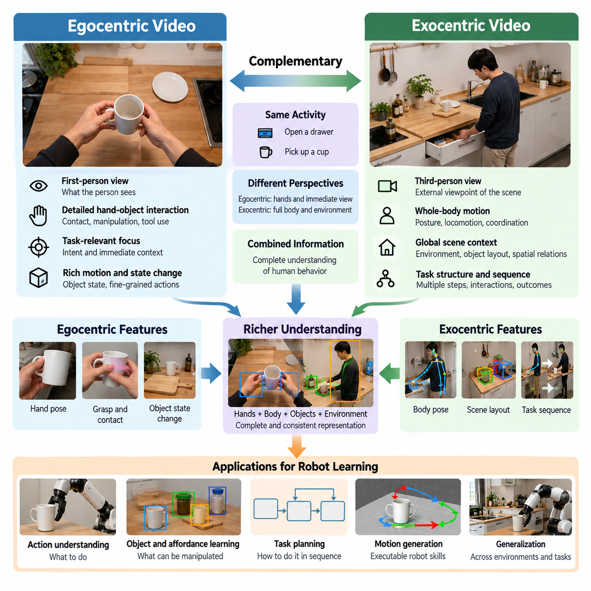{width="7.268055555555556in" height="7.268055555555556in"}

자기중심 영상(Egocentric Video)과 외부 관찰 영상(Exocentric Video)은 인간 행동을 기록하고 피지컬 인공지능(Physical AI)을 위한 체화 지식(Embodied Knowledge)을 추출하는 두 가지 상호 보완적인 관점을 나타낸다. 자기중심 영상은 작업을 수행하는 사람의 시점(Viewpoint)에서 활동을 기록하는 반면, 외부 관찰 영상은 외부 카메라(External Camera)를 통해 사람의 행동을 관찰한다. 이러한 관점은 인식(Perception), 움직임(Movement), 물체 상호작용(Object Interaction), 환경적 맥락(Environmental Context)에 관한 서로 다른 정보를 제공한다.

자기중심 영상(Egocentric Video)은 일반적으로 머리 장착형 카메라(Head-Mounted Camera), 웨어러블 장치(Wearable Device), 작업자의 눈 근처에 배치된 카메라를 사용하여 수집한다. 이러한 시점은 작업 수행 중 사람이 이용할 수 있는 시각 정보(Visual Information)를 근사적으로 재현하며, 주변 물체, 손의 움직임, 변화하는 공간적 관계(Spatial Relationships)를 포함한다. 따라서 행위자(Agent)가 주변 환경을 어떻게 관찰하고 상호작용하는지 이해하는 데 특히 유용하다.

자기중심 영상의 주요 장점은 행동 지향적 인식(Action-Oriented Perception)과 밀접하게 연결된다는 점이다. 사람이 물체를 향해 손을 뻗으면 카메라는 목표 물체(Target Object), 접근하는 손, 이후의 조작 과정(Manipulation Process)을 연속적으로 기록하는 경우가 많다. 이러한 시각적 시퀀스(Visual Sequence)는 학습 시스템(Learning System)이 관측 정보(Observations)를 작업 진행 상태(Task Progress) 및 가능한 행동(Potential Actions)과 연결하도록 지원하며, 로봇 제어(Robot Control)에 적합한 표현(Representation)의 개발에 기여한다.

자기중심 영상은 시각적 주의(Visual Attention)와 신체 움직임(Body Movement)이 작업 수행에 미치는 영향도 보여준다. 머리 회전(Head Rotation), 시점 변화(Viewpoint Changes), 물체 중심 카메라 움직임(Object-Centered Camera Motion)은 작업자의 주의 집중 대상에 관한 간접적인 증거를 제공한다. 그러나 카메라 방향(Camera Orientation)이 정확한 시선(Eye Gaze)을 의미하는 것은 아니므로 시선 추적 센서(Eye-Tracking Sensors)의 추가 측정값이 없다면 주의 상태를 신중하게 추론해야 한다.

외부 관찰 영상(Exocentric Video)은 작업을 수행하는 행위자(Agent)의 외부에 배치된 카메라로 인간 활동을 기록한다. 고정형 카메라(Fixed Camera), 이동형 관찰 시스템(Mobile Observation System), 다중 카메라 설치 시스템(Multi-Camera Installation)은 넓은 환경에서 전신 움직임(Whole-Body Movement)과 상호작용을 기록할 수 있다. 이러한 관점은 자세(Posture), 이동 운동(Locomotion), 작업 공간 구성(Workspace Organization), 사람과 물체 및 주변 구조물 사이의 관계에 관한 정보를 제공한다.

외부 관찰 영상의 가장 큰 강점은 외부 공간 기준 좌표계(External Spatial Reference Frame)에서 움직임을 기술할 수 있다는 점이다. 관찰자는 환경을 기준으로 신체 위치(Body Position), 사지 궤적(Limb Trajectories), 물체 변위(Object Displacement)를 추적할 수 있다. 이러한 관측은 운동 패턴(Motion Patterns)을 학습하고 작업 수행 과정을 분석하며, 로봇 조작(Robotic Manipulation)과 자율주행(Navigation)을 지원하는 표현을 구성하는 데 유용하다.

외부 관찰 영상은 특히 전신 협응 행동(Coordinated Whole-Body Behavior)을 이해하는 데 유용하다. 걷기(Walking), 들어 올리기(Lifting), 운반(Carrying), 손 뻗기(Reaching), 협력 조작(Collaborative Manipulation)은 여러 신체 부위(Body Segments) 사이의 관계를 포함한다. 외부 시점은 이러한 관계를 머리 장착형 카메라보다 명확하게 보여줄 수 있지만, 실제 가시성(Visibility)은 카메라 배치(Camera Placement), 장면 기하 구조(Scene Geometry), 가림 현상(Occlusion)에 따라 달라진다.

두 관점은 가림 현상(Occlusion)과 가시성(Visibility)을 처리하는 방식에서 상당한 차이를 보인다. 자기중심 카메라는 가까운 거리의 정밀 조작(Fine Manipulation)을 상세하게 기록할 수 있지만, 작업자의 신체나 현재 시야(Field of View) 밖에 있는 물체를 놓치는 경우가 많다. 외부 관찰 카메라는 더 넓은 움직임 패턴을 관찰할 수 있지만, 손이나 도구가 다른 물체 뒤에 가려지면 작은 접촉 영역(Contact Regions)을 포착하지 못할 수 있다.

카메라 움직임(Camera Motion)은 두 관점을 구분하는 또 다른 중요한 요소이다. 자기중심 영상은 머리와 신체 움직임으로 인한 빠른 시점 변화를 포함하는 경우가 많으며, 이로 인해 움직임 흐림(Motion Blur)과 불안정한 이미지 좌표(Image Coordinates)가 발생한다. 외부 관찰 카메라는 고정된 위치에 설치할 경우 더욱 일관된 시각적 기준(Visual References)을 제공할 수 있다. 그러나 이동하는 외부 카메라도 기하학적 재구성(Geometric Reconstruction) 과정에서 카메라 움직임 보정(Camera Motion Compensation)이 필요하다.

로봇 학습(Robot Learning)에서 자기중심 영상은 일인칭 시각 정책(First-Person Visual Policies)과 자연스럽게 연결된다. 온보드 카메라(Onboard Camera)를 장착한 로봇도 자신의 물리적 구성(Physical Configuration)과 연결된 시점에서 환경을 관찰한다. 카메라 높이(Camera Height), 시야각(Field of View), 신체 구조(Embodiment)가 서로 다르더라도 인간의 일인칭 영상은 시각적 표현(Visual Representations)과 작업 조건부 행동(Task-Conditioned Behavior)을 학습하는 데 유용한 사례를 제공할 수 있다.

외부 관찰 영상은 시연자의 정확한 감각 경험(Sensory Experience)보다 외부에서 측정 가능한 행동(Externally Measurable Behavior)을 강조함으로써 관찰 기반 학습(Learning from Observation)을 지원한다. 로봇은 사람이 물체를 한 위치에서 다른 위치로 이동시키는 과정을 관찰하고 의도된 변환(Intended Transformation)을 추론할 수 있다. 이러한 접근은 로봇의 카메라 배치가 인간 시연자의 시점과 크게 다를 때 특히 유용하다.

자기중심 영상과 외부 관찰 영상을 결합하면 어느 한 관점만 사용할 때 발생하는 모호성(Ambiguity)을 줄일 수 있다. 머리 장착형 카메라는 파지 상호작용(Grasping Interaction)을 명확하게 보여주는 반면, 외부 카메라는 팔의 구성(Arm Configuration)과 주변 작업 공간(Workspace)을 기록할 수 있다. 이러한 관측을 결합하면 국소 접촉(Local Contact), 전체 움직임(Global Movement), 작업 진행 과정(Task Progression)에 관한 상호 보완적인 증거를 확보할 수 있다.

다중 시점 기록 시스템(Multi-View Recording System)은 대응되는 관측 사이의 관계를 유지하기 위해 정밀한 시간 동기화(Temporal Synchronization)가 필요하다. 카메라 타임스탬프(Camera Timestamps), 프레임 속도(Frame Rates), 기록 지연(Recording Delays)은 시각 정보를 통합하기 전에 정렬되어야 한다. 동기화가 이루어지지 않으면 동일한 물리적 사건(Physical Event)이 서로 다른 기록에서 다른 시간에 나타나 움직임, 접촉, 행동 경계(Action Boundaries)에 대한 부정확한 추정이 발생할 수 있다.

여러 관점을 결합할 때 공간 보정(Spatial Calibration)도 중요하다. 카메라 내부 파라미터(Camera Intrinsics)는 영상 형성(Image Formation)을 설명하고, 외부 파라미터(Extrinsic Parameters)는 기준 좌표계(Reference Frame)에 대한 카메라 위치와 방향을 설명한다. 정확한 보정(Calibration)은 서로 다른 시점의 관측을 기하학적으로 연결하여 3차원 재구성(Three-Dimensional Reconstruction), 물체 추적(Object Tracking), 인간 동작 분석(Human Motion Analysis)을 지원한다.

3차원 이해(Three-Dimensional Understanding)는 자기중심 관측과 외부 관찰 관측의 상호 보완적인 기하학적 정보(Complementary Geometry)를 통해 향상될 수 있다. 다중 시점(Multiple Viewpoints)은 깊이 모호성(Depth Ambiguity)을 줄여 물체 자세(Object Pose), 손 위치(Hand Position), 움직임 궤적(Movement Trajectories)의 추정 정확도를 개선할 수 있다. 그러나 신뢰성 있는 재구성은 여전히 영상 품질(Image Quality), 카메라 보정(Camera Calibration), 시간 정렬(Temporal Alignment), 관련 장면 특징(Scene Features)의 가시성에 의존한다.

자기중심 데이터셋(Egocentric Dataset)과 외부 관찰 데이터셋(Exocentric Dataset)은 행동 인식(Action Recognition)과 작업 분할(Task Segmentation)에 대한 적합성에서도 차이를 보인다. 일인칭 영상은 상호작용 대상(Interaction Targets)과 국소 조작 사건(Local Manipulation Events)을 강조하는 반면, 외부 관찰 영상은 신체 움직임과 환경 변화에 관한 폭넓은 맥락 정보(Contextual Information)를 제공한다. 모델은 이러한 차이를 활용하여 작업 단계(Task Phases)를 식별하고 행동 사이의 의미 있는 전환(Transitions)을 인식할 수 있다.

시점 차이(Viewpoint Differences)는 동일한 활동이 카메라에 따라 시각적으로 다르게 나타날 수 있기 때문에 표현 학습(Representation Learning)에 어려움을 발생시킨다. 머리 장착형 카메라에서 관찰한 파지 동작(Grasping Motion)은 방 건너편에서 관찰한 동일한 동작과 픽셀 수준(Pixel Level)에서 거의 유사하지 않을 수 있다. 시점 불변 표현(Viewpoint-Invariant Representations)을 학습하면 모델은 외형과 기하 구조의 변화에도 공통된 행동 의미(Action Semantics)를 식별할 수 있다.

교차 시점 학습(Cross-View Learning)은 동기화된 기록(Synchronized Recordings), 대조 학습 목표(Contrastive Objectives), 공유 작업 설명(Shared Task Descriptions)을 활용하여 대응되는 활동의 표현을 정렬할 수 있다. 이러한 학습의 목적은 카메라 시점에 대한 의존성을 줄이면서 행동과 결과에 관한 의미 있는 정보를 보존하는 것이다. 이러한 표현은 인간 시연(Human Demonstrations), 외부 관찰 시스템(External Observation Systems), 로봇 장착 카메라(Robot-Mounted Cameras) 사이의 전이(Transfer)를 개선할 수 있다.

인간에서 로봇으로의 전이(Human-to-Robot Transfer)는 시점 정렬(Viewpoint Alignment)만으로 물리적 신체 구조의 차이(Physical Embodiment Differences)가 제거되지 않기 때문에 추가적인 고려가 필요하다. 휴머노이드 로봇(Humanoid Robot), 모바일 매니퓰레이터(Mobile Manipulator), 산업용 로봇 팔(Industrial Robot Arm)은 인간과 다른 방식으로 작업을 관찰하고 실행할 수 있다. 따라서 성공적인 전이는 인간의 이미지 공간 움직임(Image-Space Motion)을 직접 재현하는 것보다 물체 중심 목표(Object-Centered Goals), 접촉 관계(Contact Relationships), 작업 제약(Task Constraints)을 추출하는 데 달려 있다.

데이터 수집 전략(Data Collection Strategies)은 의도된 학습 목표(Learning Objective)를 반영해야 한다. 정밀 조작 작업(Fine Manipulation Tasks)은 손, 도구, 물체 접촉 영역을 명확하게 기록할 수 있는 카메라 구성이 유리하다. 이동 운동(Locomotion)과 전신 활동(Whole-Body Activities)은 신체 자세와 환경 기하 구조(Environmental Geometry)를 넓게 관찰할 수 있는 시점이 필요하다. 복잡한 작업에서는 국소 상호작용 정보와 전체 맥락을 모두 보존하기 위해 동기화된 일인칭 영상과 외부 관찰 영상을 함께 기록하는 것이 유용할 수 있다.

대규모 영상 데이터 엔진(Large-Scale Video Data Engine)은 여러 관점을 관리할 때 저장 공간(Storage), 대역폭(Bandwidth), 주석 비용(Annotation Costs)을 고려해야 한다. 여러 개의 동기화된 영상 스트림(Video Streams)을 기록하면 데이터 용량과 처리 요구사항(Processing Requirements)이 증가한다. 효율적인 파이프라인(Efficient Pipeline)은 정보 가치가 높은 구간(Informative Segments)을 우선적으로 선택하고, 일관된 메타데이터(Metadata)를 유지하며, 후속 학습(Downstream Learning)에 필요한 카메라 보정 및 동기화 정보를 보존할 수 있다.

개인정보 보호(Privacy)와 데이터 거버넌스(Data Governance)는 서로 다른 카메라 관점이 서로 다른 정보를 노출하기 때문에 특히 중요하다. 자기중심 영상은 주변 사람(Bystanders), 사적인 환경(Private Environments), 민감한 물체(Sensitive Objects)를 기록할 수 있으며, 외부 관찰 영상은 개인의 신원(Identities)과 작업장 활동(Workplace Activities)을 드러낼 수 있다. 책임 있는 데이터셋 개발(Responsible Dataset Development)을 위해서는 적절한 동의(Consent), 접근 제어(Access Controls), 익명화(Anonymization), 데이터 보존 정책(Retention Policies)이 필요하다.

각 관점의 가치는 궁극적으로 로봇 학습 성능(Robot Learning Performance)에 대한 기여도를 통해 평가해야 한다. 관련 평가 지표(Evaluation Metrics)에는 행동 인식 정확도(Action Recognition Accuracy), 물체 자세 추정 품질(Object Pose Estimation Quality), 작업 이해(Task Understanding), 전이 효율성(Transfer Efficiency), 후속 로봇 작업 성공률(Downstream Robot Success Rates)이 포함된다. 단일 시점 학습(Single-View Training)과 다중 시점 학습(Multi-View Training)을 비교하면 추가적인 카메라 관점이 수집 및 처리 비용을 정당화하는지 판단할 수 있다.

따라서 자기중심 영상(Egocentric Video)과 외부 관찰 영상(Exocentric Video)은 확장 가능한 피지컬 인공지능 데이터 엔진(Scalable Physical AI Data Engine)의 상호 보완적인 구성 요소로 이해해야 한다. 일인칭 관측(First-Person Observations)은 인식과 직접적인 상호작용을 강조하는 반면, 외부 관측(External Observations)은 더 넓은 움직임과 공간 구조(Spatial Structure)를 보여준다. 두 관점을 통합하면 인간 행동에 관한 더욱 풍부한 표현을 생성하고, 체화 지식(Embodied Knowledge)을 적응 가능한 로봇 지능(Adaptable Robotic Intelligence)으로 전이하는 과정을 지원할 수 있다.

## 03.03. Internet and Instructional Video

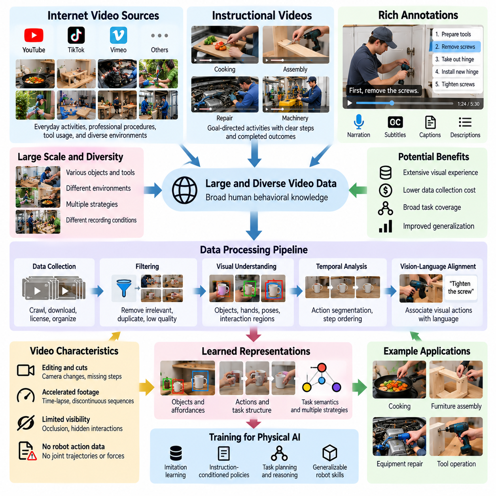{width="7.268055555555556in" height="7.268055555555556in"}

인터넷 영상(Internet Video)과 교육용 영상(Instructional Video)은 피지컬 인공지능(Physical AI)을 위한 대규모의 다양한 인간 행동 지식(Human Behavioral Knowledge)을 제공하는 중요한 데이터 원천이다. 공개적으로 이용할 수 있는 영상에는 일상 활동, 전문 작업 절차, 도구 사용, 다양한 환경에서 수행되는 복잡한 작업 시연(Task Demonstrations)이 포함된다. 로봇 전용 데이터셋(Robot-Specific Datasets)과 달리 이러한 영상은 인간이 물리적 세계와 상호작용하는 광범위한 사례를 제공하므로 일반적인 작업 개념(Task Concepts)과 행동 패턴(Behavioral Patterns)을 학습하는 데 유용하다.

교육용 영상(Instructional Video)은 명확한 시작 단계, 중간 과정, 완료 결과를 갖는 목표 지향적 활동(Goal-Directed Activities)을 자주 보여주기 때문에 특히 유용하다. 가구 조립, 음식 준비, 장비 수리, 기계 조작 등이 대표적인 사례이다. 이러한 구조적 특성은 학습 시스템(Learning Systems)에 작업 구성(Task Organization), 물체 간 의존 관계(Object Dependencies), 개별 행동을 연결하는 시간적 관계(Temporal Relationships)에 관한 정보를 제공한다.

인터넷 영상은 물체(Objects), 환경(Environments), 인간 행동(Human Behaviors), 촬영 조건(Recording Conditions) 측면에서 상당한 다양성(Diversity)을 제공한다. 동일한 작업도 서로 다른 도구, 전략, 작업 공간 구성(Workspace Configurations)을 사용하여 수행될 수 있다. 이러한 변동성(Variation)은 학습 모델(Learning Models)이 작업의 본질적인 관계와 부수적인 시각적 세부 사항을 구별하도록 지원하며, 로봇이 익숙하지 않은 물체나 환경을 만났을 때 일반화 성능(Generalization Performance)을 향상시킬 가능성을 제공한다.

인터넷 영상의 주요 장점은 로봇 시연 데이터(Robot Demonstration Data)와 비교할 때 잠재적인 확장성(Scalability)이 크다는 점이다. 로봇 궤적(Robot Trajectories)을 수집하려면 특수 하드웨어(Specialized Hardware), 작업자(Operators), 통제된 기록 절차(Controlled Recording Procedures)가 필요하다. 기존 영상 집합은 이에 상응하는 로봇 데이터 수집 비용 없이 광범위한 시각적 경험(Visual Experience)을 제공할 수 있다. 그러나 유용한 영상을 식별하고, 사용 권한을 확보하며, 처리하고, 검증하는 과정에는 여전히 상당한 엔지니어링 노력이 필요하다.

교육용 콘텐츠(Instructional Content)에는 관찰된 행동을 언어와 연결하는 내레이션(Narration), 자막(Subtitles), 캡션(Captions), 텍스트 설명(Textual Descriptions)이 포함되는 경우가 많다. 기계 부품을 교체하는 시연에서는 필요한 도구, 작업 순서(Operational Sequence), 의도된 결과(Intended Result)를 설명할 수 있다. 이러한 언어적 신호(Linguistic Signals)는 비전-언어 정렬(Vision-Language Alignment)을 지원하여 모델이 자연어 명령(Natural Language Instructions)을 관찰 가능한 물리적 활동과 연결하도록 한다.

시간적 구조(Temporal Structure)는 교육용 영상의 핵심적인 특성이다. 복잡한 절차는 준비(Preparation), 물체 위치 설정(Object Positioning), 조작(Manipulation), 검증(Verification), 완료(Completion)와 같은 하위 작업(Subtasks)으로 분해할 수 있다. 이러한 관계를 학습하면 피지컬 인공지능(Physical AI) 시스템이 행동 사이의 의존 관계(Dependencies)를 이해하고, 작업 성공을 위해 특정 작업이 다른 작업보다 먼저 수행되어야 한다는 사실을 인식하는 데 도움이 된다.

그러나 인터넷 영상은 일반적으로 기계학습(Machine Learning)을 목적으로 촬영되지 않는다. 카메라 각도(Camera Angles)가 갑자기 변경되거나 중요한 상호작용(Interactions)이 가려질 수 있으며, 편집 과정에서 중간 행동이 제거될 수도 있다. 또한 시연 영상에는 가속 재생(Accelerated Footage)이나 불연속적인 시퀀스(Discontinuous Sequences)가 포함될 수 있다. 이러한 특성은 연속적인 물리적 행동(Continuous Physical Behavior)을 재구성하기 어렵게 만들며, 시간적 정보(Temporal Information)에 대한 신중한 해석을 요구한다.

또 다른 한계는 로봇과 직접 호환되는 행동 측정값(Robot-Compatible Action Measurements)이 부족하다는 점이다. 대부분의 인터넷 영상에는 관절 궤적(Joint Trajectories), 접촉력(Contact Forces), 액추에이터 명령(Actuator Commands), 보정된 3차원 물체 자세(Calibrated Three-Dimensional Object Poses)가 포함되지 않는다. 따라서 영상 기반 학습(Video-Based Learning)은 기록된 인간 움직임이 실행 가능한 로봇 제어 명령을 직접 제공한다고 가정하기보다 시각적 변화로부터 행동 관련 표현(Action-Related Representations)을 추론해야 한다.

컴퓨터 비전 모델(Computer Vision Models)은 이러한 영상에서 물체 검출(Object Detection), 인간 자세(Human Pose), 손 궤적(Hand Trajectories), 추정된 상호작용 영역(Estimated Interaction Regions) 등 유용한 중간 정보를 추출할 수 있다. 시간적 모델(Temporal Models)은 의미 있는 전환(Meaningful Transitions)과 가능한 행동 경계(Action Boundaries)를 식별할 수 있다. 이러한 특징(Features)은 작업 이해(Task Understanding), 모방 학습(Imitation Learning), 로봇 신체 구조(Robotic Embodiments)에 대한 후속 적응을 지원하는 구조화된 표현(Structured Representations)을 제공한다.

교육용 영상은 물체의 행동 유도성(Object Affordances)과 도구 기능(Tool Functionality)에 관한 중요한 정보도 제공한다. 반복적인 시연은 손잡이를 파지하는 방법, 체결 부품(Fasteners)을 조작하는 방법, 용기를 여는 방법, 도구를 배치하는 방법을 보여준다. 학습 시스템은 서로 다른 맥락(Contexts)에서 발생하는 상호작용을 관찰함으로써 물체의 특징(Object Features)을 가능한 행동(Possible Actions) 및 예상되는 환경 변화(Expected Environmental Changes)와 연결할 수 있다.

다양한 교육용 시연(Diverse Instructional Demonstrations)으로부터 학습하면 유사한 목표를 달성하기 위한 여러 전략(Multiple Strategies)을 발견할 수 있다. 한 사람은 특정 도구 사용 순서(Tool Sequence)를 통해 부품을 조립하지만 다른 사람은 다른 절차를 따를 수 있다. 이러한 사례를 비교하면 모델은 눈에 보이는 모든 움직임이 보편적으로 최적의 행동(Universally Optimal Action)이라고 가정하지 않고도 공통 목표(Common Goals)와 필수 제약 조건(Essential Constraints)을 식별할 수 있다.

비디오-언어 모델(Video-Language Models)은 설명이 포함된 시연(Narrated Demonstrations)을 활용하여 작업 의미(Task Semantics)와 행동 시퀀스(Action Sequences)에 관한 표현을 개발할 수 있다. 대조 학습(Contrastive Learning), 마스킹 예측(Masked Prediction), 시간적 표현 학습(Temporal Representation Learning)은 시각적 관측(Visual Observations)을 텍스트 설명(Textual Descriptions)과 연결하는 방법을 제공한다. 이러한 접근은 정확한 물리적 행동 레이블(Physical Action Labels)이 없는 경우에도 의미론적 이해(Semantic Understanding)를 지원할 수 있다.

약지도학습(Weak Supervision)은 인터넷 영상에 불완전하거나 잡음이 포함된 주석(Noisy Annotations)이 자주 존재하기 때문에 특히 중요하다. 제목(Titles), 캡션(Captions), 설명(Descriptions)은 전체 작업을 식별할 수 있지만 개별 행동 경계(Individual Action Boundaries)를 명시하지 않을 수 있다. 학습 시스템은 이러한 근사적인 레이블(Approximate Labels)을 활용하면서 시간적 일관성(Temporal Consistency)과 시각적 관계(Visual Relationships)를 이용하여 더욱 상세한 행동 구조(Action Structures)를 발견할 수 있다.

데이터 필터링(Data Filtering)은 인터넷 영상을 유용한 피지컬 인공지능 학습 자원(Physical AI Training Resources)으로 변환하는 데 필수적이다. 대규모 영상 집합에는 관련 없는 콘텐츠(Irrelevant Content), 중복 영상(Duplicated Recordings), 오해를 유발하는 시연(Misleading Demonstrations), 물리적 상호작용이 제한적인 장면이 포함될 수 있다. 자동화된 필터링(Automated Filtering)은 관찰 가능한 조작(Observable Manipulation), 의미 있는 물체 변화(Meaningful Object Changes), 충분히 연속적인 작업 수행(Continuous Task Execution)을 포함하는 영상을 우선적으로 선택할 수 있다.

영상 품질(Video Quality)은 단순한 시각적 해상도(Visual Resolution)가 아니라 의도된 학습 목표(Learning Objective)와의 관계를 기준으로 평가해야 한다. 고해상도 영상(High-Resolution Video)이라도 중요한 상호작용이 가려져 있다면 유용한 정보를 거의 제공하지 못할 수 있다. 반대로 저해상도 영상(Lower-Resolution Video)이라도 작업 순서(Task Order)와 물체 관계(Object Relationships)를 명확하게 보여줄 수 있다. 따라서 효과적인 품질 평가(Quality Assessment)는 가시성(Visibility), 연속성(Continuity), 의미적 관련성(Semantic Relevance), 상호작용 완전성(Interaction Completeness)을 고려해야 한다.

교육용 영상에는 로봇이 재현하기에 안전하지 않거나 비효율적이거나 물리적으로 적합하지 않은 시연이 포함될 수 있다. 숙련된 인간이 수행하는 절차는 로봇이 보유하지 않은 손재주(Dexterity), 힘(Strength), 판단 능력(Judgment)에 의존할 수 있다. 따라서 학습 시스템은 서술적 관측(Descriptive Observations)과 검증된 실행 정책(Validated Execution Policies)을 구별해야 하며, 시연된 모든 행동을 적절한 로봇 행동(Robotic Action)으로 취급하지 않아야 한다.

인간과 로봇의 신체 구조 차이(Embodiment Differences)는 교육용 지식(Instructional Knowledge)을 전이하는 과정에서 추가적인 문제를 발생시킨다. 인간의 손과 도구는 로봇 매니퓰레이터(Robotic Manipulators)가 재현할 수 없는 운동 패턴(Motion Patterns)을 통해 작동할 수 있다. 물체 중심 작업 표현(Object-Centered Task Representations)은 인간의 정확한 관절 움직임(Exact Human Joint Movements)보다 원하는 물체 변환(Desired Object Transformations), 접촉 관계(Contact Relationships), 작업 제약 조건(Operational Constraints)을 강조함으로써 이러한 차이를 줄일 수 있다.

인터넷 영상은 로봇 전용 적응(Robot-Specific Adaptation)에 앞서 시각적·시간적 표현(Visual and Temporal Representations)을 사전학습(Pretraining)하는 데 특히 유용하다. 모델은 먼저 대규모 영상 집합으로부터 물체(Objects), 활동(Activities), 작업 진행(Task Progression)에 관한 일반적인 개념을 학습할 수 있다. 이후 원격조작 궤적(Teleoperation Trajectories), 로봇 시연(Robot Demonstrations), 시뮬레이션 데이터(Simulation Data)를 이용한 추가 학습을 통해 이러한 표현을 실행 가능한 행동(Executable Actions)과 물리적 제약(Physical Constraints)에 연결할 수 있다.

인터넷 영상과 로봇 데이터를 결합하려면 관측 분포(Observation Distributions)와 행동 분포(Action Distributions)의 차이를 신중하게 관리해야 한다. 인간 시연에는 로봇 실행과 다른 시점(Viewpoints), 움직임 속도(Motion Speeds), 조작 전략(Manipulation Strategies)이 포함될 수 있다. 도메인 적응(Domain Adaptation)과 표현 정렬(Representation Alignment)은 인간 고유의 시각적·행동적 특성(Human-Specific Visual and Behavioral Characteristics)에 대한 의존성을 줄이면서 관련 지식을 전이하는 데 도움이 될 수 있다.

데이터 출처(Data Provenance)와 라이선스(Licensing)는 인터넷 콘텐츠(Internet Content)를 책임 있게 활용하기 위한 기본 요구사항이다. 공개적으로 접근할 수 있다는 사실이 다운로드(Downloading), 재배포(Redistribution), 모델 학습(Model Training)에 대한 허가를 자동으로 의미하지는 않는다. 데이터 엔진(Data Engines)은 저작권(Copyright), 플랫폼 이용 약관(Platform Terms), 동의(Consent), 개인정보 보호(Privacy), 허용된 사용 범위(Permitted Usage)를 고려해야 한다. 데이터 출처 기록(Provenance Records)을 유지하면 감사(Auditing)와 적절한 데이터 거버넌스(Dataset Governance)를 지원할 수 있다.

확장 가능한 처리 파이프라인(Scalable Processing Pipelines)은 작업 설명(Task Descriptions), 물체 범주(Object Categories), 행동 임베딩(Action Embeddings), 시간적 메타데이터(Temporal Metadata)를 활용하여 교육용 영상을 검색 가능한 집합(Searchable Collections)으로 구성할 수 있다. 이러한 표현을 통해 개발자는 특정 로봇 기능(Robotic Capabilities)이나 학습 성능 부족(Training Deficiencies)과 관련된 사례를 검색할 수 있다. 이러한 인덱싱(Indexing)은 비정형 영상 집합(Unstructured Video Collections)을 반복적인 모델 개발(Iterative Model Development)에 재사용할 수 있는 자원으로 변환한다.

평가(Evaluation)는 영상 이해 벤치마크(Video Understanding Benchmarks)에만 의존하기보다 인터넷 영상과 교육용 영상이 후속 로봇 성능(Downstream Robotic Performance)을 실제로 향상시키는지 판단해야 한다. 관련 평가 결과에는 작업 인식(Task Recognition), 계획 정확도(Planning Accuracy), 적응 효율성(Adaptation Efficiency), 실제 환경 실행 성공률(Real-World Execution Success)이 포함된다. 통제된 비교 실험(Controlled Comparisons)은 어떤 영상 범주(Video Categories), 지도 방식(Supervision Methods), 데이터 혼합(Data Mixtures)이 의미 있는 성능 향상을 제공하는지 보여줄 수 있다.

따라서 인터넷 영상(Internet Video)과 교육용 영상(Instructional Video)은 피지컬 인공지능 데이터 엔진(Physical AI Data Engines)에서 광범위한 체화 지식(Embodied Knowledge)을 제공하는 상호 보완적인 데이터 원천이다. 이러한 영상은 인간의 목표(Human Goals), 작업 구성(Task Organization), 물체 상호작용(Object Interaction), 절차적 다양성(Procedural Variation)에 관한 방대한 관측 정보를 제공한다. 구조화된 영상 이해(Structured Video Understanding)를 로봇 전용 경험(Robot-Specific Experience)과 결합할 때 가장 큰 가치를 발휘하며, 일반적인 인간 지식(Human Knowledge)이 실용적인 로봇 지능(Practical Robotic Intelligence)의 발전에 기여하도록 한다.

## 03.04. Human Object and Tool Interaction

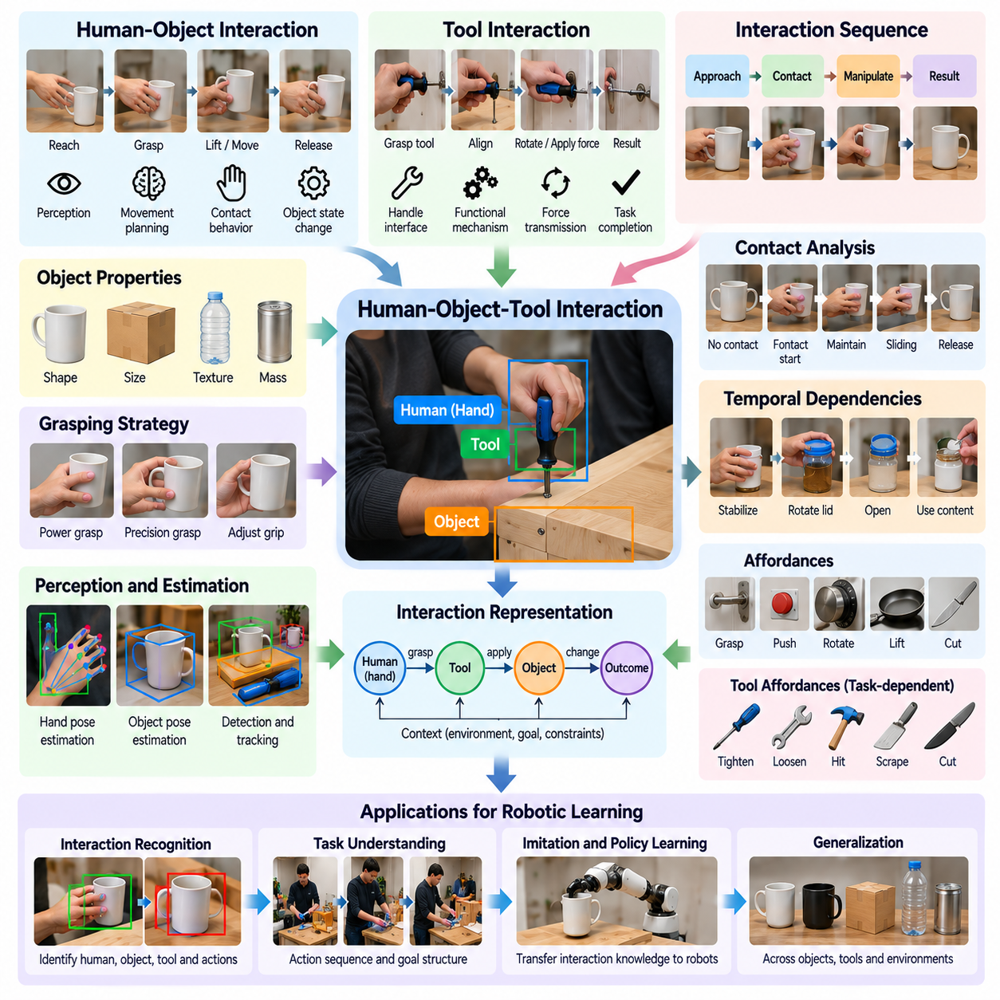{width="7.268055555555556in" height="7.268055555555556in"}

인간-물체 및 도구 상호작용(Human-Object and Tool Interaction)은 인간이 실제 목표를 달성하기 위해 물리적 물체를 어떻게 조작하는지 보여주기 때문에 피지컬 인공지능(Physical AI)을 위한 체화 지식(Embodied Knowledge)의 핵심적인 원천이다. 인간 영상(Human Video)은 신체 움직임(Body Movements), 물체 특성(Object Properties), 도구 기능(Tool Functions), 환경 변화(Environmental Changes) 사이의 관계를 기록한다. 이러한 상호작용을 이해하면 학습 시스템(Learning Systems)이 의미 있는 행동을 식별하고 로봇 조작(Robotic Manipulation)을 지원하는 표현(Representations)을 개발할 수 있다.

인간-물체 상호작용(Human-Object Interaction)은 사람이 물체에 손을 뻗거나, 파지하거나, 들어 올리거나, 밀거나, 회전시키거나, 운반하거나, 놓을 때 형성되는 물리적 관계(Physical Relationships)를 포함한다. 각 상호작용은 인식(Perception), 운동 계획(Motion Planning), 접촉 의존적 행동(Contact-Dependent Behavior)을 결합한다. 영상 관측(Video Observations)은 시간에 따른 물체 구성(Object Configurations)의 변화를 보여주며, 행동 목표(Action Objectives), 조작 전략(Manipulation Strategies), 작업 수행에 영향을 미치는 물리적 제약(Physical Constraints)에 관한 증거를 제공한다.

도구 상호작용(Tool Interaction)은 도구가 인간의 능력을 확장하고 환경에 힘이 전달되는 방식을 변화시키기 때문에 추가적인 복잡성을 갖는다. 드라이버(Screwdriver)는 회전 운동(Rotational Motion)을 체결 부품(Fastener)에 전달하고, 렌치(Wrench)는 기계적 접촉면(Mechanical Interface)을 통해 토크(Torque)를 가한다. 이러한 사례를 학습하려면 인간의 손(Human Hand), 도구(Tool), 대상 물체(Target Object), 결과적인 물리적 변환(Physical Transformation) 사이의 기능적 관계(Functional Relationship)를 이해해야 한다.

인간-물체 상호작용의 구조(Interaction Structure)는 행위자(Agents), 물체(Objects), 행동(Actions), 결과(Outcomes) 사이의 관계로 표현할 수 있다. 행위자는 움직임을 시작하고 물체와 접촉을 형성하며 물체의 물리적 상태(Physical State)를 변화시킨다. 이러한 관계는 인간의 정확한 움직임과 독립적으로 분석할 수 있는 상호작용 시퀀스(Interaction Sequence)를 형성하며, 작업 지식(Task Knowledge)을 로봇 시스템(Robotic Systems)으로 전이하기 위한 기반을 제공한다.

접촉(Contact)은 눈에 보이는 움직임과 물리적 효과(Physical Effects)를 연결하기 때문에 특히 중요하다. 손이 물체에 접근한다고 해서 반드시 조작(Manipulation)이 발생하는 것은 아니며, 접촉이 형성되고 물체의 행동이 변화할 때 실제 조작을 판단할 수 있다. 접촉 시작(Contact Initiation), 접촉 유지(Contact Maintenance), 미끄러짐(Sliding), 접촉 해제(Release)를 식별하면 의미 있는 조작과 부수적인 움직임을 구별하는 데 도움이 된다. 그러나 일반적인 영상만으로 정확한 접촉 상태(Contact States)를 추론하는 것은 어려운 경우가 많다.

물체 특성(Object Properties)은 상호작용 전략(Interaction Strategies)에 큰 영향을 미친다. 형상(Shape), 크기(Size), 표면 질감(Surface Texture), 질량 분포(Mass Distribution), 기계적 제약(Mechanical Constraints)은 물체에 접근하고 조작할 수 있는 방식을 결정한다. 일부 특성은 시각적으로 관찰할 수 있지만 다른 특성은 움직임과 상호작용 결과(Interaction Outcomes)로부터 간접적으로 추론해야 한다. 피지컬 인공지능 모델(Physical AI Models)은 물체 외형(Object Appearance)과 관찰된 조작 행동(Manipulation Behavior) 사이의 유용한 통계적 관계(Statistical Relationships)를 학습할 수 있다.

파지(Grasping)는 인간-물체 상호작용이 인식(Perception)과 물리적 제어(Physical Control)를 어떻게 결합하는지 보여주는 대표적인 사례이다. 인간은 접촉 위치(Contact Locations)를 선택하고 손가락 자세(Finger Configuration)를 조정하며 이동 중 파지 상태(Grip State)를 변경한다. 영상은 대략적인 손 자세(Hand Posture), 파지 시점(Grasp Timing), 물체 변위(Object Displacement)를 보여줄 수 있지만 일반적으로 파지력(Grip Force)이나 촉각 피드백(Tactile Feedback)을 직접 측정할 수 없다. 로봇 학습 표현(Robot Training Representations)을 구성할 때 이러한 한계를 고려해야 한다.

도구 사용(Tool Use)을 이해하려면 도구의 기하학적 구조(Geometry)와 의도된 기능(Intended Function)을 모두 파악해야 한다. 손잡이(Handle)는 작업자를 위한 조작 인터페이스(Operator Interface)를 제공하고, 작업 끝단(Working End)은 대상 재료나 기계 장치와 상호작용한다. 효과적인 도구 조작(Tool Manipulation)은 적절한 방향(Orientation), 접촉 위치(Contact Position), 움직임 방향(Movement Direction)을 유지하는 데 달려 있다. 영상 시연(Video Demonstrations)은 성공적인 작업의 반복적인 사례를 통해 이러한 관계를 보여줄 수 있다.

인간-물체 상호작용에는 작업 구조(Task Structure)를 정의하는 시간적 의존 관계(Temporal Dependencies)도 포함된다. 용기를 열기 위해서는 뚜껑을 회전시키기 전에 용기 본체를 고정해야 할 수 있으며, 조립 작업에서는 부품을 체결하기 전에 정렬해야 할 수 있다. 이러한 의존 관계를 학습하면 모델이 선행 조건(Prerequisites)과 중간 목표(Intermediate Goals)를 인식할 수 있으며, 작업 계획(Task Planning)을 지원하고 잘못된 행동 순서(Incorrect Action Ordering)로 인한 오류를 줄일 수 있다.

상호작용 인식(Interaction Recognition)은 참여하는 개체(Participating Entities)를 식별하고 시간에 따른 관계를 판단하는 과정이 필요하다. 컴퓨터 비전 시스템(Computer Vision Systems)은 손(Hands), 도구(Tools), 물체(Objects), 관련 환경 구조물(Environmental Structures)을 검출할 수 있다. 프레임(Frame) 사이에서 이러한 개체를 추적하면 근접성(Proximity), 상대 움직임(Relative Movement), 가능한 접촉 사건(Contact Events)에 관한 정보를 얻을 수 있다. 이후 실제 상호작용과 시각적 우연(Visual Coincidence)을 구별하기 위해 시간적 추론(Temporal Reasoning)이 필요하다.

손 자세 추정(Hand Pose Estimation)과 물체 자세 추정(Object Pose Estimation)은 상호작용 이해(Interaction Understanding)를 위한 유용한 중간 표현(Intermediate Representations)을 제공한다. 손의 주요 지점(Hand Landmarks)은 손가락과 손목의 구성을 근사적으로 나타내고, 물체 자세(Object Pose)는 위치(Position)와 방향(Orientation)을 설명한다. 이러한 추정값을 결합하면 접근 궤적(Approach Trajectories)과 조작 패턴(Manipulation Patterns)을 파악할 수 있다. 그러나 가림 현상(Occlusion), 깊이 모호성(Depth Ambiguity), 카메라 시점(Camera Perspective)은 상당한 추정 오차(Estimation Errors)를 발생시킬 수 있다.

상호작용 그래프(Interaction Graphs)는 인간, 도구, 물체, 환경 요소(Environmental Elements) 사이의 관계를 구조적으로 표현한다. 노드(Nodes)는 상호작용에 참여하는 개체를 나타내고, 엣지(Edges)는 접촉(Contact), 근접성(Proximity), 지지(Support), 기능적 관계(Functional Relationships)를 설명할 수 있다. 행동이 진행되면서 이러한 관계가 변화하여 동적 상호작용 구조(Dynamic Interaction Structures)를 형성하며, 이는 시간적 추론(Temporal Reasoning), 작업 인식(Task Recognition), 물리적 결과 예측(Physical Outcome Prediction)을 지원할 수 있다.

행동 유도성 학습(Affordance Learning)은 인간-물체 및 도구 상호작용과 밀접하게 연결되어 있다. 사람이 손잡이를 잡거나, 스위치를 누르거나, 손잡이형 조절 장치(Knob)를 회전시키는 장면을 관찰하면 특정 물체 특징(Object Features)과 관련된 가능한 행동(Possible Actions)에 관한 정보를 얻을 수 있다. 서로 다른 맥락(Contexts)에서 반복적으로 관찰하면 학습 시스템이 기능적 상호작용 영역(Functional Interaction Regions)과 관련 없는 시각적 세부 사항을 구별하도록 지원하여 익숙하지 않은 물체에 대한 일반화(Generalization)를 가능하게 한다.

도구의 행동 유도성(Tool Affordances)은 의도된 작업(Intended Task)과 주변 환경(Surrounding Environment)에 따라 달라지는 경우가 많다. 평평한 표면(Flat Surface)은 도구의 방향(Tool Orientation)과 대상 재료(Target Material)에 따라 밀기(Pushing), 긁기(Scraping), 들어 올리기(Lifting)에 사용될 수 있다. 따라서 행동 유도성을 물체에 고정된 레이블(Fixed Labels)로 취급해서는 안 된다. 행동 유도성은 행위자(Agent), 도구(Tool), 물체(Object), 작업(Task) 사이의 관계에서 나타나는 상황 의존적 행동 가능성(Context-Dependent Action Opportunities)을 의미한다.

인간 시연(Human Demonstrations)은 여러 물체 또는 양손을 사용하는 협응 조작(Coordinated Manipulation)을 자주 보여준다. 한 손은 부품을 고정하고 다른 손은 도구를 조작하거나, 조립 전에 여러 물체를 적절한 위치에 배치할 수 있다. 이러한 상호작용에는 지지 관계(Support Relationships), 협응 운동(Coordinated Motion), 순차적 의존 관계(Sequential Dependencies)에 대한 이해가 필요하다. 이러한 지식은 이중 매니퓰레이터(Dual Manipulators)나 특수 엔드 이펙터(Specialized End Effectors)를 장착한 로봇 시스템에 유용하다.

실패(Failures)와 수정 행동(Corrective Actions)은 물리적 상호작용 제약(Physical Interaction Constraints)에 관한 추가적인 정보를 제공한다. 물체가 미끄러지면 사람이 파지 상태(Grip)를 조정할 수 있으며, 도구가 잘못 정렬되면 작업을 계속하기 전에 위치를 다시 조정해야 할 수 있다. 이러한 사례는 인간이 예상하지 못한 결과(Unexpected Outcomes)에 어떻게 대응하는지 보여준다. 학습 시스템은 이러한 관측을 활용하여 잠재적인 실패 조건(Failure Conditions)을 식별하고 복구 전략(Recovery Strategies)에 관한 표현을 개발할 수 있다.

인간의 상호작용 지식(Human Interaction Knowledge)을 로봇으로 전이하려면 작업 목표(Task Objectives)와 인간 고유의 움직임 패턴(Human-Specific Movement Patterns)을 분리해야 한다. 로봇 그리퍼(Robotic Grippers)는 인간 손보다 자유도(Degrees of Freedom)가 적을 수 있으며, 산업용 매니퓰레이터(Industrial Manipulators)는 서로 다른 방향에서 물체에 접근할 수 있다. 물체 중심 표현(Object-Centered Representations)은 원하는 물리적 변환(Desired Transformations)과 접촉 제약(Contact Constraints)을 유지하면서 로봇 전용 계획기(Robot-Specific Planners)가 실행 가능한 움직임(Feasible Motions)을 생성하도록 지원한다.

인간 영상(Human Video)은 상호작용 동역학(Interaction Dynamics)의 예측 모델(Predictive Models)도 지원할 수 있다. 접촉 전후의 물체 움직임(Object Motion)을 관찰함으로써 모델은 눈에 보이는 행동(Visible Actions)과 이후의 환경 변화(Subsequent Environmental Changes) 사이의 관계를 학습할 수 있다. 이러한 예측은 계획(Planning)과 평가(Evaluation)에 도움이 될 수 있지만, 영상에서 학습한 모델이 신뢰성 있는 제어 수준 정확도(Control-Level Accuracy)를 달성하려면 일반적으로 추가적인 물리적 측정(Physical Measurements)이나 로봇 경험(Robot Experience)이 필요하다.

데이터 품질(Data Quality)은 의미 있는 상호작용 지식(Interaction Knowledge)을 추출하는 데 필수적이다. 영상은 가능하면 손(Hands), 도구(Tools), 접촉 영역(Contact Regions), 결과적인 물체 변화(Object Changes)를 명확하게 보여주어야 한다. 연속적인 기록(Continuous Recordings)은 준비(Preparation), 접촉(Contact), 조작(Manipulation), 완료(Completion) 단계를 구별하는 데 도움이 된다. 다중 시점 관측(Multi-View Observations)은 가림 현상을 줄이고 기하학적 이해(Geometric Understanding)를 향상시킬 수 있지만, 동기화(Synchronization)와 보정(Calibration)에 따른 추가적인 처리 요구사항이 발생한다.

확장 가능한 피지컬 인공지능 데이터 엔진(Scalable Physical AI Data Engine)은 물체 범주(Object Categories), 도구 유형(Tool Types), 행동 설명(Action Descriptions), 접촉 추정값(Contact Estimates), 작업 결과(Task Outcomes)를 활용하여 상호작용 영상을 체계적으로 구성할 수 있다. 자동화된 인덱싱(Automated Indexing)은 특정 조작 기술(Manipulation Skills)과 관련된 시연을 검색할 수 있도록 한다. 이러한 기록을 로봇 궤적(Robot Trajectories) 및 시뮬레이션 데이터(Simulation Data)와 결합하면 광범위한 인간 경험(Human Experience)을 측정 가능한 로봇 행동(Measurable Robotic Actions)과 연결할 수 있다.

평가(Evaluation)는 성공적인 상호작용 인식(Interaction Recognition)과 신뢰성 있는 로봇 실행(Robotic Execution)을 구별해야 한다. 모델이 도구의 사용 방법을 정확하게 식별하더라도 실행 가능한 힘(Feasible Forces), 궤적(Trajectories), 접촉 구성(Contact Configurations)을 생성하지 못할 수 있다. 따라서 유용한 평가에는 상호작용 이해(Interaction Understanding), 물체 상태 예측(Object-State Prediction), 작업 전이(Task Transfer), 다양한 환경 조건(Environmental Conditions)에서의 물리적 실행 성공률(Physical Execution Success)이 포함되어야 한다.

인간-물체 및 도구 상호작용(Human-Object and Tool Interaction)은 시각적 관측(Visual Observation)과 물리적 지능(Physical Intelligence)을 연결하는 가교 역할을 한다. 인간이 접촉을 형성하고, 물체의 행동 유도성(Object Affordances)을 활용하며, 도구를 협응적으로 조작하고, 원하는 물리적 변환(Desired Transformations)을 달성하는 방법을 학습함으로써 피지컬 인공지능(Physical AI) 시스템은 전이 가능한 작업 지식(Transferable Task Knowledge)을 획득할 수 있다. 이러한 지식을 로봇 전용 제어(Robot-Specific Control) 및 물리적 피드백(Physical Feedback)과 통합하는 것은 적응 가능하고 신뢰성 있는 조작 능력(Adaptable and Reliable Manipulation Capabilities)을 개발하는 데 필수적이다.

## 03.05. Hand Pose Object Pose and Action Understanding

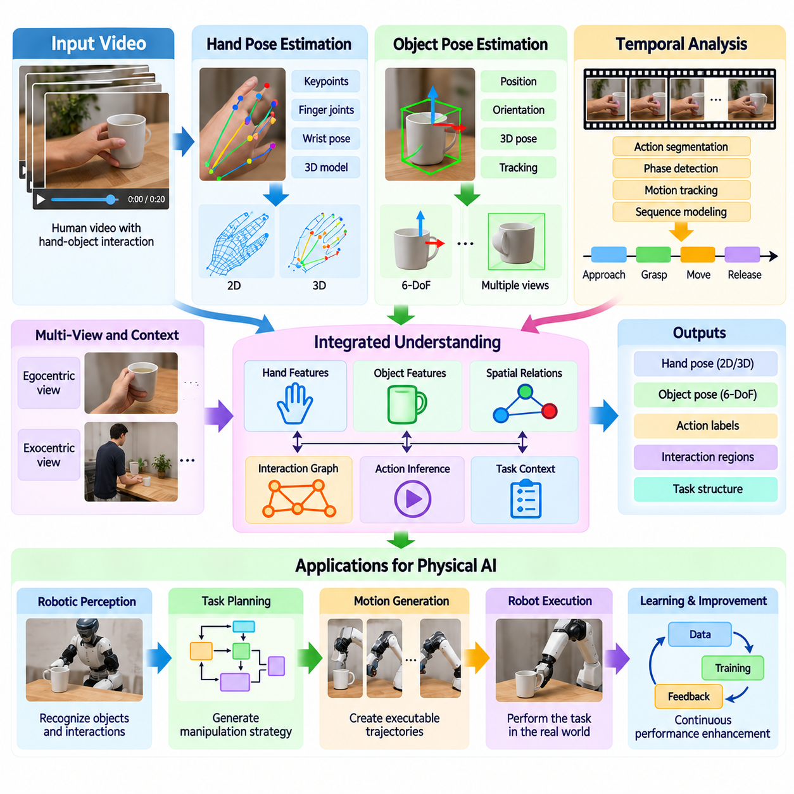{width="7.268055555555556in" height="7.268055555555556in"}

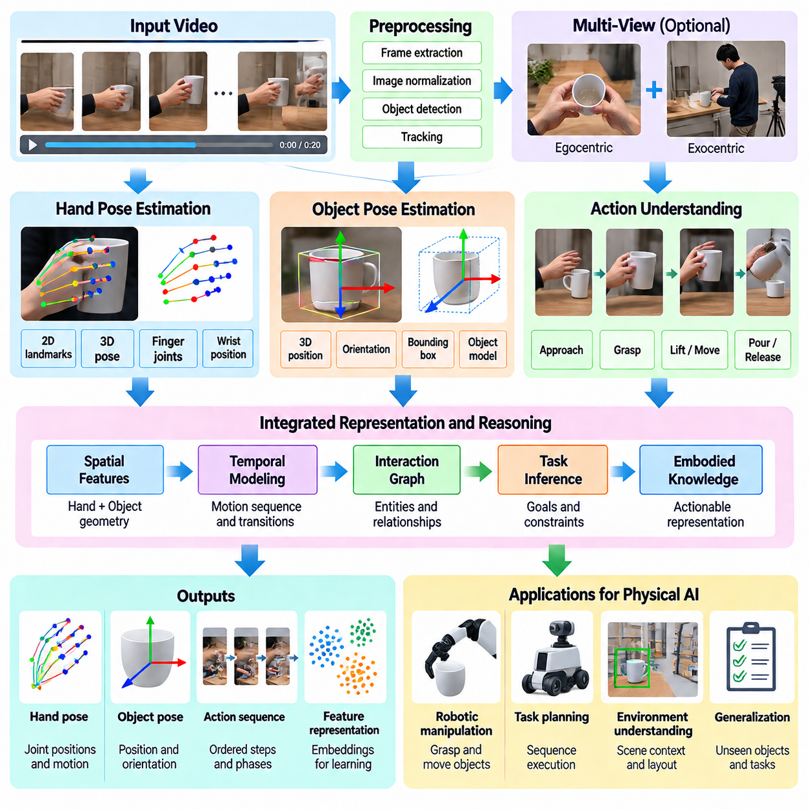{width="7.268055555555556in" height="7.268055555555556in"}

손 자세 추정(Hand Pose Estimation), 물체 자세 추정(Object Pose Estimation), 행동 이해(Action Understanding)는 피지컬 인공지능(Physical AI)을 위해 인간 영상(Human Video)에서 체화 지식(Embodied Knowledge)을 추출하는 핵심 구성 요소이다. 이들은 시각적 관측(Visual Observations)을 인간의 움직임(Human Movement), 물체 구성(Object Configuration), 물리적 상호작용(Physical Interaction)에 관한 구조화된 정보(Structured Information)로 변환한다. 이러한 표현(Representations)은 학습 시스템(Learning Systems)이 장면에 무엇이 나타나는지뿐만 아니라 행동이 물리적 환경을 어떻게 변화시키는지도 이해하도록 지원한다.

손 자세 추정(Hand Pose Estimation)은 손가락 관절(Finger Joints), 손목 위치(Wrist Position), 전체 관절 구성(Overall Articulation)을 포함한 인간 손의 공간적 구성(Spatial Configuration)을 식별한다. 컴퓨터 비전 모델(Computer Vision Models)은 일반적으로 해부학적 특징점(Anatomical Landmarks)이나 매개변수화된 3차원 모델(Parameterized Three-Dimensional Models)을 통해 손을 표현한다. 영상 프레임(Video Frames)에 걸쳐 이러한 구성을 추적하면 뻗기(Reaching), 파지(Grasping), 조작(Manipulation), 놓기(Release)에 관한 정보를 얻을 수 있으며, 정교한 운동 행동(Fine Motor Behavior)을 분석할 수 있다.

2차원 손 자세 추정(Two-Dimensional Hand Pose Estimation)은 이미지 좌표(Image Coordinates) 내에서 특징점 위치(Landmark Positions)를 예측하는 반면, 3차원 자세 추정(Three-Dimensional Pose Estimation)은 손의 공간적 구성(Spatial Configuration)을 재구성하려고 한다. 3차원 표현(Three-Dimensional Representations)은 관절 기하학(Joint Geometry)과 손가락 사이의 상대적 위치(Relative Finger Positions)를 설명하므로 로봇 조작(Robotic Manipulation)에 더욱 유용하다. 그러나 관측이 단안 영상(Monocular Video)으로 제한되면 정확한 깊이 복원(Depth Recovery)은 여전히 어려운 과제로 남는다.

손 자세 추정(Hand Pose Estimation)은 물체 조작(Object Manipulation) 중 손가락이 파지된 물체 뒤에 자주 가려지기 때문에 특히 어려워진다. 움직임 흐림(Motion Blur), 조명 변화(Lighting Variation), 카메라 시점(Camera Perspective), 자기 가림(Self-Occlusion)은 추정 신뢰성(Estimation Reliability)을 더욱 감소시킨다. 시간적 모델(Temporal Models)은 연속 프레임(Consecutive Frames)의 관측을 결합하여 일관성(Consistency)을 향상시킬 수 있지만, 상호작용 전반에 걸쳐 가려진 정보를 항상 복원할 수 있는 것은 아니다.

물체 자세 추정(Object Pose Estimation)은 카메라 또는 기준 좌표계(Reference Coordinate System)에 대한 물리적 물체의 위치(Position)와 방향(Orientation)을 결정한다. 강체(Rigid Objects)의 경우 자세(Pose)는 일반적으로 3차원 병진 이동(Three-Dimensional Translation)과 회전(Rotation)으로 표현되며, 6자유도 구성(Six-Degree-of-Freedom Configuration)을 형성한다. 정확한 물체 자세 정보(Object Pose Information)는 추적(Tracking), 파지 계획(Grasp Planning), 공간 추론(Spatial Reasoning), 인간 행동으로 발생하는 물리적 변환(Transformations)의 분석을 지원한다.

물체 자세 추정(Object Pose Estimation)을 수행하려면 물체의 기하학적 구조(Object Geometry)를 인식하고 가시적인 이미지 특징(Image Features)과 3차원 구조(Three-Dimensional Structure) 사이의 관계를 설정해야 한다. 모델 기반 방법(Model-Based Methods)은 알려진 물체 형상(Known Object Shapes)을 사용하며, 학습 기반 접근법(Learning-Based Approaches)은 시각적 사례(Visual Examples)로부터 자세를 추정한다. 미지의 물체(Unknown Objects), 반사 표면(Reflective Surfaces), 질감이 없는 재료(Textureless Materials), 부분적인 가시성(Partial Visibility)은 강건한 기하학적·의미론적 표현(Robust Geometric and Semantic Representations)이 필요한 추가적인 어려움을 발생시킨다.

손 자세(Hand Pose)와 물체 자세(Object Pose) 사이의 관계는 조작(Manipulation)을 이해하는 데 특히 중요하다. 손이 물체에 접근하는 움직임은 준비 단계(Preparation Phase)를 나타낼 수 있으며, 접촉 이후 손과 물체가 함께 움직이면 능동적인 조작 단계(Active Manipulation Phase)를 의미할 수 있다. 상대 위치(Relative Positions), 상대 방향(Relative Orientations), 궤적(Trajectories)은 파지 형성(Grasp Formation), 물체 운반(Object Transport), 회전(Rotation), 놓기(Release)에 관한 정보를 제공한다.

접촉 추정(Contact Estimation)은 기하학적 관측(Geometric Observations)을 물리적 상호작용(Physical Interaction)과 연결한다. 손가락 끝(Fingertips)이 물체 표면(Object Surface)에 접근하고 이후 물체가 움직이면 모델은 접촉(Contact)과 조작(Manipulation)이 발생했다고 추론할 수 있다. 그러나 시각적 근접성(Visual Proximity)만으로 물리적 접촉을 확정할 수는 없으며, 영상은 접촉력(Contact Force)을 직접 측정하는 경우가 거의 없다. 따라서 신뢰성 있는 추정(Reliable Estimation)을 위해서는 시간적 추론(Temporal Reasoning), 기하학적 제약(Geometric Constraints), 가능한 경우 추가적인 센싱(Additional Sensing)이 필요하다.

행동 이해(Action Understanding)는 관찰된 움직임의 목적(Purpose)과 시간적 구조(Temporal Structure)를 해석함으로써 자세 추정(Pose Estimation)의 범위를 넘어선다. 손과 물체 자세의 시퀀스(Sequence)는 열기(Opening), 닫기(Closing), 들어 올리기(Lifting), 붓기(Pouring), 조립(Assembling), 도구 조작(Tool Operation) 등의 행동에 해당할 수 있다. 이러한 행동을 인식하려면 움직임 정보(Motion Information)를 물체 정체성(Object Identity), 환경적 맥락(Environmental Context), 물리적 상태 변화(Physical State Changes)와 결합해야 한다.

시간적 모델링(Temporal Modeling)은 개별 프레임(Individual Frames)만으로 행동을 신뢰성 있게 식별하기에 충분한 정보를 얻기 어렵기 때문에 필수적이다. 용기를 잡고 있는 정지된 손은 붓기(Pouring)를 준비하는 상태일 수도 있고, 들어 올리기(Lifting)를 완료한 상태일 수도 있으며, 일시적으로 멈춘 상태일 수도 있다. 해당 프레임의 전후 움직임을 관찰하면 이러한 가능성을 구별할 수 있으며, 의미 있는 행동 경계(Action Boundaries)를 식별하는 데 도움이 된다.

인간의 조작(Human Manipulation)은 접근(Approach), 접촉 형성(Contact Establishment), 파지 안정화(Grasp Stabilization), 물체 이동(Object Movement), 놓기(Release)를 포함하는 상호작용 단계(Interaction Phases)의 시퀀스로 표현할 수 있다. 이러한 단계는 행동 분할(Action Segmentation)과 작업 이해(Task Understanding)를 위한 유용한 구조를 제공한다. 단계 사이의 경계는 활동에 따라 중첩되거나 달라질 수 있으므로 모델은 경직된 전환(Rigid Transitions)을 가정하기보다 불확실성(Uncertainty)을 표현해야 한다.

손-물체 상호작용 모델(Hand-Object Interaction Models)은 시각적 특징(Visual Features)과 검출된 개체 사이의 기하학적 관계(Geometric Relationships)를 결합하는 경우가 많다. 손 특징점(Hand Landmarks), 물체 자세(Object Poses), 상대 거리(Relative Distances), 운동 벡터(Motion Vectors)를 공통 표현(Shared Representation)에 통합할 수 있다. 그래프 기반 모델(Graph-Based Models)은 손과 물체를 연결된 개체(Connected Entities)로 설명하여 학습 시스템이 변화하는 접촉 관계(Contact Relationships)와 협응 조작(Coordinated Manipulation)을 추론하도록 지원할 수 있다.

자기중심 영상(Egocentric Video)은 작업자의 관점(Operator Perspective)에서 가까운 거리의 손-물체 상호작용(Hand-Object Interactions)을 상세하게 관찰할 수 있도록 한다. 이러한 시점은 조작 대상(Manipulation Targets)과 국소적 움직임(Local Motion)을 명확하게 포착하는 경우가 많지만 손이나 물체의 일부가 가려질 수 있다. 외부 관찰 영상(Exocentric Video)은 신체 자세(Body Posture)와 작업 공간 기하학(Workspace Geometry)에 관한 더 넓은 정보를 제공한다. 두 시점을 결합하면 자세 재구성(Pose Reconstruction)과 행동 해석(Action Interpretation)을 향상시킬 수 있다.

다중 시점 관측(Multi-View Observations)은 단일 카메라(Single Camera)와 관련된 모호성(Ambiguities)을 줄여 3차원 추정(Three-Dimensional Estimation)을 지원한다. 동기화된 카메라(Synchronized Cameras)는 손가락, 물체, 접촉 영역(Contact Regions)에 대한 상호 보완적인 관측을 제공할 수 있다. 기하학적 재구성(Geometric Reconstruction)은 정확한 카메라 보정(Camera Calibration)과 시간적 정렬(Temporal Alignment)에 의존한다. 이러한 조건이 충족되지 않으면 관측을 결합하는 과정에서 정확도가 향상되기보다 일관성 없는 자세 추정(Inconsistent Pose Estimates)이 발생할 수 있다.

자세 추정 오차(Pose Estimation Errors)는 행동 이해 시스템(Action Understanding Systems)으로 전파될 수 있다. 잘못된 손가락 위치(Incorrect Finger Positions)는 물리적으로 불가능한 파지(Impossible Grasp)를 나타낼 수 있으며, 부정확한 물체 방향(Inaccurate Object Orientation)은 추론된 조작 방향(Inferred Manipulation Direction)을 왜곡할 수 있다. 따라서 강건한 학습 파이프라인(Robust Learning Pipelines)은 신뢰도 추정(Confidence Estimates), 시간적 일관성 검사(Temporal Consistency Checks), 누락되거나 신뢰할 수 없는 관측을 처리하는 메커니즘(Mechanisms)을 포함해야 한다.

행동 이해(Action Understanding)에는 시각적으로 유사하지만 목적이 다른 움직임을 구별하는 능력도 필요하다. 원통형 물체(Cylindrical Object)를 회전시키는 행동은 용기를 여는 작업, 제어 장치를 조정하는 작업, 부품을 검사하는 작업을 의미할 수 있다. 물체 정체성(Object Identity), 작업 맥락(Task Context), 결과적인 상태 변화(Resulting State Changes)는 이러한 모호성을 해결하는 데 도움이 된다. 의미론적 추론(Semantic Reasoning)은 움직임 패턴(Motion Patterns)을 의도된 결과(Intended Outcomes)와 연결함으로써 기하학적 추적(Geometric Tracking)을 보완한다.

물체 중심 행동 표현(Object-Centered Action Representations)을 학습하면 인간 시연(Human Demonstrations)에서 로봇 시스템(Robotic Systems)으로의 전이(Transfer)를 향상시킬 수 있다. 로봇은 인간의 정확한 손가락 궤적(Human Finger Trajectories)을 재현하는 대신 원하는 물체 변위(Object Displacement), 방향 변화(Orientation Change), 접촉 제약(Contact Constraints)을 학습할 수 있다. 이러한 추상화(Abstraction)는 로봇 그리퍼(Robotic Grippers)가 기하학적 구조(Geometry), 정교한 조작 능력(Dexterity), 사용 가능한 자유도(Available Degrees of Freedom) 측면에서 인간의 손과 크게 다를 때 특히 중요하다.

손 자세(Hand Pose)와 물체 자세(Object Pose) 정보는 조작 행동 유도성(Manipulation Affordances)을 발견하는 데도 활용할 수 있다. 성공적인 상호작용을 반복적으로 관찰하면 공통적인 접촉 영역(Contact Regions), 접근 방향(Approach Directions), 물체 변환(Object Transformations)을 파악할 수 있다. 모델은 이러한 패턴을 물체 기하학(Object Geometry)과 작업 맥락(Task Context)에 연결하여 로봇이 익숙하지 않은 물체에 대해 실행 가능한 조작 전략(Feasible Manipulation Strategies)을 식별하도록 지원할 수 있다.

약지도학습(Weakly Supervised Learning)과 자기지도학습(Self-Supervised Learning)은 수작업으로 주석을 부여한 자세 및 행동 데이터셋(Manually Annotated Pose and Action Datasets)에 대한 의존성을 줄인다. 모델은 시간적 대응 관계(Temporal Correspondences)를 학습하거나, 미래 물체 구성(Future Object Configurations)을 예측하거나, 시각적 시퀀스(Visual Sequences)를 언어 설명(Language Descriptions)과 정렬할 수 있다. 그러나 고품질 레이블 데이터(High-Quality Labeled Examples)는 보정(Calibration), 평가(Evaluation), 추론된 상호작용 표현(Inferred Interaction Representations)의 체계적 오류(Systematic Errors)를 수정하는 데 여전히 중요하다.

손-물체 상호작용(Hand-Object Interaction)을 위한 데이터 주석(Data Annotation)에는 특징점(Landmarks), 좌표계(Coordinate Systems), 접촉 상태(Contact States), 행동 범주(Action Categories)에 대한 일관된 정의가 필요하다. 모호한 레이블(Ambiguous Labels)은 데이터셋 사이에서 호환되지 않는 학습 목표(Incompatible Training Targets)를 발생시킬 수 있다. 명확한 주석 프로토콜(Annotation Protocols)과 품질 검사(Quality Checks)는 재현성(Reproducibility)을 향상시키며, 신뢰도 점수(Confidence Scores)는 직접 관찰된 정보(Directly Observed Information)와 모델이 생성한 추정값(Model-Generated Estimates)을 구별하는 데 도움이 된다.

확장 가능한 피지컬 인공지능 데이터 엔진(Scalable Physical AI Data Engine)은 인간 영상을 손 자세(Hand Poses), 물체 자세(Object Poses), 상호작용 사건(Interaction Events), 의미론적 행동 레이블(Semantic Action Labels)이 동기화된 시퀀스로 처리할 수 있다. 이러한 구조화된 기록(Structured Records)은 효율적인 검색(Searching), 필터링(Filtering), 학습(Training)을 가능하게 한다. 이를 로봇 시연(Robot Demonstrations) 및 시뮬레이션 데이터(Simulation Data)와 통합하면 인간의 시각적 경험(Human Visual Experience)을 로봇과 호환되는 학습 표현(Robot-Compatible Learning Representations)으로 연결하는 경로를 구축할 수 있다.

평가(Evaluation)는 기하학적 정확도(Geometric Accuracy)와 후속 작업 유용성(Downstream Task Usefulness)을 모두 고려해야 한다. 손 특징점 오차(Hand Landmark Error), 물체 병진 이동 및 회전 오차(Object Translation and Rotation Error), 접촉 검출 성능(Contact Detection Performance), 행동 인식 정확도(Action Recognition Accuracy)는 시스템의 서로 다른 측면을 측정한다. 궁극적으로 영상 이해(Video Understanding)의 향상이 더욱 신뢰성 있는 물리적 조작(Physical Manipulation)으로 이어지는지 판단하려면 로봇 전이 실험(Robot Transfer Experiments)이 필요하다.

손 자세 추정(Hand Pose Estimation), 물체 자세 추정(Object Pose Estimation), 행동 이해(Action Understanding)는 원시 인간 영상(Raw Human Video)과 구조화된 체화 지능(Structured Embodied Intelligence) 사이의 연결 기반을 형성한다. 기하학적 구성(Geometric Configurations), 시간적 상호작용 패턴(Temporal Interaction Patterns), 의미론적 작업 목표(Semantic Task Objectives)를 연결함으로써 피지컬 인공지능(Physical AI) 시스템은 로봇 계획(Robotic Planning)과 제어(Control)에 관련된 지식을 추출할 수 있다. 이러한 요소의 통합은 인간 시연(Human Demonstrations)을 적응 가능한 로봇(Adaptable Robots)을 위한 확장 가능한 학습 자원(Scalable Learning Resources)으로 변환하는 데 필수적이다.

## 03.06. Action Segmentation and Temporal Structure

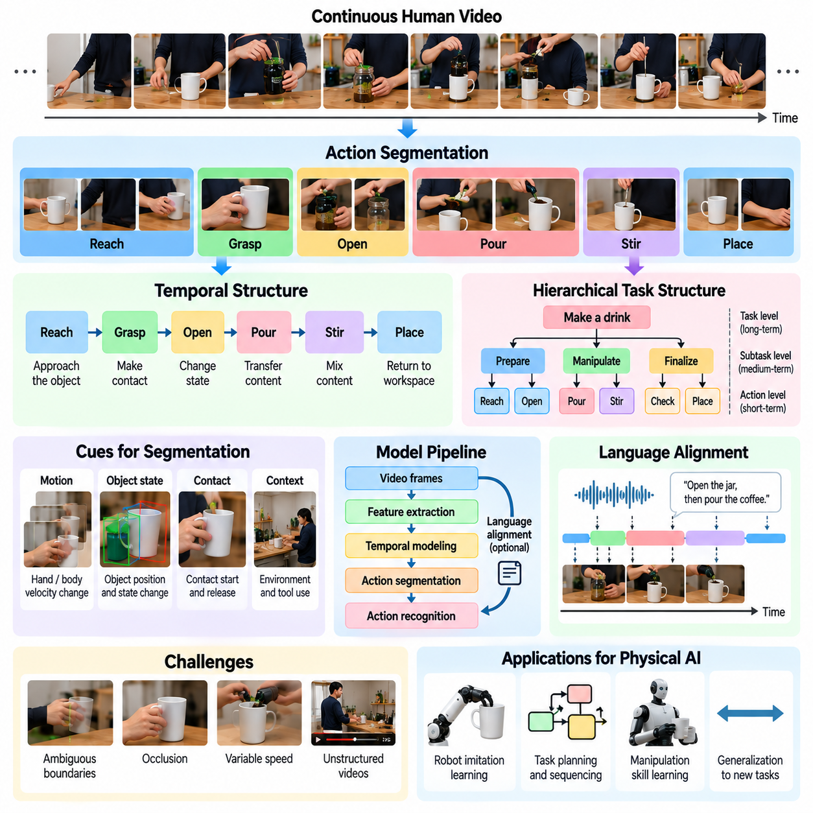{width="7.268055555555556in" height="7.268055555555556in"}

행동 분할(Action Segmentation)과 시간적 구조(Temporal Structure)는 연속적인 인간 영상(Human Video)을 의미 있는 물리적 행동(Physical Behavior)의 표현으로 변환하는 데 필수적이다. 인간의 활동(Human Activities)은 고립된 개별 행동이 아니라 서로 연결된 움직임(Movements), 상호작용(Interactions), 중간 목표(Intermediate Goals)로 구성된다. 행동 경계(Action Boundaries)와 시간적 관계(Temporal Relationships)를 식별함으로써 피지컬 인공지능(Physical AI) 시스템은 비정형 영상 기록(Unstructured Recordings)을 작업 이해(Task Understanding), 계획(Planning), 로봇 학습(Robotic Learning)에 적합한 체계적인 지식으로 변환할 수 있다.

행동 분할(Action Segmentation)은 연속적인 영상 시퀀스(Video Sequence)를 의미 있는 활동에 해당하는 시간 구간(Temporal Intervals)으로 나누는 과정이다. 음료를 준비하는 사람은 용기에 손을 뻗고, 용기를 파지하고, 뚜껑을 열고, 액체를 따르고, 용기를 작업 공간(Workspace)에 다시 놓을 수 있다. 각 구간은 고유한 물리적 목표(Physical Objective)를 가진 개별 행동(Distinct Action)을 나타낸다. 정확한 분할(Accurate Segmentation)은 학습 시스템(Learning Systems)이 개별 작업을 구별하면서 전체 작업 내에서 이들 사이의 관계를 유지하도록 한다.

시간적 구조(Temporal Structure)는 행동이 어떤 순서로 수행되고, 서로 연결되며, 반복되거나 동시에 실행되는지를 설명한다. 많은 물리적 작업(Physical Tasks)은 후속 작업이 이전의 물체 상태 변화(Object State Changes)에 의존하기 때문에 특정한 순서(Sequence)를 요구한다. 예를 들어 부품은 체결하기 전에 위치를 설정해야 하며, 용기는 내용물을 채우기 전에 열어야 한다. 이러한 의존 관계(Dependencies)를 이해하면 모델이 올바른 작업 절차(Valid Procedures)를 인식하고 다음 행동(Subsequent Actions)을 예측할 수 있다.

인간의 활동은 여러 시간 척도(Temporal Scales)에 걸쳐 자연스럽게 계층적 구성(Hierarchical Organization)을 나타낸다. 손가락 조정(Finger Adjustments)과 같은 짧은 움직임은 조작 행동(Manipulation Actions)에 포함되고, 이러한 조작 행동은 다시 더 큰 작업 절차의 하위 작업(Subtasks)을 구성한다. 가구 조립 작업(Furniture Assembly Task)은 준비(Preparation), 정렬(Alignment), 체결(Fastening), 검증(Verification) 단계로 구성될 수 있다. 계층적 표현(Hierarchical Representations)은 피지컬 인공지능 모델이 저수준 움직임(Low-Level Movements)을 고수준 목표(High-Level Objectives)와 연결하도록 한다.

행동 경계(Action Boundaries)는 인간 행동(Human Behavior)이 엄격하게 구분된 개별 사건이 아니라 연속적으로 진행되기 때문에 모호한 경우가 많다. 손을 뻗는 동작(Reaching)은 점진적으로 파지(Grasping)로 전환될 수 있으며, 물체 조작(Object Manipulation)은 위치 재조정(Repositioning)과 중첩될 수 있다. 서로 다른 관찰자는 동일한 활동에 대해 약간 다른 경계를 지정할 수 있다. 따라서 효과적인 분할 시스템(Segmentation Systems)은 불확실성(Uncertainty)을 수용하고 모든 행동 전환(Action Transitions)이 순간적으로 발생한다고 가정하지 않아야 한다.

시각적 움직임(Visual Motion)은 시간적 경계(Temporal Boundaries)를 식별하는 중요한 신호를 제공한다. 손의 속도(Hand Velocity), 신체 자세(Body Posture), 물체 변위(Object Displacement), 상호작용 강도(Interaction Intensity)의 변화는 행동의 시작이나 완료를 나타낼 수 있다. 그러나 의미 있는 전환은 큰 움직임 없이도 발생할 수 있으므로 움직임 정보만으로는 충분하지 않다. 운동학적 단서(Kinematic Cues)를 물체 상태(Object States) 및 상호작용 맥락(Interaction Context)과 결합하면 분할 신뢰성(Segmentation Reliability)을 향상시킬 수 있다.

접촉 사건(Contact Events)은 행동 전환(Action Transitions)에 관한 추가적인 근거를 제공한다. 손과 물체 사이의 접촉 형성(Contact Establishment)은 조작(Manipulation)의 시작을 나타낼 수 있으며, 접촉 해제(Release)는 완료를 의미할 수 있다. 접촉 구성(Contact Configuration)의 변화는 파지(Grasping), 밀기(Pushing), 미끄러뜨리기(Sliding), 도구 조작(Tool Operation)을 구별하는 데 도움이 된다. 일반적인 영상에서는 접촉을 직접 관찰하기 어렵기 때문에 모델은 기하학적 관계(Geometric Relationships)와 시간적 변화(Temporal Changes)를 통해 이러한 사건을 추론하는 경우가 많다.

시간적 행동 인식(Temporal Action Recognition)은 관찰된 시간 구간에 손 뻗기(Reaching), 들어 올리기(Lifting), 회전(Rotating), 붓기(Pouring), 조립(Assembling)과 같은 의미론적 범주(Semantic Categories)를 부여한다. 프레임 수준 분류(Frame-Level Classification)와 달리 구간 수준 인식(Segment-Level Recognition)은 움직임의 진행 과정과 물리적 결과(Physical Consequences)를 고려한다. 이러한 차이는 유사한 손의 구성(Hand Configurations)이라도 이전 움직임과 이후의 물체 변환(Object Transformations)에 따라 서로 다른 행동을 의미할 수 있기 때문에 중요하다.

시간적 모델링 아키텍처(Temporal Modeling Architectures)는 영상 프레임(Video Frames)과 행동 구간(Action Intervals) 사이의 의존 관계를 포착한다. 순환 신경망(Recurrent Neural Networks), 시간적 합성곱 신경망(Temporal Convolutional Networks), 트랜스포머 기반 모델(Transformer-Based Models)은 시간에 따른 관측 정보를 통합하는 메커니즘을 제공한다. 어텐션 메커니즘(Attention Mechanisms)은 중요한 프레임과 장거리 관계(Long-Range Relationships)를 강조할 수 있다. 모델 선택(Model Selection)은 시퀀스 길이(Sequence Length), 계산 제약(Computational Constraints), 주석 가용성(Annotation Availability), 필요한 시간 해상도(Temporal Resolution)에 따라 달라진다.

장시간 교육용 영상(Long-Duration Instructional Videos)은 중요한 사건 사이에 긴 준비 시간이나 비활동 구간(Inactivity Periods)이 존재할 수 있기 때문에 추가적인 문제를 발생시킨다. 작업에는 반복 작업(Repeated Operations), 중단(Interruptions), 수정 움직임(Corrective Movements)도 포함될 수 있다. 모델은 모든 프레임을 동일하게 중요하게 취급하지 않으면서 관련된 과거 맥락(Historical Context)을 유지해야 한다. 계층적 시간 인코딩(Hierarchical Temporal Encoding)과 선택적 어텐션(Selective Attention)은 효율성을 향상시키고 의미 있는 작업 정보를 보존할 수 있다.

약지도 행동 분할(Weakly Supervised Action Segmentation)은 영상에 작업 설명(Task Descriptions)이나 순서가 지정된 행동 레이블(Ordered Action Labels)은 있지만 정확한 시간적 경계(Temporal Boundaries)가 없는 상황을 다룬다. 학습 시스템은 시각적 증거(Visual Evidence)와 근사적인 지도 정보(Approximate Supervision)를 결합하여 개별 활동이 발생하는 구간을 추정한다. 이러한 방법은 수작업 주석(Manual Annotation)의 요구량을 줄이지만, 행동 순서(Action Order)나 지속 시간(Action Duration)에 대한 잘못된 가정은 체계적인 분할 오류(Systematic Segmentation Errors)를 발생시킬 수 있다.

자기지도 시간 학습(Self-Supervised Temporal Learning)은 레이블이 지정된 행동 시퀀스(Labeled Action Sequences)에 전적으로 의존하지 않고 의미 있는 표현(Meaningful Representations)을 발견할 수 있다. 모델은 미래 시각적 특징(Future Visual Features)을 예측하거나, 순서가 섞인 프레임(Shuffled Frame Orders)을 식별하거나, 인접한 관측 사이의 일관성(Consistency)을 학습할 수 있다. 이러한 학습 목표(Learning Objectives)는 시간적 연속성(Temporal Continuity)과 상태 전환(State Transitions)에 대한 인식을 촉진한다. 그러나 유용한 시간적 표현(Temporal Representations)이 정확한 의미론적 행동 경계(Semantic Action Boundaries)를 자동으로 보장하는 것은 아니다.

언어(Language)는 시간적 구성(Temporal Organization)에 관한 상호 보완적인 정보를 제공한다. 내레이션(Narration), 자막(Subtitles), 절차적 지시(Procedural Instructions)는 중요한 행동을 식별하고 이들 사이의 관계를 설명할 수 있다. 언어와 영상을 정렬(Language-Video Alignment)하면 시각적 구간(Visual Intervals)을 의미론적 설명(Semantic Descriptions)과 연결할 수 있다. 그러나 음성 설명(Spoken Explanations)은 눈에 보이는 행동보다 먼저 나타나거나, 나중에 나타나거나, 일부 행동을 생략할 수 있으므로 정확한 동기화(Exact Synchronization)를 가정하기보다 유연한 정렬(Flexible Alignment)이 필요하다.

행동 분할(Action Segmentation)은 재사용 가능한 로봇 기술(Reusable Robotic Skills)을 발견하는 데도 도움이 된다. 반복적으로 나타나는 행동 구간(Repeated Action Intervals)은 서로 다른 작업과 환경에서 공통적으로 사용되는 조작 패턴(Manipulation Patterns)을 보여줄 수 있다. 이러한 패턴은 매개변수화된 기술(Parameterized Skills)이나 계층적 제어 옵션(Hierarchical Control Options)의 후보가 될 수 있다. 로봇에서의 활용 가능성은 관련 목표(Goals), 선행 조건(Preconditions), 종료 조건(Termination Conditions)을 실행 가능한 형태(Executable Form)로 표현할 수 있는지에 따라 결정된다.

시간적 추론(Temporal Reasoning)은 미래 물체 상태(Future Object States)와 작업 결과(Task Outcomes)를 예측하는 과정과 밀접하게 연결되어 있다. 사람이 두 부품을 정렬하는 장면을 관찰한 후 모델은 체결(Fastening)이 다음 작업으로 수행될 가능성이 높다고 예측할 수 있다. 이러한 예측은 선제적 계획(Anticipatory Planning)과 작업 모니터링(Task Monitoring)을 지원한다. 그러나 인간은 대체 절차(Alternative Procedures)를 통해서도 작업을 완료할 수 있으므로 통계적인 행동 시퀀스(Statistical Action Sequences)와 필수적인 물리적 의존 관계(Necessary Physical Dependencies)를 구별해야 한다.

행동 분할 오류(Action Segmentation Errors)는 관련 없는 행동을 결합하거나 의미 있는 작업을 불완전한 조각(Incomplete Fragments)으로 나누어 후속 학습(Downstream Learning)에 영향을 미칠 수 있다. 잘못된 경계(Incorrect Boundaries)는 행동과 물체 변화(Object Changes) 사이의 인과 관계(Cause-and-Effect Relationships)를 불명확하게 만들 수 있다. 신뢰도 추정(Confidence Estimation), 경계 정제(Boundary Refinement), 일관성 검사(Consistency Checks)는 데이터셋 품질(Dataset Quality)을 향상시킬 수 있다. 모호하거나 안전이 중요한 절차(Safety-Critical Procedures)에서는 인간 검토(Human Review)가 여전히 중요하다.

시간적 분할(Temporal Segmentation)의 평가는 프레임 수준 분류 정확도(Frame-Level Classification Accuracy)를 측정하는 것만으로는 충분하지 않다. 구간 편집 거리(Segmental Edit Distance), 경계 정확도(Boundary Accuracy), 중첩 기반 측정 지표(Overlap-Based Measures)는 예측된 행동 시퀀스(Predicted Action Sequences)가 기준 주석(Reference Annotations)과 얼마나 일치하는지 평가할 수 있다. 서로 다른 평가 지표(Evaluation Metrics)는 누락된 행동(Missed Actions), 과도하게 분할된 구간(Fragmented Segments), 잘못된 순서(Incorrect Ordering) 등 서로 다른 오류를 강조한다. 평가는 의도된 로봇 학습 응용(Robotic Learning Application)을 반영해야 한다.

로봇 모방 학습(Robotic Imitation Learning)에서 분할된 인간 영상(Segmented Human Video)은 직접적인 제어 명령(Control Commands)이 없는 경우에도 작업 진행(Task Progression)에 대한 구조화된 설명을 제공할 수 있다. 각 구간은 물체 중심 목표(Object-Centered Goal), 관련 제약 조건(Relevant Constraints), 예상되는 상태 변화(Expected State Changes)와 연결될 수 있다. 이후 로봇 시연(Robot Demonstrations)이나 시뮬레이션(Simulation)을 통해 실행 가능한 궤적(Executable Trajectories)을 제공할 수 있다. 이러한 분리는 인간의 시각적 행동(Human Visual Behavior)과 로봇 전용 제어(Robot-Specific Control) 사이의 차이를 줄이는 데 도움이 된다.

시간적 구조(Temporal Structure)는 로봇 실행(Robotic Execution) 중 발생하는 편차(Deviations)를 감지하는 데도 중요하다. 조립 작업을 수행하는 로봇은 관찰된 진행 상태(Observed Progress)를 예상되는 행동 단계(Expected Action Stages) 및 물체 상태 전환(Object-State Transitions)과 비교할 수 있다. 누락된 단계(Missing Steps), 예상하지 못한 반복(Unexpected Repetitions), 잘못된 중간 상태(Incorrect Intermediate States)는 실행 문제(Execution Problems)를 나타낼 수 있다. 이러한 모니터링은 복구 계획(Recovery Planning)을 지원할 수 있지만, 신뢰성 있는 개입(Reliable Intervention)을 위해서는 추가적인 물리적 피드백(Physical Feedback)이 필요하다.

확장 가능한 피지컬 인공지능 데이터 엔진(Scalable Physical AI Data Engine)은 대규모 영상 집합(Large Video Collections)에서 행동 구간(Action Intervals), 시간적 레이블(Temporal Labels), 작업 계층 구조(Task Hierarchies), 상호작용 전환(Interaction Transitions)을 자동으로 추출할 수 있다. 이러한 기록은 인덱싱(Indexing), 검색(Retrieval), 필터링(Filtering), 구조화된 학습 데이터셋(Structured Training Datasets)의 구축을 지원한다. 여러 카메라, 데이터셋, 로봇 플랫폼(Robot Platforms)의 정보를 통합하려면 일관된 타임스탬프 규칙(Timestamp Conventions)과 주석 스키마(Annotation Schemas)가 필요하다.

시간적 데이터 품질(Temporal Data Quality)은 기록의 연속성(Recording Continuity), 프레임 타이밍(Frame Timing), 관련 상호작용의 가시성(Visibility)에 따라 달라진다. 편집된 영상(Edited Videos)은 중간 행동(Intermediate Actions)을 생략할 수 있으며, 가변 프레임 속도(Variable Frame Rates)와 프레임 누락(Dropped Frames)은 추정된 지속 시간(Estimated Durations)을 왜곡할 수 있다. 영상, 오디오, 센서 스트림(Sensor Streams) 사이의 동기화 오류(Synchronization Errors)는 분석을 더욱 복잡하게 만든다. 데이터 파이프라인(Data Pipelines)은 시간 정보 메타데이터(Timing Metadata)를 보존하고 불확실하거나 누락된 구간(Uncertain or Missing Intervals)을 명시적으로 표현해야 한다.

작업 간 학습(Cross-Task Learning)은 서로 다른 활동에서 공유되는 시간적 패턴(Temporal Patterns)을 인식함으로써 이점을 얻는다. 준비(Preparation), 접근(Approach), 접촉(Contact), 조작(Manipulation), 검증(Verification), 완료(Completion)는 다양한 물리적 절차(Physical Procedures)에서 반복적으로 나타날 수 있다. 이러한 패턴을 학습하면 행동 지속 시간(Action Duration)과 순서(Ordering)의 변화를 허용하면서 익숙하지 않은 작업으로의 전이(Transfer)를 지원할 수 있다. 목표는 불필요하게 경직된 절차적 템플릿(Rigid Procedural Template)을 강요하지 않으면서 의미 있는 구조(Meaningful Structure)를 포착하는 것이다.

궁극적으로 행동 분할(Action Segmentation)과 시간적 구조(Temporal Structure)는 인간 영상(Human Video)으로부터 대규모 학습을 수행하기 위한 조직적 기반(Organizational Foundation)을 제공한다. 이들은 연속적인 시각적 관측(Continuous Visual Observations)을 개별 행동(Discrete Actions), 계층적 작업 표현(Hierarchical Task Representations), 물리적 사건(Physical Events) 사이의 인과 관계(Causal Relationships)와 연결한다. 물체 이해(Object Understanding), 언어 기반 정합(Language Grounding), 로봇 전용 경험(Robot-Specific Experience)과 통합될 때 시간적 모델링(Temporal Modeling)은 인간 시연(Human Demonstrations)을 적응 가능한 피지컬 인공지능 시스템(Adaptable Physical AI Systems)을 위한 재사용 가능한 지식(Reusable Knowledge)으로 변환하는 데 기여한다.

## 03.07. Learning Affordances from Human Video

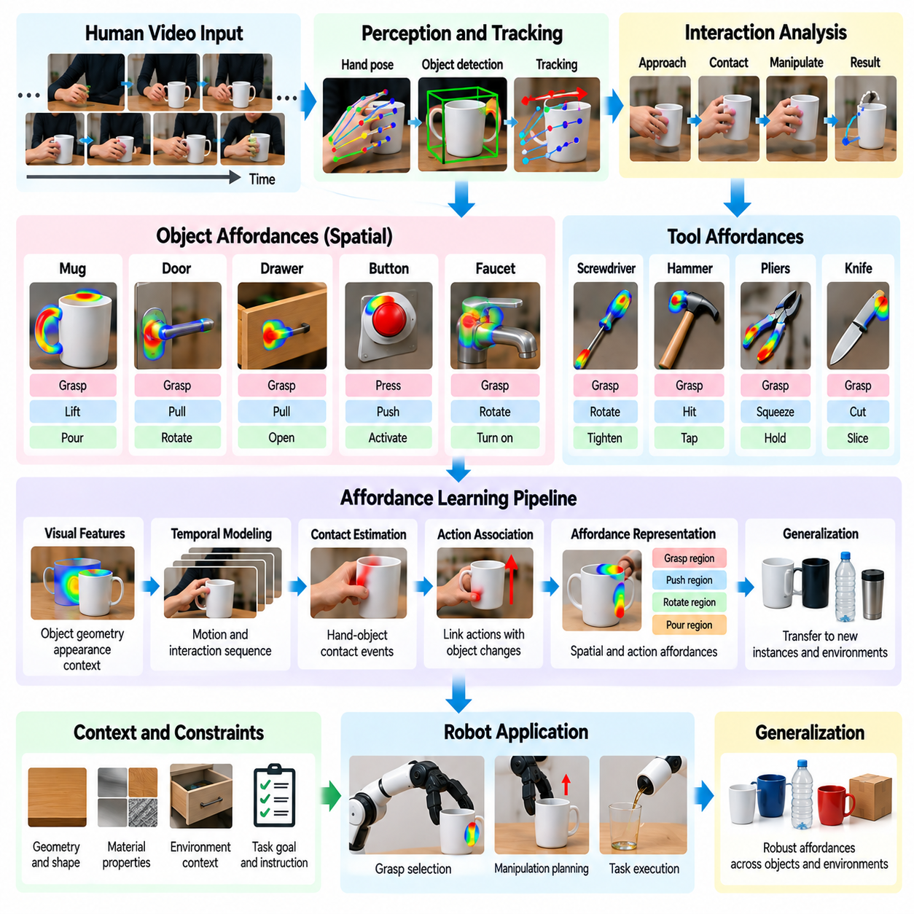{width="7.268055555555556in" height="7.268055555555556in"}

인간 영상(Human Video)으로부터 행동 유도성 학습(Affordance Learning)을 수행하면 피지컬 인공지능(Physical AI) 시스템은 물체를 활용하여 물리적 목표(Physical Goals)를 달성하는 방법을 이해할 수 있다. 행동 유도성(Affordance)은 행위자(Agent), 물체(Object), 환경(Environment) 사이의 관계에서 발생하는 행동 가능성(Action Opportunity)을 의미한다. 인간 시연(Human Demonstrations)은 파지(Grasping), 밀기(Pushing), 당기기(Pulling), 회전(Rotating), 도구 사용(Tool Use)을 통해 이러한 가능성을 보여주며, 단순한 시각적 물체 인식(Visual Object Recognition)을 넘어서는 행동적 근거(Behavioral Evidence)를 제공한다.

기존의 물체 분류(Object Classification)와 달리 행동 유도성 학습(Affordance Learning)은 어떤 행동이 가능하며 어떠한 조건에서 성공할 수 있는지에 초점을 맞춘다. 손잡이(Handle)는 파지와 당기기를 지원할 수 있으며, 평평한 표면(Flat Surface)은 밀기나 다른 물체를 지지하는 행동을 가능하게 할 수 있다. 이러한 가능성은 기하학적 구조(Geometry), 재료 특성(Material Properties), 작업 목표(Task Objectives), 행위자의 능력(Agent Capabilities)에 따라 달라지므로 행동 유도성은 본질적으로 관계적(Relational)이고 상황 의존적(Context Dependent)이다.

인간 영상(Human Video)은 사람들이 물체와 상호작용할 때 자연스럽게 기능적 영역(Functional Regions)을 선택하기 때문에 행동 유도성 발견(Affordance Discovery)을 위한 간접적인 지도 정보(Indirect Supervision)를 제공한다. 손이 손잡이, 버튼, 움직이는 부품(Movable Components)에 접근하는 장면을 반복적으로 관찰하면 가능한 상호작용 위치(Interaction Locations)를 파악할 수 있다. 접촉 패턴(Contact Patterns)을 결과적인 물체 변화(Object Changes)와 연결함으로써 학습 모델(Learning Models)은 광범위한 수작업 행동 유도성 주석(Manual Affordance Annotations) 없이도 행동 가능한 영역(Actionable Regions)을 식별할 수 있다.

시각적 행동 유도성 학습(Visual Affordance Learning)은 일반적으로 물체 검출(Object Detection), 분할(Segmentation), 손 추적(Hand Tracking), 시간적 상호작용 분석(Temporal Interaction Analysis)을 결합한다. 물체 분할(Object Segmentation)은 상호작용 후보 표면(Candidate Surfaces)을 식별하고, 손 궤적(Hand Trajectories)은 접근 방향(Approach Directions)과 잠재적인 접촉점(Potential Contact Points)을 보여준다. 관찰된 상태 변화(State Changes)는 상호작용 결과(Interaction Outcomes)에 관한 근거를 제공한다. 이러한 신호를 통합하면 시각적 외형(Visual Appearance)을 가능한 물리적 작업(Physical Operations)과 연결하는 표현(Representations)을 생성할 수 있다.

공간적 행동 유도성(Spatial Affordances)은 상호작용이 발생할 수 있는 위치를 설명하며, 행동 행동 유도성(Action Affordances)은 물체가 지원하는 작업의 종류를 나타낸다. 문손잡이(Door Handle)는 파지 가능한 영역(Graspable Region)을 제공할 수 있지만, 문을 열기 위해서는 적절한 당기기(Pulling)나 회전(Rotation)이 추가로 필요하다. 이러한 차원을 구분하면 학습 시스템(Learning Systems)이 접촉 가능성(Contact Feasibility)과 작업 완료(Task Completion)를 구별할 수 있어 더욱 정밀한 조작 계획(Manipulation Planning)을 지원한다.

행동 유도성 추론(Affordance Inference)은 고립된 프레임(Isolated Frames)이 아니라 시간에 따른 인간 행동(Human Actions)을 관찰할 때 더욱 풍부한 정보를 얻을 수 있다. 손이 서랍 손잡이(Drawer Handle)에 접근하는 장면은 파지 가능성(Possible Grasp)을 나타내지만, 이후 서랍이 움직이는 장면은 당기기 기능(Pulling Functionality)에 관한 더욱 강한 근거를 제공한다. 시간적 관측(Temporal Observations)은 상호작용 후보 영역(Candidate Interaction Regions)을 물리적 결과(Physical Consequences)와 연결하여 모델이 실제 행동 유도성과 우연한 근접성(Incidental Proximity)을 구별하도록 돕는다.

접촉 추정(Contact Estimation)은 영상에서 행동 유도성(Affordances)을 식별하는 데 핵심적인 역할을 한다. 손과 물체 사이의 근접성(Hand-Object Proximity), 상대 움직임(Relative Motion), 물체 변위(Object Displacement)는 의미 있는 상호작용이 발생하는 시점을 나타낼 수 있다. 그러나 깊이 모호성(Depth Ambiguity)과 가림 현상(Occlusion)으로 실제 접촉이 보이지 않을 수 있으므로 시각적 접촉 추정(Visual Contact Estimates)에는 불확실성이 존재한다. 강건한 시스템(Robust Systems)은 기하학적 추론(Geometric Reasoning)을 시간적 일관성(Temporal Consistency) 및 신뢰도 추정(Confidence Estimates)과 결합한다.

물체의 기하학적 구조(Object Geometry)는 사용 가능한 행동 유도성(Available Affordances)에 큰 영향을 미친다. 원통형 손잡이(Cylindrical Handles), 평평한 패널(Flat Panels), 경첩(Hinges), 관절형 연결부(Articulated Joints)는 인간이 물체와 상호작용할 수 있는 방식을 제한한다. 학습 시스템은 반복적으로 나타나는 기하학적 패턴(Geometric Patterns)을 관찰된 행동(Observed Actions)과 연결하여 익숙하지 않은 물체에 대한 일반화(Generalization)를 지원할 수 있다. 그러나 시각적으로 유사한 물체라도 서로 다른 기계적 특성(Mechanical Properties)과 작동 제약(Operational Constraints)을 가질 수 있다.

재료 특성(Material Properties)도 외형상 가능한 행동 유도성(Apparent Affordance)이 물리적으로 실행 가능한지 결정한다. 약한 손잡이(Fragile Handle)는 큰 당기는 힘(Pulling Force)을 견디지 못할 수 있으며, 미끄러운 표면(Slippery Surface)은 안정적인 파지(Stable Grasping)를 방해할 수 있다. 이러한 특성은 영상만으로 직접 추론하기 어려운 경우가 많다. 관찰된 성공(Successes), 실패(Failures), 수정 행동(Corrective Actions)은 간접적인 근거를 제공하지만, 신뢰성 있는 로봇 실행(Robotic Execution)을 위해서는 추가적인 센싱(Additional Sensing)이 필요할 수 있다.

도구 행동 유도성(Tool Affordances)은 도구가 여러 개체 사이에 기능적 관계(Functional Relationships)를 형성하기 때문에 직접적인 손-물체 상호작용(Hand-Object Interaction)을 넘어선다. 드라이버(Screwdriver)는 체결 부품(Fastener)과의 회전 결합(Rotational Engagement)을 가능하게 하며, 플라이어(Pliers)는 파지와 힘 전달(Force Transmission)을 지원한다. 도구 행동 유도성을 이해하려면 파지 영역(Grasp Regions), 작업 접촉면(Working Interfaces), 대상 물체(Target Objects), 협응 조작(Coordinated Manipulation)을 통해 발생하는 물리적 변환(Transformations)을 식별해야 한다.

작업 맥락(Task Context)은 특정 시점에 어떤 행동 유도성(Affordances)이 중요한지를 결정한다. 용기(Container)는 운반을 위해 파지하거나, 액체를 따르기 위해 기울이거나, 조립 과정에서 고정할 수 있다. 물체의 기하학적 구조(Geometry)는 변하지 않더라도 의도된 목표(Intended Objective)에 따라 선호되는 상호작용 전략(Interaction Strategy)은 달라진다. 따라서 상황 인식 모델(Context-Aware Models)은 물체 특징(Object Features)을 작업 명령(Task Instructions), 환경 조건(Environmental Conditions), 예상 결과(Expected Outcomes)와 결합한다.

행동 유도성 표현(Affordance Representations)은 공간적 히트맵(Spatial Heatmaps), 상호작용 지점(Interaction Points), 행동 범주(Action Categories), 물체 중심 변환(Object-Centered Transformations)으로 나타낼 수 있다. 히트맵(Heatmaps)은 유망한 접촉 영역(Contact Regions)을 식별하며, 변환 기반 표현(Transformation-Based Representations)은 원하는 물체 상태 변화(Object State Changes)를 설명한다. 이러한 표현 방식은 파지 위치 선택(Grasp Selection)부터 장기 조작 계획(Long-Horizon Manipulation Planning)에 이르기까지 서로 다른 로봇 응용(Robotic Applications)을 지원한다.

다양한 인간 시연(Diverse Human Demonstrations)으로부터 행동 유도성(Affordances)을 학습하면 물체 종류(Object Instances)와 환경(Environments)에 걸친 일반화 성능(Generalization Performance)을 향상시킬 수 있다. 여러 사례는 크기(Size), 형상(Shape), 방향(Orientation), 작업 공간 구성(Workspace Configuration)이 달라져도 효과적으로 유지되는 상호작용 패턴(Interaction Patterns)을 보여준다. 모델은 특정 물체의 외형(Object Appearances)이나 개별 인간의 움직임 방식(Human Movement Styles)에 지나치게 의존하지 않으면서 공통적인 기능적 특성(Functional Characteristics)을 학습할 수 있다.

약지도학습(Weakly Supervised Learning)은 대부분의 인간 영상(Human Videos)에 명시적인 행동 유도성 레이블(Explicit Affordance Labels)이 없기 때문에 유용하다. 행동 설명(Action Descriptions), 물체 범주(Object Categories), 추정된 접촉 사건(Estimated Contact Events)은 근사적인 지도 정보(Approximate Supervision)를 제공할 수 있다. 모델은 상호작용 결과(Interaction Outcomes)를 예측하거나 반복적인 손-물체 관계(Hand-Object Relationships)를 연결하여 기능적 영역(Functional Regions)을 발견할 수 있다. 그러나 잡음이 포함된 레이블(Noisy Labels)과 모호한 상호작용(Ambiguous Interactions)은 체계적인 오류(Systematic Errors)를 발생시킬 수 있다.

자기지도 영상 학습(Self-Supervised Video Learning)은 행동 유도성과 관련된 표현(Affordance-Related Representations)을 획득하는 또 다른 방법을 제공한다. 미래 물체 상태(Future Object States)를 예측하거나, 상호작용으로 발생한 변화(Interaction-Induced Changes)를 식별하거나, 성공한 시퀀스(Successful Sequences)와 실패한 시퀀스(Unsuccessful Sequences)를 비교하면 모델이 행동 관련 특징(Action-Relevant Features)을 포착하도록 유도할 수 있다. 이러한 학습 목표(Learning Objectives)는 모든 행동 유도성을 수작업으로 지정하지 않고도 유용한 학습 신호(Learning Signals)를 제공한다.

부정적 사례(Negative Examples)는 관찰된 상호작용이 항상 성공적인 기능 수행(Successful Functionality)을 의미하지 않기 때문에 특히 중요하다. 잠긴 서랍(Locked Drawer)을 당기려는 시도가 실패했다면 이는 잘못된 파지 위치(Incorrect Grasp Location)가 아니라 기계적 제약(Mechanical Constraint)을 나타낼 수 있다. 실행 불가능한 행동(Unavailable Actions), 부적절한 접촉 전략(Unsuitable Contact Strategies), 일시적인 환경적 제한(Temporary Environmental Restrictions)을 구별하면 모델이 잘못된 행동 유도성 관계(Misleading Affordance Relationships)를 학습하는 것을 방지할 수 있다.

행동 유도성 학습(Affordance Learning)은 인간과 로봇의 신체 구조 차이(Embodiment Differences)도 고려해야 한다. 인간의 손가락(Human Fingers)은 로봇 그리퍼(Robotic Grippers)가 접근하기 어려운 좁은 접촉 영역(Narrow Contact Regions)과 복잡한 파지 방식(Complex Grips)을 활용할 수 있다. 따라서 인간이 시연한 행동 유도성(Affordance)이 로봇에서 자동으로 실행 가능한 것은 아니다. 지식 전이(Transfer)를 위해서는 도달 가능성(Reachability), 엔드 이펙터 기하학(End-Effector Geometry), 힘 제한(Force Limits), 제어 능력(Control Capabilities)을 평가해야 한다.

물체 중심 행동 유도성 표현(Object-Centered Affordance Representations)은 인간의 정확한 움직임(Exact Human Motions)보다 상호작용 목표(Interaction Goals)를 강조함으로써 이러한 신체 구조 차이(Embodiment Gap)를 줄이는 데 도움이 된다. 로봇은 인간의 손 궤적(Human Hand Trajectory)을 그대로 재현하는 대신 적절한 접촉 영역(Contact Region)과 원하는 물체 변환(Desired Object Transformation)을 식별할 수 있다. 이후 로봇 전용 계획(Robot-Specific Planning)을 통해 물리적 제약(Physical Constraints)을 준수하면서 실행 가능한 파지 구성(Feasible Grasp Configurations)과 궤적(Trajectories)을 결정할 수 있다.

언어 기반 정합(Language Grounding)은 행동 유도성 지식(Affordance Knowledge)을 작업 명령(Task Instructions)과 연결할 수 있다. 손잡이를 잡기(Grasp the Handle), 조절 손잡이를 회전시키기(Rotate the Knob), 스위치를 누르기(Press the Switch)와 같은 표현은 물체와 의도된 행동(Intended Actions) 사이의 관계를 명시한다. 이러한 설명을 인간 영상(Human Video)과 정렬하면 모델이 언어적 목표(Linguistic Goals)를 상호작용 영역(Interaction Regions) 및 결과(Outcomes)와 연결하여 명령 조건부 로봇 조작(Instruction-Conditioned Robotic Manipulation)을 지원할 수 있다.

확장 가능한 피지컬 인공지능 데이터 엔진(Scalable Physical AI Data Engine)은 물체 추적(Object Tracking), 손 자세 추정(Hand Pose Estimation), 접촉 추론(Contact Inference), 행동 인식(Action Recognition)을 활용하여 대규모 인간 영상 집합(Large Human Video Collections)에서 행동 유도성 후보(Affordance Candidates)를 추출할 수 있다. 구조화된 기록(Structured Records)에는 물체 식별 정보(Object Identities), 기능적 영역(Functional Regions), 상호작용 유형(Interaction Types), 신뢰도 값(Confidence Values), 관찰된 결과(Observed Outcomes)가 포함될 수 있다. 이러한 기록은 특정 로봇 조작 능력(Robotic Manipulation Capabilities)을 위한 목표 지향적 검색(Targeted Retrieval)과 학습(Training)을 가능하게 한다.

평가(Evaluation)는 행동 유도성 인식(Affordance Recognition)과 성공적인 물리적 실행(Successful Physical Execution)을 구별해야 한다. 모델이 파지 가능한 영역(Graspable Region)을 정확하게 식별하더라도 부적절한 접근 기하학(Unsuitable Approach Geometry)이나 부족한 파지력(Insufficient Grip Force) 때문에 실패할 수 있다. 관련 평가 지표(Relevant Measures)에는 접촉 위치 추정 정확도(Contact Localization Accuracy), 행동 실행 가능성 예측(Action Feasibility Prediction), 물체 상태 변환 성공률(Object-State Transformation Success), 익숙하지 않은 물체와 환경에 대한 일반화(Generalization)가 포함된다.

궁극적으로 인간 영상 기반 행동 유도성 학습(Human Video Affordance Learning)은 시각적 경험(Visual Experience)을 실행 가능한 물리적 지식(Actionable Physical Knowledge)과 연결한다. 사람들이 접촉 영역(Contact Regions)을 선택하고, 물체의 기능(Object Functionality)을 활용하며, 변화하는 조건(Changing Conditions)에 맞추어 상호작용을 조정하는 방식을 관찰함으로써 피지컬 인공지능(Physical AI) 시스템은 가능한 행동(Possible Actions)에 관한 전이 가능한 표현(Transferable Representations)을 개발할 수 있다. 이러한 표현을 로봇 전용 센싱(Robot-Specific Sensing), 계획(Planning), 피드백(Feedback)과 결합하는 것은 실제 환경(Real Environments)에서 신뢰성 있는 조작(Reliable Manipulation)을 구현하는 데 필수적이다.

## 03.08. Learning Task Structure and Dynamics

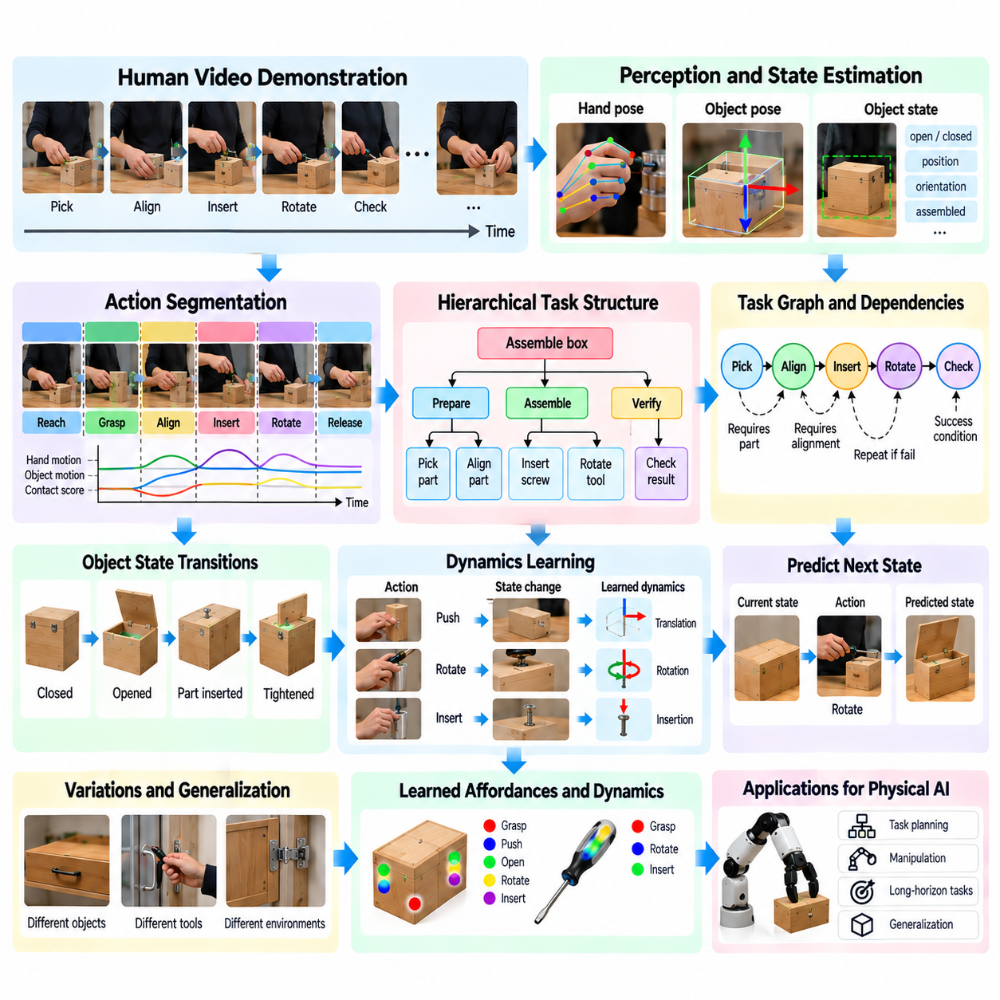{width="7.268055555555556in" height="7.268055555555556in"}

인간 영상(Human Video)으로부터 작업 구조(Task Structure)와 동역학(Dynamics)을 학습하면 피지컬 인공지능(Physical AI) 시스템은 복잡한 활동이 어떻게 구성되고 행동이 물리적 환경을 어떻게 변화시키는지 이해할 수 있다. 작업 구조는 목표(Goals), 하위 작업(Subtasks), 의존 관계(Dependencies) 사이의 관계를 설명하며, 동역학은 상호작용을 통해 물체 상태(Object States)가 어떻게 변화하는지를 설명한다. 이러한 두 관점을 결합하면 단순한 행동 인식(Action Recognition)을 넘어 계획(Planning), 예측(Prediction), 적응(Adaptation)을 지원할 수 있다.

인간 시연(Human Demonstrations)은 목표 지향적 행동(Goal-Directed Behavior)의 구성 방식에 관한 중요한 정보를 제공한다. 장비를 조립하는 사람은 부품을 준비하고, 부품을 정렬하고, 체결 부품(Fasteners)을 삽입하고, 결과를 검증할 수 있다. 이러한 활동은 최종 목표(Final Goal)와 연결된 일련의 중간 목표(Intermediate Objectives)를 형성한다. 반복적인 시연을 관찰함으로써 학습 시스템(Learning Systems)은 반복적으로 나타나는 작업 패턴(Task Patterns)을 식별하고 필수 작업(Essential Operations)과 선택적인 움직임(Optional Movements)을 구별할 수 있다.

작업 표현(Task Representations)은 고수준 목표(High-Level Objectives)를 점차 세분화된 행동(Detailed Actions)과 연결하는 계층적 구조(Hierarchical Structure)로 구성할 수 있다. 청소 작업(Cleaning Task)은 준비(Preparation), 표면 처리(Surface Treatment), 검사(Inspection), 완료(Completion) 단계로 구성될 수 있으며, 각 단계는 더 작은 작업으로 이루어진다. 계층적 학습(Hierarchical Learning)은 모델이 서로 다른 시간 척도(Temporal Scales)에 걸쳐 추론하도록 하며, 복잡한 명령(Complex Instructions)을 관리 가능한 로봇 기술(Robotic Skills)로 분해하는 과정을 지원한다.

작업 의존 관계(Task Dependencies)는 행동을 성공적으로 실행하기 전에 충족해야 하는 조건을 명시한다. 부품은 삽입하기 전에 정렬해야 할 수 있으며, 용기의 내용물을 꺼내기 전에 용기를 열어야 한다. 영상으로부터 이러한 관계를 학습하면 모델이 행동 선행 조건(Action Preconditions)과 예상 효과(Expected Effects)를 추론하는 데 도움이 된다. 이러한 지식은 올바른 작업 순서(Valid Task Sequencing)를 지원하고 계획 오류(Planning Errors)를 줄인다.

물리적 동역학(Physical Dynamics)은 시간에 따라 물체와 환경이 행동에 어떻게 반응하는지를 설명한다. 밀기(Pushing)는 물체의 위치(Position)를 변화시키고, 회전(Rotation)은 방향(Orientation)을 변화시키며, 도구 조작(Tool Operation)은 기계적 구성(Mechanical Configurations)을 변경할 수 있다. 인간 영상(Human Video)은 시각적 관측(Visual Observations)을 통해 이러한 상태 전환(State Transitions)을 간접적으로 기록한다. 학습 시스템은 시간적 변화(Temporal Changes)를 활용하여 행동, 물체 특성(Object Properties), 결과적인 물리적 상태(Physical States) 사이의 관계를 추정할 수 있다.

물체 중심 표현(Object-Centric Representations)은 인간의 정확한 움직임보다 관련 물체의 변화(Changes in Relevant Objects)를 통해 작업 진행(Task Progress)을 설명하기 때문에 특히 유용하다. 로봇은 사람의 손 궤적(Hand Trajectory)을 재현하지 않고도 서랍이 열린 상태(Open State)가 되어야 한다는 사실을 이해해야 할 수 있다. 원하는 물체 상태(Desired Object States)와 변환(Transformations)을 표현하면 학습된 지식을 서로 다른 로봇 신체 구조(Robot Embodiments)와 조작 메커니즘(Manipulation Mechanisms)에 더욱 쉽게 전이할 수 있다.

상태 추정(State Estimation)은 작업 동역학(Task Dynamics)을 학습하기 위한 기반을 제공한다. 모델은 관련 물체(Relevant Objects), 물체의 위치(Positions), 방향(Orientations), 관계(Relationships), 작동 상태(Operational Conditions)를 식별해야 한다. 일부 상태는 시각적으로 관찰할 수 있지만 내부 기계적 결합(Internal Mechanical Engagement)이나 가해진 힘(Applied Force)과 같은 상태는 관측되지 않는다. 따라서 영상 기반 시스템(Video-Based Systems)은 부분 관측 가능성(Partial Observability) 아래에서 추론하고 측정되지 않은 물리적 변수(Physical Variables)에 대한 불확실성(Uncertainty)을 유지해야 한다.

시간적 예측(Temporal Prediction)은 관찰된 상태(Observed States)를 미래에 발생할 가능성이 높은 변화(Future Developments)와 연결한다. 사람이 체결 부품(Fastener)에 도구를 위치시키는 장면을 관찰한 후 모델은 회전(Rotation)과 후속 조임(Tightening)을 예측할 수 있다. 예측 학습(Predictive Learning)은 고립된 외형(Isolated Appearances)이 아니라 행동의 결과(Action Consequences)를 포착하는 표현을 학습하도록 유도한다. 그러나 시각적으로 그럴듯한 예측(Plausible Visual Predictions)이 힘(Force)이나 접촉 동역학(Contact Dynamics)에 대한 물리적으로 정확한 모델을 의미하는 것은 아니다.

작업 구조(Task Structure)는 노드(Nodes)가 행동(Actions)이나 상태(States)를 나타내고 엣지(Edges)가 의존 관계(Dependencies)를 표현하는 절차 그래프(Procedural Graphs)로 나타낼 수 있다. 이러한 그래프는 대체 실행 경로(Alternative Execution Paths), 병렬 작업(Parallel Operations), 조건부 전환(Conditional Transitions)을 포착한다. 고정된 행동 목록(Fixed Action Lists)과 달리 그래프 기반 표현(Graph-Based Representations)은 동일한 목표에 도달하는 서로 다른 전략을 수용하며 유연한 로봇 작업 계획(Robotic Task Planning)을 위한 기반을 제공한다.

인간 영상(Human Video)에서 작업 그래프(Task Graphs)를 학습하려면 의미 있는 상태 전환(State Transitions)과 이들 사이의 관계를 식별해야 한다. 반복적인 관측(Repeated Observations)은 특정 행동이 다른 행동보다 일관되게 먼저 수행된다는 사실을 보여주며, 잠재적인 의존 관계(Potential Dependencies)를 시사할 수 있다. 그러나 시간적 순서(Temporal Ordering)만으로 인과성(Causality)이 입증되는 것은 아니다. 모델은 필수적인 물리적 선행 조건(Necessary Physical Prerequisites)을 시연자의 습관(Habits), 선호(Preferences), 우연한 작업 순서(Incidental Ordering)와 구별해야 한다.

인과적 추론(Causal Reasoning)은 개입(Interventions)을 그로 인해 발생하는 변화(Resulting Changes)와 연결함으로써 작업 이해(Task Understanding)를 향상시킨다. 사람이 패널(Panel)을 열기 전에 걸쇠(Latch)를 해제한다면, 걸쇠 해제는 후속 행동을 가능하게 하는 필수 작업(Necessary Enabling Action)일 수 있다. 대체 시연(Alternative Demonstrations)이나 실패 사례(Failed Attempts)를 관찰하면 이러한 추론을 강화할 수 있다. 그러나 수동적으로 관찰한 영상(Passive Video)만으로 도출한 인과적 결론(Causal Conclusions)은 개입 실험이나 추가적인 물리적 근거(Physical Evidence)가 없으면 여전히 불확실하다.

인간 시연(Human Demonstrations)은 작업 실행(Task Execution)의 다양성(Variations)도 보여준다. 서로 다른 작업자(Operators)는 대체 도구(Alternative Tools)를 사용하거나, 서로 독립적인 단계의 순서를 바꾸거나, 다른 조작 전략(Manipulation Strategies)을 선택할 수 있다. 학습 시스템(Learning Systems)은 어떤 변화가 작업 성공(Task Success)을 유지하고 어떤 변화가 필수 제약 조건(Essential Constraints)을 위반하는지 식별해야 한다. 이러한 구별은 모든 작업을 하나의 암기된 행동 시퀀스(Memorized Action Sequence)로 축소하지 않으면서 유연한 계획(Flexible Planning)을 가능하게 한다.

작업 동역학(Task Dynamics)에는 영상에서 완전히 관측할 수 없는 접촉(Contact), 마찰(Friction), 중력(Gravity), 변형(Deformation), 기계적 제약(Mechanical Constraints)이 포함될 수 있다. 모델은 물체가 움직임에 저항한다는 사실을 추론할 수 있지만, 그 원인이 되는 힘(Underlying Force)을 정확하게 식별하지 못할 수 있다. 따라서 영상에서 학습한 동역학(Video-Derived Dynamics)은 근사적인 예측 지식(Approximate Predictive Knowledge)으로 취급해야 하며, 로봇 상호작용(Robotic Interaction), 시뮬레이션(Simulation), 추가 센서 측정(Additional Sensor Measurements)을 통해 정교화해야 한다.

잠재 동역학 모델(Latent Dynamics Models)은 시각적 시퀀스(Visual Sequences)로부터 물리적 상태 전환(Physical State Transitions)의 압축된 표현(Compact Representations)을 학습한다. 이러한 모델은 모든 이미지 픽셀(Image Pixels)을 재구성하는 대신 물체 구성(Object Configuration)과 상호작용 관계(Interaction Relationships)의 변화를 예측할 수 있다. 이러한 추상화(Abstractions)는 계산 효율성(Computational Efficiency)과 계획 관련성(Planning Relevance)을 향상시킬 수 있다. 활용 가능성은 후속 로봇 의사결정(Downstream Robotic Decisions)에 필요한 물리적 정보를 얼마나 잘 보존하는지에 달려 있다.

월드 모델(World Models)은 서로 다른 행동에 따라 환경이 어떻게 변화할 수 있는지를 표현함으로써 작업 동역학 학습(Task Dynamics Learning)을 확장한다. 로봇은 예측된 상태 전환(Predicted State Transitions)을 활용하여 실행 전에 가능한 조작 시퀀스(Manipulation Sequences)를 비교할 수 있다. 인간 영상(Human Video)은 발생 가능한 물리적 변화(Plausible Physical Changes)의 사례를 제공하고, 로봇 전용 데이터(Robot-Specific Data)는 실행 가능한 제어 명령(Executable Controls)과 실제 상호작용 제약(Actual Interaction Constraints)에 관한 정보를 제공한다.

장기 작업(Long-Horizon Tasks)은 모델이 많은 중간 행동(Intermediate Actions)에 걸쳐 맥락(Context)을 유지하도록 요구한다. 초기 준비 단계(Early Preparation Steps)는 상당한 시간이 지난 후 수행되는 작업의 성공 여부를 결정할 수 있다. 계층적 메모리(Hierarchical Memory)와 상태 추적(State Tracking)은 이러한 의존 관계(Dependencies)를 보존하는 데 도움이 된다. 효과적인 표현(Effective Representations)은 기록된 모든 시각적 세부 사항(Visual Details)을 유지하기보다 지속적으로 중요한 작업 관련 변화(Persistent Task-Relevant Changes)에 집중한다.

언어 설명(Language Descriptions)은 목표(Goals), 선행 조건(Prerequisites), 의도된 결과(Intended Outcomes)를 식별함으로써 작업 구조 학습(Task Structure Learning)을 강화할 수 있다. 교육용 내레이션(Instructional Narration)은 부품을 체결하기 전에 정렬해야 하는 이유나 표면에 사전 처리가 필요한 이유를 설명할 수 있다. 이러한 설명을 관찰된 상태 변화(Observed State Changes)와 정렬하면 의미론적 작업 표현(Semantic Task Representations)을 지원할 수 있지만, 내레이션은 일부 단계를 생략하거나 작업을 부정확하게 설명할 수 있다.

약지도학습(Weakly Supervised Learning)은 광범위한 활동 레이블(Broad Activity Labels)이나 절차 설명(Procedural Descriptions)만 포함된 영상에서 작업 구성(Task Organization)을 추출할 수 있다. 모델은 상호작용 패턴(Interaction Patterns)을 군집화(Clustering)하고 물체 상태 전환(Object-State Transitions)을 검출하여 반복적으로 나타나는 하위 작업(Subtasks)을 발견할 수 있다. 자기지도 예측(Self-Supervised Prediction)은 상호 보완적인 학습 신호(Learning Signals)를 제공한다. 그러나 시각적 유사성(Visual Similarity)이 항상 기능적 동등성(Functional Equivalence)을 의미하는 것은 아니므로 자동으로 발견된 구조는 검증이 필요하다.

실패(Failures)와 복구 행동(Recovery Behaviors)은 작업 동역학(Task Dynamics)과 제약 조건(Constraints)에 관한 중요한 정보를 제공한다. 정렬이 잘못된 부품(Misaligned Component)은 삽입을 방해할 수 있으며, 작업자는 계속 진행하기 전에 부품의 위치를 다시 조정할 수 있다. 이러한 사례는 실패한 상태 전환(Unsuccessful Transitions)과 관련된 조건을 보여준다. 성공한 시연(Successful Demonstrations)과 실패한 시연(Failed Demonstrations)을 모두 학습하면 상태 예측(State Prediction), 오류 검출(Error Detection), 복구 계획(Recovery Planning)을 향상시킬 수 있다.

학습된 작업 지식(Task Knowledge)을 로봇으로 전이하려면 인간 관측에서 추출한 목표(Human-Observed Goals)를 실행 가능한 로봇 행동(Feasible Robot Actions)에 대응시켜야 한다. 작업 그래프(Task Graphs)는 원하는 상태 변화(Desired State Changes)를 지정할 수 있으며, 운동 계획기(Motion Planners)와 제어기(Controllers)는 실행 가능한 궤적(Executable Trajectories)을 결정한다. 도달 가능성(Reachability), 정교한 조작 능력(Dexterity), 적재 능력(Payload), 센싱(Sensing)의 차이를 고려해야 한다. 이러한 분리는 작업 수준 지식(Task-Level Knowledge)이 여러 로봇 플랫폼(Robotic Platforms)에서 유용하게 활용되도록 한다.

확장 가능한 피지컬 인공지능 데이터 엔진(Scalable Physical AI Data Engine)은 인간 영상(Human Videos)을 작업 목표(Task Goals), 하위 작업 경계(Subtask Boundaries), 물체 상태(Object States), 의존 관계(Dependencies), 관찰된 상태 전환(Observed Transitions)을 포함하는 구조화된 기록(Structured Records)으로 구성할 수 있다. 이러한 기록은 대규모 시연 집합(Large Demonstration Collections)에 걸친 검색(Retrieval), 학습(Training), 평가(Evaluation)를 지원한다. 이를 로봇 궤적(Robot Trajectories)과 시뮬레이션 데이터(Simulation Data)에 결합하면 추상적인 작업 지식(Abstract Task Knowledge)을 측정 가능한 물리적 실행(Measurable Physical Execution)과 연결하는 데 도움이 된다.

평가(Evaluation)는 학습된 작업 구조(Task Structures)와 동역학(Dynamics)이 실제 로봇 성능(Robotic Performance)을 향상시키는지 측정해야 한다. 관련 평가 기준(Evaluation Criteria)에는 의존 관계 예측(Dependency Prediction), 상태 전환 정확도(State-Transition Accuracy), 계획 성공률(Planning Success), 복구 효과성(Recovery Effectiveness), 익숙하지 않은 환경에 대한 일반화(Generalization)가 포함된다. 정확한 영상 예측(Video Prediction)만으로 성공적인 물리적 상호작용(Physical Interaction)이 보장되는 것은 아니므로 통제된 로봇 실험(Controlled Robot Experiments)이 특히 중요하다.

작업 구조와 동역학 학습(Learning Task Structure and Dynamics)은 인간 영상(Human Video)을 수동적인 시각 정보(Passive Visual Information)에서 목표(Goals), 의존 관계(Dependencies), 물리적 결과(Physical Consequences)에 관한 체계적인 지식으로 변환한다. 계층적 작업 표현(Hierarchical Task Representations), 물체 중심 상태 모델(Object-Centered State Models), 예측 동역학(Predictive Dynamics)을 통합함으로써 피지컬 인공지능(Physical AI) 시스템은 더욱 적응력 있는 계획 능력(Adaptable Planning Capabilities)을 개발할 수 있다. 이러한 지식을 신뢰성 있는 자율 행동(Reliable Autonomous Behavior)으로 전환하려면 로봇 전용 피드백(Robot-Specific Feedback)과 실행 경험(Execution Experience)이 여전히 필수적이다.

## 03.09. Human to Robot Retargeting

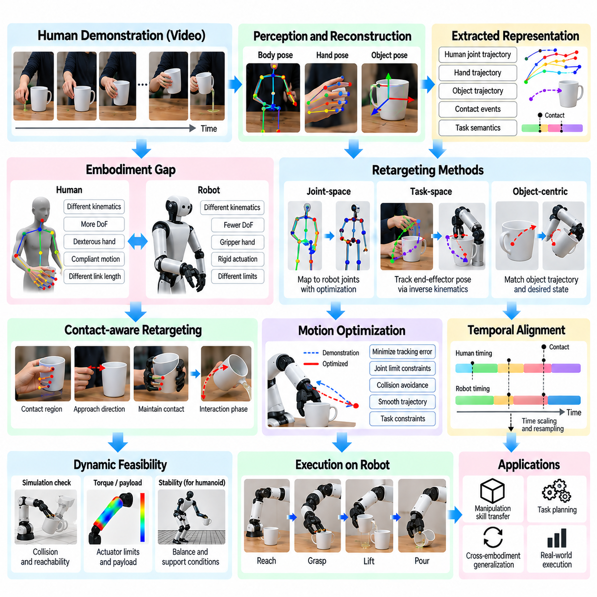{width="7.268055555555556in" height="7.268055555555556in"}

인간-로봇 동작 재매핑(Human-to-Robot Retargeting)은 해부학적 구조(Anatomy), 운동학(Kinematics), 제어 능력(Control Capabilities)의 차이에도 불구하고 인간 시연(Human Demonstrations)을 로봇이 실행할 수 있는 표현(Representations)으로 변환하는 기술이다. 인간 영상(Human Video)은 목적 지향적 움직임(Purposeful Movement)에 관한 풍부한 사례를 제공하지만, 인간의 관절 궤적(Joint Trajectories)을 직접 복제하는 것은 대부분 실행하기 어렵다. 따라서 동작 재매핑(Retargeting)은 작업 의도(Task Intent), 상호작용 기하학(Interaction Geometry), 물리적 결과(Physical Outcomes)를 보존하면서 대상 로봇(Target Robot)의 제약 조건에 맞게 움직임을 조정하는 것을 목표로 한다.

핵심적인 문제는 인간과 로봇 시스템(Robotic Systems) 사이의 신체 구조 차이(Embodiment Differences)에서 발생한다. 인간의 팔(Human Arms)은 복잡한 어깨 운동성(Shoulder Mobility), 유연한 관절(Compliant Joints), 높은 손 조작 능력(Hand Dexterity)을 갖지만, 로봇은 자유도(Degrees of Freedom)가 적거나 관절 배치(Joint Arrangements)가 다를 수 있다. 로봇이 인간과 유사한 형태를 가지더라도 링크 길이(Link Lengths), 관절 제한(Joint Limits), 구동 방식(Actuation)의 차이로 인해 직접적인 동작 전이(Motion Transfer)는 어렵다. 성공적인 재매핑을 위해서는 기능적 능력(Functional Capabilities) 사이의 명시적인 대응 관계(Correspondence)가 필요하다.

인간 동작 재구성(Human Motion Reconstruction)은 일반적으로 동작 재매핑 파이프라인(Retargeting Pipeline)의 첫 번째 단계이다. 컴퓨터 비전(Computer Vision) 모델은 단안 영상(Monocular Video)이나 다중 시점 영상(Multiview Video)에서 신체 자세(Body Pose), 손 자세(Hand Pose), 움직임 궤적(Movement Trajectories)을 추정한다. 이러한 추정 결과는 시연된 행동(Demonstrated Actions)에 대한 근사적인 3차원 표현(Three-Dimensional Representations)을 제공한다. 그러나 깊이 모호성(Depth Ambiguity), 가림 현상(Occlusion), 카메라 보정 오류(Camera Calibration Errors), 빠른 움직임(Rapid Movements)은 불확실성(Uncertainty)을 발생시키므로 로봇 실행 전에 반드시 고려해야 한다.

좌표 변환(Coordinate Transformation)은 관찰된 인간 움직임(Human Movements)과 로봇 작업 공간(Robot Workspace) 사이에 공통된 기하학적 기준(Common Geometric Reference)을 설정한다. 카메라 좌표계(Camera Coordinates)에서 추정된 인간 자세(Human Poses)는 물체 좌표계(Object Frames), 환경 기준점(Environmental Landmarks), 로봇 베이스 좌표계(Robot Base Coordinates)와 연결되어야 한다. 정확한 보정(Accurate Calibration)은 접촉이 많은 조작(Contact-Rich Manipulation)에서 특히 중요하다. 작은 공간 오차(Spatial Errors)도 파지 실패(Missed Grasps), 충돌(Collisions), 실행 중 잘못된 도구 정렬(Incorrect Tool Alignment)을 초래할 수 있다.

관절 공간 동작 재매핑(Joint-Space Retargeting)은 인간의 관절 구성(Human Joint Configurations)을 대응되는 로봇 관절 각도(Robot Joint Angles)로 변환하려는 방법이다. 인간과 로봇의 구조가 충분히 유사하다면 이러한 접근 방식은 인식 가능한 움직임 패턴(Recognizable Movement Patterns)을 보존할 수 있다. 그러나 운동학적 체인(Kinematic Chains)이 다르면 직접적인 관절 대응(Joint Correspondence)의 신뢰성이 떨어진다. 따라서 최적화 기법(Optimization Methods)을 사용하여 관절 제한(Joint Limits)을 만족시키고, 실행 가능한 구성(Feasible Configurations)을 유지하며, 중요한 동작 특징(Motion Features)과의 차이를 최소화한다.

작업 공간 동작 재매핑(Task-Space Retargeting)은 정확한 관절 구성(Exact Joint Configurations)보다 관련 신체 부위(Relevant Body Parts)나 엔드 이펙터(End Effectors)의 위치(Position)와 방향(Orientation)을 강조한다. 로봇은 서로 다른 팔꿈치 자세(Elbow Posture)를 사용하면서도 인간 손목(Human Wrist)의 움직임을 재현할 수 있다. 역운동학(Inverse Kinematics)은 원하는 엔드 이펙터 자세(Desired End-Effector Poses)를 실행 가능한 로봇 관절 상태(Feasible Robot Joint States)로 변환한다. 이러한 방식은 더 폭넓은 신체 구조 간 전이(Embodiment Transfer)를 지원하지만, 작업 공간 목표(Task-Space Targets)는 도달 가능하고 충돌이 없어야 한다.

물체 중심 동작 재매핑(Object-Centric Retargeting)은 조작 대상 물체(Manipulated Objects)의 의도된 변환(Intended Transformation)에 초점을 맞춘다. 사람이 서랍을 열 때 핵심 목표는 사람의 팔 움직임을 복제하는 것이 아니라 서랍을 허용된 방향(Permitted Direction)으로 이동시키는 것이다. 물체 궤적(Object Trajectories), 접촉 영역(Contact Regions), 원하는 최종 상태(Desired Final States)를 표현하면 서로 다른 매니퓰레이터(Manipulators)를 가진 로봇도 각기 다른 움직임 전략(Movement Strategies)을 통해 동등한 작업(Equivalent Tasks)을 수행할 수 있다.

접촉 인식 동작 재매핑(Contact-Aware Retargeting)은 인간의 손(Human Hand), 조작 대상 물체(Manipulated Objects), 주변 표면(Surrounding Surfaces) 사이의 관계를 보존한다. 접촉 위치(Contact Locations), 접근 방향(Approach Directions), 상호작용 단계(Interaction Phases)는 움직임이 의도한 효과(Intended Effect)를 발생시킬 수 있는지를 결정한다. 파지 시연(Grasping Demonstration)은 들어 올리는 동안 접촉 안정성(Contact Stability)을 유지해야 할 수 있으며, 밀기 행동(Pushing Action)은 적절한 힘의 방향(Force Direction)을 요구한다. 이러한 관계를 무시하면 시각적으로 유사하지만 물리적으로 효과가 없는 로봇 움직임이 생성될 수 있다.

인간 손 동작 재매핑(Human Hand Retargeting)은 로봇 그리퍼(Robotic Grippers)가 생물학적 손(Biological Hands)의 전체적인 정교함(Dexterity)을 재현하기 어렵기 때문에 특히 복잡하다. 인간 시연에는 손끝 정밀 조작(Fingertip Precision), 손바닥 접촉(Palm Contact), 손가락 협응 운동(Coordinated Finger Motion), 지속적인 파지 조정(Continuous Grip Adjustment)이 포함될 수 있다. 동작 재매핑 시스템(Retargeting Systems)은 이러한 패턴을 로봇이 지원하는 실행 가능한 파지 유형(Feasible Grasp Types)으로 변환해야 한다. 기능적 파지 동등성(Functional Grasp Equivalence)은 해부학적 유사성(Anatomical Similarity)보다 중요한 경우가 많다.

동작 최적화(Motion Optimization)는 서로 경쟁하는 동작 재매핑 목표(Retargeting Objectives) 사이의 균형을 맞추기 위한 수학적 프레임워크(Mathematical Framework)를 제공한다. 최적화 문제(Optimization Problem)는 엔드 이펙터 추적 오차(End-Effector Tracking Error), 관절 변위(Joint Displacement), 충돌 위험(Collision Risk), 시연된 물체 움직임(Demonstrated Object Motion)과의 차이를 최소화할 수 있다. 제약 조건(Constraints)은 관절 제한(Joint Limits), 작업 공간 경계(Workspace Boundaries), 접촉 요구사항(Contact Requirements)을 강제한다. 목적 함수 가중치(Objective Weights)는 로봇 동작 생성(Robot Motion Generation) 과정에서 인간 행동의 어떤 측면을 우선할지 결정한다.

시간적 정렬(Temporal Alignment)은 인간과 로봇의 움직임 속도(Movement Speeds)가 다를 수 있기 때문에 필요하다. 가속 능력(Acceleration Capability)이 제한되거나 액추에이터(Actuators)가 느린 로봇은 인간의 동작 타이밍(Human Timing)을 항상 재현할 수 없다. 시간 스케일링(Time Scaling)과 궤적 재샘플링(Trajectory Resampling)은 중요한 행동 단계(Action Phases)를 보존하면서 동작 지속 시간(Motion Duration)을 조정한다. 전체 실행 속도(Execution Speed)가 달라지더라도 접촉 사건(Contact Events)과 물체 상태 전환(Object-State Transitions)의 순서는 올바르게 유지되어야 한다.

궤적 평활화(Trajectory Smoothing)는 잡음이 포함된 자세 추정(Noisy Pose Estimates)이나 불연속적인 최적화 해(Discontinuous Optimization Solutions)로 인해 발생하는 급격한 변화를 줄인다. 필터링(Filtering), 스플라인 보간(Spline Interpolation), 제약 기반 궤적 생성(Constrained Trajectory Generation)은 움직임의 연속성(Motion Continuity)을 향상시킬 수 있다. 그러나 과도한 평활화(Excessive Smoothing)는 접촉과 관련된 의도적인 정지(Intentional Pauses)나 급격한 전환(Sharp Transitions)을 제거할 수 있다. 효과적인 동작 재매핑은 로봇의 속도(Velocity), 가속도(Acceleration), 저크(Jerk) 제약을 만족하면서 작업 관련 동작 구조(Task-Relevant Motion Structure)를 보존해야 한다.

동역학적 실행 가능성(Dynamic Feasibility)은 기하학적 동작 일치(Geometric Motion Matching)를 넘어 동작 재매핑의 범위를 확장한다. 운동학적으로 도달 가능한 궤적(Kinematically Reachable Trajectory)이라도 액추에이터 토크(Actuator Torque), 적재 하중(Payload), 균형 제한(Balance Limits)을 초과할 수 있다. 휴머노이드(Humanoids)와 모바일 매니퓰레이션 시스템(Mobile Manipulation Systems)은 안정성(Stability)과 지지 조건(Support Conditions)도 고려해야 한다. 동역학 모델(Dynamic Models)과 시뮬레이션(Simulation)은 실행 전에 실현 불가능한 움직임(Infeasible Motions)을 식별하여 기계적 과부하(Mechanical Overload)나 균형 상실(Loss of Balance)의 위험을 줄일 수 있다.

힘(Force)과 순응성(Compliance)은 접촉이 많은 작업(Contact-Rich Tasks)의 동작 재매핑에서 중요하다. 인간 작업자(Human Operators)는 촉각 인지(Tactile Perception)와 근육의 순응성(Muscular Compliance)을 통해 가해지는 힘(Applied Force)을 자연스럽게 조절하지만, 일반적인 영상(Ordinary Video)은 이러한 물리량을 직접 측정하지 못한다. 로봇 제어기(Robot Controllers)는 적절한 상호작용 전략(Interaction Strategies)을 추론하고 힘 센싱(Force Sensing)이나 순응 제어(Compliant Control)를 통해 접촉을 조절해야 한다. 환경 강성(Environmental Stiffness)이나 접촉 조건(Contact Conditions)이 불확실한 경우 순수한 위치 추적(Pure Position Tracking)은 안전하지 않을 수 있다.

영상 기반 동작 재매핑(Video-Based Retargeting)은 실제 측정된 기준 궤적(Ground-Truth Trajectories)이 아니라 추정된 인간 움직임(Estimated Human Motion)에 의존하는 경우가 많다. 자세 재구성(Pose Reconstruction)의 오류는 로봇 계획(Robot Planning)과 실행(Execution)으로 전파될 수 있다. 신뢰도 인식 최적화(Confidence-Aware Optimization)는 불확실한 관측(Uncertain Observations)에 대한 의존도를 줄일 수 있으며, 물체 추적(Object Tracking)은 추가적인 기하학적 제약(Geometric Constraints)을 제공한다. 여러 시연(Multiple Demonstrations)은 일관된 작업 요구사항(Consistent Task Requirements)과 우연히 발생한 인간 움직임(Accidental Human Movements)을 구별하는 데 도움이 될 수 있다.

학습 기반 동작 재매핑(Learning-Based Retargeting)은 시연 데이터셋(Demonstration Datasets)에서 대응 관계(Correspondences)를 발견함으로써 해석적 운동학 기법(Analytical Kinematic Methods)을 보완할 수 있다. 신경망 모델(Neural Models)은 인간 관측(Human Observations)으로부터 로봇 엔드 이펙터 목표(Robot End-Effector Targets), 파지 구성(Grasp Configurations), 잠재 행동 표현(Latent Action Representations)을 예측할 수 있다. 로봇 상호작용 데이터(Robot Interaction Data)를 활용한 학습은 신체 구조 호환성(Embodiment Compatibility)을 향상시킨다. 그러나 시각적으로 그럴듯한 예측(Visually Plausible Predictions)이 물리적 제약(Physical Constraints)을 위반할 수 있으므로 학습된 매핑(Learned Mappings)은 검증이 필요하다.

시뮬레이션(Simulation)은 실제 배치(Deployment) 전에 재매핑된 행동(Retargeted Behaviors)을 시험할 수 있는 통제된 환경(Controlled Environment)을 제공한다. 후보 궤적(Candidate Trajectories)은 도달 가능성(Reachability), 충돌(Collisions), 접촉 안정성(Contact Stability), 작업 완료(Task Completion)를 기준으로 평가할 수 있다. 도메인 무작위화(Domain Randomization)는 물체 기하학(Object Geometry), 마찰(Friction), 위치 설정(Positioning)의 다양한 변화에 시스템을 노출한다. 시뮬레이션 결과는 근사적이므로 가상 실행(Virtual Execution)에 성공하더라도 신중한 실제 환경 검증(Real-World Validation)이 뒤따라야 한다.

로봇 피드백(Robot Feedback)은 재매핑된 행동(Retargeted Actions)을 반복적으로 수정할 수 있도록 한다. 시각 서보잉(Visual Servoing)은 물체 위치 추정 오류(Object Localization Errors)를 보정할 수 있으며, 촉각 및 힘 피드백(Tactile and Force Feedback)은 파지 안정화(Grasp Stabilization)와 접촉 조정(Contact Adjustment)을 지원한다. 폐루프 실행(Closed-Loop Execution)은 환경이 원래 시연(Original Demonstration)과 다를 때 특히 유용하다. 로봇은 고정된 궤적(Fixed Trajectory)을 단순히 재생하는 대신 관찰된 작업 진행(Observed Task Progress)에 맞추어 행동을 지속적으로 조정한다.

작업 수준 동작 재매핑(Task-Level Retargeting)은 달성해야 하는 목표(What Must Be Achieved)와 로봇이 이를 수행하는 방법(How the Robot Accomplishes It)을 분리한다. 인간 시연(Human Demonstration)은 손잡이 파지(Grasp the Handle), 캐비닛 열기(Open the Cabinet), 물체를 내부에 배치하기(Place an Object Inside)와 같은 목표로 변환될 수 있다. 이후 로봇 계획기(Robot Planner)는 자체 신체 구조(Embodiment)에 적합한 움직임을 선택한다. 이러한 추상화(Abstraction)는 동일한 물리적 구조(Physical Structures)를 요구하지 않으면서 매니퓰레이터(Manipulators), 휴머노이드(Humanoids), 모바일 로봇(Mobile Robots) 사이의 전이를 지원한다.

언어(Language)와 의미론적 작업 표현(Semantic Task Representations)은 시연된 움직임(Demonstrated Movements)의 기능적 목적(Functional Purpose)을 식별함으로써 동작 재매핑을 향상시킬 수 있다. 명령(Instructions)은 손 움직임이 물체를 회전(Rotate), 안정화(Stabilize), 운반(Transport), 검사(Inspect)하기 위한 것인지 명확하게 설명한다. 언어 기반 정합(Language Grounding)을 물체 상태 예측(Object-State Prediction)과 결합하면 우연한 제스처(Incidental Gestures)보다 의미 있는 변환(Meaningful Transformations)을 우선할 수 있다. 이는 인간 시연에 불필요하거나 모호한 움직임(Unnecessary or Ambiguous Movements)이 포함된 경우 특히 유용하다.

확장 가능한 피지컬 인공지능 데이터 엔진(Scalable Physical AI Data Engine)은 인간 영상 집합(Human Video Collections)을 구조화된 동작 재매핑 기록(Structured Retargeting Records)으로 변환할 수 있다. 이러한 기록에는 추정된 신체 자세(Estimated Body Poses), 손 궤적(Hand Trajectories), 물체 좌표계(Object Coordinate Frames), 접촉 사건(Contact Events), 작업 목표(Task Goals), 신뢰도 측정값(Confidence Measurements)이 포함될 수 있다. 이후 로봇 전용 처리(Robot-Specific Processing)를 통해 실행 가능한 궤적(Feasible Trajectories)이나 정책 학습 목표(Policy Training Targets)를 생성할 수 있다. 데이터 출처 정보(Provenance)와 불확실성 메타데이터(Uncertainty Metadata)를 유지하면 재현성(Reproducibility)과 체계적인 품질 관리(Systematic Quality Control)를 지원할 수 있다.

평가(Evaluation)는 동작 대응성(Motion Correspondence)과 물리적 작업 성공(Physical Task Success)을 모두 측정해야 한다. 유용한 평가 지표(Metrics)에는 엔드 이펙터 추적 오차(End-Effector Tracking Error), 물체 상태 정확도(Object-State Accuracy), 충돌 빈도(Collision Frequency), 제약 조건 위반(Constraint Violations), 실행 안정성(Execution Stability), 작업 완료율(Completion Rate)이 포함된다. 신체 구조 간 평가(Cross-Embodiment Evaluation)는 동일한 시연이 서로 다른 로봇 플랫폼(Robot Platforms)을 지원할 수 있는지 판단한다. 기하학적 유사성(Geometric Similarity)만으로 신뢰성 있는 조작 성능(Reliable Manipulation Performance)을 입증할 수 없으므로 실제 환경 실험(Real-World Experiments)이 필수적이다.

인간-로봇 동작 재매핑(Human-to-Robot Retargeting)은 풍부한 인간 영상 데이터(Human Video Data)와 실행 가능한 로봇 행동(Executable Robotic Behavior)을 연결하는 핵심 기술이다. 동작 재구성(Motion Reconstruction), 기하학적 대응(Geometric Correspondence), 물체 중심 목표(Object-Centered Goals), 제약 기반 최적화(Constrained Optimization), 피드백 제어(Feedback Control)를 결합함으로써 피지컬 인공지능(Physical AI) 시스템은 인간의 경험(Human Experience)을 로봇과 호환되는 행동(Robot-Compatible Actions)으로 변환할 수 있다. 신뢰성 있는 전이(Reliable Transfer)를 위해서는 기능적 의도(Functional Intent)를 보존하면서 대상 로봇(Target Robot)의 물리적 능력(Physical Capabilities)과 환경적 제약(Environmental Constraints)을 준수해야 한다.

## 03.10. Cross Embodiment Correspondence

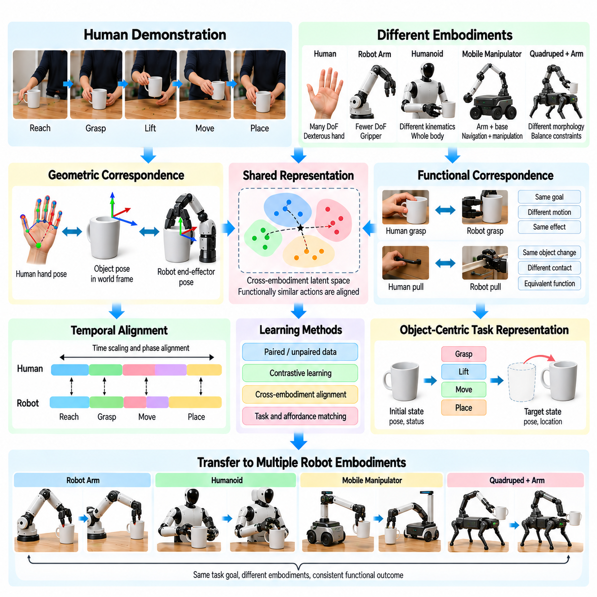{width="7.268055555555556in" height="7.268055555555556in"}

신체 구조 간 대응(Cross-Embodiment Correspondence)은 피지컬 인공지능(Physical AI) 시스템이 서로 다른 신체 구조(Bodies), 센서(Sensors), 제어 메커니즘(Control Mechanisms)을 가진 행위자(Agents) 사이에서 지식을 전이할 수 있도록 한다. 인간 시연(Human Demonstrations)은 목표(Goals)와 상호작용(Interactions)에 관한 중요한 정보를 포함하지만, 인간의 움직임을 로봇이 항상 재현할 수 있는 것은 아니다. 대응 관계 학습(Correspondence Learning)은 서로 다른 신체 구조에서도 의미를 유지하는 공통적인 기능적 관계(Functional Relationships)를 식별하여 동일한 물리적 구조 없이도 지식 전이(Knowledge Transfer)를 가능하게 한다.

신체 구조 차이(Embodiment Differences)는 관절 구성(Joint Configurations), 사지 크기(Limb Dimensions), 자유도(Degrees of Freedom), 액추에이터 성능(Actuator Capabilities), 센싱 구성(Sensing Arrangements)의 차이에서 발생한다. 인간의 손(Human Hand)은 손가락의 협응 운동(Coordinated Finger Movements)을 통해 물체를 조작할 수 있지만, 평행 그리퍼(Parallel-Jaw Gripper)는 더욱 제한적인 접촉 패턴(Contact Patterns)을 제공한다. 동일한 작업을 수행하는 로봇이라도 서로 다른 궤적(Trajectories)이 필요할 수 있다. 따라서 효과적인 대응 관계(Correspondence)는 작업 관련 행동(Task-Relevant Behavior)과 신체 구조에 종속적인 움직임(Embodiment-Specific Motion)을 구별해야 한다.

기하학적 대응(Geometric Correspondence)은 신체 부위(Body Parts), 엔드 이펙터(End Effectors), 물체(Objects), 작업 공간 좌표(Workspace Coordinates) 사이의 관계를 설정한다. 인간 손목 궤적(Human Wrist Trajectories)은 로봇 그리퍼 자세(Robotic Gripper Poses)와 연결할 수 있으며, 관찰된 물체 위치(Object Positions)는 공통적인 공간 기준(Spatial References)을 제공한다. 좌표 변환(Coordinate Transformations)과 보정(Calibration)은 일관된 비교를 가능하게 한다. 그러나 기하학적 정렬(Geometric Alignment)만으로 대응되는 움직임이 동등한 물리적 결과(Equivalent Physical Outcomes)를 생성한다고 보장할 수는 없다.

기능적 대응(Functional Correspondence)은 움직임의 외형보다 행동이 달성하는 결과에 초점을 맞춘다. 사람은 손을 사용하여 캐비닛(Cabinet)을 열 수 있지만, 로봇은 특수 그리퍼(Specialized Gripper)나 기계적 도구(Mechanical Tool)를 사용할 수 있다. 관절 움직임(Joint Motions)은 다르지만 두 행동 모두 동일한 물체 상태 전환(Object-State Transition)을 달성한다. 상호작용을 목표(Goals), 제약 조건(Constraints), 결과(Outcomes)를 통해 표현하면 신체 구조 간 학습(Cross-Embodiment Learning)에 더욱 적합한 전이 기반(Transferable Basis)을 제공할 수 있다.

물체 중심 표현(Object-Centric Representations)은 인간 행동(Human Behavior)과 로봇 행동(Robotic Behavior) 사이의 공통 인터페이스(Common Interface)를 제공한다. 모델은 관절 각도(Joint Angles)만 인코딩하는 대신 물체 자세(Object Poses), 접촉 영역(Contact Regions), 상대 변환(Relative Transformations), 원하는 최종 구성(Desired Final Configurations)을 설명한다. 이러한 변수는 서로 다른 행위자(Agents) 사이에서도 의미를 유지하는 경우가 많다. 이후 로봇 전용 제어기(Robot-Specific Controllers)는 공유된 물체 수준 목표(Object-Level Objectives)를 각 플랫폼의 물리적 제약(Physical Constraints)을 만족하는 실행 가능한 움직임(Feasible Motions)으로 변환할 수 있다.

행동 대응(Action Correspondence)은 여러 추상화 수준(Abstraction Levels)에서 정의할 수 있다. 저수준 대응(Low-Level Correspondence)은 관절 움직임(Joint Movements)이나 엔드 이펙터 궤적(End-Effector Trajectories)을 연결하며, 고수준 대응(Higher-Level Correspondence)은 파지(Grasping), 밀기(Pushing), 들어 올리기(Lifting), 조립(Assembly)과 같은 작업을 연결한다. 작업 수준 대응(Task-Level Correspondence)은 의도된 결과(Intended Outcomes)와 절차적 의존 관계(Procedural Dependencies)를 포착한다. 이러한 수준을 결합하면 모든 인간 움직임에 직접적으로 대응하는 로봇 움직임이 있다고 가정하지 않으면서 유용한 세부 정보를 보존할 수 있다.

접촉 관계(Contact Relationships)는 조작(Manipulation)이 행위자와 물체 사이에서 힘이 전달되는 방식에 의존하기 때문에 특히 중요하다. 인간은 여러 손가락(Fingers)을 사용하여 부품을 안정화할 수 있지만, 로봇은 고정 지그(Fixture)나 두 번째 매니퓰레이터(Second Manipulator)를 사용할 수 있다. 물리적 접촉 구성(Physical Contact Configuration)은 다르지만 기능적 요구사항(Functional Requirement)은 유사하게 유지된다. 대응 관계 학습(Correspondence Learning)은 단순히 접촉 위치(Contact Locations)를 일치시키는 것이 아니라 상호작용 효과(Interaction Effects)를 보존해야 한다.

행동 유도성 대응(Affordance Correspondence)은 서로 다른 신체 구조에서 공유되거나 변형되는 행동 가능성(Action Opportunities)을 식별한다. 인간이 파지할 수 있는 손잡이(Handle)라도 대형 로봇 그리퍼(Large Robotic Gripper)는 접근하지 못할 수 있지만, 다른 메커니즘을 통해 해당 문을 여는 것은 가능할 수 있다. 모델은 물체 기능(Object Functionality)과 행위자별 행동 실행 가능성(Agent-Specific Action Feasibility)을 구별해야 한다. 이러한 구별은 적응형 계획(Adaptive Planning)을 지원하고 잘못된 전이(Invalid Transfers)를 방지한다.

인간 영상(Human Video)은 기능적 행동(Functional Actions)에 관한 관측 근거(Observational Evidence)를 제공하지만, 힘(Forces), 관절 토크(Joint Torques), 접촉 역학(Contact Mechanics)에 대한 완전한 측정값을 포함하는 경우는 드물다. 시각적 자세 추정(Visual Pose Estimation)은 근사적인 움직임 기하학(Motion Geometry)을 복원할 수 있으며, 물체 추적(Object Tracking)은 상태 변화(State Changes)를 보여준다. 그러나 관측되지 않는 물리적 변수(Hidden Physical Variables)에는 여전히 불확실성(Uncertainty)이 존재한다. 따라서 신체 구조 간 대응 모델(Cross-Embodiment Models)은 영상 기반 표현(Video-Derived Representations)을 로봇 센싱(Robotic Sensing) 및 상호작용 데이터(Interaction Data)와 결합함으로써 이점을 얻을 수 있다.

공유 잠재 표현(Shared Latent Representation)을 학습하는 것은 대응 관계 발견(Correspondence Discovery)을 위한 하나의 접근 방식이다. 인코더(Encoders)는 인간 관측(Human Observations)과 로봇 궤적(Robot Trajectories)을 공통 특징 공간(Common Feature Space)으로 변환하여 기능적으로 유사한 행동(Functionally Similar Actions)이 서로 가까운 위치에 표현되도록 한다. 대조 학습(Contrastive Learning)은 대응되는 시연(Corresponding Demonstrations) 사이의 정렬(Alignment)을 촉진할 수 있다. 그러나 공유 임베딩(Shared Embeddings)은 작업 관련 차이(Task-Relevant Distinctions)를 보존해야 하며, 물리적으로 서로 다른 행동을 오해를 일으키는 유사성(Misleading Similarities)으로 축소하지 않아야 한다.

쌍을 이루는 시연(Paired Demonstrations)은 인간과 로봇이 유사한 환경(Comparable Environments)에서 동등한 작업(Equivalent Tasks)을 수행할 때 강력한 지도 정보(Supervision)를 제공한다. 모델은 두 영역(Domains)에 걸쳐 물체 상태 전환(Object-State Transitions), 상호작용 단계(Interaction Phases), 성공적인 결과(Successful Outcomes)를 정렬할 수 있다. 그러나 이러한 시연 쌍을 수집하는 데는 많은 비용이 들며, 다양한 로봇 플랫폼(Robot Platforms)을 대상으로 할 경우 더욱 어렵다. 약한 쌍 구성 학습(Weakly Paired Learning)이나 비쌍 학습(Unpaired Learning)은 직접적인 대응 관계 요구사항(Direct Correspondence Requirements)을 줄이면서 더 광범위한 데이터셋(Datasets)을 활용하려는 방법이다.

시간적 정렬(Temporal Alignment)은 동등한 행동이라도 지속 시간(Duration)과 실행 순서(Execution Sequences)가 다를 수 있기 때문에 필요하다. 인간은 빠르고 협응된 움직임(Coordinated Movements)을 수행할 수 있지만, 로봇은 더 느린 접근 동작(Approach Motions)이나 추가적인 안정화 단계(Stabilization Steps)가 필요할 수 있다. 동적 시간 왜곡(Dynamic Time Warping)과 학습 기반 시퀀스 정렬(Learned Sequence Alignment)은 대응되는 상호작용 단계(Interaction Phases)를 연결할 수 있다. 정렬은 동일한 타이밍(Identical Timing)을 강제하기보다 의미 있는 상태 전환(Meaningful State Transitions)을 강조해야 한다.

신체 구조 간 대응(Cross-Embodiment Correspondence)은 로봇 플랫폼(Robotic Platforms) 사이의 형태학적 차이(Morphological Differences)에도 영향을 받는다. 휴머노이드(Humanoid)는 인간의 손 뻗기 패턴(Human Reaching Patterns)을 재현할 수 있지만, 모바일 매니퓰레이터(Mobile Manipulator)는 이동(Navigation)과 팔 움직임(Arm Motion)을 협응해야 한다. 로봇 팔이 장착된 사족보행 로봇(Quadruped with an Attached Arm)은 서로 다른 균형 제약(Balance Constraints)과 작업 공간 제약(Workspace Constraints)을 가진다. 공유 작업 표현(Shared Task Representations)은 이러한 시스템을 지원할 수 있지만, 동작 생성(Motion Generation)은 각 형태(Morphology)에 맞게 이루어져야 한다.

운동학적 실행 가능성(Kinematic Feasibility)은 제안된 대응 관계(Proposed Correspondence)가 관절 및 작업 공간 제한(Joint and Workspace Limits) 내에서 실행될 수 있는지를 결정한다. 역운동학(Inverse Kinematics)과 제약 기반 최적화(Constrained Optimization)는 공유된 엔드 이펙터 목표(Shared End-Effector Objectives)를 로봇 전용 구성(Robot-Specific Configurations)으로 변환할 수 있다. 충돌 회피(Collision Avoidance)와 특이점 처리(Singularity Handling)는 실행 가능한 해(Feasible Solutions)를 추가로 제한한다. 대응 모델(Correspondence Models)은 시각적으로 유사한 행동이 모든 로봇에서 실행 가능하다고 가정하는 대신 이러한 제한을 명시적으로 표현해야 한다.

동역학적 실행 가능성(Dynamic Feasibility)은 대응 관계 평가(Correspondence Evaluation)에 액추에이터 토크(Actuator Torque), 적재 하중(Payload), 관성(Inertia), 균형(Balance), 접촉 안정성(Contact Stability)을 포함한다. 기하학적으로 가능한 움직임이라도 로봇의 물리적 능력(Physical Capabilities)을 초과할 수 있다. 인간 시연(Human Demonstrations)은 대상 플랫폼(Target Platform)에서 사용할 수 없는 순응성(Compliance)이나 빠른 힘 조절(Rapid Force Adjustments)을 활용할 수도 있다. 동역학 모델(Dynamic Models)과 시뮬레이션(Simulation)은 전이된 행동(Transferred Behaviors)을 안전하고 효과적으로 실행할 수 있는지 판단하는 데 도움이 된다.

언어(Language)는 행동을 기능적 의미(Functional Meaning)로 설명함으로써 서로 다른 신체 구조 사이에 추가적인 연결 수단을 제공한다. 서랍 열기(Open the Drawer)나 부품을 지그에 배치하기(Place the Component into the Fixture)와 같은 명령은 움직임 전략(Movement Strategies)이 다르더라도 인간과 로봇 모두에게 적용될 수 있다. 언어 기반 정합 표현(Language-Grounded Representations)은 작업 목표(Task Goals)를 시각적 관측(Visual Observations) 및 로봇 행동(Robot Actions)과 연결한다. 이러한 표현의 신뢰성(Reliability)은 환경적 맥락(Environmental Context)을 통해 모호한 명령(Ambiguous Instructions)을 얼마나 정확하게 해석하는지에 달려 있다.

작업 그래프(Task Graphs)와 계층적 정책(Hierarchical Policies)은 재사용 가능한 기술(Reusable Skills) 수준에서 대응 관계를 표현할 수 있다. 공유 작업 그래프(Shared Task Graph)는 필요한 물체 상태 전환(Object-State Transitions)과 의존 관계(Dependencies)를 명시하며, 플랫폼별 정책(Platform-Specific Policies)은 개별 작업(Individual Operations)을 구현한다. 이러한 분리는 서로 다른 로봇이 각기 다른 제어 전략(Control Strategies)을 통해 동등한 목표(Equivalent Objectives)를 달성할 수 있도록 한다. 또한 특정 신체 구조(Embodiment)에서 선호되는 행동(Preferred Action)을 실행할 수 없을 때 복구(Recovery)를 지원한다.

시뮬레이션 환경(Simulation Environments)은 실제 환경 시연(Real-World Demonstrations)을 반복적으로 수집하지 않고도 여러 로봇 신체 구조(Robotic Bodies)에 걸쳐 대응 관계를 평가할 수 있는 기회를 제공한다. 동일한 작업을 서로 다른 매니퓰레이터(Manipulators), 그리퍼(Grippers), 모바일 베이스(Mobile Bases)를 사용하여 실행할 수 있다. 성공적인 궤적(Successful Trajectories)을 비교하면 공유된 기능적 패턴(Shared Functional Patterns)과 신체 구조별 제약(Embodiment-Specific Constraints)을 발견할 수 있다. 그러나 시뮬레이션된 접촉(Simulated Contact)과 동역학(Dynamics)은 실제 물리적 환경(Physical Reality)과 다를 수 있으므로 실험적 검증(Experimental Validation)이 필요하다.

로봇 피드백(Robot Feedback)은 초기 전이(Initial Transfer) 이후 대응 관계를 정교화하는 데 필수적이다. 비전 시스템(Vision Systems)은 물체 자세(Object Pose)의 편차(Deviations)를 검출할 수 있으며, 촉각 센서(Tactile Sensors)와 힘 측정(Force Measurements)은 접촉 조건(Contact Conditions)을 보여준다. 폐루프 제어기(Closed-Loop Controllers)는 전이된 표현(Transferred Representation)이 환경과 완벽하게 일치하지 않을 때 실행을 조정한다. 이후 성공적인 상호작용 데이터(Successful Interaction Data)는 반복 학습(Iterative Learning)을 통해 대응 모델(Correspondence Models)을 개선하는 데 활용할 수 있다.

확장 가능한 피지컬 인공지능 데이터 엔진(Scalable Physical AI Data Engine)은 공유 작업(Shared Tasks), 물체 상태(Object States), 행동 결과(Action Outcomes), 플랫폼 사양(Platform Specifications)을 중심으로 신체 구조 간 데이터셋(Cross-Embodiment Datasets)을 구성할 수 있다. 인간 영상(Human Videos), 원격 조작 시연(Teleoperation Demonstrations), 시뮬레이션 궤적(Simulation Trajectories), 자율 로봇 경험(Autonomous Robot Experiences)은 공통 의미론적 식별자(Common Semantic Identifiers)를 통해 연결할 수 있다. 형태(Morphology), 센싱(Sensing), 보정(Calibration), 실행 성공(Execution Success)을 설명하는 메타데이터(Metadata)는 호환되지 않는 플랫폼 사이에서 부적절한 비교가 이루어지는 것을 방지하는 데 도움이 된다.

평가(Evaluation)는 표현 수준의 대응성(Representational Correspondence)과 실제 전이 성능(Practical Transfer Performance)을 구별해야 한다. 유용한 평가 지표(Measures)에는 물체 상태 예측 정확도(Object-State Prediction Accuracy), 작업 완료율(Task Completion Rate), 제약 조건 위반(Constraint Violations), 적응에 필요한 노력(Adaptation Effort), 이전에 관찰하지 않은 신체 구조(Unseen Embodiments)에서의 성공률이 포함된다. 여러 로봇 형태(Robot Morphologies)에 걸친 시험은 학습된 표현(Learned Representations)이 일반적인 기능적 지식(General Functional Knowledge)을 포착하는지, 아니면 플랫폼별 움직임 패턴(Platform-Specific Movement Patterns)을 단순히 암기하는지 보여준다.

궁극적으로 신체 구조 간 대응(Cross-Embodiment Correspondence)은 이질적인 경험(Heterogeneous Experience)으로부터 재사용 가능한 물리적 기술(Reusable Physical Skills)을 학습하기 위한 기반을 제공한다. 물체 중심 목표(Object-Centered Goals), 기능적 행동 표현(Functional Action Representations), 시간적 정렬(Temporal Alignment), 로봇별 실행 가능성 제약(Robot-Specific Feasibility Constraints)을 결합함으로써 피지컬 인공지능(Physical AI) 시스템은 인간의 해부학적 구조(Human Anatomy)를 직접 모방하지 않고도 인간 지식(Human Knowledge)을 활용할 수 있다. 신뢰성 있는 일반화(Reliable Generalization)를 위해서는 물리적 상호작용(Physical Interaction)과 피드백(Feedback)을 통한 지속적인 검증(Continuous Validation)이 필요하다.

## 03.11. Language Grounded Human Video

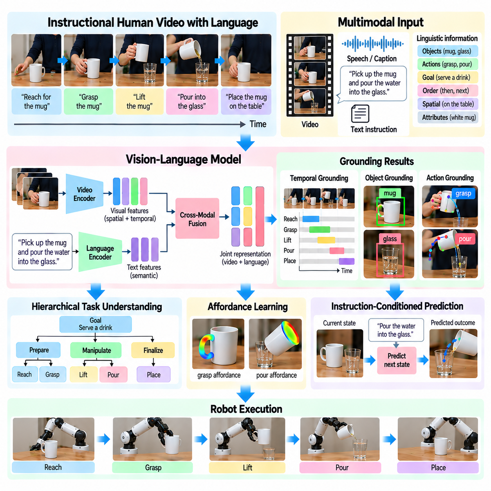{width="7.268055555555556in" height="7.268055555555556in"}

언어 기반 인간 영상 학습(Language-Grounded Human Video Learning)은 시각적 시연(Visual Demonstrations)을 행동(Actions), 물체(Objects), 목표(Goals), 물리적 관계(Physical Relationships)에 관한 언어적 설명(Linguistic Descriptions)과 연결한다. 인간 영상(Human Videos)은 작업이 수행되는 방식을 보여주며, 언어(Language)는 참여자가 달성하려는 의도(Intention)를 설명한다. 이러한 모달리티(Modalities)를 결합하면 피지컬 인공지능(Physical AI) 시스템은 의미론적 개념(Semantic Concepts)을 통해 시연을 해석하고, 관찰된 활동을 명령 수행(Instruction Following)과 로봇 계획(Robotic Planning)에 적합한 표현(Representations)으로 변환할 수 있다.

언어 기반 정합(Language Grounding)은 단어(Words)와 영상 시퀀스(Video Sequence)에서 관찰할 수 있는 사건(Observable Events) 사이의 대응 관계(Correspondence)를 설정한다. 손잡이 파지(Grasp the Handle), 조절 손잡이 회전(Rotate the Knob), 부품 배치(Place the Component)와 같은 표현은 행동과 관련 물체를 식별한다. 학습 시스템(Learning Systems)은 이러한 설명에 대응하는 시각적 영역(Visual Regions)과 시간 구간(Temporal Intervals)을 결정해야 한다. 정확한 정합(Accurate Grounding)을 위해서는 물체 인식(Object Recognition), 움직임 분석(Motion Analysis), 시간적 추론(Temporal Reasoning), 맥락 이해(Contextual Understanding)를 통합해야 한다.

교육용 영상(Instructional Videos)은 내레이션(Narration), 자막(Subtitles), 절차적 설명(Procedural Explanations)을 포함하는 경우가 많기 때문에 특히 가치 있는 학습 데이터(Training Data)를 제공한다. 장비 조립(Equipment Assembly) 시연에서는 부품 정렬(Component Alignment), 체결(Fastening), 검사(Inspection)를 설명하면서 해당 작업을 보여줄 수 있다. 이러한 쌍으로 구성된 신호(Paired Signals)는 다중모달 학습(Multimodal Learning)을 지원하지만, 음성 명령(Spoken Instructions)은 실제 행동보다 먼저 나타나거나 여러 단계를 요약하거나 시각적으로 명확한 움직임을 생략하는 경우가 많다.

시간적 언어 정렬(Temporal Language Alignment)은 연속적인 영상(Continuous Video)에서 설명된 행동이 언제 발생하는지를 결정한다. 하나의 문장(Sentence)은 몇 초 동안 지속되는 작업이나 서로 관련된 일련의 상호작용(Interactions)을 가리킬 수 있다. 모델은 정확한 동기화(Exact Synchronization)를 가정하기보다 언어적 표현(Linguistic Expressions)을 적절한 행동 경계(Action Boundaries)와 연결해야 한다. 어텐션 메커니즘(Attention Mechanisms)과 시퀀스 정렬 기법(Sequence Alignment Methods)은 내레이션 지연(Narration Delays)과 다양한 실행 속도(Variable Execution Speeds)에도 관련 시간 구간을 식별하도록 돕는다.

물체 기반 정합(Object Grounding)은 언어적 참조(Linguistic References)를 특정 물리적 개체(Physical Entities)와 연결한다. 용기(Container), 손잡이(Handle), 도구(Tool), 체결 부품(Fastener)과 같은 단어는 장면(Scene)에 보이는 물체와 연결되어야 한다. 지시 표현(Referring Expressions)에는 공간적 관계(Spatial Relationships), 기능적 특성(Functional Properties), 맥락적 설명(Contextual Descriptions)이 포함될 수 있다. 모델은 왼쪽 용기(Left Container)와 오른쪽 용기(Right Container)를 구별하고, 카메라 움직임(Camera Motion)이나 가림 현상(Occlusion)으로 외형이 변하더라도 물체의 동일성(Object Identity)을 유지해야 한다.

행동 기반 정합(Action Grounding)은 물체 식별(Object Identification)을 넘어 상호작용(Interactions)과 그 결과(Consequences)를 표현한다. 서랍 열기(Open the Drawer)라는 명령은 서랍과 관련된 행동 및 닫힌 상태(Closed State)에서 열린 상태(Open State)로의 전환을 의미한다. 이러한 관계를 인식하려면 동사(Verbs)를 손 움직임(Hand Movements)과 일치시키는 것만으로는 충분하지 않다. 모델은 접촉 사건(Contact Events), 물체 상태 변화(Object-State Changes), 관찰된 움직임의 기능적 의미(Functional Meaning)를 추론해야 한다.

언어(Language)는 작업 구성(Task Organization)에 관한 계층적 정보(Hierarchical Information)도 제공한다. 고수준 명령(High-Level Instructions)은 식사 준비(Preparing a Meal)나 기구 조립(Assembling a Mechanism)과 같은 목표를 설명하며, 저수준 설명(Lower-Level Statements)은 개별 작업(Individual Operations)을 구체적으로 명시한다. 두 수준을 모두 정합하면 모델은 전체 목표(Overall Goals)를 실행 가능한 하위 작업(Executable Subtasks)과 연결할 수 있다. 이러한 표현은 계층적 계획(Hierarchical Planning)을 지원하고 로봇이 달성해야 하는 중간 조건(Intermediate Conditions)을 결정하는 데 도움이 된다.

비전-언어 모델(Vision-Language Models)은 시각적 관측(Visual Observations)을 텍스트 설명(Textual Descriptions)과 연결하는 공동 표현(Joint Representations)을 학습한다. 영상 인코더(Video Encoders)는 공간적 특징(Spatial Features)과 시간적 특징(Temporal Features)을 추출하며, 언어 인코더(Language Encoders)는 의미론적 정보(Semantic Information)를 표현한다. 교차 모달 어텐션(Cross-Modal Attention)이나 대조 학습(Contrastive Learning)은 대응하는 신호를 정렬할 수 있다. 이렇게 생성된 표현은 행동 검색(Action Retrieval), 명령 해석(Instruction Interpretation), 서로 다른 시연 사이의 의미론적 비교(Semantic Comparison)를 지원한다.

대규모 영상-텍스트 집합(Video-Text Collections)에 대한 사전학습(Pretraining)은 일반적인 활동(Common Activities)과 물체 상호작용(Object Interactions)의 인식 성능을 향상시킬 수 있다. 그러나 인터넷 영상 자막(Internet Video Captions)은 정밀한 물리적 행동(Precise Physical Actions)보다 광범위한 사건(Broad Events)을 설명하는 경우가 많다. 또한 시간 정보가 부정확하거나 절차적 세부 사항(Procedural Details)이 누락될 수 있다. 따라서 피지컬 인공지능(Physical AI) 응용에서는 접촉(Contact), 물체 변환(Object Transformations), 작업 관련 시간적 구조(Task-Relevant Temporal Structure)를 강조하는 추가적인 정합 과정이 필요하다.

약지도학습(Weak Supervision)은 언어 주석(Language Annotations)이 정확한 행동 경계(Action Boundaries)나 물체 대응 관계(Object Correspondences)를 제공하는 경우가 드물기 때문에 일반적으로 사용된다. 내레이션 전사문(Narration Transcripts), 자막(Subtitles), 자동 생성 설명(Automatically Generated Descriptions)은 근사적인 레이블(Approximate Labels)로 활용할 수 있다. 학습 시스템은 시간적 일관성(Temporal Consistency)과 시각적 근거(Visual Evidence)를 사용하여 이러한 연관 관계를 정교화할 수 있다. 그러나 신뢰도 추정(Confidence Estimation)과 품질 필터링(Quality Filtering)을 적용하지 않으면 잡음이 포함된 설명(Noisy Descriptions)이 잘못된 관계를 강화할 수 있다.

자기지도 학습 목표(Self-Supervised Objectives)는 모델이 의미 있는 시각적 동역학(Visual Dynamics)을 학습하도록 유도함으로써 언어 지도학습(Language Supervision)을 보완한다. 미래 물체 상태(Future Object States)를 예측하거나, 마스킹된 영상 특징(Masked Video Features)을 재구성하거나, 올바른 시간적 순서(Correct Temporal Order)를 구별하면 행동 표현(Action Representations)을 향상시킬 수 있다. 이후 언어는 이렇게 학습된 특징(Learned Features)에 의미론적 구조(Semantic Organization)를 제공한다. 두 접근 방식을 결합하면 조밀하게 주석 처리된 시연(Densely Annotated Demonstrations)에 대한 의존도를 줄일 수 있다.

명령 조건부 예측(Instruction-Conditioned Prediction)은 지정된 행동(Specified Action)이 수행될 때 환경이 어떻게 변화해야 하는지를 모델이 추정하도록 한다. 컵을 쟁반 위로 옮기라는 명령(Move a Cup onto a Tray)이 주어지면 시스템은 필요한 물체 변위(Object Displacement)와 최종 공간 관계(Final Spatial Relationship)를 예측할 수 있다. 이러한 예측은 계획(Planning)과 진행 상황 모니터링(Progress Monitoring)을 지원한다. 그러나 시각적으로 그럴듯한 결과(Visually Plausible Outcomes)라도 물리적 실행 가능성(Physical Feasibility)과 로봇 능력(Robot Capabilities)에 대한 검증이 필요하다.

언어 기반 행동 유도성 학습(Language-Grounded Affordance Learning)은 행동 설명(Action Descriptions)을 물체의 기능적 영역(Functional Regions)과 연결한다. 손잡이 당기기(Pull the Handle)나 버튼 누르기(Press the Button)와 같은 명령은 의도된 작업(Intended Operation)과 가능한 상호작용 위치(Interaction Location)를 모두 식별한다. 인간 시연(Human Demonstrations)은 이러한 행동 유도성(Affordances)이 활용되는 방식을 보여준다. 모델은 텍스트 목표(Textual Goals)를 접촉 추정(Contact Estimates) 및 물체 기하학(Object Geometry)과 결합하여 로봇 상호작용 전략(Robot Interaction Strategies)의 후보를 식별할 수 있다.

모호성(Ambiguity)은 자연어(Natural Language)가 인간에게 명확하다고 여겨지는 정보를 자주 생략하기 때문에 중요한 과제로 나타난다. 그것을 거기에 놓으라는 명령(Put It There)은 대화 맥락(Conversational Context)과 장면 이해(Scene Understanding)에 의존한다. 여러 물체가 동일한 설명을 만족할 수 있으며, 서로 다른 행동이 유사한 언어적 레이블(Verbal Labels)을 공유할 수도 있다. 강건한 정합(Robust Grounding)을 위해서는 근거 없는 가정(Unsupported Assumptions)을 하기보다 맥락 메모리(Contextual Memory)를 유지하고 불확실성(Uncertainty)을 표현해야 한다.

언어 설명(Language Descriptions)은 실행에 필요한 정확한 물리적 궤적(Physical Trajectory)을 지정하지 않고 의도(Intent)를 표현할 수 있다. 인간은 물체를 배치하는 시연을 수행하면서 로봇에 적합하지 않은 움직임(Movements Unsuitable for a Robot)을 사용할 수 있다. 물체 중심 정합(Object-Centered Grounding)은 원하는 결과(Desired Result)를 시연된 신체 움직임(Demonstrated Body Motion)과 분리한다. 이후 로봇 전용 계획기(Robot-Specific Planners)는 신체 구조 제약(Embodiment Constraints)을 준수하면서 언어적 목표(Linguistic Objective)를 만족하는 실행 가능한 궤적(Feasible Trajectories)을 생성할 수 있다.

다국어 영상 집합(Multilingual Video Collections)은 용어(Terminology), 문법 구조(Grammatical Structure), 작업 설명(Task Descriptions)에 추가적인 다양성을 가져온다. 동등한 작업(Equivalent Operations)이라도 언어나 기술 분야(Technical Domains)에 따라 서로 다르게 표현될 수 있다. 공유 의미론적 표현(Shared Semantic Representations)은 이러한 표현을 공통적인 물리적 사건(Physical Events)과 연결하는 데 도움이 된다. 전문 로봇 학습 데이터셋(Specialized Robotic Training Datasets)을 구축할 때는 일관된 용어(Consistent Terminology)와 신중하게 검증된 번역(Validated Translations)이 중요하다.

언어 기반 정합(Language Grounding)은 실패 해석(Failure Interpretation)과 수정 행동(Corrective Behavior)도 지원한다. 내레이션(Narration)은 부품의 정렬이 잘못되었거나 작업을 계속하기 전에 도구의 위치를 다시 조정해야 한다고 설명할 수 있다. 이러한 설명은 관찰된 오류(Observed Errors)를 가능한 복구 전략(Recovery Strategies)과 연결한다. 상태 추적(State Tracking)과 결합하면 언어는 충족되지 않은 선행 조건(Unmet Preconditions)을 식별하고 로봇 실행(Robotic Execution) 중 대체 행동(Alternative Actions)을 안내하는 데 도움이 될 수 있다.

인간 영상 시연(Human Video Demonstrations)에는 작업과 관련 없는 제스처(Irrelevant Gestures), 대화 중단(Conversational Interruptions), 배경 활동(Background Activity)이 포함되는 경우가 많다. 언어는 의도된 목표(Intended Objectives)를 식별하여 작업 관련 상호작용(Task-Relevant Interactions)을 우연한 움직임(Incidental Movement)과 구별하는 데 도움이 될 수 있다. 그러나 언어적 설명(Verbal Descriptions) 자체도 불완전하거나 오해를 유발할 수 있다. 신뢰성 있는 시스템(Reliable Systems)은 내레이션을 무조건적인 정답 정보(Ground Truth)로 취급하기보다 언어적 주장(Linguistic Claims)을 관찰 가능한 물체 변화(Observable Object Changes)와 비교해야 한다.

확장 가능한 피지컬 인공지능 데이터 엔진(Scalable Physical AI Data Engine)은 인간 영상을 동기화된 시각적 기록(Visual Records), 언어적 기록(Linguistic Records), 시간적 기록(Temporal Records)으로 처리할 수 있다. 이러한 기록에는 전사문(Transcripts), 물체 식별 정보(Object Identities), 행동 구간(Action Intervals), 작업 설명(Task Descriptions), 접촉 추정(Contact Estimates), 관찰된 결과(Observed Outcomes)가 포함될 수 있다. 구조화된 다중모달 주석(Structured Multimodal Annotations)은 목표 지향적 검색(Targeted Retrieval)과 모델 학습(Model Training)을 지원한다. 데이터 출처 정보(Provenance), 정렬 신뢰도(Alignment Confidence), 주석 품질(Annotation Quality)은 후속 검증(Downstream Validation)을 위해 유지되어야 한다.

언어 기반 정합 평가(Evaluation of Language Grounding)는 의미론적 정확도(Semantic Accuracy)와 물리적 관련성(Physical Relevance)을 모두 고려해야 한다. 유용한 평가 기준(Useful Criteria)에는 텍스트-영상 검색 성능(Text-Video Retrieval Performance), 시간적 위치 추정 정확도(Temporal Localization Accuracy), 물체 참조 해석(Object Reference Resolution), 행동 이해(Action Understanding), 명령 조건부 작업 완료(Instruction-Conditioned Task Completion)가 포함된다. 모델이 문장을 정확하게 이해하더라도 물리적으로 실행 가능한 행동(Physically Feasible Action)을 생성하지 못할 수 있으므로 로봇 실행 시험(Robotic Execution Tests)이 특히 중요하다.

궁극적으로 언어 기반 인간 영상 학습(Language-Grounded Human Video Learning)은 의미론적 작업 이해(Semantic Task Understanding)와 체화된 물리적 행동(Embodied Physical Behavior)을 연결한다. 단어(Words)를 물체(Objects), 행동(Actions), 시간적 구조(Temporal Structure), 관찰된 결과(Observed Consequences)와 연결함으로써 피지컬 인공지능(Physical AI) 시스템은 대규모 시연 집합(Large Demonstration Collections)으로부터 재사용 가능한 지식(Reusable Knowledge)을 획득할 수 있다. 이러한 지식을 로봇 전용 인식(Robot-Specific Perception), 계획(Planning), 피드백(Feedback)과 통합하면 실제 환경(Real Environments)에서 더욱 유연한 명령 수행(Flexible Instruction Following)과 적응형 조작(Adaptive Manipulation)을 구현할 수 있다.

## 03.12. Weakly and Self Supervised Video Learning

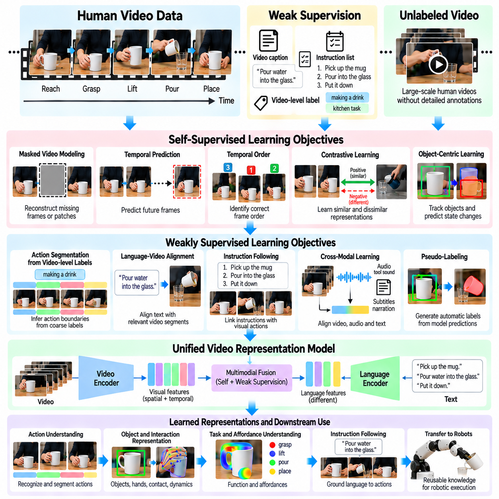{width="7.268055555555556in" height="7.268055555555556in"}

약지도 영상 학습(Weakly Supervised Video Learning)과 자기지도 영상 학습(Self-Supervised Video Learning)은 피지컬 인공지능(Physical AI) 시스템이 광범위한 수작업 주석(Manual Annotations) 없이도 대규모 인간 시연(Human Demonstrations)으로부터 유용한 표현(Representations)을 획득할 수 있도록 한다. 인간 영상(Human Videos)은 행동(Actions), 물체(Objects), 상호작용(Interactions), 물리적 동역학(Physical Dynamics)에 관한 풍부한 정보를 포함하지만, 상세한 레이블링(Detailed Labeling)에는 많은 비용이 발생한다. 이러한 학습 접근 방식은 불완전한 지도 정보(Incomplete Supervision)와 영상의 내재적 구조(Intrinsic Video Structure)를 활용하여 풍부한 시각적 경험(Visual Experience)을 재사용 가능한 지식(Reusable Knowledge)으로 변환한다.

약지도학습(Weakly Supervised Learning)은 모든 관련 사건(Relevant Events)을 정확하게 지정하지 않고 영상 내용을 설명하는 근사적인 레이블(Approximate Labels)을 사용한다. 영상 기록(Recording)에는 정확한 시간적 경계(Temporal Boundaries) 없이 활동 범주(Activity Category), 짧은 캡션(Short Caption), 일련의 명령(Sequence of Instructions)이 포함될 수 있다. 모델은 어떤 프레임(Frames)이 특정 행동(Actions)과 물체(Objects)에 대응하는지 추론해야 한다. 이러한 접근 방식은 주석 비용(Annotation Costs)을 줄이지만 학습 과정에서 관리해야 하는 불확실성(Uncertainty)을 발생시킨다.

자기지도학습(Self-Supervised Learning)은 레이블이 없는 영상 데이터(Unlabeled Video Data)의 구조에서 직접 학습 신호(Training Signals)를 생성한다. 모델은 인간이 제공한 행동 레이블(Human-Provided Action Labels)에 의존하는 대신 시각적 관측(Visual Observations)에 관한 예측 작업(Predictive Tasks)이나 재구성 작업(Reconstruction Tasks)을 수행한다. 대표적인 사례에는 미래 프레임 예측(Future Frame Prediction), 마스킹된 특징 복원(Masked Feature Recovery), 올바른 시간적 시퀀스 구별(Correct Temporal Sequence Discrimination)이 포함된다. 이러한 학습 목표(Learning Objectives)는 반복적으로 나타나는 패턴(Patterns)과 관계(Relationships)를 포착하는 표현을 학습하도록 유도한다.

약지도학습(Weak Supervision)과 자기지도학습(Self-Supervision)의 차이는 학습 신호(Learning Signals)의 출처에 있다. 약지도학습은 캡션(Captions), 메타데이터(Metadata), 자동 생성 레이블(Automatically Generated Labels)과 같은 불완전한 외부 정보(External Information)에 의존한다. 반면 자기지도학습은 데이터 자체에서 학습 목표값(Training Targets)을 생성한다. 두 접근 방식은 공통 학습 파이프라인(Common Training Pipeline)에서 결합할 수 있으며, 의미론적 설명(Semantic Descriptions)이 학습된 시각적 및 시간적 규칙성(Visual and Temporal Regularities)을 보완하도록 한다.

마스킹 기반 영상 모델링(Masked Video Modeling)은 주변 관측(Surrounding Observations)을 활용하여 시각적 시퀀스(Visual Sequences)에서 누락된 부분을 재구성하도록 신경망(Networks)을 학습시킨다. 공간적 마스킹(Spatial Masking)은 이미지 패치(Image Patches)를 제거하고, 시간적 마스킹(Temporal Masking)은 선택된 프레임이나 시간 구간(Temporal Intervals)을 숨긴다. 누락된 정보를 복원하려면 모델은 물체 외형(Object Appearance), 움직임 연속성(Motion Continuity), 장면 관계(Scene Relationships)를 학습해야 한다. 원시 픽셀(Raw Pixels) 대신 압축된 시각적 특징(Compact Visual Features)을 예측하면 계산 요구량(Computational Demands)을 줄일 수 있다.

시간적 예측(Temporal Prediction)은 이전 프레임(Preceding Frames)으로부터 미래 관측(Future Observations)을 추정하도록 요구하는 또 다른 자기지도 학습 목표(Self-Supervised Objective)를 제공한다. 성공적인 예측을 위해서는 움직이는 물체(Moving Objects), 상호작용 패턴(Interaction Patterns), 발생 가능한 상태 전환(Likely State Transitions)을 인식해야 한다. 그러나 인간 행동(Human Behavior)에는 선택(Choices)과 불확실성(Uncertainty)이 존재하므로 미래 영상(Future Images)이 항상 하나로 결정되는 것은 아니다. 확률적 예측(Probabilistic Prediction)이나 잠재 공간 예측(Latent Prediction) 기법은 여러 가능한 결과(Plausible Outcomes)를 표현할 수 있다.

대조 학습(Contrastive Learning)은 관련된 관측(Related Observations)의 표현이 서로 유사하게 유지되도록 하면서 관련 없는 사례(Unrelated Examples)는 구별하도록 유도한다. 양성 쌍(Positive Pairs)은 인접한 영상 구간(Nearby Video Segments), 동일한 사건의 서로 다른 카메라 시점(Different Camera Views), 대응되는 영상과 텍스트 설명(Video and Text Descriptions)으로 구성할 수 있다. 서로 다른 영상 기록이 기능적으로 동등한 행동(Functionally Equivalent Actions)을 나타낼 수 있으므로 음성 샘플링(Negative Sampling)에는 주의가 필요하다. 부적절한 쌍 선택(Poor Pair Selection)은 작업 관련 표현(Task-Relevant Representations)의 품질을 저하시킬 수 있다.

시간적 순서 학습(Temporal Order Learning)은 물리적 행동(Physical Actions)이 의미 있는 시퀀스(Meaningful Sequences)를 따르는 경우가 많다는 특성을 활용한다. 모델은 프레임이나 구간(Segments)이 원래 순서(Original Order)대로 배열되어 있는지 인식하도록 학습할 수 있다. 올바른 시퀀스(Correct Sequences)를 재구성하는 과정은 준비(Preparation), 상호작용(Interaction), 완료(Completion) 단계에 대한 이해를 촉진한다. 그러나 일부 작업은 되돌릴 수 있거나(Reversible) 순서를 바꾸어 수행할 수 있으므로(Interchangeable), 시간적 순서(Chronological Order)를 필수적인 인과 관계(Necessary Causality)와 혼동해서는 안 된다.

약지도 행동 분할(Weakly Supervised Action Segmentation)은 대략적인 영상 수준 레이블(Coarse Video-Level Labels)이나 순서가 지정된 전사문(Ordered Transcripts)만을 사용하여 개별 행동(Individual Actions)의 위치를 추정한다. 모델은 시각적 변화(Visual Changes), 반복 패턴(Repeated Patterns), 정렬 제약(Alignment Constraints)을 통해 시간적 경계(Temporal Boundaries)를 추론한다. 이를 통해 대규모 교육용 데이터셋(Instructional Datasets)을 세밀한 학습(Fine-Grained Learning)에 활용할 수 있다. 내레이션이 일부 작업을 생략하거나 행동이 중첩되거나 서로 다른 시연이 대체 절차(Alternative Procedures)를 따를 때 오류가 발생할 수 있다.

물체 중심 자기지도학습(Object-Centric Self-Supervision)은 제한 없는 픽셀 재구성(Unrestricted Pixel Reconstruction)보다 물체의 변화(Changes in Objects)에 초점을 맞춘다. 모델은 물체 위치(Object Positions)를 추적하거나 변환(Transformations)을 예측하거나 상태 변화(State Changes)를 발생시키는 상호작용(Interactions)을 식별할 수 있다. 이러한 학습 목표는 로봇 조작(Robotic Manipulation)에 유용한 표현을 학습하도록 유도한다. 그러나 잘못된 물체 연관 관계(Incorrect Object Associations)는 오해를 유발하는 학습 신호(Misleading Training Signals)를 생성할 수 있으므로 물체 추적(Object Tracking)과 분할(Segmentation)의 품질이 중요하다.

손-물체 상호작용(Hand-Object Interaction)은 인간 영상(Human Video)에서 암묵적인 지도 정보(Implicit Supervision)를 얻을 수 있는 중요한 원천이다. 손 궤적(Hand Trajectories), 추정된 접촉 사건(Estimated Contact Events), 후속 물체 움직임(Subsequent Object Motion)은 행동과 결과 사이의 관계를 보여준다. 모델은 모든 프레임에 수작업 레이블(Manual Labels)을 부여하지 않고도 접촉 위치(Contact Locations)나 상호작용 단계(Interaction Phases)를 예측하도록 학습할 수 있다. 그러나 가림 현상(Occlusion), 카메라 움직임(Camera Motion), 불확실한 깊이 추정(Uncertain Depth Estimates)은 이러한 신호의 신뢰성(Reliability)을 제한한다.

언어(Language)는 내레이션(Narration), 자막(Subtitles), 교육용 설명(Instructional Descriptions), 영상 캡션(Video Captions)을 통해 약지도 정보(Weak Supervision)를 제공할 수 있다. 작업을 설명하는 문장(Sentence)은 정확한 시간적 정렬(Temporal Alignment)이 알려지지 않았더라도 의미론적 맥락(Semantic Context)을 제공한다. 비전-언어 학습(Vision-Language Learning)은 이러한 설명을 관련 시각적 구간(Visual Segments)과 연결할 수 있다. 학습 과정에서는 불완전한 내레이션(Incomplete Narration), 모호한 참조(Ambiguous References), 관찰된 결과(Observed Outcomes)가 아니라 의도(Intentions)를 설명하는 캡션을 고려해야 한다.

교차 모달 자기지도학습(Cross-Modal Self-Supervision)은 영상(Video), 오디오(Audio), 기타 동기화된 신호(Synchronized Signals)의 정보를 정렬한다. 도구 소리(Tool Sounds), 물체 충돌음(Object Impacts), 음성 명령(Spoken Instructions)은 시각적으로 인식하기 어려운 사건을 드러낼 수 있다. 모달리티 사이의 대응 관계(Correspondence)를 예측하면 모델이 공유 사건 표현(Shared Event Representations)을 학습하도록 유도할 수 있다. 그러나 동기화 오류(Synchronization Errors)와 관련 없는 배경 소음(Unrelated Background Audio)은 정렬 정확도(Alignment Accuracy)를 저하시킬 수 있다.

인간 영상 데이터셋(Human Video Datasets)은 카메라 시점(Camera Viewpoint), 조명(Lighting), 해상도(Resolution), 움직임 속도(Motion Speed), 기록 품질(Recording Quality)에서 상당한 다양성을 포함한다. 데이터 증강(Data Augmentation)은 시각적 외형(Visual Appearance)과 시간적 샘플링(Temporal Sampling)에 통제된 변화를 적용하여 강건성(Robustness)을 향상시킬 수 있다. 그러나 시퀀스를 역순으로 바꾸거나 공간적 방향(Spatial Orientation)을 변경하면 물리적 행동(Physical Actions)의 해석이 달라질 수 있으므로 데이터 증강은 작업 의미(Task Meaning)를 보존해야 한다.

표현 학습(Representation Learning)은 서로 다른 사람(People), 물체(Objects), 환경(Environments)에서도 유용하게 유지되는 특징(Features)을 강조해야 한다. 모델은 작업과 관련된 물리적 변화(Task-Relevant Physical Changes)를 배경 움직임(Background Motion)과 우연한 제스처(Incidental Gestures)로부터 구별해야 한다. 물체 중심 학습 목표(Object-Centered Objectives), 시간적 일관성(Temporal Consistency), 상호작용 예측(Interaction Prediction)은 이러한 구별을 촉진할 수 있다. 그러나 작은 기하학적 차이(Geometric Differences)가 접촉 실행 가능성(Contact Feasibility)이나 조작 성공(Manipulation Success)을 결정하는 경우에는 지나친 불변성(Excessive Invariance)이 바람직하지 않다.

의사 레이블링(Pseudo-Labeling)은 약지도 데이터셋(Weakly Supervised Datasets)을 확장하기 위한 실용적인 방법을 제공한다. 학습된 모델(Trained Model)은 레이블이 없는 영상(Unlabeled Videos)에 대해 임시 행동 레이블(Provisional Action Labels), 물체 연관 관계(Object Associations), 시간적 경계(Temporal Boundaries)를 생성한다. 신뢰도가 높은 예측(High-Confidence Predictions)은 이후 학습 단계(Subsequent Training Rounds)에 포함할 수 있다. 그러나 잘못된 의사 레이블(Incorrect Pseudo-Labels)을 반복적으로 학습하면 체계적인 오류(Systematic Errors)가 증폭될 수 있으므로 신뢰도 보정(Confidence Calibration)과 선택적 필터링(Selective Filtering)이 필수적이다.

커리큘럼 학습(Curriculum Learning)은 복잡도(Complexity)와 신뢰성(Reliability)에 따라 영상 학습 사례(Video Training Examples)를 구성할 수 있다. 모델은 물체가 명확하게 보이고 행동이 뚜렷하게 구분되는 시연(Clear Demonstrations)부터 학습한 후, 가림 현상이 심하거나 장시간 지속되는 영상(Long-Duration Recordings)을 처리할 수 있다. 난이도(Difficulty)를 점진적으로 높이면 학습 안정성(Training Stability)을 향상시킬 수 있다. 커리큘럼(Curriculum)은 영상 길이(Video Length)만으로 작업 복잡도(Task Complexity)가 결정된다고 가정하기보다 의미 있는 학습 과제(Learning Challenges)를 반영해야 한다.

대규모 학습(Large-Scale Training)에서는 긴 영상 시퀀스(Long Video Sequences)와 중복 프레임(Redundant Frames)을 효율적으로 처리해야 한다. 시간적 서브샘플링(Temporal Subsampling), 특징 캐싱(Feature Caching), 계층적 인코더(Hierarchical Encoders), 선택적 어텐션(Selective Attention)은 계산 비용(Computational Costs)을 줄일 수 있다. 중요한 접촉 사건(Contact Events)과 빠른 상태 변화(Rapid State Changes)에는 충분한 시간 해상도(Temporal Resolution)를 제공해야 한다. 효율적인 샘플링(Efficient Sampling)은 전체 활동(Complete Activities)의 포괄적인 관측과 물리적으로 의미 있는 세부 정보(Physically Meaningful Details)의 보존 사이에서 균형을 유지해야 한다.

약지도학습(Weak Supervision)을 로봇 생성 데이터(Robot-Generated Data)와 결합하면 의미론적 이해(Semantic Understanding)를 실행 가능한 행동(Executable Behavior)과 연결할 수 있다. 인간 영상(Human Videos)은 작업과 상호작용에 대한 폭넓은 사례를 제공하며, 로봇 시연(Robot Demonstrations)은 행동 명령(Action Commands), 고유수용감각(Proprioception), 측정된 결과(Measured Outcomes)를 제공한다. 공동 학습(Joint Training)이나 적응(Adaptation)은 이러한 상호 보완적인 데이터 원천(Complementary Data Sources)을 정렬할 수 있다. 신체 구조(Embodiment)와 센싱(Sensing)의 차이는 무시하지 않고 명시적으로 모델링해야 한다.

학습된 영상 표현(Learned Video Representations)의 평가는 사전학습 목표(Pretraining Objectives)에 대한 성능을 넘어 이루어져야 한다. 유용한 후속 작업(Downstream Tasks)에는 행동 인식(Action Recognition), 시간적 위치 추정(Temporal Localization), 물체 상태 예측(Object-State Prediction), 행동 유도성 추정(Affordance Estimation), 로봇 조작(Robotic Manipulation)이 포함된다. 익숙하지 않은 환경(Unfamiliar Environments)과 로봇 플랫폼(Robot Platforms)으로의 전이는 일반화(Generalization)의 근거를 제공한다. 높은 재구성 정확도(Reconstruction Accuracy)만으로 물리적 이해(Physical Understanding)가 입증되는 것은 아니다.

데이터셋 품질(Dataset Quality)은 약지도학습(Weakly Supervised Learning)과 자기지도학습(Self-Supervised Learning)의 결과에 큰 영향을 미친다. 중복 영상(Duplicate Recordings), 편집된 시퀀스(Edited Sequences), 오해를 유발하는 캡션(Misleading Captions), 손상된 타임스탬프(Corrupted Timestamps)는 학습된 관계(Learned Relationships)를 왜곡할 수 있다. 자동 필터링(Automated Filtering)과 선별적인 인간 검토(Targeted Human Review)는 신뢰성을 향상시키는 데 도움이 된다. 데이터 출처 정보(Provenance), 주석 신뢰도(Annotation Confidence), 처리 메타데이터(Processing Metadata)를 유지하면 재현 가능한 학습(Reproducible Training)과 체계적인 오류 분석(Systematic Error Analysis)을 지원할 수 있다.

확장 가능한 피지컬 인공지능 데이터 엔진(Scalable Physical AI Data Engine)은 영상 수집(Video Ingestion), 자동 주석(Automatic Annotation), 자기지도 사전학습(Self-Supervised Pretraining), 의사 레이블 정제(Pseudo-Label Refinement), 후속 검증(Downstream Validation)을 연속적인 학습 파이프라인(Continuous Learning Pipeline)으로 통합할 수 있다. 모델 예측(Model Predictions)은 검토가 필요한 불확실한 사례(Uncertain Examples)를 식별하고 부족한 작업 범위(Missing Task Coverage)를 드러낼 수 있다. 새롭게 수집된 인간 및 로봇 경험(Human and Robot Experiences)은 이후 학습을 개선하여 데이터 품질(Data Quality)과 모델 능력(Model Capability) 사이의 반복적인 개선 관계(Iterative Relationship)를 형성한다.

약지도 영상 학습(Weakly Supervised Video Learning)과 자기지도 영상 학습(Self-Supervised Video Learning)은 대규모 인간 경험(Human Experience)으로부터 체화된 지식(Embodied Knowledge)을 추출하기 위한 기반을 제공한다. 시간적 연속성(Temporal Continuity), 물체 상호작용(Object Interactions), 다중모달 신호(Multimodal Signals), 근사적인 의미론적 설명(Approximate Semantic Descriptions)을 활용함으로써 피지컬 인공지능(Physical AI) 시스템은 비용이 많이 드는 주석(Costly Annotations)에 대한 의존도를 줄일 수 있다. 그러나 신뢰성 있는 로봇 전이(Reliable Robotic Transfer)를 위해서는 물리적 검증(Physical Validation), 신체 구조 인식 적응(Embodiment-Aware Adaptation), 실제 환경 실행(Real-World Execution)으로부터 얻은 피드백(Feedback)이 여전히 필요하다.

## 03.13. Video Data Filtering and Quality

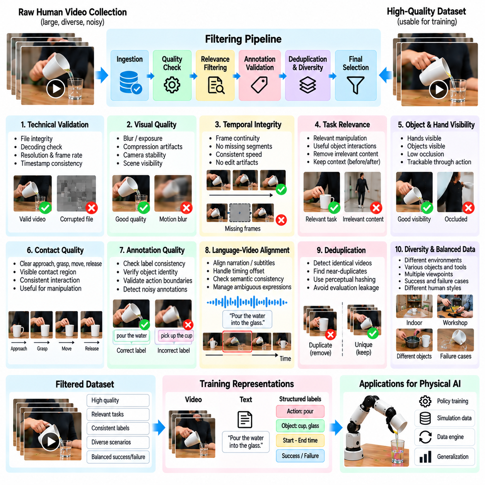{width="7.268055555555556in" height="7.268055555555556in"}

영상 데이터 필터링(Video Data Filtering)과 품질 관리(Quality Management)는 확장 가능한 피지컬 인공지능 데이터 엔진(Scalable Physical AI Data Engines)의 핵심 구성 요소이다. 대규모 인간 영상 데이터셋(Human Video Collections)에는 조작(Manipulation), 도구 사용(Tool Use), 물리적 상호작용(Physical Interaction)에 관한 가치 있는 시연이 포함되어 있지만, 그 유용성은 크게 다르다. 낮은 가시성(Poor Visibility), 관련 없는 콘텐츠(Irrelevant Content), 일관되지 않은 주석(Inconsistent Annotations), 손상된 영상(Corrupted Recordings)은 학습된 표현(Learned Representations)의 품질을 저하시킬 수 있다. 체계적인 필터링(Systematic Filtering)은 원시 영상 데이터(Raw Video Collections)를 신뢰할 수 있는 학습 자원(Reliable Training Resources)으로 변환한다.

영상 품질(Video Quality)은 시각적 특성(Visual Characteristics)과 작업 관련성(Task Relevance)을 모두 고려하여 평가해야 한다. 고해상도 영상(High-Resolution Video)이라도 중요한 상호작용(Important Interactions)이 카메라 시야(Camera View) 밖에서 발생하면 유용한 정보를 거의 제공하지 못할 수 있다. 반대로 낮은 해상도의 영상(Lower-Resolution Footage)이라도 물체 움직임(Object Movement)과 작업 완료(Task Completion)를 명확하게 보여줄 수 있다. 따라서 효과적인 품질 평가(Quality Assessment)는 물리적 행동(Physical Behavior)을 학습하는 데 필요한 관측 정보(Observations)가 영상에 보존되어 있는지를 고려해야 한다.

기술적 검증(Technical Validation)은 파일 무결성(File Integrity), 디코딩 신뢰성(Decoding Reliability), 프레임 속도(Frame Rate), 해상도(Resolution), 타임스탬프 일관성(Timestamp Consistency)을 검사하는 것에서 시작한다. 손상된 프레임(Corrupted Frames), 누락된 구간(Missing Segments), 가변 재생 속도(Variable Playback Speed), 동기화 오류(Synchronization Errors)는 움직임 패턴(Motion Patterns)을 왜곡할 수 있다. 자동화된 데이터 수집 파이프라인(Automated Ingestion Pipelines)은 많은 비용이 드는 모델 학습(Model Training)을 시작하기 전에 이러한 문제를 감지해야 한다. 메타데이터 검증(Metadata Validation)은 저장 시스템(Storage Systems)과 컴퓨팅 시스템(Computing Systems) 전반에서 영상 기록을 일관되게 처리할 수 있도록 한다.

시각적 품질 필터링(Visual Quality Filtering)은 흐림(Blur), 노출(Exposure), 압축 아티팩트(Compression Artifacts), 카메라 불안정성(Camera Instability), 장면 가시성(Scene Visibility)을 평가한다. 심한 움직임 흐림(Motion Blur)은 접촉 사건(Contact Events)을 가릴 수 있으며, 과다 노출(Overexposure)은 중요한 물체 경계(Object Boundaries)를 사라지게 할 수 있다. 자동 영상 품질 지표(Automated Image Quality Metrics)는 문제가 의심되는 구간(Suspicious Segments)을 식별할 수 있지만, 고정된 임계값(Fixed Thresholds)만으로는 충분하지 않은 경우가 많다. 품질 판단(Quality Decisions)은 영향을 받은 시각적 정보가 의도된 학습 목표(Learning Objective)에 필요한지 고려해야 한다.

시간적 무결성(Temporal Integrity)은 피지컬 인공지능(Physical AI) 모델이 행동과 결과(Actions and Consequences)의 시퀀스(Sequences)로부터 학습하기 때문에 특히 중요하다. 누락된 프레임(Missing Frames)이나 편집된 전환(Edited Transitions)은 움직임과 물체 상태 변화(Object-State Changes) 사이에 잘못된 관계를 형성할 수 있다. 프레임 연속성 분석(Frame Continuity Analysis)과 타임스탬프 검사(Timestamp Inspection)는 불연속성(Discontinuities)을 식별할 수 있다. 시간적 구조(Temporal Structure)가 불확실한 영상은 인식 작업(Recognition Tasks)에는 유용할 수 있지만, 동역학 학습(Dynamics Learning)에서는 신중하게 사용해야 한다.

작업 관련성 필터링(Task Relevance Filtering)은 영상에 목표 로봇 능력(Target Robotic Capabilities)에 기여하는 상호작용이 포함되어 있는지를 판단한다. 일반적인 인간 활동 영상(General Human Activity Footage)에는 대화(Conversation), 보행(Walking), 관련 없는 배경 움직임(Unrelated Background Motion)이 장시간 포함될 수 있다. 의미론적 분류기(Semantic Classifiers)와 행동 인식 모델(Action Recognition Models)은 잠재적으로 유용한 구간을 식별할 수 있다. 그러나 필터링 과정에서는 성공적인 작업 실행(Successful Task Execution)에 중요한 맥락을 제공하는 준비 동작(Preparatory Movements)과 복구 행동(Recovery Actions)을 보존해야 한다.

물체 및 상호작용 가시성(Object and Interaction Visibility)은 인간 시연 영상(Human Demonstration Videos)의 가치를 크게 좌우한다. 작업에 관한 내레이션(Narration)이 명확하더라도 손(Hands), 도구(Tools), 조작 대상 물체(Manipulated Objects)가 보이지 않을 수 있다. 탐지 및 추적 시스템(Detection and Tracking Systems)은 중요한 시간 구간(Critical Intervals) 동안 관련 개체(Relevant Entities)가 보이는지 추정할 수 있다. 가시성 점수(Visibility Scores)는 인식 가능한 물체의 존재 여부만이 아니라 가림 현상(Occlusion), 카메라 시점(Camera Perspective), 물체 크기(Object Scale)를 고려해야 한다.

손-물체 접촉 품질(Hand-Object Contact Quality)은 조작 학습(Manipulation Learning)에서 특히 중요하다. 접근(Approach), 파지(Grasp), 이동(Movement), 해제(Release) 단계가 명확하게 나타나는 영상은 상호작용 구조(Interaction Structure)에 관한 더욱 강력한 근거를 제공한다. 자동 접촉 추정(Automated Contact Estimation)은 물리적으로 유익한 사건(Informative Physical Events)이 포함되었을 가능성이 높은 구간을 식별할 수 있다. 그러나 시각적으로 관찰되는 접촉(Visual Contact)은 힘의 크기(Force Magnitude)나 마찰 조건(Friction Conditions)을 직접적으로 보여주지 않으므로, 필터링 과정에서는 관찰 가능한 근거(Observable Evidence)와 추론된 물리량(Inferred Physical Quantities)을 구별해야 한다.

주석 품질(Annotation Quality)은 데이터 신뢰성(Data Reliability)에 또 다른 중요한 요소를 추가한다. 캡션(Captions), 행동 레이블(Action Labels), 물체 식별 정보(Object Identities), 시간적 경계(Temporal Boundaries)에는 불일치(Inconsistencies)나 체계적인 오류(Systematic Errors)가 포함될 수 있다. 자동화된 검사(Automated Checks)는 주석을 시각적 예측(Visual Predictions) 및 인접 구간(Neighboring Segments)과 비교할 수 있다. 불일치가 발생하면 자동으로 데이터를 제거하기보다 신뢰도 감소(Confidence Reduction)나 선별적인 검토(Targeted Review)를 수행해야 한다. 특이한 시연(Unusual Demonstrations)이 가치 있는 학습 사례(Training Examples)가 될 수 있기 때문이다.

언어-영상 정렬 품질(Language-Video Alignment Quality)은 다중모달 학습(Multimodal Learning)과 명령 기반 정합(Instruction Grounding)에 영향을 미친다. 내레이션(Narration)은 작업이 발생하기 전에 해당 작업을 설명하거나 여러 행동을 요약하거나 화면에 보이지 않는 물체를 참조할 수 있다. 시간적 정렬 모델(Temporal Alignment Models)은 음성(Speech)과 시각적 사건(Visual Events) 사이의 대응 관계(Correspondence)를 추정할 수 있다. 정확한 설명(Accurate Description)이라도 시간적 위치(Timing)가 불확실할 수 있으므로 정렬 신뢰도(Alignment Confidence)는 언어적 정확성(Linguistic Correctness)과 별도로 저장해야 한다.

중복 및 유사 중복 탐지(Duplicate and Near-Duplicate Detection)는 대규모 데이터셋(Large Datasets)이 반복된 영상에 의해 지배되는 현상을 방지한다. 동일한 영상이 서로 다른 해상도(Resolutions), 잘라내기(Crops), 자막(Subtitles), 압축 설정(Compression Settings)으로 나타날 수 있다. 지각 해싱(Perceptual Hashing)과 학습된 영상 임베딩(Learned Video Embeddings)은 이러한 관계를 식별할 수 있다. 중복 제거(Deduplication)는 불필요한 계산(Redundant Computation)을 줄이고 평가 데이터 누출(Evaluation Leakage)을 방지하는 데 도움이 된다. 그러나 동일한 작업을 수행한 실제로 서로 다른 시연(Distinct Demonstrations)은 유지해야 한다.

데이터셋 다양성(Dataset Diversity)은 개별 영상 품질(Individual Recording Quality)과 함께 고려해야 한다. 지나치게 엄격한 필터링(Aggressive Filtering)은 익숙한 환경(Familiar Environments), 일반적인 물체(Common Objects), 성공적인 시연(Successful Demonstrations)만 포함하는 시각적으로 깨끗한 데이터셋을 생성할 수 있다. 이러한 데이터셋은 로봇이 익숙하지 않은 조건(Unfamiliar Conditions)에 직면했을 때 낮은 성능을 보일 수 있다. 다양성 인식 선택(Diversity-Aware Selection)은 시점(Viewpoint), 조명(Lighting), 물체 기하학(Object Geometry), 인간 행동(Human Behavior), 작업 실행 전략(Task Execution Strategies)의 의미 있는 변화를 보존해야 한다.

실패 시연(Failure Demonstrations)은 물리적 제약(Physical Constraints)과 복구 행동(Recovery Behavior)에 관한 중요한 근거를 제공한다. 물체 낙하(Dropped Object), 불안정한 파지(Unstable Grasp), 삽입 실패(Unsuccessful Insertion)는 성공적인 사례에서 드러나지 않는 조건을 보여줄 수 있다. 필터링 파이프라인(Filtering Pipelines)은 사용할 수 없는 영상(Unusable Recordings)과 학습에 유익한 실패 사례(Informative Failures)를 구별해야 한다. 실패 레이블(Failure Labels)과 결과 설명(Outcome Descriptions)을 활용하면 실패한 행동을 바람직한 사례로 잘못 학습하지 않으면서 위험 인식 행동(Risk-Sensitive Behavior)을 학습할 수 있다.

자동화된 품질 점수화(Automated Quality Scoring)는 기술적 지표(Technical Indicators), 의미론적 지표(Semantic Indicators), 시간적 지표(Temporal Indicators), 상호작용 관련 지표(Interaction-Related Indicators)를 결합할 수 있다. 각 영상이나 구간에는 가시성(Visibility), 움직임 연속성(Motion Continuity), 주석 신뢰도(Annotation Confidence), 작업 관련성(Task Relevance), 신규성(Novelty)에 대한 점수를 부여할 수 있다. 이러한 점수는 하나의 보편적인 수용 임계값(Universal Acceptance Threshold)을 강제하기보다 우선순위 결정(Prioritization)을 지원한다. 서로 다른 학습 목표(Learning Objectives)는 동일한 원본 영상 집합(Underlying Video Collection)에서 서로 다른 하위 데이터셋(Subsets)을 선택할 수 있다.

품질 임계값(Quality Thresholds)은 후속 모델 요구사항(Downstream Model Requirements)을 반영해야 한다. 행동 인식(Action Recognition)은 어느 정도의 공간적 불확실성(Spatial Uncertainty)을 허용할 수 있지만, 접촉 예측(Contact Prediction)에는 명확한 손-물체 경계(Hand-Object Boundaries)와 정확한 시간 해상도(Temporal Resolution)가 필요할 수 있다. 로봇 궤적 추론(Robot Trajectory Inference)은 추가로 신뢰할 수 있는 기하학적 정보(Geometry)와 카메라 보정(Camera Calibration)에 의존한다. 따라서 작업별 필터링 정책(Task-Specific Filtering Policies)은 모든 데이터셋에 동일하게 엄격한 시각적 품질 요구사항(Visual Quality Requirements)을 적용하는 것보다 더 큰 가치를 제공한다.

자동화된 시스템(Automated Systems)이 물리적 사건(Physical Events)을 신뢰성 있게 해석하기 어려운 경우에는 인간 검토(Human Review)가 여전히 중요하다. 검토자(Reviewers)는 모호한 접촉(Ambiguous Contacts), 특이한 도구 상호작용(Unusual Tool Interactions), 일관되지 않은 설명(Inconsistent Descriptions), 불확실한 결과(Uncertain Outcomes)를 확인할 수 있다. 능동학습(Active Learning)은 모델 예측(Model Predictions)이 서로 다르거나 신뢰도(Confidence)가 낮은 사례를 우선적으로 검토하도록 할 수 있다. 신중하게 선별된 검토(Targeted Review)는 일반화(Generalization)에 도움이 되는 어려운 사례(Difficult Examples)를 보존하면서 주석 효율성(Annotation Efficiency)을 향상시킨다.

데이터 출처 관리(Data Provenance)와 데이터 거버넌스(Data Governance)는 학습 품질(Training Quality)에 직접적으로 기여한다. 각 영상에는 출처(Source), 수집 조건(Collection Conditions), 처리 이력(Processing History), 라이선스 상태(Licensing Status), 주석 수정 이력(Annotation Revisions)에 관한 정보를 유지해야 한다. 개인정보에 민감한 영상(Privacy-Sensitive Footage)은 제외(Exclusion), 익명화(Anonymization), 접근 제한(Restricted Access)이 필요할 수 있다. 추적 가능한 기록(Traceable Records)을 유지하면 재현성(Reproducibility), 규정 준수(Compliance), 문제가 있는 학습 사례가 실제 배포된 로봇 행동(Deployed Robotic Behavior)에 영향을 미친 경우의 원인 조사(Investigation)를 지원할 수 있다.

데이터셋 분할(Dataset Splitting)은 서로 관련된 영상이 학습 및 평가 데이터 분할(Training and Evaluation Partitions)에 동시에 포함되지 않도록 해야 한다. 동일한 시연의 프레임(Frames), 동일한 영상의 편집본(Edited Versions), 밀접하게 관련된 촬영 세션(Related Capture Sessions)은 잘못된 평가 결과(Misleading Evaluation Results)를 생성할 수 있다. 그룹 인식 분할(Group-Aware Splitting)은 출처 식별 정보(Source Identity), 작업 사례(Task Instances), 영상 간 관계(Recording Relationships)를 고려해야 한다. 신뢰성 있는 평가(Strong Evaluation)를 위해서는 실제로 구별되는 사례(Distinct Examples)와 관련된 데이터 분포 변화(Distribution Shifts)를 대상으로 시험해야 한다.

새로운 데이터 원천(Data Sources)과 자동 생성 주석(Automated Annotations)이 도입되면서 데이터셋 품질(Dataset Quality)이 변화하므로 지속적인 모니터링(Continuous Monitoring)이 필요하다. 통계 대시보드(Statistical Dashboards)는 데이터 거부율(Rejection Rates), 중복 빈도(Duplicate Frequency), 행동 범위(Action Coverage), 가시성 분포(Visibility Distributions), 주석 불확실성(Annotation Uncertainty)을 추적할 수 있다. 갑작스러운 변화(Sudden Changes)는 센서 고장(Sensor Failures)이나 처리 결함(Processing Defects)을 나타낼 수 있다. 또한 모니터링은 전체 평균(Aggregate Averages)을 통한 품질 측정에 그치지 않고 충분히 표현되지 않은 작업(Underrepresented Tasks)과 조건을 식별해야 한다.

필터링 정책(Filtering Policies)은 후속 학습 성능(Downstream Learning Performance)에 미치는 영향을 통해 평가해야 한다. 낮은 품질의 영상(Low-Quality Recordings)을 제거하더라도 제거된 데이터에 드문 상호작용(Rare Interactions)이나 가치 있는 환경적 다양성(Environmental Variation)이 포함되어 있다면 로봇 능력(Robotic Capabilities)이 반드시 향상되는 것은 아니다. 통제된 실험(Controlled Experiments)은 동일한 학습 예산(Common Training Budgets)을 사용하여 대체 필터링 전략(Alternative Filtering Strategies)을 비교할 수 있다. 작업 성공률(Task Success), 강건성(Robustness), 전이 성능(Transfer Performance)은 시각적 품질 점수(Visual Quality Scores)만으로 판단하는 것보다 강력한 근거를 제공한다.

확장 가능한 피지컬 인공지능 데이터 엔진(Scalable Physical AI Data Engine)은 품질 평가(Quality Assessment)를 데이터 수집(Ingestion), 주석(Annotation), 학습(Training), 피드백(Feedback) 작업 흐름에 통합한다. 원시 영상(Raw Recordings)은 기술적 검증(Technical Validation), 의미론적 색인화(Semantic Indexing), 상호작용 분석(Interaction Analysis), 중복 제거(Deduplication), 신뢰도 추정(Confidence Estimation)을 거친다. 선별된 데이터셋(Selected Datasets)은 모델 학습과 평가를 지원하며, 관찰된 모델 실패(Model Failures)는 추가 데이터 수집(Additional Data Collection)과 검토(Review)를 안내한다. 이러한 폐루프 프로세스(Closed-Loop Process)는 데이터 품질(Data Quality)과 로봇 성능(Robotic Performance) 사이의 관계를 지속적으로 개선한다.

궁극적으로 영상 데이터 필터링(Video Data Filtering)은 단순히 시각적 선명도(Visual Cleanliness)를 극대화하는 것이 아니라 물리적으로 의미 있는 정보(Physically Meaningful Information)를 보존하는 것을 목표로 한다. 고품질 데이터셋(High-Quality Datasets)은 관찰 가능한 상호작용(Observable Interactions), 신뢰할 수 있는 시간적 구조(Reliable Temporal Structure), 정확하고 믿을 수 있는 주석(Trustworthy Annotations), 일반화(Generalization)를 지원하기에 충분한 다양성(Diversity)을 포함한다. 자동화된 평가(Automated Assessment), 선별적인 인간 검토(Selective Human Review), 데이터 출처 추적(Provenance Tracking), 후속 검증(Downstream Validation)을 결합하면 피지컬 인공지능(Physical AI) 시스템이 대규모 인간 영상 자원(Large-Scale Human Video Resources)으로부터 더욱 신뢰성 있게 학습할 수 있다.

## 03.14. Human Video to Robot Data Pipeline [w/Code]

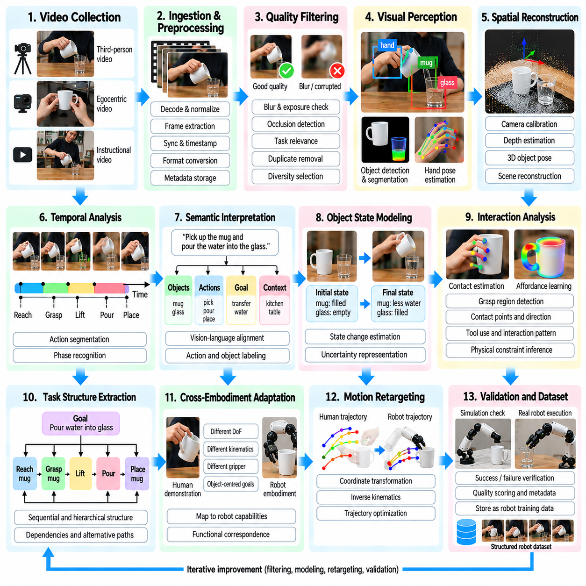{width="7.268055555555556in" height="7.268055555555556in"}

인간 영상-로봇 데이터 파이프라인(Human Video-to-Robot Data Pipeline)은 인간 활동(Human Activity)의 관측 정보를 로봇 인식(Robotic Perception), 계획(Planning), 제어(Control)를 지원하는 구조화된 정보(Structured Information)로 변환한다. 인간 시연(Human Demonstrations)은 물체 조작(Object Manipulation), 작업 구성(Task Organization), 물리적 상호작용(Physical Interactions)에 관한 폭넓은 지식을 제공하지만, 실행 가능한 로봇 명령(Executable Robot Commands)을 직접 포함하는 경우는 드물다. 신뢰성 있는 파이프라인(Reliable Pipeline)은 시각적 분석(Visual Analysis), 의미론적 해석(Semantic Interpretation), 신체 구조 적응(Embodiment Adaptation), 물리적 검증(Physical Validation)을 통해 이러한 차이를 해결해야 한다.

파이프라인(Pipeline)은 교육용 영상(Instructional Recordings), 일인칭 카메라(Egocentric Cameras), 작업 현장 시연(Workplace Demonstrations), 통제된 실험(Controlled Experiments)에서 영상을 수집하는 것으로 시작한다. 각 데이터 원천(Data Source)은 시점(Viewpoint), 작업 다양성(Task Diversity), 상호작용 가시성(Interaction Visibility) 측면에서 서로 다른 장점을 제공한다. 데이터 수집 절차(Collection Procedures)에서는 카메라 특성(Camera Characteristics), 작업 설명(Task Descriptions), 타임스탬프(Timestamps), 사용 권한(Usage Permissions)을 포함한 메타데이터(Metadata)를 기록해야 한다. 이러한 기록은 추적 가능성(Traceability)과 일관된 후속 처리(Downstream Processing)를 지원한다.

영상 수집 및 입력 처리(Video Ingestion)는 이질적인 영상 기록(Heterogeneous Recordings)을 자동화된 분석(Automated Analysis)에 적합한 표준화된 표현(Standardized Representations)으로 변환한다. 디코딩(Decoding), 프레임 속도 정규화(Frame-Rate Normalization), 타임스탬프 검증(Timestamp Verification), 형식 변환(Format Conversion)은 일관된 처리 조건(Processing Conditions)을 확립한다. 정규화(Normalization) 과정에서 유용한 세부 정보가 제거될 수 있으므로 원본 영상(Original Recordings)은 보존해야 한다. 구조화된 저장 시스템(Structured Storage System)은 원본 파일(Source Files)을 추출된 프레임(Extracted Frames), 메타데이터(Metadata), 처리 버전(Processing Versions), 품질 지표(Quality Indicators)와 연결한다.

품질 필터링(Quality Filtering)은 의미 있는 물리적 상호작용(Meaningful Physical Interactions)을 포함하는 시연을 보존하면서 사용할 수 없는 영상(Unusable Recordings)을 제거한다. 자동화된 검사(Automated Checks)는 흐림(Blur), 가림 현상(Occlusion), 손상된 프레임(Corrupted Frames), 시간적 불연속성(Temporal Discontinuities), 작업 관련성(Task Relevance)을 평가한다. 중복 탐지(Duplicate Detection)는 불필요한 반복 처리(Redundant Processing)를 줄이며, 다양성 인식 선택(Diversity-Aware Selection)은 특이한 환경(Unusual Environments)과 실행 전략(Execution Strategies)을 유지한다. 실패 시연(Failed Demonstrations)도 제약 조건(Constraints)이나 복구 행동(Recovery Behavior)에 관한 유용한 근거를 제공한다면 보존해야 한다.

시각적 인식(Visual Perception)은 선별된 영상에서 물체(Objects), 손(Hands), 도구(Tools), 관련 장면 구조(Relevant Scene Structures)를 추출한다. 물체 탐지기(Object Detectors)와 분할 모델(Segmentation Models)은 상호작용 대상(Interaction Targets)을 식별하며, 추적 알고리즘(Tracking Algorithms)은 프레임 사이에서 개체의 동일성(Identities)을 유지한다. 손 자세 추정(Hand Pose Estimation)은 근사적인 움직임 정보(Approximate Movement Information)를 제공한다. 이러한 출력을 결합하면 장면의 구조화된 표현(Structured Scene Representation)을 생성할 수 있지만, 가림 현상(Occlusion)과 불확실한 깊이 정보(Uncertain Depth)는 기하학적 정확도(Geometric Accuracy)를 제한할 수 있다.

공간 재구성(Spatial Reconstruction)은 손(Hands), 물체(Objects), 도구(Tools), 환경 표면(Environmental Surfaces) 사이의 관계를 추정한다. 카메라 보정(Camera Calibration)과 깊이 추정(Depth Estimation)은 3차원 위치(Three-Dimensional Positions)와 방향(Orientations)의 복원을 지원할 수 있다. 상대적인 물체 변환(Relative Object Transformations)은 인간의 절대적인 관절 궤적(Absolute Human Joint Trajectories)보다 전이 가능성(Transferability)이 높은 경우가 많다. 단안 영상(Monocular Video)만으로는 모든 공간 구성(Spatial Configurations)을 유일하게 결정할 수 없으므로 재구성 불확실성(Reconstruction Uncertainty)을 기록해야 한다.

시간적 분석(Temporal Analysis)은 연속적인 영상 기록(Continuous Recordings)을 의미 있는 행동 구간(Action Segments)으로 나눈다. 모델은 움직임(Motion)과 물체 상태 변화(Object-State Changes)를 활용하여 준비(Preparation), 접근(Approach), 접촉(Contact), 조작(Manipulation), 해제(Release), 완료(Completion) 단계를 식별한다. 행동이 중첩되거나 중요한 사건이 가려져 있을 때 시간적 경계(Temporal Boundaries)는 불확실할 수 있다. 구간 수준 표현(Segment-Level Representations)은 긴 시연(Long Demonstrations)을 검색하고 주석을 부여하며 재사용 가능한 로봇 학습 사례(Reusable Robotic Learning Examples)로 변환하는 과정을 용이하게 한다.

의미론적 해석(Semantic Interpretation)은 관찰된 상호작용(Observed Interactions)을 행동 레이블(Action Labels), 물체 기능(Object Functions), 작업 목표(Task Objectives)와 연결한다. 내레이션(Narration), 자막(Subtitles), 언어 모델(Language Models)은 시연자가 달성하려는 의도(Intention)를 설명하는 데 도움이 될 수 있다. 시각적 근거(Visual Evidence)를 통해 설명된 결과(Described Outcomes)가 실제로 발생했는지 검증해야 한다. 이렇게 생성된 의미론적 기록(Semantic Records)은 저수준 움직임 관측(Low-Level Motion Observations)을 고수준 명령(Higher-Level Instructions) 및 절차적 지식(Procedural Knowledge)과 연결한다.

물체 상태 모델링(Object-State Modeling)은 각 상호작용(Interaction) 동안 물리적 개체(Physical Entities)가 어떻게 변화하는지를 표현한다. 용기(Container)는 닫힌 상태(Closed State)에서 열린 상태(Open State)로 전환될 수 있으며, 부품(Component)은 조립되지 않은 상태(Unassembled Configuration)에서 설치된 상태(Installed Configuration)로 이동할 수 있다. 이러한 상태 전환(State Transitions)은 서로 다른 로봇 신체 구조(Robot Embodiments)에서도 유효하게 유지될 수 있는 작업 관련 정보(Task-Relevant Information)를 제공한다. 접촉(Contact), 힘(Force), 숨겨진 메커니즘(Hidden Mechanisms)을 직접 관찰할 수 없는 경우에는 상태 표현(State Representations)에 불확실성(Uncertainty)을 포함해야 한다.

상호작용 분석(Interaction Analysis)은 잠재적인 파지 영역(Grasp Regions), 접촉 지점(Contact Points), 도구 사용 패턴(Tool-Use Patterns), 행동 유도성(Affordances)을 식별한다. 인간의 손 궤적(Human Hand Trajectories)은 조작이 시작되는 위치를 나타낼 수 있으며, 물체 움직임(Object Motion)은 상호작용의 가능한 결과(Likely Consequences)를 보여준다. 이러한 관측 정보는 로봇 계획(Robot Planning)을 위한 후보 제약 조건(Candidate Constraints)을 제공한다. 그러나 추정된 접촉(Estimated Contact)을 측정된 힘(Measured Force)으로 취급해서는 안 되며, 시각적 시연(Visual Demonstrations)만으로 완전한 물리적 동역학(Physical Dynamics)을 확립할 수는 없다.

작업 구조 추출(Task Structure Extraction)은 개별 행동(Individual Actions)을 순서가 지정된 작업(Ordered Operations)이나 부분적으로 순서가 지정된 작업(Partially Ordered Operations)으로 구성한다. 의존 관계(Dependencies)는 후속 단계(Subsequent Steps)를 시작하기 전에 충족해야 하는 조건을 나타낸다. 계층적 작업 그래프(Hierarchical Task Graphs)는 목표(Goals), 하위 작업(Subtasks), 대체 실행 경로(Alternative Execution Paths)를 표현할 수 있다. 이러한 구조는 로봇이 모든 인간 움직임(Human Movements)을 재현하지 않고도 동등한 작업 결과(Equivalent Task Outcomes)를 추구할 수 있도록 하므로 로봇 계획(Robotic Planning)을 지원한다.

신체 구조 간 적응(Cross-Embodiment Adaptation)은 인간 중심 정보(Human-Centered Information)를 로봇과 호환되는 목표(Robot-Compatible Objectives)로 변환한다. 관절 구조(Joint Structure), 작업 공간(Workspace), 그리퍼 기하학(Gripper Geometry), 구동 방식(Actuation)의 차이로 인해 많은 인간 움직임(Human Motions)을 직접 재현할 수 없다. 물체 중심 목표(Object-Centered Goals)와 기능적 행동 표현(Functional Action Representations)은 공유 인터페이스(Shared Interface)를 제공한다. 이후 로봇 전용 계획기(Robot-Specific Planners)는 제안된 각 상호작용(Proposed Interaction)이 도달 가능(Reachable)하고 안정적(Stable)이며 물리적으로 실행 가능한지(Physically Feasible)를 판단한다.

동작 리타게팅(Motion Retargeting)은 선택된 시연 특징(Demonstration Features)을 로봇 궤적 후보(Candidate Robot Trajectories)로 매핑한다. 좌표 변환(Coordinate Transformations), 역운동학(Inverse Kinematics), 충돌 검사(Collision Checking), 궤적 최적화(Trajectory Optimization)는 기하학적 제약 조건(Geometric Constraints)을 만족하도록 돕는다. 동역학적 실행 가능성 검사(Dynamic Feasibility Checks)는 액추에이터 한계(Actuator Limits), 적재 하중(Payload), 접촉 안정성(Contact Stability)을 고려한다. 리타게팅된 궤적(Retargeted Trajectories)은 실행 특성(Execution Properties)이 검증되기 전까지 검증된 명령(Verified Commands)이 아니라 제안된 궤적(Proposed Trajectories)으로 취급해야 한다.

시뮬레이션(Simulation)은 실제 로봇 배포(Physical Deployment) 전에 행동 후보(Candidate Behaviors)를 시험하기 위한 중간 환경(Intermediate Environment)을 제공한다. 로봇 모델(Robot Models)은 제안된 궤적(Proposed Trajectories)을 실행하면서 충돌(Collisions), 물체 변위(Object Displacement), 작업 완료(Task Completion), 제약 조건 위반(Constraint Violations)을 기록할 수 있다. 도메인 무작위화(Domain Randomization)는 불확실한 마찰(Friction), 기하학(Geometry), 센싱 조건(Sensing Conditions)에 대한 민감도를 드러낼 수 있다. 시뮬레이션 결과(Simulation Results)는 개선 방향을 제시하지만 실제 환경 검증(Real-World Validation)을 완전히 대체할 수는 없다.

로봇 실행(Robot Execution)은 관찰된 인간 행동(Observed Human Behavior)과 실행 가능한 물리적 기술(Executable Physical Skills) 사이의 차이를 해소한다. 제어기(Controllers)는 시각적 피드백(Visual Feedback), 고유수용감각(Proprioception), 사용 가능한 힘 측정(Force Measurements)이나 촉각 측정(Tactile Measurements)을 활용하여 상호작용 중 움직임을 조정한다. 성공적인 실행(Successful Executions)은 명령(Commands)과 측정된 결과(Measured Outcomes)를 포함하는 로봇 전용 시연(Robot-Specific Demonstrations)을 제공한다. 실패한 시도(Failed Attempts)는 누락된 제약 조건(Missing Constraints), 부정확한 가정(Inaccurate Assumptions), 수정 학습(Corrective Learning)의 기회를 드러낸다.

파이프라인(Pipeline)은 관찰된 데이터(Observed Data), 추론된 물리량(Inferred Quantities), 검증된 로봇 행동(Validated Robot Actions)을 명확하게 구별해야 한다. 영상은 물체가 움직이는 모습을 직접 보여줄 수 있지만, 추정된 손 접촉(Estimated Hand Contact)과 재구성된 깊이(Reconstructed Depth)에는 여전히 불확실성(Uncertainty)이 존재한다. 생성된 궤적(Generated Trajectory)은 성공적인 실행 기록(Successful Execution Record)과 동일하지 않다. 명시적인 신뢰도 값(Confidence Values)과 데이터 출처 연결(Provenance Links)은 후속 모델(Downstream Models)이 예측값(Predictions)을 검증된 물리적 측정값(Verified Physical Measurements)으로 잘못 취급하는 것을 방지한다.

학습 데이터셋 구축(Training Dataset Construction)은 영상 관측(Video Observations), 의미론적 주석(Semantic Annotations), 물체 상태 전환(Object-State Transitions), 검증된 로봇 경험(Validated Robotic Experiences)을 결합한다. 학습 샘플(Samples)은 행동 인식(Action Recognition), 행동 유도성 예측(Affordance Prediction), 모방 학습(Imitation Learning), 명령 조건부 정책 학습(Instruction-Conditioned Policy Training)을 지원할 수 있다. 데이터셋 스키마(Dataset Schemas)는 시간적 정렬(Temporal Alignment)과 신체 구조 정보(Embodiment Information)를 보존해야 한다. 학습 및 평가 데이터 분할(Training and Evaluation Splits)은 관련 영상(Videos), 시연(Demonstrations), 촬영 세션(Capture Sessions) 사이의 데이터 누출(Data Leakage)을 방지해야 한다.

약지도학습(Weakly Supervised Learning)과 자기지도학습(Self-Supervised Learning)은 광범위한 수작업 주석(Exhaustive Manual Annotation) 없이도 파이프라인(Pipeline)을 확장할 수 있다. 영상 인코더(Video Encoders)는 레이블이 없는 영상(Unlabeled Recordings)에서 움직임(Motion)과 상호작용 특징(Interaction Features)을 학습하며, 근사적인 캡션(Approximate Captions)은 의미론적 지침(Semantic Guidance)을 제공한다. 의사 레이블링(Pseudo-Labeling)은 임시 행동 경계(Provisional Action Boundaries)와 물체 연관 관계(Object Associations)를 생성한다. 신뢰도 필터링(Confidence Filtering)과 선별적인 인간 검토(Targeted Human Review)는 체계적인 오류(Systematic Errors)가 이후 학습 단계(Subsequent Training Rounds)로 확산되는 것을 방지하는 데 도움이 된다.

실용적인 구현(Practical Implementation)에서는 데이터 입력 처리(Ingestion), 인식(Perception), 분할(Segmentation), 의미론적 정합(Semantic Grounding), 리타게팅(Retargeting), 평가(Evaluation)를 위한 모듈형 소프트웨어 서비스(Modular Software Services)를 사용할 수 있다. 각 모듈(Module)은 구조화된 입력(Structured Inputs)을 받아 신뢰도 추정값(Confidence Estimates)이 포함된 버전 관리 출력(Versioned Outputs)을 생성한다. 메시지 큐(Message Queues)와 분산 처리(Distributed Processing)는 대규모 영상 집합(Large Collections)을 지원하며, 재현 가능한 설정(Reproducible Configurations)은 일관된 실험(Consistent Experiments)을 가능하게 한다. 모듈형 설계(Modular Design)는 전체 파이프라인을 재구축하지 않고도 개별 모델(Individual Models)을 개선할 수 있도록 한다.

품질 보증(Quality Assurance)은 중간 데이터 정확도(Intermediate Data Accuracy)와 후속 로봇 성능(Downstream Robotic Performance)을 모두 측정해야 한다. 유용한 지표(Indicators)에는 물체 추적 일관성(Object Tracking Consistency), 행동 분할 정확도(Action Segmentation Accuracy), 상태 전환 정확성(State-Transition Correctness), 궤적 실행 가능성(Trajectory Feasibility), 작업 성공률(Task Success Rate)이 포함된다. 평가는 익숙하지 않은 물체(Unfamiliar Objects), 환경(Environments), 로봇 플랫폼(Robot Platforms)을 포함해야 한다. 우수한 영상 이해(Video Understanding) 성능만으로 성공적인 물리적 실행(Physical Execution)이 보장되는 것은 아니다.

폐루프 데이터 엔진(Closed-Loop Data Engine)은 실제 배포 결과(Deployment Results)를 활용하여 인간 영상-로봇 파이프라인(Human Video-to-Robot Pipeline)을 지속적으로 개선한다. 로봇 실패(Robot Failures)는 누락된 상호작용 사례(Missing Interaction Examples), 불확실한 상태 추정(Uncertain State Estimates), 잘못된 리타게팅 가정(Incorrect Retargeting Assumptions)을 식별한다. 이러한 발견은 추가적인 영상 선택(Video Selection), 주석(Annotation), 로봇 데이터 수집(Robot Data Collection)을 안내한다. 반복적인 학습(Repeated Training)과 검증(Validation)은 대규모 인간 시연(Large-Scale Human Demonstrations)을 점점 더 신뢰성 높은 로봇 능력(Robotic Capabilities)과 연결한다.

궁극적인 목표(Ultimate Objective)는 관찰된 모든 인간 움직임(Observed Human Movement)을 대응하는 로봇 명령(Corresponding Robot Command)으로 변환하는 것이 아니다. 대신 파이프라인(Pipeline)은 목표(Goals), 물체(Objects), 상호작용(Interactions), 물리적 결과(Physical Consequences)에 관한 전이 가능한 지식(Transferable Knowledge)을 추출한다. 구조화된 영상 이해(Structured Video Understanding)를 신체 구조 인식 계획(Embodiment-Aware Planning) 및 검증된 실행(Validated Execution)과 결합함으로써 피지컬 인공지능(Physical AI) 시스템은 안전성(Safety)과 추적 가능성(Traceability)을 유지하면서 다양한 인간 경험(Diverse Human Experiences)을 재사용 가능한 로봇 기술(Reusable Robotic Skills)로 변환할 수 있다.
