**Volume 04. Data Engines and Scaling for Physical AI**


# Chapter 04. Simulation Generated Data

##  

## 04.01. Simulation as a Data Generator

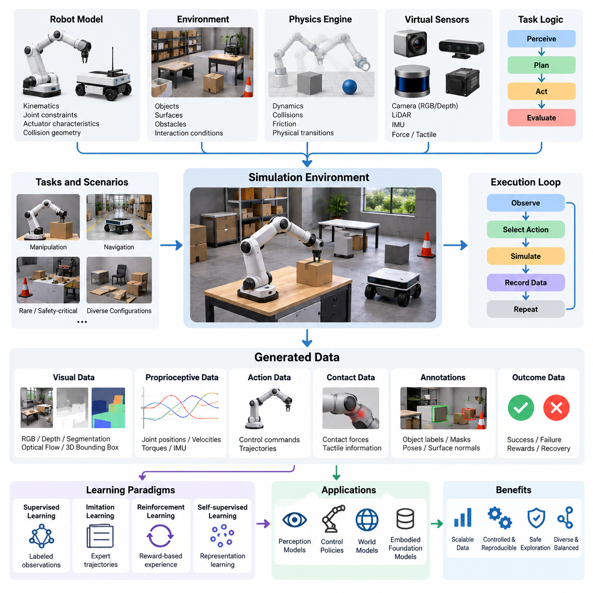{width="7.268055555555556in" height="7.268055555555556in"}

Simulation serves as a scalable data generator for Physical AI by creating controlled virtual environments in which robots can perceive, act, interact, and learn without requiring continuous access to physical hardware. Unlike conventional datasets collected from completed real-world operations, simulation-generated data can be produced on demand by systematically varying tasks, environments, objects, and robot behaviors.

The fundamental advantage of simulation is its ability to generate large quantities of structured observation-action-outcome data under reproducible conditions. A simulated robot can execute thousands of trajectories while recording sensor observations, internal states, control commands, contact events, and task outcomes. These records provide training material for perception models, control policies, world models, and embodied foundation models.

A simulation environment typically combines a robot model, a representation of the surrounding world, a physics engine, virtual sensors, and task execution logic. The robot model describes kinematic structures, joint constraints, actuator characteristics, and collision geometry. The environment defines objects, surfaces, obstacles, and interaction conditions, while the physics engine estimates how these elements evolve over time.

During simulated execution, the system generates sequences of observations, actions, and resulting states. At each time step, virtual sensors capture information about the environment, and a control policy selects an action based on available observations. The simulator then computes the resulting physical transition, producing temporally aligned trajectories that can be stored as complete learning episodes.

Simulation-generated data supports multiple learning paradigms, including supervised learning, imitation learning, reinforcement learning, and self-supervised representation learning. Supervised models can learn from automatically labeled observations, while imitation learning uses trajectories generated by expert controllers. Reinforcement learning collects experience through repeated interactions and evaluates actions using task-dependent rewards.

One important application is the generation of perception training data. Virtual cameras, depth sensors, LiDAR systems, and other sensing models can produce observations from precisely defined scenes. Because the simulator maintains access to object geometry, position, orientation, and semantic identity, it can generate corresponding annotations without requiring extensive manual labeling or physical measurement.

Synthetic perception datasets can include object detection labels, segmentation masks, depth maps, surface normals, optical flow, and three-dimensional bounding boxes. These annotations are especially valuable when training models that require geometric understanding. However, their practical usefulness depends on whether simulated sensing characteristics adequately represent the noise, occlusion, calibration errors, and environmental variations found in reality.

Simulation also generates proprioceptive and control data that are difficult to observe directly through external cameras. Joint positions, joint velocities, actuator torques, contact forces, inertial measurements, and commanded actions can be recorded with precise timestamps. Such information supports learning robot dynamics, estimating hidden states, identifying contact conditions, and developing feedback control policies.

For manipulation tasks, simulation can reproduce grasping, pushing, lifting, placing, and tool interaction across many object configurations. A robotic manipulator may attempt thousands of grasps while object mass, friction, shape, and initial position are varied. The resulting trajectories provide examples of successful manipulation, unstable contacts, failed grasps, and corrective actions that would be expensive to collect physically.

Mobile robots benefit from simulated navigation data covering corridors, warehouses, factories, construction sites, and outdoor environments. Virtual scenarios can introduce moving obstacles, narrow passages, uneven surfaces, and unexpected route blockages. By observing how navigation policies respond to these conditions, developers can generate training examples for obstacle avoidance, path planning, localization, and recovery behavior.

Simulation is particularly useful for generating rare and safety-critical scenarios. Physical experiments involving collisions, unstable loads, sensor failures, or hazardous environmental conditions may be impractical or unacceptable. Virtual environments allow these situations to be explored repeatedly while preserving detailed records of the events leading to failure and the actions required for recovery.

Another advantage is the ability to control the distribution of generated experiences. Real-world datasets often contain large quantities of routine behavior but relatively few difficult or unusual situations. Simulation can deliberately increase the frequency of challenging events, producing a more balanced collection of successful operations, failure cases, boundary conditions, and recovery trajectories.

Procedural generation extends this capability by automatically constructing diverse scenes and task configurations. Object arrangements, room layouts, obstacle positions, surface properties, and lighting conditions can be generated from parameterized rules. This approach reduces dependence on manually designed environments and allows training datasets to cover combinations of conditions that may never appear in a small collection of fixed scenarios.

Domain randomization further expands dataset diversity by varying visual and physical parameters during generation. Camera viewpoints, textures, illumination, friction coefficients, object dimensions, and actuator characteristics can change between episodes. The objective is to expose learning systems to sufficiently diverse conditions so that they become less dependent on incidental properties of individual simulated environments.

Expert policies and classical planners can also act as automated data producers. Motion planners, trajectory optimizers, and model-based controllers generate demonstrations by solving tasks inside virtual environments. These demonstrations can train neural policies to approximate complex planning behavior, although the quality of the resulting models remains dependent on the validity and coverage of the expert-generated trajectories.

Reinforcement learning introduces a different data generation mechanism because the learning agent actively determines which states and actions are explored. As a policy improves, the distribution of collected experiences changes. Early training may contain unsuccessful attempts and unstable behavior, while later stages increasingly capture effective strategies, making the history of policy development itself a valuable source of training information.

Curriculum-based simulation organizes data generation according to increasing task difficulty. A robot may initially learn navigation in an empty environment before encountering static obstacles, moving agents, and complex traffic patterns. By adjusting difficulty according to learning progress, the data engine can emphasize experiences that are informative without overwhelming the policy with tasks beyond its current capabilities.

Massively parallel simulation enables many independent environments to operate simultaneously, often using accelerated computing resources. Each environment may contain different robots, objects, or task conditions, allowing large collections of trajectories to be produced efficiently. Nevertheless, simulation throughput depends on model complexity, numerical stability, rendering requirements, and available computational resources.

The quality of simulation-generated data depends strongly on the fidelity of the underlying models. Inaccurate contact dynamics, unrealistic actuator responses, simplified sensor noise, or incorrect material properties can introduce systematic errors. A policy trained entirely on these assumptions may perform well virtually but fail when confronted with real-world friction, deformation, latency, or uncertainty.

This difference between simulated and real-world behavior is commonly described as the simulation-to-reality gap. It includes discrepancies in visual appearance, physical dynamics, sensor characteristics, environmental complexity, and operational timing. Effective data generation therefore requires more than increasing simulation volume; it requires understanding which discrepancies influence the learning task and reducing their effects through validation.

Real-world measurements play an important role in calibrating simulation models. Recorded robot trajectories, actuator responses, sensor observations, and object interactions can be compared with corresponding simulated results. Differences provide evidence for adjusting model parameters and identifying missing physical effects. This calibration process helps improve the relevance of subsequently generated synthetic data.

Combining real and synthetic data offers a practical approach to balancing realism, diversity, and collection cost. Real-world demonstrations provide examples of authentic physical interactions, while simulation expands coverage across controlled variations and rare scenarios. The mixture must be designed carefully because excessive reliance on unrealistic synthetic samples can introduce biases or reduce performance in actual deployment conditions.

A production-oriented simulation data engine requires systematic management of generated episodes. Each record should identify the simulator version, robot configuration, environment parameters, randomization settings, policy version, and task outcome. Preserving this metadata makes it possible to reproduce experiments, investigate unexpected model behavior, and distinguish improvements caused by data changes from those caused by software modifications.

Dataset validation is equally important because large-scale generation does not guarantee useful information. Automated checks can identify corrupted trajectories, invalid sensor readings, physically inconsistent states, incomplete episodes, and duplicated experiences. Additional analysis should measure task coverage, environmental diversity, success and failure distributions, and the relationship between generated data and downstream learning performance.

Simulation becomes especially powerful when connected to a closed-loop Physical AI data engine. Failures observed during real-world deployment can be converted into new simulation scenarios, allowing similar conditions to be reproduced and varied systematically. Models retrained on these targeted experiences can then be evaluated in simulation before undergoing controlled physical testing, creating a feedback mechanism between deployment and data generation.

The long-term value of simulation is not simply the production of more samples, but the ability to generate experiences that improve physical intelligence. A mature simulation data engine selects environments, tasks, and interactions according to identified learning needs, continuously evaluates synthetic data quality, and integrates real-world feedback. This transforms simulation from a testing environment into an adaptive source of training experience for scalable Physical AI systems.

시뮬레이션(Simulation)은 로봇이 실제 하드웨어(Hardware)에 지속적으로 접근하지 않고도 인식(Perception), 행동(Action), 상호작용(Interaction), 학습(Learning)을 수행할 수 있는 제어된 가상 환경(Virtual Environment)을 생성함으로써 피지컬 인공지능(Physical AI)을 위한 확장 가능한 데이터 생성기(Data Generator) 역할을 한다. 실제 환경에서 완료된 작업으로부터 수집하는 기존 데이터셋(Dataset)과 달리, 시뮬레이션 생성 데이터(Simulation-Generated Data)는 작업, 환경, 객체, 로봇 행동을 체계적으로 변화시키면서 필요에 따라 생성할 수 있다.

시뮬레이션의 근본적인 장점은 재현 가능한 조건(Reproducible Conditions)에서 대량의 구조화된 관측-행동-결과 데이터(Observation-Action-Outcome Data)를 생성할 수 있다는 것이다. 시뮬레이션 로봇은 수천 개의 궤적(Trajectory)을 실행하면서 센서 관측값, 내부 상태, 제어 명령, 접촉 이벤트, 작업 결과를 기록할 수 있다. 이러한 기록은 인식 모델(Perception Model), 제어 정책(Control Policy), 월드 모델(World Model), 체화 기반 파운데이션 모델(Embodied Foundation Model)의 학습 자료로 활용된다.

시뮬레이션 환경은 일반적으로 로봇 모델(Robot Model), 주변 세계의 표현(World Representation), 물리 엔진(Physics Engine), 가상 센서(Virtual Sensor), 작업 실행 로직(Task Execution Logic)으로 구성된다. 로봇 모델은 운동학적 구조(Kinematic Structure), 관절 제약조건(Joint Constraint), 액추에이터 특성(Actuator Characteristics), 충돌 형상(Collision Geometry)을 정의한다. 환경은 객체, 표면, 장애물, 상호작용 조건을 정의하며, 물리 엔진은 이러한 요소들이 시간에 따라 어떻게 변화하는지 계산한다.

시뮬레이션 실행 과정에서 시스템은 관측값, 행동, 결과 상태로 구성된 연속적인 데이터 시퀀스(Data Sequence)를 생성한다. 각 시간 단계(Time Step)에서 가상 센서는 환경 정보를 수집하고, 제어 정책은 사용 가능한 관측값을 바탕으로 행동을 선택한다. 이후 시뮬레이터(Simulator)는 해당 행동에 따른 물리적 상태 전이(Physical State Transition)를 계산하여 시간적으로 정렬된 궤적 데이터를 생성하며, 이를 완전한 학습 에피소드(Learning Episode)로 저장할 수 있다.

시뮬레이션 생성 데이터는 지도학습(Supervised Learning), 모방학습(Imitation Learning), 강화학습(Reinforcement Learning), 자기지도 표현학습(Self-Supervised Representation Learning)을 포함한 다양한 학습 방식에 활용된다. 지도학습 모델은 자동으로 라벨링된 관측 데이터로 학습할 수 있으며, 모방학습은 전문가 제어기(Expert Controller)가 생성한 궤적을 활용한다. 강화학습은 반복적인 상호작용을 통해 경험을 수집하고 작업별 보상(Task-Dependent Reward)을 이용하여 행동을 평가한다.

중요한 응용 분야 중 하나는 인식 학습 데이터(Perception Training Data)의 생성이다. 가상 카메라(Virtual Camera), 깊이 센서(Depth Sensor), 라이다(LiDAR), 기타 센서 모델(Sensor Model)은 정밀하게 정의된 장면(Scene)으로부터 관측 데이터를 생성할 수 있다. 시뮬레이터는 객체의 형상, 위치, 방향, 의미적 식별 정보(Semantic Identity)에 접근할 수 있으므로 광범위한 수작업 라벨링이나 물리적 측정 없이도 대응되는 정답 주석(Ground Truth Annotation)을 생성할 수 있다.

합성 인식 데이터셋(Synthetic Perception Dataset)에는 객체 탐지 라벨(Object Detection Label), 분할 마스크(Segmentation Mask), 깊이 맵(Depth Map), 표면 법선(Surface Normal), 광학 흐름(Optical Flow), 3차원 경계 상자(3D Bounding Box)가 포함될 수 있다. 이러한 주석은 기하학적 이해(Geometric Understanding)가 필요한 모델 학습에 특히 유용하다. 그러나 실제 활용 가능성은 시뮬레이션 센서 특성이 현실의 잡음(Noise), 가림(Occlusion), 보정 오차(Calibration Error), 환경 변화(Environmental Variation)를 얼마나 적절하게 반영하는지에 따라 달라진다.

시뮬레이션은 외부 카메라만으로 직접 관측하기 어려운 고유수용감각 데이터(Proprioceptive Data)와 제어 데이터(Control Data)도 생성한다. 관절 위치(Joint Position), 관절 속도(Joint Velocity), 액추에이터 토크(Actuator Torque), 접촉력(Contact Force), 관성 측정값(Inertial Measurement), 명령된 행동(Commanded Action)을 정확한 타임스탬프(Timestamp)와 함께 기록할 수 있다. 이러한 정보는 로봇 동역학(Robot Dynamics) 학습, 숨겨진 상태 추정(Hidden State Estimation), 접촉 조건 식별(Contact Condition Identification), 피드백 제어 정책(Feedback Control Policy) 개발을 지원한다.

조작 작업(Manipulation Task)에서 시뮬레이션은 다양한 객체 구성에 대해 파지(Grasping), 밀기(Pushing), 들어 올리기(Lifting), 배치(Placing), 도구 상호작용(Tool Interaction)을 재현할 수 있다. 로봇 매니퓰레이터(Robot Manipulator)는 객체의 질량, 마찰, 형상, 초기 위치를 변화시키면서 수천 번의 파지를 시도할 수 있다. 생성된 궤적은 성공적인 조작, 불안정한 접촉, 파지 실패, 교정 행동(Corrective Action)에 대한 사례를 제공하며, 실제 환경에서 수집할 경우 높은 비용이 발생하는 데이터를 확보할 수 있게 한다.

이동 로봇(Mobile Robot)은 복도, 창고, 공장, 건설 현장, 실외 환경을 포함하는 시뮬레이션 내비게이션 데이터(Simulated Navigation Data)를 활용할 수 있다. 가상 시나리오(Virtual Scenario)에는 이동 장애물(Moving Obstacle), 좁은 통로(Narrow Passage), 불균일한 표면(Uneven Surface), 예기치 않은 경로 차단(Route Blockage)을 도입할 수 있다. 이러한 조건에서 내비게이션 정책(Navigation Policy)의 반응을 관찰함으로써 장애물 회피(Obstacle Avoidance), 경로 계획(Path Planning), 위치 추정(Localization), 복구 행동(Recovery Behavior)을 위한 학습 사례를 생성할 수 있다.

시뮬레이션은 희귀 상황(Rare Scenario)과 안전 필수 상황(Safety-Critical Scenario)의 데이터를 생성하는 데 특히 유용하다. 충돌(Collision), 불안정한 적재물(Unstable Load), 센서 고장(Sensor Failure), 위험한 환경 조건(Hazardous Environmental Condition)을 포함하는 실제 실험은 실행이 어렵거나 허용되지 않을 수 있다. 가상 환경에서는 이러한 상황을 반복적으로 탐색하면서 고장으로 이어지는 사건과 복구에 필요한 행동을 상세하게 기록할 수 있다.

또 다른 장점은 생성된 경험의 데이터 분포(Data Distribution)를 제어할 수 있다는 것이다. 실제 환경 데이터셋에는 일반적인 반복 행동(Routine Behavior)이 대량으로 포함되는 반면, 어렵거나 비정상적인 상황은 상대적으로 적게 나타난다. 시뮬레이션은 도전적인 사건의 발생 빈도를 의도적으로 높여 성공적인 작업, 실패 사례, 경계 조건(Boundary Condition), 복구 궤적(Recovery Trajectory)이 보다 균형 있게 포함된 데이터셋을 생성할 수 있다.

절차적 생성(Procedural Generation)은 다양한 장면과 작업 구성을 자동으로 생성하여 이러한 기능을 확장한다. 객체 배치(Object Arrangement), 공간 구조(Room Layout), 장애물 위치(Obstacle Position), 표면 특성(Surface Property), 조명 조건(Lighting Condition)은 매개변수화된 규칙(Parameterized Rule)을 통해 생성할 수 있다. 이 접근법은 수작업으로 설계된 환경에 대한 의존도를 줄이고, 소수의 고정된 시나리오에서는 나타나지 않을 수 있는 다양한 조건의 조합을 학습 데이터셋에 포함하도록 한다.

도메인 무작위화(Domain Randomization)는 데이터 생성 과정에서 시각적 매개변수(Visual Parameter)와 물리적 매개변수(Physical Parameter)를 변화시켜 데이터셋 다양성을 더욱 확대한다. 카메라 시점(Camera Viewpoint), 텍스처(Texture), 조명(Illumination), 마찰계수(Friction Coefficient), 객체 크기(Object Dimension), 액추에이터 특성은 에피소드마다 달라질 수 있다. 이러한 방법의 목적은 학습 시스템을 충분히 다양한 조건에 노출시켜 특정 시뮬레이션 환경의 부수적인 특성에 대한 의존도를 낮추는 것이다.

전문가 정책(Expert Policy)과 고전적 계획기(Classical Planner) 역시 자동화된 데이터 생성기로 활용될 수 있다. 모션 플래너(Motion Planner), 궤적 최적화기(Trajectory Optimizer), 모델 기반 제어기(Model-Based Controller)는 가상 환경에서 작업을 해결하면서 시연 데이터(Demonstration Data)를 생성한다. 이러한 시연은 신경망 정책(Neural Policy)이 복잡한 계획 행동을 근사하도록 학습시키는 데 활용되지만, 결과 모델의 품질은 전문가가 생성한 궤적의 타당성과 적용 범위에 영향을 받는다.

강화학습(Reinforcement Learning)은 학습 에이전트(Learning Agent)가 탐색할 상태와 행동을 능동적으로 결정한다는 점에서 다른 데이터 생성 메커니즘(Data Generation Mechanism)을 제공한다. 정책(Policy)이 개선됨에 따라 수집되는 경험의 분포도 변화한다. 초기 학습에는 실패한 시도와 불안정한 행동이 많이 포함될 수 있지만, 후기 단계에서는 효과적인 전략이 점차 증가하므로 정책 개발 과정 자체가 가치 있는 학습 정보의 원천이 된다.

커리큘럼 기반 시뮬레이션(Curriculum-Based Simulation)은 작업 난이도(Task Difficulty)를 점진적으로 높이는 방식으로 데이터 생성을 구성한다. 로봇은 처음에 장애물이 없는 환경에서 내비게이션을 학습한 다음 정적 장애물, 이동 에이전트(Moving Agent), 복잡한 교통 패턴(Traffic Pattern)을 경험할 수 있다. 학습 진행 상황에 따라 난이도를 조정함으로써 현재 정책의 능력을 지나치게 초과하는 작업을 강요하지 않으면서 유익한 학습 경험에 집중할 수 있다.

대규모 병렬 시뮬레이션(Massively Parallel Simulation)은 가속 컴퓨팅 자원(Accelerated Computing Resource)을 활용하여 다수의 독립적인 환경을 동시에 실행할 수 있게 한다. 각 환경에는 서로 다른 로봇, 객체, 작업 조건을 적용할 수 있으므로 대규모 궤적 데이터를 효율적으로 생성할 수 있다. 다만 시뮬레이션 처리량(Simulation Throughput)은 모델 복잡도(Model Complexity), 수치적 안정성(Numerical Stability), 렌더링 요구사항(Rendering Requirement), 사용 가능한 컴퓨팅 자원에 따라 달라진다.

시뮬레이션 생성 데이터의 품질은 기반 모델의 충실도(Model Fidelity)에 크게 의존한다. 부정확한 접촉 동역학(Contact Dynamics), 비현실적인 액추에이터 응답(Actuator Response), 단순화된 센서 잡음(Sensor Noise), 잘못된 재료 특성(Material Property)은 체계적인 오차(Systematic Error)를 유발할 수 있다. 이러한 가정에만 기반하여 학습된 정책은 가상 환경에서 우수하게 작동하더라도 실제 환경의 마찰, 변형, 지연시간(Latency), 불확실성(Uncertainty)에 직면하면 실패할 수 있다.

시뮬레이션과 실제 환경의 행동 차이는 일반적으로 시뮬레이션-현실 격차(Simulation-to-Reality Gap)라고 한다. 여기에는 시각적 외관(Visual Appearance), 물리 동역학(Physical Dynamics), 센서 특성(Sensor Characteristics), 환경 복잡도(Environmental Complexity), 운영 타이밍(Operational Timing)의 불일치가 포함된다. 따라서 효과적인 데이터 생성에는 단순히 시뮬레이션 데이터의 양을 늘리는 것뿐 아니라 학습 작업에 영향을 미치는 차이를 이해하고 검증을 통해 그 영향을 줄이는 과정이 필요하다.

실제 환경 측정값(Real-World Measurement)은 시뮬레이션 모델을 보정(Calibration)하는 데 중요한 역할을 한다. 기록된 로봇 궤적, 액추에이터 응답, 센서 관측값, 객체 상호작용을 대응되는 시뮬레이션 결과와 비교할 수 있다. 이러한 차이는 모델 매개변수(Model Parameter)를 조정하고 누락된 물리적 효과(Physical Effect)를 식별하는 근거를 제공한다. 이 보정 과정은 이후 생성되는 합성 데이터(Synthetic Data)의 실제 환경 관련성을 향상시키는 데 기여한다.

실제 데이터(Real Data)와 합성 데이터(Synthetic Data)를 결합하는 것은 현실성(Realism), 다양성(Diversity), 수집 비용(Collection Cost)의 균형을 맞추는 실용적인 접근법이다. 실제 환경 시연(Real-World Demonstration)은 진정한 물리적 상호작용 사례를 제공하며, 시뮬레이션은 제어된 변화와 희귀 시나리오를 통해 데이터의 적용 범위를 확대한다. 그러나 비현실적인 합성 샘플에 과도하게 의존하면 편향(Bias)이 발생하거나 실제 배포 환경에서 성능이 저하될 수 있으므로 데이터 혼합 비율(Mixture Ratio)을 신중하게 설계해야 한다.

실제 운영을 위한 시뮬레이션 데이터 엔진(Simulation Data Engine)에는 생성된 에피소드(Episode)의 체계적인 관리가 필요하다. 각 기록에는 시뮬레이터 버전(Simulator Version), 로봇 구성(Robot Configuration), 환경 매개변수(Environment Parameter), 무작위화 설정(Randomization Setting), 정책 버전(Policy Version), 작업 결과(Task Outcome)가 포함되어야 한다. 이러한 메타데이터(Metadata)를 보존하면 실험 재현, 예상치 못한 모델 행동 조사, 데이터 변경으로 인한 개선과 소프트웨어 수정으로 인한 개선을 구분할 수 있다.

데이터셋 검증(Dataset Validation)도 중요하다. 대규모 데이터 생성이 반드시 유용한 정보를 보장하지는 않기 때문이다. 자동화된 검사(Automated Check)는 손상된 궤적(Corrupted Trajectory), 유효하지 않은 센서 측정값(Invalid Sensor Reading), 물리적으로 일관성이 없는 상태(Physically Inconsistent State), 불완전한 에피소드(Incomplete Episode), 중복된 경험(Duplicated Experience)을 식별할 수 있다. 추가 분석에서는 작업 적용 범위(Task Coverage), 환경 다양성, 성공과 실패의 분포, 생성 데이터와 후속 학습 성능(Downstream Learning Performance)의 관계를 평가해야 한다.

시뮬레이션은 폐루프 피지컬 인공지능 데이터 엔진(Closed-Loop Physical AI Data Engine)과 연결될 때 특히 강력해진다. 실제 배포(Real-World Deployment) 과정에서 관찰된 실패는 새로운 시뮬레이션 시나리오로 변환되어 유사한 조건을 재현하고 체계적으로 변화시키는 데 활용될 수 있다. 이러한 목표 지향적 경험(Targeted Experience)으로 재학습된 모델은 통제된 실제 환경 시험(Controlled Physical Testing)에 앞서 시뮬레이션에서 평가할 수 있으며, 이를 통해 배포와 데이터 생성 사이에 피드백 메커니즘(Feedback Mechanism)이 형성된다.

시뮬레이션의 장기적인 가치(Long-Term Value)는 단순히 더 많은 샘플을 생성하는 것이 아니라 물리적 지능(Physical Intelligence)을 향상시키는 경험을 만들어내는 능력에 있다. 성숙한 시뮬레이션 데이터 엔진(Mature Simulation Data Engine)은 확인된 학습 요구사항(Learning Need)에 따라 환경, 작업, 상호작용을 선택하고, 합성 데이터 품질을 지속적으로 평가하며, 실제 환경의 피드백을 통합한다. 이를 통해 시뮬레이션은 단순한 시험 환경(Testing Environment)을 넘어 확장 가능한 피지컬 인공지능 시스템(Scalable Physical AI System)을 위한 적응형 학습 경험 생성원(Adaptive Source of Training Experience)으로 발전한다.

##  

## 04.02. Physics Based and Rendering Based Data

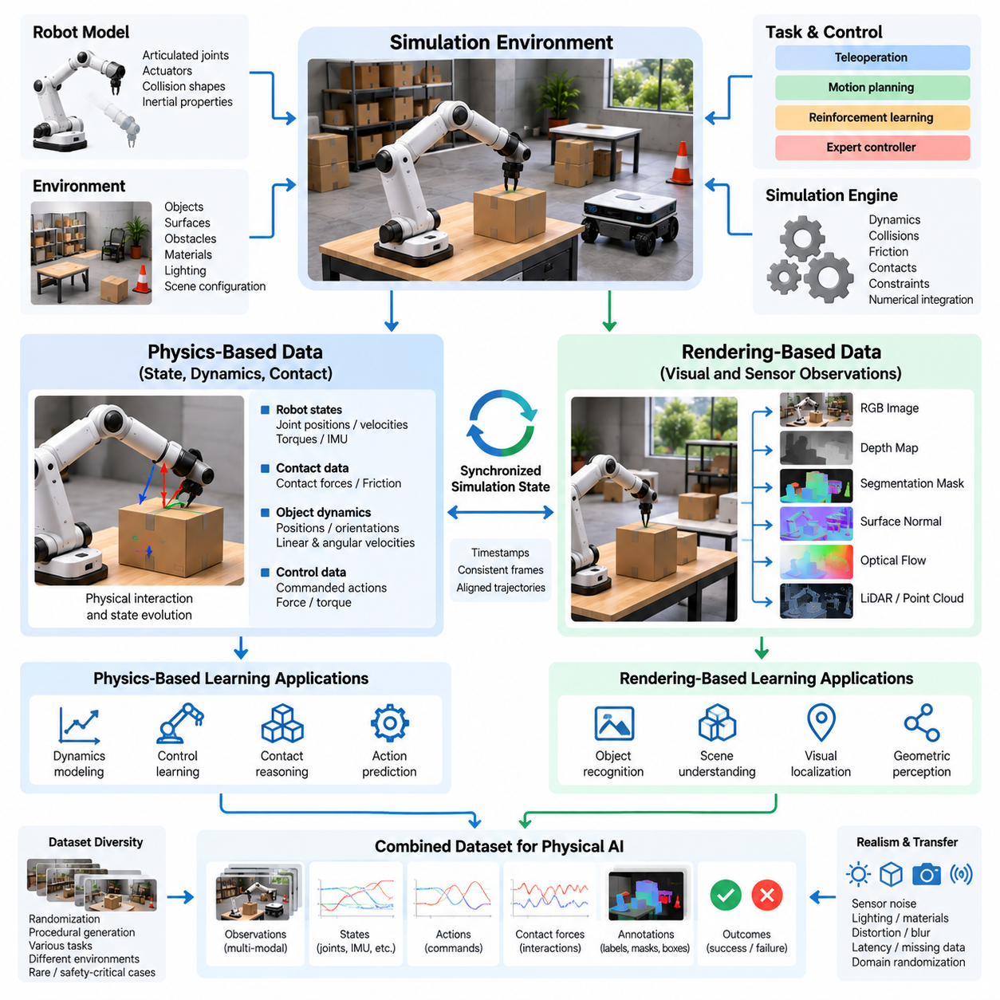{width="7.268055555555556in" height="7.268055555555556in"}

Physics-based data and rendering-based data represent two complementary foundations of simulation-generated datasets for Physical AI. Physics-based simulation produces information about motion, forces, contacts, and state transitions, while rendering-based simulation generates visual and sensor observations of virtual environments. Together, they connect physical behavior with perception, enabling robots to learn how actions influence the surrounding world.

Physics-based data originates from numerical models that approximate the dynamics of robots, objects, and environments. These models describe relationships among mass, inertia, gravity, friction, joint constraints, and external forces. During simulation, a physics engine calculates how the system evolves in response to applied actions, producing trajectories that represent the changing physical state of the robot and its environment.

Rendering-based data is generated by transforming virtual scene descriptions into sensor observations. A rendering engine uses object geometry, material properties, lighting, camera parameters, and scene composition to produce synthetic images. Depending on the rendering method, the output may include RGB images, depth maps, segmentation masks, surface normals, and other representations useful for robotic perception and spatial understanding.

The distinction between these data sources reflects different learning objectives. Physics-based datasets primarily support dynamics modeling, control learning, contact reasoning, and action prediction. Rendering-based datasets support object recognition, scene understanding, visual localization, and geometric perception. However, many Physical AI applications require both because successful behavior depends on interpreting sensory information and predicting physical consequences.

A physics simulator typically represents a robot through rigid bodies, articulated joints, collision shapes, and actuator models. The simulation state may include positions, orientations, linear velocities, angular velocities, and joint configurations. Control commands generate forces or desired motions, while numerical integration advances the system through time according to the modeled dynamics and constraint conditions.

Contact modeling is particularly important because many robotic tasks involve physical interaction with surrounding objects. When a gripper touches an object or a mobile robot wheel contacts the ground, the simulator estimates contact forces and frictional responses. These interactions generate valuable data for grasp stability, manipulation planning, locomotion control, and prediction of physical outcomes.

Physics-based simulation can also represent compliant materials, deformable objects, and articulated mechanisms, although their computational requirements are often greater than those of rigid-body models. Simulating cables, fabrics, flexible tools, or soft robotic structures requires approximations of deformation and material response. The resulting data can support learning tasks involving nonrigid interaction and complex physical manipulation.

Rendering systems operate through a different computational process. They project three-dimensional scene geometry into sensor coordinates while modeling visibility, illumination, surface appearance, and optical effects. Rasterization provides efficient image generation, while ray tracing can represent more detailed light transport and reflections. The selected rendering approach determines the balance between visual realism and generation throughput.

Photorealistic rendering attempts to reproduce the appearance of real environments by modeling materials, shadows, reflections, and lighting conditions. Such realism can be useful for training visual perception systems that must operate under complex illumination and surface characteristics. Nevertheless, visually convincing images do not automatically guarantee accurate sensor behavior or effective transfer to physical robots.

Rendering-based simulation can produce multiple synchronized observation modalities from the same virtual scene. An RGB camera provides appearance information, a depth camera estimates geometric distance, and a simulated LiDAR produces spatial measurements. Because these observations originate from a shared scene state, they can be associated with consistent object positions, camera poses, and semantic annotations.

The generation of ground-truth information is a major advantage of synthetic rendering. A simulator can directly access object identifiers, exact geometry, depth values, and camera transformations. It can therefore produce segmentation masks, bounding boxes, optical flow, and pose annotations automatically. This reduces the labeling burden associated with real-world datasets and supports large-scale supervised learning.

Temporal consistency is essential when combining physics-based and rendering-based data. The physics engine updates object positions and robot states, while the rendering engine generates observations corresponding to those states. Accurate synchronization ensures that recorded images, joint measurements, and control commands describe the same simulated events, enabling coherent observation-action trajectories for policy learning.

Different simulation frequencies may be required for physical dynamics and visual rendering. Contact-rich control systems often need relatively small integration time steps, while cameras operate at lower frame rates. A data generation pipeline must therefore manage timestamp alignment, interpolation, and sensor sampling carefully to avoid introducing artificial timing errors into training sequences.

Sensor realism presents another important challenge. Real cameras exhibit noise, motion blur, lens distortion, exposure variation, and rolling-shutter effects. Depth sensors and LiDAR systems may produce missing measurements, multipath effects, or range-dependent uncertainty. Rendering-based datasets become more representative when these characteristics are modeled according to the intended physical sensing hardware.

Physics-based datasets face corresponding challenges in actuator and interaction fidelity. Real motors exhibit torque limits, friction, backlash, delays, and thermal effects that simplified simulations may omit. Contact solvers can also introduce approximations that affect grasping and locomotion behavior. Policies trained on inaccurate dynamics may exploit simulation artifacts rather than learning strategies that remain reliable in reality.

The relationship between physical accuracy and visual realism is not necessarily proportional. A simulation may produce highly realistic images while representing object interactions inaccurately. Conversely, a simplified visual environment may contain sufficiently accurate dynamics for control training. Simulation design should therefore prioritize the characteristics most relevant to the target learning objective rather than maximizing every form of fidelity.

For robot manipulation, physics-based data describes grasp forces, contact locations, object trajectories, and joint torques, while rendering-based data provides visual observations of the same interaction. Combining these modalities enables learning systems to associate visible object configurations with feasible actions and expected outcomes. This relationship is fundamental to vision-based manipulation and embodied action prediction.

For autonomous mobile robots, physics simulation represents wheel-ground interaction, acceleration, braking, and collision response. Rendering simulation produces camera images, depth observations, and environmental geometry. Together, these data sources support navigation policies that must interpret obstacles, estimate traversability, and select physically executable motions under changing environmental conditions.

Domain randomization can be applied independently to physical and visual parameters. Physics randomization varies mass, friction, actuator strength, and contact properties, while visual randomization changes textures, illumination, camera viewpoints, and object appearance. Coordinating these variations helps generate datasets that expose models to uncertainty across both perception and physical interaction.

The computational cost of physics-based and rendering-based generation differs significantly across applications. Complex contact dynamics, deformable materials, and high-resolution photorealistic rendering may require substantial processing resources. Efficient data engines balance simulation fidelity, parallel execution, storage requirements, and generation speed according to the expected contribution of each dataset to model performance.

Data quality evaluation should examine physical validity and perceptual representativeness separately. Physics-based trajectories can be assessed through conservation behavior, constraint violations, contact stability, and comparison with measured robot dynamics. Rendering-based observations can be evaluated through sensor statistics, image characteristics, annotation consistency, and downstream perception performance on real-world data.

Combining physics-based and rendering-based data creates a unified representation of observation, action, and physical consequence. Such datasets are particularly valuable for learning world models that predict future states from sensory observations and candidate actions. By integrating visual information with dynamical transitions, Physical AI systems can develop representations that support planning, control, and interaction under uncertainty.

A scalable Physical AI data engine must treat physical simulation and rendering as coordinated but independently configurable components. Physics models determine how virtual systems behave, while rendering models determine how those behaviors are observed. Their integration enables the systematic production of multimodal, temporally consistent, and automatically annotated training experiences that can be refined through real-world validation.

물리 기반 데이터(Physics-Based Data)와 렌더링 기반 데이터(Rendering-Based Data)는 피지컬 인공지능(Physical AI)을 위한 시뮬레이션 생성 데이터셋(Simulation-Generated Dataset)의 상호 보완적인 두 가지 기반을 구성한다. 물리 기반 시뮬레이션(Physics-Based Simulation)은 운동, 힘, 접촉, 상태 전이(State Transition)에 관한 정보를 생성하는 반면, 렌더링 기반 시뮬레이션(Rendering-Based Simulation)은 가상 환경의 시각 및 센서 관측 데이터(Sensor Observation Data)를 생성한다. 두 방식은 물리적 행동과 인식을 연결하여 로봇이 자신의 행동이 주변 세계에 미치는 영향을 학습하도록 지원한다.

물리 기반 데이터는 로봇, 객체, 환경의 동역학(Dynamics)을 근사하는 수치 모델(Numerical Model)에서 생성된다. 이러한 모델은 질량(Mass), 관성(Inertia), 중력(Gravity), 마찰(Friction), 관절 제약조건(Joint Constraint), 외력(External Force) 사이의 관계를 설명한다. 시뮬레이션 과정에서 물리 엔진(Physics Engine)은 적용된 행동에 따라 시스템이 어떻게 변화하는지 계산하며, 로봇과 환경의 물리적 상태 변화를 나타내는 궤적(Trajectory)을 생성한다.

렌더링 기반 데이터는 가상 장면 설명(Virtual Scene Description)을 센서 관측값(Sensor Observation)으로 변환하여 생성된다. 렌더링 엔진(Rendering Engine)은 객체 형상(Object Geometry), 재료 특성(Material Property), 조명(Lighting), 카메라 매개변수(Camera Parameter), 장면 구성(Scene Composition)을 사용하여 합성 이미지(Synthetic Image)를 생성한다. 렌더링 방식에 따라 출력에는 RGB 이미지(RGB Image), 깊이 맵(Depth Map), 분할 마스크(Segmentation Mask), 표면 법선(Surface Normal), 로봇 인식과 공간 이해에 유용한 기타 표현이 포함될 수 있다.

이러한 데이터 소스의 차이는 서로 다른 학습 목표(Learning Objective)를 반영한다. 물리 기반 데이터셋(Physics-Based Dataset)은 주로 동역학 모델링(Dynamics Modeling), 제어 학습(Control Learning), 접촉 추론(Contact Reasoning), 행동 예측(Action Prediction)을 지원한다. 렌더링 기반 데이터셋(Rendering-Based Dataset)은 객체 인식(Object Recognition), 장면 이해(Scene Understanding), 시각적 위치 추정(Visual Localization), 기하학적 인식(Geometric Perception)을 지원한다. 그러나 성공적인 로봇 행동에는 감각 정보의 해석과 물리적 결과의 예측이 모두 필요하므로 많은 피지컬 인공지능 응용 분야에서 두 가지 데이터가 함께 요구된다.

물리 시뮬레이터(Physics Simulator)는 일반적으로 강체(Rigid Body), 관절 구조(Articulated Joint), 충돌 형상(Collision Shape), 액추에이터 모델(Actuator Model)을 통해 로봇을 표현한다. 시뮬레이션 상태(Simulation State)에는 위치(Position), 방향(Orientation), 선속도(Linear Velocity), 각속도(Angular Velocity), 관절 구성(Joint Configuration)이 포함될 수 있다. 제어 명령(Control Command)은 힘이나 목표 운동을 생성하며, 수치 적분(Numerical Integration)은 모델링된 동역학과 제약조건에 따라 시스템 상태를 시간적으로 진행시킨다.

접촉 모델링(Contact Modeling)은 많은 로봇 작업이 주변 객체와의 물리적 상호작용(Physical Interaction)을 포함하기 때문에 특히 중요하다. 그리퍼(Gripper)가 객체에 접촉하거나 이동 로봇의 바퀴가 지면과 접촉할 때 시뮬레이터는 접촉력(Contact Force)과 마찰 응답(Frictional Response)을 추정한다. 이러한 상호작용은 파지 안정성(Grasp Stability), 조작 계획(Manipulation Planning), 이동 제어(Locomotion Control), 물리적 결과 예측(Physical Outcome Prediction)에 유용한 데이터를 생성한다.

물리 기반 시뮬레이션은 유연한 재료(Compliant Material), 변형 가능한 객체(Deformable Object), 관절형 메커니즘(Articulated Mechanism)도 표현할 수 있지만, 일반적으로 강체 모델보다 높은 계산 비용이 요구된다. 케이블(Cable), 직물(Fabric), 유연한 도구(Flexible Tool), 소프트 로봇 구조(Soft Robotic Structure)를 시뮬레이션하려면 변형(Deformation)과 재료 응답(Material Response)에 대한 근사 모델이 필요하다. 생성된 데이터는 비강체 상호작용(Nonrigid Interaction)과 복잡한 물리적 조작을 포함하는 학습 작업을 지원할 수 있다.

렌더링 시스템(Rendering System)은 물리 시뮬레이션과 다른 계산 과정을 통해 작동한다. 렌더링 시스템은 가시성(Visibility), 조명(Illumination), 표면 외관(Surface Appearance), 광학 효과(Optical Effect)를 모델링하면서 3차원 장면 형상(3D Scene Geometry)을 센서 좌표계(Sensor Coordinate System)에 투영한다. 래스터화(Rasterization)는 효율적인 이미지 생성을 제공하며, 광선 추적(Ray Tracing)은 보다 정교한 빛의 전달(Light Transport)과 반사(Reflection)를 표현할 수 있다. 선택된 렌더링 방식은 시각적 현실성(Visual Realism)과 데이터 생성 처리량(Generation Throughput) 사이의 균형을 결정한다.

사실적 렌더링(Photorealistic Rendering)은 재료(Material), 그림자(Shadow), 반사(Reflection), 조명 조건(Lighting Condition)을 모델링하여 실제 환경의 외관을 재현하려는 기술이다. 이러한 현실성은 복잡한 조명과 표면 특성에서 작동해야 하는 시각 인식 시스템(Visual Perception System)의 학습에 유용할 수 있다. 그러나 시각적으로 설득력 있는 이미지가 반드시 정확한 센서 동작(Sensor Behavior)이나 실제 로봇으로의 효과적인 전이(Transfer)를 보장하는 것은 아니다.

렌더링 기반 시뮬레이션은 동일한 가상 장면에서 여러 개의 동기화된 관측 모달리티(Observation Modality)를 생성할 수 있다. RGB 카메라(RGB Camera)는 외관 정보를 제공하고, 깊이 카메라(Depth Camera)는 기하학적 거리(Geometric Distance)를 추정하며, 시뮬레이션 라이다(Simulated LiDAR)는 공간 측정값(Spatial Measurement)을 생성한다. 이러한 관측값은 공통된 장면 상태(Scene State)에서 생성되므로 일관된 객체 위치, 카메라 자세(Camera Pose), 의미적 주석(Semantic Annotation)과 연결할 수 있다.

정답 데이터(Ground Truth Information)의 생성은 합성 렌더링(Synthetic Rendering)의 주요 장점이다. 시뮬레이터는 객체 식별자(Object Identifier), 정확한 형상(Exact Geometry), 깊이 값(Depth Value), 카메라 변환(Camera Transformation)에 직접 접근할 수 있다. 따라서 분할 마스크(Segmentation Mask), 경계 상자(Bounding Box), 광학 흐름(Optical Flow), 자세 주석(Pose Annotation)을 자동으로 생성할 수 있다. 이는 실제 데이터셋에서 요구되는 라벨링 부담(Labeling Burden)을 줄이고 대규모 지도학습(Supervised Learning)을 지원한다.

물리 기반 데이터와 렌더링 기반 데이터를 결합할 때는 시간적 일관성(Temporal Consistency)이 필수적이다. 물리 엔진은 객체 위치와 로봇 상태를 갱신하고, 렌더링 엔진은 해당 상태에 대응하는 관측값을 생성한다. 정확한 동기화(Synchronization)는 기록된 이미지, 관절 측정값(Joint Measurement), 제어 명령이 동일한 시뮬레이션 사건을 설명하도록 보장하며, 정책 학습(Policy Learning)을 위한 일관된 관측-행동 궤적(Observation-Action Trajectory)을 생성할 수 있게 한다.

물리 동역학과 시각적 렌더링에는 서로 다른 시뮬레이션 주파수(Simulation Frequency)가 필요할 수 있다. 접촉이 많은 제어 시스템(Contact-Rich Control System)은 상대적으로 작은 적분 시간 간격(Integration Time Step)을 요구하는 반면, 카메라는 더 낮은 프레임 속도(Frame Rate)로 작동한다. 따라서 데이터 생성 파이프라인(Data Generation Pipeline)은 학습 시퀀스(Training Sequence)에 인위적인 시간 오차(Artificial Timing Error)가 발생하지 않도록 타임스탬프 정렬(Timestamp Alignment), 보간(Interpolation), 센서 샘플링(Sensor Sampling)을 신중하게 관리해야 한다.

센서 현실성(Sensor Realism)은 또 다른 중요한 과제이다. 실제 카메라에는 잡음(Noise), 모션 블러(Motion Blur), 렌즈 왜곡(Lens Distortion), 노출 변화(Exposure Variation), 롤링 셔터 효과(Rolling-Shutter Effect)가 나타난다. 깊이 센서와 라이다 시스템에서는 측정값 누락(Missing Measurement), 다중 경로 효과(Multipath Effect), 거리에 따른 불확실성(Range-Dependent Uncertainty)이 발생할 수 있다. 렌더링 기반 데이터셋은 이러한 특성을 실제 사용하려는 센서 하드웨어(Sensing Hardware)에 맞게 모델링할 때 대표성이 높아진다.

물리 기반 데이터셋 역시 액추에이터 충실도(Actuator Fidelity)와 상호작용 충실도(Interaction Fidelity)에 관한 문제를 가진다. 실제 모터에는 토크 제한(Torque Limit), 마찰(Friction), 백래시(Backlash), 지연(Delay), 열적 효과(Thermal Effect)가 존재하지만 단순화된 시뮬레이션에서는 이러한 요소가 생략될 수 있다. 접촉 해석기(Contact Solver) 역시 파지와 이동 행동에 영향을 주는 근사값을 사용한다. 부정확한 동역학으로 학습된 정책은 현실에서도 신뢰할 수 있는 전략을 학습하기보다 시뮬레이션 인공 특성(Simulation Artifact)을 이용할 수 있다.

물리적 정확도(Physical Accuracy)와 시각적 현실성(Visual Realism)의 관계가 반드시 비례하는 것은 아니다. 시뮬레이션은 매우 사실적인 이미지를 생성하면서도 객체 상호작용(Object Interaction)을 부정확하게 표현할 수 있다. 반대로 단순화된 시각 환경(Simplified Visual Environment)이 제어 학습에 충분히 정확한 동역학을 포함할 수도 있다. 따라서 시뮬레이션 설계(Simulation Design)는 모든 충실도를 최대화하기보다 목표 학습 작업(Target Learning Task)에 가장 중요한 특성을 우선해야 한다.

로봇 조작(Robot Manipulation)에서 물리 기반 데이터는 파지력(Grasp Force), 접촉 위치(Contact Location), 객체 궤적(Object Trajectory), 관절 토크(Joint Torque)를 설명하며, 렌더링 기반 데이터는 동일한 상호작용에 대한 시각적 관측값을 제공한다. 이러한 모달리티를 결합하면 학습 시스템은 관찰 가능한 객체 구성(Object Configuration)을 실행 가능한 행동(Feasible Action) 및 예상 결과(Expected Outcome)와 연결할 수 있다. 이 관계는 시각 기반 조작(Vision-Based Manipulation)과 체화 행동 예측(Embodied Action Prediction)의 핵심 기반이다.

자율 이동 로봇(Autonomous Mobile Robot)에서 물리 시뮬레이션은 바퀴-지면 상호작용(Wheel-Ground Interaction), 가속(Acceleration), 제동(Braking), 충돌 응답(Collision Response)을 표현한다. 렌더링 시뮬레이션은 카메라 이미지(Camera Image), 깊이 관측값(Depth Observation), 환경 형상(Environmental Geometry)을 생성한다. 두 데이터 소스는 변화하는 환경 조건에서 장애물을 해석하고, 주행 가능성(Traversability)을 추정하며, 물리적으로 실행 가능한 운동(Physically Executable Motion)을 선택해야 하는 내비게이션 정책(Navigation Policy)을 지원한다.

도메인 무작위화(Domain Randomization)는 물리적 매개변수와 시각적 매개변수에 독립적으로 적용할 수 있다. 물리 무작위화(Physics Randomization)는 질량, 마찰, 액추에이터 출력(Actuator Strength), 접촉 특성(Contact Property)을 변화시키며, 시각적 무작위화(Visual Randomization)는 텍스처, 조명, 카메라 시점(Camera Viewpoint), 객체 외관(Object Appearance)을 변화시킨다. 이러한 변화를 조정하면 인식과 물리적 상호작용 모두에서 발생하는 불확실성에 모델을 노출시키는 데이터셋을 생성할 수 있다.

물리 기반 데이터와 렌더링 기반 데이터의 계산 비용(Computational Cost)은 응용 분야에 따라 크게 달라진다. 복잡한 접촉 동역학(Complex Contact Dynamics), 변형 가능한 재료(Deformable Material), 고해상도 사실적 렌더링(High-Resolution Photorealistic Rendering)은 상당한 처리 자원을 요구할 수 있다. 효율적인 데이터 엔진(Data Engine)은 각 데이터셋이 모델 성능(Model Performance)에 기여할 것으로 예상되는 정도에 따라 시뮬레이션 충실도(Simulation Fidelity), 병렬 실행(Parallel Execution), 저장 요구사항(Storage Requirement), 생성 속도(Generation Speed)의 균형을 조정한다.

데이터 품질 평가(Data Quality Evaluation)는 물리적 타당성(Physical Validity)과 지각적 대표성(Perceptual Representativeness)을 별도로 검토해야 한다. 물리 기반 궤적은 보존 법칙 준수 특성(Conservation Behavior), 제약조건 위반(Constraint Violation), 접촉 안정성(Contact Stability), 실제 측정된 로봇 동역학과의 비교를 통해 평가할 수 있다. 렌더링 기반 관측값은 센서 통계(Sensor Statistics), 이미지 특성(Image Characteristics), 주석 일관성(Annotation Consistency), 실제 데이터에서의 후속 인식 성능(Downstream Perception Performance)을 통해 평가할 수 있다.

물리 기반 데이터와 렌더링 기반 데이터를 결합하면 관측(Observation), 행동(Action), 물리적 결과(Physical Consequence)에 대한 통합 표현(Unified Representation)을 생성할 수 있다. 이러한 데이터셋은 감각 관측값과 후보 행동(Candidate Action)으로부터 미래 상태(Future State)를 예측하는 월드 모델(World Model)의 학습에 특히 유용하다. 시각 정보와 동역학적 상태 전이(Dynamical Transition)를 통합함으로써 피지컬 인공지능 시스템은 불확실성 아래에서 계획(Planning), 제어(Control), 상호작용(Interaction)을 지원하는 표현을 학습할 수 있다.

확장 가능한 피지컬 인공지능 데이터 엔진(Scalable Physical AI Data Engine)은 물리 시뮬레이션과 렌더링을 서로 협력하면서도 독립적으로 구성할 수 있는 구성요소(Coordinated but Independently Configurable Component)로 취급해야 한다. 물리 모델(Physics Model)은 가상 시스템이 어떻게 행동하는지를 결정하고, 렌더링 모델(Rendering Model)은 그러한 행동이 어떻게 관측되는지를 결정한다. 두 모델의 통합은 다중모달(Multimodal), 시간적 일관성(Temporal Consistency), 자동 주석(Automatic Annotation)을 갖춘 학습 경험을 체계적으로 생성하고, 실제 환경 검증(Real-World Validation)을 통해 지속적으로 개선할 수 있게 한다.

##  

## 04.03. Procedural Scene and Environment Generation

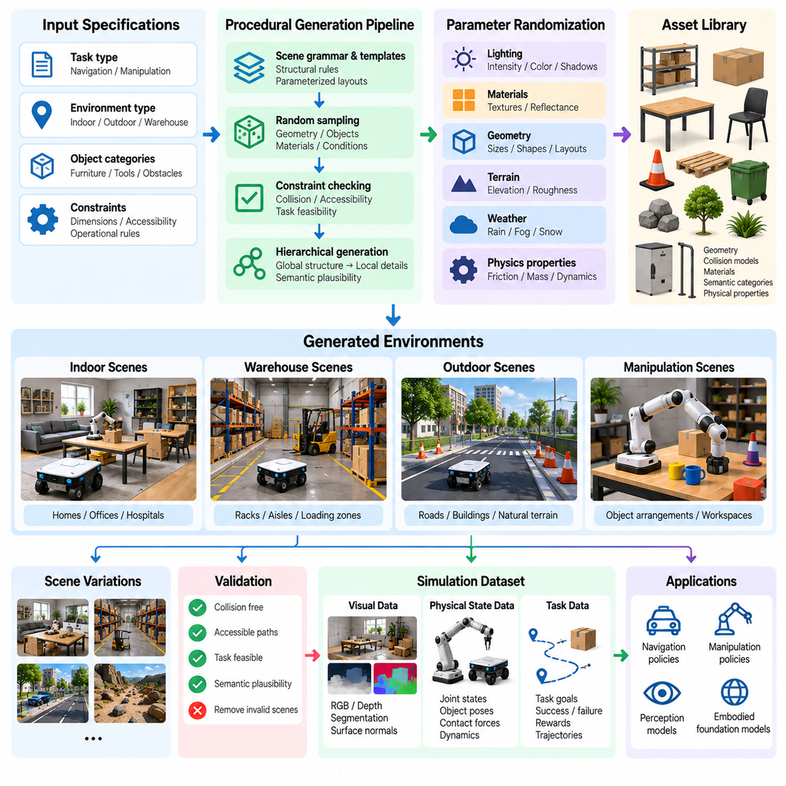{width="7.268055555555556in" height="7.268055555555556in"}

Procedural scene and environment generation is a fundamental capability of simulation-based data engines for Physical AI. Instead of manually constructing every virtual environment, procedural methods use algorithms, parameterized rules, and reusable assets to generate diverse scenes automatically. This approach expands the range of robot experiences while reducing the time and labor required to create large-scale simulation datasets.

A procedural generation system transforms high-level environment specifications into complete virtual worlds. These specifications may describe room dimensions, terrain characteristics, object categories, obstacle density, and operational constraints. Generation algorithms then determine spatial layouts, object placements, surface properties, and environmental conditions while maintaining consistency with the intended simulation tasks.

The primary objective is not simply to create visually different scenes but to produce meaningful variations in the situations robots encounter. A useful procedural dataset should contain differences in geometry, accessibility, object relationships, and task difficulty. These variations expose learning systems to conditions beyond a limited collection of manually designed environments and encourage broader behavioral generalization.

Procedural generation commonly begins with a scene grammar or parameterized environment template. A grammar defines relationships among structural elements, such as walls, doors, corridors, shelves, and workstations. Templates establish allowable dimensions and placement constraints. Random sampling then creates different configurations while preserving essential geometric and functional relationships.

Spatial validity is an important requirement because randomly generated environments may contain impossible or unusable arrangements. Objects must respect collision constraints, navigation paths must remain accessible when required, and task-relevant components must satisfy operational rules. Constraint checking and geometric validation prevent invalid scenes from consuming simulation resources or producing misleading training experiences.

For indoor mobile robots, procedural generation can produce warehouses, hospitals, offices, and residential spaces with varying floor plans. Corridor widths, doorway locations, furniture arrangements, and obstacle positions can change between episodes. Such diversity supports learning navigation policies that remain effective across unfamiliar layouts rather than memorizing a small number of fixed maps.

Warehouse environments provide a particularly useful example because their structural elements follow recognizable operational patterns. Procedural algorithms can vary rack spacing, aisle connectivity, pallet locations, loading zones, and temporary obstructions. The resulting scenes support training for autonomous mobile robots operating under changing inventory arrangements and dynamic logistics conditions.

For robotic manipulation, procedural generation focuses on object configurations and interaction opportunities. Objects can be placed on tables, shelves, conveyors, or inside containers with randomized positions and orientations. Their shapes, sizes, and material properties may also vary, creating diverse grasping and manipulation conditions that help policies learn relationships between object geometry and feasible actions.

Outdoor environments introduce additional generation requirements involving terrain, vegetation, weather, and infrastructure. Procedural terrain models can vary elevation, slope, roughness, and surface composition. Roads, pathways, buildings, and natural obstacles can be arranged according to geographic constraints, allowing mobile robots and autonomous vehicles to encounter diverse operating conditions.

Scene generation must distinguish between geometric diversity and semantic plausibility. A scene may satisfy collision constraints yet contain unrealistic object arrangements or operational relationships. For example, industrial equipment should be positioned according to functional access requirements, while household objects should follow plausible usage patterns. Semantic constraints improve the relevance of generated experiences.

Object libraries and asset repositories provide the reusable components needed for procedural generation. Each asset may contain geometry, collision representations, material definitions, semantic categories, and physical properties. Consistent metadata enables generation algorithms to select appropriate objects and place them according to environmental rules, supporting reproducible and automatically annotated simulation scenes.

Hierarchical generation improves scalability by separating environment structure from local details. A system may first generate a building layout, then assign room functions, place large equipment, and finally distribute smaller objects. This hierarchy preserves global organization while allowing substantial variation within individual regions, producing scenes that remain coherent across multiple levels of complexity.

Randomization strategies determine how procedural parameters are sampled. Uniform sampling provides broad coverage across predefined ranges, while weighted sampling emphasizes common or operationally important configurations. Conditional sampling maintains relationships among parameters, such as matching doorway dimensions to robot clearance requirements or selecting terrain characteristics appropriate for a particular environment.

Task-conditioned generation creates environments specifically designed around robot learning objectives. A navigation task may require a reachable destination with several possible routes, while a manipulation task may require objects positioned within a feasible workspace. By incorporating task constraints directly into generation, the system can produce scenes that provide meaningful learning opportunities rather than arbitrary visual variation.

Difficulty-controlled generation enables structured learning curricula. Simple scenes may contain open spaces, isolated objects, and predictable conditions. More challenging scenes introduce clutter, narrow passages, occlusion, moving obstacles, and complex object interactions. Adjusting these parameters according to policy performance allows simulation data engines to generate experiences matched to the robot\'s developing capabilities.

Procedural environments can also produce rare events and difficult edge cases. Algorithms may deliberately generate partially blocked routes, unstable object arrangements, unusual lighting conditions, or limited sensor visibility. These scenarios increase exposure to situations that are infrequent in ordinary data collection but important for robustness, recovery behavior, and safety-oriented evaluation.

Dynamic scene generation extends procedural methods beyond static geometry. Moving agents, pedestrians, vehicles, and robotic systems can follow parameterized behavior models. Their trajectories, speeds, and interaction patterns may change between episodes. This produces temporal diversity and enables learning systems to reason about motion, prediction, collision avoidance, and coordinated behavior.

Physical realism requires generated scenes to include appropriate material and interaction properties. Surface friction, object mass, contact stiffness, and environmental forces influence how robots behave. Procedural generation should therefore coordinate geometric construction with physics configuration so that generated environments support meaningful physical interactions rather than functioning only as visual backgrounds.

Visual diversity can be introduced through procedural textures, lighting configurations, material variations, and camera conditions. These parameters influence the appearance of generated scenes without necessarily changing their physical structure. Separating visual and geometric randomization allows developers to investigate whether learned policies depend on appearance, spatial relationships, or underlying physical behavior.

Large-scale procedural generation benefits from deterministic random seeds and explicit configuration records. A seed allows the same scene to be reconstructed, while parameter logs identify the conditions used during generation. Reproducibility is essential for debugging, comparing learning algorithms, investigating failures, and maintaining consistent evaluation environments across successive model versions.

Quality assurance must evaluate generated environments before their data enters the training pipeline. Automated checks can identify overlapping objects, inaccessible regions, invalid robot starting positions, unreachable goals, and inconsistent physical properties. Additional semantic validation can determine whether object arrangements and operational relationships remain plausible for the intended application.

Coverage analysis provides a way to measure the diversity achieved through procedural generation. Environment parameters, object categories, spatial relationships, and task outcomes can be summarized across generated scenes. Such analysis reveals underrepresented conditions and excessive repetition, allowing generation rules to be adjusted toward more informative and balanced training distributions.

Procedural generation becomes particularly effective when integrated with feedback from trained models. Failures observed during simulation or physical deployment can identify environmental configurations that require additional training data. The generator can then create related scenarios with controlled variations, establishing a targeted feedback loop between model evaluation and synthetic experience production.

A mature procedural environment generation system combines geometric rules, semantic constraints, physical properties, task objectives, and adaptive sampling. Its purpose is to create structured diversity that improves learning rather than merely increasing the number of virtual scenes. By producing reproducible, validated, and task-relevant environments at scale, procedural generation becomes a central component of Physical AI data engines.

절차적 장면 및 환경 생성(Procedural Scene and Environment Generation)은 피지컬 인공지능(Physical AI)을 위한 시뮬레이션 기반 데이터 엔진(Simulation-Based Data Engine)의 핵심 기능이다. 모든 가상 환경(Virtual Environment)을 수작업으로 구축하는 대신, 절차적 생성 방법(Procedural Generation Method)은 알고리즘(Algorithm), 매개변수화된 규칙(Parameterized Rule), 재사용 가능한 자산(Reusable Asset)을 활용하여 다양한 장면을 자동으로 생성한다. 이러한 접근법은 대규모 시뮬레이션 데이터셋(Simulation Dataset)을 구축하는 데 필요한 시간과 노동력을 줄이면서 로봇이 경험할 수 있는 상황의 범위를 확대한다.

절차적 생성 시스템(Procedural Generation System)은 상위 수준의 환경 명세(High-Level Environment Specification)를 완전한 가상 세계(Virtual World)로 변환한다. 이러한 명세에는 공간 크기(Room Dimension), 지형 특성(Terrain Characteristic), 객체 범주(Object Category), 장애물 밀도(Obstacle Density), 운영 제약조건(Operational Constraint)이 포함될 수 있다. 이후 생성 알고리즘(Generation Algorithm)은 의도된 시뮬레이션 작업과의 일관성을 유지하면서 공간 배치(Spatial Layout), 객체 배치(Object Placement), 표면 특성(Surface Property), 환경 조건(Environmental Condition)을 결정한다.

절차적 생성의 주요 목적은 단순히 시각적으로 서로 다른 장면을 만드는 것이 아니라 로봇이 직면하는 상황에 의미 있는 변화(Meaningful Variation)를 제공하는 것이다. 유용한 절차적 데이터셋(Procedural Dataset)은 기하학적 구조(Geometry), 접근 가능성(Accessibility), 객체 관계(Object Relationship), 작업 난이도(Task Difficulty)의 차이를 포함해야 한다. 이러한 변화는 학습 시스템(Learning System)을 제한된 수작업 환경을 넘어 다양한 조건에 노출시키고, 보다 폭넓은 행동 일반화(Behavioral Generalization)를 촉진한다.

절차적 생성은 일반적으로 장면 문법(Scene Grammar)이나 매개변수화된 환경 템플릿(Parameterized Environment Template)에서 시작된다. 장면 문법은 벽(Wall), 문(Door), 복도(Corridor), 선반(Shelf), 작업대(Workstation)와 같은 구조 요소 사이의 관계를 정의한다. 템플릿(Template)은 허용 가능한 크기와 배치 제약조건(Placement Constraint)을 설정한다. 이후 무작위 샘플링(Random Sampling)은 필수적인 기하학적 관계와 기능적 관계를 유지하면서 서로 다른 구성을 생성한다.

공간적 유효성(Spatial Validity)은 무작위로 생성된 환경에 불가능하거나 사용할 수 없는 배치가 포함될 수 있기 때문에 중요한 요구사항이다. 객체는 충돌 제약조건(Collision Constraint)을 준수해야 하며, 필요한 경우 내비게이션 경로(Navigation Path)는 접근 가능한 상태를 유지해야 하고, 작업 관련 구성요소는 운영 규칙(Operational Rule)을 충족해야 한다. 제약조건 검사(Constraint Checking)와 기하학적 검증(Geometric Validation)은 유효하지 않은 장면이 시뮬레이션 자원을 낭비하거나 잘못된 학습 경험을 생성하는 것을 방지한다.

실내 이동 로봇(Indoor Mobile Robot)을 위한 절차적 생성은 다양한 평면 구조(Floor Plan)를 가진 창고(Warehouse), 병원(Hospital), 사무실(Office), 주거 공간(Residential Space)을 생성할 수 있다. 복도 폭(Corridor Width), 출입문 위치(Doorway Location), 가구 배치(Furniture Arrangement), 장애물 위치(Obstacle Position)는 에피소드(Episode)마다 달라질 수 있다. 이러한 다양성은 소수의 고정된 지도(Map)를 암기하는 대신 익숙하지 않은 공간 구조에서도 효과적으로 작동하는 내비게이션 정책(Navigation Policy)의 학습을 지원한다.

창고 환경(Warehouse Environment)은 구조적 요소가 명확한 운영 패턴(Operational Pattern)을 따르기 때문에 특히 유용한 사례이다. 절차적 알고리즘(Procedural Algorithm)은 랙 간격(Rack Spacing), 통로 연결성(Aisle Connectivity), 팔레트 위치(Pallet Location), 상하차 구역(Loading Zone), 임시 장애물(Temporary Obstruction)을 변화시킬 수 있다. 이렇게 생성된 장면은 변화하는 재고 배치(Inventory Arrangement)와 동적 물류 조건(Dynamic Logistics Condition)에서 작동하는 자율 이동 로봇(Autonomous Mobile Robot)의 학습을 지원한다.

로봇 조작(Robotic Manipulation)을 위한 절차적 생성은 객체 구성(Object Configuration)과 상호작용 기회(Interaction Opportunity)에 초점을 맞춘다. 객체는 테이블(Table), 선반(Shelf), 컨베이어(Conveyor), 컨테이너(Container) 내부에 무작위 위치와 방향으로 배치될 수 있다. 객체의 형상(Shape), 크기(Size), 재료 특성(Material Property)도 변화시킬 수 있으며, 이를 통해 정책(Policy)이 객체 형상과 실행 가능한 행동(Feasible Action) 사이의 관계를 학습하도록 지원하는 다양한 파지 및 조작 조건(Grasping and Manipulation Condition)을 생성한다.

실외 환경(Outdoor Environment)은 지형(Terrain), 식생(Vegetation), 날씨(Weather), 기반시설(Infrastructure)에 관한 추가적인 생성 요구사항을 포함한다. 절차적 지형 모델(Procedural Terrain Model)은 고도(Elevation), 경사(Slope), 거칠기(Roughness), 표면 구성(Surface Composition)을 변화시킬 수 있다. 도로(Road), 보행로(Pathway), 건물(Building), 자연 장애물(Natural Obstacle)은 지리적 제약조건(Geographic Constraint)에 따라 배치될 수 있으며, 이를 통해 이동 로봇과 자율주행 차량(Autonomous Vehicle)이 다양한 운영 조건을 경험할 수 있다.

장면 생성(Scene Generation)에서는 기하학적 다양성(Geometric Diversity)과 의미적 타당성(Semantic Plausibility)을 구분해야 한다. 어떤 장면은 충돌 제약조건을 만족하더라도 비현실적인 객체 배치나 운영 관계를 포함할 수 있다. 예를 들어 산업 장비(Industrial Equipment)는 기능적 접근 요구사항(Functional Access Requirement)에 따라 배치되어야 하며, 가정용 객체(Household Object)는 실제 사용 패턴(Usage Pattern)에 부합해야 한다. 의미적 제약조건(Semantic Constraint)은 생성된 학습 경험의 현실적 관련성을 향상시킨다.

객체 라이브러리(Object Library)와 자산 저장소(Asset Repository)는 절차적 생성에 필요한 재사용 가능한 구성요소(Reusable Component)를 제공한다. 각 자산(Asset)에는 형상(Geometry), 충돌 표현(Collision Representation), 재료 정의(Material Definition), 의미적 범주(Semantic Category), 물리적 특성(Physical Property)이 포함될 수 있다. 일관된 메타데이터(Metadata)는 생성 알고리즘이 적절한 객체를 선택하고 환경 규칙에 따라 배치할 수 있도록 하며, 재현 가능하고 자동으로 주석이 부여된 시뮬레이션 장면(Simulation Scene)을 지원한다.

계층적 생성(Hierarchical Generation)은 환경 구조(Environment Structure)와 국소적인 세부 요소(Local Detail)를 분리하여 확장성(Scalability)을 향상시킨다. 시스템은 먼저 건물 배치(Building Layout)를 생성한 다음 공간 기능(Room Function)을 지정하고, 대형 장비(Large Equipment)를 배치한 후 작은 객체(Small Object)를 분산시킬 수 있다. 이러한 계층 구조(Hierarchy)는 전체적인 조직 구조(Global Organization)를 유지하면서 개별 영역(Individual Region) 내에서 상당한 변화를 허용하여 여러 복잡도 수준(Complexity Level)에서 일관성을 유지하는 장면을 생성한다.

무작위화 전략(Randomization Strategy)은 절차적 매개변수(Procedural Parameter)를 어떻게 샘플링할지 결정한다. 균등 샘플링(Uniform Sampling)은 미리 정의된 범위에서 폭넓은 적용 범위(Coverage)를 제공하며, 가중 샘플링(Weighted Sampling)은 일반적이거나 운영상 중요한 구성을 강조한다. 조건부 샘플링(Conditional Sampling)은 출입문 크기를 로봇의 통과 여유 공간(Robot Clearance Requirement)에 맞추거나 특정 환경에 적합한 지형 특성을 선택하는 것처럼 매개변수 사이의 관계를 유지한다.

작업 조건부 생성(Task-Conditioned Generation)은 로봇 학습 목표(Robot Learning Objective)에 맞추어 환경을 생성한다. 내비게이션 작업(Navigation Task)은 여러 가능한 경로를 가진 도달 가능한 목적지(Reachable Destination)를 요구할 수 있으며, 조작 작업(Manipulation Task)은 실행 가능한 작업 공간(Feasible Workspace) 내에 객체를 배치해야 할 수 있다. 생성 과정에 작업 제약조건(Task Constraint)을 직접 통합하면 임의적인 시각적 변화가 아니라 의미 있는 학습 기회(Learning Opportunity)를 제공하는 장면을 생성할 수 있다.

난이도 제어 생성(Difficulty-Controlled Generation)은 구조화된 학습 커리큘럼(Learning Curriculum)을 가능하게 한다. 단순한 장면(Simple Scene)은 개방된 공간(Open Space), 분리된 객체(Isolated Object), 예측 가능한 조건(Predictable Condition)을 포함할 수 있다. 더 어려운 장면은 복잡한 객체 배치(Clutter), 좁은 통로(Narrow Passage), 가림(Occlusion), 이동 장애물(Moving Obstacle), 복잡한 객체 상호작용(Complex Object Interaction)을 도입한다. 정책 성능(Policy Performance)에 따라 이러한 매개변수를 조정하면 로봇의 발전하는 능력에 맞는 경험을 생성할 수 있다.

절차적 환경(Procedural Environment)은 희귀 사건(Rare Event)과 어려운 경계 사례(Edge Case)도 생성할 수 있다. 알고리즘은 부분적으로 차단된 경로(Partially Blocked Route), 불안정한 객체 배치(Unstable Object Arrangement), 비정상적인 조명 조건(Unusual Lighting Condition), 제한된 센서 가시성(Limited Sensor Visibility)을 의도적으로 생성할 수 있다. 이러한 시나리오는 일반적인 데이터 수집에서는 드물지만 강건성(Robustness), 복구 행동(Recovery Behavior), 안전 중심 평가(Safety-Oriented Evaluation)에 중요한 상황에 대한 노출을 증가시킨다.

동적 장면 생성(Dynamic Scene Generation)은 절차적 생성 방법을 정적인 기하학적 구조(Static Geometry) 이상으로 확장한다. 이동 에이전트(Moving Agent), 보행자(Pedestrian), 차량(Vehicle), 로봇 시스템(Robotic System)은 매개변수화된 행동 모델(Parameterized Behavior Model)을 따를 수 있다. 이들의 궤적(Trajectory), 속도(Speed), 상호작용 패턴(Interaction Pattern)은 에피소드마다 달라질 수 있다. 이를 통해 시간적 다양성(Temporal Diversity)을 생성하고 학습 시스템이 운동(Motion), 예측(Prediction), 충돌 회피(Collision Avoidance), 협력 행동(Coordinated Behavior)을 추론하도록 지원한다.

물리적 현실성(Physical Realism)을 확보하려면 생성된 장면에 적절한 재료 특성(Material Property)과 상호작용 특성(Interaction Property)이 포함되어야 한다. 표면 마찰(Surface Friction), 객체 질량(Object Mass), 접촉 강성(Contact Stiffness), 환경 외력(Environmental Force)은 로봇의 행동에 영향을 미친다. 따라서 절차적 생성은 기하학적 구성(Geometric Construction)과 물리 설정(Physics Configuration)을 조정하여 생성된 환경이 단순한 시각적 배경(Visual Background)이 아니라 의미 있는 물리적 상호작용을 지원하도록 해야 한다.

시각적 다양성(Visual Diversity)은 절차적 텍스처(Procedural Texture), 조명 구성(Lighting Configuration), 재료 변화(Material Variation), 카메라 조건(Camera Condition)을 통해 도입할 수 있다. 이러한 매개변수는 반드시 물리적 구조를 변경하지 않더라도 생성된 장면의 외관에 영향을 준다. 시각적 무작위화(Visual Randomization)와 기하학적 무작위화(Geometric Randomization)를 분리하면 학습된 정책이 외관(Appearance), 공간적 관계(Spatial Relationship), 기본적인 물리적 행동(Underlying Physical Behavior) 중 어떤 요소에 의존하는지 조사할 수 있다.

대규모 절차적 생성(Large-Scale Procedural Generation)에는 결정론적 난수 시드(Deterministic Random Seed)와 명시적인 구성 기록(Configuration Record)이 유용하다. 난수 시드(Random Seed)를 사용하면 동일한 장면을 재구성할 수 있으며, 매개변수 로그(Parameter Log)는 생성 과정에서 사용된 조건을 식별한다. 재현성(Reproducibility)은 디버깅(Debugging), 학습 알고리즘(Learning Algorithm) 비교, 실패 원인 조사(Failure Investigation), 연속적인 모델 버전(Model Version) 사이에서 일관된 평가 환경(Evaluation Environment)을 유지하는 데 필수적이다.

품질 보증(Quality Assurance)은 생성된 환경의 데이터가 학습 파이프라인(Training Pipeline)에 입력되기 전에 평가해야 한다. 자동화된 검사(Automated Check)는 객체 중첩(Overlapping Object), 접근할 수 없는 영역(Inaccessible Region), 유효하지 않은 로봇 시작 위치(Invalid Robot Starting Position), 도달할 수 없는 목표(Unreachable Goal), 일관되지 않은 물리적 특성(Inconsistent Physical Property)을 식별할 수 있다. 추가적인 의미적 검증(Semantic Validation)은 객체 배치와 운영 관계가 의도된 응용 분야에서 타당성을 유지하는지 판단할 수 있다.

적용 범위 분석(Coverage Analysis)은 절차적 생성을 통해 확보된 다양성을 측정하는 방법을 제공한다. 환경 매개변수(Environment Parameter), 객체 범주(Object Category), 공간적 관계(Spatial Relationship), 작업 결과(Task Outcome)를 생성된 장면 전체에 걸쳐 요약할 수 있다. 이러한 분석은 충분히 표현되지 않은 조건(Underrepresented Condition)과 과도한 반복(Excessive Repetition)을 식별하여 생성 규칙(Generation Rule)을 더욱 유익하고 균형 잡힌 학습 분포(Training Distribution)로 조정할 수 있게 한다.

절차적 생성은 학습된 모델(Trained Model)의 피드백(Feedback)과 통합될 때 특히 효과적이다. 시뮬레이션이나 실제 배포(Physical Deployment) 과정에서 관찰된 실패는 추가적인 학습 데이터가 필요한 환경 구성(Environment Configuration)을 식별하는 데 활용될 수 있다. 이후 생성기(Generator)는 제어된 변화를 적용하여 관련 시나리오를 생성할 수 있으며, 이를 통해 모델 평가(Model Evaluation)와 합성 경험 생성(Synthetic Experience Production) 사이에 목표 지향적 피드백 루프(Targeted Feedback Loop)를 구축할 수 있다.

성숙한 절차적 환경 생성 시스템(Mature Procedural Environment Generation System)은 기하학적 규칙(Geometric Rule), 의미적 제약조건(Semantic Constraint), 물리적 특성(Physical Property), 작업 목표(Task Objective), 적응형 샘플링(Adaptive Sampling)을 결합한다. 이 시스템의 목적은 단순히 가상 장면의 수를 증가시키는 것이 아니라 학습을 향상시키는 구조화된 다양성(Structured Diversity)을 생성하는 것이다. 절차적 생성은 재현 가능하고 검증되었으며 작업과 관련된 환경(Task-Relevant Environment)을 대규모로 생성함으로써 피지컬 인공지능 데이터 엔진(Physical AI Data Engine)의 핵심 구성요소가 된다.

##  

## 04.04. Synthetic RGB Depth LiDAR and Radar

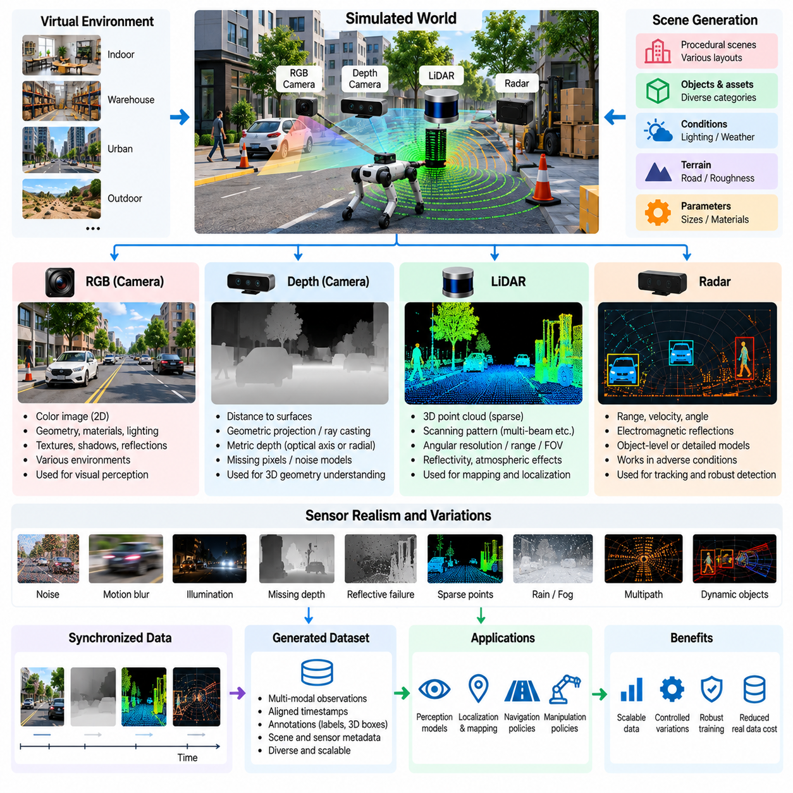{width="7.268055555555556in" height="7.268055555555556in"}

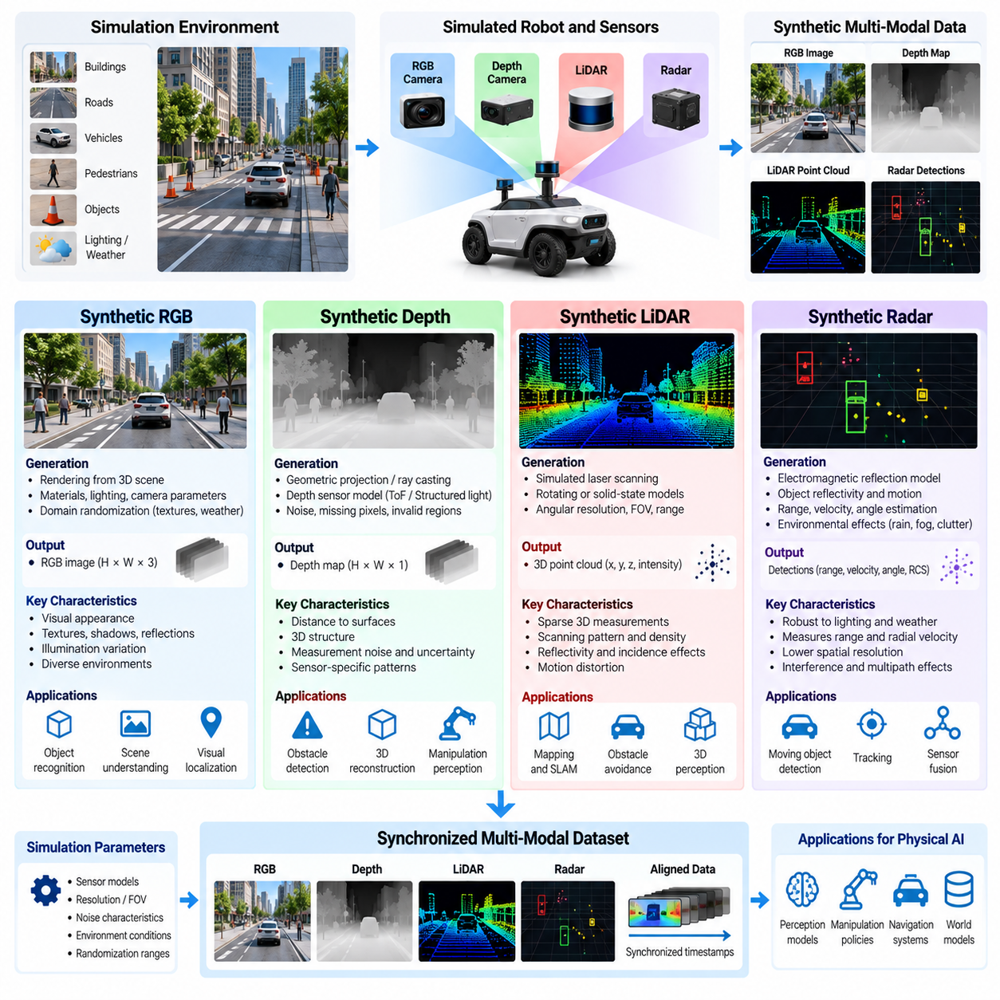{width="7.268055555555556in" height="7.268055555555556in"}

Synthetic RGB, depth, LiDAR, and radar data form a multimodal sensing foundation for Physical AI systems trained through simulation. Each modality captures different properties of the surrounding environment, including visual appearance, geometric distance, spatial structure, and object motion. Simulation enables these observations to be generated under controlled conditions, providing scalable datasets for perception, localization, navigation, and embodied decision-making.

Synthetic RGB data is produced by virtual cameras that transform three-dimensional scenes into two-dimensional color images. Rendering engines calculate how geometry, materials, lighting, and camera parameters influence pixel values. The resulting images can represent industrial facilities, warehouses, outdoor environments, and human-centered spaces, allowing perception models to encounter diverse visual conditions without requiring physical image collection.

The usefulness of synthetic RGB images depends on both scene diversity and rendering fidelity. Surface textures, illumination, shadows, reflections, transparency, and environmental effects influence visual appearance. Procedural scene generation can vary these properties across training episodes, helping models learn object characteristics and spatial relationships rather than relying excessively on particular textures or lighting configurations.

Synthetic depth data represents the distance between a virtual sensing device and visible surfaces. Depth images are generated through geometric projection, ray casting, or simulated depth-sensing processes. Unlike RGB images, depth observations emphasize three-dimensional structure and relative distance, making them valuable for obstacle detection, object manipulation, scene reconstruction, and geometric reasoning.

Depth sensors may represent distance along the camera optical axis or radial distance from the sensor origin, depending on their measurement convention. This distinction matters when converting depth images into three-dimensional point clouds. Accurate camera intrinsics, coordinate transformations, and measurement definitions are necessary to preserve geometric consistency between simulated depth observations and physical sensor outputs.

Real depth cameras introduce measurement errors that ideal geometric rendering does not reproduce automatically. Structured-light and time-of-flight sensors may exhibit missing pixels, reflective-surface failures, multipath interference, and distance-dependent uncertainty. Synthetic depth pipelines can incorporate calibrated noise models and invalid measurement patterns to improve the correspondence between generated observations and actual sensing hardware.

Synthetic LiDAR data is generated by simulating laser measurements across predefined scanning patterns. Virtual rays intersect scene geometry to estimate distances and produce point clouds representing surrounding surfaces. Depending on the sensor model, the simulation may reproduce rotating multi-beam scanners, solid-state LiDAR configurations, or other scanning geometries used in autonomous robots and vehicles.

LiDAR simulation requires careful representation of angular resolution, field of view, measurement range, scan frequency, and beam arrangement. These parameters determine point density and spatial coverage. A synthetic point cloud generated with unrealistic scanning geometry may provide misleading information to learning systems, even when the underlying virtual environment is geometrically accurate.

Advanced LiDAR models incorporate surface reflectivity, incidence angle, atmospheric attenuation, and measurement uncertainty. Transparent or highly reflective materials can create missing or ambiguous returns, while rain, fog, and dust may degrade sensing performance. Modeling such effects allows synthetic datasets to represent difficult operating conditions, although accurate reproduction requires sensor-specific calibration and validation.

Motion distortion is another important characteristic of LiDAR data. Many scanners acquire measurements sequentially while the robot or surrounding objects are moving. Consequently, points within a single scan may correspond to different acquisition times. Simulation can reproduce this behavior by sampling the evolving scene during the scan interval, generating data suitable for motion compensation and dynamic mapping research.

Synthetic radar data differs from optical sensing because radar measures electromagnetic reflections rather than visible appearance or laser-based distance alone. Automotive and robotic radar systems can estimate range, radial velocity, and angular information from reflected signals. Radar simulation therefore requires representations of target reflectivity, relative motion, propagation effects, and sensor measurement characteristics.

Radar data generation may use simplified object-level detection models or more detailed electromagnetic propagation approximations. Simplified models estimate detections from object position, velocity, and radar cross-section, while higher-fidelity methods consider multipath reflections, interference, and scattering behavior. The appropriate approach depends on whether the training objective concerns object tracking, sensor fusion, or detailed signal interpretation.

Synthetic radar datasets can include range measurements, Doppler velocity, azimuth estimates, detection confidence, and radar point clouds. More detailed simulation may generate range-Doppler maps or intermediate signal representations. These outputs support learning systems that must detect moving objects under conditions where cameras and LiDAR sensors may experience reduced visibility.

Radar realism is challenging because electromagnetic interactions depend on material composition, object geometry, frequency, polarization, and environmental conditions. Multipath propagation can create ghost detections, while clutter and interference may obscure real targets. Simplified geometric simulators cannot reproduce every phenomenon, making empirical calibration essential when synthetic radar data is intended for real-world deployment.

The combination of RGB, depth, LiDAR, and radar provides complementary information about the same environment. RGB images describe appearance and semantic context, depth sensors provide dense local geometry, LiDAR captures broader spatial structure, and radar contributes motion-sensitive measurements. Multimodal datasets allow learning systems to exploit these complementary strengths while compensating for limitations of individual sensors.

Accurate multimodal generation requires a shared representation of scene geometry, object states, and sensor configurations. Each virtual sensor must have defined intrinsic parameters, extrinsic transformations, coordinate conventions, and acquisition timing. Without consistent calibration, observations from different modalities may describe incompatible spatial relationships, reducing the reliability of sensor fusion and cross-modal learning.

Temporal synchronization becomes especially important when simulated robots or surrounding objects move. Cameras may capture images at fixed frame intervals, LiDAR scanners collect points over time, and radar systems operate according to measurement cycles. A simulation data engine must associate these observations with appropriate timestamps and physical states to preserve consistency across observation sequences.

Automatic ground-truth generation is a major advantage of synthetic multimodal sensing. Because the simulator maintains access to object identities, geometry, trajectories, and physical states, it can generate segmentation labels, three-dimensional bounding boxes, velocity annotations, and object tracking identifiers. These annotations support supervised perception learning without the extensive manual labeling required for real sensor recordings.

Synthetic sensing pipelines can also generate controlled sensor failures and degraded observations. Camera overexposure, depth measurement dropout, LiDAR beam loss, and radar clutter can be introduced systematically. Such variations enable robustness testing and help train models to recognize unreliable measurements, adjust confidence estimates, and maintain operation when individual sensing modalities become degraded.

Domain randomization expands sensor data diversity by varying environmental appearance, sensor placement, calibration offsets, noise characteristics, and operating conditions. However, randomization should remain within physically plausible ranges when the objective is real-world transfer. Excessive or inconsistent perturbations can produce unrealistic observations that reduce the relevance of generated training experiences.

The computational requirements of synthetic sensing differ substantially across modalities. RGB rendering may require detailed lighting calculations, while depth and LiDAR generation often rely on geometric intersection operations. High-fidelity radar simulation can require expensive electromagnetic approximations. Efficient pipelines select appropriate fidelity levels and balance sensor realism against generation throughput and storage costs.

Quality evaluation should compare synthetic observations with representative measurements from physical sensors. RGB datasets can be assessed through visual statistics and downstream perception performance, while depth and LiDAR data require geometric and noise-distribution comparisons. Radar validation should consider detection characteristics, velocity estimation, clutter behavior, and signal statistics relevant to the intended application.

A scalable Physical AI data engine integrates synthetic RGB, depth, LiDAR, and radar generation into a coordinated simulation pipeline. Procedural environments provide scene diversity, physics simulation determines object behavior, and sensor models transform evolving states into synchronized observations. By combining calibrated sensing, automatic annotations, and real-world validation, synthetic multimodal data becomes a practical foundation for training robust Physical AI perception and decision-making systems.

합성 RGB, 깊이, 라이다 및 레이더 데이터(Synthetic RGB, Depth, LiDAR, and Radar Data)는 시뮬레이션(Simulation)을 통해 학습되는 피지컬 인공지능(Physical AI) 시스템의 다중모달 센싱 기반(Multimodal Sensing Foundation)을 형성한다. 각 센서 모달리티(Sensor Modality)는 시각적 외관(Visual Appearance), 기하학적 거리(Geometric Distance), 공간 구조(Spatial Structure), 객체 운동(Object Motion)을 포함하여 주변 환경의 서로 다른 특성을 포착한다. 시뮬레이션은 이러한 관측값을 제어된 조건에서 생성할 수 있게 하며, 인식(Perception), 위치 추정(Localization), 내비게이션(Navigation), 체화된 의사결정(Embodied Decision-Making)을 위한 확장 가능한 데이터셋(Scalable Dataset)을 제공한다.

합성 RGB 데이터(Synthetic RGB Data)는 3차원 장면(Three-Dimensional Scene)을 2차원 컬러 이미지(Two-Dimensional Color Image)로 변환하는 가상 카메라(Virtual Camera)를 통해 생성된다. 렌더링 엔진(Rendering Engine)은 기하학적 구조(Geometry), 재료(Material), 조명(Lighting), 카메라 매개변수(Camera Parameter)가 픽셀 값(Pixel Value)에 미치는 영향을 계산한다. 생성된 이미지는 산업시설(Industrial Facility), 창고(Warehouse), 실외 환경(Outdoor Environment), 인간 중심 공간(Human-Centered Space)을 표현할 수 있으며, 실제 이미지 수집 없이도 인식 모델(Perception Model)이 다양한 시각적 조건을 경험하도록 한다.

합성 RGB 이미지의 유용성은 장면 다양성(Scene Diversity)과 렌더링 충실도(Rendering Fidelity)에 따라 달라진다. 표면 텍스처(Surface Texture), 조도(Illumination), 그림자(Shadow), 반사(Reflection), 투명도(Transparency), 환경 효과(Environmental Effect)는 시각적 외관에 영향을 미친다. 절차적 장면 생성(Procedural Scene Generation)은 학습 에피소드(Training Episode)마다 이러한 특성을 변화시킬 수 있으며, 모델이 특정 텍스처나 조명 구성에 과도하게 의존하지 않고 객체 특성(Object Characteristic)과 공간적 관계(Spatial Relationship)를 학습하도록 지원한다.

합성 깊이 데이터(Synthetic Depth Data)는 가상 센싱 장치(Virtual Sensing Device)와 가시 표면(Visible Surface) 사이의 거리를 나타낸다. 깊이 이미지(Depth Image)는 기하학적 투영(Geometric Projection), 광선 투사(Ray Casting), 시뮬레이션된 깊이 센싱 과정(Simulated Depth-Sensing Process)을 통해 생성된다. RGB 이미지와 달리 깊이 관측값(Depth Observation)은 3차원 구조(Three-Dimensional Structure)와 상대 거리(Relative Distance)를 강조하므로 장애물 탐지(Obstacle Detection), 객체 조작(Object Manipulation), 장면 재구성(Scene Reconstruction), 기하학적 추론(Geometric Reasoning)에 유용하다.

깊이 센서(Depth Sensor)는 측정 방식(Measurement Convention)에 따라 카메라 광축(Camera Optical Axis)을 따라 측정한 거리 또는 센서 원점(Sensor Origin)으로부터의 방사 거리(Radial Distance)를 표현할 수 있다. 이러한 차이는 깊이 이미지를 3차원 포인트 클라우드(Three-Dimensional Point Cloud)로 변환할 때 중요하다. 정확한 카메라 내부 매개변수(Camera Intrinsics), 좌표 변환(Coordinate Transformation), 측정 정의(Measurement Definition)는 시뮬레이션 깊이 관측값과 실제 센서 출력 사이의 기하학적 일관성(Geometric Consistency)을 유지하는 데 필요하다.

실제 깊이 카메라(Real Depth Camera)는 이상적인 기하학적 렌더링(Ideal Geometric Rendering)만으로 자동 재현되지 않는 측정 오차(Measurement Error)를 발생시킨다. 구조광 센서(Structured-Light Sensor)와 비행시간 센서(Time-of-Flight Sensor)는 픽셀 누락(Missing Pixel), 반사 표면 측정 실패(Reflective-Surface Failure), 다중 경로 간섭(Multipath Interference), 거리에 따른 불확실성(Distance-Dependent Uncertainty)을 나타낼 수 있다. 합성 깊이 데이터 파이프라인(Synthetic Depth Pipeline)은 보정된 잡음 모델(Calibrated Noise Model)과 유효하지 않은 측정 패턴(Invalid Measurement Pattern)을 포함하여 생성된 관측값과 실제 센서 하드웨어(Physical Sensing Hardware) 사이의 일치도를 향상시킬 수 있다.

합성 라이다 데이터(Synthetic LiDAR Data)는 미리 정의된 스캐닝 패턴(Scanning Pattern)에 따라 레이저 측정(Laser Measurement)을 시뮬레이션하여 생성된다. 가상 광선(Virtual Ray)은 장면 형상(Scene Geometry)과 교차하여 거리를 추정하고 주변 표면을 나타내는 포인트 클라우드(Point Cloud)를 생성한다. 센서 모델(Sensor Model)에 따라 시뮬레이션은 회전형 다중 빔 스캐너(Rotating Multi-Beam Scanner), 고체형 라이다(Solid-State LiDAR), 자율 로봇과 차량에 사용되는 기타 스캐닝 구조를 재현할 수 있다.

라이다 시뮬레이션(LiDAR Simulation)에서는 각도 해상도(Angular Resolution), 시야각(Field of View), 측정 거리(Measurement Range), 스캔 주파수(Scan Frequency), 빔 배열(Beam Arrangement)을 신중하게 표현해야 한다. 이러한 매개변수는 포인트 밀도(Point Density)와 공간적 적용 범위(Spatial Coverage)를 결정한다. 기반 가상 환경(Virtual Environment)의 기하학적 구조가 정확하더라도 비현실적인 스캐닝 구조로 생성된 합성 포인트 클라우드(Synthetic Point Cloud)는 학습 시스템에 잘못된 정보를 제공할 수 있다.

고급 라이다 모델(Advanced LiDAR Model)은 표면 반사율(Surface Reflectivity), 입사각(Incidence Angle), 대기 감쇠(Atmospheric Attenuation), 측정 불확실성(Measurement Uncertainty)을 포함한다. 투명하거나 반사율이 높은 재료는 측정값 누락(Missing Return)이나 모호한 반사 신호(Ambiguous Return)를 발생시킬 수 있으며, 비(Rain), 안개(Fog), 먼지(Dust)는 센싱 성능(Sensing Performance)을 저하시킬 수 있다. 이러한 효과를 모델링하면 합성 데이터셋이 어려운 운영 조건을 표현할 수 있지만, 정확한 재현을 위해서는 센서별 보정(Sensor-Specific Calibration)과 검증(Validation)이 필요하다.

운동 왜곡(Motion Distortion)은 라이다 데이터의 또 다른 중요한 특성이다. 많은 스캐너(Scanner)는 로봇이나 주변 객체가 움직이는 동안 측정값을 순차적으로 수집한다. 따라서 하나의 스캔(Scan)에 포함된 포인트들은 서로 다른 취득 시간(Acquisition Time)에 대응할 수 있다. 시뮬레이션은 스캔 구간(Scan Interval) 동안 변화하는 장면을 샘플링하여 이러한 동작을 재현할 수 있으며, 운동 보상(Motion Compensation)과 동적 지도 작성(Dynamic Mapping) 연구에 적합한 데이터를 생성한다.

합성 레이더 데이터(Synthetic Radar Data)는 레이더(Radar)가 가시광선의 외관이나 레이저 기반 거리만을 측정하는 것이 아니라 전자기파 반사(Electromagnetic Reflection)를 측정한다는 점에서 광학 센싱(Optical Sensing)과 다르다. 차량용 및 로봇용 레이더(Automotive and Robotic Radar)는 반사 신호(Reflected Signal)를 통해 거리(Range), 방사 속도(Radial Velocity), 각도 정보(Angular Information)를 추정할 수 있다. 따라서 레이더 시뮬레이션(Radar Simulation)은 표적 반사율(Target Reflectivity), 상대 운동(Relative Motion), 전파 효과(Propagation Effect), 센서 측정 특성(Sensor Measurement Characteristic)을 표현해야 한다.

레이더 데이터 생성(Radar Data Generation)은 단순화된 객체 수준 탐지 모델(Object-Level Detection Model)이나 보다 정교한 전자기파 전파 근사(Electromagnetic Propagation Approximation)를 사용할 수 있다. 단순화된 모델은 객체 위치(Object Position), 속도(Velocity), 레이더 단면적(Radar Cross-Section)을 이용하여 탐지 결과를 추정하며, 고충실도 방식(High-Fidelity Method)은 다중 경로 반사(Multipath Reflection), 간섭(Interference), 산란 특성(Scattering Behavior)을 고려한다. 적절한 방식은 학습 목표가 객체 추적(Object Tracking), 센서 융합(Sensor Fusion), 세부 신호 해석(Detailed Signal Interpretation) 중 무엇인지에 따라 달라진다.

합성 레이더 데이터셋(Synthetic Radar Dataset)에는 거리 측정값(Range Measurement), 도플러 속도(Doppler Velocity), 방위각 추정값(Azimuth Estimate), 탐지 신뢰도(Detection Confidence), 레이더 포인트 클라우드(Radar Point Cloud)가 포함될 수 있다. 더욱 정교한 시뮬레이션은 거리-도플러 맵(Range-Doppler Map)이나 중간 신호 표현(Intermediate Signal Representation)을 생성할 수도 있다. 이러한 출력은 카메라와 라이다 센서의 가시성이 저하되는 조건에서도 이동 객체(Moving Object)를 탐지해야 하는 학습 시스템을 지원한다.

레이더 현실성(Radar Realism)을 확보하는 것은 전자기적 상호작용(Electromagnetic Interaction)이 재료 구성(Material Composition), 객체 형상(Object Geometry), 주파수(Frequency), 편파(Polarization), 환경 조건(Environmental Condition)에 의존하기 때문에 어렵다. 다중 경로 전파(Multipath Propagation)는 허위 탐지(Ghost Detection)를 생성할 수 있으며, 클러터(Clutter)와 간섭(Interference)은 실제 표적(Real Target)을 가릴 수 있다. 단순화된 기하학적 시뮬레이터(Geometric Simulator)는 모든 현상을 재현할 수 없으므로 합성 레이더 데이터를 실제 환경에 배포하려면 실측 기반 보정(Empirical Calibration)이 필수적이다.

RGB, 깊이, 라이다, 레이더를 결합하면 동일한 환경에 대한 상호 보완적인 정보(Complementary Information)를 얻을 수 있다. RGB 이미지는 외관과 의미적 맥락(Semantic Context)을 설명하고, 깊이 센서는 밀집된 국소 기하학 정보(Dense Local Geometry)를 제공하며, 라이다는 더 넓은 공간 구조(Spatial Structure)를 포착하고, 레이더는 운동에 민감한 측정값(Motion-Sensitive Measurement)을 제공한다. 다중모달 데이터셋(Multimodal Dataset)은 학습 시스템이 각 센서의 한계를 보완하면서 이러한 상호 보완적 강점을 활용하도록 한다.

정확한 다중모달 데이터 생성(Multimodal Data Generation)을 위해서는 장면 형상(Scene Geometry), 객체 상태(Object State), 센서 구성(Sensor Configuration)에 대한 공통 표현(Shared Representation)이 필요하다. 각 가상 센서(Virtual Sensor)는 내부 매개변수(Intrinsic Parameter), 외부 변환(Extrinsic Transformation), 좌표계 규약(Coordinate Convention), 데이터 취득 시점(Acquisition Timing)을 정의해야 한다. 일관된 보정(Calibration)이 없으면 서로 다른 모달리티의 관측값이 서로 호환되지 않는 공간적 관계를 나타낼 수 있으며, 센서 융합과 교차 모달 학습(Cross-Modal Learning)의 신뢰성이 저하된다.

시뮬레이션 로봇이나 주변 객체가 움직일 때 시간 동기화(Temporal Synchronization)는 특히 중요해진다. 카메라는 일정한 프레임 간격(Frame Interval)으로 이미지를 촬영하고, 라이다 스캐너는 시간에 걸쳐 포인트를 수집하며, 레이더 시스템은 측정 주기(Measurement Cycle)에 따라 작동한다. 시뮬레이션 데이터 엔진(Simulation Data Engine)은 관측 시퀀스(Observation Sequence) 전반의 일관성을 유지하기 위해 이러한 관측값을 적절한 타임스탬프(Timestamp) 및 물리적 상태(Physical State)와 연결해야 한다.

자동 정답 데이터 생성(Automatic Ground-Truth Generation)은 합성 다중모달 센싱(Synthetic Multimodal Sensing)의 주요 장점이다. 시뮬레이터는 객체 식별 정보(Object Identity), 형상(Geometry), 궤적(Trajectory), 물리적 상태(Physical State)에 접근할 수 있으므로 분할 라벨(Segmentation Label), 3차원 경계 상자(Three-Dimensional Bounding Box), 속도 주석(Velocity Annotation), 객체 추적 식별자(Object Tracking Identifier)를 생성할 수 있다. 이러한 주석은 실제 센서 기록에서 요구되는 광범위한 수작업 라벨링(Manual Labeling) 없이 지도 인식 학습(Supervised Perception Learning)을 지원한다.

합성 센싱 파이프라인(Synthetic Sensing Pipeline)은 제어된 센서 고장(Controlled Sensor Failure)과 성능이 저하된 관측값(Degraded Observation)도 생성할 수 있다. 카메라 과다 노출(Camera Overexposure), 깊이 측정값 누락(Depth Measurement Dropout), 라이다 빔 손실(LiDAR Beam Loss), 레이더 클러터(Radar Clutter)를 체계적으로 도입할 수 있다. 이러한 변화는 강건성 시험(Robustness Testing)을 가능하게 하며, 모델이 신뢰할 수 없는 측정값(Unreliable Measurement)을 인식하고 신뢰도 추정(Confidence Estimate)을 조정하며 개별 센서 모달리티의 성능이 저하되어도 작동을 유지하도록 학습하는 데 도움이 된다.

도메인 무작위화(Domain Randomization)는 환경 외관(Environmental Appearance), 센서 배치(Sensor Placement), 보정 오프셋(Calibration Offset), 잡음 특성(Noise Characteristic), 운영 조건(Operating Condition)을 변화시켜 센서 데이터의 다양성을 확대한다. 그러나 실제 환경으로의 전이(Real-World Transfer)가 목표라면 무작위화는 물리적으로 타당한 범위(Physically Plausible Range) 내에서 이루어져야 한다. 과도하거나 일관되지 않은 교란(Perturbation)은 비현실적인 관측값을 생성하여 학습 경험의 관련성을 감소시킬 수 있다.

합성 센싱(Synthetic Sensing)의 계산 요구사항(Computational Requirement)은 센서 모달리티에 따라 상당한 차이가 있다. RGB 렌더링(RGB Rendering)은 상세한 조명 계산(Lighting Calculation)이 필요할 수 있으며, 깊이 및 라이다 데이터 생성은 주로 기하학적 교차 연산(Geometric Intersection Operation)에 의존한다. 고충실도 레이더 시뮬레이션(High-Fidelity Radar Simulation)은 계산 비용이 높은 전자기파 근사(Electromagnetic Approximation)를 요구할 수 있다. 효율적인 파이프라인(Efficient Pipeline)은 적절한 충실도 수준(Fidelity Level)을 선택하고 센서 현실성과 생성 처리량(Generation Throughput), 저장 비용(Storage Cost) 사이의 균형을 조정한다.

품질 평가(Quality Evaluation)는 합성 관측값(Synthetic Observation)을 실제 센서(Physical Sensor)에서 얻은 대표적인 측정값(Representative Measurement)과 비교해야 한다. RGB 데이터셋은 시각적 통계(Visual Statistics)와 후속 인식 성능(Downstream Perception Performance)을 통해 평가할 수 있으며, 깊이 및 라이다 데이터는 기하학적 특성(Geometric Characteristic)과 잡음 분포(Noise Distribution)의 비교가 필요하다. 레이더 검증(Radar Validation)은 의도된 응용 분야와 관련된 탐지 특성(Detection Characteristic), 속도 추정(Velocity Estimation), 클러터 동작(Clutter Behavior), 신호 통계(Signal Statistics)를 고려해야 한다.

확장 가능한 피지컬 인공지능 데이터 엔진(Scalable Physical AI Data Engine)은 합성 RGB, 깊이, 라이다, 레이더 데이터 생성을 통합된 시뮬레이션 파이프라인(Coordinated Simulation Pipeline)으로 결합한다. 절차적 환경(Procedural Environment)은 장면 다양성(Scene Diversity)을 제공하고, 물리 시뮬레이션(Physics Simulation)은 객체 행동(Object Behavior)을 결정하며, 센서 모델(Sensor Model)은 변화하는 상태를 동기화된 관측값(Synchronized Observation)으로 변환한다. 보정된 센싱(Calibrated Sensing), 자동 주석(Automatic Annotation), 실제 환경 검증(Real-World Validation)을 결합함으로써 합성 다중모달 데이터(Synthetic Multimodal Data)는 강건한 피지컬 인공지능 인식 및 의사결정 시스템(Robust Physical AI Perception and Decision-Making System)을 학습시키기 위한 실용적인 기반이 된다.

##  

## 04.05. Synthetic Proprioceptive and Action Data

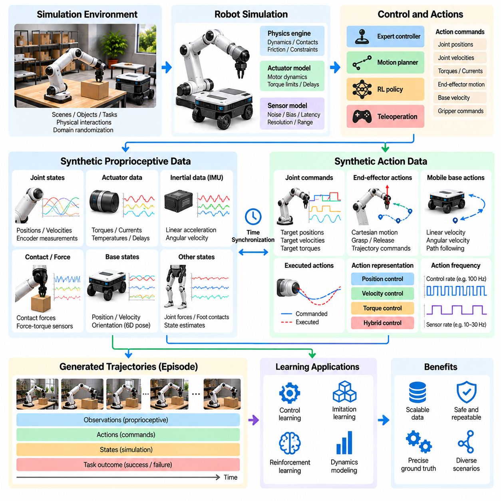{width="7.268055555555556in" height="7.268055555555556in"}

Synthetic proprioceptive and action data provide essential information about the internal state and physical behavior of robots operating in simulated environments. Unlike external perception data, which describes surrounding objects and scenes, proprioceptive data captures joint configurations, motion, forces, and actuator conditions. Action data records control commands and their consequences, enabling Physical AI systems to learn the relationship between internal states and physical interactions.

Proprioception refers to a robot\'s ability to estimate its own configuration and motion through internal sensing. Typical measurements include joint positions, joint velocities, motor currents, actuator torques, inertial acceleration, and angular velocity. Simulation can generate these signals directly from modeled robot states, creating synchronized records that support state estimation, feedback control, motion prediction, and learning of embodied behavior.

Synthetic proprioceptive data is commonly produced by physics engines that maintain detailed representations of robot dynamics. At each simulation step, the engine updates joint coordinates, rigid-body velocities, contact conditions, and actuator responses. These quantities can be recorded as ground-truth states or transformed through virtual sensor models to approximate measurements available from physical encoders, inertial sensors, and motor controllers.

A fundamental distinction exists between simulated ground truth and synthetic sensor measurements. Ground-truth data represents internal simulation variables, while sensor measurements approximate what a real robot could observe. Physical sensors introduce noise, bias, quantization, delay, and limited measurement ranges. Training pipelines should preserve this distinction to prevent learning policies from depending on information unavailable during actual deployment.

Joint position and velocity data form the foundation of many robot control systems. Encoders measure rotational or linear displacement, while velocity estimates describe how joint configurations change over time. Synthetic datasets can reproduce encoder resolution, measurement noise, and sampling frequency. These observations help train controllers that coordinate articulated mechanisms, manipulators, humanoids, and mobile robot platforms.

Actuator-related data provides additional information about how commanded motion is physically produced. Simulated motors can generate torque, current, speed, and temperature estimates according to actuator models. Incorporating torque limits, friction, backlash, saturation, and response delays improves the realism of generated trajectories. Such data supports learning actuator-aware policies that respect physical hardware constraints.

Inertial measurements are particularly important for mobile robots, humanoids, quadrupeds, and aerial systems. Synthetic inertial measurement units can produce acceleration and angular velocity signals derived from simulated rigid-body motion. Gravity compensation, sensor orientation, bias drift, and measurement noise must be considered when approximating real inertial sensors. These signals support balance control, localization, and dynamic state estimation.

Contact and force information is another valuable category of synthetic proprioceptive data. Physics simulators can estimate contact forces, joint reaction forces, and interaction impulses during manipulation or locomotion. Virtual force-torque sensors may transform these quantities into realistic measurements. Such data enables learning systems to recognize contact events, regulate interaction forces, and adapt behavior during uncertain physical interactions.

Action data describes the commands issued by a robot controller or learning policy. Depending on the control architecture, actions may represent desired joint positions, target velocities, actuator torques, Cartesian end-effector motions, or mobile base commands. Simulation records these commands together with resulting state transitions, establishing the observation-action-outcome relationships required for robot policy learning.

The distinction between commanded actions and executed actions is essential for accurate data generation. A controller may request a particular movement, but actuator limitations, environmental contacts, or safety constraints can prevent exact execution. Recording both intended commands and realized physical responses allows learning systems to understand actuator dynamics, control errors, and the consequences of interactions with the environment.

Temporal alignment determines whether synthetic proprioceptive and action sequences accurately represent robot behavior. Control commands, joint measurements, inertial observations, and contact events may operate at different frequencies. Simulation pipelines must associate these signals with consistent timestamps and sampling conventions. Incorrect alignment can distort cause-and-effect relationships and reduce the effectiveness of learned control policies.

Synthetic trajectories are commonly organized into episodes containing initial states, observation sequences, action commands, state transitions, and task outcomes. Each episode may also include reward signals, termination conditions, and contextual metadata. This structure supports imitation learning, reinforcement learning, system identification, and training of predictive models that estimate future robot states from previous observations and actions.

For robotic manipulation, synthetic proprioceptive data captures joint configurations, gripper states, applied forces, and contact events. Action records describe reaching, grasping, lifting, and object placement commands. Combining these signals enables policies to associate internal motion with manipulation outcomes, supporting precise control and recovery from unsuccessful grasps or unexpected object interactions.

For humanoid and legged robots, proprioceptive data is central to maintaining balance and coordinating whole-body movement. Joint measurements, inertial signals, and foot-contact information describe the robot\'s evolving physical state. Synthetic action trajectories can represent walking, turning, stepping, and recovery maneuvers, providing training experiences for locomotion policies operating under changing terrain and disturbance conditions.

Mobile robots use proprioceptive measurements to estimate wheel motion, body velocity, and vehicle dynamics. Synthetic wheel encoders, inertial sensors, and steering feedback can reproduce the information available to navigation controllers. Action data may include linear velocity, angular velocity, steering angle, and braking commands, allowing models to learn motion execution and predict deviations caused by surface conditions.

Domain randomization improves the diversity of synthetic proprioceptive and action datasets by varying robot mass, joint friction, actuator strength, sensor bias, and control latency. These variations expose learning systems to uncertainty in mechanical and sensing characteristics. Properly selected parameter ranges can improve robustness, although unrealistic combinations may produce behaviors that do not correspond to feasible physical systems.

Sensor noise modeling is necessary because ideal simulated measurements can create unrealistic learning conditions. Encoder quantization, inertial drift, communication delays, and intermittent measurement loss affect real control systems. Synthetic pipelines can introduce these effects using calibrated stochastic models, enabling policies and estimators to learn under observation uncertainty rather than assuming perfect internal state information.

Action-space design strongly influences the usefulness of generated datasets. Position-controlled actions are often suitable for manipulation tasks, while torque-controlled actions may provide greater flexibility for dynamic locomotion. Higher-level commands can simplify learning but conceal important actuator behavior. Dataset specifications should therefore document action representations, control frequencies, normalization methods, and physical limits.

Synthetic proprioceptive and action data also support system identification and dynamics learning. By observing how simulated robots respond to controlled inputs, models can learn relationships among forces, velocities, positions, and contact conditions. Comparing these relationships with physical measurements helps identify discrepancies in simulation parameters and provides a basis for refining robot dynamics models.

Data quality evaluation should examine physical consistency, temporal synchronization, sensor realism, and action validity. Automated checks can detect impossible joint configurations, excessive actuator commands, discontinuous trajectories, missing measurements, and inconsistent contact states. Validation against real robot recordings is particularly important because internally consistent simulation data may still represent inaccurate physical behavior.

A scalable Physical AI data engine integrates synthetic proprioceptive and action data with external sensor observations and task-level information. This integration creates complete multimodal trajectories linking perception, internal state, control decisions, and physical outcomes. When combined with calibrated dynamics, systematic randomization, and real-world validation, these datasets provide a foundation for robust control learning and generalizable embodied intelligence.

합성 고유수용감각 및 행동 데이터(Synthetic Proprioceptive and Action Data)는 시뮬레이션 환경(Simulated Environment)에서 작동하는 로봇의 내부 상태(Internal State)와 물리적 행동(Physical Behavior)에 관한 필수 정보를 제공한다. 주변 객체와 장면을 설명하는 외부 인식 데이터(External Perception Data)와 달리, 고유수용감각 데이터(Proprioceptive Data)는 관절 구성(Joint Configuration), 운동(Motion), 힘(Force), 구동기 상태(Actuator Condition)를 포착한다. 행동 데이터(Action Data)는 제어 명령(Control Command)과 그 결과를 기록하여 피지컬 인공지능(Physical AI) 시스템이 내부 상태와 물리적 상호작용 사이의 관계를 학습하도록 지원한다.

고유수용감각(Proprioception)은 로봇이 내부 센싱(Internal Sensing)을 통해 자신의 구성과 운동을 추정하는 능력을 의미한다. 대표적인 측정값에는 관절 위치(Joint Position), 관절 속도(Joint Velocity), 모터 전류(Motor Current), 구동기 토크(Actuator Torque), 관성 가속도(Inertial Acceleration), 각속도(Angular Velocity)가 포함된다. 시뮬레이션은 모델링된 로봇 상태(Modelled Robot State)에서 이러한 신호를 직접 생성할 수 있으며, 상태 추정(State Estimation), 피드백 제어(Feedback Control), 운동 예측(Motion Prediction), 체화된 행동 학습(Embodied Behavior Learning)을 지원하는 동기화된 기록을 생성한다.

합성 고유수용감각 데이터(Synthetic Proprioceptive Data)는 일반적으로 로봇 동역학(Robot Dynamics)의 상세한 표현을 유지하는 물리 엔진(Physics Engine)을 통해 생성된다. 각 시뮬레이션 단계(Simulation Step)에서 물리 엔진은 관절 좌표(Joint Coordinate), 강체 속도(Rigid-Body Velocity), 접촉 조건(Contact Condition), 구동기 응답(Actuator Response)을 갱신한다. 이러한 값은 정답 상태(Ground-Truth State)로 기록하거나 가상 센서 모델(Virtual Sensor Model)을 통해 변환하여 실제 엔코더(Physical Encoder), 관성 센서(Inertial Sensor), 모터 제어기(Motor Controller)에서 얻을 수 있는 측정값을 근사할 수 있다.

시뮬레이션 정답 데이터(Simulated Ground Truth)와 합성 센서 측정값(Synthetic Sensor Measurement) 사이에는 근본적인 차이가 존재한다. 정답 데이터는 시뮬레이션 내부 변수(Internal Simulation Variable)를 나타내는 반면, 센서 측정값은 실제 로봇이 관측할 수 있는 정보를 근사한다. 실제 센서(Physical Sensor)는 잡음(Noise), 편향(Bias), 양자화(Quantization), 지연(Delay), 제한된 측정 범위(Limited Measurement Range)를 발생시킨다. 학습 파이프라인(Training Pipeline)은 실제 배포(Actual Deployment) 과정에서 사용할 수 없는 정보에 학습 정책(Learned Policy)이 의존하지 않도록 이러한 차이를 유지해야 한다.

관절 위치 및 속도 데이터(Joint Position and Velocity Data)는 많은 로봇 제어 시스템(Robot Control System)의 기반을 형성한다. 엔코더(Encoder)는 회전 또는 선형 변위(Rotational or Linear Displacement)를 측정하며, 속도 추정값(Velocity Estimate)은 시간에 따라 관절 구성이 어떻게 변화하는지 설명한다. 합성 데이터셋(Synthetic Dataset)은 엔코더 해상도(Encoder Resolution), 측정 잡음(Measurement Noise), 샘플링 주파수(Sampling Frequency)를 재현할 수 있다. 이러한 관측값은 다관절 기구(Articulated Mechanism), 매니퓰레이터(Manipulator), 휴머노이드(Humanoid), 이동 로봇 플랫폼(Mobile Robot Platform)을 조정하는 제어기(Controller)의 학습을 지원한다.

구동기 관련 데이터(Actuator-Related Data)는 명령된 운동이 물리적으로 어떻게 생성되는지에 관한 추가 정보를 제공한다. 시뮬레이션 모터(Simulated Motor)는 구동기 모델(Actuator Model)에 따라 토크(Torque), 전류(Current), 속도(Speed), 온도 추정값(Temperature Estimate)을 생성할 수 있다. 토크 제한(Torque Limit), 마찰(Friction), 백래시(Backlash), 포화(Saturation), 응답 지연(Response Delay)을 반영하면 생성된 궤적(Generated Trajectory)의 현실성이 향상된다. 이러한 데이터는 실제 하드웨어 제약조건(Physical Hardware Constraint)을 준수하는 구동기 인식 정책(Actuator-Aware Policy)의 학습을 지원한다.

관성 측정(Inertial Measurement)은 이동 로봇(Mobile Robot), 휴머노이드(Humanoid), 사족보행 로봇(Quadruped Robot), 비행 시스템(Aerial System)에서 특히 중요하다. 합성 관성 측정 장치(Synthetic Inertial Measurement Unit)는 시뮬레이션된 강체 운동(Rigid-Body Motion)에서 유도된 가속도(Acceleration)와 각속도(Angular Velocity) 신호를 생성할 수 있다. 실제 관성 센서(Real Inertial Sensor)를 근사할 때는 중력 보상(Gravity Compensation), 센서 방향(Sensor Orientation), 편향 드리프트(Bias Drift), 측정 잡음(Measurement Noise)을 고려해야 한다. 이러한 신호는 균형 제어(Balance Control), 위치 추정(Localization), 동적 상태 추정(Dynamic State Estimation)을 지원한다.

접촉 및 힘 정보(Contact and Force Information)는 합성 고유수용감각 데이터의 또 다른 중요한 범주이다. 물리 시뮬레이터(Physics Simulator)는 조작(Manipulation)이나 이동(Locomotion) 중 발생하는 접촉력(Contact Force), 관절 반력(Joint Reaction Force), 상호작용 충격량(Interaction Impulse)을 추정할 수 있다. 가상 힘-토크 센서(Virtual Force-Torque Sensor)는 이러한 값을 현실적인 측정값으로 변환할 수 있다. 이러한 데이터는 학습 시스템이 접촉 사건(Contact Event)을 인식하고, 상호작용 힘(Interaction Force)을 조절하며, 불확실한 물리적 상호작용에 따라 행동을 적응시키도록 지원한다.

행동 데이터(Action Data)는 로봇 제어기(Robot Controller) 또는 학습 정책(Learning Policy)이 발행하는 명령을 설명한다. 제어 아키텍처(Control Architecture)에 따라 행동은 목표 관절 위치(Desired Joint Position), 목표 속도(Target Velocity), 구동기 토크(Actuator Torque), 데카르트 좌표계 기반 말단효과기 운동(Cartesian End-Effector Motion), 이동 베이스 명령(Mobile Base Command)을 나타낼 수 있다. 시뮬레이션은 이러한 명령과 그에 따른 상태 전이(State Transition)를 함께 기록하여 로봇 정책 학습(Robot Policy Learning)에 필요한 관측-행동-결과 관계(Observation-Action-Outcome Relationship)를 구축한다.

명령된 행동(Commanded Action)과 실제 실행된 행동(Executed Action)을 구분하는 것은 정확한 데이터 생성(Data Generation)에 필수적이다. 제어기는 특정 운동을 요청할 수 있지만, 구동기 한계(Actuator Limitation), 환경 접촉(Environmental Contact), 안전 제약조건(Safety Constraint)으로 인해 정확한 실행이 불가능할 수 있다. 의도된 명령(Intended Command)과 실제 물리적 응답(Realized Physical Response)을 모두 기록하면 학습 시스템이 구동기 동역학(Actuator Dynamics), 제어 오차(Control Error), 환경과의 상호작용 결과를 이해할 수 있다.

시간적 정렬(Temporal Alignment)은 합성 고유수용감각 및 행동 시퀀스(Synthetic Proprioceptive and Action Sequence)가 로봇 행동을 정확하게 표현하는지 결정한다. 제어 명령(Control Command), 관절 측정값(Joint Measurement), 관성 관측값(Inertial Observation), 접촉 사건(Contact Event)은 서로 다른 주파수(Frequency)로 작동할 수 있다. 시뮬레이션 파이프라인(Simulation Pipeline)은 이러한 신호를 일관된 타임스탬프(Timestamp)와 샘플링 규약(Sampling Convention)에 연결해야 한다. 잘못된 정렬은 인과관계(Cause-and-Effect Relationship)를 왜곡하고 학습된 제어 정책(Control Policy)의 효과를 감소시킬 수 있다.

합성 궤적(Synthetic Trajectory)은 일반적으로 초기 상태(Initial State), 관측 시퀀스(Observation Sequence), 행동 명령(Action Command), 상태 전이(State Transition), 작업 결과(Task Outcome)를 포함하는 에피소드(Episode)로 구성된다. 각 에피소드에는 보상 신호(Reward Signal), 종료 조건(Termination Condition), 상황 메타데이터(Contextual Metadata)도 포함될 수 있다. 이러한 구조는 모방 학습(Imitation Learning), 강화 학습(Reinforcement Learning), 시스템 식별(System Identification), 이전 관측값과 행동을 바탕으로 미래 로봇 상태를 추정하는 예측 모델(Predictive Model)의 학습을 지원한다.

로봇 조작(Robotic Manipulation)에서 합성 고유수용감각 데이터는 관절 구성(Joint Configuration), 그리퍼 상태(Gripper State), 적용된 힘(Applied Force), 접촉 사건(Contact Event)을 포착한다. 행동 기록(Action Record)은 도달(Reaching), 파지(Grasping), 들어 올리기(Lifting), 객체 배치(Object Placement) 명령을 설명한다. 이러한 신호를 결합하면 정책이 내부 운동(Internal Motion)과 조작 결과(Manipulation Outcome)를 연결할 수 있으며, 정밀 제어(Precise Control)와 파지 실패(Unsuccessful Grasp) 또는 예상하지 못한 객체 상호작용(Unexpected Object Interaction)으로부터의 복구를 지원한다.

휴머노이드 및 다족보행 로봇(Humanoid and Legged Robot)에서는 고유수용감각 데이터가 균형 유지(Balance Maintenance)와 전신 운동 협응(Whole-Body Movement Coordination)의 핵심 요소이다. 관절 측정값(Joint Measurement), 관성 신호(Inertial Signal), 발 접촉 정보(Foot-Contact Information)는 변화하는 로봇의 물리적 상태를 설명한다. 합성 행동 궤적(Synthetic Action Trajectory)은 보행(Walking), 회전(Turning), 발 디딤(Stepping), 복구 동작(Recovery Maneuver)을 표현할 수 있으며, 변화하는 지형(Terrain)과 외란 조건(Disturbance Condition)에서 작동하는 이동 정책(Locomotion Policy)에 학습 경험을 제공한다.

이동 로봇(Mobile Robot)은 고유수용감각 측정값(Proprioceptive Measurement)을 사용하여 바퀴 운동(Wheel Motion), 본체 속도(Body Velocity), 차량 동역학(Vehicle Dynamics)을 추정한다. 합성 휠 엔코더(Synthetic Wheel Encoder), 관성 센서(Inertial Sensor), 조향 피드백(Steering Feedback)은 내비게이션 제어기(Navigation Controller)가 사용할 수 있는 정보를 재현할 수 있다. 행동 데이터에는 선속도(Linear Velocity), 각속도(Angular Velocity), 조향각(Steering Angle), 제동 명령(Braking Command)이 포함될 수 있으며, 이를 통해 모델은 운동 실행(Motion Execution)을 학습하고 표면 조건(Surface Condition)으로 인한 편차(Deviation)를 예측할 수 있다.

도메인 무작위화(Domain Randomization)는 로봇 질량(Robot Mass), 관절 마찰(Joint Friction), 구동기 출력(Actuator Strength), 센서 편향(Sensor Bias), 제어 지연(Control Latency)을 변화시켜 합성 고유수용감각 및 행동 데이터셋의 다양성을 향상시킨다. 이러한 변화는 학습 시스템을 기계적 특성(Mechanical Characteristic)과 센싱 특성(Sensing Characteristic)의 불확실성에 노출시킨다. 적절하게 선택된 매개변수 범위(Parameter Range)는 강건성(Robustness)을 향상시킬 수 있지만, 비현실적인 조합은 실제 구현 가능한 물리 시스템(Feasible Physical System)과 일치하지 않는 행동을 생성할 수 있다.

센서 잡음 모델링(Sensor Noise Modeling)은 이상적인 시뮬레이션 측정값(Ideal Simulated Measurement)이 비현실적인 학습 조건을 만들 수 있기 때문에 필요하다. 엔코더 양자화(Encoder Quantization), 관성 드리프트(Inertial Drift), 통신 지연(Communication Delay), 간헐적인 측정값 손실(Intermittent Measurement Loss)은 실제 제어 시스템에 영향을 미친다. 합성 파이프라인(Synthetic Pipeline)은 보정된 확률적 모델(Calibrated Stochastic Model)을 사용하여 이러한 효과를 도입할 수 있으며, 정책과 추정기(Estimator)가 완벽한 내부 상태 정보(Perfect Internal State Information)를 가정하는 대신 관측 불확실성(Observation Uncertainty) 속에서 학습하도록 지원한다.

행동 공간 설계(Action-Space Design)는 생성된 데이터셋의 유용성에 큰 영향을 미친다. 위치 제어 행동(Position-Controlled Action)은 조작 작업(Manipulation Task)에 적합한 경우가 많으며, 토크 제어 행동(Torque-Controlled Action)은 동적 이동(Dynamic Locomotion)에 더 큰 유연성을 제공할 수 있다. 상위 수준 명령(Higher-Level Command)은 학습을 단순화할 수 있지만 중요한 구동기 행동(Actuator Behavior)을 감출 수 있다. 따라서 데이터셋 명세(Dataset Specification)에는 행동 표현(Action Representation), 제어 주파수(Control Frequency), 정규화 방법(Normalization Method), 물리적 한계(Physical Limit)를 문서화해야 한다.

합성 고유수용감각 및 행동 데이터는 시스템 식별(System Identification)과 동역학 학습(Dynamics Learning)도 지원한다. 시뮬레이션 로봇이 제어된 입력(Controlled Input)에 어떻게 반응하는지 관찰함으로써 모델은 힘(Force), 속도(Velocity), 위치(Position), 접촉 조건(Contact Condition) 사이의 관계를 학습할 수 있다. 이러한 관계를 실제 측정값(Physical Measurement)과 비교하면 시뮬레이션 매개변수(Simulation Parameter)의 불일치를 식별할 수 있으며, 로봇 동역학 모델(Robot Dynamics Model)을 개선하기 위한 기반을 제공한다.

데이터 품질 평가(Data Quality Evaluation)는 물리적 일관성(Physical Consistency), 시간 동기화(Temporal Synchronization), 센서 현실성(Sensor Realism), 행동 유효성(Action Validity)을 검토해야 한다. 자동화된 검사(Automated Check)는 불가능한 관절 구성(Impossible Joint Configuration), 과도한 구동기 명령(Excessive Actuator Command), 불연속적인 궤적(Discontinuous Trajectory), 누락된 측정값(Missing Measurement), 일관되지 않은 접촉 상태(Inconsistent Contact State)를 탐지할 수 있다. 내부적으로 일관된 시뮬레이션 데이터도 부정확한 물리적 행동을 표현할 수 있으므로 실제 로봇 기록(Real Robot Recording)을 이용한 검증이 특히 중요하다.

확장 가능한 피지컬 인공지능 데이터 엔진(Scalable Physical AI Data Engine)은 합성 고유수용감각 및 행동 데이터를 외부 센서 관측값(External Sensor Observation)과 작업 수준 정보(Task-Level Information)에 통합한다. 이러한 통합은 인식(Perception), 내부 상태(Internal State), 제어 의사결정(Control Decision), 물리적 결과(Physical Outcome)를 연결하는 완전한 다중모달 궤적(Complete Multimodal Trajectory)을 생성한다. 보정된 동역학(Calibrated Dynamics), 체계적인 무작위화(Systematic Randomization), 실제 환경 검증(Real-World Validation)을 결합하면 이러한 데이터셋은 강건한 제어 학습(Robust Control Learning)과 일반화 가능한 체화 지능(Generalizable Embodied Intelligence)을 위한 기반을 제공한다.

##  

## 04.06. Expert Policy and Planner Generated Data

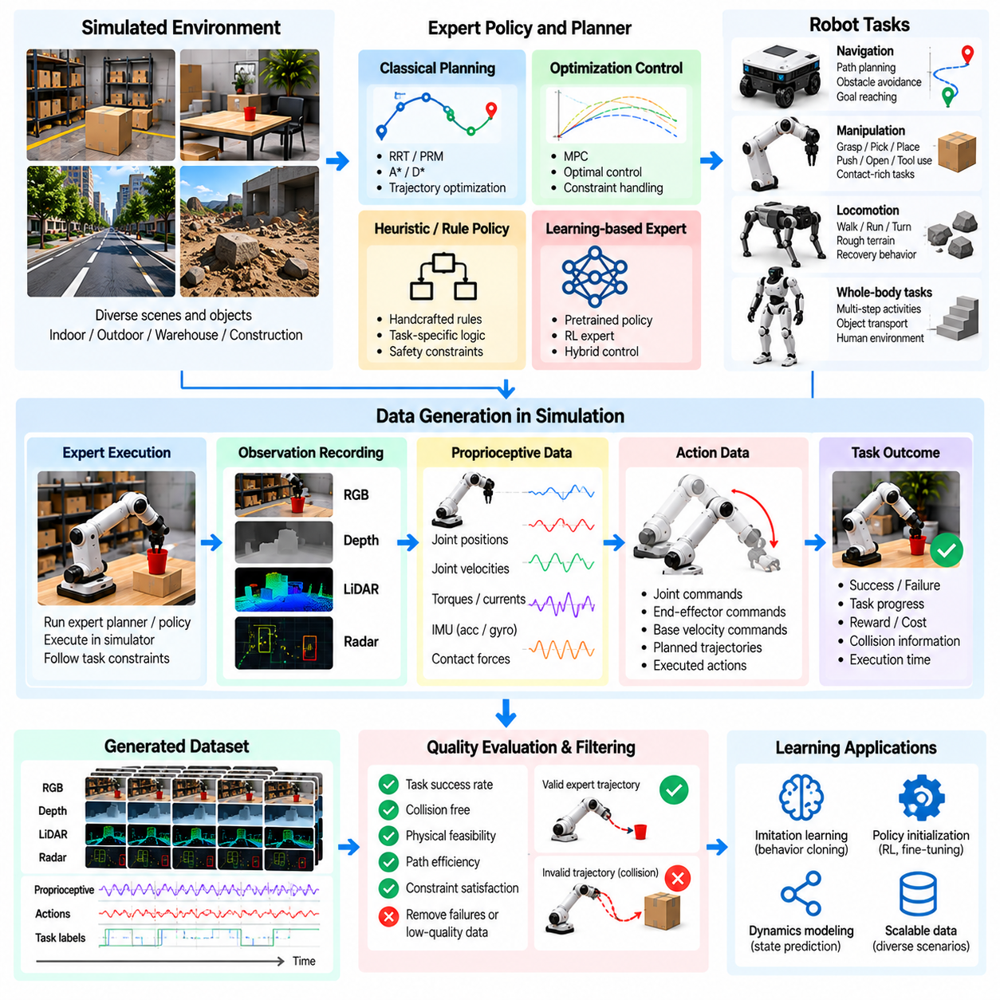{width="7.268055555555556in" height="7.268055555555556in"}

Expert policy and planner-generated data provide a structured source of high-quality demonstrations for training Physical AI systems. Instead of relying entirely on human teleoperation or random exploration, simulation environments can use algorithmic experts to produce purposeful robot behavior. These experts generate observation-action trajectories that demonstrate how robots can accomplish tasks while satisfying motion, safety, and operational constraints.

An expert policy is a decision-making mechanism designed to select effective actions under specified conditions. It may use handcrafted control rules, optimization algorithms, classical robotics methods, or previously trained models. A planner differs by explicitly evaluating possible future states or action sequences before execution. Both approaches can generate demonstrations that guide learning systems toward successful behaviors.

Expert-generated datasets commonly contain robot observations, internal states, selected actions, resulting transitions, and task outcomes. Additional records may include planned trajectories, intermediate goals, collision margins, and execution costs. Because simulation exposes detailed environment states, these datasets can include privileged information for training or evaluation while maintaining separate observations available to the deployed robot.

Classical motion planning algorithms are valuable sources of expert demonstrations. Sampling-based methods such as RRT and PRM explore feasible configurations, while optimization-based planners refine trajectories according to smoothness, collision avoidance, and dynamic constraints. Their solutions can be converted into sequences of control commands, creating training examples for manipulation, navigation, and whole-body motion.

For mobile robots, expert planners generate routes through simulated environments using geometric maps, occupancy grids, or semantic representations. Global planners identify feasible paths toward destinations, while local planners respond to obstacles and changing conditions. Recording their decisions across procedurally generated environments produces navigation datasets covering different layouts, obstacle configurations, and operational situations.

Manipulation tasks require expert policies that coordinate perception, grasp selection, motion planning, and contact interaction. A simulated expert may identify a suitable grasp pose, calculate a collision-free approach, close the gripper, and transport an object toward its target. Recording successful and unsuccessful executions provides information about feasible manipulation strategies and the conditions that influence task completion.

Optimization-based control methods can generate expert actions for systems requiring precise dynamic behavior. Model predictive control repeatedly predicts future states and selects actions that minimize a specified objective over a finite horizon. In simulation, such controllers can produce demonstrations for balancing, trajectory tracking, obstacle avoidance, and coordinated movement under actuator and contact constraints.

For legged and humanoid robots, expert trajectories may be generated through trajectory optimization, whole-body control, or model-based locomotion planners. These methods coordinate joint motion, contact timing, center-of-mass movement, and stability requirements. Their outputs provide structured examples of walking, stepping, turning, and recovery behaviors that can support imitation learning and policy initialization.

Task and motion planning combines symbolic reasoning with geometric and physical feasibility. A task planner determines the sequence of operations needed to achieve a goal, while motion planners calculate executable movements for individual steps. This integration can generate demonstrations of multi-stage activities such as retrieving an object, opening a container, transporting materials, or assembling components.

Expert policies can also be constructed using hierarchical control architectures. High-level policies select goals or behavioral modes, while lower-level controllers execute corresponding movements. Recording decisions at both levels creates datasets that connect task intent with physical actions. Such representations are useful for training systems that must reason over extended time horizons without directly predicting every low-level command.

A central advantage of expert-generated data is the ability to produce demonstrations at scale. Once an expert controller is integrated with a simulator, it can execute thousands of episodes across different environments, object arrangements, and robot configurations. Parallel simulation further increases throughput, allowing data engines to collect large numbers of task-relevant trajectories without continuous human supervision.

However, expert demonstrations are not automatically optimal or universally applicable. Classical planners may rely on simplified dynamics, accurate maps, or privileged state information unavailable in physical deployment. Optimization algorithms may converge to local solutions, and handcrafted policies may fail outside their designed conditions. Dataset generation must therefore evaluate expert reliability rather than assuming every demonstration is correct.

Demonstration quality can be assessed using task success, execution time, path efficiency, collision frequency, energy consumption, and constraint violations. Different applications require different performance priorities. A warehouse robot may emphasize safe and efficient navigation, while a manipulation system may prioritize grasp stability and placement accuracy. These metrics support filtering and ranking of generated trajectories.

Imitation learning converts expert demonstrations into trainable robot policies. Behavioral cloning directly maps observations to expert actions, while sequence-based methods learn relationships across extended trajectories. The resulting policy can execute actions without repeatedly invoking expensive planners. Nevertheless, supervised imitation may struggle when the robot encounters states that were rarely represented in the expert dataset.

Distribution shift is a major limitation of learning from fixed demonstrations. Small prediction errors can move a learned policy into unfamiliar states, causing additional errors to accumulate. Interactive data aggregation methods address this problem by allowing the learned policy to visit new states while an expert supplies corrective actions. Such approaches expand training coverage around the learner\'s actual behavior.

Expert data generation can deliberately include recovery demonstrations rather than recording only successful nominal trajectories. Simulation can introduce disturbances, blocked paths, misplaced objects, or inaccurate initial states. The expert then attempts to restore progress toward the task objective. These recovery examples help learned policies handle deviations and reduce dependence on perfectly controlled execution conditions.

Multiple experts can contribute complementary demonstrations within the same data engine. A geometric planner may provide efficient navigation paths, a model predictive controller may handle dynamic constraints, and a learned expert may demonstrate complex contact interactions. Combining their outputs increases behavioral diversity, although differences in action conventions and performance quality must be normalized and documented.

Expert selection can be adapted to task difficulty and computational cost. Simple scenarios may be solved using fast heuristic policies, while difficult configurations require trajectory optimization or more sophisticated planning. A generation pipeline can allocate expensive expert computation selectively, improving dataset throughput while preserving high-quality supervision for challenging states and interactions.

The relationship between expert planning and reinforcement learning is complementary. Expert trajectories can initialize policies, guide exploration, or provide offline training data before reward-driven optimization begins. Reinforcement learning may subsequently discover strategies that improve upon the original expert. Combining these methods reduces reliance on unguided exploration while allowing adaptation beyond predefined planning assumptions.

Dataset diversity remains essential even when demonstrations are generated by reliable experts. Procedural environments, randomized object properties, varying task objectives, and altered robot dynamics expose planners to different situations. The resulting demonstrations should represent multiple feasible strategies rather than a narrow collection of repeated solutions, supporting broader policy generalization.

A scalable expert-generated data pipeline coordinates scenario generation, expert execution, trajectory recording, quality evaluation, and dataset curation. Each trajectory should preserve observations, actions, timing information, task context, and relevant execution metrics. Reproducible simulation seeds and expert configurations enable developers to investigate failures, compare planning methods, and regenerate important training cases.

Expert policy and planner-generated data ultimately connect established robotics algorithms with data-driven Physical AI learning. Planners contribute structured reasoning and physically constrained behavior, while learned policies offer rapid execution and potential generalization across diverse conditions. By combining reliable demonstrations, targeted recovery examples, and continuous evaluation, data engines can transform expert knowledge into scalable training resources for embodied intelligence.

전문가 정책 및 계획기 생성 데이터(Expert Policy and Planner-Generated Data)는 피지컬 인공지능(Physical AI) 시스템을 학습시키기 위한 고품질 시연 데이터(High-Quality Demonstration Data)의 구조화된 공급원이다. 인간 원격조작(Human Teleoperation)이나 무작위 탐색(Random Exploration)에 전적으로 의존하는 대신, 시뮬레이션 환경(Simulation Environment)은 알고리즘 기반 전문가(Algorithmic Expert)를 활용하여 목적 지향적인 로봇 행동(Purposeful Robot Behavior)을 생성할 수 있다. 이러한 전문가는 운동(Motion), 안전(Safety), 운영 제약조건(Operational Constraint)을 충족하면서 로봇이 작업을 수행하는 방법을 보여주는 관측-행동 궤적(Observation-Action Trajectory)을 생성한다.

전문가 정책(Expert Policy)은 특정 조건에서 효과적인 행동을 선택하도록 설계된 의사결정 메커니즘(Decision-Making Mechanism)이다. 전문가 정책은 수작업으로 설계된 제어 규칙(Handcrafted Control Rule), 최적화 알고리즘(Optimization Algorithm), 고전적 로보틱스 방법(Classical Robotics Method), 기존 학습 모델(Previously Trained Model)을 활용할 수 있다. 계획기(Planner)는 실행 전에 가능한 미래 상태(Future State)나 행동 시퀀스(Action Sequence)를 명시적으로 평가한다는 점에서 차이가 있다. 두 접근법 모두 학습 시스템을 성공적인 행동으로 유도하는 시연 데이터를 생성할 수 있다.

전문가 생성 데이터셋(Expert-Generated Dataset)은 일반적으로 로봇 관측값(Robot Observation), 내부 상태(Internal State), 선택된 행동(Selected Action), 결과적인 상태 전이(State Transition), 작업 결과(Task Outcome)를 포함한다. 추가 기록에는 계획 궤적(Planned Trajectory), 중간 목표(Intermediate Goal), 충돌 여유 거리(Collision Margin), 실행 비용(Execution Cost)이 포함될 수 있다. 시뮬레이션은 상세한 환경 상태(Environment State)를 제공하므로 이러한 데이터셋은 학습이나 평가를 위한 특권 정보(Privileged Information)를 포함하면서도 실제 배포된 로봇이 사용할 수 있는 관측값을 별도로 유지할 수 있다.

고전적 운동 계획 알고리즘(Classical Motion Planning Algorithm)은 전문가 시연 데이터(Expert Demonstration)의 중요한 공급원이다. RRT와 PRM 같은 샘플링 기반 방법(Sampling-Based Method)은 실행 가능한 구성(Feasible Configuration)을 탐색하며, 최적화 기반 계획기(Optimization-Based Planner)는 부드러움(Smoothness), 충돌 회피(Collision Avoidance), 동역학적 제약조건(Dynamic Constraint)을 기준으로 궤적을 개선한다. 이러한 해법은 제어 명령 시퀀스(Control Command Sequence)로 변환되어 조작(Manipulation), 내비게이션(Navigation), 전신 운동(Whole-Body Motion)을 위한 학습 사례를 생성할 수 있다.

이동 로봇(Mobile Robot)의 경우 전문가 계획기(Expert Planner)는 기하학적 지도(Geometric Map), 점유 격자(Occupancy Grid), 의미적 표현(Semantic Representation)을 활용하여 시뮬레이션 환경에서 경로를 생성한다. 전역 계획기(Global Planner)는 목적지까지 실행 가능한 경로(Feasible Path)를 식별하고, 지역 계획기(Local Planner)는 장애물과 변화하는 조건에 대응한다. 절차적으로 생성된 환경(Procedurally Generated Environment)에서 이러한 의사결정을 기록하면 다양한 공간 배치(Layout), 장애물 구성(Obstacle Configuration), 운영 상황(Operational Situation)을 포함하는 내비게이션 데이터셋(Navigation Dataset)을 구축할 수 있다.

조작 작업(Manipulation Task)에는 인식(Perception), 파지 선택(Grasp Selection), 운동 계획(Motion Planning), 접촉 상호작용(Contact Interaction)을 조정하는 전문가 정책이 필요하다. 시뮬레이션 전문가(Simulated Expert)는 적절한 파지 자세(Grasp Pose)를 식별하고, 충돌 없는 접근 경로(Collision-Free Approach)를 계산하며, 그리퍼(Gripper)를 닫고, 객체를 목표 위치로 이동시킬 수 있다. 성공한 실행과 실패한 실행을 모두 기록하면 실행 가능한 조작 전략(Feasible Manipulation Strategy)과 작업 완료(Task Completion)에 영향을 미치는 조건에 관한 정보를 얻을 수 있다.

최적화 기반 제어 방법(Optimization-Based Control Method)은 정밀한 동적 행동(Dynamic Behavior)이 필요한 시스템을 위한 전문가 행동(Expert Action)을 생성할 수 있다. 모델 예측 제어(Model Predictive Control)는 미래 상태를 반복적으로 예측하고 유한 예측 구간(Finite Horizon)에서 지정된 목적함수(Objective Function)를 최소화하는 행동을 선택한다. 시뮬레이션에서 이러한 제어기는 구동기 및 접촉 제약조건(Actuator and Contact Constraint)하에서 균형 유지(Balancing), 궤적 추종(Trajectory Tracking), 장애물 회피(Obstacle Avoidance), 협응 운동(Coordinated Movement)을 위한 시연 데이터를 생성할 수 있다.

다족보행 및 휴머노이드 로봇(Legged and Humanoid Robot)의 전문가 궤적(Expert Trajectory)은 궤적 최적화(Trajectory Optimization), 전신 제어(Whole-Body Control), 모델 기반 이동 계획기(Model-Based Locomotion Planner)를 통해 생성될 수 있다. 이러한 방법은 관절 운동(Joint Motion), 접촉 시점(Contact Timing), 질량중심 운동(Center-of-Mass Movement), 안정성 요구사항(Stability Requirement)을 조정한다. 생성된 결과는 보행(Walking), 발 디딤(Stepping), 회전(Turning), 복구 행동(Recovery Behavior)에 대한 구조화된 사례를 제공하여 모방 학습(Imitation Learning)과 정책 초기화(Policy Initialization)를 지원한다.

작업 및 운동 계획(Task and Motion Planning)은 기호적 추론(Symbolic Reasoning)과 기하학적 및 물리적 실행 가능성(Geometric and Physical Feasibility)을 결합한다. 작업 계획기(Task Planner)는 목표 달성에 필요한 작업 순서(Operation Sequence)를 결정하고, 운동 계획기(Motion Planner)는 각 단계에 필요한 실행 가능한 움직임(Executable Movement)을 계산한다. 이러한 통합은 객체 가져오기(Object Retrieval), 컨테이너 열기(Container Opening), 자재 운반(Material Transportation), 부품 조립(Component Assembly)과 같은 다단계 활동(Multi-Stage Activity)의 시연 데이터를 생성할 수 있다.

전문가 정책은 계층적 제어 아키텍처(Hierarchical Control Architecture)를 사용하여 구성할 수도 있다. 상위 수준 정책(High-Level Policy)은 목표(Goal)나 행동 모드(Behavioral Mode)를 선택하고, 하위 수준 제어기(Low-Level Controller)는 해당 움직임을 실행한다. 두 수준의 의사결정을 모두 기록하면 작업 의도(Task Intent)와 물리적 행동(Physical Action)을 연결하는 데이터셋을 생성할 수 있다. 이러한 표현은 모든 하위 수준 명령을 직접 예측하지 않고도 장기 시간 범위(Extended Time Horizon)에 걸쳐 추론해야 하는 시스템을 학습시키는 데 유용하다.

전문가 생성 데이터(Expert-Generated Data)의 핵심 장점은 대규모 시연 데이터 생성(Scalable Demonstration Generation)이 가능하다는 것이다. 전문가 제어기(Expert Controller)가 시뮬레이터(Simulator)에 통합되면 다양한 환경, 객체 배치(Object Arrangement), 로봇 구성(Robot Configuration)에서 수천 개의 에피소드(Episode)를 실행할 수 있다. 병렬 시뮬레이션(Parallel Simulation)은 처리량(Throughput)을 더욱 증가시켜 데이터 엔진(Data Engine)이 지속적인 인간 감독(Human Supervision) 없이 대량의 작업 관련 궤적(Task-Relevant Trajectory)을 수집하도록 한다.

그러나 전문가 시연 데이터(Expert Demonstration)가 자동으로 최적이거나 모든 상황에 적용 가능한 것은 아니다. 고전적 계획기(Classical Planner)는 단순화된 동역학(Simplified Dynamics), 정확한 지도(Accurate Map), 실제 배포 환경에서 사용할 수 없는 특권 상태 정보(Privileged State Information)에 의존할 수 있다. 최적화 알고리즘은 국소 해(Local Solution)에 수렴할 수 있으며, 수작업으로 설계된 정책(Handcrafted Policy)은 설계된 조건을 벗어나면 실패할 수 있다. 따라서 데이터 생성 과정에서는 모든 시연 데이터가 정확하다고 가정하기보다 전문가 신뢰성(Expert Reliability)을 평가해야 한다.

시연 품질(Demonstration Quality)은 작업 성공률(Task Success), 실행 시간(Execution Time), 경로 효율성(Path Efficiency), 충돌 빈도(Collision Frequency), 에너지 소비(Energy Consumption), 제약조건 위반(Constraint Violation)을 사용하여 평가할 수 있다. 응용 분야에 따라 성능 우선순위(Performance Priority)는 달라진다. 창고 로봇(Warehouse Robot)은 안전하고 효율적인 내비게이션을 강조할 수 있으며, 조작 시스템(Manipulation System)은 파지 안정성(Grasp Stability)과 배치 정확도(Placement Accuracy)를 우선시할 수 있다. 이러한 지표는 생성된 궤적의 필터링(Filtering)과 순위화(Ranking)를 지원한다.

모방 학습(Imitation Learning)은 전문가 시연 데이터(Expert Demonstration)를 학습 가능한 로봇 정책(Trainable Robot Policy)으로 변환한다. 행동 복제(Behavioral Cloning)는 관측값을 전문가 행동(Expert Action)에 직접 매핑(Mapping)하며, 시퀀스 기반 방법(Sequence-Based Method)은 장기간의 궤적에 걸친 관계를 학습한다. 이렇게 생성된 정책은 계산 비용이 높은 계획기를 반복적으로 호출하지 않고도 행동을 실행할 수 있다. 그러나 지도 모방 학습(Supervised Imitation)은 전문가 데이터셋에서 거의 나타나지 않았던 상태를 로봇이 경험할 때 어려움을 겪을 수 있다.

분포 이동(Distribution Shift)은 고정된 시연 데이터(Fixed Demonstration)로부터 학습할 때 발생하는 주요 한계이다. 작은 예측 오차(Prediction Error)는 학습된 정책을 익숙하지 않은 상태(Unfamiliar State)로 이동시켜 추가적인 오차가 누적되도록 할 수 있다. 상호작용형 데이터 집계 방법(Interactive Data Aggregation Method)은 학습된 정책이 새로운 상태를 방문하는 동안 전문가가 수정 행동(Corrective Action)을 제공하도록 하여 이 문제를 해결한다. 이러한 접근법은 학습자의 실제 행동 주변으로 학습 데이터의 적용 범위(Training Coverage)를 확장한다.

전문가 데이터 생성(Expert Data Generation)은 정상적인 성공 궤적(Nominal Successful Trajectory)만 기록하는 대신 복구 시연 데이터(Recovery Demonstration)를 의도적으로 포함할 수 있다. 시뮬레이션은 외란(Disturbance), 차단된 경로(Blocked Path), 잘못 배치된 객체(Misplaced Object), 부정확한 초기 상태(Inaccurate Initial State)를 도입할 수 있다. 이후 전문가는 작업 목표(Task Objective)를 향한 진행을 복구하려고 시도한다. 이러한 복구 사례(Recovery Example)는 학습된 정책이 정상 상태에서 벗어난 상황을 처리하도록 돕고 완벽하게 제어된 실행 조건에 대한 의존성을 줄인다.

여러 전문가(Multiple Expert)는 동일한 데이터 엔진 내에서 상호 보완적인 시연 데이터를 제공할 수 있다. 기하학적 계획기(Geometric Planner)는 효율적인 내비게이션 경로(Navigation Path)를 제공하고, 모델 예측 제어기(Model Predictive Controller)는 동적 제약조건(Dynamic Constraint)을 처리하며, 학습된 전문가(Learned Expert)는 복잡한 접촉 상호작용(Complex Contact Interaction)을 시연할 수 있다. 이러한 결과를 결합하면 행동 다양성(Behavioral Diversity)이 증가하지만, 행동 표현 규약(Action Convention)과 성능 품질(Performance Quality)의 차이를 정규화(Normalization)하고 문서화해야 한다.

전문가 선택(Expert Selection)은 작업 난이도(Task Difficulty)와 계산 비용(Computational Cost)에 따라 조정할 수 있다. 단순한 시나리오(Simple Scenario)는 빠른 휴리스틱 정책(Heuristic Policy)으로 해결할 수 있지만, 어려운 구성(Challenging Configuration)은 궤적 최적화(Trajectory Optimization)나 더욱 정교한 계획(Advanced Planning)이 필요하다. 생성 파이프라인(Generation Pipeline)은 계산 비용이 높은 전문가 연산(Expert Computation)을 선택적으로 할당하여 어려운 상태와 상호작용에 대한 고품질 지도 정보(High-Quality Supervision)를 유지하면서 데이터셋 처리량(Dataset Throughput)을 향상시킬 수 있다.

전문가 계획(Expert Planning)과 강화 학습(Reinforcement Learning)은 상호 보완적인 관계에 있다. 전문가 궤적(Expert Trajectory)은 정책을 초기화(Policy Initialization)하거나 탐색(Exploration)을 안내하고, 보상 기반 최적화(Reward-Driven Optimization)가 시작되기 전에 오프라인 학습 데이터(Offline Training Data)를 제공할 수 있다. 이후 강화 학습은 기존 전문가보다 우수한 전략을 발견할 수도 있다. 이러한 방법을 결합하면 무작위 탐색(Unguided Exploration)에 대한 의존성을 줄이면서 미리 정의된 계획 가정(Planning Assumption)을 넘어서는 적응을 가능하게 한다.

신뢰할 수 있는 전문가(Reliable Expert)가 시연 데이터를 생성하더라도 데이터셋 다양성(Dataset Diversity)은 여전히 필수적이다. 절차적 환경(Procedural Environment), 무작위화된 객체 특성(Randomized Object Property), 다양한 작업 목표(Task Objective), 변경된 로봇 동역학(Altered Robot Dynamics)은 계획기를 서로 다른 상황에 노출시킨다. 생성된 시연 데이터는 반복되는 제한적인 해법(Narrow Collection of Repeated Solution)이 아니라 여러 실행 가능한 전략(Feasible Strategy)을 표현해야 하며, 이를 통해 더 폭넓은 정책 일반화(Policy Generalization)를 지원한다.

확장 가능한 전문가 생성 데이터 파이프라인(Scalable Expert-Generated Data Pipeline)은 시나리오 생성(Scenario Generation), 전문가 실행(Expert Execution), 궤적 기록(Trajectory Recording), 품질 평가(Quality Evaluation), 데이터셋 큐레이션(Dataset Curation)을 조정한다. 각 궤적은 관측값(Observation), 행동(Action), 시간 정보(Timing Information), 작업 맥락(Task Context), 관련 실행 지표(Execution Metric)를 보존해야 한다. 재현 가능한 시뮬레이션 시드(Reproducible Simulation Seed)와 전문가 구성(Expert Configuration)은 개발자가 실패를 조사하고 계획 방법을 비교하며 중요한 학습 사례를 재생성하도록 지원한다.

전문가 정책 및 계획기 생성 데이터는 궁극적으로 기존 로보틱스 알고리즘(Established Robotics Algorithm)과 데이터 기반 피지컬 인공지능 학습(Data-Driven Physical AI Learning)을 연결한다. 계획기는 구조화된 추론(Structured Reasoning)과 물리적 제약조건을 충족하는 행동(Physically Constrained Behavior)을 제공하며, 학습된 정책(Learned Policy)은 빠른 실행(Rapid Execution)과 다양한 조건에서의 일반화 가능성(Generalization Potential)을 제공한다. 신뢰할 수 있는 시연 데이터(Reliable Demonstration), 목표 지향적 복구 사례(Targeted Recovery Example), 지속적인 평가(Continuous Evaluation)를 결합함으로써 데이터 엔진은 전문가 지식(Expert Knowledge)을 체화 지능(Embodied Intelligence)을 위한 확장 가능한 학습 자원(Scalable Training Resource)으로 변환할 수 있다.

##  

## 04.07. Reinforcement Learning Generated Data

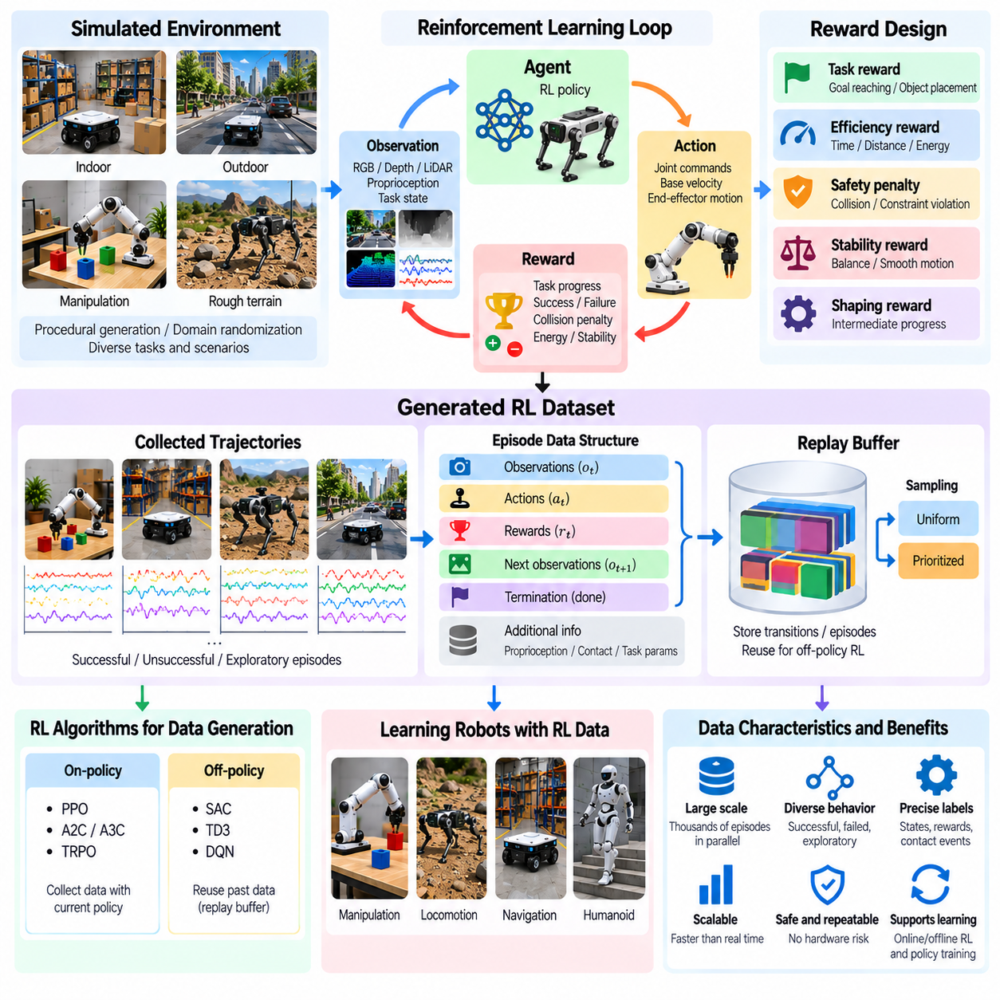{width="7.268055555555556in" height="7.268055555555556in"}

Reinforcement learning-generated data is a major component of simulation-driven data engines for Physical AI. Unlike expert demonstrations that provide predefined actions, reinforcement learning produces experience through interactions between an agent and its environment. The resulting datasets contain observations, actions, rewards, state transitions, and outcomes, capturing both successful behavior and the exploratory processes through which effective robot policies emerge.

In reinforcement learning, an agent repeatedly observes its environment, selects an action, and receives feedback through a reward signal. The environment transitions to a new state according to physical dynamics and interaction conditions. Each transition becomes a training sample that connects decisions with consequences. Simulation enables these interactions to occur repeatedly without exposing physical robots to excessive wear, damage, or operational risk.

A reinforcement learning dataset commonly consists of trajectories containing observations, actions, rewards, next observations, and termination indicators. Additional information may include privileged simulation states, task parameters, contact events, and policy identifiers. Recording these elements consistently supports policy optimization, offline reinforcement learning, behavioral analysis, and reproducible comparisons between training experiments.

Simulation provides a controlled environment for generating reinforcement learning experiences at scale. Thousands of robot instances can operate in parallel, each exploring different states and actions. Accelerated physics simulation may produce experience faster than real time, although achievable throughput depends on simulation fidelity and computational resources. This scalability makes reinforcement learning an important source of large-scale robot interaction data.

Reward design determines which behaviors the learning process encourages. Rewards may represent task completion, distance reduction, movement efficiency, stability, or successful object manipulation. Penalties may discourage collisions, excessive energy consumption, unsafe contact, or constraint violations. Poorly designed rewards can produce unintended strategies, making reward validation essential before collecting large datasets.

Sparse rewards provide feedback mainly when a task succeeds or fails, while dense rewards supply intermediate guidance during execution. Sparse rewards can preserve clear task objectives but often make exploration difficult. Dense rewards can accelerate learning but may introduce undesirable shortcuts. Simulation data engines should record reward components separately so that developers can investigate how individual incentives influence learned behavior.

Exploration is the mechanism through which reinforcement learning discovers unfamiliar states and potentially useful actions. Stochastic policies, action noise, entropy regularization, and structured exploration strategies encourage behavioral diversity. Generated data therefore includes both productive and unsuccessful experiences. These failures can be informative because they reveal unsafe configurations, ineffective actions, and regions where policy improvement is necessary.

On-policy reinforcement learning collects data using the current policy or a closely related version. Algorithms such as PPO repeatedly generate fresh trajectories and update the policy using recent experience. This approach supports stable policy improvement under appropriate conditions but can require substantial simulation interaction. Dataset records should preserve policy versions and collection conditions to maintain traceability.

Off-policy reinforcement learning can reuse transitions collected by earlier policies or other behavior-generating systems. Algorithms such as SAC and TD3 learn from replay buffers containing previous interactions. Reusing experience improves sample efficiency and allows data generated during different training stages to contribute to policy development. However, dataset coverage and behavior distribution strongly influence learning reliability.

Replay buffers are central storage components for reinforcement learning-generated data. They maintain transitions or trajectory segments that can be sampled during optimization. Uniform sampling provides broad reuse, while prioritized experience replay emphasizes transitions associated with larger learning errors. Effective buffer management must consider data freshness, diversity, storage capacity, and the risk of repeatedly sampling narrow experience distributions.

For robotic manipulation, reinforcement learning generates data through repeated attempts to reach, grasp, lift, move, and place objects. Policies experience different object configurations, contact conditions, and execution outcomes. These interactions can reveal manipulation strategies that are difficult to specify through handcrafted rules. Recording contact forces and failure events improves the usefulness of generated trajectories.

For legged and humanoid robots, reinforcement learning can generate extensive locomotion experiences involving balance, walking, turning, and disturbance recovery. Simulated agents encounter different terrain profiles, friction conditions, and external forces. Their trajectories contain joint states, actuator commands, contact patterns, and stability outcomes, supporting the development of policies capable of adapting to changing physical conditions.

Mobile robot reinforcement learning can generate navigation data involving obstacle avoidance, route selection, and local motion control. Procedurally generated environments expose policies to different corridor structures, moving obstacles, and destination configurations. Reward functions encourage progress while penalizing collisions or inefficient movement. These datasets help identify behaviors that remain effective under unfamiliar navigation conditions.

Curriculum learning can improve data generation by adjusting task difficulty according to policy performance. Initial episodes may involve simple environments and easily reachable objectives. As performance improves, the simulator introduces clutter, disturbances, tighter constraints, and more complex interactions. This progression increases the likelihood that collected experiences remain informative throughout different stages of learning.

Domain randomization expands reinforcement learning datasets by varying physical and environmental parameters. Robot mass, actuator strength, joint friction, sensor noise, terrain properties, and object characteristics may change across episodes. These variations encourage policies to tolerate uncertainty and reduce dependence on a single simulated configuration. Parameter ranges should be validated against plausible real-world conditions.

Reinforcement learning-generated data can include rare failures and recovery situations that are difficult to collect safely on physical hardware. Simulation can introduce sudden disturbances, unstable contacts, unexpected obstacles, or actuator degradation. The agent\'s responses provide information about recovery capabilities and failure boundaries. Safety constraints and evaluation procedures remain necessary before transferring such policies to real robots.

Multi-agent reinforcement learning extends experience generation to environments containing several interacting robots or autonomous entities. Agents may cooperate, compete, share resources, or navigate around one another. Their interactions create datasets describing coordination, communication, collision avoidance, and decentralized decision-making. Such data is valuable for warehouse fleets, traffic systems, and collaborative robotic operations.

Data quality cannot be measured solely by the number of simulated transitions. Large datasets may contain repetitive states, uninformative actions, or artifacts caused by unrealistic physics. Useful evaluation criteria include state-action coverage, task diversity, reward distributions, success rates, and failure characteristics. Filtering and balanced sampling can improve the information content of stored experiences.

The simulation-to-reality gap remains a major challenge for reinforcement learning-generated data. Policies may exploit numerical approximations, simplified contacts, or idealized sensing conditions that do not exist in physical environments. Real-world measurements should therefore guide simulator calibration, dynamics randomization, and policy evaluation. Successful simulated performance alone does not establish reliable physical deployment.

Offline reinforcement learning enables previously generated interaction datasets to train new policies without requiring continuous simulation access. This supports reuse of expensive experiences and comparisons among learning methods. However, policies may select actions poorly represented in the dataset, creating extrapolation errors. Dataset diversity, conservative learning methods, and careful evaluation are important for reliable offline policy development.

A scalable reinforcement learning data engine integrates environment generation, parallel simulation, policy execution, trajectory storage, reward analysis, and automated evaluation. Training outcomes can guide the creation of new scenarios that target weak behaviors or underrepresented states. By combining systematic exploration, physical realism, and feedback-driven data generation, reinforcement learning transforms simulated interaction into a continuously improving resource for Physical AI.

강화 학습 생성 데이터(Reinforcement Learning-Generated Data)는 피지컬 인공지능(Physical AI)을 위한 시뮬레이션 기반 데이터 엔진(Simulation-Driven Data Engine)의 주요 구성요소이다. 사전에 정의된 행동을 제공하는 전문가 시연(Expert Demonstration)과 달리, 강화 학습(Reinforcement Learning)은 에이전트(Agent)와 환경(Environment) 사이의 상호작용을 통해 경험 데이터(Experience Data)를 생성한다. 생성된 데이터셋(Dataset)은 관측값(Observation), 행동(Action), 보상(Reward), 상태 전이(State Transition), 결과(Outcome)를 포함하며, 성공적인 행동뿐만 아니라 효과적인 로봇 정책(Robot Policy)이 형성되는 탐색 과정(Exploration Process)도 포착한다.

강화 학습에서 에이전트는 환경을 반복적으로 관측하고 행동을 선택한 다음 보상 신호(Reward Signal)를 통해 피드백(Feedback)을 받는다. 환경은 물리적 동역학(Physical Dynamics)과 상호작용 조건(Interaction Condition)에 따라 새로운 상태로 전이된다. 각 상태 전이는 의사결정(Decision)과 그 결과(Consequence)를 연결하는 학습 샘플(Training Sample)이 된다. 시뮬레이션(Simulation)은 실제 로봇에 과도한 마모(Wear), 손상(Damage), 운영 위험(Operational Risk)을 발생시키지 않으면서 이러한 상호작용을 반복적으로 수행할 수 있도록 한다.

강화 학습 데이터셋(Reinforcement Learning Dataset)은 일반적으로 관측값, 행동, 보상, 다음 관측값(Next Observation), 종료 표시자(Termination Indicator)를 포함하는 궤적(Trajectory)으로 구성된다. 추가 정보에는 특권 시뮬레이션 상태(Privileged Simulation State), 작업 매개변수(Task Parameter), 접촉 사건(Contact Event), 정책 식별자(Policy Identifier)가 포함될 수 있다. 이러한 요소를 일관되게 기록하면 정책 최적화(Policy Optimization), 오프라인 강화 학습(Offline Reinforcement Learning), 행동 분석(Behavioral Analysis), 학습 실험(Training Experiment) 사이의 재현 가능한 비교를 지원할 수 있다.

시뮬레이션은 대규모 강화 학습 경험(Reinforcement Learning Experience)을 생성하기 위한 제어된 환경을 제공한다. 수천 개의 로봇 인스턴스(Robot Instance)가 병렬로 작동하면서 서로 다른 상태와 행동을 탐색할 수 있다. 가속 물리 시뮬레이션(Accelerated Physics Simulation)은 실제 시간(Real Time)보다 빠르게 경험 데이터를 생성할 수 있지만, 달성 가능한 처리량(Throughput)은 시뮬레이션 충실도(Simulation Fidelity)와 계산 자원(Computational Resource)에 따라 달라진다. 이러한 확장성(Scalability)은 강화 학습을 대규모 로봇 상호작용 데이터(Robot Interaction Data)의 중요한 공급원으로 만든다.

보상 설계(Reward Design)는 학습 과정에서 어떤 행동을 장려할지 결정한다. 보상은 작업 완료(Task Completion), 거리 감소(Distance Reduction), 이동 효율성(Movement Efficiency), 안정성(Stability), 성공적인 객체 조작(Successful Object Manipulation)을 나타낼 수 있다. 페널티(Penalty)는 충돌(Collision), 과도한 에너지 소비(Excessive Energy Consumption), 위험한 접촉(Unsafe Contact), 제약조건 위반(Constraint Violation)을 억제할 수 있다. 잘못 설계된 보상은 의도하지 않은 전략(Unintended Strategy)을 생성할 수 있으므로 대규모 데이터셋을 수집하기 전에 보상 검증(Reward Validation)이 필수적이다.

희소 보상(Sparse Reward)은 주로 작업의 성공 또는 실패 시점에 피드백을 제공하는 반면, 밀집 보상(Dense Reward)은 실행 과정에서 중간 단계의 지침(Intermediate Guidance)을 제공한다. 희소 보상은 명확한 작업 목표(Task Objective)를 유지할 수 있지만 탐색을 어렵게 만드는 경우가 많다. 밀집 보상은 학습을 가속할 수 있지만 바람직하지 않은 지름길 행동(Undesirable Shortcut)을 유발할 수 있다. 시뮬레이션 데이터 엔진은 개발자가 개별 유인 요소(Incentive)가 학습된 행동에 미치는 영향을 분석할 수 있도록 보상 구성요소(Reward Component)를 별도로 기록해야 한다.

탐색(Exploration)은 강화 학습이 익숙하지 않은 상태와 잠재적으로 유용한 행동을 발견하는 메커니즘이다. 확률적 정책(Stochastic Policy), 행동 잡음(Action Noise), 엔트로피 정규화(Entropy Regularization), 구조화된 탐색 전략(Structured Exploration Strategy)은 행동 다양성(Behavioral Diversity)을 촉진한다. 따라서 생성된 데이터에는 생산적인 경험(Productive Experience)과 실패한 경험(Unsuccessful Experience)이 모두 포함된다. 이러한 실패는 위험한 구성(Unsafe Configuration), 비효율적인 행동(Ineffective Action), 정책 개선(Policy Improvement)이 필요한 영역을 드러내므로 유용한 정보를 제공할 수 있다.

온정책 강화 학습(On-Policy Reinforcement Learning)은 현재 정책(Current Policy) 또는 이와 밀접하게 관련된 버전을 사용하여 데이터를 수집한다. PPO와 같은 알고리즘(Algorithm)은 새로운 궤적을 반복적으로 생성하고 최근 경험(Recent Experience)을 사용하여 정책을 갱신한다. 이러한 접근법은 적절한 조건에서 안정적인 정책 개선(Stable Policy Improvement)을 지원하지만 상당한 시뮬레이션 상호작용(Simulation Interaction)이 필요할 수 있다. 데이터셋 기록에는 추적 가능성(Traceability)을 유지하기 위해 정책 버전(Policy Version)과 수집 조건(Collection Condition)을 보존해야 한다.

오프정책 강화 학습(Off-Policy Reinforcement Learning)은 이전 정책(Earlier Policy)이나 다른 행동 생성 시스템(Behavior-Generating System)이 수집한 상태 전이를 재사용할 수 있다. SAC와 TD3 같은 알고리즘은 이전 상호작용을 저장한 리플레이 버퍼(Replay Buffer)에서 학습한다. 경험 재사용(Experience Reuse)은 샘플 효율성(Sample Efficiency)을 향상시키고 서로 다른 학습 단계(Training Stage)에서 생성된 데이터가 정책 개발에 기여하도록 한다. 그러나 데이터셋 적용 범위(Dataset Coverage)와 행동 분포(Behavior Distribution)는 학습 신뢰성(Learning Reliability)에 큰 영향을 미친다.

리플레이 버퍼(Replay Buffer)는 강화 학습 생성 데이터를 위한 핵심 저장 구성요소(Storage Component)이다. 리플레이 버퍼는 최적화(Optimization) 과정에서 샘플링할 수 있는 상태 전이 또는 궤적 구간(Trajectory Segment)을 유지한다. 균등 샘플링(Uniform Sampling)은 폭넓은 재사용을 제공하며, 우선순위 경험 재생(Prioritized Experience Replay)은 학습 오차(Learning Error)가 큰 상태 전이를 강조한다. 효과적인 버퍼 관리(Buffer Management)는 데이터 최신성(Data Freshness), 다양성(Diversity), 저장 용량(Storage Capacity), 제한된 경험 분포를 반복적으로 샘플링할 위험을 고려해야 한다.

로봇 조작(Robotic Manipulation)에서 강화 학습은 객체에 도달하고, 파지하고, 들어 올리고, 이동시키고, 배치하는 반복적인 시도를 통해 데이터를 생성한다. 정책은 서로 다른 객체 구성(Object Configuration), 접촉 조건(Contact Condition), 실행 결과(Execution Outcome)를 경험한다. 이러한 상호작용은 수작업 규칙(Handcrafted Rule)으로 명시하기 어려운 조작 전략(Manipulation Strategy)을 발견할 수 있다. 접촉력(Contact Force)과 실패 사건(Failure Event)을 기록하면 생성된 궤적의 유용성이 향상된다.

다족보행 및 휴머노이드 로봇(Legged and Humanoid Robot)의 경우 강화 학습은 균형 유지(Balance), 보행(Walking), 회전(Turning), 외란 복구(Disturbance Recovery)를 포함하는 광범위한 이동 경험(Locomotion Experience)을 생성할 수 있다. 시뮬레이션 에이전트는 다양한 지형 형상(Terrain Profile), 마찰 조건(Friction Condition), 외력(External Force)을 경험한다. 생성된 궤적에는 관절 상태(Joint State), 구동기 명령(Actuator Command), 접촉 패턴(Contact Pattern), 안정성 결과(Stability Outcome)가 포함되며, 변화하는 물리적 조건에 적응할 수 있는 정책 개발을 지원한다.

이동 로봇 강화 학습(Mobile Robot Reinforcement Learning)은 장애물 회피(Obstacle Avoidance), 경로 선택(Route Selection), 지역 운동 제어(Local Motion Control)를 포함하는 내비게이션 데이터(Navigation Data)를 생성할 수 있다. 절차적으로 생성된 환경(Procedurally Generated Environment)은 정책을 서로 다른 복도 구조(Corridor Structure), 이동 장애물(Moving Obstacle), 목적지 구성(Destination Configuration)에 노출시킨다. 보상 함수(Reward Function)는 진행(Progress)을 장려하면서 충돌이나 비효율적인 이동을 억제한다. 이러한 데이터셋은 익숙하지 않은 내비게이션 조건에서도 효과적인 행동을 식별하는 데 도움이 된다.

커리큘럼 학습(Curriculum Learning)은 정책 성능(Policy Performance)에 따라 작업 난이도(Task Difficulty)를 조정하여 데이터 생성을 개선할 수 있다. 초기 에피소드(Initial Episode)는 단순한 환경과 쉽게 도달할 수 있는 목표(Easily Reachable Objective)를 포함할 수 있다. 성능이 향상되면 시뮬레이터는 복잡한 장애물 배치(Clutter), 외란(Disturbance), 더욱 엄격한 제약조건(Tighter Constraint), 복잡한 상호작용(Complex Interaction)을 도입한다. 이러한 단계적 진행(Progression)은 학습의 여러 단계에서 수집된 경험이 지속적으로 유용한 정보를 제공할 가능성을 높인다.

도메인 무작위화(Domain Randomization)는 물리적 및 환경적 매개변수(Physical and Environmental Parameter)를 변화시켜 강화 학습 데이터셋의 다양성을 확대한다. 로봇 질량(Robot Mass), 구동기 출력(Actuator Strength), 관절 마찰(Joint Friction), 센서 잡음(Sensor Noise), 지형 특성(Terrain Property), 객체 특성(Object Characteristic)은 에피소드마다 달라질 수 있다. 이러한 변화는 정책이 불확실성을 견디도록 장려하고 단일 시뮬레이션 구성(Simulated Configuration)에 대한 의존성을 줄인다. 매개변수 범위(Parameter Range)는 현실적으로 가능한 조건에 따라 검증해야 한다.

강화 학습 생성 데이터에는 실제 하드웨어(Physical Hardware)에서 안전하게 수집하기 어려운 희귀 실패(Rare Failure)와 복구 상황(Recovery Situation)이 포함될 수 있다. 시뮬레이션은 갑작스러운 외란(Sudden Disturbance), 불안정한 접촉(Unstable Contact), 예상하지 못한 장애물(Unexpected Obstacle), 구동기 성능 저하(Actuator Degradation)를 도입할 수 있다. 에이전트의 반응은 복구 능력(Recovery Capability)과 실패 경계(Failure Boundary)에 관한 정보를 제공한다. 이러한 정책을 실제 로봇에 전이하기 전에는 안전 제약조건(Safety Constraint)과 평가 절차(Evaluation Procedure)가 여전히 필요하다.

다중 에이전트 강화 학습(Multi-Agent Reinforcement Learning)은 여러 로봇이나 자율 개체(Autonomous Entity)가 상호작용하는 환경으로 경험 데이터 생성을 확장한다. 에이전트는 협력(Cooperation), 경쟁(Competition), 자원 공유(Resource Sharing), 상호 회피(Navigation Around One Another)를 수행할 수 있다. 이러한 상호작용은 협응(Coordination), 통신(Communication), 충돌 회피(Collision Avoidance), 분산형 의사결정(Decentralized Decision-Making)을 설명하는 데이터셋을 생성한다. 이러한 데이터는 창고 로봇 군집(Warehouse Fleet), 교통 시스템(Traffic System), 협업 로봇 운영(Collaborative Robotic Operation)에 유용하다.

데이터 품질(Data Quality)은 시뮬레이션된 상태 전이(Simulated Transition)의 수만으로 측정할 수 없다. 대규모 데이터셋에는 반복적인 상태(Repetitive State), 정보 가치가 낮은 행동(Uninformative Action), 비현실적인 물리 모델(Unrealistic Physics)로 인해 발생한 인공적 현상(Artifact)이 포함될 수 있다. 유용한 평가 기준(Evaluation Criterion)에는 상태-행동 적용 범위(State-Action Coverage), 작업 다양성(Task Diversity), 보상 분포(Reward Distribution), 성공률(Success Rate), 실패 특성(Failure Characteristic)이 포함된다. 필터링(Filtering)과 균형 샘플링(Balanced Sampling)은 저장된 경험의 정보량(Information Content)을 향상시킬 수 있다.

시뮬레이션과 현실 사이의 격차(Simulation-to-Reality Gap)는 강화 학습 생성 데이터의 주요 과제로 남아 있다. 정책은 실제 물리 환경(Physical Environment)에 존재하지 않는 수치적 근사(Numerical Approximation), 단순화된 접촉(Simplified Contact), 이상화된 센싱 조건(Idealized Sensing Condition)을 이용할 수 있다. 따라서 실제 측정값(Real-World Measurement)을 활용하여 시뮬레이터 보정(Simulator Calibration), 동역학 무작위화(Dynamics Randomization), 정책 평가(Policy Evaluation)를 수행해야 한다. 시뮬레이션에서의 성공적인 성능만으로 실제 물리 환경에서의 신뢰할 수 있는 배포(Reliable Physical Deployment)가 입증되는 것은 아니다.

오프라인 강화 학습(Offline Reinforcement Learning)은 이전에 생성된 상호작용 데이터셋(Interaction Dataset)을 사용하여 지속적인 시뮬레이션 접근(Continuous Simulation Access) 없이 새로운 정책을 학습할 수 있도록 한다. 이는 비용이 많이 드는 경험 데이터(Expensive Experience)의 재사용과 학습 방법(Learning Method) 사이의 비교를 지원한다. 그러나 정책이 데이터셋에서 충분히 표현되지 않은 행동을 선택하면 외삽 오차(Extrapolation Error)가 발생할 수 있다. 신뢰할 수 있는 오프라인 정책 개발(Offline Policy Development)을 위해서는 데이터셋 다양성(Dataset Diversity), 보수적 학습 방법(Conservative Learning Method), 신중한 평가(Careful Evaluation)가 중요하다.

확장 가능한 강화 학습 데이터 엔진(Scalable Reinforcement Learning Data Engine)은 환경 생성(Environment Generation), 병렬 시뮬레이션(Parallel Simulation), 정책 실행(Policy Execution), 궤적 저장(Trajectory Storage), 보상 분석(Reward Analysis), 자동화된 평가(Automated Evaluation)를 통합한다. 학습 결과(Training Outcome)는 취약한 행동(Weak Behavior)이나 충분히 표현되지 않은 상태(Underrepresented State)를 대상으로 새로운 시나리오를 생성하도록 안내할 수 있다. 체계적인 탐색(Systematic Exploration), 물리적 현실성(Physical Realism), 피드백 기반 데이터 생성(Feedback-Driven Data Generation)을 결합함으로써 강화 학습은 시뮬레이션 상호작용을 피지컬 인공지능을 위한 지속적으로 개선되는 자원(Continuously Improving Resource)으로 변환한다.

##  

## 04.08. Random Exploration and Curriculum Data

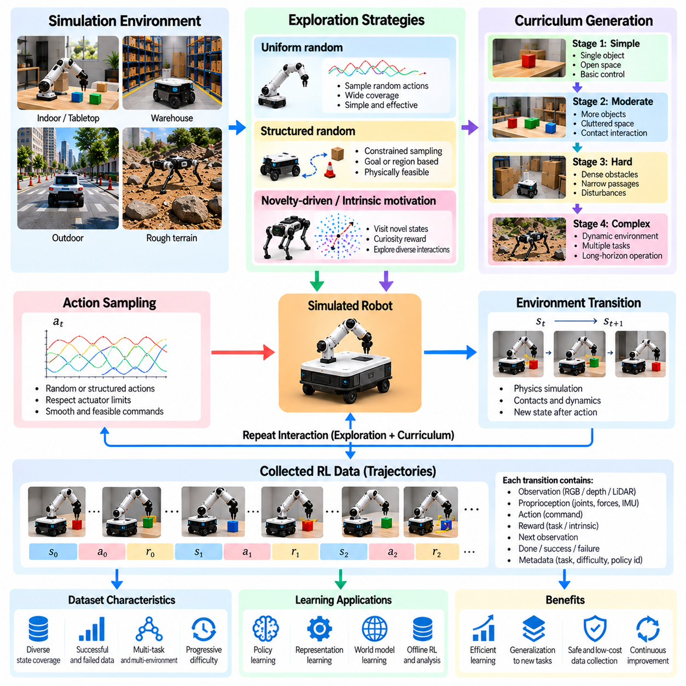{width="7.268055555555556in" height="7.268055555555556in"}

Random exploration and curriculum data generation are complementary approaches for expanding the diversity and learning value of simulation datasets in Physical AI. Random exploration exposes robots to unfamiliar states and interactions without requiring predefined expert behavior. Curriculum generation organizes experiences according to difficulty and learning progress. Together, these methods support broad behavioral coverage and more efficient acquisition of complex robotic skills.

Random exploration generates experience by selecting actions from predefined probability distributions or stochastic policies. The resulting trajectories contain observations, actions, state transitions, and interaction outcomes. Although many actions may not directly accomplish a task, they reveal how robot dynamics and environmental conditions influence behavior. Such data is valuable for learning general representations of physical interaction.

Uniform random action sampling is the simplest exploration strategy, but its effectiveness depends strongly on the action space. Independently sampling every actuator command may produce unstable or repetitive movements. For articulated robots, correlated action sequences and bounded control signals often generate more meaningful trajectories. Exploration policies should therefore consider actuator limits, motion continuity, and physical feasibility.

Structured random exploration introduces constraints that guide behavior without specifying complete solutions. A mobile robot may sample reachable navigation goals, while a manipulator may explore different end-effector positions or contact configurations. These strategies preserve behavioral diversity while increasing the probability of useful interactions. They also reduce the computational resources spent on physically impossible or uninformative actions.

Exploration data is particularly useful when task objectives are not fully defined. By collecting diverse interactions before training a specialized policy, data engines can construct reusable datasets for representation learning, dynamics prediction, and future task adaptation. This approach separates the acquisition of general physical experience from the optimization of individual tasks, potentially reducing repeated data collection.

State-space coverage is a central objective of random exploration. A useful dataset should represent different robot configurations, object relationships, contact states, and environmental conditions. However, uniform coverage of high-dimensional state spaces is generally impractical. Coverage metrics and novelty estimators can identify underexplored regions and guide subsequent sampling toward more informative experiences.

Novelty-driven exploration encourages agents to visit states that differ from previously observed experiences. Novelty may be estimated through state visitation counts, prediction errors, learned embeddings, or density models. Such methods can improve exploration efficiency compared with purely random actions. Nevertheless, novelty does not always imply usefulness, so exploration objectives should consider task relevance and physical validity.

Intrinsic motivation provides another mechanism for generating diverse experience. Curiosity-based agents receive internal rewards for encountering unpredictable or informative transitions. This encourages interaction with objects, surfaces, and dynamic environments even when external task rewards are unavailable. Careful design is necessary because unpredictable sensor noise or simulation artifacts may attract exploration without producing meaningful knowledge.

Curriculum learning organizes training experiences from relatively simple conditions toward more demanding situations. Initial scenarios may involve isolated objects, open navigation spaces, or stable robot configurations. Later stages introduce clutter, disturbances, contact complexity, and tighter task constraints. This progression allows learning systems to acquire foundational behaviors before confronting difficult combinations of physical challenges.

A curriculum can be defined manually using engineering knowledge or generated automatically from performance measurements. Manual curricula specify difficulty stages according to task characteristics. Adaptive curricula modify environment parameters based on observed success rates, learning progress, or failure patterns. Both approaches aim to maintain training experiences that are challenging enough to improve performance without becoming consistently unsolvable.

Difficulty is multidimensional rather than a single numerical property. Navigation difficulty may depend on obstacle density, passage width, route length, and moving-agent behavior. Manipulation difficulty may involve object geometry, grasp accessibility, friction, and placement tolerance. Effective curriculum generation changes these factors systematically while preserving the ability to identify which conditions influence learning outcomes.

Competence-based curriculum generation adjusts tasks according to the robot\'s demonstrated abilities. When a policy consistently succeeds, the system can increase complexity or introduce new variations. When performance declines substantially, the curriculum may temporarily reduce difficulty or revisit foundational skills. Such adaptation can improve learning efficiency, although overly restrictive progression may limit exposure to valuable challenging experiences.

Automatic curriculum generation may also use learning progress as a scheduling signal. Tasks producing measurable improvement receive greater sampling priority, while tasks that are already mastered or remain consistently impossible receive less emphasis. This creates a dynamic allocation of simulation resources. Reliable progress estimation requires sufficient evaluation data because short-term performance fluctuations can otherwise distort curriculum decisions.

Random exploration and curriculum learning can be integrated within the same generation pipeline. Randomized actions produce behavioral diversity inside environments selected by a curriculum controller. The controller determines which scenarios and difficulty levels should be sampled, while exploration policies determine how agents interact with them. This combination balances broad discovery with structured progression toward increasingly complex capabilities.

Procedural environment generation strengthens both approaches by creating controlled variations in geometry, object placement, and physical properties. A curriculum may gradually increase obstacle density while random exploration discovers different navigation behaviors within each environment. Similarly, manipulation scenarios may vary object orientation and contact conditions while preserving task feasibility. These combinations produce diverse yet interpretable training data.

Safety constraints remain important even when exploration occurs entirely in simulation. Unrestricted actions may generate physically meaningless states, numerical instability, or trajectories that cannot be executed on real hardware. Joint limits, actuator saturation, collision constraints, and stability conditions should be represented appropriately. Safety-aware exploration can preserve informative failures without relying on unrealistic physical behavior.

Failure data contributes significantly to learning because it identifies the boundaries of successful behavior. Random exploration may reveal unexpected collisions, unstable contacts, or ineffective control sequences. Curriculum generation can reproduce these situations with controlled variations to support recovery learning. Recording failure causes and subsequent actions helps distinguish useful challenging experiences from simulation errors or invalid scenarios.

Temporal diversity is another important consideration. Randomly sampled actions at every simulation step may create high-frequency command changes that are unsuitable for physical robots. Temporally correlated exploration, action smoothing, and variable-duration commands produce more realistic behavior. Curriculum schedules can also vary interaction duration, requiring policies to manage longer tasks and delayed consequences as their capabilities improve.

Dataset management should preserve the context under which exploration and curriculum experiences were generated. Records may include random seeds, policy versions, action distributions, environment parameters, difficulty levels, and performance metrics. This metadata enables reproducibility, supports analysis of training progression, and allows developers to distinguish changes caused by policy improvement from changes in scenario difficulty.

Data quality evaluation should examine state-action diversity, task coverage, physical validity, and learning utility. Large quantities of random transitions do not necessarily provide useful information if they repeatedly visit similar states. Curriculum datasets may also become biased toward frequently selected difficulty levels. Balanced sampling, coverage analysis, and periodic evaluation on fixed benchmark scenarios help identify these limitations.

A scalable Physical AI data engine combines random exploration, adaptive curricula, procedural environments, and feedback-driven sampling into a unified experience generation process. Exploration discovers unfamiliar interactions, curricula organize learning challenges, and evaluation identifies remaining weaknesses. By coordinating these mechanisms, simulation systems can generate diverse, physically meaningful data that supports efficient learning and generalization across robotic tasks.

무작위 탐색 및 커리큘럼 데이터 생성(Random Exploration and Curriculum Data Generation)은 피지컬 인공지능(Physical AI)의 시뮬레이션 데이터셋(Simulation Dataset)에서 다양성과 학습 가치를 확대하기 위한 상호 보완적인 접근법이다. 무작위 탐색(Random Exploration)은 사전에 정의된 전문가 행동(Expert Behavior) 없이 로봇을 익숙하지 않은 상태와 상호작용에 노출시킨다. 커리큘럼 생성(Curriculum Generation)은 난이도(Difficulty)와 학습 진행 상황(Learning Progress)에 따라 경험을 체계적으로 구성한다. 이러한 방법을 결합하면 폭넓은 행동 적용 범위(Behavioral Coverage)와 복잡한 로봇 기술(Robotic Skill)의 효율적인 습득을 지원할 수 있다.

무작위 탐색은 사전에 정의된 확률 분포(Probability Distribution)나 확률적 정책(Stochastic Policy)에서 행동을 선택하여 경험을 생성한다. 생성된 궤적(Trajectory)에는 관측값(Observation), 행동(Action), 상태 전이(State Transition), 상호작용 결과(Interaction Outcome)가 포함된다. 많은 행동이 작업을 직접 완료하지 못하더라도 로봇 동역학(Robot Dynamics)과 환경 조건(Environmental Condition)이 행동에 어떤 영향을 미치는지 보여준다. 이러한 데이터는 물리적 상호작용(Physical Interaction)에 대한 일반적인 표현 학습(Representation Learning)에 유용하다.

균등 무작위 행동 샘플링(Uniform Random Action Sampling)은 가장 단순한 탐색 전략(Exploration Strategy)이지만, 그 효과는 행동 공간(Action Space)에 크게 의존한다. 모든 구동기 명령(Actuator Command)을 독립적으로 샘플링하면 불안정하거나 반복적인 움직임이 발생할 수 있다. 다관절 로봇(Articulated Robot)의 경우 시간적으로 연관된 행동 시퀀스(Correlated Action Sequence)와 범위가 제한된 제어 신호(Bounded Control Signal)가 더 의미 있는 궤적을 생성하는 경우가 많다. 따라서 탐색 정책(Exploration Policy)은 구동기 한계(Actuator Limit), 운동 연속성(Motion Continuity), 물리적 실행 가능성(Physical Feasibility)을 고려해야 한다.

구조화된 무작위 탐색(Structured Random Exploration)은 완전한 해법을 지정하지 않으면서 행동을 유도하는 제약조건(Constraint)을 도입한다. 이동 로봇(Mobile Robot)은 도달 가능한 내비게이션 목표(Reachable Navigation Goal)를 샘플링할 수 있으며, 매니퓰레이터(Manipulator)는 다양한 말단효과기 위치(End-Effector Position)나 접촉 구성(Contact Configuration)을 탐색할 수 있다. 이러한 전략은 행동 다양성(Behavioral Diversity)을 유지하면서 유용한 상호작용이 발생할 가능성을 높인다. 또한 물리적으로 불가능하거나 정보 가치가 낮은 행동에 소비되는 계산 자원(Computational Resource)을 줄인다.

탐색 데이터(Exploration Data)는 작업 목표(Task Objective)가 완전히 정의되지 않은 경우에 특히 유용하다. 특화된 정책(Specialized Policy)을 학습하기 전에 다양한 상호작용을 수집함으로써 데이터 엔진(Data Engine)은 표현 학습(Representation Learning), 동역학 예측(Dynamics Prediction), 향후 작업 적응(Future Task Adaptation)을 위한 재사용 가능한 데이터셋(Reusable Dataset)을 구축할 수 있다. 이러한 접근법은 일반적인 물리 경험(General Physical Experience)의 획득과 개별 작업 최적화(Individual Task Optimization)를 분리하여 반복적인 데이터 수집의 필요성을 줄일 수 있다.

상태 공간 적용 범위(State-Space Coverage)는 무작위 탐색의 핵심 목표이다. 유용한 데이터셋은 서로 다른 로봇 구성(Robot Configuration), 객체 관계(Object Relationship), 접촉 상태(Contact State), 환경 조건(Environmental Condition)을 표현해야 한다. 그러나 고차원 상태 공간(High-Dimensional State Space)을 균등하게 탐색하는 것은 일반적으로 비현실적이다. 적용 범위 지표(Coverage Metric)와 신규성 추정기(Novelty Estimator)는 충분히 탐색되지 않은 영역(Underexplored Region)을 식별하고 이후 샘플링을 더욱 유익한 경험으로 유도할 수 있다.

신규성 기반 탐색(Novelty-Driven Exploration)은 에이전트(Agent)가 이전에 관측한 경험과 다른 상태를 방문하도록 장려한다. 신규성(Novelty)은 상태 방문 횟수(State Visitation Count), 예측 오차(Prediction Error), 학습된 임베딩(Learned Embedding), 밀도 모델(Density Model)을 통해 추정할 수 있다. 이러한 방법은 순수한 무작위 행동(Purely Random Action)보다 탐색 효율성(Exploration Efficiency)을 높일 수 있다. 그러나 신규성이 반드시 유용성을 의미하는 것은 아니므로 탐색 목표(Exploration Objective)는 작업 관련성(Task Relevance)과 물리적 유효성(Physical Validity)을 함께 고려해야 한다.

내재적 동기(Intrinsic Motivation)는 다양한 경험을 생성하기 위한 또 다른 메커니즘을 제공한다. 호기심 기반 에이전트(Curiosity-Based Agent)는 예측하기 어렵거나 유익한 상태 전이(Informative Transition)를 경험할 때 내부 보상(Internal Reward)을 받는다. 이는 외부 작업 보상(External Task Reward)이 없는 상황에서도 객체, 표면, 동적 환경(Dynamic Environment)과의 상호작용을 장려한다. 그러나 예측하기 어려운 센서 잡음(Sensor Noise)이나 시뮬레이션 인공 현상(Simulation Artifact)이 의미 있는 지식을 생성하지 않으면서 탐색을 유도할 수 있으므로 신중한 설계가 필요하다.

커리큘럼 학습(Curriculum Learning)은 비교적 단순한 조건에서 더욱 어려운 상황으로 학습 경험(Training Experience)을 구성한다. 초기 시나리오(Initial Scenario)는 분리된 객체(Isolated Object), 개방된 내비게이션 공간(Open Navigation Space), 안정적인 로봇 구성(Stable Robot Configuration)을 포함할 수 있다. 이후 단계에서는 복잡한 장애물 배치(Clutter), 외란(Disturbance), 접촉 복잡성(Contact Complexity), 더욱 엄격한 작업 제약조건(Task Constraint)을 도입한다. 이러한 단계적 진행(Progression)은 학습 시스템이 복잡한 물리적 과제에 직면하기 전에 기초 행동(Foundational Behavior)을 습득하도록 한다.

커리큘럼(Curriculum)은 공학적 지식(Engineering Knowledge)을 사용하여 수동으로 정의하거나 성능 측정값(Performance Measurement)을 기반으로 자동 생성할 수 있다. 수동 커리큘럼(Manual Curriculum)은 작업 특성(Task Characteristic)에 따라 난이도 단계(Difficulty Stage)를 지정한다. 적응형 커리큘럼(Adaptive Curriculum)은 관측된 성공률(Success Rate), 학습 진행 상황(Learning Progress), 실패 패턴(Failure Pattern)에 따라 환경 매개변수(Environment Parameter)를 변경한다. 두 접근법 모두 지속적으로 해결할 수 없을 정도로 어렵지는 않으면서 성능 향상에 충분한 도전성을 제공하는 학습 경험을 유지하는 것을 목표로 한다.

난이도(Difficulty)는 단일 수치 속성이 아니라 다차원적 특성(Multidimensional Property)이다. 내비게이션 난이도(Navigation Difficulty)는 장애물 밀도(Obstacle Density), 통로 폭(Passage Width), 경로 길이(Route Length), 이동 에이전트 행동(Moving-Agent Behavior)에 따라 달라질 수 있다. 조작 난이도(Manipulation Difficulty)는 객체 형상(Object Geometry), 파지 접근성(Grasp Accessibility), 마찰(Friction), 배치 허용오차(Placement Tolerance)를 포함할 수 있다. 효과적인 커리큘럼 생성은 어떤 조건이 학습 결과(Learning Outcome)에 영향을 미치는지 식별할 수 있도록 이러한 요소를 체계적으로 변경한다.

역량 기반 커리큘럼 생성(Competence-Based Curriculum Generation)은 로봇이 입증한 능력(Demonstrated Ability)에 따라 작업을 조정한다. 정책(Policy)이 지속적으로 성공하면 시스템은 복잡도를 높이거나 새로운 변형(Variation)을 도입할 수 있다. 성능이 크게 저하되면 커리큘럼은 일시적으로 난이도를 낮추거나 기초 기술(Foundational Skill)을 다시 학습하도록 할 수 있다. 이러한 적응은 학습 효율성(Learning Efficiency)을 향상시킬 수 있지만, 지나치게 제한적인 진행은 가치 있는 고난도 경험(Challenging Experience)에 대한 노출을 줄일 수 있다.

자동 커리큘럼 생성(Automatic Curriculum Generation)은 학습 진행도(Learning Progress)를 일정 조정 신호(Scheduling Signal)로 사용할 수도 있다. 측정 가능한 성능 향상을 생성하는 작업에는 더 높은 샘플링 우선순위(Sampling Priority)를 부여하고, 이미 숙달했거나 지속적으로 해결할 수 없는 작업에는 낮은 우선순위를 부여한다. 이를 통해 시뮬레이션 자원(Simulation Resource)을 동적으로 할당할 수 있다. 단기적인 성능 변동(Short-Term Performance Fluctuation)이 커리큘럼 의사결정(Curriculum Decision)을 왜곡할 수 있으므로 신뢰할 수 있는 진행도 추정(Progress Estimation)을 위해서는 충분한 평가 데이터(Evaluation Data)가 필요하다.

무작위 탐색과 커리큘럼 학습은 동일한 데이터 생성 파이프라인(Data Generation Pipeline) 안에서 통합할 수 있다. 무작위화된 행동(Randomized Action)은 커리큘럼 제어기(Curriculum Controller)가 선택한 환경 내부에서 행동 다양성을 생성한다. 커리큘럼 제어기는 어떤 시나리오(Scenario)와 난이도 수준(Difficulty Level)을 샘플링할지 결정하고, 탐색 정책은 에이전트가 해당 환경과 어떻게 상호작용할지 결정한다. 이러한 결합은 폭넓은 발견(Broad Discovery)과 점차 복잡해지는 능력(Capability)을 향한 구조화된 진행(Structured Progression) 사이의 균형을 유지한다.

절차적 환경 생성(Procedural Environment Generation)은 기하학적 구조(Geometry), 객체 배치(Object Placement), 물리적 특성(Physical Property)에 제어된 변화(Controlled Variation)를 제공하여 두 접근법을 강화한다. 커리큘럼은 장애물 밀도를 점진적으로 증가시키는 동안 무작위 탐색을 통해 각 환경에서 다양한 내비게이션 행동(Navigation Behavior)을 발견할 수 있다. 마찬가지로 조작 시나리오(Manipulation Scenario)는 작업 실행 가능성(Task Feasibility)을 유지하면서 객체 방향(Object Orientation)과 접촉 조건(Contact Condition)을 변화시킬 수 있다. 이러한 조합은 다양하면서도 해석 가능한 학습 데이터(Interpretable Training Data)를 생성한다.

탐색이 전적으로 시뮬레이션에서 이루어지더라도 안전 제약조건(Safety Constraint)은 여전히 중요하다. 제한 없는 행동(Unrestricted Action)은 물리적으로 의미 없는 상태(Physically Meaningless State), 수치적 불안정성(Numerical Instability), 실제 하드웨어에서 실행할 수 없는 궤적(Trajectory)을 생성할 수 있다. 관절 한계(Joint Limit), 구동기 포화(Actuator Saturation), 충돌 제약조건(Collision Constraint), 안정성 조건(Stability Condition)을 적절하게 표현해야 한다. 안전 인식 탐색(Safety-Aware Exploration)은 비현실적인 물리적 행동에 의존하지 않으면서도 유익한 실패 경험(Informative Failure)을 유지할 수 있다.

실패 데이터(Failure Data)는 성공적인 행동의 경계(Boundary of Successful Behavior)를 식별하기 때문에 학습에 크게 기여한다. 무작위 탐색은 예상하지 못한 충돌(Unexpected Collision), 불안정한 접촉(Unstable Contact), 비효율적인 제어 시퀀스(Ineffective Control Sequence)를 드러낼 수 있다. 커리큘럼 생성은 복구 학습(Recovery Learning)을 지원하기 위해 이러한 상황을 제어된 변화와 함께 재현할 수 있다. 실패 원인(Failure Cause)과 이후 행동(Subsequent Action)을 기록하면 유용한 고난도 경험을 시뮬레이션 오류(Simulation Error)나 유효하지 않은 시나리오(Invalid Scenario)와 구분하는 데 도움이 된다.

시간적 다양성(Temporal Diversity)도 중요한 고려사항이다. 모든 시뮬레이션 단계(Simulation Step)에서 무작위로 행동을 샘플링하면 실제 로봇에 적합하지 않은 고주파 명령 변화(High-Frequency Command Change)가 발생할 수 있다. 시간적으로 상관된 탐색(Temporally Correlated Exploration), 행동 평활화(Action Smoothing), 가변 지속시간 명령(Variable-Duration Command)은 더욱 현실적인 행동을 생성한다. 커리큘럼 일정(Curriculum Schedule)은 상호작용 지속시간(Interaction Duration)도 변화시켜 정책의 능력이 향상됨에 따라 더 긴 작업(Longer Task)과 지연된 결과(Delayed Consequence)를 처리하도록 요구할 수 있다.

데이터셋 관리(Dataset Management)는 탐색 및 커리큘럼 경험이 생성된 맥락(Context)을 보존해야 한다. 기록에는 난수 시드(Random Seed), 정책 버전(Policy Version), 행동 분포(Action Distribution), 환경 매개변수(Environment Parameter), 난이도 수준(Difficulty Level), 성능 지표(Performance Metric)가 포함될 수 있다. 이러한 메타데이터(Metadata)는 재현성(Reproducibility)을 확보하고 학습 진행 분석(Training Progression Analysis)을 지원하며, 개발자가 정책 개선으로 인한 변화와 시나리오 난이도 변화로 인한 결과를 구분하도록 한다.

데이터 품질 평가(Data Quality Evaluation)는 상태-행동 다양성(State-Action Diversity), 작업 적용 범위(Task Coverage), 물리적 유효성(Physical Validity), 학습 유용성(Learning Utility)을 검토해야 한다. 많은 양의 무작위 상태 전이(Random Transition)도 유사한 상태를 반복적으로 방문한다면 반드시 유용한 정보를 제공하지는 않는다. 커리큘럼 데이터셋(Curriculum Dataset) 역시 자주 선택되는 난이도 수준에 편향(Bias)될 수 있다. 균형 샘플링(Balanced Sampling), 적용 범위 분석(Coverage Analysis), 고정된 벤치마크 시나리오(Fixed Benchmark Scenario)에 대한 주기적 평가(Periodic Evaluation)는 이러한 한계를 식별하는 데 도움이 된다.

확장 가능한 피지컬 인공지능 데이터 엔진(Scalable Physical AI Data Engine)은 무작위 탐색(Random Exploration), 적응형 커리큘럼(Adaptive Curriculum), 절차적 환경(Procedural Environment), 피드백 기반 샘플링(Feedback-Driven Sampling)을 통합된 경험 생성 과정(Unified Experience Generation Process)으로 결합한다. 탐색은 익숙하지 않은 상호작용을 발견하고, 커리큘럼은 학습 과제(Learning Challenge)를 체계적으로 구성하며, 평가는 남아 있는 취약점(Remaining Weakness)을 식별한다. 이러한 메커니즘을 조정함으로써 시뮬레이션 시스템은 다양한 로봇 작업에서 효율적인 학습과 일반화(Generalization)를 지원하는 물리적으로 의미 있는 데이터(Physically Meaningful Data)를 생성할 수 있다.

##  

## 04.09. Domain Randomization for Data Generation

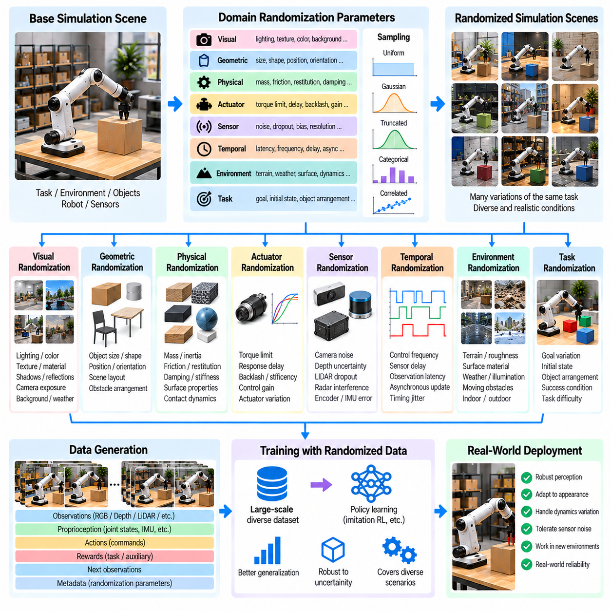{width="7.268055555555556in" height="7.268055555555556in"}

Domain randomization is a fundamental technique for generating diverse simulation datasets that improve the robustness and generalization of Physical AI systems. Instead of training robots under a single fixed environment configuration, domain randomization systematically varies visual, physical, and operational parameters. The resulting experiences expose learning algorithms to uncertainty and help reduce dependence on assumptions that may not hold in real-world deployment.

The central objective of domain randomization is to represent a distribution of plausible environments rather than reproduce one idealized scenario. Simulation parameters are sampled from predefined ranges or probability distributions before or during training episodes. These variations create multiple versions of similar tasks, allowing robots to experience changing conditions while preserving the underlying objectives and essential physical relationships.

Visual domain randomization modifies the appearance of simulated scenes without necessarily changing their physical structure. Lighting intensity, color, texture, material reflectance, shadows, and background appearance can vary between episodes. Camera exposure, white balance, and image noise may also be randomized. Such variations discourage vision models from relying on superficial visual features that are unlikely to remain consistent across environments.

Geometric randomization changes object dimensions, shapes, positions, orientations, and spatial arrangements. A manipulation dataset may contain objects with different sizes and graspable surfaces, while navigation datasets may include varying corridor widths and obstacle placements. These modifications broaden spatial experience and help learning systems recognize task-relevant relationships across different geometric configurations.

Physical domain randomization modifies parameters that determine how simulated objects and robots move or interact. Mass, inertia, friction, restitution, damping, and joint stiffness may be sampled across realistic ranges. Changes in these properties influence acceleration, contact behavior, and stability. Training under multiple physical configurations can improve tolerance to modeling uncertainty and variations between manufactured robot units.

Actuator randomization represents uncertainty in motors, transmissions, and control interfaces. Torque limits, response delays, backlash, control gains, and actuator efficiency may vary across simulated episodes. These factors influence how commanded actions translate into actual motion. Including actuator variability helps policies accommodate imperfect control execution, although sampled parameters must remain consistent with feasible hardware behavior.

Sensor randomization addresses differences between simulated observations and measurements from physical devices. Camera noise, depth uncertainty, LiDAR dropout, radar interference, encoder errors, and inertial measurement drift can be modeled. Sampling these disturbances prevents policies from assuming perfectly accurate observations. Sensor models should reflect relevant failure characteristics rather than simply introducing arbitrary noise.

Temporal randomization changes the timing characteristics of perception, communication, and control. Observation delays, actuator latency, sampling frequencies, and asynchronous sensor updates may vary during data generation. These effects are important because real robotic systems rarely operate with perfectly synchronized information. Policies trained under timing uncertainty may become more resilient to delayed observations and control execution.

Environmental randomization introduces variations in operating conditions such as terrain roughness, surface friction, weather, illumination, and obstacle movement. Outdoor robots may experience simulated rain, dust, slopes, and uneven ground, while indoor systems may encounter changing floor materials and clutter. These variations extend dataset coverage across operational conditions that cannot be represented by a single nominal environment.

Task randomization changes goals, initial conditions, target locations, object arrangements, and success requirements. A robot may repeatedly perform the same general operation while encountering different task configurations. This prevents memorization of fixed trajectories and encourages policies to infer appropriate behavior from observations. Task variations should remain aligned with the intended application and measurable completion criteria.

Domain randomization can be applied independently to individual parameters or jointly across multiple dimensions. Independent sampling is simple but may generate unrealistic combinations of physical properties. Correlated sampling preserves relationships between variables, such as object mass and dimensions or surface material and friction. Realistic parameter dependencies are important for generating data that supports reliable physical generalization.

The selection of randomization ranges strongly influences training outcomes. Narrow ranges may fail to represent actual deployment uncertainty, while excessively broad ranges can produce implausible environments and unnecessarily difficult learning problems. Engineering measurements, manufacturer specifications, and experimental observations provide useful constraints. Randomization distributions should be revised as additional real-world evidence becomes available.

Uniform randomization assigns equal sampling probability across a defined parameter interval, but real operating conditions are rarely distributed uniformly. Gaussian, truncated, categorical, and empirical distributions may better represent specific uncertainties. Distribution selection should reflect whether the objective is realistic frequency modeling, robustness against extreme conditions, or broad exploration of possible environments.

Adaptive domain randomization modifies parameter distributions according to policy performance. When a robot performs reliably under current variations, the training system can introduce more challenging conditions. If performance deteriorates, the system may concentrate on specific failure regions or adjust difficulty. This feedback-driven process allocates simulation resources toward conditions that contribute to measurable improvements in robustness.

Curriculum-based domain randomization gradually expands environmental variability during training. Initial stages may use limited sensor noise, moderate friction changes, and relatively simple geometry. Later stages introduce larger disturbances and combinations of uncertain parameters. This progression can improve learning stability while ultimately exposing policies to a broad distribution of operating conditions.

Domain randomization is particularly valuable for sim-to-real transfer, where policies trained in simulation must operate on physical hardware. Randomized training encourages behavior that remains effective despite discrepancies between simulated and actual dynamics. However, randomization alone cannot compensate for missing physical phenomena, incorrect contact models, or fundamentally inaccurate sensor representations. Simulator calibration remains essential.

For manipulation systems, domain randomization can vary object mass, friction, grasp geometry, contact stiffness, and visual appearance. These changes expose policies to different grasping and placement conditions. A policy trained on diverse simulated interactions may become less sensitive to individual object properties. Nevertheless, reliable manipulation requires realistic contact dynamics and validation using representative physical objects.

For mobile and legged robots, randomized terrain geometry, wheel slip, ground friction, actuator response, and external disturbances support robust mobility learning. These parameters affect traction, balance, path tracking, and recovery behavior. Combining physical and environmental variation helps policies respond to conditions that differ from nominal training scenarios, especially when deployment environments are difficult to characterize precisely.

Dataset generation pipelines should record the randomization parameters associated with every simulation episode. Metadata may include sampled physical properties, sensor configurations, visual settings, random seeds, and environment identifiers. These records support reproducibility, failure analysis, and controlled comparisons. They also allow developers to determine whether performance weaknesses are associated with particular parameter combinations.

Evaluation must distinguish robustness gained through randomization from performance measured only on familiar training distributions. Separate test environments should contain unseen parameter combinations and realistic operating conditions. Metrics may include task success, safety violations, control accuracy, recovery performance, and sensitivity to parameter changes. Physical experiments remain necessary to verify that simulated robustness transfers to actual robots.

A scalable Physical AI data engine integrates domain randomization with procedural scene generation, policy execution, automated evaluation, and dataset curation. Feedback from simulation and real-world testing guides the refinement of parameter distributions and scenario coverage. By systematically representing uncertainty while preserving physical plausibility, domain randomization transforms simulation into a powerful source of diverse training data for adaptable robotic intelligence.

도메인 무작위화(Domain Randomization)는 피지컬 인공지능(Physical AI) 시스템의 강건성(Robustness)과 일반화(Generalization)를 향상시키는 다양한 시뮬레이션 데이터셋(Simulation Dataset)을 생성하기 위한 핵심 기술이다. 단일한 고정 환경 구성(Fixed Environment Configuration)에서 로봇을 학습시키는 대신, 도메인 무작위화는 시각적 매개변수(Visual Parameter), 물리적 매개변수(Physical Parameter), 운영 매개변수(Operational Parameter)를 체계적으로 변화시킨다. 이를 통해 생성된 경험은 학습 알고리즘(Learning Algorithm)을 불확실성(Uncertainty)에 노출시키고 실제 환경 배포(Real-World Deployment)에서 유지되지 않을 수 있는 가정에 대한 의존성을 줄인다.

도메인 무작위화의 핵심 목표는 하나의 이상화된 시나리오(Idealized Scenario)를 재현하는 것이 아니라 현실적으로 가능한 환경의 분포(Distribution of Plausible Environments)를 표현하는 것이다. 시뮬레이션 매개변수(Simulation Parameter)는 학습 에피소드(Training Episode) 이전이나 진행 중에 사전에 정의된 범위(Predefined Range) 또는 확률 분포(Probability Distribution)에서 샘플링된다. 이러한 변화는 유사한 작업의 여러 변형을 생성하여 로봇이 기본 작업 목표(Underlying Task Objective)와 필수적인 물리적 관계(Essential Physical Relationship)를 유지하면서 변화하는 조건을 경험하도록 한다.

시각적 도메인 무작위화(Visual Domain Randomization)는 물리적 구조를 반드시 변경하지 않으면서 시뮬레이션 장면(Simulated Scene)의 외관을 변화시킨다. 조명 강도(Lighting Intensity), 색상(Color), 텍스처(Texture), 재질 반사율(Material Reflectance), 그림자(Shadow), 배경 외관(Background Appearance)은 에피소드마다 달라질 수 있다. 카메라 노출(Camera Exposure), 화이트 밸런스(White Balance), 영상 잡음(Image Noise)도 무작위화할 수 있다. 이러한 변화는 비전 모델(Vision Model)이 환경 전반에서 일관되게 유지되기 어려운 피상적인 시각적 특징(Superficial Visual Feature)에 의존하지 않도록 한다.

기하학적 무작위화(Geometric Randomization)는 객체 크기(Object Dimension), 형상(Shape), 위치(Position), 방향(Orientation), 공간 배치(Spatial Arrangement)를 변경한다. 조작 데이터셋(Manipulation Dataset)은 서로 다른 크기와 파지 가능한 표면(Graspable Surface)을 가진 객체를 포함할 수 있으며, 내비게이션 데이터셋(Navigation Dataset)은 다양한 통로 폭(Corridor Width)과 장애물 배치(Obstacle Placement)를 포함할 수 있다. 이러한 변경은 공간적 경험(Spatial Experience)을 확대하고 학습 시스템이 서로 다른 기하학적 구성(Geometric Configuration)에서 작업과 관련된 관계(Task-Relevant Relationship)를 인식하도록 지원한다.

물리적 도메인 무작위화(Physical Domain Randomization)는 시뮬레이션 객체와 로봇의 운동 및 상호작용을 결정하는 매개변수를 변경한다. 질량(Mass), 관성(Inertia), 마찰(Friction), 반발계수(Restitution), 감쇠(Damping), 관절 강성(Joint Stiffness)은 현실적인 범위에서 샘플링할 수 있다. 이러한 특성의 변화는 가속도(Acceleration), 접촉 행동(Contact Behavior), 안정성(Stability)에 영향을 미친다. 다양한 물리적 구성(Physical Configuration)에서 학습하면 모델링 불확실성(Modeling Uncertainty)과 제조된 로봇 개체 사이의 편차(Variation)에 대한 허용 능력을 향상시킬 수 있다.

구동기 무작위화(Actuator Randomization)는 모터(Motor), 동력 전달장치(Transmission), 제어 인터페이스(Control Interface)의 불확실성을 표현한다. 토크 한계(Torque Limit), 응답 지연(Response Delay), 백래시(Backlash), 제어 이득(Control Gain), 구동기 효율(Actuator Efficiency)은 시뮬레이션 에피소드마다 달라질 수 있다. 이러한 요소는 명령된 행동(Commanded Action)이 실제 운동(Actual Motion)으로 변환되는 방식에 영향을 미친다. 구동기 변동성(Actuator Variability)을 포함하면 정책(Policy)이 불완전한 제어 실행(Imperfect Control Execution)에 적응하도록 지원하지만, 샘플링된 매개변수는 실제 하드웨어에서 구현 가능한 동작과 일치해야 한다.

센서 무작위화(Sensor Randomization)는 시뮬레이션 관측값(Simulated Observation)과 물리적 장치(Physical Device)의 측정값 사이의 차이를 다룬다. 카메라 잡음(Camera Noise), 깊이 불확실성(Depth Uncertainty), 라이다 데이터 누락(LiDAR Dropout), 레이더 간섭(Radar Interference), 엔코더 오차(Encoder Error), 관성 측정 드리프트(Inertial Measurement Drift)를 모델링할 수 있다. 이러한 교란(Disturbance)을 샘플링하면 정책이 완벽하게 정확한 관측값을 가정하지 않도록 한다. 센서 모델(Sensor Model)은 임의의 잡음을 단순히 추가하기보다 실제로 관련성이 있는 고장 특성(Failure Characteristic)을 반영해야 한다.

시간적 무작위화(Temporal Randomization)는 인식(Perception), 통신(Communication), 제어(Control)의 시간적 특성(Timing Characteristic)을 변경한다. 관측 지연(Observation Delay), 구동기 지연시간(Actuator Latency), 샘플링 주파수(Sampling Frequency), 비동기 센서 갱신(Asynchronous Sensor Update)은 데이터 생성 과정에서 달라질 수 있다. 실제 로봇 시스템(Real Robotic System)은 완벽하게 동기화된 정보(Synchronized Information)로 작동하는 경우가 드물기 때문에 이러한 효과는 중요하다. 시간적 불확실성(Timing Uncertainty)에서 학습된 정책은 지연된 관측과 제어 실행에 대해 더 높은 복원력(Resilience)을 확보할 수 있다.

환경 무작위화(Environmental Randomization)는 지형 거칠기(Terrain Roughness), 표면 마찰(Surface Friction), 날씨(Weather), 조도(Illumination), 장애물 이동(Obstacle Movement)과 같은 운영 조건(Operating Condition)에 변화를 도입한다. 실외 로봇(Outdoor Robot)은 시뮬레이션된 비(Rain), 먼지(Dust), 경사면(Slope), 불균일한 지면(Uneven Ground)을 경험할 수 있으며, 실내 시스템(Indoor System)은 변화하는 바닥 재질(Floor Material)과 복잡한 장애물 배치(Clutter)를 경험할 수 있다. 이러한 변화는 단일한 기준 환경(Nominal Environment)으로 표현할 수 없는 운영 조건 전반으로 데이터셋 적용 범위(Dataset Coverage)를 확장한다.

작업 무작위화(Task Randomization)는 목표(Goal), 초기 조건(Initial Condition), 목표 위치(Target Location), 객체 배치(Object Arrangement), 성공 요구사항(Success Requirement)을 변경한다. 로봇은 서로 다른 작업 구성(Task Configuration)을 경험하면서 동일한 일반 작업(General Operation)을 반복적으로 수행할 수 있다. 이는 고정된 궤적(Fixed Trajectory)을 암기하는 것을 방지하고 정책이 관측값으로부터 적절한 행동을 추론하도록 장려한다. 작업 변형(Task Variation)은 의도된 응용 분야(Intended Application)와 측정 가능한 완료 기준(Measurable Completion Criterion)에 부합해야 한다.

도메인 무작위화는 개별 매개변수에 독립적으로 적용하거나 여러 차원에 걸쳐 공동으로 적용할 수 있다. 독립 샘플링(Independent Sampling)은 단순하지만 물리적 특성의 비현실적인 조합(Unrealistic Combination)을 생성할 수 있다. 상관 샘플링(Correlated Sampling)은 객체 질량과 크기 또는 표면 재질과 마찰 사이의 관계처럼 변수 간 관계(Relationship Between Variables)를 보존한다. 현실적인 매개변수 의존성(Parameter Dependency)은 신뢰할 수 있는 물리적 일반화(Physical Generalization)를 지원하는 데이터를 생성하는 데 중요하다.

무작위화 범위(Randomization Range)의 선택은 학습 결과(Training Outcome)에 큰 영향을 미친다. 범위가 지나치게 좁으면 실제 배포 환경의 불확실성(Deployment Uncertainty)을 충분히 표현하지 못할 수 있으며, 지나치게 넓으면 현실성이 낮은 환경과 불필요하게 어려운 학습 문제(Learning Problem)를 생성할 수 있다. 공학적 측정값(Engineering Measurement), 제조업체 사양(Manufacturer Specification), 실험적 관측값(Experimental Observation)은 유용한 제약조건을 제공한다. 무작위화 분포(Randomization Distribution)는 추가적인 실제 환경 증거(Real-World Evidence)가 확보됨에 따라 수정해야 한다.

균등 무작위화(Uniform Randomization)는 정의된 매개변수 구간(Parameter Interval) 전체에 동일한 샘플링 확률(Sampling Probability)을 부여하지만, 실제 운영 조건은 균등하게 분포하는 경우가 드물다. 가우시안 분포(Gaussian Distribution), 절단 분포(Truncated Distribution), 범주형 분포(Categorical Distribution), 경험적 분포(Empirical Distribution)는 특정 불확실성을 더 적절하게 표현할 수 있다. 분포 선택(Distribution Selection)은 목표가 현실적인 발생 빈도 모델링(Realistic Frequency Modeling), 극한 조건에 대한 강건성(Robustness Against Extreme Conditions), 가능한 환경에 대한 광범위한 탐색(Broad Exploration) 중 무엇인지에 따라 결정해야 한다.

적응형 도메인 무작위화(Adaptive Domain Randomization)는 정책 성능(Policy Performance)에 따라 매개변수 분포(Parameter Distribution)를 변경한다. 로봇이 현재의 변동 조건에서 안정적으로 작업을 수행하면 학습 시스템은 더욱 어려운 조건을 도입할 수 있다. 성능이 저하되면 시스템은 특정 실패 영역(Failure Region)에 집중하거나 난이도를 조정할 수 있다. 이러한 피드백 기반 과정(Feedback-Driven Process)은 강건성의 측정 가능한 개선에 기여하는 조건에 시뮬레이션 자원(Simulation Resource)을 할당한다.

커리큘럼 기반 도메인 무작위화(Curriculum-Based Domain Randomization)는 학습 과정에서 환경 변동성(Environmental Variability)을 점진적으로 확대한다. 초기 단계에서는 제한된 센서 잡음(Sensor Noise), 적당한 마찰 변화(Friction Variation), 비교적 단순한 기하학적 구조(Geometry)를 사용할 수 있다. 이후 단계에서는 더 큰 외란(Disturbance)과 불확실한 매개변수(Uncertain Parameter)의 조합을 도입한다. 이러한 진행 방식은 학습 안정성(Learning Stability)을 향상시키면서 궁극적으로 정책을 폭넓은 운영 조건 분포(Distribution of Operating Conditions)에 노출시킬 수 있다.

도메인 무작위화는 시뮬레이션에서 학습된 정책이 실제 하드웨어(Physical Hardware)에서 작동해야 하는 시뮬레이션-현실 전이(Sim-to-Real Transfer)에 특히 유용하다. 무작위화된 학습(Randomized Training)은 시뮬레이션 동역학(Simulated Dynamics)과 실제 동역학(Actual Dynamics) 사이의 차이에도 효과적으로 작동하는 행동을 장려한다. 그러나 무작위화만으로는 누락된 물리 현상(Missing Physical Phenomenon), 부정확한 접촉 모델(Incorrect Contact Model), 근본적으로 잘못된 센서 표현(Inaccurate Sensor Representation)을 보완할 수 없다. 따라서 시뮬레이터 보정(Simulator Calibration)은 여전히 필수적이다.

조작 시스템(Manipulation System)에서 도메인 무작위화는 객체 질량(Object Mass), 마찰(Friction), 파지 형상(Grasp Geometry), 접촉 강성(Contact Stiffness), 시각적 외관(Visual Appearance)을 변화시킬 수 있다. 이러한 변화는 정책을 서로 다른 파지 및 배치 조건(Grasping and Placement Condition)에 노출시킨다. 다양한 시뮬레이션 상호작용(Simulated Interaction)에서 학습된 정책은 개별 객체 특성(Object Property)에 대한 민감도가 낮아질 수 있다. 그러나 신뢰할 수 있는 조작을 위해서는 현실적인 접촉 동역학(Contact Dynamics)과 대표적인 실제 객체(Representative Physical Object)를 사용한 검증이 필요하다.

이동 로봇 및 다족보행 로봇(Mobile and Legged Robot)의 경우 무작위화된 지형 형상(Terrain Geometry), 바퀴 미끄러짐(Wheel Slip), 지면 마찰(Ground Friction), 구동기 응답(Actuator Response), 외부 외란(External Disturbance)은 강건한 이동 학습(Robust Mobility Learning)을 지원한다. 이러한 매개변수는 견인력(Traction), 균형(Balance), 경로 추종(Path Tracking), 복구 행동(Recovery Behavior)에 영향을 미친다. 물리적 변화(Physical Variation)와 환경적 변화(Environmental Variation)를 결합하면 특히 배포 환경의 특성을 정확하게 파악하기 어려운 경우에도 정책이 기준 학습 시나리오(Nominal Training Scenario)와 다른 조건에 대응하도록 지원한다.

데이터셋 생성 파이프라인(Dataset Generation Pipeline)은 모든 시뮬레이션 에피소드(Simulation Episode)와 연관된 무작위화 매개변수(Randomization Parameter)를 기록해야 한다. 메타데이터(Metadata)에는 샘플링된 물리적 특성(Sampled Physical Property), 센서 구성(Sensor Configuration), 시각적 설정(Visual Setting), 난수 시드(Random Seed), 환경 식별자(Environment Identifier)가 포함될 수 있다. 이러한 기록은 재현성(Reproducibility), 실패 분석(Failure Analysis), 통제된 비교(Controlled Comparison)를 지원한다. 또한 개발자가 성능 취약점(Performance Weakness)이 특정 매개변수 조합(Parameter Combination)과 연관되어 있는지 판단하도록 한다.

평가(Evaluation)는 무작위화를 통해 확보한 강건성과 익숙한 학습 분포(Training Distribution)에서만 측정된 성능을 구분해야 한다. 별도의 테스트 환경(Test Environment)은 학습 중 관측하지 않은 매개변수 조합(Unseen Parameter Combination)과 현실적인 운영 조건(Realistic Operating Condition)을 포함해야 한다. 평가 지표(Evaluation Metric)에는 작업 성공률(Task Success), 안전 위반(Safety Violation), 제어 정확도(Control Accuracy), 복구 성능(Recovery Performance), 매개변수 변화에 대한 민감도(Parameter Sensitivity)가 포함될 수 있다. 시뮬레이션에서 확보한 강건성이 실제 로봇으로 전이되는지 검증하려면 물리적 실험(Physical Experiment)이 여전히 필요하다.

확장 가능한 피지컬 인공지능 데이터 엔진(Scalable Physical AI Data Engine)은 도메인 무작위화를 절차적 장면 생성(Procedural Scene Generation), 정책 실행(Policy Execution), 자동화된 평가(Automated Evaluation), 데이터셋 큐레이션(Dataset Curation)과 통합한다. 시뮬레이션 및 실제 환경 테스트(Real-World Testing)에서 얻은 피드백은 매개변수 분포와 시나리오 적용 범위(Scenario Coverage)의 개선을 안내한다. 물리적 타당성(Physical Plausibility)을 유지하면서 불확실성을 체계적으로 표현함으로써 도메인 무작위화는 시뮬레이션을 적응형 로봇 지능(Adaptable Robotic Intelligence)을 위한 다양한 학습 데이터의 강력한 공급원으로 변환한다.

##  

## 04.10. Robot Morphology and Environment Randomization

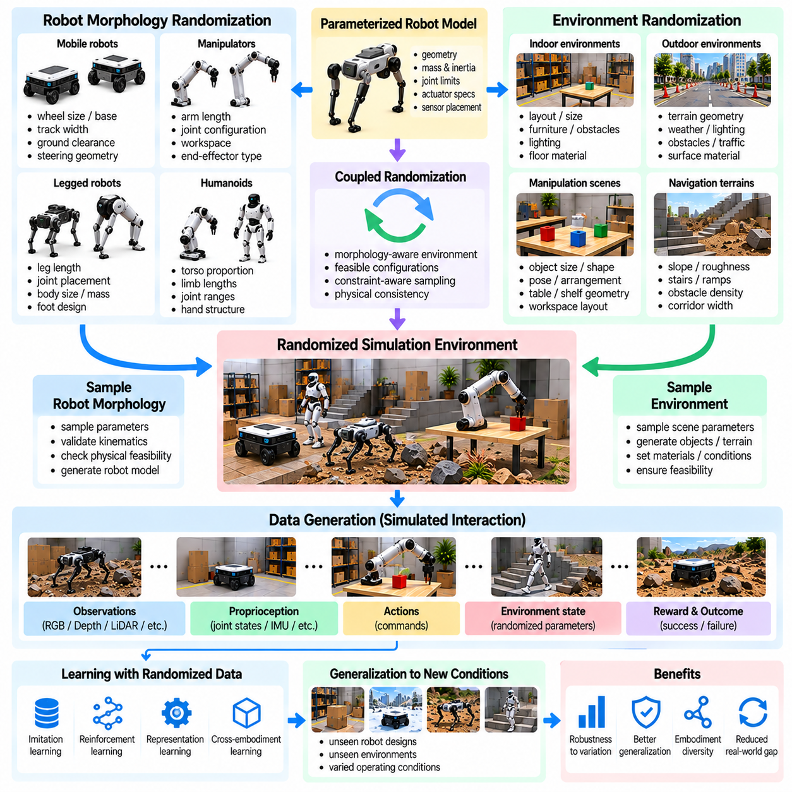{width="7.268055555555556in" height="7.268055555555556in"}

Robot morphology and environment randomization extend simulation data generation beyond variations in appearance and physical parameters. Robot morphology defines the structural arrangement of links, joints, actuators, and sensing components, while environment configuration determines the conditions under which these structures operate. Randomizing both dimensions exposes Physical AI systems to diverse embodiments and interaction conditions, supporting broader learning and generalization.

Morphology randomization modifies robot characteristics such as link lengths, joint locations, body proportions, actuator placement, and degrees of freedom. These changes influence reachability, mobility, stability, and control requirements. By generating data across different robot configurations, simulation environments can reveal which behaviors depend on specific mechanical structures and which strategies remain effective across multiple embodiments.

Parametric robot models provide a practical foundation for morphology randomization. A simulator can modify geometric dimensions, mass distributions, joint limits, and actuator specifications through configurable parameters. Each generated model must preserve physically consistent kinematic and dynamic relationships. Automated validation is necessary to reject configurations that violate mechanical constraints or produce unstable simulation behavior.

For mobile robots, morphology variations may include wheel diameter, wheelbase, track width, ground clearance, and steering geometry. These parameters influence turning radius, traction, obstacle traversal, and maneuverability. Randomized mobile platforms can generate navigation and control data representing different vehicle designs, helping learning systems distinguish general mobility principles from platform-specific behavior.

Manipulator morphology randomization changes arm length, joint arrangement, workspace geometry, and end-effector characteristics. Different configurations produce different reachable regions, collision constraints, and manipulation capabilities. Training across multiple manipulators can support adaptable motion planning and grasping policies, although differences in joint structure require consistent representations of actions and robot states.

Legged robot morphology introduces additional complexity because locomotion depends strongly on body geometry and contact structure. Leg length, joint placement, foot dimensions, and body mass distribution influence gait generation and balance. Randomizing these properties produces locomotion experiences across different mechanical designs, supporting the investigation of transferable movement strategies and morphology-dependent control requirements.

Humanoid morphology randomization may involve torso proportions, limb lengths, joint ranges, hand structures, and center-of-mass characteristics. Such variations affect whole-body coordination, manipulation reach, walking stability, and recovery behavior. Simulation datasets containing diverse humanoid configurations can support cross-embodiment learning, but anatomical feasibility and actuator capabilities must remain consistent with realistic engineering constraints.

Morphology randomization also changes the relationship between observations and actions. Robots with different numbers of joints or sensors cannot always share fixed-dimensional control representations. Graph-based models, structured joint descriptors, and embodiment-conditioned policies can represent varying robot structures. These approaches allow learning systems to associate mechanical configuration with appropriate control behavior.

Environment randomization complements morphology variation by changing the physical spaces in which robots operate. Terrain geometry, obstacle density, surface materials, object placement, and workspace dimensions can be sampled across episodes. These changes expose robots to different operational challenges and prevent policies from depending on a single environment layout or narrowly defined interaction pattern.

For navigation applications, randomized environments may include corridors, ramps, doorways, stairs, and uneven surfaces. Their dimensions and arrangements influence route feasibility and collision risk. A robot\'s morphology determines which environmental features it can traverse, making joint variation especially important. Dataset generation should therefore evaluate compatibility between platform dimensions and environmental geometry.

Manipulation environments can be randomized through object dimensions, fixture positions, shelf heights, table geometry, and workspace accessibility. Different robot arm configurations may succeed or fail depending on these conditions. Recording the relationship between morphology and task feasibility provides useful supervision for motion planning, grasp selection, and robot configuration selection.

Joint morphology-environment randomization explores interactions between robot design and operating conditions. A short-legged robot may perform well on flat terrain but struggle with large obstacles, while a longer-legged design may require different balance strategies. Similarly, manipulator reach and workspace geometry jointly determine accessible targets. These interactions reveal performance boundaries that cannot be identified by varying either dimension independently.

Randomization distributions should reflect meaningful engineering design spaces rather than arbitrary parameter combinations. Link dimensions, actuator torque, structural mass, and joint limits are physically related. Increasing limb length without adjusting inertia or actuator capacity may create unrealistic systems. Constraint-aware sampling preserves feasible relationships and prevents generated datasets from being dominated by invalid robot configurations.

Automated morphology generation can use robot description formats, procedural assembly rules, and parameterized mechanical templates. Each generated robot requires updated kinematic models, collision geometry, inertial properties, and control interfaces. Simulation pipelines should verify joint connectivity, collision consistency, and dynamic stability before collecting training trajectories. This validation supports reliable large-scale generation.

Curriculum strategies can gradually increase morphology and environment diversity during learning. Initial training may use closely related robot structures and simple environments. Later stages introduce larger geometric differences, unfamiliar joint configurations, and challenging terrain or workspaces. This progression helps policies acquire transferable control principles before encountering difficult combinations of embodiment and environmental variation.

Cross-embodiment learning aims to transfer knowledge between robots with different mechanical structures. Shared task representations, normalized observations, and morphology-aware policy architectures can support this objective. However, direct transfer is limited when robots have fundamentally different capabilities. Training datasets must distinguish universally applicable behaviors from actions that require particular joints, sensors, or locomotion mechanisms.

Morphology randomization can also support robot design optimization. Simulation data may reveal how structural choices affect energy consumption, task success, payload capacity, and movement efficiency. By evaluating multiple embodiments under comparable environmental conditions, developers can identify promising design regions. Such analysis connects policy learning with hardware configuration decisions and supports systematic robot development.

Dataset metadata must preserve the robot morphology and environment parameters associated with each trajectory. Relevant records include link dimensions, joint definitions, actuator properties, terrain characteristics, object configurations, and simulation seeds. This information enables reproducible experiments and helps explain performance differences. It also supports filtering datasets according to specific robot families or deployment conditions.

Evaluation should separate performance improvements caused by learning from advantages associated with particular robot designs. Benchmark environments can test familiar and unseen morphology-environment combinations while measuring task success, stability, energy use, and constraint violations. Physical validation remains essential because simulated mechanical configurations may overlook structural compliance, manufacturing tolerances, and complex contact effects.

A scalable Physical AI data engine integrates morphology generation, environment randomization, simulation execution, trajectory recording, and automated quality assessment. By exploring feasible combinations of robot structures and operating conditions, the system produces datasets that capture both shared behavioral principles and embodiment-specific limitations. This approach supports adaptable robot policies, cross-platform generalization, and data-informed mechanical design.

로봇 형태 및 환경 무작위화(Robot Morphology and Environment Randomization)는 외관과 물리적 매개변수(Physical Parameter)의 변화를 넘어 시뮬레이션 데이터 생성(Simulation Data Generation)의 범위를 확장한다. 로봇 형태(Robot Morphology)는 링크(Link), 관절(Joint), 구동기(Actuator), 센싱 구성요소(Sensing Component)의 구조적 배치(Structural Arrangement)를 정의하며, 환경 구성(Environment Configuration)은 이러한 구조가 작동하는 조건을 결정한다. 두 차원을 모두 무작위화하면 피지컬 인공지능(Physical AI) 시스템을 다양한 로봇 신체 구조(Embodiment)와 상호작용 조건(Interaction Condition)에 노출시켜 폭넓은 학습과 일반화(Generalization)를 지원할 수 있다.

형태 무작위화(Morphology Randomization)는 링크 길이(Link Length), 관절 위치(Joint Location), 몸체 비율(Body Proportion), 구동기 배치(Actuator Placement), 자유도(Degrees of Freedom)와 같은 로봇 특성을 변경한다. 이러한 변화는 도달 가능성(Reachability), 이동성(Mobility), 안정성(Stability), 제어 요구사항(Control Requirement)에 영향을 미친다. 다양한 로봇 구성(Robot Configuration)에서 데이터를 생성함으로써 시뮬레이션 환경(Simulation Environment)은 어떤 행동이 특정 기계적 구조(Mechanical Structure)에 의존하고 어떤 전략이 여러 로봇 신체 구조에서 효과적으로 유지되는지 밝혀낼 수 있다.

매개변수화된 로봇 모델(Parametric Robot Model)은 형태 무작위화를 위한 실용적인 기반을 제공한다. 시뮬레이터(Simulator)는 설정 가능한 매개변수(Configurable Parameter)를 통해 기하학적 치수(Geometric Dimension), 질량 분포(Mass Distribution), 관절 한계(Joint Limit), 구동기 사양(Actuator Specification)을 변경할 수 있다. 생성된 각 모델은 물리적으로 일관된 운동학적 관계(Kinematic Relationship)와 동역학적 관계(Dynamic Relationship)를 유지해야 한다. 기계적 제약조건(Mechanical Constraint)을 위반하거나 불안정한 시뮬레이션 동작(Unstable Simulation Behavior)을 생성하는 구성을 제거하기 위해 자동 검증(Automated Validation)이 필요하다.

이동 로봇(Mobile Robot)의 형태 변화에는 바퀴 직경(Wheel Diameter), 축간거리(Wheelbase), 윤거(Track Width), 지상고(Ground Clearance), 조향 기하학(Steering Geometry)이 포함될 수 있다. 이러한 매개변수는 회전 반경(Turning Radius), 견인력(Traction), 장애물 통과 능력(Obstacle Traversal), 기동성(Maneuverability)에 영향을 미친다. 무작위화된 이동 플랫폼(Randomized Mobile Platform)은 다양한 차량 설계(Vehicle Design)를 나타내는 내비게이션 및 제어 데이터(Navigation and Control Data)를 생성하여 학습 시스템이 일반적인 이동 원리(General Mobility Principle)와 플랫폼별 행동(Platform-Specific Behavior)을 구분하도록 지원한다.

매니퓰레이터 형태 무작위화(Manipulator Morphology Randomization)는 로봇 팔 길이(Arm Length), 관절 배치(Joint Arrangement), 작업공간 기하학(Workspace Geometry), 말단효과기 특성(End-Effector Characteristic)을 변경한다. 서로 다른 구성은 도달 가능한 영역(Reachable Region), 충돌 제약조건(Collision Constraint), 조작 능력(Manipulation Capability)의 차이를 발생시킨다. 여러 매니퓰레이터를 대상으로 학습하면 적응형 운동 계획(Adaptable Motion Planning)과 파지 정책(Grasping Policy)을 지원할 수 있지만, 관절 구조의 차이를 처리하기 위해 행동(Action)과 로봇 상태(Robot State)에 대한 일관된 표현(Consistent Representation)이 필요하다.

다족보행 로봇 형태(Legged Robot Morphology)는 이동 운동(Locomotion)이 몸체 기하학(Body Geometry)과 접촉 구조(Contact Structure)에 크게 의존하기 때문에 추가적인 복잡성을 가진다. 다리 길이(Leg Length), 관절 위치(Joint Placement), 발 치수(Foot Dimension), 몸체 질량 분포(Body Mass Distribution)는 보행 패턴 생성(Gait Generation)과 균형(Balance)에 영향을 미친다. 이러한 특성을 무작위화하면 다양한 기계적 설계(Mechanical Design)에 걸친 이동 경험(Locomotion Experience)을 생성하여 전이 가능한 운동 전략(Transferable Movement Strategy)과 형태 의존적 제어 요구사항(Morphology-Dependent Control Requirement)을 연구할 수 있다.

휴머노이드 형태 무작위화(Humanoid Morphology Randomization)는 몸통 비율(Torso Proportion), 사지 길이(Limb Length), 관절 가동 범위(Joint Range), 손 구조(Hand Structure), 질량중심 특성(Center-of-Mass Characteristic)을 포함할 수 있다. 이러한 변화는 전신 협응(Whole-Body Coordination), 조작 도달 범위(Manipulation Reach), 보행 안정성(Walking Stability), 복구 행동(Recovery Behavior)에 영향을 미친다. 다양한 휴머노이드 구성(Humanoid Configuration)을 포함하는 시뮬레이션 데이터셋은 신체 구조 간 학습(Cross-Embodiment Learning)을 지원할 수 있지만, 해부학적 실행 가능성(Anatomical Feasibility)과 구동기 능력(Actuator Capability)은 현실적인 공학적 제약조건(Engineering Constraint)에 부합해야 한다.

형태 무작위화는 관측값(Observation)과 행동(Action) 사이의 관계도 변화시킨다. 관절이나 센서의 수가 서로 다른 로봇은 항상 고정 차원 제어 표현(Fixed-Dimensional Control Representation)을 공유할 수 있는 것은 아니다. 그래프 기반 모델(Graph-Based Model), 구조화된 관절 기술자(Structured Joint Descriptor), 신체 구조 조건부 정책(Embodiment-Conditioned Policy)은 서로 다른 로봇 구조를 표현할 수 있다. 이러한 접근법은 학습 시스템이 기계적 구성(Mechanical Configuration)과 적절한 제어 행동(Control Behavior)을 연관시키도록 한다.

환경 무작위화(Environment Randomization)는 로봇이 작동하는 물리적 공간(Physical Space)을 변경하여 형태 변화를 보완한다. 지형 기하학(Terrain Geometry), 장애물 밀도(Obstacle Density), 표면 재질(Surface Material), 객체 배치(Object Placement), 작업공간 치수(Workspace Dimension)는 에피소드(Episode)마다 샘플링할 수 있다. 이러한 변화는 로봇을 서로 다른 운영 과제(Operational Challenge)에 노출시키고 정책(Policy)이 단일 환경 배치(Environment Layout)나 제한적으로 정의된 상호작용 패턴(Interaction Pattern)에 의존하지 않도록 한다.

내비게이션 응용 분야(Navigation Application)에서 무작위화된 환경은 복도(Corridor), 경사로(Ramp), 출입구(Doorway), 계단(Stair), 불균일한 표면(Uneven Surface)을 포함할 수 있다. 이러한 요소의 치수와 배치는 경로 실행 가능성(Route Feasibility)과 충돌 위험(Collision Risk)에 영향을 미친다. 로봇 형태는 어떤 환경 요소를 통과할 수 있는지 결정하므로 형태와 환경의 공동 변화(Joint Variation)가 특히 중요하다. 따라서 데이터셋 생성(Dataset Generation)은 플랫폼 치수(Platform Dimension)와 환경 기하학(Environmental Geometry) 사이의 적합성(Compatibility)을 평가해야 한다.

조작 환경(Manipulation Environment)은 객체 치수(Object Dimension), 고정구 위치(Fixture Position), 선반 높이(Shelf Height), 작업대 기하학(Table Geometry), 작업공간 접근성(Workspace Accessibility)을 변경하여 무작위화할 수 있다. 서로 다른 로봇 팔 구성(Robot Arm Configuration)은 이러한 조건에 따라 성공하거나 실패할 수 있다. 로봇 형태와 작업 실행 가능성(Task Feasibility) 사이의 관계를 기록하면 운동 계획(Motion Planning), 파지 선택(Grasp Selection), 로봇 구성 선택(Robot Configuration Selection)을 위한 유용한 지도 정보(Supervision)를 제공할 수 있다.

형태-환경 공동 무작위화(Joint Morphology-Environment Randomization)는 로봇 설계(Robot Design)와 운영 조건(Operating Condition) 사이의 상호작용을 탐색한다. 다리가 짧은 로봇(Short-Legged Robot)은 평탄한 지형(Flat Terrain)에서 우수한 성능을 보이지만 큰 장애물에서는 어려움을 겪을 수 있으며, 다리가 긴 설계(Longer-Legged Design)는 다른 균형 전략(Balance Strategy)이 필요할 수 있다. 마찬가지로 매니퓰레이터 도달 범위(Manipulator Reach)와 작업공간 기하학은 접근 가능한 목표(Accessible Target)를 공동으로 결정한다. 이러한 상호작용은 어느 한 차원만 독립적으로 변경해서는 식별할 수 없는 성능 경계(Performance Boundary)를 드러낸다.

무작위화 분포(Randomization Distribution)는 임의의 매개변수 조합(Arbitrary Parameter Combination)이 아니라 공학적으로 의미 있는 설계 공간(Engineering Design Space)을 반영해야 한다. 링크 치수(Link Dimension), 구동기 토크(Actuator Torque), 구조 질량(Structural Mass), 관절 한계(Joint Limit)는 물리적으로 서로 연관되어 있다. 관성(Inertia)이나 구동기 용량(Actuator Capacity)을 조정하지 않고 사지 길이(Limb Length)만 증가시키면 비현실적인 시스템이 생성될 수 있다. 제약조건 인식 샘플링(Constraint-Aware Sampling)은 실행 가능한 관계(Feasible Relationship)를 보존하고 생성된 데이터셋이 유효하지 않은 로봇 구성(Invalid Robot Configuration)에 의해 지배되는 것을 방지한다.

자동화된 형태 생성(Automated Morphology Generation)은 로봇 기술 형식(Robot Description Format), 절차적 조립 규칙(Procedural Assembly Rule), 매개변수화된 기계 템플릿(Parameterized Mechanical Template)을 활용할 수 있다. 생성된 각 로봇에는 갱신된 운동학 모델(Kinematic Model), 충돌 기하학(Collision Geometry), 관성 특성(Inertial Property), 제어 인터페이스(Control Interface)가 필요하다. 시뮬레이션 파이프라인(Simulation Pipeline)은 학습 궤적(Training Trajectory)을 수집하기 전에 관절 연결성(Joint Connectivity), 충돌 일관성(Collision Consistency), 동적 안정성(Dynamic Stability)을 검증해야 한다. 이러한 검증은 신뢰할 수 있는 대규모 데이터 생성(Large-Scale Data Generation)을 지원한다.

커리큘럼 전략(Curriculum Strategy)은 학습 과정에서 로봇 형태와 환경의 다양성을 점진적으로 증가시킬 수 있다. 초기 학습(Initial Training)은 서로 유사한 로봇 구조(Robot Structure)와 단순한 환경을 사용할 수 있다. 이후 단계에서는 더 큰 기하학적 차이(Geometric Difference), 익숙하지 않은 관절 구성(Joint Configuration), 어려운 지형(Challenging Terrain)이나 작업공간(Workspace)을 도입한다. 이러한 진행 방식은 정책이 로봇 신체 구조와 환경 변화의 어려운 조합을 경험하기 전에 전이 가능한 제어 원리(Transferable Control Principle)를 습득하도록 지원한다.

신체 구조 간 학습(Cross-Embodiment Learning)은 서로 다른 기계적 구조(Mechanical Structure)를 가진 로봇 사이에서 지식을 전이하는 것을 목표로 한다. 공유 작업 표현(Shared Task Representation), 정규화된 관측값(Normalized Observation), 형태 인식 정책 아키텍처(Morphology-Aware Policy Architecture)는 이러한 목표를 지원할 수 있다. 그러나 로봇의 기본적인 능력(Fundamental Capability)이 크게 다르면 직접적인 전이(Direct Transfer)는 제한된다. 학습 데이터셋은 보편적으로 적용 가능한 행동(Universally Applicable Behavior)과 특정 관절, 센서 또는 이동 메커니즘(Locomotion Mechanism)이 필요한 행동을 구분해야 한다.

형태 무작위화는 로봇 설계 최적화(Robot Design Optimization)도 지원할 수 있다. 시뮬레이션 데이터는 구조적 선택(Structural Choice)이 에너지 소비(Energy Consumption), 작업 성공률(Task Success), 적재 능력(Payload Capacity), 이동 효율성(Movement Efficiency)에 어떤 영향을 미치는지 보여줄 수 있다. 비교 가능한 환경 조건(Comparable Environmental Condition)에서 여러 로봇 신체 구조(Embodiment)를 평가함으로써 개발자는 유망한 설계 영역(Promising Design Region)을 식별할 수 있다. 이러한 분석은 정책 학습(Policy Learning)과 하드웨어 구성 의사결정(Hardware Configuration Decision)을 연결하고 체계적인 로봇 개발(Systematic Robot Development)을 지원한다.

데이터셋 메타데이터(Dataset Metadata)는 각 궤적(Trajectory)과 연관된 로봇 형태 및 환경 매개변수(Robot Morphology and Environment Parameter)를 보존해야 한다. 관련 기록에는 링크 치수(Link Dimension), 관절 정의(Joint Definition), 구동기 특성(Actuator Property), 지형 특성(Terrain Characteristic), 객체 구성(Object Configuration), 시뮬레이션 시드(Simulation Seed)가 포함된다. 이러한 정보는 재현 가능한 실험(Reproducible Experiment)을 가능하게 하고 성능 차이(Performance Difference)를 설명하는 데 도움이 된다. 또한 특정 로봇 계열(Robot Family)이나 배포 조건(Deployment Condition)에 따라 데이터셋을 필터링(Filtering)하는 것을 지원한다.

평가(Evaluation)는 학습으로 인한 성능 향상(Performance Improvement)과 특정 로봇 설계(Robot Design)가 제공하는 이점을 구분해야 한다. 벤치마크 환경(Benchmark Environment)은 익숙한 형태-환경 조합(Familiar Morphology-Environment Combination)과 학습 중 경험하지 않은 조합(Unseen Combination)을 테스트하면서 작업 성공률(Task Success), 안정성(Stability), 에너지 사용량(Energy Use), 제약조건 위반(Constraint Violation)을 측정할 수 있다. 시뮬레이션된 기계적 구성(Simulated Mechanical Configuration)은 구조적 유연성(Structural Compliance), 제조 공차(Manufacturing Tolerance), 복잡한 접촉 효과(Complex Contact Effect)를 충분히 반영하지 못할 수 있으므로 실제 환경 검증(Physical Validation)이 필수적이다.

확장 가능한 피지컬 인공지능 데이터 엔진(Scalable Physical AI Data Engine)은 형태 생성(Morphology Generation), 환경 무작위화(Environment Randomization), 시뮬레이션 실행(Simulation Execution), 궤적 기록(Trajectory Recording), 자동화된 품질 평가(Automated Quality Assessment)를 통합한다. 로봇 구조와 운영 조건의 실행 가능한 조합(Feasible Combination)을 탐색함으로써 시스템은 공유된 행동 원리(Shared Behavioral Principle)와 신체 구조별 한계(Embodiment-Specific Limitation)를 모두 포착하는 데이터셋을 생성한다. 이러한 접근법은 적응형 로봇 정책(Adaptable Robot Policy), 플랫폼 간 일반화(Cross-Platform Generalization), 데이터 기반 기계 설계(Data-Informed Mechanical Design)를 지원한다.

##  

## 04.11. Automatic Ground Truth Generation

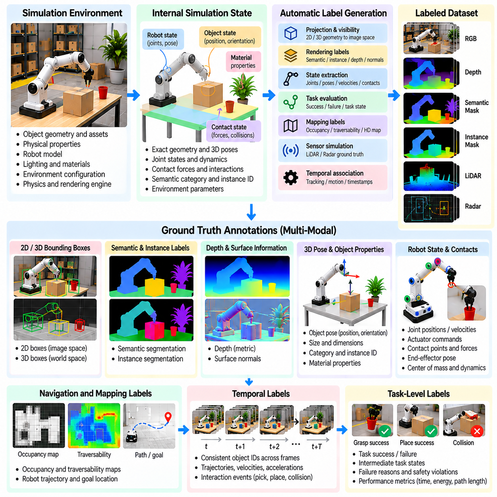{width="7.268055555555556in" height="7.268055555555556in"}

Automatic ground truth generation is a fundamental advantage of simulation-based data engines for Physical AI. Ground truth represents accurate reference information about objects, robot states, environmental properties, and interaction outcomes. Unlike real-world data collection, where annotations often require human effort or specialized measurement systems, simulation can directly expose internal states and generate structured labels during execution.

A simulation environment maintains detailed information about object geometry, spatial coordinates, physical properties, and dynamic states. These internal representations provide the foundation for automatic annotation. By extracting information from the simulation engine, data pipelines can associate sensor observations with corresponding reference labels. This process enables large-scale dataset generation with consistent annotation rules and reduced manual labeling requirements.

Automatic ground truth generation supports multiple perception tasks, including object detection, semantic segmentation, instance segmentation, depth estimation, and pose estimation. Each task requires a different representation of reference information. A single simulated scene can produce several synchronized annotation types, allowing the same observation to support multiple learning objectives and reducing the need to construct separate datasets.

For object detection, simulation engines can generate two-dimensional and three-dimensional bounding boxes directly from object geometry and camera parameters. Projected object coordinates determine image-space annotations, while world-space geometry provides spatial bounding volumes. Accurate labels must account for camera calibration, object visibility, image boundaries, and occlusion to remain consistent with the observations used during training.

Semantic segmentation assigns a category label to each visible image pixel. Simulation renderers can produce segmentation masks by associating rendered surfaces with predefined semantic classes. Instance segmentation extends this process by distinguishing individual objects belonging to the same category. These labels support scene understanding, object localization, and robotic manipulation, particularly when multiple similar objects appear together.

Depth ground truth can be generated from simulated camera geometry and rendering calculations. Each pixel may contain the distance to the visible surface according to the selected depth convention. However, optical-axis depth and Euclidean range are different quantities and must not be confused. Dataset specifications should document coordinate systems, measurement units, invalid pixels, and sensor modeling assumptions.

Three-dimensional ground truth includes object positions, orientations, dimensions, and spatial relationships. Simulators can export these values in world, robot, or sensor coordinate frames. Such information supports pose estimation, object tracking, mapping, and spatial reasoning. Consistent transformation conventions are essential because coordinate-frame errors can create systematic labeling mistakes even when the underlying simulation states are correct.

Robot state ground truth includes joint positions, joint velocities, actuator commands, body poses, and contact configurations. These values can be extracted directly from simulation state variables. Additional annotations may describe center-of-mass motion, end-effector trajectories, and stability conditions. Such labels are valuable for state estimation, imitation learning, motion prediction, and the evaluation of robot control algorithms.

Contact and interaction ground truth provide information that is difficult to measure comprehensively in physical environments. Simulation engines can record contact locations, collision events, normal forces, frictional interactions, and object motion. These records support grasp analysis, manipulation learning, and failure diagnosis. Their accuracy depends on the fidelity and numerical behavior of the underlying contact solver.

For navigation and autonomous mobility, ground truth may include robot trajectories, obstacle locations, occupancy maps, traversability labels, and collision-free paths. Simulated environments can generate reference maps from known geometry while recording the robot\'s actual movement. These annotations support localization, mapping, path planning, and navigation policy evaluation across procedurally generated environments.

Synthetic LiDAR and radar datasets can also contain automatically generated reference information. LiDAR annotations may include point-level semantic labels, object identifiers, surface normals, and range values. Radar annotations may include simulated target range, radial velocity, and object associations. Ground truth should remain distinct from sensor measurements, which may contain noise, missed detections, and modeling approximations.

Temporal ground truth describes how objects and robots evolve across simulation steps. Object identities, velocities, accelerations, trajectories, and interaction events can be recorded over time. These annotations support multi-object tracking, motion forecasting, and video-based learning. Persistent object identifiers and synchronized timestamps are necessary to preserve continuity across frames and avoid incorrect temporal associations.

Automatic task-level labeling extends beyond geometric and sensor information. Simulators can determine whether a grasp succeeds, an object reaches its target, a navigation goal is achieved, or a safety constraint is violated. Intermediate task states and failure reasons may also be recorded. These annotations connect low-level physical observations with high-level task outcomes, supporting policy learning and performance evaluation.

A major benefit of simulation-generated ground truth is the availability of privileged information that physical sensors cannot directly observe. Hidden object poses, exact friction coefficients, internal contact states, and complete environment maps may be accessible during generation. Such information can supervise learning or evaluate predictions, but training pipelines must distinguish privileged labels from observations available during real-world deployment.

Annotation consistency requires careful management of coordinate frames, object identifiers, semantic taxonomies, and measurement conventions. Different simulation engines may use different axis orientations, unit systems, and rendering definitions. Without explicit standardization, combined datasets may contain incompatible labels. A unified annotation schema helps preserve interoperability across simulation platforms and robot configurations.

Occlusion and visibility introduce important challenges for automatic labeling. An object may exist in the simulation state but be partially or completely hidden from a sensor. Ground truth generation must distinguish complete object geometry from visible regions and specify whether annotations include occluded objects. This distinction affects object detection, tracking, segmentation, and evaluation protocols.

Synchronization is essential when generating labels for multiple sensors and robot state streams. Cameras, LiDAR, inertial sensors, and control systems may operate at different frequencies. Annotation timestamps must correspond to the appropriate simulation states, particularly when objects are moving. Interpolation and temporal alignment procedures should be documented to prevent systematic errors in multimodal training datasets.

Ground truth accuracy should not be confused with physical realism. Simulation may provide exact labels for an internally modeled world while representing real-world phenomena imperfectly. Simplified geometry, approximate contact dynamics, and idealized rendering can produce precisely annotated but unrealistic examples. Therefore, annotation correctness and simulation fidelity must be evaluated as separate dimensions of dataset quality.

Automated quality assurance can identify missing labels, inconsistent identifiers, invalid coordinate transformations, and physically impossible values. Validation routines may compare projected geometry with segmentation masks, verify bounding-box dimensions, and check temporal continuity. Statistical analysis can detect unusual annotation distributions. Such procedures are important because automatic generation can propagate systematic errors across millions of samples.

A scalable ground truth pipeline integrates simulation state extraction, sensor rendering, annotation generation, validation, and dataset storage. Each sample should preserve observations, labels, timestamps, coordinate conventions, and relevant simulation metadata. Reproducible scene configurations and random seeds support debugging and regeneration. By combining accurate internal references with systematic quality control, automatic ground truth generation enables efficient development of large, richly annotated Physical AI datasets.

자동 정답 데이터 생성(Automatic Ground Truth Generation)은 피지컬 인공지능(Physical AI)을 위한 시뮬레이션 기반 데이터 엔진(Simulation-Based Data Engine)의 핵심적인 장점이다. 정답 데이터(Ground Truth)는 객체(Object), 로봇 상태(Robot State), 환경 특성(Environmental Property), 상호작용 결과(Interaction Outcome)에 관한 정확한 참조 정보(Reference Information)를 의미한다. 주석 작업(Annotation)에 인간의 노력이나 특수 측정 시스템(Specialized Measurement System)이 필요한 실제 데이터 수집(Real-World Data Collection)과 달리, 시뮬레이션은 내부 상태(Internal State)를 직접 제공하고 실행 과정에서 구조화된 레이블(Structured Label)을 생성할 수 있다.

시뮬레이션 환경(Simulation Environment)은 객체 기하학(Object Geometry), 공간 좌표(Spatial Coordinate), 물리적 특성(Physical Property), 동적 상태(Dynamic State)에 관한 상세한 정보를 유지한다. 이러한 내부 표현(Internal Representation)은 자동 주석 생성(Automatic Annotation)의 기반을 제공한다. 데이터 파이프라인(Data Pipeline)은 시뮬레이션 엔진(Simulation Engine)에서 정보를 추출하여 센서 관측값(Sensor Observation)을 해당 참조 레이블(Reference Label)과 연결할 수 있다. 이 과정은 일관된 주석 규칙(Annotation Rule)을 유지하면서 수작업 레이블링(Manual Labeling)의 필요성을 줄이고 대규모 데이터셋 생성(Large-Scale Dataset Generation)을 가능하게 한다.

자동 정답 데이터 생성은 객체 탐지(Object Detection), 의미적 분할(Semantic Segmentation), 인스턴스 분할(Instance Segmentation), 깊이 추정(Depth Estimation), 자세 추정(Pose Estimation)을 포함하는 다양한 인식 작업(Perception Task)을 지원한다. 각 작업에는 서로 다른 참조 정보 표현(Reference Information Representation)이 필요하다. 하나의 시뮬레이션 장면(Simulated Scene)에서 여러 유형의 동기화된 주석(Synchronized Annotation)을 생성할 수 있으므로 동일한 관측값을 여러 학습 목표(Learning Objective)에 활용하고 별도의 데이터셋을 구축할 필요성을 줄일 수 있다.

객체 탐지(Object Detection)의 경우 시뮬레이션 엔진은 객체 기하학(Object Geometry)과 카메라 매개변수(Camera Parameter)를 사용하여 2차원 및 3차원 경계 상자(2D and 3D Bounding Box)를 직접 생성할 수 있다. 투영된 객체 좌표(Projected Object Coordinate)는 영상 공간 주석(Image-Space Annotation)을 결정하며, 월드 공간 기하학(World-Space Geometry)은 공간적 경계 체적(Spatial Bounding Volume)을 제공한다. 정확한 레이블은 학습에 사용되는 관측값과 일관성을 유지하기 위해 카메라 보정(Camera Calibration), 객체 가시성(Object Visibility), 영상 경계(Image Boundary), 가림 현상(Occlusion)을 고려해야 한다.

의미적 분할(Semantic Segmentation)은 영상에서 보이는 각 픽셀(Pixel)에 범주 레이블(Category Label)을 할당한다. 시뮬레이션 렌더러(Simulation Renderer)는 렌더링된 표면(Rendered Surface)을 사전에 정의된 의미적 클래스(Semantic Class)와 연결하여 분할 마스크(Segmentation Mask)를 생성할 수 있다. 인스턴스 분할(Instance Segmentation)은 동일한 범주에 속하는 개별 객체를 구분하도록 이 과정을 확장한다. 이러한 레이블은 특히 유사한 객체가 여러 개 함께 존재하는 상황에서 장면 이해(Scene Understanding), 객체 위치 추정(Object Localization), 로봇 조작(Robotic Manipulation)을 지원한다.

깊이 정답 데이터(Depth Ground Truth)는 시뮬레이션된 카메라 기하학(Camera Geometry)과 렌더링 계산(Rendering Calculation)을 통해 생성할 수 있다. 각 픽셀에는 선택된 깊이 정의(Depth Convention)에 따라 가시 표면(Visible Surface)까지의 거리가 포함될 수 있다. 그러나 광축 방향 깊이(Optical-Axis Depth)와 유클리드 거리(Euclidean Range)는 서로 다른 물리량이므로 혼동해서는 안 된다. 데이터셋 사양(Dataset Specification)에는 좌표계(Coordinate System), 측정 단위(Measurement Unit), 유효하지 않은 픽셀(Invalid Pixel), 센서 모델링 가정(Sensor Modeling Assumption)을 명시해야 한다.

3차원 정답 데이터(Three-Dimensional Ground Truth)는 객체 위치(Object Position), 방향(Orientation), 치수(Dimension), 공간적 관계(Spatial Relationship)를 포함한다. 시뮬레이터(Simulator)는 이러한 값을 월드 좌표계(World Coordinate Frame), 로봇 좌표계(Robot Coordinate Frame), 센서 좌표계(Sensor Coordinate Frame)로 내보낼 수 있다. 이러한 정보는 자세 추정(Pose Estimation), 객체 추적(Object Tracking), 지도 작성(Mapping), 공간 추론(Spatial Reasoning)을 지원한다. 기본 시뮬레이션 상태가 정확하더라도 좌표계 오류(Coordinate-Frame Error)는 체계적인 레이블 오류(Systematic Labeling Error)를 발생시킬 수 있으므로 일관된 좌표 변환 규약(Transformation Convention)이 필수적이다.

로봇 상태 정답 데이터(Robot State Ground Truth)는 관절 위치(Joint Position), 관절 속도(Joint Velocity), 구동기 명령(Actuator Command), 몸체 자세(Body Pose), 접촉 구성(Contact Configuration)을 포함한다. 이러한 값은 시뮬레이션 상태 변수(Simulation State Variable)에서 직접 추출할 수 있다. 추가 주석에는 질량중심 운동(Center-of-Mass Motion), 말단효과기 궤적(End-Effector Trajectory), 안정성 조건(Stability Condition)이 포함될 수 있다. 이러한 레이블은 상태 추정(State Estimation), 모방 학습(Imitation Learning), 운동 예측(Motion Prediction), 로봇 제어 알고리즘(Robot Control Algorithm)의 평가에 유용하다.

접촉 및 상호작용 정답 데이터(Contact and Interaction Ground Truth)는 실제 물리 환경에서 포괄적으로 측정하기 어려운 정보를 제공한다. 시뮬레이션 엔진은 접촉 위치(Contact Location), 충돌 사건(Collision Event), 법선 방향 힘(Normal Force), 마찰 상호작용(Frictional Interaction), 객체 운동(Object Motion)을 기록할 수 있다. 이러한 기록은 파지 분석(Grasp Analysis), 조작 학습(Manipulation Learning), 실패 진단(Failure Diagnosis)을 지원한다. 데이터의 정확도는 기반이 되는 접촉 해석기(Contact Solver)의 충실도(Fidelity)와 수치적 동작(Numerical Behavior)에 따라 달라진다.

내비게이션 및 자율 이동(Navigation and Autonomous Mobility)의 경우 정답 데이터에는 로봇 궤적(Robot Trajectory), 장애물 위치(Obstacle Location), 점유 지도(Occupancy Map), 주행 가능성 레이블(Traversability Label), 충돌 없는 경로(Collision-Free Path)가 포함될 수 있다. 시뮬레이션 환경은 알려진 기하학적 구조(Known Geometry)에서 참조 지도(Reference Map)를 생성하면서 로봇의 실제 이동(Actual Movement)을 기록할 수 있다. 이러한 주석은 절차적으로 생성된 환경(Procedurally Generated Environment) 전반에서 위치 추정(Localization), 지도 작성(Mapping), 경로 계획(Path Planning), 내비게이션 정책 평가(Navigation Policy Evaluation)를 지원한다.

합성 라이다 및 레이더 데이터셋(Synthetic LiDAR and Radar Dataset)에도 자동으로 생성된 참조 정보(Reference Information)를 포함할 수 있다. 라이다 주석(LiDAR Annotation)에는 포인트 단위 의미 레이블(Point-Level Semantic Label), 객체 식별자(Object Identifier), 표면 법선(Surface Normal), 거리값(Range Value)이 포함될 수 있다. 레이더 주석(Radar Annotation)에는 시뮬레이션된 표적 거리(Target Range), 방사 방향 속도(Radial Velocity), 객체 연관 정보(Object Association)가 포함될 수 있다. 정답 데이터는 잡음(Noise), 탐지 누락(Missed Detection), 모델링 근사(Modeling Approximation)를 포함할 수 있는 센서 측정값(Sensor Measurement)과 명확하게 구분해야 한다.

시간적 정답 데이터(Temporal Ground Truth)는 시뮬레이션 단계(Simulation Step)에 따라 객체와 로봇이 어떻게 변화하는지 설명한다. 객체 식별 정보(Object Identity), 속도(Velocity), 가속도(Acceleration), 궤적(Trajectory), 상호작용 사건(Interaction Event)을 시간에 따라 기록할 수 있다. 이러한 주석은 다중 객체 추적(Multi-Object Tracking), 운동 예측(Motion Forecasting), 비디오 기반 학습(Video-Based Learning)을 지원한다. 프레임(Frame) 사이의 연속성을 유지하고 잘못된 시간적 연관(Temporal Association)을 방지하려면 지속적인 객체 식별자(Persistent Object Identifier)와 동기화된 타임스탬프(Synchronized Timestamp)가 필요하다.

자동 작업 수준 레이블링(Automatic Task-Level Labeling)은 기하학적 정보와 센서 정보를 넘어 확장된다. 시뮬레이터는 파지(Grasp)가 성공했는지, 객체가 목표 위치(Target Position)에 도달했는지, 내비게이션 목표(Navigation Goal)를 달성했는지, 안전 제약조건(Safety Constraint)을 위반했는지 판단할 수 있다. 중간 작업 상태(Intermediate Task State)와 실패 원인(Failure Reason)도 기록할 수 있다. 이러한 주석은 저수준 물리 관측값(Low-Level Physical Observation)과 고수준 작업 결과(High-Level Task Outcome)를 연결하여 정책 학습(Policy Learning)과 성능 평가(Performance Evaluation)를 지원한다.

시뮬레이션 생성 정답 데이터(Simulation-Generated Ground Truth)의 주요 장점은 물리적 센서(Physical Sensor)가 직접 관측할 수 없는 특권 정보(Privileged Information)를 활용할 수 있다는 것이다. 가려진 객체 자세(Hidden Object Pose), 정확한 마찰계수(Exact Friction Coefficient), 내부 접촉 상태(Internal Contact State), 완전한 환경 지도(Complete Environment Map)는 데이터 생성 과정에서 접근할 수 있다. 이러한 정보는 학습을 지도(Supervise)하거나 예측 결과를 평가하는 데 사용할 수 있지만, 학습 파이프라인(Training Pipeline)은 특권 레이블(Privileged Label)과 실제 환경 배포(Real-World Deployment)에서 사용 가능한 관측값을 구분해야 한다.

주석 일관성(Annotation Consistency)을 확보하려면 좌표계(Coordinate Frame), 객체 식별자(Object Identifier), 의미적 분류 체계(Semantic Taxonomy), 측정 규약(Measurement Convention)을 신중하게 관리해야 한다. 서로 다른 시뮬레이션 엔진(Simulation Engine)은 축 방향(Axis Orientation), 단위 체계(Unit System), 렌더링 정의(Rendering Definition)가 다를 수 있다. 명시적인 표준화(Standardization)가 없으면 통합 데이터셋(Combined Dataset)에 호환되지 않는 레이블(Incompatible Label)이 포함될 수 있다. 통합 주석 스키마(Unified Annotation Schema)는 시뮬레이션 플랫폼(Simulation Platform)과 로봇 구성(Robot Configuration) 사이의 상호운용성(Interoperability)을 유지하는 데 도움이 된다.

가림 현상과 가시성(Occlusion and Visibility)은 자동 레이블링(Automatic Labeling)에 중요한 과제를 제시한다. 객체가 시뮬레이션 상태(Simulation State)에는 존재하지만 센서에서는 부분적으로 또는 완전히 가려질 수 있다. 정답 데이터 생성은 전체 객체 기하학(Complete Object Geometry)과 가시 영역(Visible Region)을 구분하고 주석에 가려진 객체(Occluded Object)를 포함하는지 명시해야 한다. 이러한 구분은 객체 탐지(Object Detection), 추적(Tracking), 분할(Segmentation), 평가 프로토콜(Evaluation Protocol)에 영향을 미친다.

여러 센서와 로봇 상태 데이터 스트림(Robot State Stream)에 대한 레이블을 생성할 때는 동기화(Synchronization)가 필수적이다. 카메라(Camera), 라이다(LiDAR), 관성 센서(Inertial Sensor), 제어 시스템(Control System)은 서로 다른 주파수(Frequency)로 작동할 수 있다. 특히 객체가 이동하는 경우 주석 타임스탬프(Annotation Timestamp)는 해당 시뮬레이션 상태(Simulation State)와 일치해야 한다. 다중 모달 학습 데이터셋(Multimodal Training Dataset)에서 체계적인 오류를 방지하기 위해 보간(Interpolation)과 시간 정렬 절차(Temporal Alignment Procedure)를 문서화해야 한다.

정답 데이터 정확도(Ground Truth Accuracy)를 물리적 현실성(Physical Realism)과 혼동해서는 안 된다. 시뮬레이션은 내부적으로 모델링된 세계(Internally Modeled World)에 대해 정확한 레이블을 제공하면서도 실제 물리 현상(Real-World Phenomenon)을 불완전하게 표현할 수 있다. 단순화된 기하학(Simplified Geometry), 근사된 접촉 동역학(Approximate Contact Dynamics), 이상화된 렌더링(Idealized Rendering)은 주석은 정확하지만 비현실적인 학습 사례(Unrealistic Example)를 생성할 수 있다. 따라서 주석 정확성(Annotation Correctness)과 시뮬레이션 충실도(Simulation Fidelity)는 데이터셋 품질(Dataset Quality)의 서로 다른 차원으로 평가해야 한다.

자동화된 품질 보증(Automated Quality Assurance)은 누락된 레이블(Missing Label), 일관되지 않은 식별자(Inconsistent Identifier), 유효하지 않은 좌표 변환(Invalid Coordinate Transformation), 물리적으로 불가능한 값(Physically Impossible Value)을 식별할 수 있다. 검증 루틴(Validation Routine)은 투영된 기하학(Projected Geometry)과 분할 마스크(Segmentation Mask)를 비교하고, 경계 상자 치수(Bounding-Box Dimension)를 확인하며, 시간적 연속성(Temporal Continuity)을 검사할 수 있다. 통계 분석(Statistical Analysis)은 비정상적인 주석 분포(Unusual Annotation Distribution)를 탐지할 수 있다. 자동 생성 과정에서는 체계적인 오류가 수백만 개의 샘플에 전파될 수 있으므로 이러한 절차가 중요하다.

확장 가능한 정답 데이터 파이프라인(Scalable Ground Truth Pipeline)은 시뮬레이션 상태 추출(Simulation State Extraction), 센서 렌더링(Sensor Rendering), 주석 생성(Annotation Generation), 검증(Validation), 데이터셋 저장(Dataset Storage)을 통합한다. 각 샘플은 관측값(Observation), 레이블(Label), 타임스탬프(Timestamp), 좌표 규약(Coordinate Convention), 관련 시뮬레이션 메타데이터(Simulation Metadata)를 보존해야 한다. 재현 가능한 장면 구성(Reproducible Scene Configuration)과 난수 시드(Random Seed)는 디버깅(Debugging)과 데이터 재생성(Regeneration)을 지원한다. 정확한 내부 참조 정보(Accurate Internal Reference)와 체계적인 품질 관리(Systematic Quality Control)를 결합함으로써 자동 정답 데이터 생성은 풍부한 주석을 포함하는 대규모 피지컬 인공지능 데이터셋(Large, Richly Annotated Physical AI Dataset)의 효율적인 개발을 가능하게 한다.

##  

## 04.12. Synthetic vs Real Data Distribution

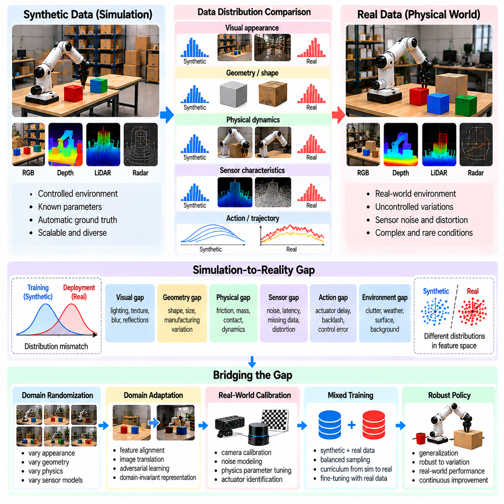{width="7.268055555555556in" height="7.268055555555556in"}

Synthetic and real data distributions represent a central challenge in developing reliable Physical AI systems. Synthetic data is generated through simulation using modeled environments, sensors, and physical interactions, while real data originates from physical robots operating in actual environments. Although both sources may describe similar tasks, their statistical properties often differ. Understanding these differences is essential for building models that generalize beyond simulation.

A data distribution describes the statistical patterns of observations, states, actions, and outcomes encountered during learning. In robotics, these patterns include visual appearance, object geometry, contact behavior, sensor noise, and environmental dynamics. Synthetic distributions are controlled by simulation parameters, whereas real distributions emerge from complex physical conditions that cannot always be modeled completely.

The simulation-to-reality gap arises when synthetic data fails to represent important characteristics of real-world observations or interactions. Differences may involve lighting, material appearance, friction, actuator response, sensor distortion, and contact dynamics. Models trained exclusively on synthetic data may perform well in simulation yet fail under physical conditions because they encounter unfamiliar combinations of these factors.

Visual distribution differences are especially important for perception-based robotic systems. Synthetic images may contain simplified textures, idealized lighting, unrealistic reflections, or limited background diversity. Real camera images include exposure variations, motion blur, optical distortion, and environmental interference. These discrepancies can cause perception models to rely on visual features that do not transfer reliably.

Geometric distribution differences arise when simulated objects and environments fail to represent the variety encountered in physical deployment. Synthetic datasets may use standardized object shapes, simplified surfaces, or limited spatial arrangements. Real environments contain manufacturing tolerances, irregular geometry, deformation, and unexpected clutter. Such differences influence object recognition, collision prediction, and manipulation planning.

Physical distribution differences involve discrepancies between simulated and actual dynamics. Friction coefficients, mass distributions, contact stiffness, damping, and actuator behavior may differ from their modeled values. Even small inaccuracies can accumulate during repeated interactions. These differences are particularly important for grasping, locomotion, balancing, and other tasks requiring precise physical contact.

Sensor distribution differences result from imperfect simulation of measurement processes. Real sensors experience calibration errors, nonlinear noise, missing measurements, latency, and environmental interference. Synthetic sensors may represent these effects through simplified statistical models. If simulated noise distributions do not match real measurements, learned policies may become overly dependent on observation quality that is unavailable during deployment.

Action and trajectory distributions can also differ substantially between simulation and reality. Simulated controllers may generate precise, repeatable motions, while physical robots experience actuator delays, backlash, mechanical compliance, and control errors. Consequently, identical action commands may produce different state transitions. This discrepancy affects imitation learning, reinforcement learning, and learned dynamics models.

Distribution shift can be categorized according to which statistical relationships change. Covariate shift occurs when input distributions differ while the conditional target relationship remains stable. Label shift involves changes in target frequencies, while concept shift changes the relationship between inputs and targets. In robotics, multiple forms of shift may occur simultaneously, making simple correction methods insufficient.

Measuring synthetic-real distribution differences requires representative datasets from both domains. Feature statistics, sensor noise characteristics, trajectory distributions, and task outcomes can be compared. Distance measures such as maximum mean discrepancy or Wasserstein distance may quantify differences in selected representations. However, low statistical distance does not automatically guarantee successful robot behavior.

Learned feature representations provide another way to compare synthetic and real datasets. Images, point clouds, or robot trajectories can be mapped into embedding spaces where similarity is measured. Clustering and domain classification may reveal systematic differences between sources. These methods are useful for diagnosing gaps, but their conclusions depend on whether the selected representations preserve task-relevant information.

Domain randomization attempts to reduce distribution mismatch by generating synthetic data across diverse parameter configurations. Lighting, textures, geometry, friction, sensor noise, and actuator characteristics may be varied. This broadens the training distribution and encourages models to tolerate uncertainty. Nevertheless, excessive randomization can introduce unrealistic samples and reduce learning efficiency.

Domain adaptation seeks to align representations or predictions across synthetic and real domains. Feature alignment, adversarial learning, image translation, and statistical normalization are possible approaches. Some methods transform synthetic observations toward realistic appearance, while others learn domain-invariant features. Adaptation must preserve task-relevant geometry and physical relationships to avoid introducing misleading training signals.

Real-world calibration improves synthetic data quality by constraining simulation parameters using measured physical behavior. Sensor characteristics, robot dynamics, contact properties, and environmental conditions can be estimated from experiments. The calibrated simulator provides a more representative starting distribution. Randomization around measured parameters can then account for residual uncertainty and variation between operating conditions.

Coverage is as important as similarity when evaluating synthetic datasets. A synthetic distribution may closely match average real-world conditions but omit rare events, extreme disturbances, or unusual object configurations. These missing cases can cause severe failures during deployment. Targeted scenario generation can increase coverage of safety-critical and low-frequency situations that are difficult to collect physically.

Dataset imbalance can create additional differences between synthetic and real distributions. Simulation pipelines may overproduce successful trajectories, simple environments, or easily generated object configurations. Real-world data may contain more failures, interruptions, and irregular conditions. Balanced sampling and targeted generation help correct these biases while preserving the statistical context needed for reliable evaluation.

The relationship between synthetic and real distributions changes as robot policies improve. A learned policy may visit states that were uncommon in the original training data, creating new distribution gaps. Closed-loop evaluation can identify these unfamiliar states and guide additional simulation generation. This feedback process connects policy development with continuous dataset refinement.

Evaluation should separate synthetic validation performance from real-world deployment performance. A model may achieve high accuracy on simulated test data while remaining sensitive to physical uncertainty. Representative real-world benchmarks should measure task success, robustness, safety violations, and recovery behavior. Performance comparisons across domains reveal which distribution differences have practical consequences.

Synthetic and real data should be treated as complementary rather than interchangeable resources. Synthetic data offers scalability, controlled variation, and automatic ground truth, while real data captures unmodeled physical complexity. Combining both sources can improve learning when sampling strategies account for their differences. The optimal balance depends on task complexity, simulator fidelity, and available physical data.

A scalable Physical AI data engine continuously compares synthetic and real distributions, identifies underrepresented conditions, and updates simulation generation accordingly. Statistical analysis, physical calibration, targeted randomization, and real-world validation form a feedback loop. By managing distribution differences systematically, developers can transform synthetic experience into training resources that support reliable behavior in physical environments.

합성 데이터와 실제 데이터의 분포(Synthetic and Real Data Distribution)는 신뢰할 수 있는 피지컬 인공지능(Physical AI) 시스템을 개발하는 데 있어 핵심적인 과제이다. 합성 데이터(Synthetic Data)는 모델링된 환경(Modelled Environment), 센서(Sensor), 물리적 상호작용(Physical Interaction)을 사용하는 시뮬레이션(Simulation)을 통해 생성되며, 실제 데이터(Real Data)는 실제 환경에서 작동하는 물리적 로봇(Physical Robot)으로부터 수집된다. 두 데이터 소스(Data Source)가 유사한 작업을 설명하더라도 통계적 특성(Statistical Property)은 서로 다를 수 있다. 이러한 차이를 이해하는 것은 시뮬레이션을 넘어 일반화(Generalization)할 수 있는 모델을 구축하는 데 필수적이다.

데이터 분포(Data Distribution)는 학습 과정에서 경험하는 관측값(Observation), 상태(State), 행동(Action), 결과(Outcome)의 통계적 패턴(Statistical Pattern)을 설명한다. 로봇공학(Robotics)에서 이러한 패턴에는 시각적 외관(Visual Appearance), 객체 기하학(Object Geometry), 접촉 행동(Contact Behavior), 센서 잡음(Sensor Noise), 환경 동역학(Environmental Dynamics)이 포함된다. 합성 데이터 분포(Synthetic Distribution)는 시뮬레이션 매개변수(Simulation Parameter)에 의해 제어되는 반면, 실제 데이터 분포(Real Distribution)는 항상 완전하게 모델링할 수 없는 복잡한 물리적 조건(Physical Condition)에서 형성된다.

시뮬레이션과 현실 사이의 격차(Simulation-to-Reality Gap)는 합성 데이터가 실제 관측값이나 상호작용의 중요한 특성을 충분히 표현하지 못할 때 발생한다. 이러한 차이에는 조명(Lighting), 재질 외관(Material Appearance), 마찰(Friction), 구동기 응답(Actuator Response), 센서 왜곡(Sensor Distortion), 접촉 동역학(Contact Dynamics)이 포함될 수 있다. 합성 데이터만으로 학습한 모델은 시뮬레이션에서는 우수한 성능을 보이더라도 실제 물리적 조건에서 이러한 요인들의 익숙하지 않은 조합을 만나면 실패할 수 있다.

시각적 분포 차이(Visual Distribution Difference)는 인식 기반 로봇 시스템(Perception-Based Robotic System)에서 특히 중요하다. 합성 영상(Synthetic Image)에는 단순화된 텍스처(Simplified Texture), 이상화된 조명(Idealized Lighting), 비현실적인 반사(Unrealistic Reflection), 제한적인 배경 다양성(Limited Background Diversity)이 포함될 수 있다. 실제 카메라 영상(Real Camera Image)에는 노출 변화(Exposure Variation), 움직임 흐림(Motion Blur), 광학 왜곡(Optical Distortion), 환경 간섭(Environmental Interference)이 존재한다. 이러한 불일치(Discrepancy)는 인식 모델(Perception Model)이 실제 환경으로 안정적으로 전이되지 않는 시각적 특징(Visual Feature)에 의존하게 만들 수 있다.

기하학적 분포 차이(Geometric Distribution Difference)는 시뮬레이션된 객체와 환경이 실제 배포 환경(Physical Deployment)에서 나타나는 다양성을 충분히 표현하지 못할 때 발생한다. 합성 데이터셋(Synthetic Dataset)은 표준화된 객체 형상(Standardized Object Shape), 단순화된 표면(Simplified Surface), 제한적인 공간 배치(Spatial Arrangement)를 사용할 수 있다. 실제 환경에는 제조 공차(Manufacturing Tolerance), 불규칙한 기하학(Irregular Geometry), 변형(Deformation), 예상하지 못한 혼잡 상태(Unexpected Clutter)가 존재한다. 이러한 차이는 객체 인식(Object Recognition), 충돌 예측(Collision Prediction), 조작 계획(Manipulation Planning)에 영향을 미친다.

물리적 분포 차이(Physical Distribution Difference)는 시뮬레이션된 동역학(Simulated Dynamics)과 실제 동역학(Actual Dynamics) 사이의 불일치를 포함한다. 마찰계수(Friction Coefficient), 질량 분포(Mass Distribution), 접촉 강성(Contact Stiffness), 감쇠(Damping), 구동기 동작(Actuator Behavior)은 모델링된 값과 다를 수 있다. 작은 부정확성(Inaccuracy)도 반복적인 상호작용 과정에서 누적될 수 있다. 이러한 차이는 정밀한 물리적 접촉(Physical Contact)이 필요한 파지(Grasping), 이동 운동(Locomotion), 균형 유지(Balancing) 등의 작업에서 특히 중요하다.

센서 분포 차이(Sensor Distribution Difference)는 측정 과정(Measurement Process)을 불완전하게 시뮬레이션하면서 발생한다. 실제 센서는 보정 오류(Calibration Error), 비선형 잡음(Nonlinear Noise), 측정값 누락(Missing Measurement), 지연(Latency), 환경 간섭(Environmental Interference)을 경험한다. 합성 센서(Synthetic Sensor)는 이러한 효과를 단순화된 통계 모델(Statistical Model)로 표현할 수 있다. 시뮬레이션된 잡음 분포(Noise Distribution)가 실제 측정값과 일치하지 않으면 학습된 정책(Learned Policy)이 실제 배포 환경에서 확보할 수 없는 높은 관측 품질(Observation Quality)에 지나치게 의존할 수 있다.

행동 및 궤적 분포(Action and Trajectory Distribution) 역시 시뮬레이션과 현실 사이에서 상당한 차이를 보일 수 있다. 시뮬레이션된 제어기(Simulated Controller)는 정밀하고 반복 가능한 운동(Repeatable Motion)을 생성할 수 있지만, 실제 로봇은 구동기 지연(Actuator Delay), 백래시(Backlash), 기계적 유연성(Mechanical Compliance), 제어 오차(Control Error)를 경험한다. 따라서 동일한 행동 명령(Action Command)도 서로 다른 상태 전이(State Transition)를 발생시킬 수 있다. 이러한 불일치는 모방 학습(Imitation Learning), 강화 학습(Reinforcement Learning), 학습 기반 동역학 모델(Learned Dynamics Model)에 영향을 미친다.

분포 이동(Distribution Shift)은 어떤 통계적 관계(Statistical Relationship)가 변화하는지에 따라 분류할 수 있다. 공변량 이동(Covariate Shift)은 입력 분포(Input Distribution)가 달라지지만 조건부 목표 관계(Conditional Target Relationship)는 안정적으로 유지되는 경우에 발생한다. 레이블 이동(Label Shift)은 목표 레이블의 빈도(Target Frequency)가 변화하는 현상이며, 개념 이동(Concept Shift)은 입력과 목표 사이의 관계가 변화하는 현상이다. 로봇공학에서는 여러 유형의 분포 이동이 동시에 발생할 수 있으므로 단순한 보정 방법(Correction Method)만으로는 충분하지 않을 수 있다.

합성 데이터와 실제 데이터의 분포 차이를 측정하려면 두 도메인(Domain)을 대표하는 데이터셋(Representative Dataset)이 필요하다. 특징 통계(Feature Statistics), 센서 잡음 특성(Sensor Noise Characteristic), 궤적 분포(Trajectory Distribution), 작업 결과(Task Outcome)를 비교할 수 있다. 최대 평균 불일치(Maximum Mean Discrepancy)나 바서슈타인 거리(Wasserstein Distance)와 같은 거리 측정 방법(Distance Measure)은 선택된 표현(Representation)에서 분포 차이를 정량화할 수 있다. 그러나 통계적 거리가 작다고 해서 로봇 행동(Robot Behavior)의 성공이 자동으로 보장되는 것은 아니다.

학습된 특징 표현(Learned Feature Representation)은 합성 데이터셋과 실제 데이터셋을 비교하는 또 다른 방법을 제공한다. 영상(Image), 포인트 클라우드(Point Cloud), 로봇 궤적(Robot Trajectory)을 임베딩 공간(Embedding Space)으로 변환하여 유사성(Similarity)을 측정할 수 있다. 군집화(Clustering)와 도메인 분류(Domain Classification)는 데이터 소스 사이의 체계적인 차이(Systematic Difference)를 드러낼 수 있다. 이러한 방법은 분포 격차(Gap)를 진단하는 데 유용하지만, 분석 결과는 선택된 표현이 작업 관련 정보(Task-Relevant Information)를 얼마나 잘 보존하는지에 따라 달라진다.

도메인 무작위화(Domain Randomization)는 다양한 매개변수 구성(Parameter Configuration)에서 합성 데이터를 생성하여 분포 불일치(Distribution Mismatch)를 줄이려는 접근법이다. 조명(Lighting), 텍스처(Texture), 기하학(Geometry), 마찰(Friction), 센서 잡음(Sensor Noise), 구동기 특성(Actuator Characteristic)을 변화시킬 수 있다. 이는 학습 분포(Training Distribution)를 확장하고 모델이 불확실성(Uncertainty)을 견딜 수 있도록 유도한다. 그러나 과도한 무작위화(Excessive Randomization)는 비현실적인 샘플(Unrealistic Sample)을 생성하고 학습 효율성(Learning Efficiency)을 감소시킬 수 있다.

도메인 적응(Domain Adaptation)은 합성 도메인(Synthetic Domain)과 실제 도메인(Real Domain) 사이의 표현이나 예측을 정렬(Alignment)하는 것을 목표로 한다. 특징 정렬(Feature Alignment), 적대적 학습(Adversarial Learning), 영상 변환(Image Translation), 통계적 정규화(Statistical Normalization) 등이 가능한 접근법이다. 일부 방법은 합성 관측값(Synthetic Observation)을 현실적인 외관(Realistic Appearance)에 가깝게 변환하고, 다른 방법은 도메인 불변 특징(Domain-Invariant Feature)을 학습한다. 적응 과정에서는 잘못된 학습 신호(Misleading Training Signal)가 발생하지 않도록 작업 관련 기하학(Task-Relevant Geometry)과 물리적 관계(Physical Relationship)를 보존해야 한다.

실제 환경 보정(Real-World Calibration)은 측정된 물리적 동작(Measured Physical Behavior)을 사용하여 시뮬레이션 매개변수(Simulation Parameter)를 제한함으로써 합성 데이터의 품질을 개선한다. 센서 특성(Sensor Characteristic), 로봇 동역학(Robot Dynamics), 접촉 특성(Contact Property), 환경 조건(Environmental Condition)을 실험을 통해 추정할 수 있다. 보정된 시뮬레이터(Calibrated Simulator)는 실제 환경을 더 잘 대표하는 초기 분포(Starting Distribution)를 제공한다. 이후 측정된 매개변수 주변에서 무작위화(Randomization)를 수행하여 남아 있는 불확실성(Residual Uncertainty)과 운영 조건(Operating Condition) 사이의 변화를 반영할 수 있다.

합성 데이터셋(Synthetic Dataset)을 평가할 때는 유사성(Similarity)만큼 포괄 범위(Coverage)도 중요하다. 합성 분포(Synthetic Distribution)가 평균적인 실제 환경 조건(Average Real-World Condition)과 매우 유사하더라도 드문 사건(Rare Event), 극단적인 외란(Extreme Disturbance), 비정상적인 객체 구성(Unusual Object Configuration)을 누락할 수 있다. 이러한 누락 사례(Missing Case)는 실제 배포 과정에서 심각한 실패를 발생시킬 수 있다. 목표 지향적 시나리오 생성(Targeted Scenario Generation)은 실제 환경에서 수집하기 어려운 안전 중요 상황(Safety-Critical Situation)과 발생 빈도가 낮은 상황(Low-Frequency Situation)의 포괄 범위를 확대할 수 있다.

데이터셋 불균형(Dataset Imbalance)은 합성 분포와 실제 분포 사이에 추가적인 차이를 발생시킬 수 있다. 시뮬레이션 파이프라인(Simulation Pipeline)은 성공적인 궤적(Successful Trajectory), 단순한 환경(Simple Environment), 생성하기 쉬운 객체 구성(Object Configuration)을 과도하게 생산할 수 있다. 실제 데이터에는 실패(Failure), 중단(Interruption), 불규칙한 조건(Irregular Condition)이 더 많이 포함될 수 있다. 균형 잡힌 샘플링(Balanced Sampling)과 목표 지향적 데이터 생성(Targeted Generation)은 신뢰할 수 있는 평가에 필요한 통계적 맥락(Statistical Context)을 유지하면서 이러한 편향(Bias)을 보정하는 데 도움이 된다.

합성 분포와 실제 분포 사이의 관계는 로봇 정책(Robot Policy)이 개선됨에 따라 변화한다. 학습된 정책(Learned Policy)은 초기 학습 데이터(Original Training Data)에서 드물게 나타났던 상태(State)에 도달하여 새로운 분포 격차(Distribution Gap)를 발생시킬 수 있다. 폐루프 평가(Closed-Loop Evaluation)는 이러한 익숙하지 않은 상태(Unfamiliar State)를 식별하고 추가적인 시뮬레이션 데이터 생성(Simulation Data Generation)을 유도할 수 있다. 이러한 피드백 과정(Feedback Process)은 정책 개발(Policy Development)과 지속적인 데이터셋 개선(Continuous Dataset Refinement)을 연결한다.

평가(Evaluation)는 합성 데이터 검증 성능(Synthetic Validation Performance)과 실제 환경 배포 성능(Real-World Deployment Performance)을 구분해야 한다. 모델이 시뮬레이션 테스트 데이터(Simulated Test Data)에서 높은 정확도(Accuracy)를 달성하더라도 물리적 불확실성(Physical Uncertainty)에 민감할 수 있다. 대표성 있는 실제 환경 벤치마크(Representative Real-World Benchmark)는 작업 성공률(Task Success), 강건성(Robustness), 안전 위반(Safety Violation), 복구 행동(Recovery Behavior)을 측정해야 한다. 도메인 간 성능 비교(Cross-Domain Performance Comparison)는 어떤 분포 차이가 실제적인 결과를 초래하는지 보여준다.

합성 데이터와 실제 데이터는 서로 대체 가능한 자원(Interchangeable Resource)이 아니라 상호 보완적인 자원(Complementary Resource)으로 취급해야 한다. 합성 데이터는 확장성(Scalability), 제어된 변화(Controlled Variation), 자동 정답 데이터(Automatic Ground Truth)를 제공하며, 실제 데이터는 모델링되지 않은 물리적 복잡성(Unmodeled Physical Complexity)을 포착한다. 샘플링 전략(Sampling Strategy)이 두 데이터 소스 사이의 차이를 고려한다면 이를 결합하여 학습 성능을 개선할 수 있다. 최적의 균형(Optimal Balance)은 작업 복잡성(Task Complexity), 시뮬레이터 충실도(Simulator Fidelity), 사용 가능한 실제 데이터(Available Physical Data)에 따라 달라진다.

확장 가능한 피지컬 인공지능 데이터 엔진(Scalable Physical AI Data Engine)은 합성 분포와 실제 분포를 지속적으로 비교하고, 충분히 표현되지 않은 조건(Underrepresented Condition)을 식별하며, 이에 따라 시뮬레이션 데이터 생성 과정을 갱신한다. 통계 분석(Statistical Analysis), 물리적 보정(Physical Calibration), 목표 지향적 무작위화(Targeted Randomization), 실제 환경 검증(Real-World Validation)은 피드백 루프(Feedback Loop)를 형성한다. 분포 차이(Distribution Difference)를 체계적으로 관리함으로써 개발자는 합성 경험(Synthetic Experience)을 실제 물리 환경에서 신뢰할 수 있는 행동(Reliable Behavior)을 지원하는 학습 자원(Training Resource)으로 전환할 수 있다.

##  

## 04.13. Mixing Real and Synthetic Data

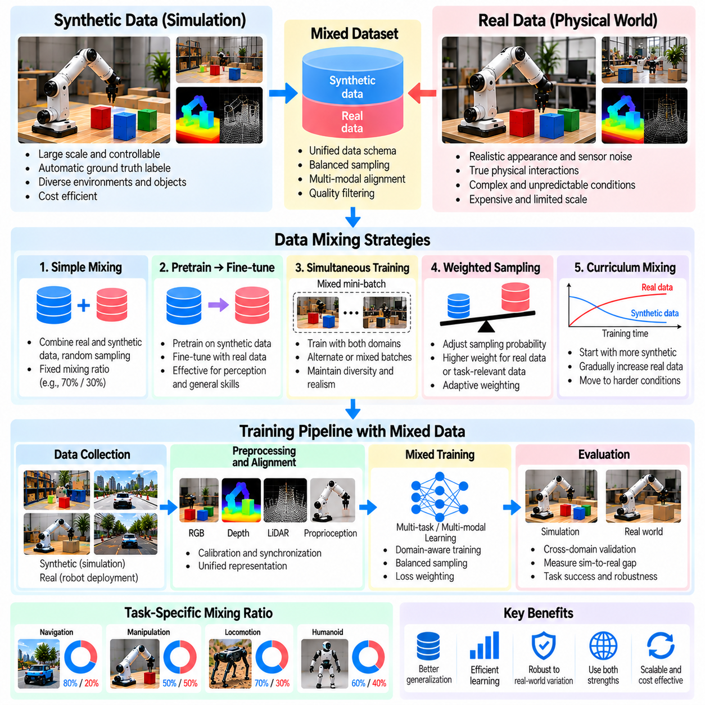{width="7.268055555555556in" height="7.268055555555556in"}

Mixing real and synthetic data is a fundamental strategy for building scalable and reliable Physical AI learning systems. Synthetic data provides large quantities of controlled experiences, while real data captures the complexity of physical environments and robot interactions. Combining these sources allows training pipelines to exploit simulation scalability without ignoring deployment conditions. The central challenge is determining how different data sources should contribute to learning.

Real-world robotic datasets are expensive because collecting demonstrations requires hardware, operators, maintenance, and controlled operating conditions. Synthetic datasets can be generated repeatedly with automated simulation pipelines and precise ground truth annotations. However, synthetic observations may contain unrealistic physical or visual characteristics. A mixed-data strategy attempts to balance the economic advantages of simulation with the representational value of physical experience.

The effectiveness of data mixing depends on the relationship between source distributions and target deployment conditions. Real and synthetic samples may describe identical tasks while differing in sensor noise, contact dynamics, object appearance, and action execution. Simply combining all samples does not guarantee better performance. Training procedures must consider domain differences, task relevance, data quality, and the relative contribution of each source.

A basic mixing strategy combines real and synthetic samples within a unified training dataset. A sampling ratio determines the proportion of examples drawn from each domain during optimization. This ratio influences the model\'s exposure to realistic conditions and simulated diversity. High synthetic proportions may improve coverage, while higher real-data proportions may strengthen adaptation to deployment-specific characteristics.

The optimal real-to-synthetic ratio is not universal. Perception models may benefit from extensive synthetic pretraining followed by smaller quantities of real images. Contact-intensive manipulation policies may require more physical interaction data because contact dynamics are difficult to reproduce accurately. The appropriate ratio depends on task complexity, simulation fidelity, model architecture, and the diversity of available real-world experiences.

Pretraining and fine-tuning provide a practical alternative to simultaneous data mixing. A model first learns general representations or behaviors from large synthetic datasets and subsequently adapts using real-world examples. Synthetic pretraining can establish useful perception, planning, or control capabilities before expensive physical data is introduced. Real-world fine-tuning then adjusts learned parameters toward deployment conditions.

Simultaneous mixed-domain training exposes a model to real and synthetic examples throughout optimization. Mini-batches may contain samples from both domains, or training may alternate between domain-specific batches. This approach can preserve synthetic diversity while maintaining regular exposure to physical observations. Careful sampling is necessary to prevent the larger synthetic dataset from overwhelming the smaller real dataset.

Weighted sampling assigns different probabilities or training importance to individual data sources. Real-world examples may receive greater weight when they represent deployment conditions more accurately. Synthetic samples may receive higher weight when they cover rare situations or difficult tasks. Importance weighting and adaptive sampling can refine this balance, although inaccurate weighting may amplify noise or reduce useful diversity.

Data mixing should account for differences in annotation quality and representation. Synthetic data may provide exact object poses, segmentation masks, contact states, and robot trajectories. Real data may contain incomplete annotations, measurement uncertainty, or inconsistent sensor calibration. Unified data schemas and explicit validity masks help models learn from available supervision without treating missing real-world labels as incorrect observations.

Multimodal alignment is especially important when mixing camera, LiDAR, proprioceptive, and action data. Synthetic and physical systems may use different coordinate frames, sensor frequencies, resolutions, and control interfaces. Standardized transformations and timestamp conventions are necessary for consistent training. Without alignment, models may learn artificial relationships caused by data processing rather than genuine physical behavior.

Domain-aware training can explicitly represent whether a sample originates from simulation or physical deployment. Domain identifiers, separate normalization statistics, or domain-specific model components may help manage distribution differences. Other approaches encourage shared representations that remain useful across both sources. The appropriate design depends on whether domain differences should be preserved, compensated for, or suppressed.

Curriculum-based mixing gradually changes the composition of training data. Early learning may emphasize abundant synthetic examples covering fundamental skills and simple environments. Later stages can introduce increasing amounts of real-world data and more challenging physical conditions. This progression allows models to acquire broad capabilities before adapting to the detailed constraints of deployment environments.

Task-aware mixing adjusts data proportions according to the capabilities being learned. Navigation training may emphasize synthetic obstacle configurations, while precision grasping may require additional physical contact demonstrations. Different tasks can therefore use different mixing schedules within a shared model. This strategy prevents a single global sampling ratio from dominating learning objectives with different data requirements.

Failure-driven data mixing prioritizes examples associated with poor real-world performance. Physical deployment may reveal slipping, missed grasps, localization errors, or unexpected collisions that were uncommon during simulation training. These failures can guide targeted synthetic scenario generation and additional real-world collection. Mixing newly generated examples with existing datasets creates a feedback loop focused on observed weaknesses.

Synthetic data can also compensate for rare or hazardous situations that are difficult to reproduce physically. Simulations may generate emergency stops, obstacle encounters, unstable contacts, or sensor degradation under controlled conditions. These examples can improve exposure to challenging events, but simulated safety performance cannot replace physical validation. Their contribution should be assessed through realistic testing and risk-aware evaluation.

Dataset balancing requires attention to more than the overall number of real and synthetic samples. Object categories, environments, robot embodiments, task outcomes, and difficulty levels may be distributed unevenly. A large synthetic dataset can still provide limited useful diversity if it repeatedly generates similar situations. Stratified sampling and coverage analysis help ensure that training examples represent meaningful operational variation.

Mixed-data learning can suffer from negative transfer when synthetic examples encourage behaviors that are unsuitable for physical deployment. Unrealistic friction, idealized sensing, or inaccurate actuator dynamics may produce misleading training signals. Monitoring performance on held-out real-world datasets helps identify these effects. Synthetic samples that consistently degrade deployment performance may require correction, filtering, or reduced sampling weight.

Evaluation must measure whether mixed training improves real-world performance rather than only synthetic benchmark accuracy. Controlled experiments can compare real-only, synthetic-only, and mixed-data training under matched model architectures and evaluation conditions. Task success, robustness, sample efficiency, and failure recovery provide complementary metrics. Ablation studies can identify which synthetic data categories contribute meaningful improvements.

A scalable mixing pipeline should preserve data provenance, collection conditions, simulation parameters, annotation confidence, and sampling history. These records enable reproducible experiments and support analysis of domain-specific performance. Automated monitoring can detect changes in real-world data distributions and adjust future generation priorities. Traceability is particularly important when multiple simulation engines and physical robot platforms contribute data.

An effective Physical AI data engine treats real and synthetic data as complementary components of a continuous learning process. Simulation supplies scalable exploration and structured supervision, while physical deployment provides evidence about actual operating conditions. Adaptive sampling, domain alignment, targeted generation, and real-world evaluation connect these resources. The resulting training strategy supports efficient learning while progressively improving reliability in physical environments.

실제 데이터와 합성 데이터의 혼합(Mixing Real and Synthetic Data)은 확장 가능하고 신뢰할 수 있는 피지컬 인공지능(Physical AI) 학습 시스템을 구축하기 위한 핵심 전략이다. 합성 데이터(Synthetic Data)는 제어된 환경에서 대량의 경험을 제공하는 반면, 실제 데이터(Real Data)는 물리적 환경(Physical Environment)과 로봇 상호작용(Robot Interaction)의 복잡성을 포착한다. 이러한 데이터 소스를 결합하면 학습 파이프라인(Training Pipeline)은 실제 배포 조건(Deployment Condition)을 무시하지 않으면서 시뮬레이션 확장성(Simulation Scalability)을 활용할 수 있다. 핵심 과제는 서로 다른 데이터 소스가 학습에 어느 정도 기여해야 하는지 결정하는 것이다.

실제 로봇 데이터셋(Real-World Robotic Dataset)은 시연 데이터(Demonstration)를 수집하는 데 하드웨어(Hardware), 운영자(Operator), 유지보수(Maintenance), 통제된 운영 조건(Controlled Operating Condition)이 필요하므로 비용이 많이 든다. 합성 데이터셋(Synthetic Dataset)은 자동화된 시뮬레이션 파이프라인(Automated Simulation Pipeline)과 정확한 정답 데이터 주석(Ground Truth Annotation)을 사용하여 반복적으로 생성할 수 있다. 그러나 합성 관측값(Synthetic Observation)에는 비현실적인 물리적 또는 시각적 특성(Unrealistic Physical or Visual Characteristic)이 포함될 수 있다. 혼합 데이터 전략(Mixed-Data Strategy)은 시뮬레이션의 경제적 이점(Economic Advantage)과 실제 물리적 경험(Physical Experience)의 표현적 가치(Representational Value) 사이에서 균형을 맞추고자 한다.

데이터 혼합(Data Mixing)의 효과는 소스 분포(Source Distribution)와 목표 배포 조건(Target Deployment Condition) 사이의 관계에 따라 달라진다. 실제 샘플(Real Sample)과 합성 샘플(Synthetic Sample)은 동일한 작업(Task)을 설명하면서도 센서 잡음(Sensor Noise), 접촉 동역학(Contact Dynamics), 객체 외관(Object Appearance), 행동 실행(Action Execution)에서 차이를 보일 수 있다. 모든 샘플을 단순히 결합한다고 해서 더 나은 성능이 보장되는 것은 아니다. 학습 절차(Training Procedure)는 도메인 차이(Domain Difference), 작업 관련성(Task Relevance), 데이터 품질(Data Quality), 각 데이터 소스의 상대적 기여도(Relative Contribution)를 고려해야 한다.

기본적인 혼합 전략(Basic Mixing Strategy)은 실제 샘플과 합성 샘플을 통합 학습 데이터셋(Unified Training Dataset)으로 결합한다. 샘플링 비율(Sampling Ratio)은 최적화(Optimization) 과정에서 각 도메인(Domain)으로부터 추출되는 사례의 비율을 결정한다. 이 비율은 모델이 현실적인 조건(Realistic Condition)과 시뮬레이션 다양성(Simulated Diversity)에 노출되는 정도에 영향을 미친다. 합성 데이터 비율이 높으면 포괄 범위(Coverage)가 개선될 수 있으며, 실제 데이터 비율이 높으면 배포 환경별 특성(Deployment-Specific Characteristic)에 대한 적응이 강화될 수 있다.

최적의 실제 데이터 대비 합성 데이터 비율(Real-to-Synthetic Ratio)은 보편적으로 정해져 있지 않다. 인식 모델(Perception Model)은 대규모 합성 데이터 사전학습(Synthetic Pretraining)을 수행한 후 소량의 실제 영상(Real Image)을 활용하는 방식에서 이점을 얻을 수 있다. 접촉 중심 조작 정책(Contact-Intensive Manipulation Policy)은 접촉 동역학(Contact Dynamics)을 정확하게 재현하기 어렵기 때문에 더 많은 실제 물리적 상호작용 데이터(Physical Interaction Data)가 필요할 수 있다. 적절한 비율은 작업 복잡성(Task Complexity), 시뮬레이션 충실도(Simulation Fidelity), 모델 아키텍처(Model Architecture), 사용 가능한 실제 경험의 다양성(Real-World Experience Diversity)에 따라 달라진다.

사전학습과 미세조정(Pretraining and Fine-Tuning)은 동시 데이터 혼합(Simultaneous Data Mixing)을 대체할 수 있는 실용적인 방법이다. 모델은 먼저 대규모 합성 데이터셋에서 일반적인 표현(General Representation)이나 행동(Behavior)을 학습한 다음 실제 사례(Real-World Example)를 사용하여 적응한다. 합성 데이터 사전학습(Synthetic Pretraining)은 비용이 많이 드는 실제 데이터를 도입하기 전에 유용한 인식(Perception), 계획(Planning), 제어(Control) 능력을 형성할 수 있다. 이후 실제 환경 미세조정(Real-World Fine-Tuning)은 학습된 매개변수(Learned Parameter)를 배포 조건(Deployment Condition)에 맞게 조정한다.

동시 혼합 도메인 학습(Simultaneous Mixed-Domain Training)은 최적화 과정 전반에 걸쳐 모델을 실제 사례와 합성 사례에 노출시킨다. 미니배치(Mini-Batch)는 두 도메인의 샘플을 모두 포함하거나 도메인별 배치(Domain-Specific Batch)를 번갈아 사용할 수 있다. 이러한 접근법은 실제 물리적 관측값(Physical Observation)에 지속적으로 노출되면서 합성 데이터의 다양성(Synthetic Diversity)을 유지할 수 있다. 그러나 규모가 큰 합성 데이터셋이 상대적으로 작은 실제 데이터셋의 영향을 압도하지 않도록 신중한 샘플링(Sampling)이 필요하다.

가중 샘플링(Weighted Sampling)은 개별 데이터 소스(Data Source)에 서로 다른 추출 확률(Sampling Probability)이나 학습 중요도(Training Importance)를 부여한다. 실제 환경 사례(Real-World Example)는 배포 조건을 더 정확하게 나타낼 때 높은 가중치(Weight)를 받을 수 있다. 합성 샘플(Synthetic Sample)은 드문 상황(Rare Situation)이나 어려운 작업(Difficult Task)을 포함할 때 높은 가중치를 받을 수 있다. 중요도 가중(Importance Weighting)과 적응형 샘플링(Adaptive Sampling)은 이러한 균형을 개선할 수 있지만, 부정확한 가중치는 잡음(Noise)을 증폭시키거나 유용한 다양성(Useful Diversity)을 감소시킬 수 있다.

데이터 혼합은 주석 품질(Annotation Quality)과 표현(Representation)의 차이를 고려해야 한다. 합성 데이터는 정확한 객체 자세(Object Pose), 분할 마스크(Segmentation Mask), 접촉 상태(Contact State), 로봇 궤적(Robot Trajectory)을 제공할 수 있다. 실제 데이터에는 불완전한 주석(Incomplete Annotation), 측정 불확실성(Measurement Uncertainty), 일관되지 않은 센서 보정(Inconsistent Sensor Calibration)이 포함될 수 있다. 통합 데이터 스키마(Unified Data Schema)와 명시적인 유효성 마스크(Validity Mask)는 모델이 누락된 실제 레이블(Missing Real-World Label)을 잘못된 관측값으로 취급하지 않으면서 사용 가능한 지도 정보(Supervision)로부터 학습하도록 지원한다.

다중 모달 정렬(Multimodal Alignment)은 카메라(Camera), 라이다(LiDAR), 고유수용감각(Proprioceptive), 행동 데이터(Action Data)를 혼합할 때 특히 중요하다. 합성 시스템(Synthetic System)과 실제 물리 시스템(Physical System)은 서로 다른 좌표계(Coordinate Frame), 센서 주파수(Sensor Frequency), 해상도(Resolution), 제어 인터페이스(Control Interface)를 사용할 수 있다. 일관된 학습을 위해서는 표준화된 좌표 변환(Standardized Transformation)과 타임스탬프 규약(Timestamp Convention)이 필요하다. 정렬이 이루어지지 않으면 모델은 실제 물리적 행동(Genuine Physical Behavior)이 아니라 데이터 처리(Data Processing)로 인해 발생한 인위적인 관계(Artificial Relationship)를 학습할 수 있다.

도메인 인식 학습(Domain-Aware Training)은 샘플이 시뮬레이션(Simulation)에서 생성되었는지 실제 물리적 배포(Physical Deployment)에서 수집되었는지를 명시적으로 표현할 수 있다. 도메인 식별자(Domain Identifier), 분리된 정규화 통계(Separate Normalization Statistics), 도메인별 모델 구성요소(Domain-Specific Model Component)는 분포 차이(Distribution Difference)를 관리하는 데 도움이 될 수 있다. 다른 접근법은 두 데이터 소스에서 모두 유용하게 유지되는 공유 표현(Shared Representation)을 학습하도록 유도한다. 적절한 설계는 도메인 차이를 보존(Preserve), 보정(Compensate), 억제(Suppress)해야 하는지에 따라 달라진다.

커리큘럼 기반 혼합(Curriculum-Based Mixing)은 학습 데이터의 구성(Training Data Composition)을 점진적으로 변경한다. 초기 학습(Early Learning)은 기본 기술(Fundamental Skill)과 단순한 환경(Simple Environment)을 포함하는 풍부한 합성 사례(Synthetic Example)를 강조할 수 있다. 이후 단계에서는 실제 데이터의 비중을 높이고 더 어려운 물리적 조건(Challenging Physical Condition)을 도입할 수 있다. 이러한 진행 방식은 모델이 배포 환경(Deployment Environment)의 세부 제약조건(Detailed Constraint)에 적응하기 전에 폭넓은 능력(Broad Capability)을 습득하도록 한다.

작업 인식 혼합(Task-Aware Mixing)은 학습할 능력(Capability)에 따라 데이터 비율(Data Proportion)을 조정한다. 내비게이션 학습(Navigation Training)은 합성 장애물 구성(Synthetic Obstacle Configuration)을 강조할 수 있지만, 정밀 파지(Precision Grasping)는 추가적인 실제 접촉 시연(Physical Contact Demonstration)이 필요할 수 있다. 따라서 서로 다른 작업은 공유 모델(Shared Model) 내에서 서로 다른 혼합 일정(Mixing Schedule)을 사용할 수 있다. 이러한 전략은 하나의 전역 샘플링 비율(Global Sampling Ratio)이 서로 다른 데이터 요구사항(Data Requirement)을 가진 학습 목표(Learning Objective)를 일방적으로 지배하지 않도록 한다.

실패 기반 데이터 혼합(Failure-Driven Data Mixing)은 실제 환경 성능(Real-World Performance)이 낮은 사례를 우선적으로 활용한다. 실제 배포 과정에서는 시뮬레이션 학습(Simulation Training)에서 드물었던 미끄러짐(Slipping), 파지 실패(Missed Grasp), 위치 추정 오류(Localization Error), 예상하지 못한 충돌(Unexpected Collision)이 나타날 수 있다. 이러한 실패는 목표 지향적 합성 시나리오 생성(Targeted Synthetic Scenario Generation)과 추가적인 실제 데이터 수집(Real-World Data Collection)을 유도할 수 있다. 새롭게 생성된 사례를 기존 데이터셋(Existing Dataset)과 혼합하면 관측된 약점(Observed Weakness)에 집중하는 피드백 루프(Feedback Loop)가 형성된다.

합성 데이터는 실제 물리 환경에서 재현하기 어려운 드물거나 위험한 상황(Rare or Hazardous Situation)을 보완할 수도 있다. 시뮬레이션은 통제된 조건(Controlled Condition)에서 비상 정지(Emergency Stop), 장애물 조우(Obstacle Encounter), 불안정한 접촉(Unstable Contact), 센서 성능 저하(Sensor Degradation)를 생성할 수 있다. 이러한 사례는 어려운 사건(Challenging Event)에 대한 경험을 확대할 수 있지만, 시뮬레이션 안전 성능(Simulated Safety Performance)이 실제 물리적 검증(Physical Validation)을 대체할 수는 없다. 이러한 데이터의 기여도는 현실적인 시험(Realistic Testing)과 위험 인식 평가(Risk-Aware Evaluation)를 통해 평가해야 한다.

데이터셋 균형화(Dataset Balancing)는 실제 샘플과 합성 샘플의 전체 개수뿐 아니라 다양한 요소에 주의를 기울여야 한다. 객체 범주(Object Category), 환경(Environment), 로봇 신체 구조(Robot Embodiment), 작업 결과(Task Outcome), 난이도 수준(Difficulty Level)이 불균등하게 분포할 수 있다. 대규모 합성 데이터셋이라도 유사한 상황을 반복적으로 생성한다면 유용한 다양성(Useful Diversity)이 제한될 수 있다. 층화 샘플링(Stratified Sampling)과 포괄 범위 분석(Coverage Analysis)은 학습 사례가 의미 있는 운영상의 변화(Operational Variation)를 표현하도록 지원한다.

혼합 데이터 학습(Mixed-Data Learning)은 합성 사례가 실제 물리적 배포에 적합하지 않은 행동을 유도할 때 부정적 전이(Negative Transfer)를 경험할 수 있다. 비현실적인 마찰(Unrealistic Friction), 이상화된 센싱(Idealized Sensing), 부정확한 구동기 동역학(Inaccurate Actuator Dynamics)은 잘못된 학습 신호(Misleading Training Signal)를 생성할 수 있다. 별도로 보관한 실제 환경 데이터셋(Held-Out Real-World Dataset)에서 성능을 모니터링(Monitoring)하면 이러한 영향을 식별하는 데 도움이 된다. 배포 성능(Deployment Performance)을 지속적으로 저하시키는 합성 샘플은 수정(Correction), 필터링(Filtering), 샘플링 가중치 감소(Reduced Sampling Weight)가 필요할 수 있다.

평가(Evaluation)는 혼합 학습(Mixed Training)이 합성 벤치마크 정확도(Synthetic Benchmark Accuracy)뿐 아니라 실제 환경 성능(Real-World Performance)을 개선하는지 측정해야 한다. 통제된 실험(Controlled Experiment)은 동일한 모델 아키텍처(Model Architecture)와 평가 조건(Evaluation Condition)에서 실제 데이터만 사용한 학습(Real-Only Training), 합성 데이터만 사용한 학습(Synthetic-Only Training), 혼합 데이터 학습(Mixed-Data Training)을 비교할 수 있다. 작업 성공률(Task Success), 강건성(Robustness), 샘플 효율성(Sample Efficiency), 실패 복구(Failure Recovery)는 상호 보완적인 평가 지표(Complementary Metric)를 제공한다. 제거 실험(Ablation Study)은 어떤 합성 데이터 범주(Synthetic Data Category)가 의미 있는 성능 개선에 기여하는지 식별할 수 있다.

확장 가능한 혼합 파이프라인(Scalable Mixing Pipeline)은 데이터 출처(Data Provenance), 수집 조건(Collection Condition), 시뮬레이션 매개변수(Simulation Parameter), 주석 신뢰도(Annotation Confidence), 샘플링 이력(Sampling History)을 보존해야 한다. 이러한 기록은 재현 가능한 실험(Reproducible Experiment)을 가능하게 하고 도메인별 성능(Domain-Specific Performance) 분석을 지원한다. 자동화된 모니터링(Automated Monitoring)은 실제 데이터 분포(Real-World Data Distribution)의 변화를 탐지하고 향후 데이터 생성 우선순위(Generation Priority)를 조정할 수 있다. 여러 시뮬레이션 엔진(Simulation Engine)과 실제 로봇 플랫폼(Physical Robot Platform)이 데이터를 제공하는 경우 추적 가능성(Traceability)이 특히 중요하다.

효과적인 피지컬 인공지능 데이터 엔진(Physical AI Data Engine)은 실제 데이터와 합성 데이터를 지속적인 학습 과정(Continuous Learning Process)의 상호 보완적인 구성요소(Complementary Component)로 취급한다. 시뮬레이션은 확장 가능한 탐색(Scalable Exploration)과 구조화된 지도 정보(Structured Supervision)를 제공하며, 실제 물리적 배포(Physical Deployment)는 실제 운영 조건(Actual Operating Condition)에 관한 근거(Evidence)를 제공한다. 적응형 샘플링(Adaptive Sampling), 도메인 정렬(Domain Alignment), 목표 지향적 데이터 생성(Targeted Generation), 실제 환경 평가(Real-World Evaluation)는 이러한 자원을 연결한다. 그 결과 형성되는 학습 전략(Training Strategy)은 효율적인 학습(Efficient Learning)을 지원하면서 실제 물리 환경(Physical Environment)에서의 신뢰성(Reliability)을 점진적으로 개선한다.

##  

## 04.14. Simulation Data Generation Pipeline [w/Code]

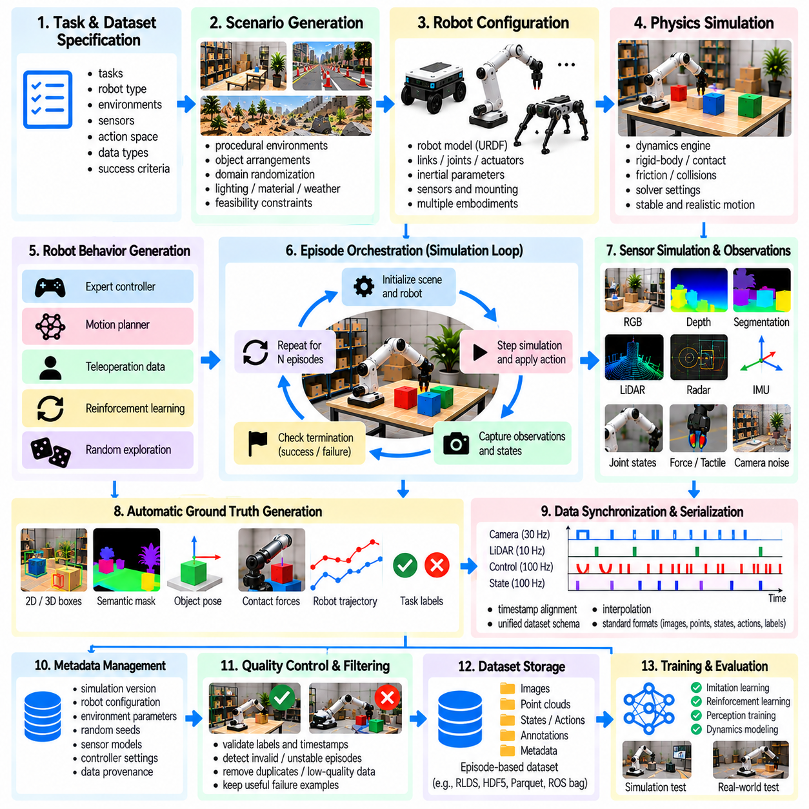{width="7.268055555555556in" height="7.268055555555556in"}

A simulation data generation pipeline is an integrated workflow that transforms virtual environments and robot behaviors into structured training datasets for Physical AI. It connects scenario configuration, physics simulation, sensor rendering, robot control, annotation, and storage. The primary objective is to generate diverse, reproducible, and physically meaningful experiences while reducing the cost and operational complexity of collecting data from real robots.

The pipeline begins with task and dataset specifications that define what information must be generated. These specifications identify robot capabilities, operating environments, sensor modalities, action representations, and expected learning objectives. Requirements may include navigation trajectories, manipulation demonstrations, contact events, or failure examples. Explicit specifications ensure that generated data supports intended training and evaluation tasks.

Scenario generation creates the virtual conditions under which robots operate. Procedural methods can construct rooms, corridors, terrain, workspaces, and object arrangements from configurable templates. Randomization controls geometry, lighting, materials, object placement, and environmental disturbances. Each generated scenario should satisfy feasibility constraints so that the resulting data represents meaningful robot interactions rather than arbitrary configurations.

Robot configuration establishes the mechanical and computational properties of the simulated platform. Robot description files define links, joints, collision geometry, inertial parameters, actuators, and sensor attachments. The pipeline loads these descriptions and initializes robot states before simulation. Parameterized configurations can support multiple robot embodiments, enabling data generation across different mobility and manipulation systems.

Physics simulation calculates how robots and environmental objects evolve under forces, constraints, and control inputs. Dynamics engines evaluate rigid-body motion, collisions, friction, and contact responses at discrete time steps. Numerical integration settings influence stability and computational cost. Appropriate solver configurations are necessary to generate trajectories that remain physically plausible across diverse tasks and operating conditions.

Sensor simulation converts virtual world states into observations resembling physical measurements. Cameras generate RGB, depth, and segmentation images, while LiDAR and radar models produce spatial measurements. Inertial sensors, encoders, and force sensors provide robot state information. Noise, distortion, latency, and missing measurements can be introduced to approximate deployment conditions and improve robustness against sensor uncertainty.

Robot behavior generation determines the actions performed during simulated episodes. Expert controllers, motion planners, teleoperation recordings, reinforcement learning policies, and exploratory strategies can produce trajectories. Different behavior sources provide complementary examples of successful execution, partial progress, and failure. The pipeline should record both commanded actions and resulting physical states to preserve causal relationships.

Episode orchestration coordinates scenario initialization, robot execution, sensor recording, and termination conditions. Each episode begins with a selected environment configuration and robot state. The system advances simulation, applies control commands, and captures observations at defined intervals. Episodes terminate when tasks succeed, failures occur, safety limits are reached, or maximum durations expire.

Automatic ground truth generation extracts reference information directly from simulation states. Object poses, bounding boxes, segmentation masks, depth maps, contact forces, and robot trajectories can be recorded without manual annotation. Task-level labels may identify success, failure, and intermediate progress. These annotations should remain synchronized with observations and use consistent coordinate frames, identifiers, and measurement units.

Data synchronization ensures that sensor observations, actions, and robot states correspond to compatible simulation times. Cameras, LiDAR, controllers, and physics solvers may operate at different frequencies. The pipeline must manage timestamps, sampling intervals, and interpolation where necessary. Incorrect synchronization can create misleading relationships between actions and outcomes, reducing the usefulness of generated training examples.

Data serialization converts simulation outputs into standardized storage representations. Images, point clouds, trajectories, annotations, and metadata may require different formats depending on their structure. A unified dataset schema should define episode identifiers, observation fields, action vectors, coordinate conventions, and label definitions. Consistent serialization enables efficient loading, filtering, and reuse across learning frameworks.

Metadata management preserves the conditions under which each sample was generated. Important records include simulation engine versions, robot configurations, environment parameters, random seeds, sensor models, and controller settings. These details support reproducibility, debugging, and comparisons between experiments. Data provenance also helps identify whether unexpected model behavior originates from simulation assumptions or training procedures.

Quality control validates generated datasets before they enter the training pipeline. Automated checks can identify missing sensor frames, invalid labels, unstable dynamics, inconsistent timestamps, and physically impossible states. Additional filters may remove duplicate trajectories or uninformative episodes. Quality assessment should preserve valuable failure examples while excluding corrupted data that could introduce misleading learning signals.

Dataset balancing controls the relative representation of tasks, environments, robot configurations, and outcomes. Unrestricted simulation may repeatedly generate easy scenarios or successful behaviors while underrepresenting difficult interactions. Stratified sampling and targeted scenario generation can improve coverage. Balanced datasets help learning systems encounter meaningful variations without becoming dominated by redundant or narrowly distributed experiences.

Parallel simulation enables large-scale generation by executing multiple environments simultaneously. Independent simulation instances can run on multicore processors, GPUs, or distributed computing clusters. Workload scheduling assigns scenarios and computational resources according to complexity. Efficient parallelization increases throughput, although rendering demands, physics computation, and data transfer can become significant bottlenecks.

Storage architecture must accommodate high-volume multimodal datasets generated by parallel simulation. RGB images, depth maps, point clouds, and continuous state trajectories can consume substantial capacity. Compression, chunked storage, and selective recording reduce unnecessary overhead. Data management systems should support efficient retrieval, dataset versioning, and reliable transfer between generation infrastructure and model training systems.

Pipeline monitoring tracks operational performance and dataset quality during generation. Useful metrics include episodes per hour, valid sample rate, simulation speed, storage consumption, and task outcome distributions. Monitoring can identify stalled simulations, abnormal physics behavior, or imbalanced scenario production. Automated alerts and recovery procedures improve reliability when generation workloads operate continuously.

A minimal implementation can organize the workflow around a repeated episode loop. The system samples scenario parameters, resets the simulator, executes a controller, records synchronized observations, and saves validated trajectories. A Python-based implementation may coordinate simulation APIs, sensor callbacks, and dataset writers. Separating configuration, execution, validation, and storage components makes the pipeline easier to test and extend.

Integration with real-world data improves the practical relevance of generated datasets. Physical robot observations can guide simulator calibration, randomization ranges, and scenario selection. Deployment failures may reveal missing environmental conditions or inaccurate dynamics models. The pipeline can then generate targeted synthetic examples and combine them with real demonstrations, creating a feedback mechanism for continuous improvement.

A production-ready simulation data engine integrates automated generation, validation, versioning, and feedback-driven refinement into a scalable system. Its effectiveness depends not only on the quantity of generated samples but also on physical fidelity, task coverage, annotation consistency, and real-world relevance. By connecting simulation infrastructure with learning and deployment evaluation, the pipeline becomes a foundation for continuous Physical AI development.

시뮬레이션 데이터 생성 파이프라인(Simulation Data Generation Pipeline)은 가상 환경(Virtual Environment)과 로봇 행동(Robot Behavior)을 피지컬 인공지능(Physical AI)을 위한 구조화된 학습 데이터셋(Structured Training Dataset)으로 변환하는 통합 작업 흐름(Integrated Workflow)이다. 이 파이프라인은 시나리오 구성(Scenario Configuration), 물리 시뮬레이션(Physics Simulation), 센서 렌더링(Sensor Rendering), 로봇 제어(Robot Control), 주석 생성(Annotation), 데이터 저장(Storage)을 연결한다. 주요 목표는 실제 로봇에서 데이터를 수집하는 비용과 운영 복잡성(Operational Complexity)을 줄이면서 다양하고 재현 가능하며 물리적으로 의미 있는 경험을 생성하는 것이다.

파이프라인은 생성해야 할 정보를 정의하는 작업 및 데이터셋 사양(Task and Dataset Specification)에서 시작한다. 이러한 사양은 로봇 능력(Robot Capability), 운영 환경(Operating Environment), 센서 모달리티(Sensor Modality), 행동 표현(Action Representation), 예상 학습 목표(Learning Objective)를 식별한다. 요구사항에는 내비게이션 궤적(Navigation Trajectory), 조작 시연(Manipulation Demonstration), 접촉 사건(Contact Event), 실패 사례(Failure Example)가 포함될 수 있다. 명시적인 사양은 생성된 데이터가 의도한 학습 및 평가 작업(Training and Evaluation Task)을 지원하도록 보장한다.

시나리오 생성(Scenario Generation)은 로봇이 작동하는 가상 조건(Virtual Condition)을 구성한다. 절차적 생성 방법(Procedural Method)은 설정 가능한 템플릿(Configurable Template)을 사용하여 방(Room), 복도(Corridor), 지형(Terrain), 작업공간(Workspace), 객체 배치(Object Arrangement)를 구성할 수 있다. 무작위화(Randomization)는 기하학(Geometry), 조명(Lighting), 재질(Material), 객체 위치(Object Placement), 환경 외란(Environmental Disturbance)을 제어한다. 생성된 각 시나리오는 실행 가능성 제약조건(Feasibility Constraint)을 충족해야 하며, 결과 데이터는 임의적인 구성이 아니라 의미 있는 로봇 상호작용(Robot Interaction)을 나타내야 한다.

로봇 구성(Robot Configuration)은 시뮬레이션 플랫폼(Simulated Platform)의 기계적 및 계산적 특성(Mechanical and Computational Property)을 설정한다. 로봇 기술 파일(Robot Description File)은 링크(Link), 관절(Joint), 충돌 기하학(Collision Geometry), 관성 매개변수(Inertial Parameter), 구동기(Actuator), 센서 부착 구조(Sensor Attachment)를 정의한다. 파이프라인은 이러한 기술 정보를 불러오고 시뮬레이션 전에 로봇 상태(Robot State)를 초기화한다. 매개변수화된 구성(Parameterized Configuration)은 여러 로봇 신체 구조(Robot Embodiment)를 지원하여 서로 다른 이동 및 조작 시스템(Mobility and Manipulation System)에 걸친 데이터 생성을 가능하게 한다.

물리 시뮬레이션(Physics Simulation)은 힘(Force), 제약조건(Constraint), 제어 입력(Control Input)에 따라 로봇과 환경 객체(Environmental Object)가 어떻게 변화하는지 계산한다. 동역학 엔진(Dynamics Engine)은 이산 시간 단계(Discrete Time Step)에서 강체 운동(Rigid-Body Motion), 충돌(Collision), 마찰(Friction), 접촉 응답(Contact Response)을 평가한다. 수치 적분 설정(Numerical Integration Setting)은 안정성(Stability)과 계산 비용(Computational Cost)에 영향을 미친다. 다양한 작업과 운영 조건에서 물리적으로 타당한 궤적(Physically Plausible Trajectory)을 생성하려면 적절한 해석기 구성(Solver Configuration)이 필요하다.

센서 시뮬레이션(Sensor Simulation)은 가상 세계 상태(Virtual World State)를 실제 물리적 측정값(Physical Measurement)과 유사한 관측값(Observation)으로 변환한다. 카메라(Camera)는 RGB 영상(RGB Image), 깊이 영상(Depth Image), 분할 영상(Segmentation Image)을 생성하며, 라이다(LiDAR)와 레이더(Radar) 모델은 공간 측정값(Spatial Measurement)을 생성한다. 관성 센서(Inertial Sensor), 엔코더(Encoder), 힘 센서(Force Sensor)는 로봇 상태 정보(Robot State Information)를 제공한다. 잡음(Noise), 왜곡(Distortion), 지연(Latency), 측정값 누락(Missing Measurement)을 도입하여 실제 배포 조건(Deployment Condition)을 근사하고 센서 불확실성(Sensor Uncertainty)에 대한 강건성(Robustness)을 향상시킬 수 있다.

로봇 행동 생성(Robot Behavior Generation)은 시뮬레이션 에피소드(Simulated Episode) 동안 수행할 행동(Action)을 결정한다. 전문가 제어기(Expert Controller), 운동 계획기(Motion Planner), 원격조작 기록(Teleoperation Recording), 강화 학습 정책(Reinforcement Learning Policy), 탐색 전략(Exploratory Strategy)은 궤적(Trajectory)을 생성할 수 있다. 서로 다른 행동 소스(Behavior Source)는 성공적인 실행(Successful Execution), 부분적인 진행(Partial Progress), 실패(Failure)에 대한 상호 보완적인 사례를 제공한다. 파이프라인은 인과관계(Causal Relationship)를 보존하기 위해 명령된 행동(Commanded Action)과 그 결과로 발생한 물리적 상태(Physical State)를 모두 기록해야 한다.

에피소드 오케스트레이션(Episode Orchestration)은 시나리오 초기화(Scenario Initialization), 로봇 실행(Robot Execution), 센서 기록(Sensor Recording), 종료 조건(Termination Condition)을 조정한다. 각 에피소드는 선택된 환경 구성(Environment Configuration)과 로봇 상태(Robot State)에서 시작한다. 시스템은 시뮬레이션을 진행하고 제어 명령(Control Command)을 적용하며 정의된 간격(Defined Interval)으로 관측값을 수집한다. 에피소드는 작업 성공(Task Success), 실패 발생(Failure Occurrence), 안전 한계 도달(Safety Limit), 최대 지속시간 초과(Maximum Duration)에 따라 종료된다.

자동 정답 데이터 생성(Automatic Ground Truth Generation)은 시뮬레이션 상태(Simulation State)에서 참조 정보(Reference Information)를 직접 추출한다. 객체 자세(Object Pose), 경계 상자(Bounding Box), 분할 마스크(Segmentation Mask), 깊이 지도(Depth Map), 접촉력(Contact Force), 로봇 궤적(Robot Trajectory)을 수작업 주석(Manual Annotation) 없이 기록할 수 있다. 작업 수준 레이블(Task-Level Label)은 성공(Success), 실패(Failure), 중간 진행 상태(Intermediate Progress)를 식별할 수 있다. 이러한 주석은 관측값과 동기화되어야 하며 일관된 좌표계(Coordinate Frame), 식별자(Identifier), 측정 단위(Measurement Unit)를 사용해야 한다.

데이터 동기화(Data Synchronization)는 센서 관측값(Sensor Observation), 행동(Action), 로봇 상태(Robot State)가 서로 호환되는 시뮬레이션 시간(Simulation Time)에 대응하도록 보장한다. 카메라(Camera), 라이다(LiDAR), 제어기(Controller), 물리 해석기(Physics Solver)는 서로 다른 주파수(Frequency)로 작동할 수 있다. 파이프라인은 필요한 경우 타임스탬프(Timestamp), 샘플링 간격(Sampling Interval), 보간(Interpolation)을 관리해야 한다. 잘못된 동기화(Incorrect Synchronization)는 행동과 결과 사이에 오해를 유발하는 관계(Misleading Relationship)를 만들어 생성된 학습 사례(Training Example)의 유용성을 감소시킬 수 있다.

데이터 직렬화(Data Serialization)는 시뮬레이션 출력(Simulation Output)을 표준화된 저장 표현(Standardized Storage Representation)으로 변환한다. 영상(Image), 포인트 클라우드(Point Cloud), 궤적(Trajectory), 주석(Annotation), 메타데이터(Metadata)는 구조에 따라 서로 다른 형식(Format)이 필요할 수 있다. 통합 데이터셋 스키마(Unified Dataset Schema)는 에피소드 식별자(Episode Identifier), 관측 필드(Observation Field), 행동 벡터(Action Vector), 좌표 규약(Coordinate Convention), 레이블 정의(Label Definition)를 규정해야 한다. 일관된 직렬화는 다양한 학습 프레임워크(Learning Framework)에서 효율적인 데이터 불러오기(Loading), 필터링(Filtering), 재사용(Reuse)을 가능하게 한다.

메타데이터 관리(Metadata Management)는 각 샘플이 생성된 조건(Generation Condition)을 보존한다. 중요한 기록에는 시뮬레이션 엔진 버전(Simulation Engine Version), 로봇 구성(Robot Configuration), 환경 매개변수(Environment Parameter), 난수 시드(Random Seed), 센서 모델(Sensor Model), 제어기 설정(Controller Setting)이 포함된다. 이러한 세부 정보는 재현성(Reproducibility), 디버깅(Debugging), 실험 간 비교(Experiment Comparison)를 지원한다. 데이터 출처 추적(Data Provenance)은 예상하지 못한 모델 동작(Unexpected Model Behavior)이 시뮬레이션 가정(Simulation Assumption)에서 비롯되었는지 학습 절차(Training Procedure)에서 비롯되었는지 식별하는 데 도움이 된다.

품질 관리(Quality Control)는 생성된 데이터셋이 학습 파이프라인(Training Pipeline)에 입력되기 전에 유효성을 검증한다. 자동화된 검사(Automated Check)는 누락된 센서 프레임(Missing Sensor Frame), 유효하지 않은 레이블(Invalid Label), 불안정한 동역학(Unstable Dynamics), 일관되지 않은 타임스탬프(Inconsistent Timestamp), 물리적으로 불가능한 상태(Physically Impossible State)를 식별할 수 있다. 추가적인 필터(Filter)는 중복 궤적(Duplicate Trajectory)이나 정보량이 부족한 에피소드(Uninformative Episode)를 제거할 수 있다. 품질 평가는 가치 있는 실패 사례(Valuable Failure Example)는 보존하면서 잘못된 학습 신호(Misleading Learning Signal)를 유발할 수 있는 손상된 데이터(Corrupted Data)를 제외해야 한다.

데이터셋 균형화(Dataset Balancing)는 작업(Task), 환경(Environment), 로봇 구성(Robot Configuration), 결과(Outcome)의 상대적인 표현 비율(Relative Representation)을 제어한다. 제한 없는 시뮬레이션(Unrestricted Simulation)은 어려운 상호작용(Difficult Interaction)을 충분히 표현하지 못하면서 쉬운 시나리오(Easy Scenario)나 성공적인 행동(Successful Behavior)을 반복적으로 생성할 수 있다. 층화 샘플링(Stratified Sampling)과 목표 지향적 시나리오 생성(Targeted Scenario Generation)은 포괄 범위(Coverage)를 개선할 수 있다. 균형 잡힌 데이터셋(Balanced Dataset)은 학습 시스템이 중복되거나 좁은 분포(Narrowly Distributed Experience)에 지배되지 않으면서 의미 있는 변화(Meaningful Variation)를 경험하도록 지원한다.

병렬 시뮬레이션(Parallel Simulation)은 여러 환경을 동시에 실행하여 대규모 데이터 생성(Large-Scale Data Generation)을 가능하게 한다. 독립적인 시뮬레이션 인스턴스(Independent Simulation Instance)는 멀티코어 프로세서(Multicore Processor), 그래픽 처리 장치(GPU), 분산 컴퓨팅 클러스터(Distributed Computing Cluster)에서 실행될 수 있다. 작업 부하 스케줄링(Workload Scheduling)은 복잡성(Complexity)에 따라 시나리오와 계산 자원(Computational Resource)을 할당한다. 효율적인 병렬화(Efficient Parallelization)는 처리량(Throughput)을 증가시키지만 렌더링 요구량(Rendering Demand), 물리 계산(Physics Computation), 데이터 전송(Data Transfer)이 중요한 병목현상(Bottleneck)이 될 수 있다.

저장 아키텍처(Storage Architecture)는 병렬 시뮬레이션에서 생성되는 대용량 다중 모달 데이터셋(High-Volume Multimodal Dataset)을 수용할 수 있어야 한다. RGB 영상(RGB Image), 깊이 지도(Depth Map), 포인트 클라우드(Point Cloud), 연속 상태 궤적(Continuous State Trajectory)은 상당한 저장 용량(Storage Capacity)을 소비할 수 있다. 압축(Compression), 청크 단위 저장(Chunked Storage), 선택적 기록(Selective Recording)은 불필요한 오버헤드(Overhead)를 줄인다. 데이터 관리 시스템(Data Management System)은 효율적인 검색(Retrieval), 데이터셋 버전 관리(Dataset Versioning), 생성 인프라(Generation Infrastructure)와 모델 학습 시스템(Model Training System) 사이의 안정적인 전송(Reliable Transfer)을 지원해야 한다.

파이프라인 모니터링(Pipeline Monitoring)은 데이터 생성 과정에서 운영 성능(Operational Performance)과 데이터셋 품질(Dataset Quality)을 추적한다. 유용한 지표(Metric)에는 시간당 에피소드 수(Episodes per Hour), 유효 샘플 비율(Valid Sample Rate), 시뮬레이션 속도(Simulation Speed), 저장 공간 사용량(Storage Consumption), 작업 결과 분포(Task Outcome Distribution)가 포함된다. 모니터링은 중단된 시뮬레이션(Stalled Simulation), 비정상적인 물리 동작(Abnormal Physics Behavior), 불균형한 시나리오 생성(Imbalanced Scenario Production)을 식별할 수 있다. 자동 경고(Automated Alert)와 복구 절차(Recovery Procedure)는 데이터 생성 작업(Generation Workload)이 지속적으로 실행될 때 신뢰성(Reliability)을 향상시킨다.

최소 구현(Minimal Implementation)은 반복적인 에피소드 루프(Episode Loop)를 중심으로 작업 흐름(Workflow)을 구성할 수 있다. 시스템은 시나리오 매개변수(Scenario Parameter)를 샘플링하고 시뮬레이터(Simulator)를 초기화한 다음 제어기(Controller)를 실행하고 동기화된 관측값(Synchronized Observation)을 기록하며 검증된 궤적(Validated Trajectory)을 저장한다. 파이썬 기반 구현(Python-Based Implementation)은 시뮬레이션 응용 프로그래밍 인터페이스(Simulation API), 센서 콜백(Sensor Callback), 데이터셋 기록기(Dataset Writer)를 조정할 수 있다. 구성(Configuration), 실행(Execution), 검증(Validation), 저장(Storage) 구성요소를 분리하면 파이프라인을 더 쉽게 테스트하고 확장할 수 있다.

실제 데이터와의 통합(Integration with Real-World Data)은 생성된 데이터셋의 실용적 관련성(Practical Relevance)을 향상시킨다. 실제 로봇 관측값(Physical Robot Observation)은 시뮬레이터 보정(Simulator Calibration), 무작위화 범위(Randomization Range), 시나리오 선택(Scenario Selection)을 안내할 수 있다. 실제 배포 실패(Deployment Failure)는 누락된 환경 조건(Missing Environmental Condition)이나 부정확한 동역학 모델(Inaccurate Dynamics Model)을 드러낼 수 있다. 이후 파이프라인은 목표 지향적 합성 사례(Targeted Synthetic Example)를 생성하고 실제 시연(Real Demonstration)과 결합하여 지속적인 개선(Continuous Improvement)을 위한 피드백 메커니즘(Feedback Mechanism)을 형성할 수 있다.

실제 운영 수준의 시뮬레이션 데이터 엔진(Production-Ready Simulation Data Engine)은 자동화된 생성(Automated Generation), 검증(Validation), 버전 관리(Versioning), 피드백 기반 개선(Feedback-Driven Refinement)을 확장 가능한 시스템(Scalable System)으로 통합한다. 그 효과는 생성된 샘플의 양뿐만 아니라 물리적 충실도(Physical Fidelity), 작업 포괄 범위(Task Coverage), 주석 일관성(Annotation Consistency), 실제 환경 관련성(Real-World Relevance)에 따라 결정된다. 시뮬레이션 인프라(Simulation Infrastructure)를 학습(Learning) 및 배포 평가(Deployment Evaluation)와 연결함으로써 이 파이프라인은 지속적인 피지컬 인공지능 개발(Continuous Physical AI Development)의 기반이 된다.
