**Volume 04. Data Engines and Scaling for Physical AI**

# Chapter 05. Data Labeling for Robotics

## 05.01. Why Robot Data Labeling is Different

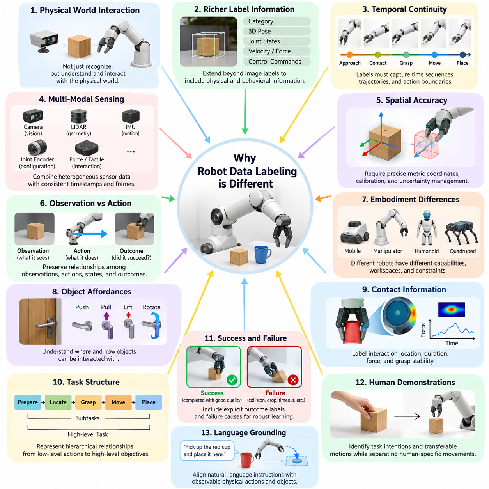{width="7.268055555555556in" height="7.268055555555556in"}

Robot data labeling differs fundamentally from conventional data annotation because robots must perceive, interpret, and interact with the physical world rather than simply recognize patterns in static information. A labeled image may identify an object, but a robot must also understand its position, orientation, motion, physical properties, and relationship to possible actions. Consequently, robot labels must connect perception with physical behavior and task execution.

Traditional computer vision datasets commonly associate images with categories, bounding boxes, or segmentation masks. Robotics datasets extend these representations to include spatial coordinates, joint configurations, velocities, forces, contact states, and control commands. Labels must describe not only what exists in a scene but also how objects and agents behave over time, enabling learning systems to predict the consequences of physical interactions.

Temporal continuity is a defining requirement of robotic annotation. A manipulation sequence may involve approaching an object, establishing contact, adjusting grip force, lifting, transporting, and releasing it. Each stage contributes information about the underlying task. Independent frame annotations cannot adequately capture these relationships, making synchronized trajectories, action boundaries, and event sequences essential components of robot learning datasets.

Robot data also combines multiple sensing modalities that operate at different frequencies and resolutions. Cameras provide visual observations, LiDAR supplies geometric measurements, inertial sensors estimate motion, and joint encoders describe internal configurations. Force and tactile sensors reveal physical interaction states. Effective labeling requires these heterogeneous signals to share consistent timestamps, coordinate frames, calibration parameters, and semantic interpretations.

Spatial accuracy introduces challenges rarely encountered in ordinary image classification. A small error in a two-dimensional bounding box may have limited consequences for object recognition, while a comparable error in a grasp pose can cause manipulation failure. Robotics annotations therefore require careful treatment of metric coordinates, geometric transformations, sensor calibration, and uncertainty, particularly when labels directly influence motion planning or physical control.

The distinction between observation and action is equally important. A camera image describes what the robot sees, whereas an action command describes what the robot attempts to change. The resulting observation reveals whether the intended transformation occurred. High-quality robotics datasets preserve this relationship among observations, states, actions, and outcomes, allowing models to learn action-conditioned dynamics rather than isolated visual associations.

Embodiment further complicates annotation because different robots possess different physical capabilities. A mobile robot, industrial manipulator, humanoid, and quadruped may observe similar environments but interpret actionable opportunities differently. Joint configurations, reachable workspaces, locomotion constraints, and available end effectors determine which actions are feasible. Labels must therefore distinguish transferable task semantics from robot-specific execution parameters.

Object affordances provide another important dimension of robotic labeling. Recognizing a door handle is insufficient unless the robot understands where it can be grasped, how it moves, and which forces or motions operate it. Affordance annotations connect object geometry with possible interactions, including pushing, pulling, lifting, supporting, and rotating. These labels help transform visual perception into physically meaningful action selection.

Contact information is particularly valuable because many manipulation tasks depend on interactions that are difficult to infer from appearance alone. A robot may visually appear to grasp an object while applying insufficient force to lift it. Contact labels can describe interaction location, duration, force direction, and grasp stability. Combining tactile measurements with visual observations enables more accurate interpretation of successful and unsuccessful manipulation attempts.

Task structure introduces semantic relationships extending beyond individual motor commands. Preparing a workspace, locating an object, grasping it, moving it, and placing it at a destination form a sequence of interconnected subtasks. Robotics labeling must represent these hierarchical relationships so learning systems can associate low-level actions with high-level objectives. This organization becomes increasingly important for long-horizon autonomous behavior.

Unlike conventional recognition datasets, robotics datasets frequently require explicit success and failure annotations. A trajectory may reach its intended destination while violating safety constraints, damaging an object, or consuming excessive time. Outcome labels should therefore distinguish task completion from execution quality. Recording failure causes, corrective actions, and recovery behavior provides essential information for training robust policies under imperfect conditions.

Human demonstrations introduce additional annotation complexity because human actions do not directly correspond to robot control spaces. Human hands possess different kinematics, compliance, and sensing capabilities from robotic grippers. Labeling demonstrations requires identifying task intentions, interaction targets, and transferable motion characteristics while separating human-specific movements from behaviors that can be executed by a robot with different physical constraints.

Language-grounded robot learning requires alignment between natural-language instructions and observable physical behavior. An instruction such as placing a container on a shelf contains semantic information about objects, spatial relationships, and intended outcomes. Corresponding annotations must identify relevant observations, action segments, and completion conditions. These relationships support vision-language-action models that translate human instructions into executable robot behaviors.

Robotics labeling also differs in its dependence on physical context. The same motion may be appropriate on a stable surface but unsafe near a human worker or fragile object. Environmental geometry, obstacle proximity, payload properties, and operating conditions influence action interpretation. Contextual labels help learning systems distinguish visually similar situations that require different control decisions because their physical constraints are fundamentally different.

Uncertainty must be represented explicitly when observations cannot establish reliable ground truth. Occlusion may hide an object\'s contact surface, sensor noise may distort position estimates, and visual recordings may not reveal applied forces. Assigning precise labels without sufficient evidence introduces misleading supervision. Confidence scores, visibility indicators, uncertainty intervals, and unknown-state annotations provide mechanisms for preserving the limits of available measurements.

Data sources also influence labeling reliability. Teleoperation recordings provide direct access to robot commands and measured states, while human videos often require inferred actions and reconstructed geometry. Simulation environments can generate exact internal state labels relative to their simulated models, but these may not accurately reflect real-world physical behavior. Annotation pipelines must account for these differences when combining datasets from heterogeneous sources.

Safety-critical events require specialized labeling because rare failures can carry consequences disproportionate to their frequency. Near collisions, unstable grasps, unexpected human interventions, and emergency stops may represent only a small fraction of collected trajectories. Nevertheless, accurately identifying these events is essential for improving operational reliability. Event labels should preserve the surrounding temporal context needed to understand causes and potential recovery strategies.

Annotation quality cannot be evaluated solely through agreement between human labelers. Two annotators may consistently identify the same object while producing grasp locations that are unsuitable for execution. Robotics labeling quality must therefore consider geometric accuracy, temporal consistency, physical plausibility, and downstream task performance. Evaluation may include replay analysis, simulation testing, and controlled robot experiments to determine whether annotations support reliable behavior.

A consistent label taxonomy is necessary for combining observations across tasks, environments, and robot platforms. Categories such as object identity, contact state, action primitive, subtask, outcome, and safety event should have clear definitions. Coordinate conventions, measurement units, reference frames, and timestamp semantics must also remain consistent. Without these standards, individually useful datasets may become difficult to integrate into larger training systems.

The annotation process increasingly relies on automated perception models, geometric estimation, tracking algorithms, and learned action recognition. However, automated labels may propagate systematic errors across large collections of trajectories. Human review remains important for ambiguous interactions, rare events, and safety-sensitive decisions. Combining automated generation with targeted verification offers a practical balance between annotation throughput, cost, and reliability.

Active learning can improve labeling efficiency by identifying observations or trajectories that provide unusually high training value. Instead of annotating every recorded episode uniformly, a data engine can prioritize uncertain predictions, unfamiliar objects, unusual contact conditions, and unsuccessful executions. This strategy directs human effort toward examples that are difficult for current models, potentially improving performance with fewer manually verified annotations.

Robotic annotations must also preserve data provenance and reproducibility. Each label should remain associated with its source episode, sensor configuration, calibration version, annotation method, and relevant model version. When labels are corrected or regenerated, version histories should document the changes. This traceability supports error investigation, dataset maintenance, and meaningful comparisons between successive robot learning experiments.

Scaling robot data labeling requires more than increasing the number of annotated frames. The underlying system must maintain consistency across trajectories, environments, embodiments, and evolving task definitions. Automated validation can detect missing timestamps, invalid transformations, impossible joint states, and inconsistent event boundaries. These checks reduce the risk that annotation defects will silently influence policy training or evaluation results.

Ultimately, robot data labeling is the process of converting physical experience into structured learning signals. Its distinctive challenge lies in connecting multimodal observations with geometry, dynamics, actions, intentions, and consequences. Successful labeling systems preserve the causal and temporal relationships necessary for embodied intelligence, enabling physical AI models to move beyond recognizing the world toward understanding how to act within it safely and effectively.

## 05.02. Manual Semi Automatic and Automatic Labeling

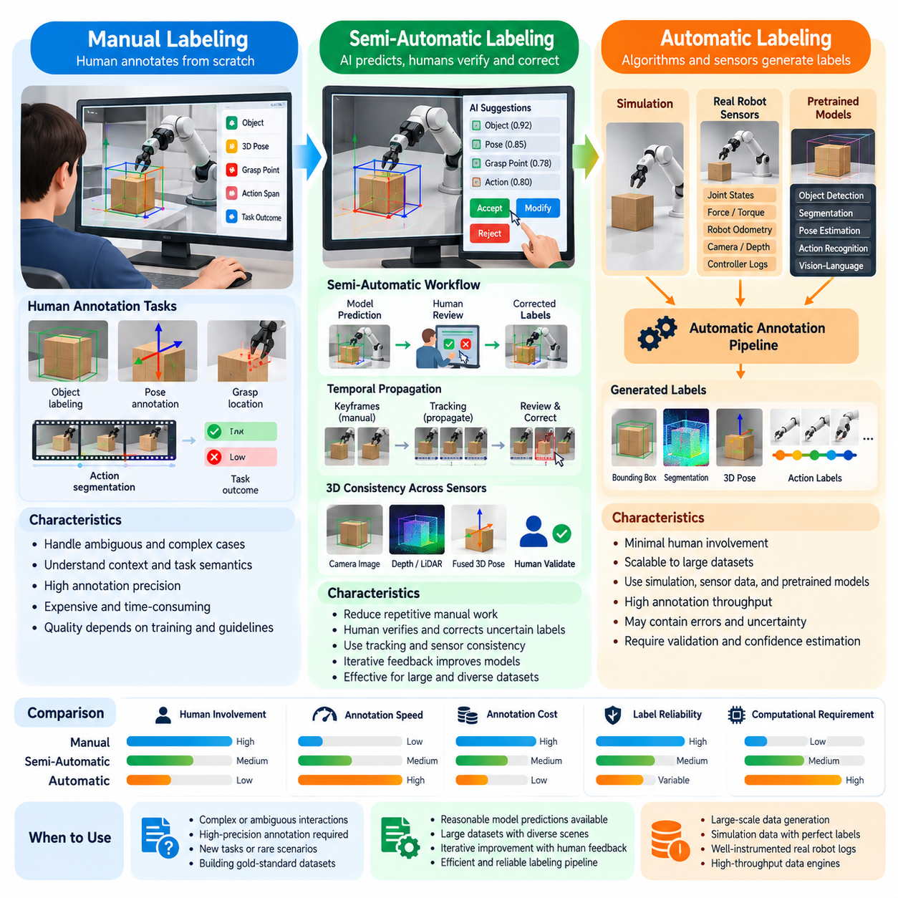{width="7.268055555555556in" height="7.268055555555556in"}

Robot data labeling can be organized into three major approaches: manual, semi-automatic, and automatic labeling. These approaches differ in human involvement, computational requirements, annotation speed, and reliability. Selecting an appropriate strategy depends on the complexity of the robotic task, the available sensor data, the required annotation precision, and the scale of the dataset being developed.

Manual labeling relies on human annotators to inspect robot observations and assign meaningful labels. Typical activities include identifying objects, marking grasp locations, segmenting actions, and classifying task outcomes. Human judgment is especially valuable when physical interactions are ambiguous or difficult to infer computationally. However, manual annotation becomes expensive and time-consuming when applied to large multimodal robot datasets.

A major advantage of manual labeling is the ability to interpret contextual and semantic information. Human annotators can distinguish between intentional actions, accidental contact, corrective movements, and task failures by examining complete episodes. They can also interpret language instructions and complex task structures. Nevertheless, annotation quality depends on training, domain expertise, and consistent labeling guidelines.

Manual annotation presents particular challenges for three-dimensional robotics data. Estimating object poses, contact points, and spatial relationships requires specialized visualization tools and calibrated coordinate systems. Annotators may need to examine synchronized camera views, point clouds, and robot trajectories. Even experienced operators can introduce geometric errors when important surfaces are occluded or sensor measurements are incomplete.

Semi-automatic labeling combines computational predictions with human verification and correction. An algorithm generates preliminary annotations, while human reviewers inspect uncertain or incorrect results. This approach reduces repetitive manual work without completely removing human supervision. It is particularly effective when perception models provide reasonable initial estimates but cannot consistently handle unusual objects, difficult interactions, or rare events.

A typical semi-automatic workflow begins with automated object detection, segmentation, pose estimation, or action recognition. Generated labels are presented through an annotation interface where reviewers can accept, modify, or reject them. Corrections may subsequently improve the labeling model. This iterative process creates a feedback loop in which human expertise progressively increases automated annotation accuracy and operational efficiency.

Temporal propagation is an important technique in semi-automatic robot labeling. Instead of independently annotating every video frame, a human may label selected keyframes while tracking algorithms propagate annotations across neighboring observations. Reviewers then correct tracking drift, occlusion errors, and identity switches. This method is especially useful for object trajectories, manipulation sequences, and long-duration mobile robot recordings.

Three-dimensional semi-automatic annotation can exploit geometric consistency across sensors and time. Object detections from camera images may be projected into depth measurements or LiDAR point clouds to estimate spatial positions. Tracking and registration algorithms can refine these estimates across consecutive frames. Human reviewers validate the resulting geometry, particularly when objects overlap, move unpredictably, or interact through contact.

Automatic labeling minimizes direct human participation by generating annotations through algorithms, sensor measurements, simulation engines, or pretrained models. It is attractive for large-scale physical AI data engines because annotation throughput can increase with computational resources. However, automatic generation does not guarantee correctness. Reliable systems must distinguish directly measured states from inferred labels and continuously assess prediction uncertainty.

Simulation provides a particularly powerful source of automatically generated labels. A physics simulator can expose object positions, orientations, velocities, collision states, and robot joint configurations directly from its internal representation. Rendering systems can generate segmentation masks, depth maps, and object identifiers. These labels are internally consistent with the simulated scene, although their real-world validity depends on simulation fidelity.

Real robot systems can also produce automatic labels from their own instrumentation. Joint encoders provide measured configurations, force sensors report interaction forces, and motion controllers record commanded actions. Robot localization systems may estimate platform trajectories, while calibrated cameras and depth sensors provide spatial observations. These measurements can support annotation pipelines, provided their accuracy, synchronization, and coordinate conventions are verified.

Model-based automatic labeling extends beyond direct sensor measurements. Computer vision networks can predict object categories, segmentation masks, and six-degree-of-freedom poses. Temporal models can identify action boundaries and classify behavioral sequences. Vision-language models may generate task descriptions or semantic labels. Because these outputs are predictions rather than verified ground truth, confidence estimation and independent validation remain essential.

The three labeling approaches differ substantially in their cost structures. Manual labeling requires significant human labor but relatively limited model development. Semi-automatic labeling introduces software integration and reviewer workflows while reducing annotation time per example. Automatic labeling requires greater initial investment in models, infrastructure, and validation systems but can achieve lower marginal annotation costs when operating at sufficient scale.

Labeling accuracy must be evaluated separately from labeling speed. A fully automatic system may process millions of frames while repeatedly misclassifying rare contact events or unstable grasps. Conversely, manual annotation may provide detailed semantic interpretations but suffer from inconsistency and fatigue. Semi-automatic methods can balance these limitations when reviewers focus on cases where automated predictions are uncertain or physically implausible.

Different label categories often require different levels of automation. Object identification and image segmentation may be suitable for automated processing when strong perception models are available. Contact-state interpretation, task intention, and failure causality may require greater human involvement. A practical robotics data engine therefore assigns labeling methods according to annotation complexity, available evidence, operational risk, and expected downstream consequences.

Confidence-based routing provides a systematic mechanism for selecting annotation methods. Predictions with high confidence and strong consistency checks may be accepted automatically, while uncertain examples are sent for human review. Highly ambiguous or safety-critical cases may require expert annotation. Confidence thresholds should be calibrated against measured error rates rather than treated as universal indicators of correctness across different tasks and environments.

Human correction data creates opportunities for continuous improvement. When reviewers modify automatically generated labels, the differences reveal systematic weaknesses in perception and action-understanding models. These corrections can become supervised training examples for subsequent model updates. Over repeated cycles, the annotation system can improve its ability to handle previously difficult conditions while reducing the volume of routine human intervention.

Quality assurance must operate across all three labeling approaches. Manual annotations benefit from reviewer agreement, expert audits, and clear definitions. Semi-automatic outputs require checks for correction consistency and unresolved model errors. Automatic labels need geometric validation, temporal consistency testing, and comparison with independently verified references. Evaluation should also examine whether annotation errors degrade downstream robot behavior.

Scalability depends on more than the number of labels generated per second. Large robotics datasets contain synchronized video, depth measurements, proprioceptive signals, actions, and task metadata. Annotation pipelines must preserve relationships among these modalities while processing substantial data volumes. Distributed computing, efficient storage, dataset indexing, and incremental processing become important as collection expands across robots and deployment sites.

Annotation interfaces also influence productivity and reliability. Effective tools should display synchronized sensor streams, robot states, trajectories, and relevant task information in a coherent workspace. Reviewers need mechanisms for inspecting three-dimensional geometry, adjusting temporal boundaries, and comparing predicted labels with observations. Well-designed interfaces reduce cognitive effort and help prevent inconsistencies between visual, spatial, and behavioral annotations.

Data provenance and version management are essential when labeling methods evolve. Each annotation should retain information about its generating algorithm, human reviewer, confidence score, timestamp, and relevant calibration or model version. Corrected labels should not silently overwrite earlier records without traceability. This information enables dataset audits, reproducible training experiments, and investigation of failures associated with particular annotation pipelines.

A hybrid labeling architecture can combine manual, semi-automatic, and automatic processing within a single data engine. Routine perception labels may be generated automatically, uncertain geometric estimates may receive targeted review, and complex task outcomes may be evaluated by specialists. The resulting workflow allocates human attention according to information value and risk rather than requiring the same annotation procedure for every example.

The long-term objective is not to eliminate human annotators entirely but to maximize the quality and usefulness of labeled robotic experience. Automation provides throughput, human expertise supplies contextual judgment, and validation establishes confidence in the resulting data. By integrating these capabilities into a continuous feedback process, physical AI data engines can produce scalable, traceable, and increasingly reliable training datasets.

## 05.03. Human in the Loop and AI Assisted Labeling

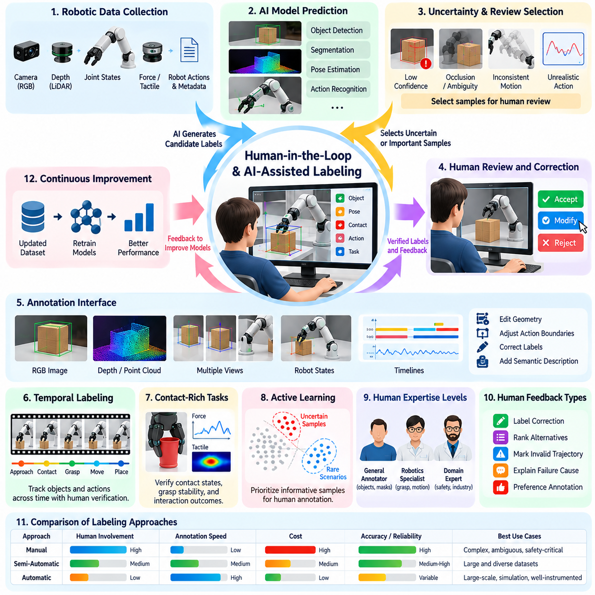{width="7.268055555555556in" height="7.268055555555556in"}

Human-in-the-loop labeling integrates human judgment into automated annotation systems to improve the accuracy, reliability, and usefulness of robotics training data. Rather than treating human annotation and machine prediction as separate processes, this approach establishes a collaborative workflow in which AI models generate candidate labels and human experts verify, correct, or refine them. The resulting feedback continuously improves both dataset quality and annotation efficiency.

Robotics applications particularly benefit from human-in-the-loop approaches because physical interactions frequently contain ambiguity that automated models cannot resolve reliably. Occluded objects, subtle contact transitions, unexpected movements, and complex task intentions may require contextual interpretation. Human reviewers provide semantic understanding and physical reasoning that complement computational perception, especially when incorrect labels could influence unsafe robot behavior.

AI-assisted labeling uses machine learning models to reduce repetitive annotation work while preserving human oversight. Object detectors, segmentation networks, pose estimators, and action recognition models can generate preliminary annotations from multimodal robot recordings. Reviewers then concentrate on uncertain predictions rather than labeling every observation manually. This division of labor allows annotation resources to focus on difficult examples and high-value information.

A typical human-in-the-loop pipeline begins with collecting synchronized sensor observations, robot states, actions, and task metadata. Automated models process these records and produce candidate annotations with associated confidence estimates. A selection mechanism identifies labels requiring human inspection. Verified corrections are stored alongside the original data and subsequently incorporated into training, evaluation, and model improvement workflows.

The effectiveness of this architecture depends on determining when human intervention is necessary. Confidence-based selection can identify predictions with low estimated reliability, while disagreement between multiple models can reveal ambiguous cases. Geometric inconsistency, temporal discontinuity, and physically implausible actions provide additional warning signals. Combining these indicators produces more reliable review priorities than relying on model confidence alone.

Human reviewers contribute different forms of expertise depending on the annotation task. General annotators may verify object categories and segmentation masks, while robotics specialists inspect grasp poses, contact states, and motion feasibility. Domain experts may evaluate industrial operations, surgical interactions, or safety-critical events. Matching reviewer expertise to annotation complexity improves quality while avoiding unnecessary specialist involvement.

Interactive annotation tools are central to effective human-AI collaboration. Reviewers should be able to inspect synchronized camera streams, depth measurements, point clouds, robot trajectories, and controller states within a unified interface. AI-generated labels should remain editable, with mechanisms for correcting geometry, adjusting action boundaries, and revising semantic descriptions. Efficient interfaces reduce review time and improve annotation consistency.

Temporal annotation benefits substantially from AI assistance because robotic behavior unfolds across sequences rather than isolated frames. Tracking algorithms can propagate object identities and spatial labels through video recordings, while temporal models propose action boundaries and task segments. Human reviewers examine transitions, correct tracking drift, and identify meaningful behavioral changes. This approach preserves temporal structure without requiring exhaustive frame-by-frame annotation.

Human-in-the-loop labeling is particularly important for contact-rich manipulation tasks. Automated systems may detect object motion but fail to determine whether a grasp is stable, whether contact is intentional, or why an operation fails. Human experts can examine force measurements, tactile signals, visual evidence, and task context to refine interaction labels. Their corrections provide valuable supervision for models learning physical relationships and manipulation dynamics.

Active learning strengthens human-in-the-loop systems by selecting examples expected to provide the greatest improvement in model performance. Rather than sampling data uniformly, the system prioritizes uncertain predictions, unfamiliar environments, rare object configurations, and previously unsuccessful actions. Human annotations are then concentrated on regions where the current model lacks reliable knowledge, improving the efficiency of the labeling budget.

Uncertainty estimation must be carefully calibrated to support effective review decisions. A model may produce high confidence for incorrect predictions when encountering unfamiliar objects or environmental conditions. Calibration methods, ensemble disagreement, and distribution-shift detection can help identify these failures. Review thresholds should reflect the consequences of annotation errors, particularly when labels support safety-sensitive perception, planning, or control.

Human feedback can take several forms beyond direct label correction. Reviewers may rank alternative predictions, identify invalid trajectories, explain failure causes, or express preferences between different robot behaviors. Such feedback provides richer supervision than categorical labels alone. Preference and comparative annotations can support reward modeling, policy evaluation, and learning systems that must balance task completion, efficiency, and safety.

A closed-loop annotation architecture transforms corrections into continuous model improvement. Once human-reviewed labels pass quality checks, they are incorporated into curated training datasets. Updated models generate predictions for newly collected episodes, and subsequent review results reveal remaining weaknesses. This iterative process gradually reduces repetitive human work while maintaining oversight of difficult or unfamiliar situations.

Annotation quality depends on consistent instructions and clear definitions of acceptable labels. Human reviewers may disagree about ambiguous contacts, action boundaries, or partial task success. Detailed annotation guidelines, representative examples, and escalation procedures help reduce subjective variation. Expert adjudication can resolve difficult disagreements and establish reference annotations for evaluating both human and automated labeling performance.

AI assistance can introduce automation bias when reviewers accept model predictions without sufficient examination. Incorrect suggestions may influence human judgment, especially when interfaces present predictions as authoritative. Effective systems should display uncertainty, expose supporting evidence, and allow independent inspection of raw observations. Periodic blind reviews and randomly sampled audits can reveal errors that ordinary confirmation workflows might overlook.

Review allocation should consider both information value and operational risk. Routine labels with strong supporting evidence may require limited verification, while uncertain contact states or safety-critical failures deserve more detailed examination. A risk-aware review policy can combine prediction uncertainty, task importance, and potential consequences of error. This prevents annotation resources from being consumed primarily by frequent but low-impact examples.

Scalable human-in-the-loop systems require careful management of annotation queues, reviewer assignments, and processing latency. Large robot fleets may generate more candidate events than human teams can inspect immediately. Prioritization mechanisms can route urgent or informative episodes to appropriate reviewers while deferring routine cases. Distributed annotation platforms and workload monitoring help maintain throughput without sacrificing quality.

Data provenance is essential for tracing how human and AI contributions shape the final dataset. Each annotation should record its generating model, confidence estimate, review status, correction history, and relevant sensor or calibration versions. Distinguishing automatically accepted labels from human-verified annotations supports targeted quality analysis. Versioned records also enable reproducible training experiments and investigation of systematic labeling errors.

The economics of AI-assisted labeling depend on balancing model development, computational inference, human review, and quality assurance costs. Automation can reduce the number of annotations requiring direct human effort, but unreliable predictions may increase correction time. Productivity should therefore be measured through verified labels per unit cost rather than raw annotation volume. Downstream robot performance provides an additional measure of labeling value.

Human-in-the-loop systems also create opportunities for cross-embodiment learning. Human experts can identify common task intentions across manipulators, mobile robots, humanoids, and other platforms while preserving embodiment-specific constraints. AI models can propose correspondences between different action representations, and reviewers can validate their physical meaning. This collaboration supports reusable semantic annotations across heterogeneous robotic datasets.

Privacy, security, and accountability remain important when human reviewers inspect robot recordings. Industrial environments may contain confidential processes, while service robots may capture identifiable individuals or sensitive activities. Annotation platforms should apply access controls, data minimization, and appropriate redaction procedures. Review histories and audit records help establish accountability without unnecessarily exposing private information.

The long-term direction of human-in-the-loop labeling is toward adaptive collaboration between people and increasingly capable AI systems. As models improve, human attention can shift from routine annotation toward complex reasoning, rare failures, and validation of emerging capabilities. The objective is not simply to minimize human participation but to allocate expertise where it contributes the greatest value, creating scalable and trustworthy data engines for physical AI.

## 05.04. Weak Supervision and Pseudo Labeling

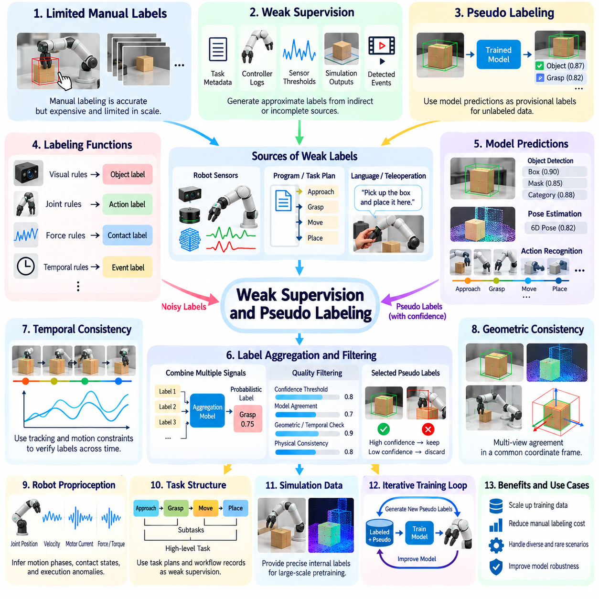{width="7.268055555555556in" height="7.268055555555556in"}

Weak supervision and pseudo-labeling provide scalable approaches to generating training annotations when manually labeled robotics data is limited or expensive. Instead of requiring precise human annotations for every observation, these methods exploit imperfect signals, heuristic rules, pretrained models, and unlabeled recordings. Their objective is to expand useful supervision while controlling label noise and preserving the physical consistency required for reliable robot learning.

Weak supervision generates approximate labels from indirect or incomplete sources of information. These sources may include task metadata, robot controller logs, sensor thresholds, simulation outputs, and automatically detected events. For example, a gripper closing command combined with an increase in measured force may suggest object contact. However, such evidence does not necessarily prove that a stable grasp occurred, making uncertainty representation essential.

Labeling functions are a common mechanism for implementing weak supervision. A labeling function applies a rule or computational procedure to assign a tentative category, state, or event label. Different functions may use visual detections, joint measurements, force signals, or temporal relationships. Their outputs can overlap, disagree, or abstain, requiring aggregation methods that account for varying reliability and correlated errors.

In robotic manipulation, weak labels can be derived from relationships between actions and observed outcomes. A commanded lifting motion followed by upward object displacement may indicate successful pickup. Conversely, gripper closure without corresponding object motion may suggest an unsuccessful grasp. These interpretations remain probabilistic because sensor noise, occlusion, and environmental constraints can produce similar observations under different physical conditions.

Pseudo-labeling differs from rule-based weak supervision by using predictions from a trained model as provisional annotations for unlabeled data. A perception model may identify objects in new camera recordings, while an action recognition model may classify manipulation phases. Predictions satisfying selected quality criteria are incorporated into subsequent training. This approach allows models to exploit additional observations without requiring equivalent growth in manual labeling effort.

A typical pseudo-labeling workflow begins with a model trained on a relatively small verified dataset. The model processes a larger collection of unlabeled robot episodes and produces candidate labels with confidence estimates. Filtering mechanisms select predictions considered sufficiently reliable. Accepted pseudo-labels are combined with verified annotations to train an updated model, which can then generate improved predictions in later iterations.

Confidence thresholds are frequently used to control pseudo-label quality, but confidence alone is insufficient. Neural networks may produce highly confident incorrect predictions when encountering unfamiliar objects, unusual lighting, or new robot embodiments. Calibration, distribution-shift detection, and independent consistency checks can improve selection reliability. Thresholds should be validated separately for different label categories and operating conditions.

Temporal consistency provides a particularly valuable source of weak supervision in robotics. Object identities, poses, and contact relationships often evolve continuously across adjacent observations. A predicted object location that changes implausibly between frames may indicate annotation error. Tracking algorithms and motion constraints can therefore help verify pseudo-labels, although genuine collisions or abrupt interactions must not be incorrectly rejected.

Geometric consistency can also strengthen weakly supervised annotations. Calibrated cameras, depth sensors, and LiDAR measurements provide complementary constraints on object positions and orientations. Predictions from multiple viewpoints can be transformed into a common coordinate frame and compared. Agreement increases confidence in spatial labels, while disagreement may reveal occlusion, calibration errors, or inaccurate perception estimates.

Robot proprioception offers weak supervisory signals that are unavailable in conventional image datasets. Joint positions, velocities, motor currents, and measured forces can provide evidence about physical actions and interaction states. These signals may support automatic identification of movement phases, contact transitions, and execution anomalies. Nevertheless, commanded actions must be distinguished from measured outcomes because robots do not always achieve intended motions.

Task structure provides another source of approximate supervision. Robot programs, workflow descriptions, and teleoperation logs often contain information about expected action sequences. Such records can suggest subtask boundaries and intended goals even when precise temporal annotations are unavailable. Weak labels derived from task plans should be checked against observed behavior because interruptions, corrective actions, and failures may invalidate expected sequences.

Language-based weak supervision can connect natural-language instructions with robot observations and actions. Task descriptions may provide approximate semantic labels for complete episodes, while vision-language models can propose object references or action summaries. These annotations support language-conditioned robot learning but may contain incorrect temporal grounding or unsupported descriptions. Verification is especially important when language labels are used to train vision-language-action policies.

Simulation-generated data offers additional opportunities for weak supervision and pseudo-labeling. Simulators can provide precise internal labels for synthetic scenes, while models trained on those scenes can generate provisional annotations for real recordings. However, differences in appearance, contact dynamics, and sensor characteristics may cause systematic errors. Domain adaptation and real-world validation are therefore necessary before synthetic supervision is treated as reliable.

Combining multiple weak signals can improve annotation quality when their errors are sufficiently independent. Visual object tracking, force measurements, controller events, and task metadata may each provide partial evidence of a grasp. A probabilistic label model can estimate a consensus from these observations. However, correlated errors must be considered because several signals may depend on the same inaccurate sensor or incorrect underlying assumption.

Teacher-student learning is a common architecture for iterative pseudo-labeling. A teacher model generates labels for unlabeled observations, and a student model learns from verified and pseudo-labeled examples. The teacher may subsequently be updated using the improved student or a moving average of model parameters. This process can increase data utilization, but uncontrolled feedback may reinforce mistakes across successive training cycles.

Error amplification is a major risk in self-training systems. If incorrect pseudo-labels are repeatedly accepted, the model may become increasingly confident in inaccurate interpretations. Rare objects, unusual contacts, and failure events are especially vulnerable because they are poorly represented in initial training data. Maintaining verified reference datasets, limiting noisy-label influence, and periodically auditing predictions help prevent progressive degradation.

Loss weighting provides a practical method for managing different levels of label reliability. Human-verified annotations may receive greater training weight than uncertain pseudo-labels, while weak labels can be weighted according to estimated confidence or source quality. Some training objectives can incorporate soft probability distributions instead of hard categories. These strategies reduce the influence of uncertain supervision without discarding potentially useful observations.

Weak supervision is particularly useful for mining rare robotic events from large recording archives. Heuristic detectors can identify unusual force spikes, emergency stops, unexpected trajectory deviations, or possible manipulation failures. These detections may not be accurate enough to serve directly as final labels, but they can prioritize episodes for expert review. This creates an efficient connection between weak labeling, active learning, and human-in-the-loop annotation.

Evaluation must distinguish annotation coverage from annotation correctness. A system may generate pseudo-labels for nearly every recorded frame while introducing substantial errors in contact states or task outcomes. Useful metrics include label precision, recall, calibration, temporal consistency, and downstream policy performance. Comparisons against independently verified data are necessary to determine whether additional weakly labeled examples improve robot capabilities.

Data provenance is essential when datasets contain mixtures of verified, weakly supervised, and pseudo-labeled annotations. Each label should record its generating method, model version, confidence estimate, and validation status. Maintaining these distinctions enables targeted filtering, error investigation, and reproducible training experiments. It also prevents automatically inferred information from being mistaken for directly measured or human-verified ground truth.

A practical physical AI data engine can integrate weak supervision and pseudo-labeling into a continuous improvement loop. New robot episodes are processed by heuristic labeling functions and trained models, while uncertainty and consistency checks identify unreliable predictions. Selected examples receive human verification, and accepted annotations support subsequent training. The system thereby increases dataset coverage while preserving opportunities for correction and quality control.

The long-term value of weak supervision and pseudo-labeling lies in transforming abundant unlabeled physical experience into useful learning signals. These methods cannot eliminate the need for reliable ground truth, particularly in safety-critical applications, but they can substantially reduce dependence on exhaustive manual annotation. Their effectiveness depends on balancing scale, uncertainty, physical consistency, and independent validation within an evolving robotics data engine.

## 05.05. Active Learning for Labeling

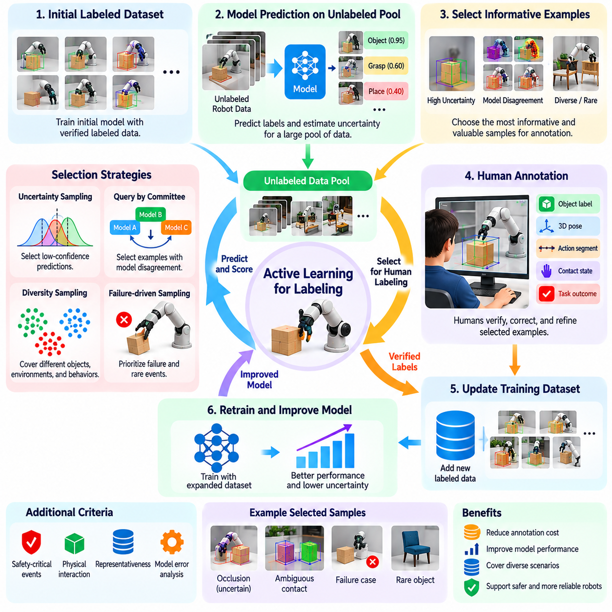{width="7.268055555555556in" height="7.268055555555556in"}

Active learning for labeling is a data selection strategy that reduces annotation costs by identifying the most informative examples for human review. Rather than labeling every robot observation uniformly, active learning prioritizes data expected to improve model performance. This approach is particularly valuable in physical AI, where collecting and annotating multimodal trajectories requires substantial human effort, specialized expertise, and computational resources.

The central principle of active learning is that different training examples contribute unequal amounts of information. Repeated observations of familiar objects and successful actions may provide limited additional learning value. In contrast, unfamiliar environments, ambiguous contacts, unexpected failures, and rare interactions can reveal important model weaknesses. Selecting such examples enables more efficient use of limited annotation budgets.

A typical active learning workflow begins with a model trained on an initial set of verified robot data. The model evaluates a larger pool of unlabeled observations or trajectories and assigns acquisition scores reflecting their expected usefulness. High-priority examples are submitted for human annotation, and the verified labels are incorporated into subsequent training. Repeating this process creates a feedback loop between model uncertainty and dataset expansion.

Uncertainty sampling is one of the most widely used active learning strategies. The system selects examples for which a model produces uncertain predictions, such as competing object classifications or ambiguous action boundaries. Predictive entropy, confidence margins, and probability distributions can quantify uncertainty. However, uncertainty estimates must be calibrated because confident predictions can still be incorrect under unfamiliar conditions.

Query-by-committee uses disagreement among multiple models to identify informative examples. Several perception or action recognition models independently evaluate the same robot observation. Significant disagreement suggests that the available training data does not adequately constrain the prediction. These examples become candidates for human labeling, although disagreement caused by sensor corruption or inconsistent model assumptions may provide limited training value.

Diversity-based sampling addresses the limitations of selecting examples solely through uncertainty. A dataset may contain thousands of uncertain frames from nearly identical robot interactions. Annotating all of them would produce substantial redundancy. Feature embeddings, clustering algorithms, and distance-based selection can identify examples representing different objects, environments, behaviors, and operating conditions.

Representativeness is another important consideration in active learning. Highly unusual observations may be uncertain but irrelevant to normal robot operation. A useful acquisition strategy balances difficult examples with coverage of the deployment distribution. This prevents annotation resources from concentrating exclusively on extreme outliers while neglecting common situations that significantly influence overall system performance.

Robotics active learning differs from conventional image classification because the unit of selection may be an entire episode rather than an individual frame. A grasp failure, navigation interruption, or recovery maneuver often requires temporal context for accurate interpretation. Selecting trajectory segments preserves the relationships among observations, actions, and outcomes. Annotation systems must therefore consider both information value and sequence boundaries.

Temporal uncertainty can identify informative moments within robot trajectories. Sudden changes in predicted contact states, inconsistent object tracking, or ambiguous subtask transitions may indicate regions requiring annotation. Instead of reviewing an entire recording, the system can select a relevant temporal window around the event. Sufficient context must be retained to distinguish genuine behavioral changes from sensor noise or prediction instability.

Physical interaction data introduces specialized acquisition criteria. A manipulation model may confidently recognize an object while remaining uncertain about grasp stability, friction, or contact transitions. Force measurements, tactile signals, and motion outcomes can reveal these uncertainties. Active learning should therefore evaluate physical prediction errors rather than relying exclusively on visual classification confidence.

Failure-driven sampling prioritizes robot experiences associated with unsuccessful or unexpected outcomes. Examples include dropped objects, unstable grasps, blocked navigation paths, and unsuccessful recovery attempts. These events provide information about policy limitations and environmental constraints. However, failure examples must be balanced with successful demonstrations to avoid producing training datasets that inadequately represent desired behavior.

Safety-aware active learning assigns additional importance to events with potentially serious consequences. Near collisions, unexpected human interventions, emergency stops, and unstable movements may deserve annotation even when they occur infrequently. Acquisition scores can incorporate estimated risk alongside uncertainty and diversity. Such strategies support safety evaluation while avoiding unnecessary collection of hazardous experiences.

Model error analysis provides another mechanism for selecting data. After evaluating a robot policy, engineers can identify conditions associated with poor performance, such as reflective surfaces, unusual object shapes, or crowded environments. The data engine can search recorded episodes for similar situations and request targeted annotations. This connects active learning directly to measurable weaknesses in deployed robot capabilities.

Active learning can operate across multiple annotation categories simultaneously. A single robot episode may require object labels, three-dimensional poses, contact states, action segments, and outcome classifications. Each label type has different uncertainty and annotation costs. A practical acquisition system estimates which missing annotations will provide the greatest benefit instead of automatically requesting every possible label for each selected episode.

Cost-sensitive active learning accounts for differences in annotation effort. Identifying an object category may require only a few seconds, while verifying a complex manipulation trajectory may require specialized tools and expert review. Acquisition strategies can estimate expected model improvement relative to annotation cost. This helps allocate limited resources toward examples offering the greatest practical learning value.

Human expertise remains essential because automated acquisition scores cannot fully determine annotation usefulness. Reviewers may discover that selected examples contain corrupted sensor data, ambiguous ground truth, or physically impossible interpretations. Annotation interfaces should allow experts to reject unsuitable queries and record reasons for rejection. These decisions can improve future selection policies and prevent repeated requests for uninformative data.

Active learning can be integrated with weak supervision and pseudo-labeling. High-confidence predictions may receive provisional labels automatically, while uncertain or inconsistent examples are routed for human verification. Weak labeling functions can identify potential events, and active learning can prioritize those requiring detailed inspection. This combination expands dataset coverage while reserving expensive human annotation for the most valuable cases.

Batch selection is important when annotation teams process many examples simultaneously. Choosing the highest-scoring observations independently can result in redundant batches containing similar scenes. Batch acquisition methods consider interactions among selected examples to improve diversity and coverage. They may also account for reviewer specialization, task urgency, and available annotation capacity when organizing labeling workloads.

Evaluation of active learning should measure improvements in downstream robot performance rather than annotation volume alone. Relevant outcomes include perception accuracy, manipulation success, navigation robustness, and performance under unfamiliar conditions. Learning curves can compare model quality against annotation cost or the number of verified episodes. Random sampling provides an important baseline for determining whether an acquisition strategy delivers measurable benefits.

Selection bias presents a significant challenge because actively collected datasets may overrepresent difficult or uncertain situations. Although such examples are valuable for training, they may not reflect the frequency of events in actual deployment. Maintaining representative validation and test datasets helps prevent misleading performance estimates. Sampling metadata can also support analysis of how acquisition decisions influence the resulting data distribution.

Fleet-scale active learning extends data selection across robots operating in different locations and environments. Individual robots may encounter unfamiliar objects, unusual terrain, or rare operational failures. Local uncertainty estimates and event triggers can identify candidate episodes for centralized review. Fleet-level selection then balances information value, diversity, communication costs, and annotation capacity across the entire deployment.

Continuous active learning requires monitoring how model uncertainty and data distributions change over time. Newly deployed policies may encounter different failure patterns from earlier versions, while environmental changes introduce unfamiliar conditions. Periodic acquisition and retraining cycles allow the dataset to evolve with operational experience. Version tracking ensures that selected examples, verified labels, and resulting model improvements remain traceable.

The long-term objective of active learning for robotics is to maximize capability improvement from each unit of annotation effort. By combining uncertainty estimation, diversity, physical reasoning, failure analysis, and human expertise, a data engine can identify experiences that matter most for learning. This transforms labeling from a uniform processing activity into an adaptive feedback mechanism supporting scalable and continuously improving physical AI systems.

## 05.06. 2D Perception Labels

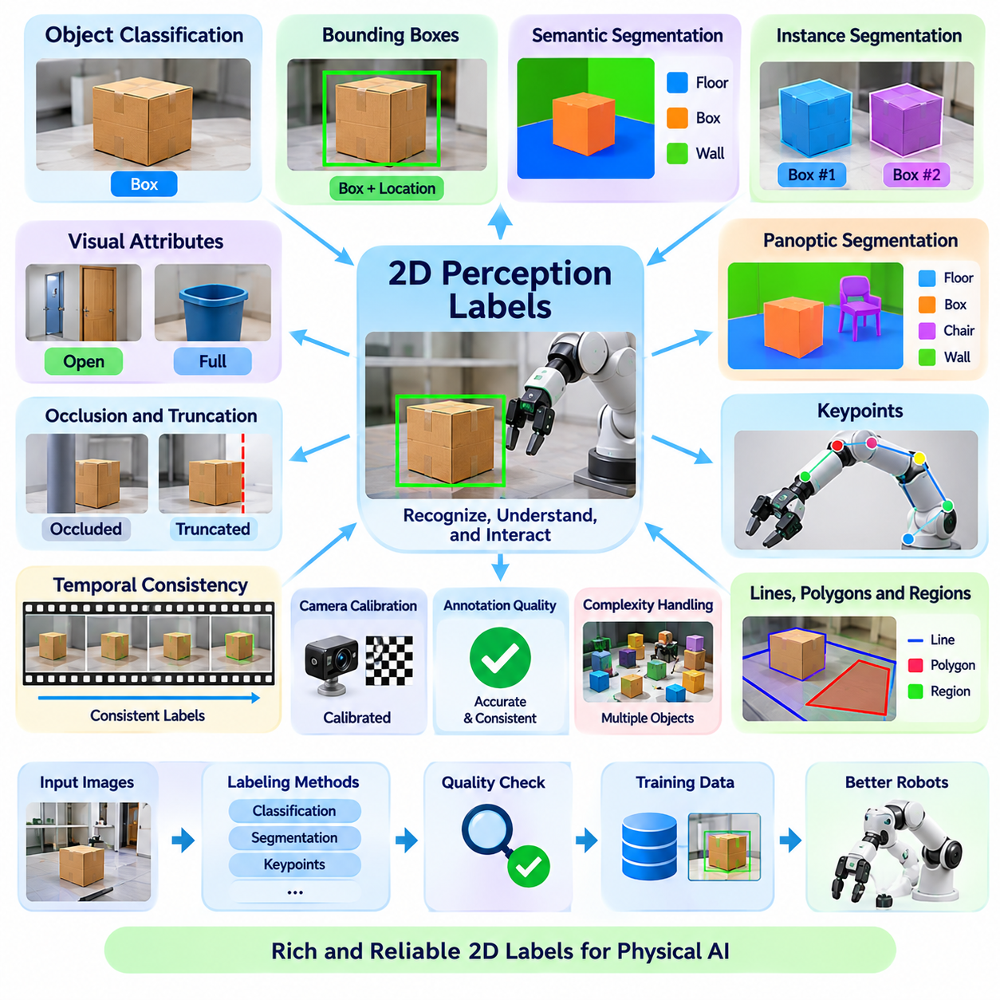{width="7.268055555555556in" height="7.268055555555556in"}

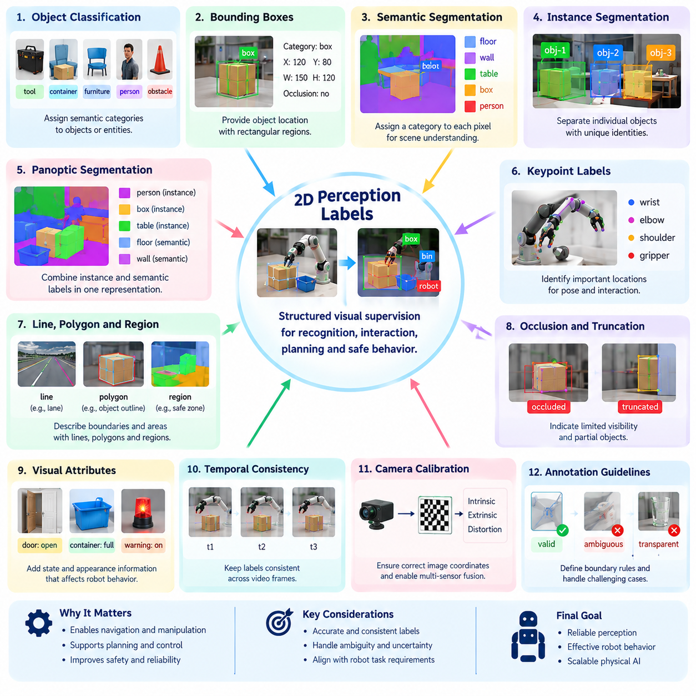{width="7.268055555555556in" height="7.268055555555556in"}

Two-dimensional perception labels provide structured visual supervision that enables robots to recognize objects, interpret scenes, and identify regions relevant to physical interaction. These annotations transform camera images into machine-readable representations of object identity, location, boundaries, and semantic meaning. In physical AI, their value extends beyond image recognition because perception outputs must support navigation, manipulation, planning, and safe behavior.

Object classification labels assign semantic categories to images or detected entities. A robot may distinguish tools, containers, furniture, people, and environmental obstacles through these annotations. Category definitions should reflect operational requirements rather than visual appearance alone. For example, distinguishing a movable container from a fixed storage structure may be more useful for manipulation planning than assigning broad visual categories.

Bounding boxes represent object locations using rectangular image regions. They are widely used for training object detectors because they are relatively inexpensive to annotate and computationally efficient to process. Each box typically includes coordinates, category identity, and optional attributes such as occlusion or visibility. However, rectangular boundaries cannot accurately describe irregular shapes or separate overlapping objects.

Semantic segmentation assigns a category to each image pixel, allowing robots to distinguish floors, walls, obstacles, vegetation, and other environmental regions. Unlike bounding boxes, segmentation provides detailed spatial boundaries that support traversability analysis and scene understanding. Semantic labels do not necessarily distinguish individual objects belonging to the same category, which limits their usefulness for object-specific manipulation.

Instance segmentation combines semantic classification with individual object separation. Each visible object receives a distinct identifier and pixel-level mask, even when several objects share the same category. This representation is valuable for robotic picking, sorting, and cluttered-scene manipulation. Accurate instance boundaries help identify accessible surfaces and reduce confusion when objects overlap or partially obscure one another.

Panoptic segmentation integrates semantic segmentation and instance segmentation into a unified scene representation. Countable objects such as tools and boxes receive individual instance identities, while continuous regions such as floors and walls receive semantic categories. This approach supports robots that must simultaneously reason about discrete objects and surrounding environments. Consistent category definitions are essential for reliable panoptic annotations.

Keypoint labels identify meaningful image locations associated with objects, people, or articulated mechanisms. Examples include human joints, tool endpoints, door handles, and grasp-relevant landmarks. Keypoints provide compact geometric information for pose estimation, interaction planning, and visual tracking. Their definitions must remain consistent across viewpoints, and invisible landmarks should be distinguished from points that cannot be reliably determined.

Two-dimensional perception datasets may also contain line, polygon, and region annotations. Lines can describe lane markings, structural edges, or boundaries between navigable areas. Polygons represent irregular object outlines or operational zones more precisely than rectangular boxes. Region labels can identify hazardous areas, loading zones, or workspaces. Annotation geometry should be selected according to the downstream robotic task.

Occlusion and truncation labels describe limitations in object visibility. Occlusion occurs when another object blocks part of the target, while truncation occurs when the target extends beyond the image boundary. These conditions affect detection confidence, tracking continuity, and object localization. Explicit visibility attributes help models learn partial observations without incorrectly treating invisible regions as absent objects.

Visual attributes can supplement geometric labels with information about object state and appearance. A door may be open or closed, a container may be full or empty, and a warning indicator may be active or inactive. Such attributes often determine the appropriate robot response. Annotation guidelines should distinguish directly observable properties from states that cannot be reliably inferred from a single image.

Temporal consistency is important when two-dimensional labels are generated from robot video. Object identities, segmentation masks, and keypoints should remain coherent across adjacent frames despite camera motion and changing viewpoints. Tracking-assisted annotation can propagate labels through sequences, reducing repetitive manual work. Human verification remains necessary when objects disappear, reappear, or undergo substantial changes in appearance.

Camera calibration influences how two-dimensional annotations are interpreted by robotic systems. Image coordinates depend on camera resolution, lens distortion, cropping, and image transformations. Labels generated in one coordinate system must be transformed consistently when images are resized or rectified. Calibration metadata enables integration with depth measurements and robot geometry, although two-dimensional labels alone do not determine physical distance.

Annotation quality depends on clear conventions for boundaries and ambiguous visual regions. Transparent objects, reflective surfaces, motion blur, shadows, and severe occlusion can make exact object outlines difficult to establish. Guidelines should specify whether masks follow visible pixels, estimated full-object boundaries, or another defined convention. Mixing incompatible annotation conventions introduces systematic errors into model training.

Automated labeling tools can accelerate the creation of two-dimensional perception datasets. Pretrained detectors and segmentation models generate candidate boxes and masks, while interactive correction tools allow annotators to refine boundaries. Tracking algorithms propagate verified labels across video frames. Confidence filtering and targeted human review help control errors, particularly for unfamiliar objects and complex industrial scenes.

Weak supervision and pseudo-labeling can further expand two-dimensional annotation coverage. Robot navigation maps, simulation outputs, object inventories, and previously trained vision models may provide approximate labels. High-confidence predictions can support additional training, but automatic annotations should remain distinguishable from verified ground truth. Independent validation is necessary to detect systematic errors caused by domain shifts or incorrect assumptions.

Class imbalance presents a challenge because common objects and backgrounds dominate many robotic datasets. Floors, walls, and frequently encountered containers may appear in thousands of frames, while safety hazards or rare tools occur infrequently. Sampling and annotation strategies should preserve sufficient examples of uncommon categories. Evaluation must examine category-specific performance rather than relying exclusively on aggregate accuracy.

Dataset design should reflect environmental diversity and deployment requirements. Lighting variation, camera motion, object scale, clutter, weather, and material appearance can significantly affect visual perception. Indoor service robots, warehouse manipulators, and outdoor inspection robots encounter different visual conditions. Representative annotations across these environments improve robustness and reduce failures caused by unfamiliar deployment conditions.

Evaluation metrics should match the annotation type and intended robotic application. Object detection commonly uses intersection over union and average precision, while segmentation evaluates pixel overlap and category consistency. Keypoint estimation measures localization accuracy under defined visibility conditions. Beyond conventional vision metrics, downstream task success and safety performance indicate whether perception improvements benefit actual robot behavior.

Two-dimensional labels are often combined with three-dimensional perception and robot state information. Image detections can guide depth-based localization, while segmentation masks can isolate point clouds associated with particular objects. Keypoints may support geometric pose estimation when camera parameters and object models are available. This integration transforms visual annotations into actionable information for manipulation, navigation, and spatial reasoning.

Data provenance and version management are essential for maintaining large perception datasets. Each annotation should retain its source image, label schema, annotation method, reviewer status, and relevant camera transformations. Changes to category definitions or mask conventions must be tracked to preserve reproducibility. Reliable metadata also supports error analysis, dataset filtering, and comparisons between successive perception models.

Privacy and safety considerations influence how two-dimensional perception labels are collected and stored. Images from service robots may contain identifiable individuals, while industrial recordings may reveal confidential equipment or processes. Access controls and appropriate data minimization procedures should protect sensitive content. Safety-critical categories require especially careful validation because missed detections can affect navigation and interaction decisions.

The long-term objective of two-dimensional perception labeling is to create visual supervision that remains useful across changing robots, environments, and tasks. Standardized semantic definitions, precise geometric annotations, temporal consistency, and continuous quality control enable scalable perception learning. When integrated with multimodal data engines, these labels form a foundation for reliable scene understanding and physically grounded robot intelligence.

## 05.07. 3D Perception and Pose Labels

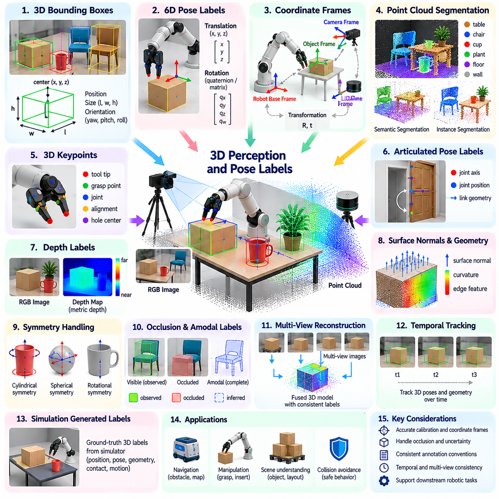{width="7.268055555555556in" height="7.268055555555556in"}

Three-dimensional perception and pose labels describe the spatial structure, position, orientation, and geometry of objects within robotic environments. Unlike two-dimensional image annotations, these labels represent physical relationships in metric space, enabling robots to estimate distances, plan movements, and interact with objects. They provide essential supervision for manipulation, navigation, collision avoidance, and physically grounded scene understanding.

Three-dimensional bounding boxes represent objects using spatial dimensions, positions, and orientations. Each box typically contains a center location, length, width, height, and rotational parameters within a defined coordinate frame. These annotations are widely used in autonomous navigation, warehouse robotics, and mobile manipulation. Accurate box dimensions help robots estimate clearance, detect obstacles, and reason about available workspace.

Six-degree-of-freedom pose labels specify an object\'s three-dimensional translation and rotation relative to a reference frame. Translation determines spatial position, while rotation describes orientation using matrices, quaternions, or other representations. Such labels enable robots to align grippers, insert components, and manipulate tools. Their usefulness depends on consistent coordinate conventions and accurate object reference frames.

Coordinate frame management is fundamental to reliable three-dimensional labeling. Cameras, LiDAR sensors, robot bases, end effectors, and objects may each use different reference frames. Transformation matrices connect these frames through calibrated translation and rotation. Annotation pipelines must preserve frame definitions, units, timestamps, and transformation directions to prevent systematic geometric errors.

Point cloud segmentation assigns semantic or instance labels to individual three-dimensional measurements. LiDAR and depth cameras produce point clouds describing visible surfaces, but these measurements may be sparse, noisy, or incomplete. Semantic segmentation identifies categories such as floors, walls, and obstacles, while instance segmentation separates individual objects. These labels support spatial mapping and object-level reasoning.

Three-dimensional keypoints identify geometrically meaningful landmarks on objects or articulated structures. Examples include tool tips, mechanical joints, grasp reference points, and assembly alignment features. Unlike image keypoints, their coordinates represent positions in three-dimensional space. Accurate landmark definitions support registration, motion planning, and interaction, particularly when complete object surfaces cannot be observed.

Articulated pose labels describe configurations of objects containing movable joints or linked components. Robot arms, human bodies, doors, and industrial mechanisms require representations that capture joint positions and structural relationships. A kinematic model can associate labeled joints with link geometry and motion constraints. These annotations support motion prediction, human-robot interaction, and manipulation of articulated objects.

Depth annotations provide metric information about visible surfaces relative to a camera or reference frame. Depth maps can be generated using stereo vision, structured light, time-of-flight sensors, or simulation. Their reliability depends on sensing range, surface properties, and calibration. Missing depth values and measurement uncertainty should be represented explicitly rather than replaced with unsupported geometric assumptions.

Surface normals and geometric feature labels describe local object orientation and shape. Surface normals indicate directions perpendicular to observed surfaces, while curvature and edge features characterize local geometry. These annotations are useful for grasp planning, contact estimation, and surface inspection. Their accuracy depends on point density, neighborhood selection, and measurement noise.

Object symmetry introduces ambiguity into three-dimensional pose labeling. Cylinders, spheres, and repeated mechanical structures may admit multiple orientations that are physically equivalent. Assigning only one arbitrary orientation can create misleading training targets and evaluation errors. Symmetry-aware representations and pose metrics should account for equivalent configurations while preserving distinctions relevant to robotic interaction.

Occlusion presents a major challenge because three-dimensional sensors observe only accessible surfaces. Objects may be partially hidden behind other objects, machinery, or structural elements. Annotation systems must distinguish observed geometry from estimated complete shapes. When amodal object representations are required, inferred regions should carry uncertainty information and remain identifiable as estimates rather than direct measurements.

Multi-view reconstruction can improve three-dimensional annotation accuracy by combining observations from different camera positions. Sensor poses and calibration parameters allow measurements to be transformed into a common spatial reference. Registration algorithms align overlapping point clouds, while fusion methods reduce missing surface coverage. However, calibration drift and dynamic objects can introduce inconsistencies that require verification.

Temporal three-dimensional labeling tracks object poses and geometry across robot trajectories. Consistent pose sequences support motion estimation, trajectory prediction, and dynamic scene understanding. Tracking methods may combine geometric registration, visual features, and motion models. Abrupt pose changes should be evaluated carefully because they may indicate either genuine physical interactions or annotation errors.

Simulation environments can generate precise three-dimensional labels from known object states and geometry. Synthetic datasets may include object poses, segmentation, depth, joint configurations, and collision information. These annotations reduce manual labeling effort and provide supervision for difficult-to-observe states. Nevertheless, simulation-to-reality differences require validation before synthetic labels are treated as representative of physical deployment.

Automated three-dimensional labeling pipelines often combine object detection, point cloud clustering, geometric registration, and pose estimation. Pretrained models can generate candidate spatial labels, while optimization procedures refine alignment with sensor observations. Human reviewers inspect difficult cases involving occlusion, symmetry, or overlapping objects. Confidence estimation and consistency checks help prioritize verification effort.

Annotation quality depends on geometric accuracy and consistency with physical constraints. Three-dimensional boxes should correspond to actual object dimensions, while pose labels must follow defined coordinate conventions. Calibration errors can create systematic offsets across an entire dataset. Quality assurance should therefore evaluate spatial residuals, transformation consistency, temporal stability, and agreement with independently measured reference geometry.

Evaluation metrics should reflect the intended robotics application. Three-dimensional detection may use volumetric intersection over union, while pose estimation measures translation and rotation errors. Surface reconstruction can be evaluated through geometric distances, and articulated poses through joint-position accuracy. Task-specific tolerances are essential because acceptable errors differ between obstacle avoidance and precision assembly.

Three-dimensional labels become especially valuable when integrated with robot kinematics and action data. An object pose can be related to the end-effector frame, while contact locations can be associated with planned trajectories. These relationships connect spatial perception with manipulation feasibility and collision checking. Accurate synchronization between perception and robot state measurements is necessary for physically meaningful supervision.

Uncertainty representation is essential because geometric measurements are never perfectly accurate. Depth noise, sensor calibration, partial visibility, and object deformation contribute different forms of uncertainty. Covariance estimates, confidence intervals, and visibility attributes can communicate label reliability. Learning systems can use this information to avoid treating uncertain geometric estimates as exact physical ground truth.

Data provenance supports reproducibility and systematic error investigation in three-dimensional datasets. Each annotation should retain sensor calibration versions, coordinate frame definitions, reconstruction methods, timestamps, and review status. Changes in sensor configuration or object models may require label regeneration. Versioned records help distinguish genuine model improvements from changes in annotation geometry or evaluation conventions.

Scalable three-dimensional labeling requires balancing annotation precision, computational cost, and downstream value. High-resolution reconstruction may be unnecessary for coarse navigation but essential for precision manipulation. Adaptive pipelines can allocate detailed geometric annotation to objects and interactions that demand greater accuracy. This task-aware strategy reduces unnecessary processing while preserving information important to robot performance.

The long-term objective of three-dimensional perception and pose labeling is to provide consistent, physically meaningful spatial supervision across diverse robotic systems. Accurate geometry, calibrated coordinate frames, temporal coherence, and explicit uncertainty enable models to learn reliable relationships between objects and actions. Integrated into multimodal data engines, these labels support increasingly capable spatial reasoning, manipulation, and autonomous physical interaction.

## 05.08. Tracking and Temporal Labels

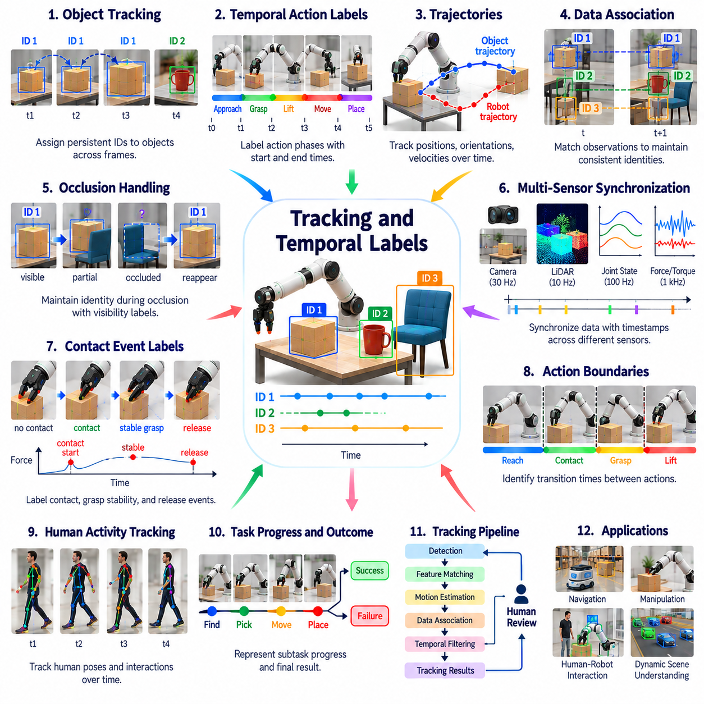{width="7.268055555555556in" height="7.268055555555556in"}

Tracking and temporal labels describe how objects, robots, and interactions evolve over time. Unlike static perception annotations, they preserve identity, motion, and event continuity across sequences of observations. These labels allow physical AI systems to understand object trajectories, recognize action transitions, and predict future states. They provide essential supervision for navigation, manipulation, human-robot interaction, and dynamic scene understanding.

Object tracking labels assign persistent identities to entities observed across consecutive frames. Each tracked object retains an identifier even when its position, orientation, scale, or appearance changes. Bounding boxes, segmentation masks, and three-dimensional poses may be associated with these identities. Reliable identity continuity enables robots to distinguish moving objects, maintain scene memory, and reason about interactions over extended periods.

Temporal annotations represent events and behaviors using timestamps, intervals, and ordered sequences. A manipulation episode may contain reaching, grasping, lifting, transporting, and releasing phases. Each phase can be assigned a start time, end time, and semantic category. Such labels provide structured supervision for action recognition, task segmentation, and learning policies that depend on the progression of physical activities.

Tracking systems must distinguish object motion from camera motion. A stationary object may appear to move when a mobile robot changes position or orientation. Camera calibration, robot odometry, and visual motion estimation help separate these effects. Labels expressed in image coordinates may differ from those expressed in world coordinates, making coordinate transformations and reference frame consistency essential.

Data association is a central challenge in multi-object tracking. When several similar objects appear in the same scene, the system must determine which observation corresponds to each previously tracked entity. Appearance features, spatial proximity, motion predictions, and geometric constraints can support association. Incorrect matches produce identity switches that corrupt temporal supervision and reduce tracking reliability.

Occlusion complicates tracking because objects may temporarily disappear behind obstacles, machinery, or other moving entities. A robust annotation system should preserve object identity when sufficient evidence supports continuity across the hidden interval. Visibility states can distinguish fully visible, partially occluded, and temporarily unobserved objects. Uncertain associations should be recorded explicitly rather than forcing unsupported identity assignments.

Trajectory labels describe the evolution of object or robot positions over time. They may contain sampled coordinates, velocities, accelerations, orientations, and associated uncertainty estimates. Trajectories support motion prediction, collision avoidance, and behavior modeling. Their accuracy depends on synchronized measurements and appropriate coordinate frames, especially when sensors operate at different frequencies.

Temporal synchronization is fundamental when combining camera recordings, LiDAR scans, tactile measurements, and robot controller logs. Each data source may use different sampling rates and clock references. Timestamp alignment and interpolation can associate measurements with corresponding physical events. Synchronization errors may create false motion patterns or incorrect contact labels, particularly during rapid manipulation.

Action boundary labeling identifies transitions between meaningful behavioral phases. These boundaries are often ambiguous because reaching, contact, grasp stabilization, and lifting may overlap. Annotation guidelines should define whether boundaries correspond to commands, measured physical events, or observable state changes. Consistent conventions improve the usefulness of temporal labels for learning hierarchical robot behaviors.

Contact event labels provide a temporal description of physical interactions. They may indicate initial contact, sustained contact, slipping, release, or unexpected collision. Force sensors, tactile arrays, motor currents, and visual observations can provide complementary evidence. Accurate event timing is particularly important for manipulation policies that must coordinate motion with changing contact conditions.

Temporal labels can also represent task progress and execution outcomes. A robot may successfully complete individual subtasks while failing the overall operation. Sequence annotations can distinguish intended actions, executed actions, recovery attempts, and final results. This structure supports failure analysis, reward estimation, and policy learning by connecting intermediate behavior with eventual task success.

Human activity tracking introduces additional complexity because people exhibit articulated motion and unpredictable behavior. Temporal labels may describe body joint trajectories, gestures, walking direction, and interaction intent. These annotations support collaborative robotics and safety-aware navigation. However, inferred intentions should be distinguished from directly observed movements to avoid presenting uncertain interpretations as factual labels.

Automated tracking pipelines typically combine object detection, feature matching, motion estimation, and temporal filtering. Kalman filters and learned motion models can predict object states between observations, while association algorithms maintain identities. These systems reduce manual annotation effort but may fail during prolonged occlusion or abrupt motion. Human review remains important for correcting identity switches and trajectory discontinuities.

Tracking-assisted annotation can propagate verified labels through video sequences. Once an object is manually identified, automated methods estimate its location and shape in subsequent frames. Reviewers inspect uncertain intervals and correct accumulated drift. This workflow improves annotation throughput while preserving temporal coherence, provided that propagated errors are detected before they spread across long sequences.

Weak supervision can generate approximate temporal labels from robot commands and sensor events. A gripper closure command may suggest a grasp phase, while an increase in force may indicate contact. These signals provide useful candidates but cannot always establish the actual physical outcome. Combining controller logs with observed motion and human verification improves the reliability of automatically inferred events.

Temporal uncertainty should be represented explicitly because event boundaries and object associations are not always precisely observable. Labels may include confidence estimates, ambiguous intervals, or alternative identity hypotheses. Such information helps learning systems avoid treating uncertain annotations as exact ground truth. It also supports targeted review of sequences where annotation errors could significantly affect downstream performance.

Quality control for temporal annotations must examine sequence-level consistency rather than individual frames alone. An object identity should not change without justification, and trajectories should generally satisfy plausible motion constraints. Action labels should follow meaningful task relationships while allowing unexpected recovery behavior. Automated validation can identify discontinuities, impossible transitions, and inconsistent timestamps for human inspection.

Evaluation metrics depend on the temporal labeling objective. Multi-object tracking may be assessed through identity consistency, association accuracy, and trajectory localization errors. Temporal action segmentation can use boundary accuracy and segment overlap. Event detection requires attention to timing precision and missed transitions. Downstream robot performance remains important because accurate frame-level metrics do not always guarantee useful behavioral supervision.

Long-duration robot recordings create storage and computational challenges for temporal labeling. Continuous operation may produce millions of frames containing repetitive or uneventful behavior. Event-driven sampling and hierarchical segmentation can reduce processing requirements while preserving informative sequences. Annotation systems should retain sufficient context around selected events to support accurate interpretation and subsequent policy training.

Fleet-scale tracking datasets can reveal recurring interaction patterns across robots and environments. Aggregated trajectories may identify common navigation conflicts, manipulation delays, or failure sequences. Consistent temporal label definitions enable comparisons between platforms and deployments. Data provenance should preserve timestamps, sensor configurations, tracking model versions, and human corrections to support reproducible analysis.

Privacy and safety requirements influence the management of temporal data, particularly when recordings contain identifiable people or sensitive operational activities. Long-term tracking may reveal movement patterns beyond what is necessary for robot learning. Data minimization, controlled access, and appropriate retention policies help reduce these risks. Safety-critical temporal events should receive additional validation because timing errors can affect robot decisions.

The long-term objective of tracking and temporal labeling is to transform isolated observations into coherent representations of physical behavior. Persistent identities, synchronized trajectories, event boundaries, and explicit uncertainty allow models to learn how environments change through action. Integrated with perception, task, and outcome labels, temporal supervision forms a foundation for predictive world models, robust planning, and adaptive physical AI systems.

## 05.09. Affordance Grasp and Contact Labels

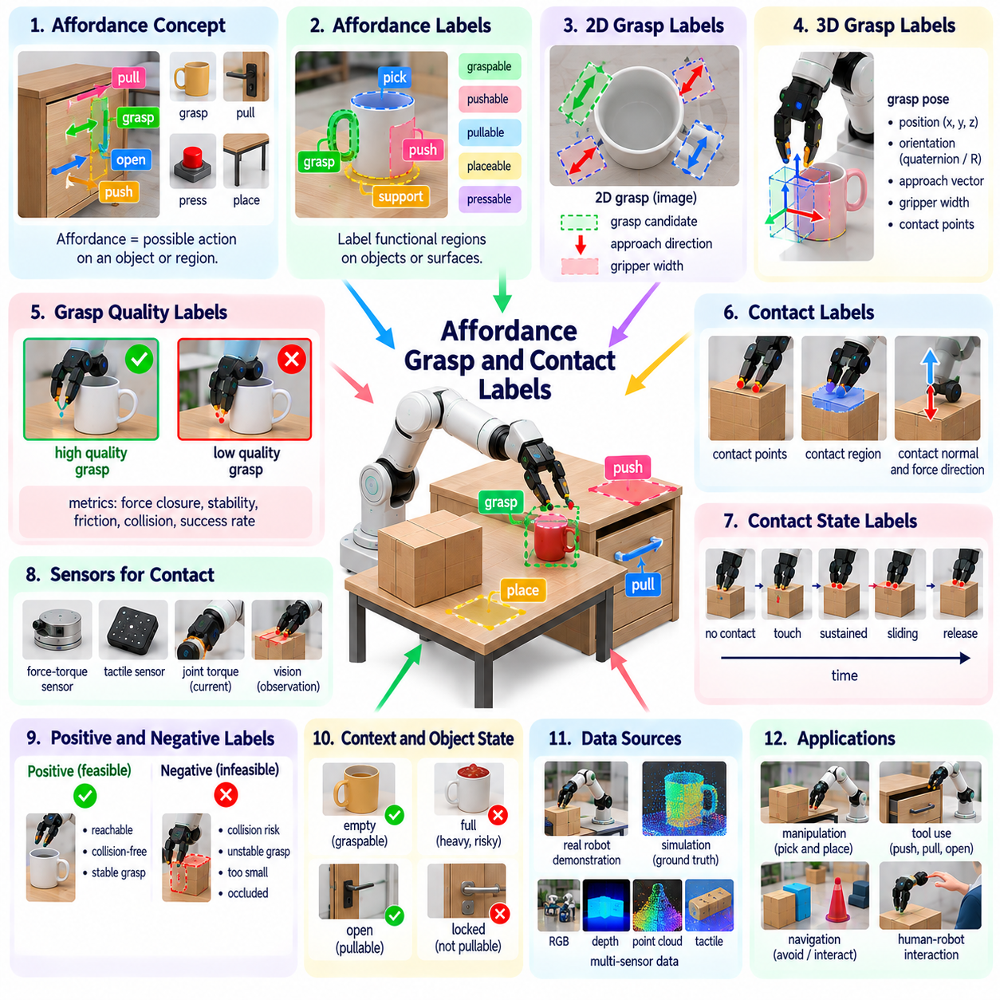{width="7.268055555555556in" height="7.268055555555556in"}

Affordance, grasp, and contact labels describe how robots can physically interact with objects and environments. Unlike conventional perception labels that identify objects and their locations, these annotations represent possible actions, feasible grasp configurations, and physical interaction states. They connect visual and geometric understanding with manipulation capabilities, allowing physical AI systems to learn what actions are possible and how those actions should be executed.

An affordance represents an action opportunity offered by an object or environmental feature relative to a particular agent. A handle may support pulling, a flat surface may support placing, and a button may support pressing. Affordance labels therefore describe functional relationships rather than object categories alone. Their interpretation depends on robot morphology, available tools, task objectives, and environmental constraints.

Affordance annotations may be assigned to complete objects, object parts, image regions, or three-dimensional surfaces. A cabinet can contain graspable handles, pullable doors, and surfaces suitable for supporting objects. Region-level labels identify where particular interactions are feasible. Part-level annotations provide greater precision for manipulation planning because different components of the same object may support different actions.

Grasp labels describe candidate configurations for establishing stable control over an object. A grasp representation may include gripper position, orientation, opening width, approach direction, and expected contact locations. Parallel-jaw grippers, suction devices, and dexterous hands require different grasp parameters. Consequently, grasp annotations must reflect the robot\'s end-effector geometry and mechanical capabilities.

Two-dimensional grasp labels often represent candidate grasps as oriented rectangles or image-based contact points. These annotations are convenient for learning grasp detection from camera images. However, image-space representations do not directly encode depth, collision clearance, or complete object geometry. Additional geometric information is usually necessary before a robot can convert a predicted grasp into a physically executable motion.

Three-dimensional grasp labels specify candidate end-effector poses in a spatial coordinate frame. They may include approach vectors, finger contact positions, grasp widths, and collision constraints. Such labels support grasp planning in cluttered environments and enable integration with robot kinematics. Accurate camera calibration and object pose estimation are essential when transforming grasp predictions into robot commands.

Grasp quality labels estimate the likelihood that a proposed grasp will maintain stable object control. Quality may depend on contact geometry, friction, force closure, object mass, and external disturbances. Analytical grasp metrics provide useful approximations, while physical trials reveal performance under real conditions. A grasp labeled successful in one configuration may fail when object properties or robot dynamics change.

Contact labels identify where, when, and how physical interaction occurs between bodies. They may describe contact points, contact regions, surface normals, force directions, and interaction duration. Contact can occur between a gripper and an object, an object and a support surface, or a robot and its environment. These annotations support manipulation learning, collision analysis, and physically grounded state estimation.

Contact state labels distinguish phases such as no contact, initial touch, sustained contact, sliding, sticking, and separation. These states are particularly important for tasks involving pushing, insertion, wiping, and assembly. A robot may need to change its control strategy when contact transitions from free motion to constrained motion. Temporal contact annotations help learning systems recognize these transitions and respond appropriately.

Force and tactile measurements provide direct evidence for contact labeling. Force-torque sensors measure interaction loads, while tactile arrays capture pressure distributions across contact surfaces. Motor currents and joint torque estimates may provide indirect contact indicators. Sensor readings require calibration and synchronization because noise, mechanical compliance, and delayed measurements can produce misleading interpretations.

Affordance labels must account for task context and object state. A container may be graspable but unsuitable for lifting when overloaded, while a door handle may be reachable but locked. Functional feasibility depends on environmental conditions and available robot capabilities. Context-aware labels can distinguish theoretically possible interactions from actions that are currently safe and executable.

Negative interaction labels are valuable because they describe actions that should not be attempted. Examples include unstable grasps, obstructed contact regions, collision-prone approaches, and surfaces unsuitable for suction. These labels help models learn operational constraints rather than only successful behaviors. However, negative examples should identify the reason for infeasibility whenever reliable evidence is available.

Demonstration data provides a practical source of grasp and contact supervision. Teleoperated robots can record gripper poses, joint states, tactile signals, and manipulation outcomes during task execution. Successful demonstrations reveal feasible interaction patterns, while failed attempts expose important limitations. Aligning sensor measurements with action timestamps enables detailed reconstruction of contact events and grasp transitions.

Simulation can generate affordance, grasp, and contact labels using known object geometry and physical interaction models. Virtual experiments allow large numbers of grasp candidates to be evaluated without damaging equipment. Contact locations and collision states can be recorded automatically. Nevertheless, simulated friction, material deformation, and sensor behavior may differ from reality, requiring validation with physical experiments.

Automated labeling pipelines may combine visual segmentation, geometric analysis, grasp proposal networks, and contact detection algorithms. Candidate labels can be generated from object surfaces and refined using robot demonstrations. Human reviewers evaluate ambiguous cases and verify task relevance. Confidence estimates and provenance records help distinguish measured contacts, predicted grasps, and inferred affordances.

Annotation quality depends on clear definitions of interaction feasibility and physical success. A grasp may initially lift an object but fail during transport, making the evaluation horizon important. Contact detection thresholds must account for sensor noise and task-specific force requirements. Consistent labeling conventions should specify reference frames, robot configurations, environmental assumptions, and criteria for successful interaction.

Evaluation metrics should reflect the physical purpose of each label. Affordance segmentation may use region overlap, while grasp prediction can be assessed through pose accuracy and execution success. Contact localization evaluates spatial error, and contact event detection measures temporal precision. Physical task completion and safety outcomes remain essential because geometric agreement alone does not guarantee successful manipulation.

Multimodal integration improves the reliability of interaction labels by combining visual, geometric, tactile, and proprioceptive information. Cameras identify candidate interaction regions, depth sensors estimate surface geometry, and tactile sensors confirm physical contact. Robot state measurements reveal whether the intended action was executed. Together, these signals provide stronger supervision than any single sensing modality.

Uncertainty is unavoidable because object properties and contact conditions are not always directly observable. Friction coefficients, internal mass distributions, and hidden support structures may remain unknown until interaction occurs. Labels should distinguish observed outcomes from predicted feasibility and uncertain physical assumptions. This distinction prevents learning systems from treating hypothetical interactions as verified physical evidence.

Scalable data engines can prioritize interaction examples that reveal new capabilities or recurring failures. Rare contact transitions, unusual object materials, and unsuccessful grasp attempts may provide more information than repeated routine demonstrations. Active learning and targeted data collection can improve annotation efficiency. Fleet-level feedback can identify interaction conditions that require additional supervision or revised grasp strategies.

The objective of affordance, grasp, and contact labeling is to connect perception with reliable physical action. Functional regions describe what interactions are possible, grasp labels describe how objects can be controlled, and contact labels describe what happens during interaction. When integrated with task, motion, and outcome data, these annotations support robust manipulation policies and increasingly adaptive physical AI systems.

## 05.10. Action Task and Subtask Labels

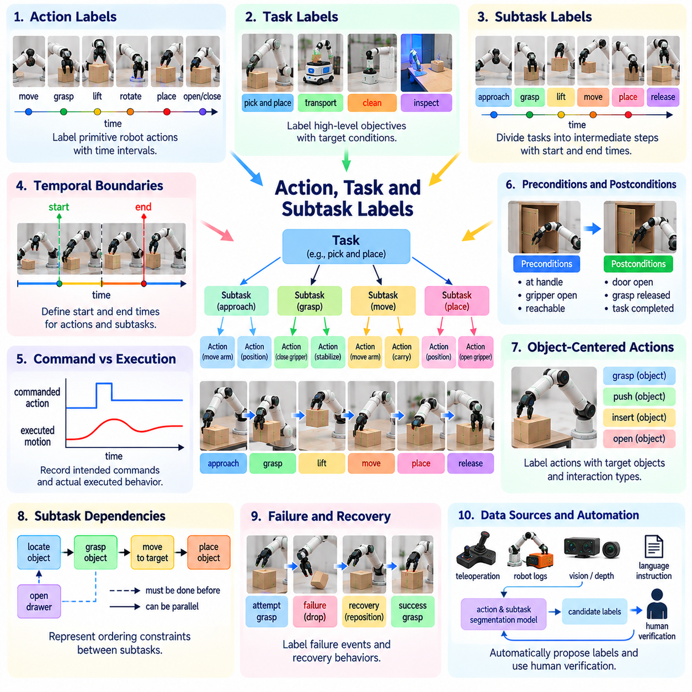{width="7.268055555555556in" height="7.268055555555556in"}

Action, task, and subtask labels describe the structure and purpose of robot behavior across different levels of abstraction. Action labels identify individual movements or control decisions, while task labels represent broader objectives and subtask labels describe intermediate steps. These annotations connect sensor observations with intended behavior, enabling physical AI systems to learn structured policies, interpret demonstrations, and execute complex operations.

An action label represents a specific behavior performed by a robot within a defined time interval. Examples include moving an arm, closing a gripper, rotating a wrist, or advancing a mobile base. Actions may be represented as discrete categories or continuous control parameters. Their definitions should distinguish commanded actions from executed movements because actuator limitations, environmental resistance, and control errors can produce different physical outcomes.

Task labels describe the overall objectives that a robot attempts to accomplish. A task may involve assembling a component, transporting a container, cleaning a surface, or inspecting equipment. Unlike low-level actions, tasks are defined primarily by desired outcomes and operational constraints. Task annotations should identify relevant objects, target conditions, and completion criteria so that learning systems can distinguish purposeful behavior from unrelated movement.

Subtask labels divide complex objectives into meaningful intermediate operations. For example, a pick-and-place task may contain object localization, approach, grasp, lifting, transportation, placement, and release. Each subtask represents a recognizable stage with its own preconditions and expected results. Hierarchical labeling enables robots to learn reusable behavioral components rather than treating every long sequence as an indivisible operation.

Hierarchical task representations organize behavior across multiple levels of abstraction. A high-level objective may be decomposed into subtasks, motion primitives, and actuator commands. These relationships can be represented using task trees, directed graphs, or structured sequences. The resulting annotations support hierarchical reinforcement learning, behavior planning, and modular policy development across different robotic platforms.

Temporal boundaries are essential for defining where actions and subtasks begin and end. A grasping sequence may transition gradually from approach to contact and stabilization, making exact boundaries difficult to identify. Annotation guidelines should specify whether transitions are based on controller commands, sensor observations, or physical state changes. Consistent boundary definitions improve temporal segmentation and policy training.

Action labels should preserve the relationship between robot commands and observed consequences. A commanded gripper closure does not necessarily indicate a successful grasp, and a movement command may be interrupted by collision or safety intervention. Recording intended actions separately from executed behavior and measured outcomes prevents misleading supervision. This distinction is particularly important for learning from unsuccessful demonstrations.

Task annotations often require explicit preconditions and postconditions. Preconditions describe the state necessary to begin an operation, while postconditions specify the expected state after completion. For example, opening a cabinet may require the robot to reach the handle and finish with the door sufficiently open. Such labels support symbolic planning, execution monitoring, and verification of task completion.

Object-centered action labels describe behavior in relation to manipulated entities rather than robot joints alone. Actions such as grasping a bottle, pushing a cart, or inserting a connector contain semantic relationships between agents, objects, and targets. These representations can transfer across robots with different kinematic structures. They are particularly useful for learning generalizable manipulation policies from heterogeneous demonstrations.

Subtask dependencies describe ordering constraints and relationships between intermediate operations. Some activities must occur sequentially, while others can be performed concurrently or in alternative orders. A robot may need to open a drawer before retrieving an object, but visual inspection and route planning may overlap. Dependency labels help planning systems identify valid execution sequences and recognize violations of task constraints.

Failure and recovery behaviors should be included in action and subtask annotations. A robot may miss a grasp, reposition its end effector, and attempt the operation again. Labeling only the successful final attempt removes valuable information about adaptation. Recovery annotations can identify failure detection, corrective movement, repeated attempts, and eventual outcomes, supporting robust policy learning.

Demonstration datasets provide important sources of action and task labels. Teleoperation logs, robot controller records, video observations, and human instructions can reveal intended operations and executed behavior. However, commands alone do not establish task meaning or physical success. Reliable annotation requires aligning behavioral records with sensor evidence and interpreting them according to consistent task definitions.

Automated labeling pipelines can infer candidate actions and subtasks from motion trajectories, gripper states, contact events, and changes in object configuration. Statistical segmentation methods and learned sequence models can identify recurring behavioral patterns. Language models may suggest semantic descriptions for detected segments. Human verification remains necessary when inferred labels depend on ambiguous intentions or incomplete observations.

Annotation consistency becomes challenging when the same physical behavior serves different purposes. Moving an arm toward a container may represent reaching, inspection, collision avoidance, or preparation for grasping. Labels should incorporate task context and observable evidence rather than relying on motion appearance alone. Clear definitions reduce disagreement among annotators and improve the reliability of learned behavioral representations.

Language-conditioned task labels connect natural-language instructions with structured robot behavior. An instruction such as placing a tool inside a box can be associated with a task objective, relevant objects, and an ordered sequence of subtasks. This alignment supports vision-language-action models and instruction-following policies. Ambiguous instructions should retain uncertainty rather than being converted into unsupported action sequences.

Task taxonomies and ontologies provide standardized definitions for actions, subtasks, and objectives. A taxonomy may distinguish locomotion, manipulation, inspection, and interaction, while an ontology defines relationships between agents, objects, and operations. Consistent semantic structures enable dataset integration and cross-platform learning. Version management is necessary when categories or task definitions evolve.

Evaluation should measure both annotation accuracy and usefulness for robot learning. Action recognition can be assessed through classification performance, while subtask segmentation evaluates temporal boundary accuracy and segment overlap. Task-level labels require checking objective consistency and completion conditions. Downstream execution success provides additional evidence that annotations support meaningful behavioral learning.

Long-horizon tasks introduce challenges involving memory, delayed outcomes, and changing environmental conditions. A robot may execute many subtasks before determining whether the overall objective has been achieved. Hierarchical labels preserve intermediate progress and reveal where failures occur. They also enable learning systems to associate early decisions with later consequences without losing the structure of the execution sequence.

Multimodal integration strengthens behavioral labeling by combining video, proprioception, force measurements, object states, and controller logs. Visual observations reveal scene changes, while robot state data describes executed motion and tactile signals identify contact transitions. These sources help distinguish superficially similar actions. Accurate synchronization is essential for assigning semantic labels to the correct physical events.

Scalable data engines can use action and task labels to identify underrepresented behaviors and difficult execution scenarios. Rare recovery procedures, unusual object interactions, and long-duration task failures may deserve additional annotation. Active learning can prioritize sequences where behavioral models show uncertainty or disagreement. Fleet-level analysis can reveal recurring subtask failures and opportunities for policy improvement.

The objective of action, task, and subtask labeling is to transform raw robot trajectories into interpretable representations of purposeful behavior. Hierarchical structure, temporal boundaries, semantic relationships, and explicit outcomes allow learning systems to connect individual actions with complex objectives. Integrated with perception and interaction data, these labels support reusable skills, adaptive planning, and increasingly autonomous physical AI systems.

## 05.11. Success Failure Reward and Preference Labels

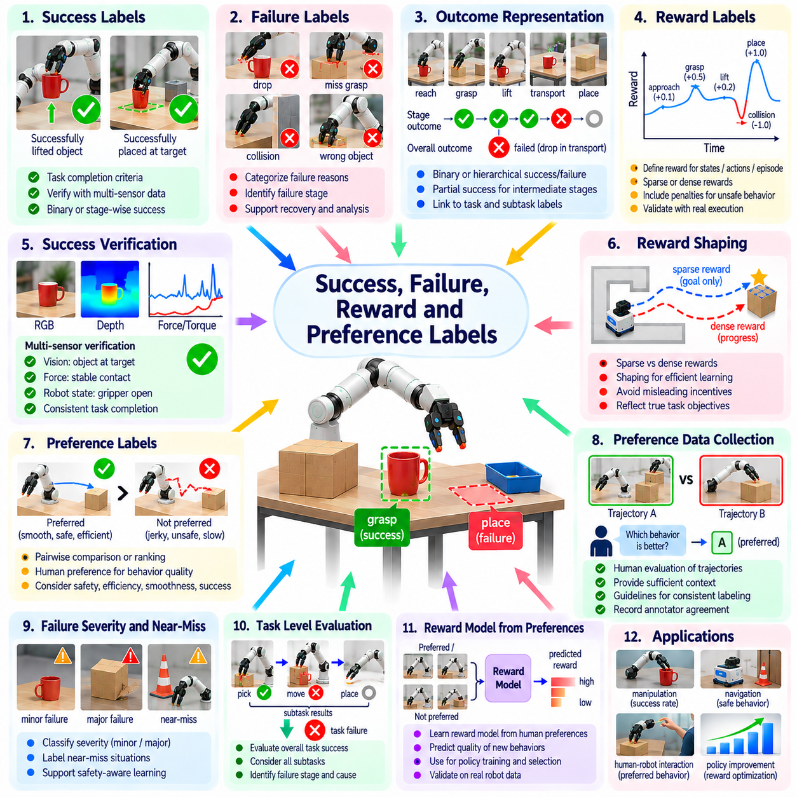{width="7.268055555555556in" height="7.268055555555556in"}

Success, failure, reward, and preference labels describe the quality and consequences of robot behavior. While perception and action labels explain what a robot observes and performs, outcome-oriented labels indicate whether its behavior achieves intended objectives. These annotations provide critical supervision for reinforcement learning, imitation learning, policy evaluation, and autonomous improvement across physical environments.

Success labels indicate whether a robot has satisfied defined task completion criteria. A grasp may succeed when an object is securely lifted, while a delivery task succeeds when the correct item reaches its destination. Success must be defined through observable conditions rather than assumed intentions. Clear criteria allow automated verification and consistent comparisons across demonstrations, robots, and deployment environments.

Failure labels identify unsuccessful outcomes and the conditions responsible for them. A manipulation attempt may fail because of an unstable grasp, collision, incorrect object selection, or incomplete placement. Distinguishing failure categories provides more useful supervision than assigning a single negative label. Structured failure information supports diagnosis, recovery planning, and targeted collection of difficult training examples.

Binary outcome labels classify episodes as successful or unsuccessful, offering a simple representation for training and evaluation. However, complex robotic tasks often contain partial achievements and multiple failure opportunities. A robot may complete object retrieval but fail during transportation. Hierarchical outcome labels preserve intermediate results and help learning systems identify which stages require improvement.

Success verification should combine task specifications with sensor evidence. Camera observations may confirm object placement, while force sensors indicate contact stability and controller logs reveal execution status. No single signal necessarily establishes successful completion. Multimodal verification reduces false positives caused by commanded actions being mistaken for completed physical operations.

Reward labels assign numerical feedback to states, actions, transitions, or complete episodes. Positive rewards may encourage successful task completion, while penalties discourage collisions, excessive force, or unsafe motion. Reward values influence which behaviors a learning algorithm prioritizes. Their design must reflect operational objectives without creating incentives for shortcuts that violate intended task requirements.

Sparse rewards provide feedback primarily when a meaningful outcome occurs, such as completing an assembly or reaching a destination. They closely reflect task objectives but may make learning difficult when successful episodes are rare. Dense rewards provide intermediate feedback for progress, alignment, or reduced distance to a target. Careful design is necessary because dense signals may reward apparent progress without genuine task success.

Reward shaping introduces additional feedback to guide learning toward desirable behavior. Potential-based shaping can preserve the optimal policy under appropriate mathematical assumptions, while arbitrary shaping may change the preferred solution. For physical robots, poorly designed rewards can encourage unnecessary motion, excessive contact, or exploitation of sensor artifacts. Reward validation should therefore include real execution outcomes.

Preference labels compare alternative robot behaviors rather than assigning absolute numerical scores. A human evaluator may prefer one trajectory because it is safer, smoother, faster, or more reliable. Pairwise preferences can provide supervision when defining a precise reward function is difficult. However, preference judgments must specify evaluation criteria because different reviewers may prioritize competing objectives.

Preference datasets may contain trajectory pairs, ranked demonstrations, or comparisons between proposed actions. Annotators can review videos, robot state histories, and outcome summaries before expressing judgments. The compared examples should contain sufficient context to evaluate meaningful differences. Preference labels are especially useful for learning behavioral qualities that are difficult to express through simple success indicators.

Human feedback introduces valuable operational knowledge but also creates subjective variation. Different annotators may disagree about acceptable speed, clearance, force, or task efficiency. Detailed evaluation guidelines and representative examples improve consistency. Recording reviewer agreement and uncertainty helps distinguish ambiguous preferences from labeling errors or poorly specified objectives.

Reward models can learn to predict human preferences from labeled behavior comparisons. These models transform preference supervision into estimated feedback for policy optimization or candidate trajectory selection. Their predictions remain approximations of the underlying evaluation criteria. Independent testing is necessary because reward models may generalize poorly to unfamiliar objects, environments, or robot configurations.

Failure severity should be distinguished from failure occurrence. Dropping a lightweight object onto a protected surface differs substantially from colliding with a person or damaging critical equipment. Severity labels can incorporate safety consequences, equipment damage, recovery cost, and operational disruption. Such annotations help prioritize high-risk failures even when they occur less frequently than minor execution errors.

Near-miss labels describe situations in which undesirable outcomes were narrowly avoided. A robot may pass too close to an obstacle, nearly lose its grasp, or approach a prohibited workspace boundary. These events provide information about safety margins that binary success labels cannot capture. Near-miss annotations support preventive policy improvement and risk-aware evaluation before serious failures occur.

Recovery labels describe how robots respond after detecting unsuccessful or unexpected behavior. A failed grasp may trigger repositioning, another attempt, or a request for human assistance. Recovery quality can be evaluated through eventual success, additional time, resource consumption, and safety. Including recovery outcomes prevents learning systems from treating every initial failure as an irreversible task termination.

Automated outcome labeling can combine state comparisons, sensor thresholds, and task-specific verification rules. Simulation provides exact access to selected object states, while physical deployments rely on imperfect observations. Rule-based systems can efficiently label straightforward cases but may misinterpret ambiguous outcomes. Human review is particularly important when verification signals conflict or task requirements are incomplete.

Temporal alignment connects outcome labels with the actions that produced them. A final failure may result from an earlier positioning error rather than the last executed movement. Credit assignment becomes difficult when consequences are delayed across long task sequences. Subtask outcomes, event timestamps, and causal evidence help learning systems associate behavior with meaningful feedback without assuming unsupported causal relationships.

Annotation quality requires clear definitions of success, failure, reward scales, and preference criteria. Labels should identify whether judgments come from direct measurements, human evaluations, simulations, or learned estimators. Conflicting assessments should be preserved for review rather than silently reconciled. Versioned guidelines maintain consistency when operational objectives or safety requirements change.

Evaluation should examine both predictive accuracy and downstream behavioral effects. Success classifiers can be assessed using precision and recall, while reward models can be evaluated through preference prediction accuracy. Calibration tests determine whether confidence estimates correspond to observed outcomes. Ultimately, policy performance, safety, and robustness reveal whether feedback labels support reliable physical behavior.

Dataset imbalance is common because routine successful operations may greatly outnumber rare failures, while experimental datasets may overrepresent difficult attempts. Sampling strategies should preserve realistic deployment statistics while ensuring adequate coverage of important failure modes. Separate evaluation sets can reveal whether learned models remain reliable across different outcome frequencies and operating conditions.

Fleet-scale data engines can use outcome feedback to identify recurring weaknesses and prioritize new demonstrations. Failure clusters may reveal problematic objects, environmental conditions, or robot configurations. Preference feedback can guide improvements in motion quality and operational efficiency. Continuous validation ensures that changes in labeling or reward design produce measurable improvements rather than misleading optimization signals.

The objective of success, failure, reward, and preference labeling is to connect robot behavior with meaningful assessments of its consequences. Explicit completion criteria, structured failure descriptions, calibrated rewards, and well-defined preferences enable learning systems to distinguish effective actions from undesirable ones. Integrated with perception and task data, these labels support safer policies, adaptive recovery, and continual improvement in physical AI.

## 05.12. Language and Vision Language Action Labels

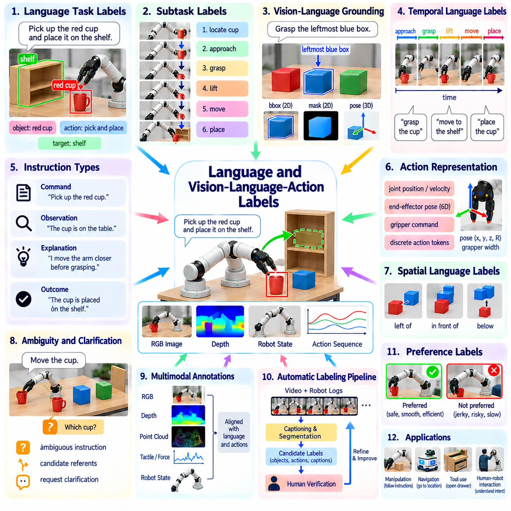{width="7.268055555555556in" height="7.268055555555556in"}

Language and vision-language-action labels connect human instructions, visual observations, and executable robot behavior within a unified learning framework. Language labels describe goals, objects, constraints, and intended outcomes, while vision-language-action labels associate these descriptions with sensory inputs and physical actions. Such annotations enable robots to interpret natural-language commands and learn policies that translate semantic understanding into practical interaction.

Language annotations may describe complete tasks, individual subtasks, or specific actions within a demonstration. A command such as placing a red cup on a shelf identifies an object, an intended operation, and a destination. More detailed descriptions may include orientation, handling precautions, or completion requirements. Effective labeling preserves these relationships so that models learn grounded instructions rather than isolated words or disconnected action categories.

Vision-language grounding establishes correspondence between linguistic expressions and observable scene elements. Object names, spatial relationships, attributes, and references must be associated with relevant image regions or three-dimensional entities. For example, the phrase leftmost container should identify the correct object relative to the current scene. Grounding annotations reduce ambiguity and help robots connect symbolic descriptions with measurable physical states.

Vision-language-action datasets extend grounding by associating instructions and observations with robot control sequences. A training example may contain a task instruction, camera frames, proprioceptive measurements, and corresponding end-effector actions. The annotation should preserve temporal relationships between observations and executed commands. This alignment enables models to learn how language-conditioned decisions produce physical changes in the environment.

Action representations within VLA datasets vary according to robot hardware and learning objectives. They may include joint positions, joint velocities, end-effector poses, gripper commands, or discretized action tokens. Labels must specify coordinate frames, units, control frequencies, and actuator conventions. Without consistent action semantics, datasets collected from different platforms may introduce contradictory supervision and reduce transfer performance.

Task-level language labels describe intended outcomes rather than exact movement sequences. An instruction to organize a workspace may permit several valid action plans depending on object positions and environmental conditions. Subtask annotations can decompose the objective into identifying objects, selecting destinations, manipulating items, and verifying completion. This structure supports hierarchical planning and flexible execution rather than memorization of fixed trajectories.

Temporal language labels connect descriptions to specific intervals within robot demonstrations. A long recording may include approaching an object, establishing contact, lifting, transporting, and releasing it. Segment-level captions identify these phases and distinguish planned actions from observed outcomes. Accurate temporal boundaries are important because incorrectly aligned descriptions can teach models to associate instructions with unrelated movements.

Language annotations should distinguish commands, observations, explanations, and outcome statements. The phrase grasp the bottle expresses an instruction, while the bottle was grasped describes an observed result. These statements have different meanings even when they refer to the same physical operation. Explicit annotation roles prevent learning systems from confusing intended behavior with verified execution and support more reliable instruction following.

Spatial language introduces challenges because expressions such as left, behind, above, and near depend on reference frames and context. A direction may be defined relative to the camera, robot base, object, or human operator. Annotation guidelines should record the intended reference frame whenever possible. Grounded spatial descriptions improve navigation, manipulation, and communication between humans and robots operating in shared environments.

Ambiguous instructions require careful treatment rather than unsupported interpretation. A request to move the box may be unclear when several boxes are visible or the destination is unspecified. Labels can preserve uncertainty, identify candidate referents, or indicate that clarification is required. Training on such examples helps robots recognize when available information is insufficient and discourages confident execution of potentially incorrect actions.

Multimodal annotations combine language with RGB images, depth measurements, tactile signals, and robot state histories. Visual observations reveal object identity and scene geometry, while proprioception and tactile sensing describe motion and contact. Language provides semantic goals that may not be directly observable from sensor measurements. Synchronizing these modalities allows models to associate high-level intent with low-level physical evidence.

Automatic language labeling can use video captioning models, speech transcription, object recognition, and trajectory segmentation to generate candidate descriptions. These tools reduce manual annotation effort but may hallucinate objects, misidentify actions, or infer intentions without sufficient evidence. Automated captions should therefore be checked against recorded observations and execution outcomes, particularly when labels describe safety-critical behavior.

Human annotators contribute contextual understanding when demonstrations contain implicit goals or unusual interactions. However, annotators may describe identical behavior using different vocabulary or levels of detail. Controlled terminology, annotation examples, and semantic normalization improve consistency without eliminating useful linguistic diversity. Quality control should verify that descriptions are accurate, grounded, and appropriate to their intended abstraction level.

Cross-embodiment datasets introduce additional complexity because different robots execute equivalent tasks through different action spaces. A mobile manipulator and a humanoid may both open a door but use different joint configurations and contact strategies. Shared language labels can describe the common objective, while embodiment-specific action labels preserve execution details. This separation supports generalization without assuming identical physical capabilities.

Evaluation should examine linguistic accuracy, visual grounding, temporal alignment, and downstream task execution. Grounding performance can be measured through object localization accuracy, while action prediction requires appropriate trajectory or control metrics. Instruction-following success must be verified through observable task outcomes. Robust evaluation also tests whether models respond appropriately to ambiguous commands, unfamiliar objects, and changing environments.

The purpose of language and vision-language-action labeling is to establish reliable connections between human intent, environmental perception, and robot execution. Structured instructions, grounded references, synchronized actions, and verified outcomes provide complementary supervision for physical AI. When integrated into scalable data engines, these annotations support reusable skills, cross-task generalization, and increasingly capable language-conditioned robotic systems.

## 05.13. Label Taxonomy and Ontology Design

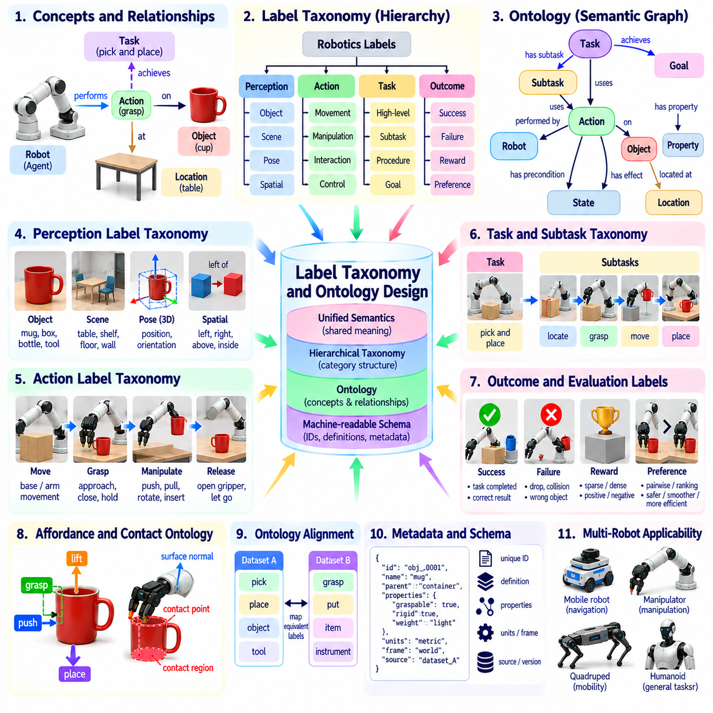{width="7.268055555555556in" height="7.268055555555556in"}

Label taxonomy and ontology design establishes a consistent semantic foundation for organizing robotic training data. A taxonomy arranges labels into hierarchical categories, while an ontology defines concepts, properties, and relationships among them. Together, these structures connect perception, action, task, and outcome annotations. They enable physical AI systems to interpret heterogeneous datasets through shared meanings rather than isolated naming conventions.

A label taxonomy organizes annotation categories according to levels of abstraction and functional similarity. Perception labels may include objects, surfaces, poses, and spatial relationships, while action labels describe movement, manipulation, and interaction. Task labels represent objectives and subtasks, and outcome labels capture success or failure. Hierarchical organization supports efficient dataset navigation, statistical analysis, and reusable learning representations.

Ontology design extends classification by representing semantic relationships between entities and events. A robot may grasp a container, place it on a shelf, and verify its final position. These interactions involve agents, objects, actions, locations, and temporal relationships. An ontology can explicitly encode such connections, allowing learning systems to distinguish object identity, functional roles, physical states, and task-dependent relationships.

The design process should begin with clearly defined annotation requirements and intended applications. A warehouse robot may require labels for inventory handling, navigation, and human interaction, while an assembly robot needs detailed contact and component relationships. A shared core vocabulary can support both domains, with specialized extensions for individual applications. This approach balances interoperability with operational specificity.

Object taxonomies should distinguish semantic categories from physical and functional properties. A container may belong to a storage category while also possessing attributes such as rigidity, capacity, weight, and graspability. These properties influence robot behavior but should not be confused with object identity. Separating categories from attributes allows models to reason about unfamiliar objects that share relevant physical characteristics.

Action ontologies describe operations through participants, preconditions, effects, and execution constraints. A grasp action involves a robot, an end effector, a target object, and an intended contact relationship. Its preconditions may include reachability and sufficient gripper clearance, while its effects may include stable object attachment. Such representations support task planning, execution monitoring, and structured interpretation of demonstrations.

Task ontologies connect high-level objectives with subtasks, action sequences, and completion criteria. A delivery task may involve locating an item, grasping it, navigating to a destination, and releasing it. Dependencies specify which operations must precede others, while alternative branches represent valid execution strategies. Explicit task structure enables hierarchical policy learning and improves analysis of long-horizon robot behavior.

Spatial and temporal concepts require standardized definitions to prevent inconsistent interpretation. Labels such as left, above, inside, approaching, and contacting depend on coordinate frames, geometric thresholds, and observation times. Ontologies should identify reference frames and relevant measurement conventions. Temporal relationships can describe event ordering, overlap, duration, and transitions between physical interaction states.

Affordance and contact ontologies connect object geometry with possible and observed interactions. A handle may support pulling, while a flat surface may support placing or sliding. Contact relationships identify interacting bodies, contact regions, and physical states. These concepts should distinguish potential actions from verified interactions. Such separation prevents a predicted capability from being incorrectly treated as an observed event.

Label definitions must specify annotation granularity and the boundaries between related categories. An arm movement may be labeled as reaching at one level and as part of grasp preparation at another. Both descriptions can be valid when their abstraction levels are explicit. Annotation guidelines should explain inclusion criteria, exclusion criteria, and ambiguous cases to reduce disagreement among human annotators and automated labeling systems.

A practical ontology should support multiple robot embodiments without assuming identical hardware capabilities. Mobile robots, manipulators, quadrupeds, and humanoids may perform similar tasks using different actuators and control spaces. Shared task and object concepts enable cross-platform learning, while embodiment-specific properties preserve kinematic and sensing differences. This distinction is essential for integrating heterogeneous physical AI datasets.

Semantic identifiers and metadata provide stability beyond human-readable label names. Each concept should have a unique identifier, definition, parent category, and documented relationships. Metadata may include coordinate conventions, measurement units, annotation sources, and confidence values. Machine-readable schemas enable automated validation and reliable conversion between dataset formats, reducing errors during large-scale data integration.

Ontology alignment becomes important when combining datasets developed by different organizations or research groups. One dataset may use pick while another uses grasp, even when their meanings overlap. Mapping procedures should determine whether labels are equivalent, broader, narrower, or context-dependent. Preserving original annotations alongside normalized labels prevents information loss and supports traceability when semantic mappings are revised.

Uncertainty and incomplete knowledge should be represented explicitly within the annotation structure. An object may have an uncertain identity, an inferred affordance, or an unverified contact state. Confidence scores and provenance records can distinguish direct measurements from human judgments and model predictions. Treating uncertainty as structured information prevents ambiguous observations from becoming misleading ground truth.

Taxonomy and ontology maintenance requires version control, change documentation, and compatibility management. New robot capabilities may introduce previously unsupported actions, sensors, or interaction categories. Changes should preserve historical meaning whenever possible and provide migration rules when definitions are modified. Versioned schemas allow datasets and trained models to remain interpretable as annotation standards evolve.

Quality evaluation should examine semantic consistency, relationship validity, annotation coverage, and downstream learning performance. Automated checks can detect incompatible categories, missing required attributes, and impossible relationship combinations. Human review remains necessary for ambiguous semantic distinctions. A well-designed ontology should improve dataset interoperability, labeling reliability, and the generalization of physical AI models across tasks and environments.

## 05.14. Label Quality Control and Agreement

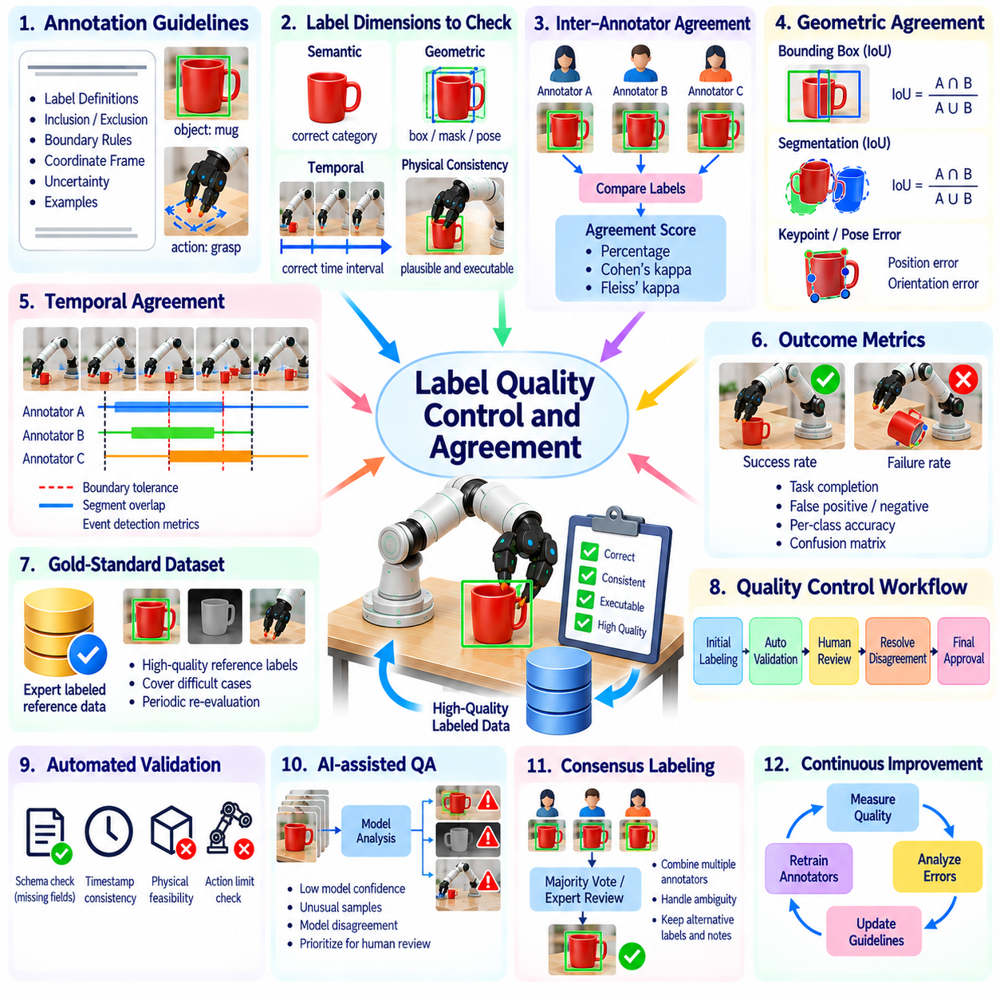{width="7.268055555555556in" height="7.268055555555556in"}

Label quality control and agreement are essential for producing reliable robotic training datasets. In physical AI, annotation errors can affect perception, motion planning, manipulation, and safety-critical decisions. Quality control verifies whether labels satisfy defined requirements, while agreement measures consistency among annotators or labeling systems. Together, these processes establish confidence in the data used to train and evaluate robotic intelligence.

Robot labeling quality extends beyond assigning correct semantic categories. An object label may be accurate while its bounding box, pose, timestamp, or coordinate frame is incorrect. Contact and action labels may also depend on physical conditions that are difficult to observe directly. Effective quality assurance must therefore examine semantic correctness, geometric precision, temporal consistency, and compatibility with robot execution requirements.

Annotation guidelines provide the foundation for consistent labeling. They should define label categories, inclusion rules, exclusion conditions, coordinate conventions, and acceptable uncertainty. For example, a grasp event may begin at initial contact or when stable object control is established. Without an explicit definition, different annotators may assign different boundaries to the same demonstration, creating inconsistent training supervision.

Inter-annotator agreement measures how consistently independent reviewers assign labels to identical data. High agreement suggests that annotation definitions are understandable and reproducible, although it does not guarantee correctness. Low agreement may indicate ambiguous observations, insufficient instructions, or overlapping categories. Agreement analysis should identify the sources of disagreement rather than treating every difference as an individual labeling mistake.

Categorical agreement can be evaluated using percentage agreement, Cohen\'s kappa, or Fleiss\' kappa, depending on the annotation setting. These measures help quantify consistency while accounting for different assumptions about chance agreement. However, heavily imbalanced categories can produce misleading interpretations. Agreement statistics should therefore be reported alongside class distributions, sample counts, and examples of disputed annotations.

Geometric annotations require evaluation methods appropriate to their representations. Bounding boxes and segmentation masks can be compared using intersection over union, while keypoints and object poses require distance or orientation errors. Three-dimensional annotations should specify measurement units and reference frames. A geometrically accurate label in the wrong coordinate system may be unusable for robot control despite appearing visually reasonable.

Temporal agreement evaluates whether annotators identify the same action intervals, contact transitions, and task boundaries. Exact timestamp matching is often unrealistic because physical interactions develop gradually. Boundary tolerance, segment overlap, and event detection metrics provide more meaningful comparisons. Evaluation rules should reflect the required control precision and distinguish minor timing differences from substantial semantic disagreements.

Quality control for continuous labels requires careful treatment of measurement uncertainty. Joint angles, velocities, forces, and object poses may originate from sensors with different noise characteristics. Reference values should include calibration information and expected error ranges when available. Comparing continuous annotations against unrealistic exact targets can incorrectly classify valid measurements as labeling failures.

A gold-standard dataset provides a reference for evaluating annotators and automated labeling pipelines. Reference labels should be produced through expert review, calibrated measurements, or independently verified outcomes. Difficult examples deserve particular attention because they reveal weaknesses hidden by routine cases. Gold-standard references should be periodically reassessed when sensors, task definitions, or annotation standards change.

Multi-stage review workflows can combine initial labeling, independent verification, disagreement resolution, and final approval. Straightforward examples may pass automated checks, while ambiguous or safety-relevant cases require expert examination. Review effort should be proportional to the consequences of incorrect labels. This risk-based approach improves efficiency without applying identical verification costs to every recorded sample.

Consensus labeling combines judgments from multiple annotators to produce a final annotation. Majority voting can work for simple categories, but complex spatial or temporal labels may require expert adjudication. Consensus should not automatically replace minority judgments when the evidence remains ambiguous. Preserving disagreement records and alternative interpretations can provide valuable information about uncertainty and dataset limitations.

Automated validation detects structural and logical errors before annotations enter training pipelines. Schema checks can identify missing fields, invalid categories, inconsistent timestamps, and incorrect coordinate conventions. Physical consistency rules may detect impossible object poses, contradictory contact states, or actions outside robot limits. These checks reduce preventable errors but cannot fully determine whether semantic interpretations are correct.

AI-assisted quality control can prioritize suspicious annotations using confidence scores, model disagreement, and anomaly detection. Samples with unusual geometry, inconsistent action sequences, or uncertain object identities may be routed for human review. Such systems should not assume that model predictions are ground truth. Automated reviewers can inherit training biases, making independent evidence essential for resolving difficult cases.

Annotation drift occurs when labeling behavior changes over time because of personnel changes, evolving guidelines, or new data conditions. A category initially defined narrowly may gradually be applied to broader situations. Periodic calibration exercises and repeated labeling of reference samples can reveal these changes. Versioned instructions and audit histories help maintain consistency across large annotation teams and long-running data collection programs.

Disagreement analysis can guide improvements in taxonomy and ontology design. Repeated confusion between grasp preparation and grasp execution may indicate unclear temporal definitions. Disagreement between contact and near-contact labels may reveal inadequate sensor thresholds. Revising category definitions, adding examples, or introducing uncertainty labels can address these problems more effectively than simply increasing reviewer workload.

Dataset quality should also be evaluated through downstream robotic performance. A labeling pipeline may achieve high agreement while producing annotations that fail to support reliable manipulation or navigation. Controlled training experiments can compare policy performance across alternative labeling standards. Task success, robustness, and safety metrics reveal whether improvements in annotation consistency translate into meaningful operational benefits.

Scalable data engines should integrate quality monitoring throughout collection, labeling, training, and deployment. Quality dashboards can track error rates, agreement trends, review backlogs, and performance differences across data sources. Fleet feedback may reveal systematic labeling weaknesses associated with particular sensors or environments. Continuous monitoring allows annotation standards to evolve while preserving traceability and reproducibility.

The objective of label quality control and agreement is to ensure that robotic datasets provide dependable supervision rather than merely large quantities of annotations. Clear definitions, calibrated measurements, independent review, statistical agreement analysis, and automated validation establish a foundation for trustworthy data. Integrated with feedback from real robot execution, these practices support safer learning, stronger generalization, and scalable physical AI development.

## 05.15. Automated Robot Labeling Pipeline [w/Code]

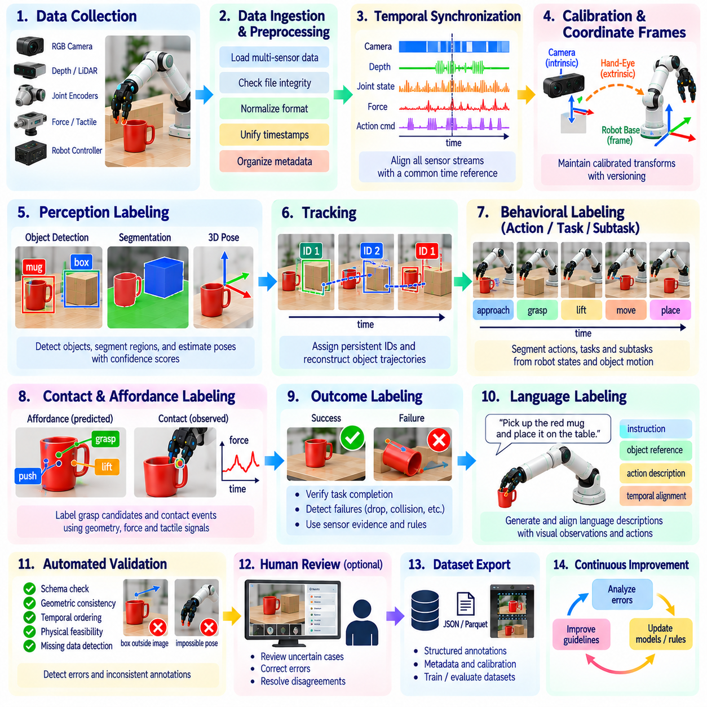{width="7.268055555555556in" height="7.268055555555556in"}

An automated robot labeling pipeline transforms raw sensor recordings and robot execution logs into structured training annotations with minimal manual intervention. It combines data ingestion, synchronization, perception models, behavioral segmentation, quality validation, and dataset export. Unlike conventional image labeling, robotic annotation must preserve temporal relationships, coordinate frames, physical interactions, and task outcomes to support reliable physical AI learning.

The pipeline begins with collecting synchronized data from cameras, depth sensors, LiDAR, joint encoders, force sensors, and robot controllers. Each recording should include timestamps, sensor identifiers, calibration parameters, and robot configuration metadata. Raw data must remain traceable to its original acquisition session. This foundation enables later reconstruction of physical events and prevents annotations from becoming disconnected from their measurement context.

Data ingestion converts heterogeneous sensor streams into a consistent internal representation. Images, point clouds, joint states, and control commands may arrive at different frequencies and use different formats. A preprocessing layer validates file integrity, normalizes metadata, and establishes a common time reference. Missing frames, corrupted messages, and inconsistent timestamps should be detected before downstream labeling begins.

Temporal synchronization aligns sensor observations with robot actions and environmental changes. Hardware timestamps are preferable when available, while software synchronization may compensate for known communication delays. Interpolation can align continuous signals such as joint positions, but discrete contact events require careful handling. Synchronization errors can incorrectly associate actions with outcomes and produce misleading supervision.

Calibration management establishes consistent geometric relationships among cameras, robot bases, end effectors, and world coordinates. Intrinsic camera parameters support image interpretation, while extrinsic transformations connect observations to robot reference frames. Calibration records should be versioned and associated with individual recording sessions. Incorrect transformations can produce plausible-looking labels that are physically unusable.

Perception labeling applies pretrained or task-specific models to identify objects, surfaces, semantic regions, and spatial relationships. Object detectors generate bounding boxes, segmentation networks produce masks, and pose estimators infer object configurations. Three-dimensional perception may combine depth images and point clouds. Predictions should retain confidence values and model versions so that uncertain annotations can be reviewed or regenerated.

Tracking modules associate detected entities across consecutive observations. Persistent object identifiers allow the pipeline to reconstruct motion trajectories, object interactions, and changes in scene configuration. Tracking should account for occlusion, temporary detection failures, and objects leaving the field of view. Identity switches must be detected because they can corrupt action associations and long-horizon task annotations.

Behavioral labeling converts robot state histories into action, task, and subtask descriptions. Joint trajectories, gripper commands, controller states, and object movements provide evidence for detecting reaching, grasping, lifting, transportation, and placement. Rule-based segmentation can identify clear transitions, while learned sequence models handle more complex patterns. Semantic labels should distinguish intended commands from verified physical behavior.

Contact and affordance labeling integrates geometric observations with force, torque, tactile, and motion signals. Candidate grasp regions may be inferred from object geometry, while actual contact events require supporting physical evidence. Sensor thresholds can identify interaction transitions, but noise and mechanical compliance introduce uncertainty. The pipeline should distinguish predicted affordances from observed contacts and successful manipulation outcomes.

Outcome labeling evaluates whether recorded operations satisfy explicit completion criteria. A successful placement may require the target object to remain stable within a defined region after release. Failure labels can identify collisions, dropped objects, incomplete actions, and safety interruptions. Task-specific verification rules should combine sensor evidence with robot execution states rather than treating completed commands as proof of success.

Language labeling associates demonstrations with instructions, object references, and action descriptions. Speech transcripts, operator commands, and video-language models can provide candidate semantic annotations. These descriptions must be grounded in observable objects and aligned with relevant action intervals. Automatically generated captions should not introduce unsupported intentions or describe predicted events as verified outcomes.

A practical implementation can use Python-based processing modules connected through a reproducible workflow. Data readers load synchronized recordings, perception models generate candidate labels, and validation functions check schema compliance. Intermediate results may be stored in structured files or databases. Modular interfaces allow individual models to be upgraded without rebuilding the entire labeling system.

Automated validation examines annotation completeness, geometric consistency, temporal ordering, and logical relationships. Bounding boxes must remain within image dimensions, pose labels must use declared coordinate frames, and action intervals must follow valid timestamps. Physical rules can flag contradictory contact states or impossible joint configurations. Validation failures should generate explicit error records instead of silently removing problematic samples.

Confidence-based routing directs uncertain or high-risk annotations to human reviewers. Low-confidence detections, inconsistent tracking, ambiguous task boundaries, and conflicting outcome signals may require manual verification. Reviewers should receive synchronized sensor evidence and the model\'s proposed labels. Corrected annotations can be returned to the pipeline as verified references for improving future automated labeling.

Dataset export converts validated annotations into standardized formats suitable for training and evaluation. Each sample should preserve sensor references, semantic labels, coordinate conventions, timestamps, confidence values, and provenance metadata. Dataset versions must record annotation models and processing configurations. Reproducible exports allow researchers to compare labeling improvements without confusing them with changes in the underlying data.

Continuous operation requires monitoring annotation quality, processing throughput, computational cost, and downstream model performance. Active learning can prioritize difficult recordings, while fleet feedback identifies recurring failures and underrepresented scenarios. Newly verified examples can improve perception and behavior labeling models. The resulting feedback loop connects real robot deployment with progressively better training data.

The objective of an automated robot labeling pipeline is not simply to maximize annotation speed, but to produce trustworthy, scalable, and physically meaningful supervision. Reliable ingestion, synchronization, perception, behavioral interpretation, validation, and human review form an integrated data engine. When combined with version control and deployment feedback, this architecture supports continuous improvement of physical AI systems.
