**Volume 04. Data Engines and Scaling for Physical AI**

# Chapter 06. Data Curation and Filtering

## 06.01. Why Data Curation Matters

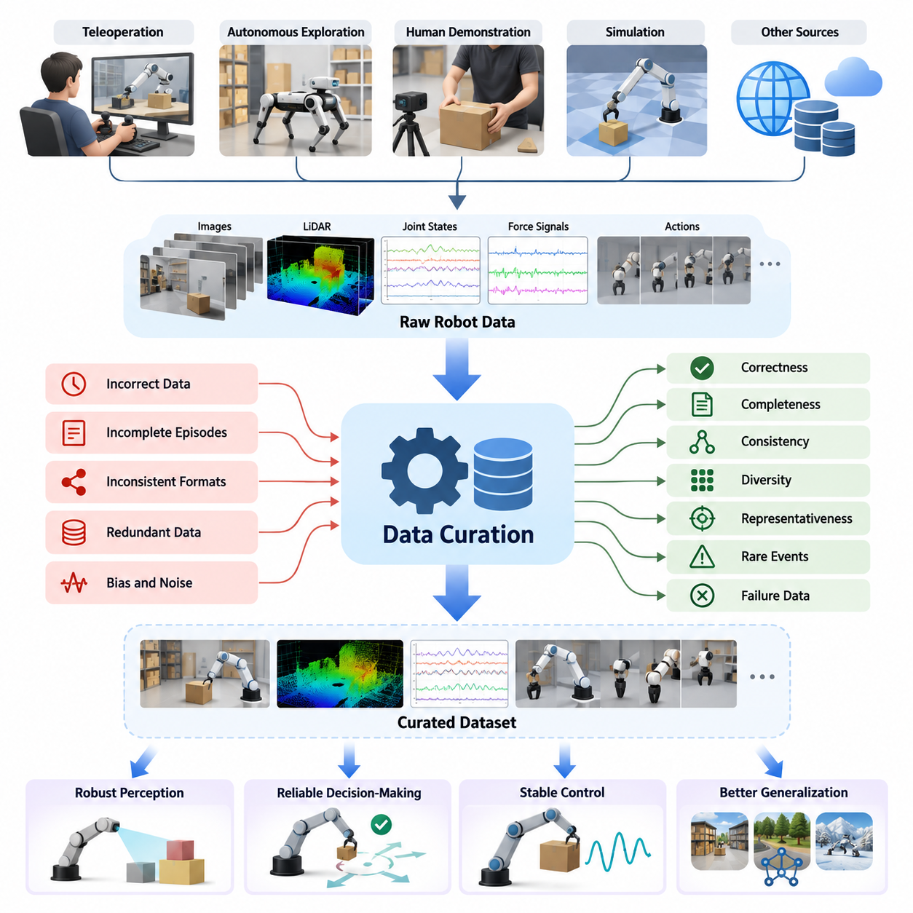{width="7.268055555555556in" height="7.268055555555556in"}

Data curation is a fundamental process in Physical AI because the effectiveness of robot learning depends not only on the amount of collected data but also on its quality, relevance, and diversity. Robots operate in dynamic physical environments where inaccurate observations, inconsistent actions, or incomplete trajectories can directly influence learned behavior. Data curation transforms raw recordings into reliable training resources that support robust perception, decision-making, and control.

Unlike conventional digital AI datasets, Physical AI datasets contain tightly coupled observations, actions, states, and outcomes. Camera images, LiDAR measurements, joint positions, force signals, and control commands must preserve their temporal and physical relationships. A dataset may appear statistically sufficient while containing synchronization errors or physically inconsistent trajectories. Effective curation identifies these problems before they propagate into model training.

The importance of curation becomes particularly evident when robot data is collected from multiple sources. Teleoperation, autonomous exploration, human demonstration videos, and simulation environments produce different distributions and levels of reliability. Each source introduces characteristic biases, noise patterns, and representation differences. A unified curation process establishes consistent quality requirements while preserving the distinctive information contributed by each collection method.

Increasing dataset size does not automatically improve robot performance. Large collections frequently contain repeated movements, stationary observations, redundant trajectories, and demonstrations that provide little additional learning value. Training repeatedly on such examples consumes computational resources without proportionate improvements in capability. Data curation reduces unnecessary redundancy and increases the concentration of informative experiences within the available training budget.

Data correctness is one of the primary concerns in robotic learning. Incorrect timestamps, corrupted sensor measurements, mismatched coordinate frames, or inaccurate action labels can create misleading relationships between observations and actions. A manipulation policy trained on inconsistent gripper positions may learn unstable grasping behavior. Curation procedures detect these inconsistencies through validation rules, physical constraints, and cross-modal consistency checks.

Completeness is equally important because robot learning often depends on understanding entire interaction sequences. A trajectory containing an initial observation and several actions but missing the final outcome may be unsuitable for evaluating task success. Missing force measurements during contact-rich manipulation can obscure the causes of failure. Curation identifies incomplete episodes and determines whether they should be repaired, partially retained, or excluded according to their intended use.

Data consistency ensures that information collected across robots, environments, and recording systems follows compatible conventions. Different robots may represent joint angles, coordinate systems, velocities, and action commands using different formats. Without standardization, combining these datasets can introduce systematic errors. Curation establishes common schemas, unit conventions, metadata definitions, and validation procedures that enable reliable integration across heterogeneous platforms.

Diversity is another essential dimension of data quality. A robot trained primarily on successful demonstrations in controlled environments may struggle when encountering unfamiliar objects, lighting conditions, surfaces, or human behaviors. Curated datasets should represent meaningful variations in task execution and environmental conditions. Diversity-oriented selection prevents excessive concentration on frequently observed situations and supports stronger generalization to previously unseen circumstances.

Representativeness connects the training distribution to the conditions expected during deployment. Warehouse robots, agricultural platforms, and humanoid manipulators encounter different operational environments and failure modes. A dataset optimized for one setting may not adequately support another. Curation therefore requires explicit consideration of target applications, environmental variability, robot morphology, and operational constraints when selecting and balancing training examples.

Rare events deserve special attention because their frequency in collected data may be inversely related to their operational importance. Unexpected obstacles, unstable grasps, sensor interruptions, and near-collision situations may occur infrequently but significantly affect reliability and safety. Random sampling can easily overlook these experiences. Curated datasets deliberately preserve relevant rare events, enabling models to learn recovery strategies and recognize situations requiring cautious behavior.

Failure data also provides valuable information that successful demonstrations alone cannot capture. Failed grasps reveal limitations in contact estimation, while navigation failures expose weaknesses in localization or obstacle reasoning. However, failure trajectories must be labeled and interpreted correctly to avoid teaching undesirable actions as successful behavior. Curation distinguishes successful execution, unsuccessful attempts, corrective interventions, and recovery sequences according to their learning objectives.

Outlier detection presents a particularly important challenge in Physical AI. Unusual measurements may indicate corrupted sensors, incorrect calibration, or recording errors, but they may also represent legitimate physical phenomena. Aggressively removing all statistical outliers can eliminate precisely the unusual situations required for robust learning. Effective curation combines statistical analysis with physical reasoning, task context, and uncertainty estimates to distinguish invalid recordings from informative exceptions.

The quality of human demonstrations introduces another layer of complexity. Teleoperation data reflects operator expertise, reaction time, interface limitations, and individual movement preferences. Some demonstrations contain unnecessary hesitation, inefficient trajectories, or inconsistent corrective actions. Curation evaluates demonstration quality using task completion, trajectory smoothness, collision avoidance, execution efficiency, and other task-dependent criteria without assuming that the shortest trajectory is always the best.

Synthetic data requires specialized curation because simulation environments can generate large volumes of perfectly labeled but insufficiently realistic experiences. Unrealistic contact dynamics, simplified object properties, and limited environmental variability may cause models to exploit simulation-specific patterns. Curating synthetic datasets involves checking physical plausibility, identifying repetitive scenarios, and selecting examples that complement real-world observations rather than merely increasing dataset size.

Modern curation systems increasingly use learned representations to organize and filter large datasets. Embedding models can map observations, trajectories, and task descriptions into feature spaces where semantically related experiences become easier to identify. Clustering and similarity analysis reveal duplicated behaviors, underrepresented conditions, and potentially novel events. These methods support scalable selection, although their effectiveness depends on the quality and relevance of the learned representations.

Uncertainty-driven curation provides a direct connection between model performance and data selection. When a trained robot policy exhibits high prediction uncertainty or repeated errors in particular situations, those experiences can be prioritized for inspection and additional training. This approach concentrates data engineering effort on regions where the current model lacks reliable knowledge. It also supports active learning and iterative improvement through targeted data acquisition.

Dataset balancing determines how different tasks, environments, robots, and data sources contribute to the training process. A large navigation dataset may overwhelm a smaller manipulation dataset if examples are sampled solely according to collection volume. Conversely, excessive oversampling of rare experiences can distort the expected operational distribution. Effective mixture design considers learning objectives, deployment frequency, task difficulty, and the relative importance of specific behaviors.

Data curation also plays a critical role in trustworthy evaluation. Training, validation, and test datasets must be separated to prevent information leakage through repeated trajectories, overlapping recording sessions, or nearly identical simulation scenes. Randomly splitting individual frames from the same robot episode can produce misleading performance estimates. Episode-level, environment-level, and deployment-site-level separation provide more meaningful assessments of generalization.

A well-designed curation process maintains traceability between original recordings and the datasets used for training. Metadata should identify data sources, robot configurations, sensor calibration, collection conditions, processing operations, and dataset versions. This provenance allows engineers to investigate unexpected model behavior and reproduce experimental results. It also supports auditing, governance, and controlled replacement of problematic data without losing historical information.

The economic significance of curation increases as Physical AI systems scale. Collecting robot demonstrations, operating simulation infrastructure, transferring sensor recordings, and training large models all require substantial resources. Processing every collected sample with equal priority can become inefficient. Curation improves the utilization of storage, annotation effort, communication bandwidth, and computational capacity by directing resources toward experiences with greater expected learning value.

Ultimately, data curation should be understood as an integral component of the Physical AI data engine rather than a one-time preprocessing activity. As robots encounter new environments and models reveal additional weaknesses, the definition of valuable data evolves. Continuous filtering, quality assessment, diversity analysis, and feedback-driven selection create a dynamic relationship between deployment experience and learning. This process transforms growing data collections into increasingly effective foundations for reliable, adaptable, and scalable robotic intelligence.

## 06.02. Data Correctness Completeness and Consistency

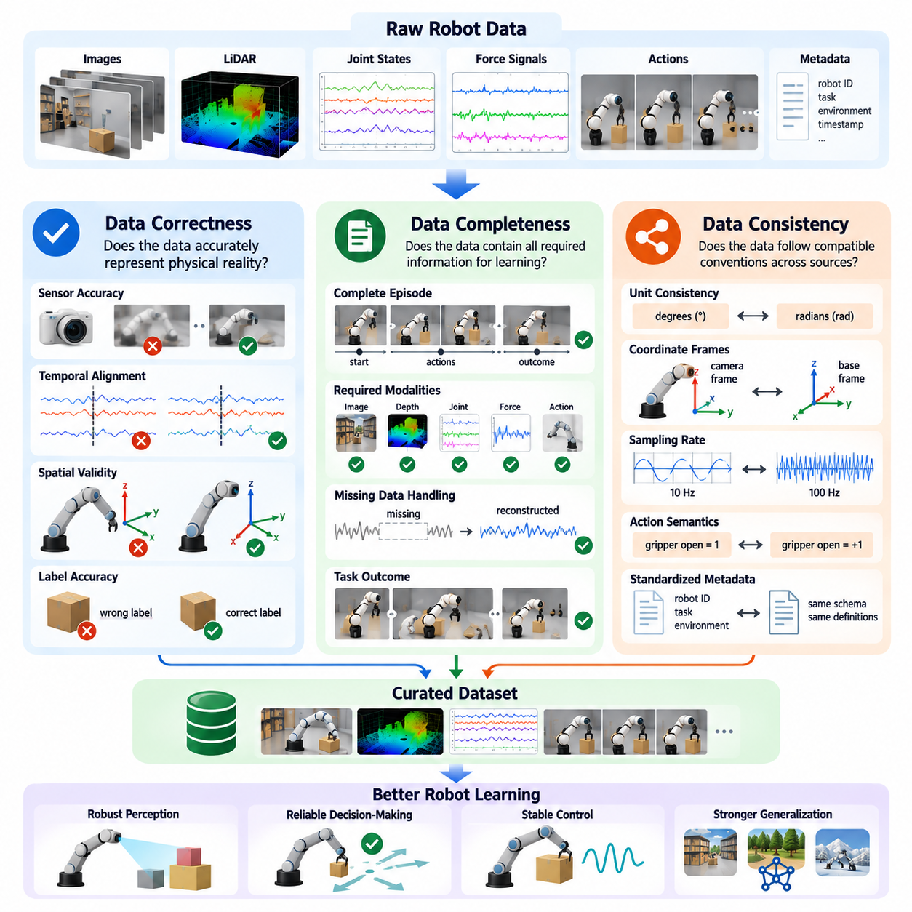{width="7.268055555555556in" height="7.268055555555556in"}

Data correctness, completeness, and consistency are three fundamental dimensions of data quality in Physical AI systems. They determine whether collected robot experiences accurately represent physical events, contain sufficient information for learning, and follow compatible conventions across different sources. Even large datasets can produce unreliable models when these properties are neglected. Effective data curation therefore evaluates all three dimensions before training.

Data correctness refers to the degree to which recorded information accurately describes the underlying physical state, action, or outcome. A correct robot dataset should contain valid sensor measurements, accurate timestamps, properly calibrated coordinate frames, and trustworthy labels. Errors in any of these elements can introduce false relationships between observations and actions, causing learned policies to make incorrect predictions or execute inappropriate movements.

Correctness problems frequently originate from sensor calibration, communication delays, and recording software. A camera may provide geometrically distorted images, while a LiDAR sensor may report inaccurate distances because of calibration drift. Joint encoders can produce incorrect position estimates, and force sensors may exhibit measurement offsets. These errors must be identified through calibration checks, physical plausibility tests, and comparisons between independent measurements.

Temporal correctness is particularly important because robot learning depends on the relationship between observations and subsequent actions. Camera frames, proprioceptive measurements, and motor commands often operate at different frequencies. Incorrect timestamps or synchronization offsets can associate an action with the wrong observation. Even small timing errors may significantly affect contact-rich manipulation, dynamic locomotion, and high-speed autonomous navigation.

Spatial correctness requires all geometric information to follow valid coordinate transformations and consistent reference frames. Robot datasets commonly contain positions expressed in camera, sensor, robot-base, and world coordinates. Incorrect transformation matrices or frame assignments can produce physically impossible trajectories. Validation procedures should verify transformation chains, coordinate handedness, calibration parameters, and the geometric relationships between sensors and robot components.

Label correctness is another essential requirement because supervised learning depends on reliable interpretations of recorded experiences. Object identities, grasp success indicators, task boundaries, and action descriptions may contain annotation errors. Automated labeling systems can also propagate systematic mistakes across thousands of samples. Quality assurance should combine automated validation, targeted human review, and agreement analysis to identify unreliable labels before they influence model training.

Data completeness describes whether a dataset contains the information required for its intended learning or evaluation objective. A trajectory may include accurate camera images and joint positions but remain incomplete if action commands or task outcomes are missing. Completeness must therefore be evaluated relative to the application rather than through a universal checklist. Different learning methods require different combinations of observations, actions, rewards, and contextual information.

Episode completeness is especially important for imitation learning and reinforcement learning. A complete episode generally preserves the initial conditions, sequence of observations, executed actions, relevant state transitions, and termination information. Missing terminal states can make it difficult to distinguish successful completion from interruption. Incomplete episodes may still be useful for representation learning, but their limitations must be explicitly recorded.

Multimodal completeness concerns the availability of synchronized information across sensing and control channels. A manipulation dataset may require RGB images, depth measurements, joint states, gripper commands, and force feedback. Missing modalities can reduce the ability to reconstruct contact events or explain failures. Curation systems should identify absent channels, document sensor availability, and determine whether partial observations remain suitable for particular training objectives.

Missing data should not automatically result in complete episode rejection. Some gaps can be repaired through interpolation, reconstruction, or synchronization with redundant sensors. However, reconstructed values introduce uncertainty and may conceal important physical events. Interpolation is particularly risky around collisions, rapid accelerations, and contact transitions. Curated datasets should distinguish original measurements from estimated values and preserve information about the reconstruction method.

Data consistency ensures that records collected across different robots, sessions, environments, and software systems follow compatible definitions and representations. Consistency includes measurement units, coordinate conventions, sampling rates, action semantics, metadata schemas, and labeling taxonomies. Without these agreements, combining individually correct datasets can still produce misleading training examples. Standardized representations are therefore essential for scalable robot learning.

Unit consistency is a common source of preventable errors in robotics datasets. One system may record joint angles in degrees while another uses radians, or one controller may express distances in millimeters while another uses meters. Velocity commands can also follow different conventions. These differences may remain unnoticed during dataset aggregation. Explicit unit declarations, schema validation, and conversion checks help prevent such errors from entering training pipelines.

Semantic consistency concerns whether labels and action descriptions maintain the same meaning across datasets. For example, one collection system may define grasp success as object contact, while another requires stable lifting and placement. Similarly, task completion criteria may differ between operators or environments. Harmonizing semantic definitions requires shared ontologies, clear annotation guidelines, and explicit mappings between source-specific labels and standardized categories.

Consistency across robot embodiments presents additional challenges because different platforms have different joint structures, control interfaces, and physical capabilities. A mobile manipulator, humanoid robot, and industrial arm may perform similar tasks using incompatible action representations. Curation must preserve embodiment-specific information while enabling meaningful comparisons. Canonical task descriptions and carefully defined action mappings can support cross-robot learning without erasing important physical differences.

Automated quality validation can integrate correctness, completeness, and consistency into a unified inspection process. Validation rules may check numerical ranges, timestamp ordering, missing fields, coordinate transformations, sensor availability, and schema compliance. More advanced systems can compare predicted physical behavior with recorded outcomes. Such checks provide scalable quality assurance, although human investigation remains necessary when unusual data may represent legitimate operating conditions.

The three quality dimensions are closely related but should not be treated as interchangeable. A dataset can be complete and consistent while containing incorrect sensor values. Another dataset may contain accurate measurements but lack essential task outcomes. A third may contain individually valid episodes that use incompatible coordinate systems. Reliable curation requires independent evaluation of each dimension followed by an integrated assessment of dataset suitability.

Quality scoring provides a practical mechanism for prioritizing datasets and identifying problematic recordings. Correctness scores can reflect calibration confidence and validation results, while completeness scores measure the availability of required information. Consistency scores can evaluate compliance with shared schemas and semantic definitions. Composite scores may support automated filtering, but their weighting should depend on task requirements and should not obscure critical safety-related defects.

Data provenance and version control strengthen quality management by preserving the history of collection, processing, correction, and validation. Each episode should retain information about sensor configurations, software versions, calibration records, and transformation operations. When errors are discovered, engineers can identify affected datasets and reproduce corrective procedures. This traceability supports reliable experimentation and prevents previously resolved problems from reappearing in subsequent training cycles.

Continuous quality monitoring becomes essential when Physical AI data engines operate across large robot fleets. Sensor degradation, software updates, changing environments, and heterogeneous hardware can gradually alter data characteristics. Automated monitoring can detect increasing missing-data rates, calibration anomalies, and schema violations. Feedback from model evaluation and field failures can then guide additional inspection and correction of affected recordings.

Ultimately, correctness, completeness, and consistency establish the foundation for trustworthy Physical AI datasets. Correctness ensures that information reflects actual physical events, completeness provides the context necessary for meaningful learning, and consistency enables reliable integration across diverse sources. Together, these properties transform raw robot recordings into dependable training assets and support scalable data engines capable of producing robust, generalizable, and safety-conscious robotic intelligence.

## 06.03. Data Diversity Representativeness and Coverage

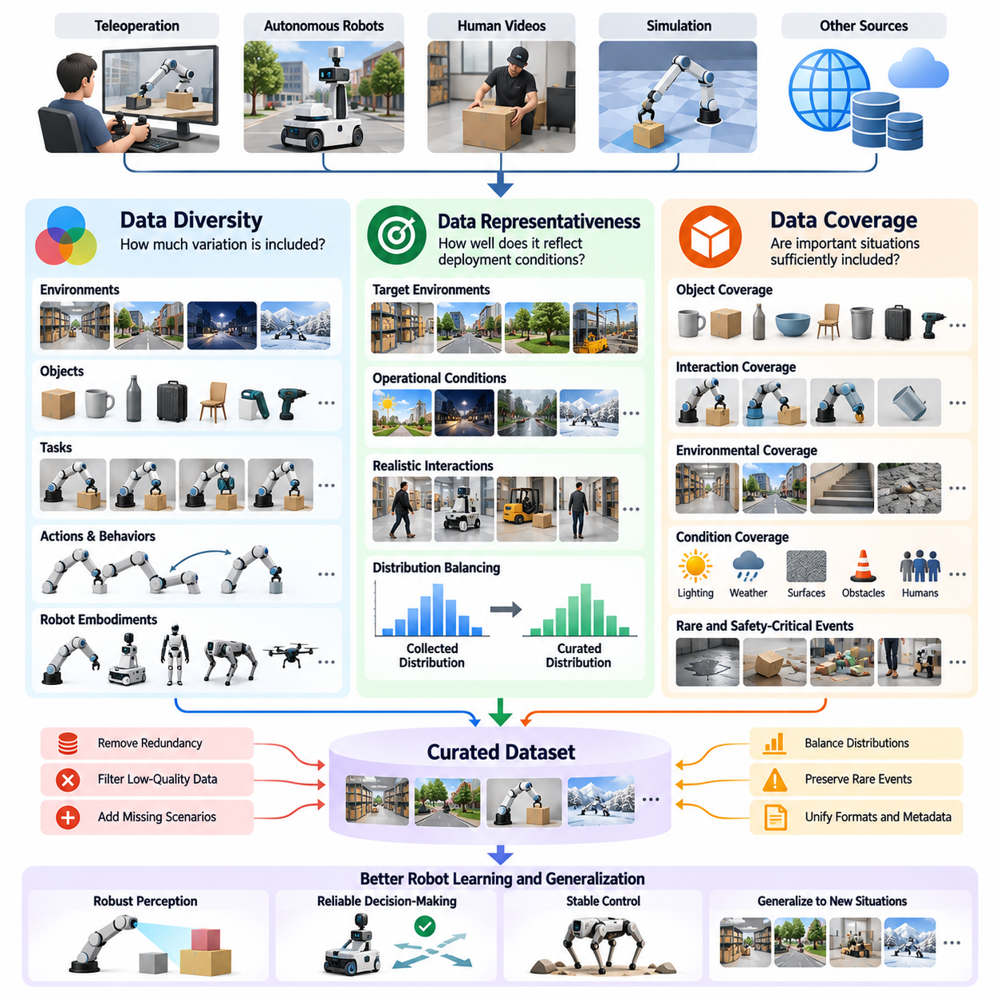{width="7.268055555555556in" height="7.268055555555556in"}

Data diversity, representativeness, and coverage are essential dimensions of dataset quality in Physical AI. Diversity describes the variation of experiences, representativeness measures how closely collected data reflects intended operating conditions, and coverage evaluates whether important situations are sufficiently included. Together, these properties determine whether robot learning systems can generalize beyond familiar demonstrations and operate reliably in complex physical environments.

A large dataset does not necessarily contain diverse experiences. Millions of camera frames collected from the same warehouse aisle may provide less useful variation than a smaller dataset containing different layouts, obstacles, lighting conditions, and human interactions. Repeated observations increase storage and training costs without proportionally expanding knowledge. Effective curation therefore emphasizes meaningful variation rather than simply maximizing the number of recorded samples.

Diversity in Physical AI extends across multiple interconnected dimensions, including environments, objects, tasks, actions, robot embodiments, and interaction outcomes. Environmental diversity includes changes in illumination, weather, terrain, and workspace geometry. Object diversity includes variations in shape, size, material, texture, and physical properties. Behavioral diversity captures different execution strategies, movement patterns, and responses to unexpected events.

Task diversity is particularly important for developing general-purpose robot intelligence. A manipulation system trained exclusively on picking objects from fixed locations may struggle with sorting, stacking, inserting, or transferring objects between containers. Diverse task demonstrations expose the model to different goals, constraints, and action sequences. However, useful diversity requires meaningful differences in task structure rather than superficial changes in object appearance.

Representativeness concerns the relationship between the training dataset and the operational distribution expected during deployment. A warehouse robot should encounter training examples reflecting realistic aisle configurations, pedestrian activity, pallet arrangements, and obstacle frequencies. A dataset dominated by artificially simplified scenes may produce impressive laboratory results while failing in production. Representative sampling therefore requires an explicit understanding of deployment conditions.

Representativeness does not mean reproducing the operational distribution without modification. Rare but safety-critical events may require deliberate oversampling because their natural occurrence frequency is insufficient for effective learning. Conversely, common but repetitive observations may be downsampled to reduce redundancy. The appropriate dataset distribution depends on whether the objective is imitation learning, robust perception, safety evaluation, or general-purpose pretraining.

Coverage measures the extent to which a dataset includes relevant regions of the task and environment space. In robotic manipulation, coverage may involve object categories, grasp orientations, contact conditions, and task outcomes. For autonomous navigation, it may include obstacle configurations, surface types, visibility conditions, and traffic interactions. Coverage analysis identifies missing combinations that could cause unexpected failures during deployment.

Coverage should be evaluated at multiple levels of abstraction. Low-level coverage concerns sensor measurements, joint configurations, and action ranges. Intermediate coverage includes object interactions, movement primitives, and environmental conditions. High-level coverage describes complete tasks, multi-step behaviors, and recovery strategies. A dataset may provide extensive low-level variation while lacking the task-level experiences required for long-horizon autonomy.

The interaction between diversity and coverage is important because broad variation does not guarantee sufficient representation of critical scenarios. A dataset may contain many different environments but very few examples of slippery surfaces or unstable object contacts. Similarly, extensive object diversity may coexist with limited grasping strategies. Curation systems should examine both individual attributes and combinations of attributes to identify meaningful gaps.

Combinatorial coverage becomes challenging as the number of variables increases. Lighting, object geometry, robot configuration, surface friction, and task instructions can produce an enormous number of possible combinations. Exhaustively collecting every combination is generally impractical. Instead, data engines can prioritize physically meaningful interactions, high-risk conditions, and combinations associated with model uncertainty or observed failures.

Robot embodiment diversity introduces additional complexity into dataset design. Industrial manipulators, mobile robots, humanoids, quadrupeds, and aerial platforms operate with different sensors, action spaces, and physical constraints. Cross-embodiment datasets can support transferable representations of tasks and environments. However, curation must preserve embodiment-specific characteristics to prevent incompatible actions or dynamics from being treated as equivalent.

Data source diversity also affects learning quality. Teleoperation provides demonstrations grounded in real robot dynamics, human videos offer broad knowledge of everyday interactions, and simulation enables controlled exploration of unusual conditions. Each source contributes different strengths and limitations. Effective mixture design combines complementary information while accounting for differences in realism, action observability, annotation quality, and distribution.

Synthetic data can improve coverage by generating scenarios that are expensive, dangerous, or difficult to collect in physical environments. Domain randomization varies textures, lighting, object placement, and physical parameters to expose models to broader conditions. Nevertheless, excessive randomization may generate unrealistic experiences. Synthetic dataset curation should prioritize plausible scenarios and verify that added variation improves real-world generalization.

Measuring diversity requires more than counting files or recording hours. Useful indicators include the number of distinct tasks, environments, object categories, robot configurations, and behavioral patterns. Feature-space analysis can reveal whether samples occupy different regions of learned representations. Clustering, distance metrics, and distribution comparisons provide practical tools for identifying redundant concentrations and underrepresented experiences.

Representativeness can be assessed by comparing curated datasets with deployment observations. Engineers may examine distributions of environmental conditions, object frequencies, task requests, and robot operating states. Differences between training and deployment distributions indicate potential generalization risks. However, statistical similarity alone is insufficient because rare physical interactions and safety-critical conditions may carry disproportionate importance.

Coverage evaluation benefits from structured scenario taxonomies and explicit operational requirements. A navigation system might classify scenarios according to obstacle type, motion behavior, visibility, and available clearance. A manipulation system might organize experiences by object geometry, contact type, grasp strategy, and outcome. Such classifications transform vague diversity objectives into measurable coverage targets and support systematic gap analysis.

Long-tail scenarios are particularly important for reliable Physical AI. Unexpected object motion, unusual human behavior, sensor degradation, and uncommon contact dynamics may be absent from ordinary training distributions. These events often reveal limitations that remain hidden during standard evaluation. Targeted mining of field failures, interventions, and near misses helps expand coverage toward situations that challenge existing robot policies.

Active data collection can improve dataset composition by selecting new experiences according to identified gaps. When coverage analysis reveals insufficient examples of reflective surfaces, narrow passages, or deformable objects, collection campaigns can target those conditions. Model uncertainty and prediction errors can further guide selection. This creates a feedback loop in which deployment experience continuously improves dataset diversity and operational relevance.

Dataset balancing determines how diversity, representativeness, and coverage are translated into training mixtures. Sampling strategies may increase the contribution of underrepresented tasks while limiting excessive repetition of common behaviors. Nevertheless, aggressive balancing can distort operational frequencies and reduce performance on common scenarios. Effective designs distinguish between datasets intended for training, stress testing, and unbiased evaluation.

Ultimately, diversity, representativeness, and coverage must be managed as complementary rather than interchangeable objectives. Diversity expands the range of experiences, representativeness maintains relevance to actual deployment, and coverage ensures that important conditions are not overlooked. Continuous measurement, targeted collection, and feedback-driven curation transform these principles into practical data-engine capabilities that support adaptable, robust, and scalable Physical AI systems.

## 06.04. Corruption Missing Data and Sensor Failure

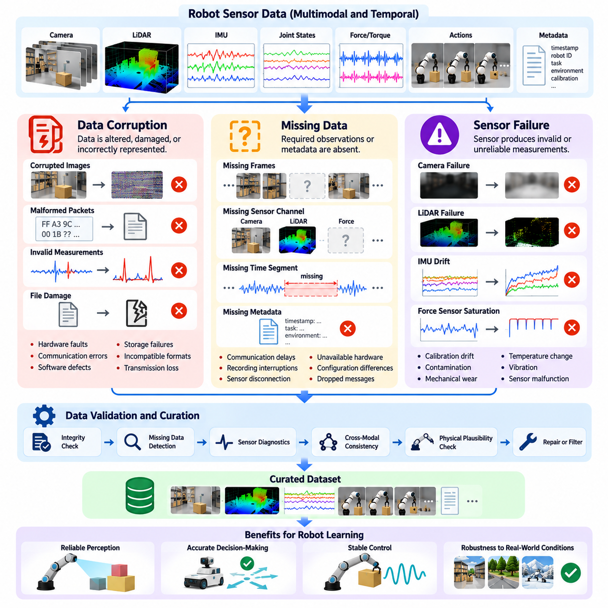{width="7.268055555555556in" height="7.268055555555556in"}

Data corruption, missing information, and sensor failure are major challenges in Physical AI data engineering because robot learning depends on accurate and continuous observations of the physical world. Unlike conventional digital datasets, robotic recordings combine multiple sensors, control commands, and temporal sequences. Errors in these components can distort physical relationships, introduce misleading training examples, and reduce the reliability of learned policies.

Data corruption occurs when recorded information is unintentionally altered, damaged, or incorrectly represented during acquisition, transmission, processing, or storage. Corrupted camera frames, malformed LiDAR packets, invalid joint measurements, and damaged trajectory files are common examples. Some corruption is immediately detectable, while subtle errors may remain hidden until training or deployment. Effective curation requires systematic integrity checks throughout the data lifecycle.

Corruption can originate from hardware faults, communication interference, software defects, storage failures, or incompatible data formats. High-bandwidth sensors are particularly vulnerable to dropped packets and incomplete transfers. Incorrect serialization or decompression may also alter numerical values without producing obvious errors. Data pipelines should therefore validate file integrity, message structure, numerical ranges, and expected relationships between recorded fields.

Missing data represents the absence of observations or metadata required to interpret robot behavior correctly. A recording may lose camera frames, omit joint states, or lack the action commands associated with a particular movement. Missing information can occur intermittently or affect entire sensing channels. Its impact depends on the learning objective, the duration of the gap, and whether other sensors provide sufficient information to reconstruct the event.

Missingness should be classified according to its temporal and structural characteristics. Isolated missing samples may result from transient communication delays, while continuous gaps can indicate sensor disconnection or recording interruptions. Entire missing modalities may reflect unavailable hardware or configuration differences. Distinguishing these conditions helps determine whether an episode can be repaired, partially retained, or excluded from a particular training dataset.

Sensor failure introduces additional complexity because failures are not always equivalent to missing measurements. A camera may continue producing frames while its lens is obstructed, or a LiDAR may return plausible but inaccurate distances because of contamination. An inertial measurement unit may experience bias drift, while a force sensor may become saturated. These conditions can generate apparently valid data that no longer accurately represents the physical environment.

Sensor degradation often develops gradually rather than through an immediate failure. Temperature changes, vibration, mechanical wear, contamination, and calibration drift can progressively reduce measurement accuracy. Such degradation may remain unnoticed when individual readings fall within expected numerical limits. Long-term monitoring of sensor statistics, calibration residuals, signal stability, and cross-sensor agreement helps identify deteriorating measurement quality.

Temporal corruption is particularly dangerous for learning observation-action relationships. Incorrect timestamps, duplicated messages, reordered packets, and synchronization drift can associate control commands with observations from the wrong moment. In contact-rich manipulation or dynamic locomotion, small timing errors may fundamentally change the interpretation of an interaction. Timestamp validation and synchronization analysis are therefore essential components of robotic data quality control.

Multimodal consistency checks provide an effective method for detecting corruption and sensor anomalies. Camera observations, depth measurements, joint encoders, inertial sensors, and force signals often describe related physical events. Disagreement between these sources may reveal faulty measurements or incorrect calibration. However, inconsistencies should be interpreted carefully because occlusion, sensor latency, and different measurement characteristics can produce legitimate differences.

Physical plausibility constraints can further improve anomaly detection. Joint positions should remain within mechanically valid limits, velocity changes should respect actuator capabilities, and rigid-body transformations should preserve geometric consistency. Unexpected discontinuities may indicate corrupted measurements or recording errors. Nevertheless, collisions and abrupt contact events can produce genuine discontinuities, so validation must distinguish physical exceptions from invalid data.

Repairing corrupted or missing data requires careful consideration of the intended learning task. Short gaps in slowly varying signals may be reconstructed through interpolation, while missing camera frames or force measurements during rapid interactions may be impossible to recover reliably. Sensor fusion and state estimation can provide alternative estimates when redundant measurements exist. Reconstructed values should always be identified separately from original observations.

Blind interpolation can introduce artificial trajectories that never occurred in the physical world. A robot arm experiencing an unexpected collision may undergo rapid changes that cannot be inferred from measurements before and after the event. Smoothing such data may eliminate evidence of failure or produce misleading demonstrations. Curation systems should preserve uncertainty, gap boundaries, and reconstruction metadata rather than presenting estimated sequences as verified recordings.

Filtering decisions should account for both data quality and information value. Severely corrupted episodes may be unsuitable for policy training, but recordings containing sensor failures can be valuable for fault detection and robust perception research. A dataset intended for normal operation may exclude invalid observations, while a fault-tolerant learning dataset may deliberately preserve them. Quality assessment should therefore remain separate from decisions about task-specific usefulness.

Automated corruption detection can combine deterministic validation rules with statistical and learning-based methods. Checksums, schema validators, timestamp monotonicity tests, and missing-value analysis detect structural problems. Statistical monitoring identifies unusual signal distributions, while anomaly detection models can recognize deviations from expected sensor behavior. Combining these methods improves scalability, although automated decisions require validation against legitimate rare events.

Data quality monitoring should operate at both episode and fleet levels. Individual episodes can be evaluated for missing frames, sensor dropouts, timestamp errors, and corrupted measurements. Fleet-level analysis can reveal recurring failures associated with particular hardware revisions, firmware versions, environments, or operating conditions. Aggregated quality metrics help engineering teams identify systematic defects that may not be obvious from isolated recordings.

Provenance and traceability are essential when handling corrupted or repaired datasets. Each recording should retain information about sensor configuration, calibration state, acquisition software, timestamps, detected anomalies, and processing operations. When repairs are applied, the original data and transformation history should remain accessible. Versioned quality records enable reproducible experiments and allow engineers to investigate whether model failures originate from data defects.

Real-time monitoring can reduce the accumulation of unusable robot data. On-robot diagnostics may detect sensor disconnections, excessive packet loss, synchronization errors, and abnormal signal behavior during operation. Recording systems can attach health indicators to affected intervals or trigger diagnostic logging. Such mechanisms improve downstream curation and help distinguish genuine environmental events from failures of the sensing infrastructure.

The relationship between sensor failure and safety deserves particular attention. A policy trained on corrupted observations may develop unreliable responses to obstacles, contact forces, or unstable motion. Conversely, training exclusively on ideal sensor data may leave a robot unprepared for realistic degradation. Carefully labeled fault scenarios can support robustness training, uncertainty estimation, and fallback behavior, provided that safety-critical responses are independently verified.

Ultimately, managing corruption, missing data, and sensor failure requires more than removing defective recordings. Reliable Physical AI data engines must detect anomalies, identify their causes, evaluate their impact, preserve useful failure information, and document corrective operations. Continuous validation across collection, storage, training, and deployment transforms imperfect sensor streams into trustworthy learning resources while supporting more robust and fault-aware robotic intelligence.

## 06.05. Outlier and Duplicate Detection

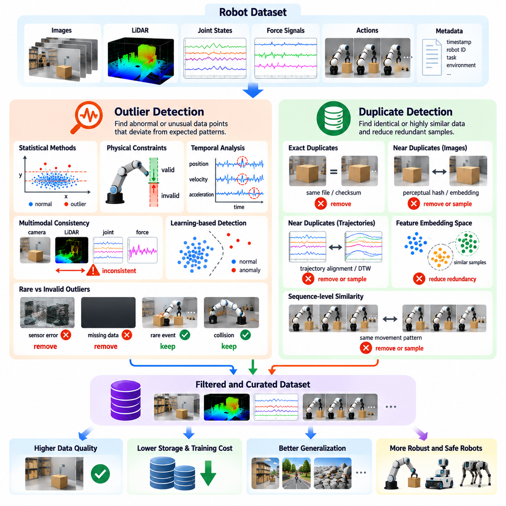{width="7.268055555555556in" height="7.268055555555556in"}

Outlier and duplicate detection are essential components of data curation in Physical AI because large robotic datasets frequently contain abnormal measurements, repeated observations, and redundant trajectories. These records can distort training distributions, increase computational costs, and reduce model generalization. Effective detection methods distinguish invalid information from valuable rare experiences while preserving the diversity needed for robust robot learning.

An outlier is a data point or sequence that differs significantly from expected patterns within a dataset. In robotics, outliers may appear as unusual sensor readings, unexpected joint movements, abnormal velocities, or rare environmental interactions. Some originate from recording errors or hardware failures, while others represent legitimate physical events. Their interpretation requires knowledge of robot dynamics, task objectives, and operating conditions.

Statistical outlier detection identifies observations that deviate from typical numerical distributions. Common approaches include standard deviation thresholds, interquartile ranges, robust covariance estimation, and density-based analysis. These methods can reveal abnormal joint positions, force measurements, or sensor values. However, fixed statistical thresholds may incorrectly classify valid behavior when robot operations involve multiple modes or highly variable environments.

Physical constraints provide additional evidence for distinguishing corrupted measurements from legitimate observations. Joint angles must respect mechanical limits, actuator commands must remain within defined operating ranges, and geometric transformations should preserve physical consistency. Violations may indicate calibration errors, corrupted recordings, or sensor faults. Nevertheless, unusual contact forces or abrupt motion changes may reflect real collisions rather than invalid data.

Temporal outlier detection examines deviations across sequences instead of evaluating individual measurements independently. Sudden discontinuities in joint trajectories, unexpected acceleration spikes, and inconsistent observation-action timing may indicate recording problems. Sequence-aware methods can compare current behavior with recent history and expected dynamics. This approach is particularly useful for identifying anomalies that remain invisible in frame-level statistical analysis.

Multimodal outlier detection combines evidence from cameras, LiDAR, proprioception, force sensors, and control commands. A sudden position change reported by joint encoders may be suspicious if visual tracking and inertial measurements indicate no corresponding motion. Cross-sensor disagreement can reveal sensor faults or synchronization errors. However, occlusion, latency, and differences in sensor accuracy must be considered before declaring an observation invalid.

Learning-based anomaly detection offers scalable alternatives to manually defined thresholds. Autoencoders, predictive models, and representation-learning systems can estimate whether observations or trajectories resemble previously encountered experiences. Large reconstruction errors or low likelihood scores may identify unusual samples. These signals are useful for prioritizing inspection, but unfamiliar data should not automatically be treated as corrupted or unsuitable for training.

Rare events create an important distinction between anomaly detection and data removal. Unexpected obstacles, unstable grasps, collisions, and recovery maneuvers may be statistically unusual but highly valuable for improving robustness. Removing such experiences can weaken performance under challenging conditions. Effective curation therefore separates invalid outliers from valid long-tail events and preserves information that contributes to safety, adaptation, and recovery learning.

Duplicate detection addresses a different problem: excessive repetition of identical or highly similar data. Robotic systems operating continuously may record thousands of nearly identical frames during stationary periods or repeated task executions. Such redundancy increases storage requirements and training time without necessarily contributing new information. Duplicate detection identifies repeated content so that datasets can be compressed, balanced, or selectively sampled.

Exact duplicates are records containing identical information, often resulting from repeated uploads, recording overlaps, or data pipeline errors. Cryptographic hashes and content checksums can efficiently identify byte-identical files or samples. However, identical physical observations may be stored using different compression settings or metadata. Exact matching should therefore be complemented by methods that recognize equivalent content despite differences in file representation.

Near-duplicate detection identifies samples that are not identical but contain substantially overlapping information. Consecutive camera frames, repeated grasp attempts, and similar navigation trajectories may exhibit high visual or behavioral similarity. Perceptual hashing, feature embeddings, and distance-based comparisons can reveal these relationships. Appropriate similarity thresholds depend on whether small differences represent irrelevant repetition or meaningful changes in physical state.

Trajectory-level duplicate detection is especially important because robotic learning depends on complete sequences of observations and actions. Two demonstrations may perform nearly identical movements while differing slightly in timing or execution speed. Sequence alignment, dynamic time warping, and trajectory embeddings can identify behavioral similarity. However, differences in contact conditions, outcomes, or recovery actions may justify retaining otherwise similar trajectories.

Embedding-based detection provides a common framework for identifying both outliers and duplicates. Sensor observations, robot states, and action sequences can be encoded into feature vectors representing their semantic or behavioral characteristics. Dense clusters may indicate redundant experiences, while isolated points may reveal rare scenarios or anomalies. The usefulness of this approach depends on whether the embedding preserves task-relevant physical distinctions.

Clustering methods help organize large robotic datasets into groups of related experiences. Density-based clustering can identify sparse regions and potential outliers, while centroid-based methods can summarize common operating patterns. Cluster membership also supports representative sampling and redundancy reduction. Nevertheless, clustering results should be interpreted alongside task metadata because similar visual scenes may correspond to substantially different actions or outcomes.

Duplicate removal must preserve the statistical and operational meaning of the dataset. Repeated experiences may represent genuine task frequencies, common operating conditions, or important variations in execution reliability. Removing all similar samples can distort the deployment distribution and reduce evidence about behavioral consistency. Curation systems should distinguish accidental duplication from legitimate repetition and retain sampling weights or frequency metadata when necessary.

Outlier and duplicate detection also contribute to reliable model evaluation. Near-identical episodes appearing in both training and test datasets can cause information leakage and artificially inflate performance estimates. Similar trajectories collected during the same session may share environmental conditions and operator behavior. Group-aware splitting and duplicate checks across dataset partitions help produce more trustworthy measurements of generalization.

Automated detection pipelines should combine structural validation, statistical analysis, physical reasoning, and learned similarity measures. Candidate outliers can be assigned anomaly scores, while potential duplicates receive similarity scores and provenance information. High-confidence corruption may be quarantined automatically, whereas ambiguous cases should undergo additional review. Maintaining separate detection and filtering stages prevents irreversible removal of valuable experiences.

Human review remains important when automated systems encounter unusual physical interactions. Engineers can examine synchronized sensor streams, task context, robot configuration, and outcome information to determine whether a detected anomaly represents corruption or a legitimate event. Review decisions can improve future detection models and refine filtering thresholds. This human-in-the-loop process is especially valuable for safety-critical and previously unseen scenarios.

At fleet scale, outlier and duplicate detection become continuous data-engine functions rather than occasional preprocessing tasks. Robots deployed across multiple sites generate overlapping experiences alongside rare operational failures. Centralized indexing, distributed similarity search, and event-based sampling can reduce redundant uploads while preserving informative observations. Detection statistics also reveal sensor degradation, environmental drift, and changing patterns of robot behavior.

Ultimately, outlier and duplicate detection should optimize information quality rather than simply minimize dataset size. Outlier analysis protects learning systems from corrupted measurements while preserving valuable rare events, and duplicate analysis reduces unnecessary repetition without destroying representative experience distributions. Together, these capabilities improve training efficiency, evaluation integrity, and the reliability of Physical AI data engines operating across diverse robots and environments.

## 06.06. Low Information and Low Quality Data Removal

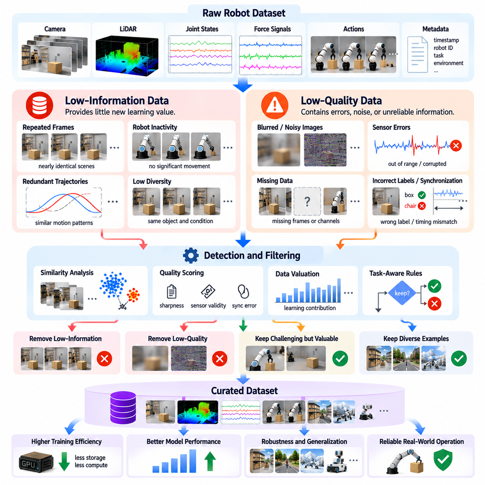{width="7.268055555555556in" height="7.268055555555556in"}

Low-information and low-quality data removal is a critical stage of Physical AI data curation because large robotic datasets often contain observations that contribute little to learning or introduce misleading patterns. Continuous recording produces repetitive scenes, inactive periods, noisy measurements, and incomplete demonstrations. Removing unsuitable samples improves training efficiency, reduces storage costs, and helps learning systems focus on experiences that support reliable physical behavior.

Low-information data refers to observations that provide limited additional knowledge relative to information already represented in the dataset. Examples include repeated images of an unchanged workspace, prolonged robot inactivity, and nearly identical trajectories collected under stable conditions. Such data may be technically correct but offer little marginal learning value. Its identification requires measuring redundancy, novelty, and relevance rather than simply checking recording integrity.

Low-quality data differs from low-information data because it contains defects that reduce its reliability or usefulness. Blurred images, inaccurate labels, corrupted sensor measurements, incomplete action sequences, and poorly synchronized modalities can all degrade training. However, data quality depends on the intended learning objective. A blurred image may be unsuitable for object recognition but useful for teaching perception systems to handle motion blur.

The distinction between information value and data quality is essential for effective filtering. A perfectly recorded stationary episode may contain little information for manipulation learning, while a noisy recording of an unexpected collision may provide valuable evidence for safety analysis. Therefore, filtering systems should evaluate information content and measurement reliability independently. Combining these dimensions prevents valuable rare events from being discarded solely because they appear unusual.

Redundancy is one of the most common sources of low-information data in robotics. High-frequency cameras may capture hundreds of nearly identical frames during periods of minimal movement. Repeated demonstrations may also follow similar trajectories without introducing new objects, actions, or environmental conditions. Temporal subsampling, similarity analysis, and trajectory clustering can reduce unnecessary repetition while retaining representative observations.

Information content can be estimated using statistical variation, feature diversity, and learned representations. Low visual change, minimal state transitions, and repeated action patterns may indicate limited novelty. Embedding-based similarity measures can identify observations that occupy densely populated regions of representation space. However, information metrics should remain sensitive to task-relevant differences because small physical changes may have major consequences.

Robot inactivity requires special consideration during data removal. Long periods without movement may provide little value for action prediction, but stationary observations can be important for localization, environmental monitoring, or learning when not to act. A navigation policy may need examples of waiting for pedestrians, while a manipulation policy may need examples of maintaining stable contact. Filtering decisions must therefore reflect task semantics rather than motion magnitude alone.

Low-quality sensor data can arise from noise, calibration drift, occlusion, saturation, communication errors, and environmental interference. Automated checks can identify invalid ranges, missing measurements, unstable timestamps, and inconsistent sensor relationships. Nevertheless, realistic sensor degradation may be useful for robustness training. Curation systems should distinguish accidental defects from intentionally retained challenging conditions and preserve appropriate quality annotations.

Demonstration quality is another important filtering dimension. Teleoperated trajectories may include operator hesitation, unnecessary movements, failed grasps, or incomplete task execution. Such behavior can reduce the effectiveness of imitation learning when treated as expert demonstrations. However, unsuccessful attempts and corrective actions may support recovery learning. Demonstration filtering should therefore consider task outcome, execution efficiency, safety, and intended training purpose.

Trajectory quality assessment can incorporate smoothness, completion status, collision frequency, action consistency, and deviation from task constraints. These indicators help identify inefficient or unreliable executions. Yet smooth trajectories are not always superior because legitimate manipulation may require abrupt contact transitions or rapid corrective actions. Quality scoring should use task-aware criteria rather than applying universal thresholds across different robot behaviors.

Learning-based data valuation estimates how much individual samples or groups contribute to model performance. Methods may examine training loss, gradient influence, prediction uncertainty, or changes in validation accuracy. Samples that repeatedly produce negligible learning improvements may be candidates for downsampling. However, computationally expensive valuation methods must be balanced against their benefits, particularly when processing fleet-scale robotic datasets.

High-loss samples require careful interpretation because they may represent annotation errors, sensor corruption, rare but important scenarios, or genuinely difficult tasks. Automatically removing all high-loss examples can eliminate precisely the experiences needed to improve generalization. Conversely, retaining every difficult sample may introduce excessive noise. Effective filtering combines loss-based indicators with data integrity checks, contextual metadata, and targeted human review.

Data removal should preserve diversity, representativeness, and coverage across the operational distribution. Aggressive filtering may disproportionately eliminate rare objects, unusual environments, slow behaviors, or challenging interactions. This can produce a cleaner dataset that performs worse during deployment. Coverage-aware filtering monitors the representation of tasks, conditions, and failure modes before and after removal to prevent unintended distribution shifts.

Adaptive sampling offers an alternative to permanently deleting low-information observations. Frequently repeated experiences can receive lower sampling probabilities while remaining available for future analysis or retraining. Rare and informative experiences may receive higher weights without requiring physical duplication. This approach separates storage decisions from training mixture design and allows dataset composition to evolve as model capabilities and operational requirements change.

Automated filtering pipelines can combine deterministic rules, statistical metrics, embedding similarity, and learned quality estimators. Each recording may receive separate scores for integrity, novelty, task relevance, and demonstration quality. Policy-based thresholds then determine whether data is retained, downsampled, quarantined, or routed for review. Maintaining transparent decision criteria supports reproducibility and helps engineers understand why particular samples were excluded.

Human-in-the-loop review remains important for ambiguous filtering decisions. Engineers can inspect synchronized sensor streams, task instructions, execution outcomes, and robot state histories to distinguish low-quality recordings from informative failures. Reviewed examples can refine automated scoring models and improve threshold selection. This process is particularly valuable when unfamiliar environments or new robot embodiments produce data outside established quality distributions.

Filtering effectiveness should be evaluated through downstream learning outcomes rather than dataset reduction alone. Relevant measurements include training time, storage consumption, validation performance, robustness under distribution shift, and task success rates. A smaller dataset is beneficial only when it preserves or improves the capabilities required for deployment. Controlled experiments comparing filtered and unfiltered datasets help identify whether removal strategies produce genuine performance gains.

At fleet scale, low-information and low-quality data removal becomes a continuous optimization process. On-robot filtering can reduce redundant recording and communication demands, while centralized data engines perform more comprehensive quality analysis. Changes in environments, sensors, tasks, and policies may alter which experiences are valuable. Periodic reevaluation prevents filtering rules from becoming outdated and supports efficient long-term data collection.

Ultimately, effective data removal is not simply the elimination of imperfect or repetitive recordings. It is the systematic allocation of learning resources toward experiences that provide reliable, diverse, and task-relevant information. By combining quality assessment, information valuation, coverage preservation, and reversible filtering decisions, Physical AI data engines can improve computational efficiency while maintaining the rare and challenging experiences essential for robust robotic intelligence.

## 06.07. Trajectory and Demonstration Quality Filtering

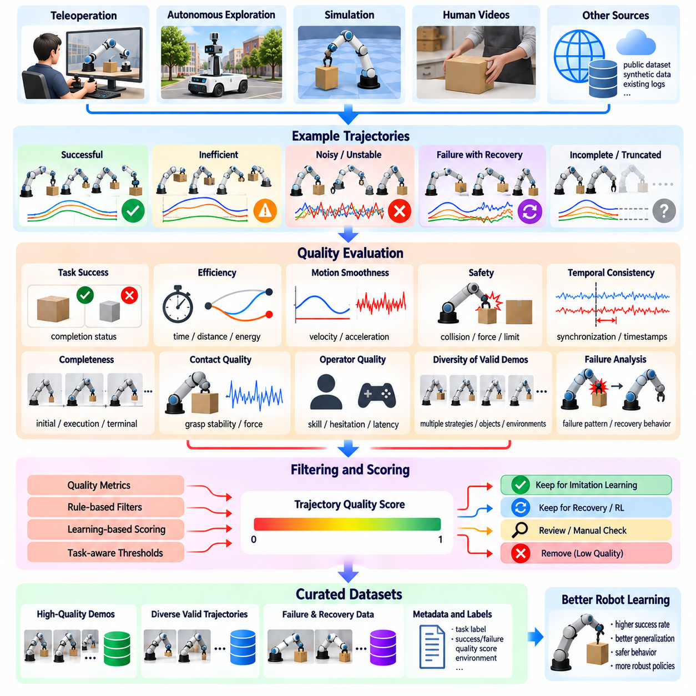{width="7.268055555555556in" height="7.268055555555556in"}

Trajectory and demonstration quality filtering is essential for Physical AI because robot learning depends not only on the quantity of recorded experiences but also on the reliability of demonstrated behavior. Teleoperation, autonomous exploration, and simulation produce trajectories with varying levels of success, efficiency, and safety. Effective filtering identifies demonstrations suitable for learning while preserving failures and corrections that provide valuable information.

A robot trajectory represents a time-ordered sequence of observations, states, actions, and interaction outcomes. Demonstration quality describes how effectively this sequence achieves an intended task under relevant constraints. High-quality demonstrations generally exhibit valid execution, appropriate actions, and reliable task completion. However, quality is task-dependent, and a trajectory that is unsuitable for expert imitation may remain useful for recovery or failure prediction.

Task success is a fundamental indicator of demonstration quality, but binary success labels provide limited information. A robot may complete an object placement task while causing unnecessary collisions, excessive force, or unstable motion. Conversely, an unsuccessful attempt may contain valuable intermediate actions. Quality assessment should therefore examine completion status, execution conditions, constraint violations, and the sequence of decisions leading to the final outcome.

Trajectory efficiency measures the resources required to complete a task, including execution time, travel distance, energy consumption, and unnecessary actions. Efficient demonstrations can help policies learn economical behavior and reduce operational costs. Nevertheless, the shortest or fastest trajectory is not always preferable. Safety margins, obstacle avoidance, contact stability, and actuator limitations may justify longer or slower execution.

Motion smoothness provides another useful quality indicator. Sudden changes in velocity, acceleration, or joint commands may reflect operator hesitation, control instability, or recording errors. Smooth trajectories often support stable policy learning and reduce mechanical stress. However, contact-rich manipulation and dynamic locomotion may require abrupt but legitimate transitions, so smoothness metrics must be interpreted within the physical context of each task.

Safety-aware filtering evaluates whether demonstrations respect collision constraints, force limits, workspace boundaries, and human proximity requirements. A successful trajectory may still be inappropriate for imitation if it repeatedly violates operational safety rules. Safety evaluation can combine recorded sensor measurements with geometric and dynamic constraints. Unsafe demonstrations may be excluded from expert datasets while retained separately for safety analysis.

Teleoperation introduces variability related to operator experience, interface design, communication latency, and fatigue. Skilled operators may produce consistent and efficient demonstrations, while inexperienced operators may exhibit hesitation, oscillation, or unnecessary corrections. Operator identity and session conditions can help explain these differences. Filtering should assess observable execution quality rather than assuming that all demonstrations from a particular operator are equally reliable.

Temporal consistency is critical because demonstrations encode relationships between observations and subsequent actions. Timestamp drift, missing commands, inconsistent sampling rates, and delayed feedback can distort these relationships. Even a successful execution may become unsuitable for behavior cloning if its action sequence is incorrectly aligned with sensory observations. Synchronization checks and temporal integrity validation should precede behavioral quality scoring.

Demonstration completeness determines whether a trajectory contains the information required to understand an entire task. Missing initial states, truncated recordings, absent terminal observations, or incomplete action logs can undermine learning. Some partial trajectories remain useful for learning individual skills or motion primitives. Curation systems should distinguish complete episodes from valid fragments and associate each with appropriate training objectives.

Contact-rich tasks require specialized quality assessment because successful execution depends on forces and physical interactions that may be difficult to infer visually. Grasp stability, contact timing, force regulation, and object slip can reveal differences between superficially similar demonstrations. A trajectory may appear successful in camera recordings while applying excessive forces. Multimodal evaluation improves the reliability of quality judgments.

Demonstration diversity must be preserved when selecting high-quality trajectories. Repeatedly retaining only the fastest or most visually smooth executions may eliminate alternative strategies that are effective under different conditions. Multiple valid approaches can improve policy adaptability and generalization. Quality filtering should therefore maintain representative variations in objects, environments, robot configurations, and successful execution strategies.

Failed demonstrations should not automatically be discarded. Unsuccessful grasps, navigation interruptions, unstable contacts, and corrective movements provide information about operational boundaries and recovery strategies. These experiences may support failure prediction, reinforcement learning, and robust policy development. A useful curation system separates expert demonstrations, recoverable failures, and invalid recordings rather than treating all unsuccessful episodes identically.

Trajectory quality scoring can combine task success, safety, efficiency, smoothness, completeness, and sensor reliability into a structured assessment. Individual dimensions should remain visible because a single aggregate score can conceal important weaknesses. Weighting depends on the application: surgical manipulation may emphasize precision and safety, while warehouse transport may prioritize reliable completion and efficient navigation.

Learning-based quality estimators can complement manually designed metrics by predicting demonstration usefulness from recorded observations and actions. Reward models, success classifiers, trajectory embeddings, and preference-based methods may identify behavioral patterns associated with effective execution. However, learned estimators can inherit biases from training labels. Their predictions should be validated against actual task outcomes and independent quality criteria.

Ranking demonstrations can be more useful than assigning simple acceptance or rejection labels. High-confidence expert trajectories may receive greater sampling weights, while lower-quality but valid demonstrations can support auxiliary objectives. Curriculum learning may introduce increasingly difficult trajectories as policy capabilities improve. This approach enables flexible dataset composition without permanently eliminating experiences that may become valuable later.

Automated filtering pipelines should combine structural validation, task-specific metrics, learned quality scores, and contextual metadata. Each trajectory can receive annotations describing success, safety, execution efficiency, sensor integrity, and recovery behavior. Filtering policies then determine whether the trajectory enters expert imitation datasets, robustness datasets, or review queues. Maintaining provenance and version history supports reproducible training.

Human review remains important when demonstrations involve ambiguous outcomes or complex physical interactions. Engineers can examine synchronized videos, robot states, force measurements, and task instructions to distinguish inefficient behavior from necessary corrective actions. Expert assessments can refine automated quality models and identify previously unrecognized failure patterns. Review effort should focus on uncertain or high-impact cases.

The effectiveness of trajectory filtering should be measured through downstream policy performance. Relevant indicators include task success rates, intervention frequency, collision rates, execution efficiency, and generalization across environments. Removing a large fraction of demonstrations does not necessarily improve learning. Controlled comparisons between filtered and unfiltered datasets are needed to establish whether quality selection produces measurable operational benefits.

At fleet scale, trajectory quality filtering becomes a continuous feedback mechanism connecting robot deployment with model improvement. Production robots generate successful executions, operator interventions, failures, and recovery sequences under diverse conditions. Automated evaluation can prioritize informative trajectories for centralized storage and retraining. Changing tasks and environments require periodic recalibration of quality thresholds and scoring models.

Ultimately, trajectory and demonstration quality filtering should maximize learning value rather than enforce a narrow definition of ideal behavior. Reliable Physical AI data engines preserve high-quality expert demonstrations while retaining informative failures, alternative strategies, and recovery experiences. By integrating task outcomes, physical constraints, temporal integrity, and adaptive selection, these systems create training datasets that support safe, efficient, and generalizable robotic intelligence.

## 06.08. Hard Example and Rare Event Mining

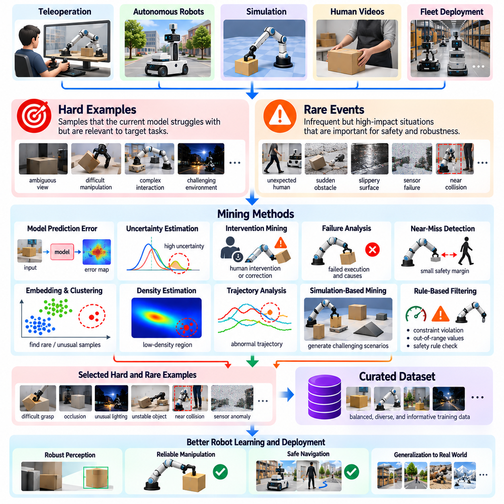{width="7.268055555555556in" height="7.268055555555556in"}

Hard example and rare event mining are essential for improving Physical AI systems because ordinary training datasets are dominated by common operating conditions. Robots may perform successfully during routine tasks yet fail when encountering unexpected obstacles, unusual objects, or complex physical interactions. Mining difficult experiences helps identify weaknesses, expand training coverage, and improve robustness in situations that conventional sampling frequently overlooks.

Hard examples are observations or trajectories that challenge a model despite being relevant to its intended tasks. They may involve ambiguous visual information, difficult object manipulation, uncertain contact conditions, or unexpected environmental changes. A hard example is not necessarily a failure or corrupted recording. Its defining characteristic is that the current model struggles to interpret, predict, or respond correctly to the situation.

Rare events occur infrequently within the operational data distribution but may have significant consequences for robot performance or safety. Examples include unexpected human movements, sudden object displacement, slippery surfaces, sensor degradation, and unusual collisions. Their low occurrence frequency makes them difficult to capture through uniform sampling. Targeted mining increases their representation without requiring excessive collection of repetitive normal data.

Hard examples and rare events overlap but are not identical. A frequently occurring scenario may remain difficult because of limitations in perception or control, while a rare event may be handled correctly by an existing policy. Effective data curation therefore distinguishes difficulty from frequency. This separation enables engineers to identify both persistent model weaknesses and underrepresented situations that could become important during deployment.

Model prediction errors provide a direct signal for hard example discovery. Large differences between predicted and observed states, incorrect object classifications, and unsuccessful action predictions can identify challenging samples. Error-based mining prioritizes experiences where the model performs poorly. However, prediction errors must be interpreted alongside sensor integrity and annotation quality to avoid repeatedly selecting corrupted or mislabeled data.

Uncertainty estimation offers another mechanism for identifying informative experiences. Perception models may exhibit low confidence when encountering unfamiliar objects, while control policies may become uncertain about appropriate actions. Ensemble disagreement, predictive uncertainty, and confidence calibration can guide sample selection. High uncertainty does not always indicate high learning value, so uncertainty signals should be combined with task relevance and operational risk.

Robot interventions provide valuable evidence of difficult operating conditions. When a human operator takes control, corrects a trajectory, or prevents an unsafe action, the event may indicate a policy limitation. Intervention logs can reveal navigation failures, manipulation errors, and unexpected environmental interactions. Recording the observations preceding intervention is especially important because the cause of failure may occur before the operator responds.

Failure-driven mining focuses on unsuccessful executions and the conditions that produced them. Failed grasps, dropped objects, collisions, localization errors, and incomplete tasks can reveal weaknesses in learned policies. Useful failure records include the initial state, action history, sensor observations, and final outcome. Preserving this context allows engineers to distinguish perception errors, planning mistakes, control limitations, and hardware problems.

Near-miss events are particularly valuable because they expose unsafe conditions without necessarily producing actual damage. A mobile robot passing too close to a pedestrian or a manipulator narrowly avoiding a collision may indicate insufficient safety margins. Such events can be identified through proximity measurements, predicted collision risk, or constraint violations. Their inclusion supports preventive learning before similar situations produce serious failures.

Temporal context is essential when mining difficult robotic experiences. A single unusual frame rarely explains why a robot failed or required intervention. The relevant cause may involve earlier perception errors, delayed decisions, or accumulated localization drift. Event-centered extraction should therefore preserve suitable observation windows before and after the detected event, together with synchronized actions and relevant system states.

Embedding-based mining helps discover difficult or rare experiences across large multimodal datasets. Visual observations, robot states, and trajectories can be mapped into representation spaces where similar experiences are grouped together. Sparse regions may reveal uncommon situations, while clusters containing frequent failures may indicate systematic weaknesses. Embedding quality must be validated because visual similarity does not always imply equivalent physical behavior.

Clustering and density estimation can support rare event discovery without requiring predefined failure categories. Unusual trajectories or environmental configurations may appear as low-density samples relative to common operating patterns. However, low density alone cannot establish that an event is meaningful or safety-critical. Additional evaluation should consider physical plausibility, task relevance, severity, and whether similar experiences already exist in the dataset.

Simulation provides a complementary source of hard examples that may be dangerous or expensive to collect on physical robots. Engineers can vary friction, object mass, obstacle motion, lighting, and sensor conditions to expose policy weaknesses. Adversarial scenario generation can search for combinations that increase failure probability. Generated examples should remain physically plausible and be validated against real-world behavior whenever practical.

Active learning connects hard example mining with targeted data acquisition. Instead of collecting new experiences uniformly, the data engine identifies uncertain regions, recurring failures, and missing scenario categories. Collection tasks can then focus on these weaknesses through teleoperation, autonomous exploration, or simulation. This feedback loop increases the learning value of additional data while reducing redundant acquisition.

Prioritizing mined examples requires balancing difficulty, rarity, severity, and expected learning benefit. A minor perception error occurring frequently may deserve attention because of its cumulative operational impact. A very rare collision scenario may receive high priority because of its potential consequences. Risk-aware selection prevents mining systems from focusing exclusively on numerical uncertainty while overlooking safety-critical conditions.

Hard example oversampling can improve learning but may also distort the training distribution. Excessive emphasis on failures and unusual conditions can reduce performance during common operations or produce overly conservative behavior. Training mixture design should maintain representative normal experiences while assigning appropriate weight to difficult cases. Separate evaluation datasets can measure improvements in both routine performance and challenging scenarios.

Automated mining pipelines can combine event-triggered logging, model error analysis, uncertainty scoring, trajectory clustering, and failure classification. Candidate examples may be ranked according to novelty, severity, and relevance before entering review or retraining workflows. Metadata should preserve robot configuration, environmental conditions, policy version, and event timing. These records support reproducibility and help identify recurring weaknesses across deployments.

Human review remains important because automated detectors may confuse unusual but valid behavior with sensor faults or irrelevant anomalies. Engineers can examine synchronized recordings, task objectives, and physical outcomes to determine whether a candidate represents a meaningful hard example. Reviewed cases can improve event classifiers and refine mining criteria. Safety-critical discoveries should also inform independent testing and operational safeguards.

At fleet scale, hard example and rare event mining becomes a continuous mechanism for improving deployed robot systems. Thousands of robots can encounter different environments, users, objects, and operational disturbances. Centralized aggregation reveals recurring failure patterns that individual robots may encounter only occasionally. Prioritized data collection and model updates can progressively address weaknesses while tracking performance across software and hardware versions.

Ultimately, hard example and rare event mining transforms operational failures and unusual experiences into structured learning opportunities. Effective Physical AI data engines identify difficult situations, preserve their physical context, evaluate their importance, and incorporate them into targeted training and validation. By combining uncertainty, error signals, risk assessment, and fleet feedback, these systems improve generalization, resilience, and safety beyond routine operating conditions.

## 06.09. Long Tail Data Discovery

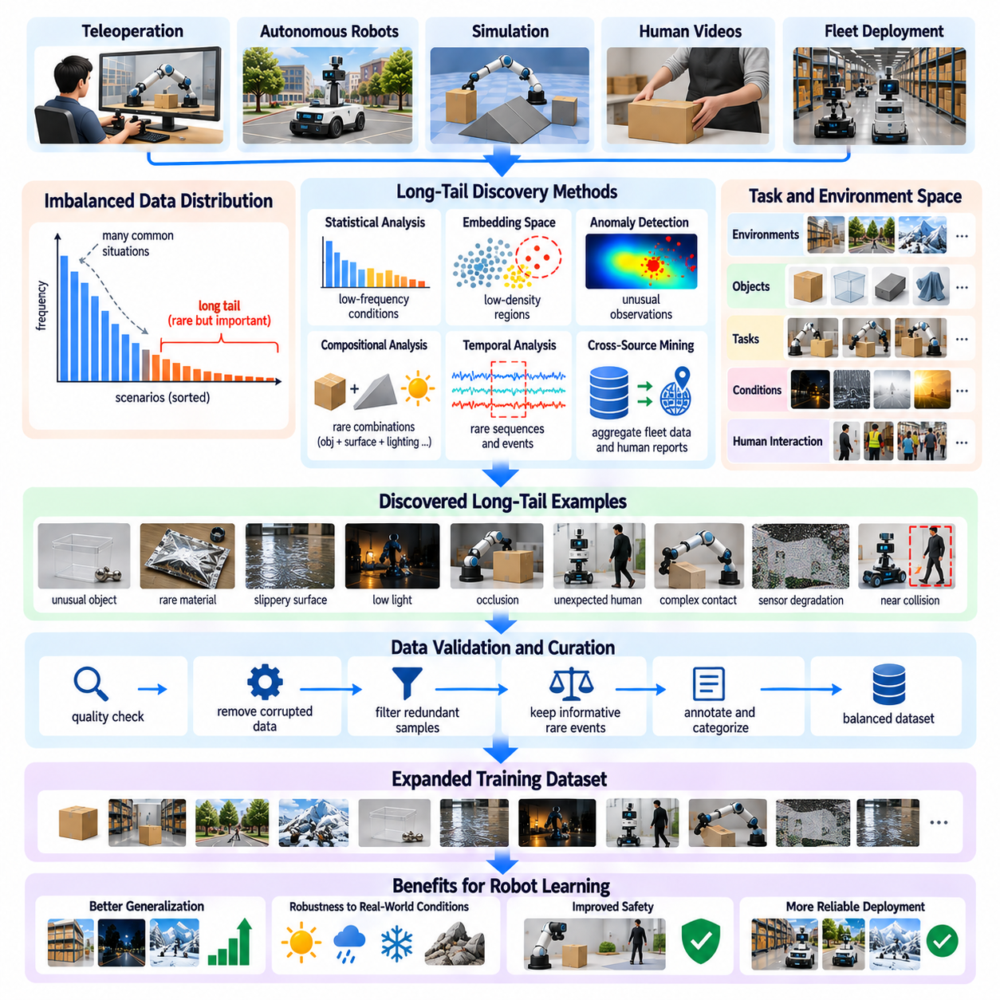{width="7.268055555555556in" height="7.268055555555556in"}

Long-tail data discovery is essential for Physical AI because real-world robotic environments contain countless uncommon situations that are poorly represented in conventional training datasets. Most collected experiences describe routine operations, while unusual objects, environmental changes, and unexpected interactions occur infrequently. Discovering these underrepresented conditions helps improve generalization, operational reliability, and safety beyond familiar deployment scenarios.

The long tail refers to the large collection of individually rare situations that collectively represent a significant portion of real-world complexity. In robotics, these situations may involve unusual object geometries, uncommon material properties, irregular lighting, unexpected human behavior, or complex contact interactions. Although each scenario appears infrequently, their combined diversity creates substantial challenges for autonomous systems operating in open environments.

Long-tail data differs from ordinary hard examples because rarity and model difficulty are separate characteristics. A rare situation may be handled successfully, while a common scenario may remain difficult for an immature policy. Long-tail discovery focuses on identifying poorly represented regions of the operational distribution, regardless of immediate model performance. This distinction supports proactive coverage expansion rather than relying exclusively on observed failures.

Robotic data distributions are typically imbalanced because routine activities generate large volumes of repetitive observations. Warehouse robots repeatedly encounter familiar shelves and pathways, while service robots operate around common household objects and predictable human movements. Unusual configurations receive comparatively little representation. Without deliberate discovery, learning systems may become highly specialized for frequent conditions while remaining vulnerable to uncommon variations.

Long-tail discovery begins with understanding the operational design domain, including environments, tasks, objects, robot configurations, and interaction conditions. Engineers can construct scenario taxonomies describing relevant dimensions such as surface friction, illumination, obstacle motion, object deformability, and human proximity. Comparing collected data against these dimensions reveals coverage gaps. However, predefined taxonomies must remain flexible enough to accommodate previously unknown conditions.

Statistical frequency analysis provides an initial mechanism for detecting underrepresented scenarios. Data engines can estimate the occurrence rates of object categories, task types, environmental conditions, and failure modes. Rare combinations may be more informative than rare individual attributes. For example, a transparent object on a reflective surface may create perception difficulties even when transparent objects and reflective surfaces are separately represented.

Embedding-based discovery enables scalable analysis of high-dimensional robotic observations and trajectories. Visual, proprioceptive, tactile, and action information can be encoded into representations that capture similarities between experiences. Low-density regions and isolated clusters may indicate uncommon situations. Nevertheless, embedding distances must be interpreted carefully because learned representations may overlook physically important differences or exaggerate irrelevant visual variations.

Density estimation and anomaly detection can identify observations that deviate from common operating patterns. Methods based on nearest-neighbor distances, probabilistic models, or learned reconstruction errors can highlight unusual experiences. However, anomalous data may result from sensor corruption, recording defects, or calibration failures rather than meaningful long-tail conditions. Data integrity validation should therefore accompany novelty detection.

Compositional rarity is particularly important in Physical AI because familiar elements can form unfamiliar combinations. A robot may recognize a tool, understand a grasping action, and operate on a sloped surface independently, yet struggle when manipulating that tool on the slope. Long-tail discovery should examine interactions among objects, actions, environments, and physical constraints. This approach reveals weaknesses that single-category frequency analysis may miss.

Temporal long-tail events arise from unusual sequences rather than isolated observations. Examples include a pedestrian reversing direction during robot navigation, an object slipping after an apparently stable grasp, or a sensor becoming unreliable during a critical maneuver. Identifying these events requires sequence-level analysis of states, actions, and outcomes. Event-centered extraction preserves the preceding context and subsequent consequences needed for meaningful interpretation.

Fleet-scale deployment offers a powerful source of long-tail discovery because different robots encounter diverse operational conditions. A rare event for one robot may appear repeatedly across thousands of deployed systems. Aggregating metadata, trajectory summaries, and selected sensor recordings enables centralized identification of emerging patterns. Geographic, environmental, hardware, and policy differences should be considered to avoid confusing deployment-specific behavior with general rarity.

Human interventions and operator reports provide additional signals for discovering underrepresented situations. Operators may recognize unusual physical conditions before automated novelty detectors identify them. Intervention reasons, task annotations, and maintenance records can reveal recurring difficulties involving objects, surfaces, or environmental disturbances. Combining human observations with sensor evidence improves the interpretation of long-tail events and supports more targeted data collection.

Simulation and procedural scenario generation can expand coverage of long-tail conditions that are difficult or unsafe to collect directly. Domain randomization varies physical parameters, visual appearances, object arrangements, and environmental dynamics. Compositional generation creates combinations that rarely occur in recorded datasets. However, synthetic scenarios must remain physically plausible, and their relevance should be assessed against real operational requirements.

Active data collection transforms discovered coverage gaps into targeted acquisition plans. Engineers may request demonstrations involving uncommon objects, unusual grasp configurations, difficult lighting, or complex navigation interactions. Autonomous exploration can seek underrepresented states under appropriate safety constraints. Simulation can supplement expensive real-world collection. Prioritizing gaps according to expected learning value improves data acquisition efficiency.

Long-tail prioritization should consider occurrence frequency, potential severity, task relevance, and expected generalization benefit. Extremely rare situations with negligible operational consequences may receive lower priority than uncommon events that threaten safety or task completion. Conversely, frequent minor variations may not justify additional collection when existing models already handle them reliably. Risk-aware prioritization helps allocate limited data and engineering resources.

Dataset balancing is necessary after long-tail examples have been discovered. Simply oversampling rare situations can distort the operational distribution and degrade performance on routine tasks. Training mixtures should preserve common experiences while increasing exposure to underrepresented conditions. Scenario-aware sampling weights and curriculum strategies allow learning systems to address coverage gaps without treating all rare events as equally important.

Evaluation datasets must explicitly represent long-tail conditions to measure progress beyond average task performance. Aggregate success rates can conceal failures in uncommon but consequential situations. Stratified evaluations can measure performance across object types, environmental conditions, interaction categories, and rare event families. Maintaining separate long-tail validation and test sets helps prevent repeated optimization against a narrow collection of known exceptions.

Automated long-tail discovery pipelines can integrate frequency statistics, embedding analysis, anomaly detection, scenario classification, and fleet telemetry. Candidate events receive metadata describing their novelty, context, physical significance, and relationship to existing coverage. Human review can validate ambiguous discoveries before examples enter training or evaluation datasets. Versioned discovery records support reproducibility and reveal how operational coverage evolves.

Long-tail discovery is inherently continuous because deployment environments and robot capabilities change over time. New objects, altered workflows, seasonal conditions, and updated policies introduce situations that may not appear in historical datasets. Previously difficult scenarios may become routine, while new weaknesses emerge as robots perform more complex tasks. Periodic coverage analysis and feedback from deployed systems keep the data engine aligned with evolving operational requirements.

Ultimately, long-tail data discovery transforms hidden gaps in robotic experience into measurable opportunities for improvement. Effective Physical AI data engines combine statistical analysis, representation learning, physical context, targeted collection, and risk-aware evaluation to expand operational coverage. By systematically discovering and incorporating uncommon situations, these systems support robust generalization and safer autonomous behavior across increasingly diverse real-world environments.

## 06.10. Uncertainty and Error Based Sampling

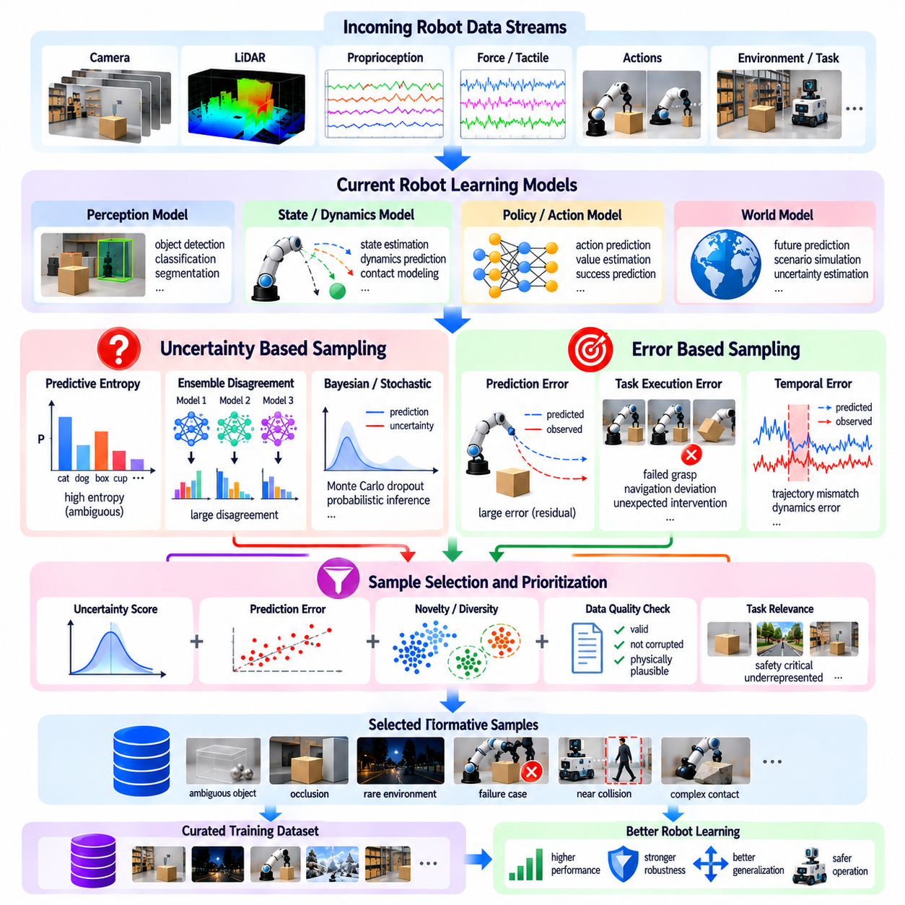{width="7.268055555555556in" height="7.268055555555556in"}

Uncertainty and error-based sampling are essential techniques for improving the efficiency of Physical AI data engines. Large robotic datasets contain many routine experiences that contribute limited additional learning value, while difficult situations remain underrepresented. By prioritizing observations associated with model uncertainty, prediction errors, and execution failures, sampling systems can direct training resources toward experiences most likely to improve perception, planning, and control.

Uncertainty-based sampling identifies data for which a model has limited confidence in its predictions or decisions. In robotic perception, uncertainty may arise from unfamiliar objects, ambiguous visual features, occlusions, or changing illumination. In control systems, uncertainty may involve predicted motion, contact forces, or action outcomes. Selecting uncertain experiences helps expose regions where the learned model lacks sufficient knowledge or reliable predictive capability.

Two major uncertainty categories are epistemic uncertainty and aleatoric uncertainty. Epistemic uncertainty reflects limited model knowledge and may decrease as additional representative training data becomes available. Aleatoric uncertainty originates from inherent randomness, measurement noise, or ambiguous observations that cannot always be eliminated through additional data. Distinguishing these categories prevents sampling systems from repeatedly collecting examples that provide little opportunity for learning improvement.

Predictive entropy is commonly used to measure uncertainty in classification-based perception systems. A model assigning similar probabilities to several object categories has greater uncertainty than one strongly favoring a single category. Entropy-based sampling prioritizes ambiguous observations for labeling or retraining. However, classification confidence must be calibrated because neural networks can produce highly confident predictions even when encountering unfamiliar or incorrectly represented situations.

Ensemble disagreement provides another approach to uncertainty estimation. Multiple models trained with different initializations or data subsets generate predictions for the same observation. Large differences between predictions indicate regions where learned representations or decision boundaries remain uncertain. Ensemble-based sampling can identify informative experiences, although maintaining multiple models increases computational requirements and may be impractical for resource-constrained robots.

Bayesian approximations and stochastic inference methods can estimate predictive uncertainty without maintaining fully independent model ensembles. Techniques such as Monte Carlo dropout generate multiple predictions under stochastic model configurations. Variation among these predictions provides an approximate measure of uncertainty. Such methods are useful for perception and state estimation, but their reliability depends on model architecture, calibration, and the quality of the underlying uncertainty assumptions.

Error-based sampling focuses on observations where predictions differ significantly from measured outcomes or trusted labels. Examples include inaccurate object localization, incorrect state estimation, failed grasp prediction, and unexpected robot motion. Large prediction residuals can reveal limitations in perception models, dynamics models, or learned policies. However, errors caused by corrupted sensors or incorrect annotations must be distinguished from genuine model weaknesses.

Temporal prediction errors are especially important in Physical AI because robotic decisions influence future physical states. A dynamics model may predict stable object motion while the actual object slips, rotates unexpectedly, or loses contact. Comparing predicted and observed trajectories reveals discrepancies that static image analysis cannot capture. Sampling these transitions helps improve physical reasoning, contact modeling, and closed-loop control performance.

Action-value uncertainty can guide sampling in reinforcement learning and policy optimization. When a policy cannot reliably distinguish between alternative actions, the corresponding state may offer useful learning opportunities. Value-function disagreement and uncertain action outcomes can identify regions requiring additional exploration. Nevertheless, uncertainty-driven exploration must respect safety constraints because informative states may involve unstable or hazardous physical interactions.

Sampling based on task execution errors connects data selection directly to operational performance. Failed grasps, navigation deviations, incomplete assembly operations, and unexpected interventions can indicate deficiencies in learned behavior. Event-triggered recording can capture relevant observations before and after such failures. Including task context, action history, and execution outcomes enables engineers to distinguish isolated mistakes from systematic weaknesses.

High uncertainty and high prediction error do not always imply high learning value. Out-of-distribution observations, irreducible sensor noise, and mislabeled samples may generate large scores without supporting useful model improvements. Sampling systems should therefore combine uncertainty and error indicators with data integrity, novelty, task relevance, and physical plausibility. This prevents limited training budgets from being consumed by misleading examples.

Uncertainty calibration is necessary to make sampling scores meaningful across models and operating conditions. A calibrated model should exhibit prediction confidence consistent with observed correctness or error magnitude. Reliability analysis, held-out evaluation data, and calibration metrics can identify overconfidence or underconfidence. Periodic recalibration becomes important when sensors, environments, robot configurations, or learned policies change during deployment.

Diversity-aware sampling prevents uncertainty-based selection from repeatedly choosing nearly identical difficult examples. Many observations from the same failure sequence may receive high uncertainty scores while contributing redundant information. Embedding similarity, clustering, and coverage constraints can distribute selected samples across different tasks and environments. Combining informativeness with diversity improves dataset efficiency and reduces concentration on narrow failure patterns.

Active learning uses uncertainty and error signals to determine which observations should receive additional labeling, expert review, or new demonstrations. Rather than annotating every recorded frame, the data engine prioritizes cases where improved supervision may reduce model weaknesses. Human operators can clarify ambiguous object states, verify task outcomes, or demonstrate corrective actions. This targeted process reduces annotation costs while improving training relevance.

Adaptive sampling weights allow difficult experiences to receive greater emphasis without permanently removing routine observations. Samples with high uncertainty, meaningful prediction errors, or safety relevance may be selected more frequently during training. As model performance improves, sampling priorities can change. This dynamic approach supports continuous learning while preserving the representative operational distribution required for reliable deployment.

Uncertainty and error-based sampling should also consider rare events and safety-critical scenarios. A low-frequency collision risk may deserve attention even when its uncertainty score is moderate. Conversely, highly uncertain but harmless visual variations may have limited operational importance. Risk-aware sampling combines model uncertainty, expected error consequences, event severity, and task relevance to prioritize experiences that improve both capability and safety.

An automated sampling pipeline can collect model predictions, confidence estimates, observed outcomes, and contextual metadata from deployed robots. Centralized processing computes uncertainty scores, prediction residuals, novelty measures, and quality indicators. Candidate samples are then ranked, deduplicated, and assigned to labeling, retraining, or validation workflows. Recording model versions and sampling decisions supports traceability and reproducibility.

Sampling effectiveness must be evaluated through downstream learning improvements rather than uncertainty reduction alone. Relevant metrics include task success rates, prediction accuracy, intervention frequency, robustness under distribution shift, and annotation efficiency. Controlled experiments can compare uncertainty-based sampling with random sampling and alternative selection strategies. These comparisons reveal whether selected examples provide measurable benefits relative to their collection and processing costs.

At fleet scale, uncertainty and error-based sampling becomes a continuous feedback mechanism connecting deployed robots with centralized learning infrastructure. Different robots encounter diverse operating conditions and generate complementary evidence of model limitations. Aggregating uncertainty patterns and execution errors reveals recurring weaknesses across environments and hardware configurations. Periodic model updates and reevaluation of sampling criteria keep the data engine aligned with changing capabilities.

Ultimately, uncertainty and error-based sampling transforms robotic data selection from passive collection into targeted learning optimization. Effective Physical AI data engines identify where models lack knowledge, where predictions fail, and where additional experience can provide meaningful improvement. By combining calibrated uncertainty, error analysis, diversity preservation, and safety-aware prioritization, these systems improve data efficiency, generalization, and reliable autonomous behavior.

## 06.11. Embedding Based Data Curation

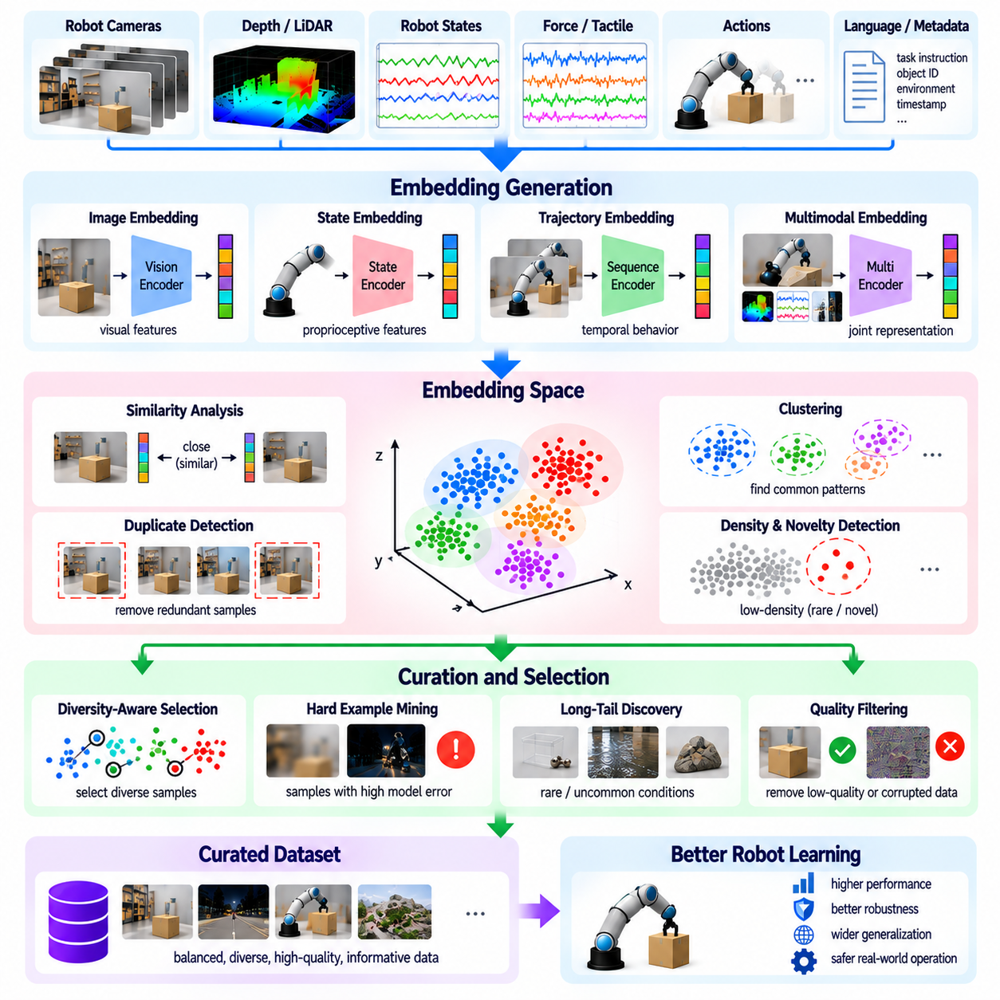{width="7.268055555555556in" height="7.268055555555556in"}

Embedding-based data curation is an important technique for organizing and filtering large Physical AI datasets using learned representations of robotic experiences. Instead of comparing raw images, sensor measurements, or action sequences directly, data engines transform observations into compact numerical vectors that capture meaningful similarities. These embeddings support duplicate detection, diversity analysis, rare event discovery, and efficient selection of training examples.

An embedding represents high-dimensional information within a lower-dimensional feature space where related observations are positioned near one another. In robotics, embeddings may describe visual scenes, object properties, robot states, actions, or complete trajectories. A useful representation should preserve distinctions relevant to physical interaction while reducing irrelevant variations. Its effectiveness depends on the training objective and the characteristics of the underlying encoder.

Visual embeddings can be generated using convolutional neural networks, vision transformers, or pretrained vision-language models. These representations may capture object categories, spatial relationships, scene structure, and semantic context. Images recorded under different lighting or camera viewpoints can sometimes produce similar embeddings when their underlying content is related. However, small geometric differences may remain critical for grasping, collision avoidance, or precise manipulation.

Robot state embeddings incorporate joint positions, velocities, actuator measurements, end-effector poses, and other proprioceptive information. Unlike visual embeddings, these representations emphasize the physical configuration and motion of the robot. Normalization is important because variables have different units and numerical ranges. State embeddings can reveal repeated configurations, unusual movements, and regions of the operational state space that lack sufficient training coverage.

Trajectory embeddings summarize sequences of observations, actions, and state transitions rather than individual moments. Recurrent networks, temporal transformers, and sequence encoders can represent complete demonstrations or selected motion segments. These embeddings support trajectory clustering, behavioral similarity analysis, and identification of alternative execution strategies. Temporal encoding must preserve action order and important transitions because similar states can produce different outcomes.

Multimodal embeddings combine information from cameras, depth sensors, tactile measurements, force sensors, robot states, and language instructions. Joint representation learning can associate visual observations with physical interactions and intended tasks. Such embeddings are useful for identifying experiences that appear visually similar but differ in contact dynamics or task objectives. Accurate synchronization and modality-aware training are essential for reliable multimodal representations.

Similarity measurement is a central operation in embedding-based curation. Cosine similarity and Euclidean distance are commonly used to compare encoded samples. High similarity may indicate redundant observations, while large distances may suggest novel experiences. However, similarity thresholds must be calibrated to the representation and task. Two images can be semantically similar while requiring different robot actions because of small differences in object pose or accessibility.

Embedding-based duplicate detection reduces unnecessary repetition in large robotic datasets. Consecutive camera frames, repeated demonstrations, and similar environmental observations often occupy nearby regions of representation space. Approximate nearest-neighbor search enables efficient identification of related samples at scale. Deduplication policies should retain representative variations and avoid removing subtle changes that affect contact, stability, or safety.

Clustering organizes robotic experiences into groups with similar features or behaviors. Methods such as k-means, hierarchical clustering, and density-based clustering can reveal common operating patterns and distinct scenario categories. Cluster populations provide information about dataset imbalance, while small clusters may contain uncommon conditions. Engineers should validate cluster meaning because mathematical proximity does not always correspond to meaningful physical similarity.

Diversity-aware selection uses embeddings to construct training subsets that cover different regions of the experience distribution. Instead of randomly selecting large numbers of repetitive samples, algorithms can prioritize observations distant from previously selected examples. Core-set selection and farthest-point sampling are common approaches. Such methods improve representation coverage, although computational efficiency and task relevance must be considered when selecting large datasets.

Embedding density provides useful signals for novelty and long-tail discovery. Samples located in sparsely populated regions may represent unusual objects, rare interactions, or unfamiliar environmental conditions. Density estimation and nearest-neighbor distances can identify candidates for further investigation. Nevertheless, sparse embeddings may also reflect sensor corruption or representation errors. Novelty detection should therefore be combined with integrity checks and contextual validation.

Hard example mining can benefit from embedding-based analysis when model failures are concentrated in particular regions of representation space. Clusters containing high prediction errors, repeated interventions, or unsuccessful trajectories may reveal systematic weaknesses. Engineers can prioritize these regions for additional labeling, simulation, or teleoperation. Combining embedding structure with performance metrics is more informative than relying on geometric distance alone.

Embedding quality strongly influences curation outcomes. Representations trained for image classification may emphasize object identity while overlooking contact forces, friction, or precise geometry. A representation suitable for navigation may not capture manipulation-relevant distinctions. Task-specific fine-tuning, contrastive learning, and multimodal objectives can improve alignment between embedding similarity and physical learning requirements.

Representation bias creates risks when embeddings reflect the limitations of their original training datasets. Uncommon objects, unfamiliar robot embodiments, and unusual environments may be mapped inaccurately or grouped with inappropriate examples. This can hide important long-tail conditions rather than reveal them. Embedding validation should examine coverage across tasks, environments, hardware configurations, and failure categories to identify systematic blind spots.

Scalable embedding infrastructure requires efficient feature extraction, storage, indexing, and retrieval. Large robot fleets may generate millions of observations and trajectories, making exhaustive pairwise comparison impractical. Vector databases and approximate nearest-neighbor indexes support similarity search over extensive datasets. Incremental indexing allows newly collected experiences to be incorporated without repeatedly rebuilding the entire representation repository.

Embedding-based curation pipelines can assign each recording scores for redundancy, novelty, diversity contribution, and proximity to known failure patterns. These scores can guide retention, downsampling, review, and training subset construction. Metadata linking embeddings to original sensor recordings, task descriptions, and robot configurations preserves interpretability. Versioning the encoder and index is important because embedding distances may change after model updates.

Human review remains valuable for interpreting clusters and unusual samples. Engineers can inspect representative observations, synchronized trajectories, and execution outcomes to determine whether embedding relationships reflect meaningful physical behavior. Reviewed examples can improve representation learning and refine selection thresholds. This feedback is particularly important when new robot platforms or operational environments introduce previously unseen patterns.

Embedding-based curation should be evaluated through downstream model performance rather than visualization quality or clustering scores alone. Relevant outcomes include task success, generalization, training efficiency, rare event coverage, and robustness under distribution shift. Controlled comparisons between random selection and embedding-guided selection help measure practical benefits. A visually organized embedding space is useful only when it supports better learning decisions.

At fleet scale, embeddings provide a common framework for comparing experiences collected by different robots and operating sites. Shared representations can reveal recurring failures, identify redundant recordings, and expose gaps in operational coverage. However, differences in sensors, calibration, robot morphology, and task definitions can affect comparability. Cross-platform alignment and periodic representation validation are necessary for reliable fleet-wide curation.

Ultimately, embedding-based data curation transforms large collections of robotic recordings into structured representations that support intelligent data selection. By integrating similarity search, clustering, diversity preservation, novelty detection, and task-aware validation, Physical AI data engines can reduce redundancy while retaining informative experiences. Effective embeddings improve dataset quality, computational efficiency, and the development of robust, generalizable robotic intelligence.

## 06.12. Data Balancing and Mixture Design

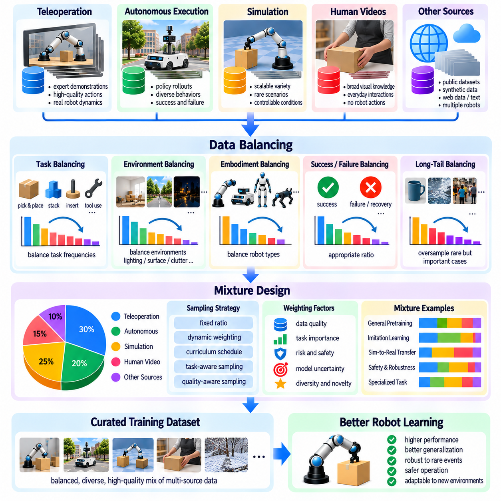{width="7.268055555555556in" height="7.268055555555556in"}

Data balancing and mixture design are essential for Physical AI because robotic datasets contain uneven distributions of tasks, environments, objects, and behaviors. Large volumes of routine observations can dominate training, while rare interactions and difficult conditions receive insufficient representation. Effective mixture design controls how different data sources contribute to learning, improving generalization without sacrificing performance in common operating scenarios.

Data balancing adjusts the relative representation of samples across categories or conditions, while mixture design determines how multiple datasets and experience types are combined during training. These processes are related but distinct. Balancing may correct excessive repetition within a dataset, whereas mixture design allocates learning capacity across teleoperation, autonomous execution, simulation, human video, and other sources.

The operational data distribution provides an important reference for designing training mixtures. Robots deployed in warehouses, factories, hospitals, or homes encounter different combinations of tasks and environmental conditions. Training data should reflect relevant deployment requirements rather than simply reproduce collection frequencies. However, preserving realistic operating conditions remains important because excessive rebalancing can produce policies that perform poorly during routine operation.

Task-level balancing prevents frequently recorded activities from overwhelming less common but important capabilities. A manipulation dataset may contain thousands of simple pick-and-place demonstrations but relatively few examples of insertion, tool use, or recovery. Assigning appropriate sampling weights to different tasks improves exposure to underrepresented skills. Weight selection should consider task difficulty, operational importance, and expected transfer between related behaviors.

Environment-level balancing addresses differences in lighting, surface properties, clutter, spatial layout, and dynamic obstacles. Data collected in controlled laboratories may be cleaner and more abundant than recordings from complex deployment sites. Overrepresenting laboratory conditions can reduce robustness when robots encounter unfamiliar environments. Balanced mixtures should preserve realistic environmental variation while avoiding unnecessary duplication of nearly identical scenes.

Robot embodiment balancing becomes important when training shared models across platforms with different kinematics, sensors, actuators, and physical capabilities. A dataset dominated by one robot configuration may bias learned representations toward that embodiment. Mixture design can allocate samples across robot types while preserving embodiment-specific constraints. Morphology-aware conditioning helps models distinguish transferable skills from behaviors that depend on particular hardware.

Data source balancing considers differences between teleoperation demonstrations, autonomous rollouts, simulation trajectories, and human video. Each source provides distinct benefits and limitations. Teleoperation offers action supervision, autonomous data reflects policy behavior, simulation enables controlled variation, and human video provides broad visual experience. Mixture weights should reflect supervision reliability, physical relevance, and the intended learning objective.

Simulation-to-real balancing is particularly important because synthetic data can be generated at much lower cost than physical robot experiences. Excessive reliance on simulation may introduce biases from inaccurate contact dynamics, simplified sensing, or unrealistic environments. Real-world data anchors learning to operational conditions, while simulation expands coverage of rare scenarios. The optimal mixture depends on simulator fidelity and measured transfer performance.

Success and failure balancing influences how policies interpret desirable behavior and operational boundaries. Expert demonstrations provide examples of effective actions, while unsuccessful trajectories reveal hazards, mistakes, and recovery opportunities. Excessive failure sampling may distort imitation objectives if unsuccessful actions are treated as expert targets. Failure data should be assigned suitable labels and learning objectives rather than mixed indiscriminately with successful demonstrations.

Long-tail balancing increases exposure to uncommon objects, unusual environmental conditions, and safety-critical interactions. These experiences may have low natural frequencies but high operational importance. Targeted oversampling can improve robustness, although excessive emphasis on rare cases may reduce performance on common tasks. Risk-aware mixture design considers occurrence probability, consequence severity, and the model\'s existing competence.

Sampling weights provide a flexible mechanism for controlling dataset composition without physically duplicating observations. Each task, environment, source, or scenario category can receive a probability that determines its frequency during training. Hierarchical sampling can first select a task or source and then choose an individual trajectory. This structure improves control over complex mixtures and supports transparent adjustment of training priorities.

Dataset size alone should not determine mixture weights because large collections may contain extensive redundancy or lower-quality supervision. A smaller dataset of diverse, reliable demonstrations can provide greater learning value than a much larger collection of repetitive experiences. Quality-aware weighting incorporates data integrity, demonstration success, annotation confidence, and novelty. However, strict quality filtering should not eliminate informative failures or challenging sensor conditions.

Balancing across multiple dimensions is difficult because task, environment, embodiment, and outcome categories are often correlated. A rare manipulation task may occur only on one robot platform or within a particular simulation environment. Independently balancing each dimension can create unintended distribution shifts. Joint distribution analysis and stratified sampling help identify interactions, while explicit coverage constraints prevent important combinations from disappearing.

Dynamic mixture design adapts sampling probabilities as model capabilities evolve. Early training may emphasize reliable demonstrations and foundational behaviors, while later stages introduce difficult interactions, recovery trajectories, and rare conditions. Curriculum learning and performance-driven reweighting can progressively address model weaknesses. Periodic reevaluation prevents sampling policies from remaining fixed after the learning system has improved.

Multi-task and foundation model training require careful mixture allocation because different objectives compete for finite model capacity. Perception, language grounding, motion prediction, and action generation may benefit from different data sources and sampling frequencies. Excessive emphasis on one objective can degrade performance elsewhere. Mixture experiments should measure transfer benefits, interference between tasks, and the marginal contribution of each data component.

Mixture optimization can use controlled experiments to estimate how sampling weights affect validation performance. Engineers may compare alternative proportions of real and simulated data, successful and failed trajectories, or common and rare scenarios. Automated search methods can adjust mixture parameters using measured learning outcomes. However, optimization should consider computational cost and avoid overfitting to narrow validation benchmarks.

Evaluation must reflect both the intended operational distribution and important challenging conditions. A balanced training mixture should not be judged only by aggregate accuracy or average task success. Stratified metrics reveal whether improvements occur across environments, robot types, task categories, and failure modes. Separate operational and stress-test evaluations help identify tradeoffs between routine efficiency and robustness under unusual conditions.

At fleet scale, mixture design becomes a continuous process informed by deployed robot telemetry and centralized data analysis. Different sites may contribute unequal volumes of experience, causing heavily instrumented locations to dominate training. Source-aware sampling can prevent this imbalance while preserving relevant deployment frequencies. New failure patterns, hardware revisions, and changing tasks require periodic updates to mixture policies and dataset versions.

Ultimately, data balancing and mixture design determine how effectively available robotic experiences are converted into learning capability. Effective Physical AI data engines combine representative operational data with targeted exposure to difficult tasks, rare events, and diverse embodiments. By integrating quality-aware sampling, adaptive weighting, coverage analysis, and downstream evaluation, these systems support efficient training and robust generalization across real-world robotic applications.

## 06.13. Train Validation Test Splitting and Leakage

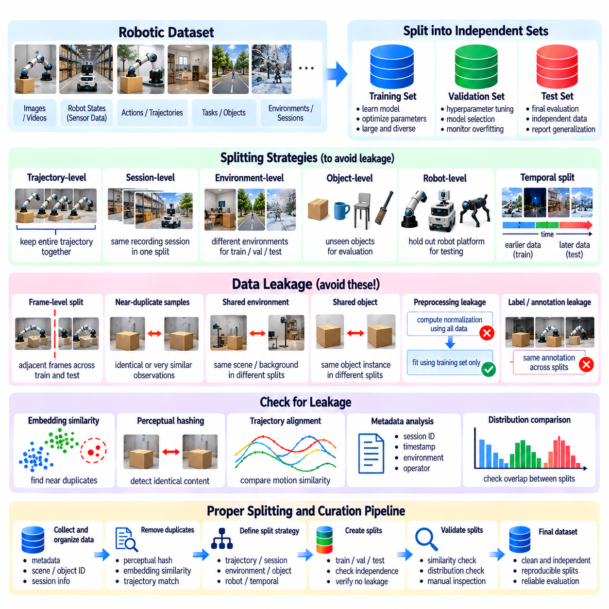{width="7.268055555555556in" height="7.268055555555556in"}

Training, validation, and test splitting is a fundamental requirement for reliable Physical AI model development. Robotic datasets contain highly correlated observations, repeated demonstrations, and shared environmental conditions that can distort performance estimates. Separating data into independent subsets enables engineers to distinguish genuine generalization from memorization. Effective splitting strategies must consider the physical and temporal relationships between samples rather than relying on random allocation alone.

The training set provides examples used to optimize model parameters and learn representations, dynamics, or control policies. The validation set supports hyperparameter selection, architecture comparison, and training decisions. The test set provides an independent assessment of final model performance. These roles must remain distinct because repeated exposure to evaluation data can gradually influence model development and produce overly optimistic performance estimates.

Data leakage occurs when information from validation or test examples influences model training or selection inappropriately. Leakage may involve identical samples, closely related trajectories, shared annotations, or preprocessing statistics derived from evaluation data. In Physical AI, leakage is particularly difficult to detect because different recordings may contain nearly identical scenes or repeated executions of the same task. Such contamination undermines the credibility of reported results.

Random frame-level splitting is often unsuitable for robotic video and trajectory datasets. Consecutive frames share object positions, camera viewpoints, lighting conditions, and robot states. Assigning adjacent frames to different subsets allows models to encounter almost identical observations during training and testing. Although the resulting accuracy may appear high, it provides limited evidence of performance on genuinely unfamiliar situations.

Trajectory-level splitting addresses temporal leakage by assigning complete episodes or demonstrations to a single subset. All observations, actions, rewards, and state transitions belonging to one execution remain together. This prevents adjacent portions of the same trajectory from appearing in both training and evaluation. However, trajectory-level separation alone may be insufficient when multiple demonstrations share identical objects, environments, or operator behaviors.

Session-level splitting groups recordings collected during the same continuous operating period. A session may share sensor calibration, environmental layout, lighting, robot configuration, and human operator characteristics. Keeping entire sessions within one subset reduces hidden correlations across training and evaluation data. Session identifiers and collection metadata are therefore important for constructing reproducible splits and detecting accidental overlap.

Environment-level splitting evaluates whether learned models generalize beyond familiar physical surroundings. Training data may come from selected warehouses, laboratories, or factory cells, while evaluation uses locations excluded from training. Such separation exposes dependencies on background appearance, object placement, and environmental geometry. Evaluation environments should remain representative of intended deployment conditions while introducing meaningful differences.

Object-level splitting tests generalization to previously unseen physical objects. Manipulation datasets frequently contain repeated interactions with a limited collection of objects, allowing models to memorize appearance or geometry. Holding out object identities, shapes, or categories can reveal whether a policy transfers learned skills to new instances. Different protocols measure distinct capabilities, so unseen instances should not be confused with entirely unseen object categories.

Robot-level splitting becomes important when foundation models or shared policies are trained using data from multiple embodiments. Holding out a robot platform can evaluate transfer across kinematic structures, sensors, and actuator configurations. This is more demanding than testing on new trajectories from a familiar robot. Evaluation must account for hardware-specific action spaces and physical constraints to avoid interpreting incompatibility as a failure of generalization.

Temporal splitting separates training and evaluation data according to collection time. Models trained on earlier recordings can be evaluated against later experiences to measure robustness to changing environments, hardware wear, and operational practices. This approach resembles deployment conditions but may introduce additional distribution shifts. Time boundaries should be documented, and future information must not influence preprocessing or training decisions.

Near-duplicate leakage can occur even when filenames, timestamps, and trajectory identifiers differ. Repeated demonstrations may contain nearly identical motions, and synchronized cameras may record the same event from multiple viewpoints. Embedding similarity, perceptual hashing, and trajectory alignment can identify suspicious overlap. Automated checks should be supplemented by metadata analysis because semantic similarity alone does not establish whether samples share an underlying event.

Preprocessing leakage arises when normalization, feature selection, dimensionality reduction, or statistical transformations use information from evaluation subsets. For example, computing normalization parameters from the entire dataset allows test distribution characteristics to influence training. Data-dependent transformations should be fitted using training data only and then applied unchanged to validation and test sets. Fixed external pretrained encoders require separate documentation of their training provenance.

Label leakage occurs when target information is inadvertently included in model inputs or derived features. A dataset may contain metadata that directly reveals task success, future robot states, or evaluation outcomes. Models can exploit these shortcuts instead of learning meaningful perception or control. Feature auditing should verify that each input would genuinely be available at the intended prediction time and during real-world deployment.

Simulation-generated data introduces additional leakage risks through shared random seeds, scene templates, object models, and procedural generation parameters. Different synthetic trajectories may appear distinct while originating from nearly identical configurations. Splitting by simulation seed alone may not ensure independence if underlying assets and environments remain unchanged. Robust evaluation should hold out meaningful combinations of scene geometry, dynamics, and task conditions.

Dataset provenance is essential for preventing leakage across large Physical AI data engines. Each recording should retain identifiers for collection sessions, robot platforms, operators, environments, tasks, and source datasets. Derived samples should preserve links to their original recordings and transformation histories. Provenance graphs make it possible to detect shared origins and ensure that related data remains within the appropriate split.

Stratified splitting can preserve useful distributions of tasks, outcomes, environments, and safety-relevant events across subsets. However, stratification must respect grouping constraints and must not divide related trajectories merely to achieve numerical balance. Rare events may require dedicated evaluation collections when independent examples are insufficient. Split design should prioritize independence and interpretability over perfectly matching category proportions.

Validation leakage can develop through repeated experimentation even when the validation set is initially isolated. Extensive hyperparameter tuning and architecture selection gradually adapt development decisions to validation characteristics. The final test set should remain untouched until evaluation protocols and model selection are complete. When test results influence subsequent development, a new independent test collection may be necessary for credible performance claims.

Evaluation should distinguish in-distribution performance from generalization under deliberate distribution shifts. Separate test subsets can examine unseen environments, objects, robot embodiments, and rare failure conditions. Reporting only aggregate metrics may conceal weaknesses in critical categories. Task success rates, prediction errors, intervention frequencies, and safety outcomes should be presented alongside clear descriptions of split boundaries and evaluation assumptions.

At fleet scale, automated split governance becomes necessary because new data continuously arrives from deployed robots. Versioned manifests can assign recordings to training, validation, or test partitions using stable grouping rules. Leakage detection should run whenever datasets are merged, transformed, or expanded. Access controls, audit logs, and reproducible dataset snapshots help prevent evaluation contamination during continuous model updates.

Ultimately, effective train-validation-test splitting establishes whether Physical AI systems learn transferable physical capabilities rather than reproduce familiar observations. Reliable evaluation requires separation across the dependencies most relevant to deployment, including time, trajectories, environments, objects, and robot configurations. By combining provenance tracking, leakage detection, disciplined model selection, and independent testing, data engines support trustworthy measurements of robotic intelligence and safety.

## 06.14. Data Quality Scoring [w/Code]

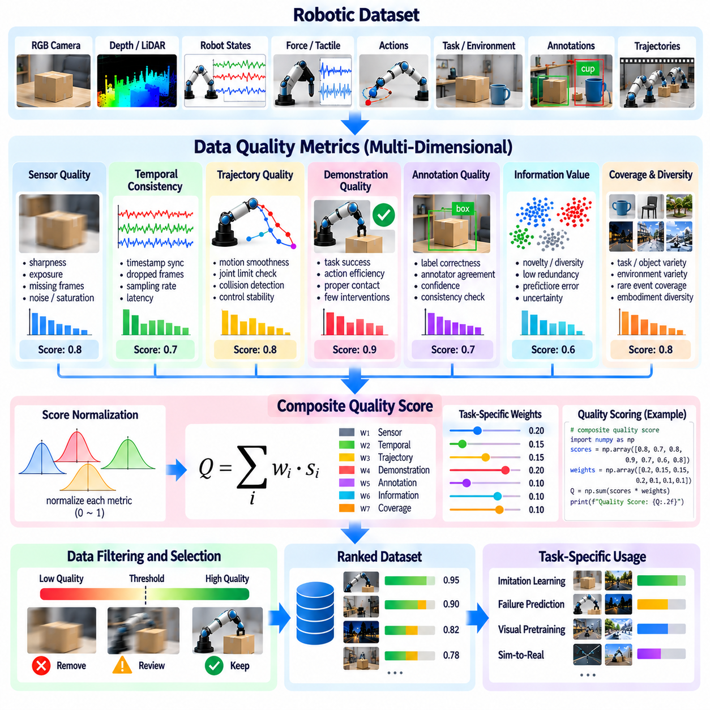{width="7.268055555555556in" height="7.268055555555556in"}

Data quality scoring is a fundamental component of Physical AI data engines because robotic learning depends on the reliability, relevance, and diversity of collected experiences. Large datasets contain useful demonstrations alongside corrupted observations, incomplete trajectories, and redundant recordings. A systematic scoring framework assigns measurable quality indicators to individual samples or sequences, enabling consistent decisions about retention, filtering, annotation, and training priority.

Data quality is multidimensional and cannot be represented reliably by a single measurement. Important dimensions include sensor integrity, temporal consistency, annotation correctness, task execution quality, information content, and operational relevance. A sample may contain excellent visual information but unreliable robot state measurements. Effective scoring systems preserve individual quality dimensions while providing composite scores for automated decision-making.

Sensor quality scoring evaluates whether recorded measurements satisfy expected technical and physical requirements. Camera data can be assessed through image sharpness, exposure, motion blur, and missing frames. Depth sensors require checks for invalid measurements, spatial noise, and range limitations. Force sensors and joint encoders may be evaluated for saturation, drift, and abnormal discontinuities. These indicators help identify recordings unsuitable for particular learning objectives.

Temporal quality scoring examines synchronization and continuity across sensor streams, robot states, and action commands. Timestamp inconsistencies, dropped messages, irregular sampling intervals, and communication delays can undermine trajectory learning. A recording with visually clear frames may still be unusable if actions and observations are misaligned. Scoring systems should quantify timing errors and distinguish recoverable synchronization problems from irreparable data corruption.

Trajectory quality scoring considers whether recorded robot behavior is physically coherent and relevant to the intended task. Important indicators include motion smoothness, joint-limit compliance, collision events, control stability, and task completion. However, smooth motion does not always indicate a successful demonstration, and abrupt movements may be legitimate responses to contact. Quality assessment must incorporate task context rather than relying on simplistic motion thresholds.

Demonstration quality scoring evaluates the effectiveness of human-operated or expert-generated robot trajectories. Successful task completion, efficient action sequences, appropriate contact forces, and limited corrective interventions may indicate strong supervision quality. Nevertheless, imperfect demonstrations can contain valuable recovery behaviors and difficult interaction examples. Scoring should distinguish expert imitation suitability from broader learning value instead of rejecting all unsuccessful executions.

Annotation quality scoring measures the reliability of labels associated with robotic observations. Object identities, bounding boxes, segmentation masks, contact events, action labels, and task outcomes may contain errors or ambiguities. Agreement between annotators, confidence estimates, and automated consistency checks can provide useful indicators. Low-confidence annotations should be routed for review when their correction could significantly improve training effectiveness.

Information quality scoring estimates how much additional learning value a sample contributes beyond existing data. Near-duplicate observations and repetitive trajectories often provide limited marginal benefit. Novelty scores, embedding distances, prediction errors, and uncertainty estimates can identify informative experiences. However, unusual observations are not automatically valuable, and high uncertainty caused by sensor corruption should not be mistaken for meaningful training information.

Coverage and diversity scoring measure how well a dataset represents relevant operating conditions. Task categories, object properties, environmental layouts, robot embodiments, and failure modes can be analyzed for representation gaps. Embedding-based clustering and distribution statistics help quantify underrepresented regions. Dataset-level coverage scores complement individual sample quality because a collection of individually excellent examples may still lack operational diversity.

Composite quality scores combine multiple indicators into an interpretable assessment. A weighted aggregation may emphasize sensor reliability, annotation correctness, trajectory validity, and task relevance according to the learning objective. Hard constraints should exclude samples with critical integrity failures regardless of their overall score. Weight selection must be documented because different applications require different tradeoffs between cleanliness, diversity, and learning value.

Quality thresholds should be adapted to the intended use of each dataset. High-precision manipulation may require strict synchronization and geometric accuracy, while visual pretraining may tolerate imperfect robot state measurements. Failure prediction may deliberately retain abnormal trajectories that imitation learning would exclude. Consequently, quality scoring should support task-specific acceptance criteria rather than imposing one universal definition of acceptable data.

Score normalization is necessary when combining indicators with different numerical scales and distributions. Sensor error magnitudes, annotation confidence, novelty measures, and task success values cannot be aggregated meaningfully without appropriate transformations. Calibration against manually reviewed examples can improve score interpretation. Thresholds should be periodically reevaluated as sensor hardware, collection environments, and learning objectives evolve.

Automated quality scoring pipelines can process raw recordings and derived datasets through successive validation stages. Initial checks verify file integrity, schema compliance, timestamps, and sensor availability. Subsequent stages evaluate trajectory consistency, annotation reliability, duplication, and information value. Each stage produces structured metrics and diagnostic reasons, allowing engineers to understand why a recording was accepted, flagged, or rejected.

Quality scoring systems benefit from maintaining separate sample-level, trajectory-level, and dataset-level assessments. A single corrupted frame may not invalidate an otherwise useful demonstration, while a sequence of timing errors can compromise an entire trajectory. Dataset-level imbalance may remain invisible when examining individual recordings. Hierarchical scoring enables targeted repair, selective exclusion, and more accurate evaluation of overall data readiness.

Human review provides essential calibration for automated scoring decisions. Engineers can inspect borderline samples, investigate unexpected score distributions, and determine whether unusual observations represent errors or valuable rare events. Reviewed examples can train quality prediction models and refine scoring rules. Active review strategies prioritize cases where human judgment is most likely to change a data retention or annotation decision.

Quality scores should not be treated as permanent properties of recordings. A sample that contributes little to an early perception model may become valuable when training contact-aware control or failure recovery. Similarly, improvements in reconstruction algorithms may restore previously unusable observations. Versioned quality assessments should record the scoring model, criteria, thresholds, and intended learning objective to preserve reproducibility.

The effectiveness of quality scoring must be validated through downstream training outcomes. Engineers can compare models trained on unfiltered data, strictly filtered data, and quality-weighted mixtures. Evaluation should measure task success, prediction accuracy, robustness, safety performance, and computational efficiency. These experiments reveal whether scoring rules improve learning or inadvertently eliminate challenging examples needed for generalization.

At fleet scale, centralized quality monitoring can identify systematic problems across deployed robots. Repeated low scores from a particular camera, actuator, site, or software version may indicate calibration drift, hardware degradation, or collection pipeline defects. Aggregated quality statistics support maintenance decisions and data collection improvements. Continuous monitoring also helps detect changes in the reliability of incoming training data.

Ultimately, data quality scoring converts subjective judgments about robotic recordings into structured, auditable evidence for data engine decisions. Reliable Physical AI systems require more than clean datasets; they need representative, informative, and physically meaningful experiences. By integrating sensor validation, trajectory assessment, annotation confidence, diversity analysis, and downstream evaluation, quality scoring supports efficient learning and dependable robotic behavior.

## 06.15. Automated Data Curation Pipeline [w/Code]

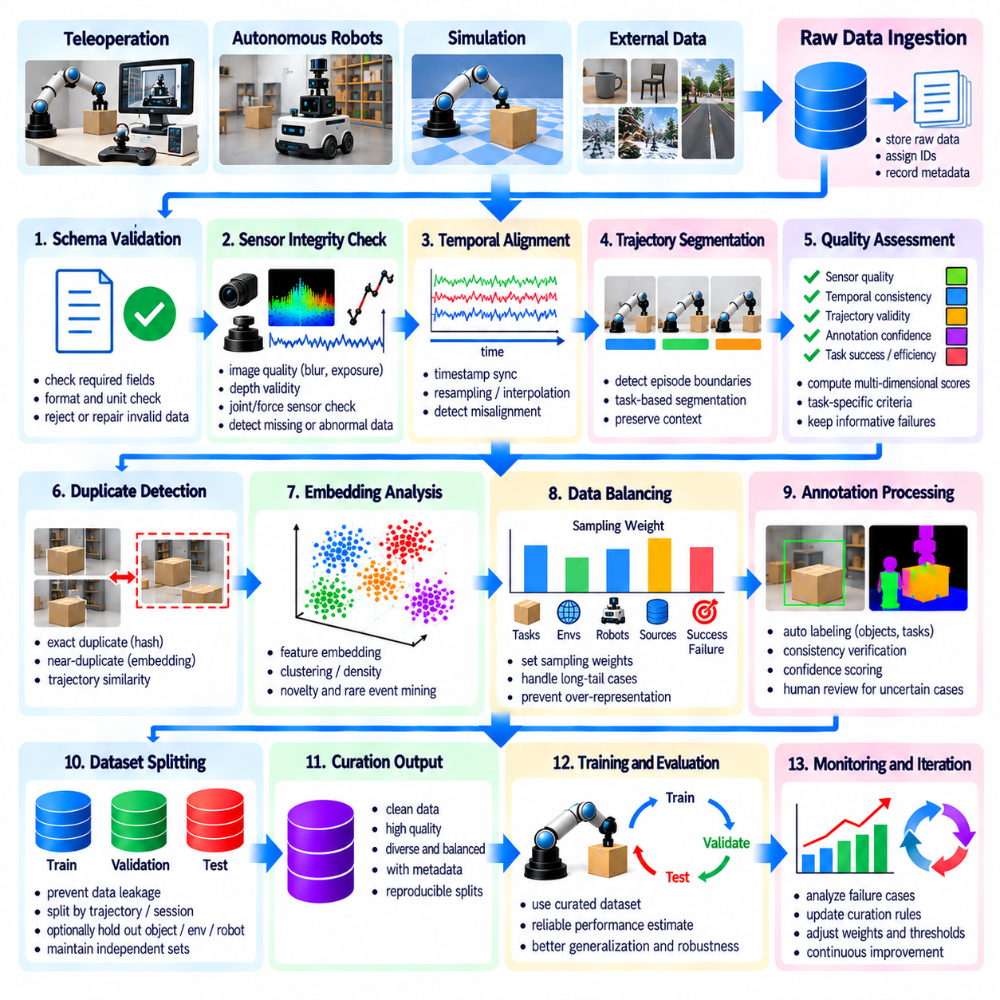{width="7.268055555555556in" height="7.268055555555556in"}

An automated data curation pipeline transforms raw robotic recordings into reliable, diverse, and training-ready datasets through repeatable processing stages. Physical AI systems generate large volumes of camera images, sensor measurements, robot states, actions, and execution logs. Manual inspection cannot scale with continuous collection. Automation therefore combines integrity validation, quality scoring, redundancy removal, and intelligent sample selection to improve learning efficiency.

The pipeline begins with data ingestion from teleoperation systems, autonomous robots, simulation environments, and external datasets. Each recording is registered with identifiers describing its source, robot configuration, task, environment, and collection time. Raw data should be stored without destructive modification to preserve original evidence. Standardized metadata and immutable identifiers enable downstream processing, traceability, and reproducible dataset construction.

Schema validation verifies that incoming recordings contain required fields and compatible data formats. Robot trajectories may require timestamps, joint states, action commands, sensor references, and task identifiers. Missing fields, inconsistent units, malformed arrays, or incompatible coordinate conventions can cause silent training errors. Automated validators should reject structurally invalid records or route recoverable problems into controlled repair workflows.

Sensor integrity checks examine whether measurements satisfy expected physical and technical constraints. Camera streams are evaluated for missing frames, exposure problems, and severe blur. Depth measurements are checked for invalid values, while joint encoders and force sensors are examined for discontinuities or saturation. Validation thresholds should reflect sensor specifications and task requirements. Suspicious observations should retain diagnostic information for later investigation.

Temporal alignment is essential because robotic learning depends on relationships between observations, actions, and resulting physical states. The pipeline compares timestamps, sampling intervals, and synchronization offsets across modalities. Interpolation or resampling can correct limited timing differences when justified by sensor characteristics. However, severe misalignment must be flagged because incorrect action-state relationships can corrupt learned dynamics and control policies.

Trajectory segmentation converts continuous recordings into meaningful episodes or task-specific sequences. Boundaries may be determined using task commands, operator annotations, robot state transitions, or detected completion events. Each segment should preserve sufficient context before and after important interactions. Reliable segmentation supports demonstration filtering, failure analysis, temporal modeling, and consistent evaluation across different collection sessions.

Automated quality assessment assigns scores to sensor reliability, temporal consistency, annotation confidence, trajectory validity, and task execution outcomes. Rather than relying on a single quality value, the pipeline maintains separate indicators and interpretable rejection reasons. Task-specific rules determine whether a recording is suitable for perception, imitation learning, dynamics modeling, or failure prediction. Informative failures should not be discarded merely because execution was unsuccessful.

Duplicate and near-duplicate detection reduces excessive repetition within large datasets. File hashes identify exact duplicates, while perceptual similarity and embedding-based retrieval detect related observations. Trajectory comparisons can reveal repeated demonstrations with nearly identical motions. Deduplication should operate at appropriate temporal and semantic levels, preserving small differences that influence contact behavior, safety, or successful task completion.

Embedding-based analysis organizes retained samples into meaningful regions of representation space. Clustering reveals common behaviors, environmental patterns, and underrepresented conditions. Density estimates and nearest-neighbor distances help identify unusual experiences, while model uncertainty and prediction errors highlight potentially informative examples. Combining these signals allows the pipeline to prioritize valuable data without overselecting corrupted or irrelevant outliers.

Data balancing controls the composition of curated datasets across tasks, environments, robot embodiments, sources, and execution outcomes. Sampling weights can prevent frequently recorded routine behaviors from dominating training. Rare but important scenarios may receive additional emphasis, while common conditions remain sufficiently represented. Mixture policies should be adjusted according to learning objectives, operational requirements, and measured model weaknesses.

Annotation processing integrates automated labeling, consistency verification, and targeted human review. Perception models may generate object labels or segmentation masks, while trajectory analysis can estimate task boundaries and outcomes. Confidence scores identify uncertain annotations requiring inspection. Human reviewers should focus on ambiguous, safety-critical, or high-impact examples. Every annotation update should preserve provenance and version information.

Dataset splitting must occur with explicit controls against information leakage. Related frames, trajectories, collection sessions, and duplicated events should remain within consistent training, validation, or test partitions. Depending on evaluation goals, entire objects, environments, or robot platforms may be held out. Stable split manifests and provenance checks prevent later processing stages from unintentionally contaminating independent evaluation datasets.

Pipeline orchestration coordinates processing dependencies, resource allocation, retries, and failure recovery. Individual stages should be modular, allowing validation, embedding extraction, scoring, and selection to run independently when possible. Idempotent operations prevent repeated execution from producing inconsistent results. Distributed workers and queue-based scheduling support high-throughput processing, while structured logs provide visibility into failures and processing delays.

Incremental curation enables newly collected robot experiences to enter existing datasets without rebuilding every processing result. Content hashes and versioned processing configurations identify which stages require recomputation. Changes to quality thresholds, embedding models, or annotation policies may trigger selective reprocessing. This approach reduces computational cost while preserving consistency between historical recordings and newly ingested data.

Dataset manifests describe the exact recordings, labels, transformations, sampling weights, and split assignments included in each release. Versioning should capture pipeline code, model checkpoints, configuration parameters, and processing timestamps. Reproducible manifests allow training experiments to reference immutable dataset snapshots. Access permissions, retention rules, and privacy controls should remain enforceable throughout curation and subsequent distribution.

Operational monitoring measures both pipeline health and resulting dataset quality. Useful indicators include ingestion throughput, processing latency, rejection rates, duplicate ratios, annotation confidence, coverage gaps, and computational cost. Sudden changes may indicate sensor degradation, software defects, or shifting deployment conditions. Dashboards and alerts can direct engineers toward problematic data sources before they affect large training runs.

The value of automated curation must be verified through downstream model evaluation. Engineers can compare training outcomes from raw datasets, conventionally filtered datasets, and automatically curated mixtures. Task success, generalization, robustness, intervention frequency, and training efficiency provide practical evidence of effectiveness. Controlled ablation studies help determine which processing stages contribute improvements and which introduce unnecessary complexity.

At fleet scale, the pipeline becomes a continuous feedback system linking deployed robots with centralized learning infrastructure. Field failures, uncertain predictions, and new environmental conditions trigger targeted collection and curation. Updated datasets support retraining, evaluation, and controlled model deployment. Feedback from subsequent operation refines quality criteria, sampling priorities, and collection strategies, creating an iterative improvement cycle.

Ultimately, an automated data curation pipeline converts uncontrolled streams of robotic experience into governed learning assets. Its effectiveness depends on reliable ingestion, physical consistency checks, quality-aware filtering, diversity preservation, leakage prevention, and reproducible versioning. By connecting automated processing with human oversight and measurable learning outcomes, Physical AI data engines support scalable, trustworthy, and continuously improving robotic intelligence.
