**Volume 04. Data Engines and Scaling for Physical AI**


# Chapter 07. Scaling Laws for Physical AI

##  

## 07.01. Introduction to Scaling Laws

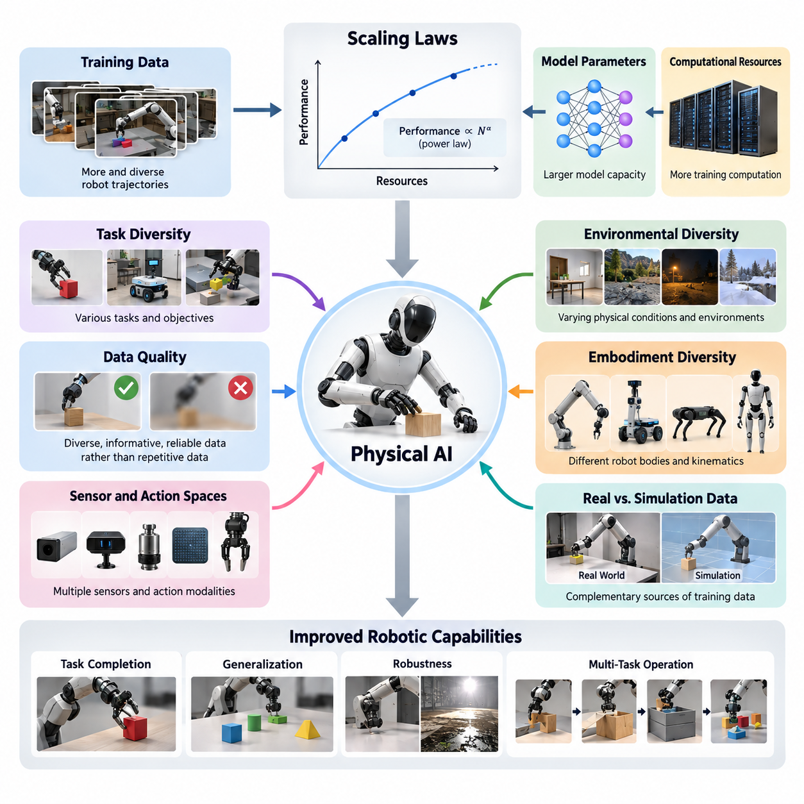{width="7.268055555555556in" height="7.268055555555556in"}

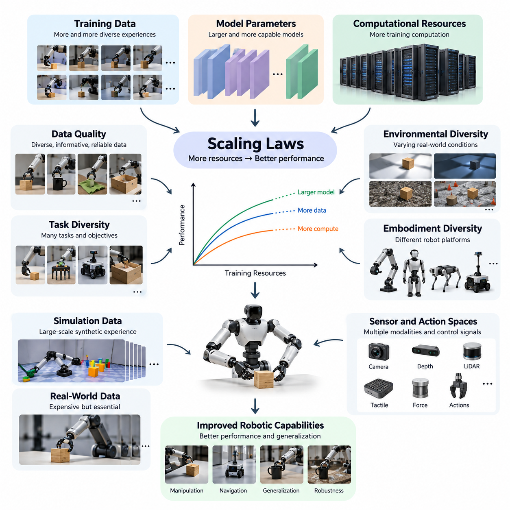{width="7.268055555555556in" height="7.268055555555556in"}

Scaling laws describe systematic relationships between the resources invested in artificial intelligence and the performance achieved by trained models. These relationships help researchers understand how improvements emerge as training data, model parameters, and computational resources increase. In Physical AI, scaling laws provide a framework for predicting how embodied intelligence may improve through larger and more diverse learning experiences.

The concept of scaling laws became prominent through research on large language models, where empirical studies demonstrated predictable performance improvements as model size, dataset size, and training computation increased. These relationships are often approximated by power-law functions over particular operating ranges. However, their mathematical forms and coefficients depend on the model architecture, training procedure, data distribution, and evaluation metric.

Physical AI extends scaling analysis beyond digital information processing into systems that perceive, reason, and act within physical environments. Unlike language models, robotic systems must interact with objects, surfaces, forces, and changing environmental conditions. Their performance depends not only on learned representations but also on sensing accuracy, actuator capabilities, control stability, and the physical consequences of executed actions.

A central question in Physical AI scaling is whether increasing training resources produces predictable improvements in robotic capabilities. Researchers investigate how additional demonstrations, longer interaction histories, broader task distributions, and larger policy models affect task completion and generalization. These relationships are especially important when developing robot foundation models intended to operate across many tasks and environments.

Traditional scaling analysis commonly considers three primary variables: dataset size, model capacity, and computational expenditure. Physical AI requires additional dimensions because embodied learning involves structured interaction with the world. The number of robot episodes, trajectory diversity, environmental complexity, object variation, embodiment diversity, and sensor configurations can influence learning outcomes independently of raw dataset volume.

Robot training data differs fundamentally from static digital datasets because observations and actions are causally connected through physical dynamics. A robotic trajectory contains sequences of sensor measurements, internal states, control commands, and resulting environmental changes. Scaling the number of trajectories therefore increases not only the quantity of observations but potentially the diversity of interactions, transitions, and consequences represented during learning.

The distinction between data quantity and data quality is particularly important in embodied intelligence. Millions of repetitive trajectories collected under nearly identical conditions may provide less useful learning information than a smaller collection covering diverse tasks and difficult situations. Effective scaling must therefore account for information density, behavioral diversity, demonstration reliability, and the representation of rare but operationally significant events.

Task diversity represents another critical scaling dimension. A robot trained exclusively to grasp one object under controlled conditions may achieve excellent performance without developing broadly transferable manipulation skills. Introducing different objects, grasping strategies, workspace arrangements, and task objectives can encourage more reusable representations. However, broader training distributions do not automatically guarantee successful transfer to unfamiliar tasks.

Environmental diversity also influences the relationship between dataset growth and robotic performance. Physical systems encounter variations in illumination, friction, geometry, temperature, surface conditions, and obstacle configurations. Training across these variations may improve robustness by exposing models to different operating conditions. Scaling studies must determine which environmental factors contribute meaningful generalization and which introduce unnecessary complexity.

Embodiment introduces a distinctive challenge because robots possess different mechanical structures, degrees of freedom, sensing arrangements, and action spaces. A manipulation policy trained on one robotic arm may not transfer directly to another with different kinematics or gripper geometry. Cross-embodiment scaling investigates whether shared representations can capture transferable task knowledge while preserving the mechanical constraints of individual robotic platforms.

The expansion of sensor and action spaces creates additional scaling considerations. Cameras, depth sensors, LiDAR, force sensors, tactile arrays, and proprioceptive measurements provide complementary information about the physical world. Combining these modalities can improve observability, but it also increases synchronization requirements and computational complexity. More sensors do not necessarily improve performance unless their information is relevant and properly integrated.

Real-world robot data is expensive because collecting physical experiences requires hardware, operators, maintenance, energy, and controlled operating environments. Unlike digital training examples, robotic interactions consume time and may cause equipment wear or physical damage. These constraints make data acquisition efficiency an essential scaling consideration and motivate approaches that extract greater learning value from each collected episode.

Simulation-generated data offers an alternative pathway for expanding robotic learning resources. Physics engines and procedural environments can produce large quantities of trajectories while varying object properties, robot configurations, and environmental conditions. Nevertheless, simulated experiences may contain modeling inaccuracies. Scaling synthetic datasets must therefore consider whether additional simulated interactions improve real-world performance rather than merely simulation benchmarks.

Human demonstration videos provide another potential source of scalable embodied knowledge. Large video collections contain examples of object manipulation, tool usage, navigation, and multistep activities. Although these recordings often lack explicit robot actions and force measurements, they can support learning of task structure and visual relationships. Their contribution depends on reliable interpretation and transfer from human behavior to robotic embodiment.

Scaling laws also influence decisions about pretraining and fine-tuning. Broad pretraining can expose robot models to many environments, objects, and behaviors, potentially producing reusable representations. Task-specific fine-tuning then adapts these representations to particular hardware or operational requirements. Understanding the relationship between pretraining diversity and adaptation data requirements is essential for developing economical robotic learning strategies.

Model capacity must be evaluated in relation to the complexity of embodied behavior. Larger neural networks may represent richer perceptual features, temporal dependencies, and action relationships, but increased parameter counts do not automatically produce better control policies. Performance improvements depend on sufficient training data, suitable architectures, effective optimization, and the ability to execute actions within real-time computational constraints.

Inference-time computation introduces another dimension of scaling. Robotic systems may allocate additional processing resources to planning, trajectory evaluation, uncertainty estimation, or predictive world modeling before selecting an action. Greater computational effort can improve decisions in some situations, but physical systems operate under strict latency constraints. Consequently, useful scaling must balance decision quality against response time and operational safety.

Long-horizon robotic tasks present difficulties that are not captured by isolated action accuracy. Completing an extended task requires maintaining context, coordinating subtasks, responding to unexpected changes, and recovering from errors. Even small per-step failure probabilities can accumulate across long action sequences. Scaling research must therefore examine complete task success, recovery capabilities, and temporal consistency rather than relying exclusively on short-horizon metrics.

Generalization is a primary objective of Physical AI scaling because practical robots must operate beyond the exact conditions represented during training. Researchers evaluate performance on unseen objects, unfamiliar environments, new task combinations, and different robotic platforms. Scaling curves measured only on familiar training distributions may overestimate practical capability, making carefully separated evaluation environments essential for interpreting progress.

Scaling relationships frequently exhibit diminishing returns as additional resources provide progressively smaller improvements. Such behavior may arise from redundant data, limited task coverage, insufficient model capacity, optimization difficulties, or hardware constraints. Identifying the dominant bottleneck helps determine whether future investment should prioritize additional demonstrations, improved data curation, greater model capacity, or more effective computational infrastructure.

Empirical scaling analysis requires controlled experiments that vary relevant resources while measuring performance consistently. Researchers may train multiple model configurations using different dataset sizes, task distributions, and computational budgets. The resulting measurements can reveal trends and support fitted scaling curves. However, extrapolating beyond observed experimental ranges introduces uncertainty, especially when evaluation conditions or system architectures change.

A useful scaling model must also distinguish statistical improvement from operational significance. A small reduction in prediction error may have little effect on a robot that already performs a simple task reliably. Conversely, a modest improvement in recovery behavior may substantially increase success during complex operations. Physical AI scaling should therefore connect learning metrics with measurable outcomes such as completion rates, intervention frequency, reliability, and execution efficiency.

The economics of scaling are equally important because embodied learning requires coordinated investments in data infrastructure, robotic hardware, simulation systems, and computing platforms. The optimal strategy is not necessarily the one that produces the largest model or dataset. Instead, effective development seeks the greatest improvement in validated robotic capability for a given resource budget while maintaining acceptable safety, reliability, and deployment costs.

Scaling laws ultimately provide a scientific framework for investigating how Physical AI capabilities evolve as learning resources expand. They are empirical relationships rather than universal guarantees of intelligence or autonomy. Their practical value comes from identifying measurable trends, exposing resource bottlenecks, and guiding experiments. Understanding these principles establishes the foundation for examining data, model, compute, diversity, embodiment, and generalization scaling in greater detail.

스케일링 법칙(Scaling Laws)은 인공지능(Artificial Intelligence)에 투입되는 자원과 학습된 모델(Model)이 달성하는 성능 사이의 체계적인 관계를 설명합니다. 이러한 관계는 학습 데이터(Training Data), 모델 매개변수(Model Parameters), 계산 자원(Computational Resources)이 증가함에 따라 성능이 어떻게 향상되는지 이해하는 데 도움을 줍니다. 피지컬 AI(Physical AI)에서 스케일링 법칙은 더 크고 다양한 학습 경험을 통해 체화 지능(Embodied Intelligence)이 어떻게 발전할 수 있는지 예측하는 프레임워크(Framework)를 제공합니다.

스케일링 법칙의 개념은 대규모 언어 모델(Large Language Models, LLMs) 연구를 통해 중요성이 부각되었습니다. 실증 연구(Empirical Studies)에서는 모델 크기(Model Size), 데이터셋 크기(Dataset Size), 학습 연산량(Training Compute)이 증가함에 따라 성능이 예측 가능한 방식으로 향상될 수 있음을 보여주었습니다. 이러한 관계는 특정 조건 범위에서 멱법칙 함수(Power-Law Functions)로 근사되는 경우가 많습니다. 그러나 수학적 형태와 계수는 모델 아키텍처(Model Architecture), 학습 절차(Training Procedure), 데이터 분포(Data Distribution), 평가 지표(Evaluation Metrics)에 따라 달라집니다.

피지컬 AI는 스케일링 분석(Scaling Analysis)을 디지털 정보 처리(Digital Information Processing)를 넘어 물리적 환경(Physical Environments)을 인식하고 추론하며 행동하는 시스템으로 확장합니다. 언어 모델과 달리 로봇 시스템(Robotic Systems)은 물체, 표면, 힘, 변화하는 환경 조건과 상호작용해야 합니다. 따라서 로봇의 성능은 학습된 표현(Learned Representations)뿐만 아니라 센싱 정확도(Sensing Accuracy), 액추에이터 성능(Actuator Capabilities), 제어 안정성(Control Stability), 실행된 행동의 물리적 결과(Physical Consequences)에 의해서도 결정됩니다.

피지컬 AI 스케일링의 핵심 질문은 학습 자원(Training Resources)의 증가가 로봇 능력(Robotic Capabilities)의 예측 가능한 향상으로 이어지는지 여부입니다. 연구자들은 추가적인 시연 데이터(Demonstrations), 더 긴 상호작용 기록(Interaction Histories), 광범위한 작업 분포(Task Distributions), 더 큰 정책 모델(Policy Models)이 작업 완료(Task Completion)와 일반화(Generalization)에 미치는 영향을 조사합니다. 이러한 관계는 다양한 작업과 환경에서 동작하도록 설계된 로봇 파운데이션 모델(Robot Foundation Models)을 개발할 때 특히 중요합니다.

전통적인 스케일링 분석은 일반적으로 데이터셋 크기(Dataset Size), 모델 용량(Model Capacity), 계산 비용(Computational Expenditure)이라는 세 가지 주요 변수를 고려합니다. 피지컬 AI에서는 체화 학습(Embodied Learning)이 물리적 세계와의 구조화된 상호작용을 포함하므로 추가적인 차원이 필요합니다. 로봇 에피소드(Robot Episodes)의 수, 궤적 다양성(Trajectory Diversity), 환경 복잡성(Environmental Complexity), 물체 변동성(Object Variation), 체화 다양성(Embodiment Diversity), 센서 구성(Sensor Configurations)은 원시 데이터의 양과 독립적으로 학습 결과에 영향을 미칠 수 있습니다.

로봇 학습 데이터(Robot Training Data)는 관측(Observations)과 행동(Actions)이 물리적 동역학(Physical Dynamics)을 통해 인과적으로 연결되어 있다는 점에서 정적인 디지털 데이터셋(Static Digital Datasets)과 근본적으로 다릅니다. 로봇 궤적(Robot Trajectory)은 센서 측정값(Sensor Measurements), 내부 상태(Internal States), 제어 명령(Control Commands), 그에 따른 환경 변화(Environmental Changes)의 연속적인 시퀀스(Sequences)를 포함합니다. 따라서 궤적 수를 확장하면 관측량뿐만 아니라 학습에 표현되는 상호작용, 상태 전이(State Transitions), 결과의 다양성도 증가할 수 있습니다.

데이터 양(Data Quantity)과 데이터 품질(Data Quality)의 구분은 체화 지능에서 특히 중요합니다. 거의 동일한 조건에서 수집된 수백만 개의 반복적인 궤적은 다양한 작업과 어려운 상황을 포함하는 소규모 데이터보다 학습에 유용한 정보를 적게 제공할 수 있습니다. 따라서 효과적인 스케일링(Effective Scaling)은 정보 밀도(Information Density), 행동 다양성(Behavioral Diversity), 시연 신뢰성(Demonstration Reliability), 드물지만 운영상 중요한 사건(Rare Events)의 표현 정도를 함께 고려해야 합니다.

작업 다양성(Task Diversity)은 또 다른 핵심 스케일링 차원(Scaling Dimension)입니다. 통제된 조건에서 하나의 물체만 파지하도록 학습된 로봇은 높은 성능을 달성하더라도 폭넓게 전이 가능한 조작 기술(Transferable Manipulation Skills)을 개발하지 못할 수 있습니다. 다양한 물체, 파지 전략(Grasping Strategies), 작업 공간 배치(Workspace Arrangements), 작업 목표(Task Objectives)를 도입하면 재사용 가능한 표현(Reusable Representations)의 학습을 촉진할 수 있습니다. 그러나 학습 분포(Training Distributions)를 확장한다고 해서 익숙하지 않은 작업으로의 성공적인 전이(Transfer)가 자동으로 보장되는 것은 아닙니다.

환경 다양성(Environmental Diversity) 역시 데이터셋 증가와 로봇 성능 사이의 관계에 영향을 미칩니다. 물리적 시스템은 조명(Illumination), 마찰(Friction), 기하학적 구조(Geometry), 온도(Temperature), 표면 조건(Surface Conditions), 장애물 구성(Obstacle Configurations)의 변화를 경험합니다. 이러한 변화를 포함한 학습은 모델이 다양한 작동 조건에 노출되도록 하여 강건성(Robustness)을 향상시킬 수 있습니다. 스케일링 연구에서는 어떤 환경 요인이 의미 있는 일반화(Generalization)에 기여하고 어떤 요인이 불필요한 복잡성을 유발하는지 판단해야 합니다.

체화(Embodiment)는 로봇마다 서로 다른 기계적 구조(Mechanical Structures), 자유도(Degrees of Freedom), 센싱 구성(Sensing Arrangements), 행동 공간(Action Spaces)을 갖기 때문에 고유한 과제를 발생시킵니다. 하나의 로봇 팔(Robotic Arm)에서 학습된 조작 정책(Manipulation Policy)은 운동학(Kinematics)이나 그리퍼 구조(Gripper Geometry)가 다른 로봇으로 직접 전이되지 않을 수 있습니다. 교차 체화 스케일링(Cross-Embodiment Scaling)은 개별 로봇 플랫폼(Robotic Platforms)의 기계적 제약을 유지하면서 공유 표현(Shared Representations)이 전이 가능한 작업 지식(Transferable Task Knowledge)을 포착할 수 있는지 연구합니다.

센서 공간(Sensor Space)과 행동 공간(Action Space)의 확장은 추가적인 스케일링 고려사항을 발생시킵니다. 카메라(Cameras), 깊이 센서(Depth Sensors), 라이다(LiDAR), 힘 센서(Force Sensors), 촉각 센서 배열(Tactile Arrays), 고유수용성 측정값(Proprioceptive Measurements)은 물리적 세계에 대한 상호 보완적인 정보를 제공합니다. 이러한 모달리티(Modalities)를 결합하면 관측 가능성(Observability)을 높일 수 있지만 동기화 요구사항(Synchronization Requirements)과 계산 복잡성(Computational Complexity)도 증가합니다. 센서 정보가 관련성이 있고 적절하게 통합되지 않는다면 센서 수의 증가가 반드시 성능 향상으로 이어지지는 않습니다.

실세계 로봇 데이터(Real-World Robot Data)는 물리적 경험을 수집하기 위해 하드웨어(Hardware), 작업자(Operators), 유지보수(Maintenance), 에너지(Energy), 통제된 운영 환경(Controlled Operating Environments)이 필요하므로 비용이 많이 듭니다. 디지털 학습 예제(Digital Training Examples)와 달리 로봇 상호작용(Robotic Interactions)은 시간을 소비하고 장비 마모(Equipment Wear)나 물리적 손상(Physical Damage)을 유발할 수 있습니다. 이러한 제약은 데이터 획득 효율성(Data Acquisition Efficiency)을 핵심적인 스케일링 고려사항으로 만들며, 수집된 각 에피소드(Episode)에서 더 높은 학습 가치를 추출하는 접근법의 필요성을 높입니다.

시뮬레이션 생성 데이터(Simulation-Generated Data)는 로봇 학습 자원(Robotic Learning Resources)을 확장하기 위한 대안적인 방법을 제공합니다. 물리 엔진(Physics Engines)과 절차적 환경(Procedural Environments)은 물체 특성(Object Properties), 로봇 구성(Robot Configurations), 환경 조건(Environmental Conditions)을 변화시키면서 대량의 궤적(Trajectories)을 생성할 수 있습니다. 그러나 시뮬레이션 경험(Simulated Experiences)에는 모델링 오차(Modeling Inaccuracies)가 포함될 수 있습니다. 따라서 합성 데이터셋(Synthetic Datasets)의 스케일링에서는 추가적인 시뮬레이션 상호작용이 단순한 시뮬레이션 벤치마크(Simulation Benchmarks)가 아니라 실세계 성능(Real-World Performance)을 개선하는지 고려해야 합니다.

인간 시연 영상(Human Demonstration Videos)은 확장 가능한 체화 지식(Embodied Knowledge)의 또 다른 잠재적 원천입니다. 대규모 영상 컬렉션(Video Collections)에는 물체 조작(Object Manipulation), 도구 사용(Tool Usage), 내비게이션(Navigation), 다단계 활동(Multistep Activities)의 사례가 포함됩니다. 이러한 영상에는 명시적인 로봇 행동(Robot Actions)과 힘 측정값(Force Measurements)이 없는 경우가 많지만 작업 구조(Task Structure)와 시각적 관계(Visual Relationships)의 학습을 지원할 수 있습니다. 이러한 데이터의 기여도는 인간 행동(Human Behavior)을 신뢰성 있게 해석하고 로봇 체화(Robotic Embodiment)로 전이하는 능력에 달려 있습니다.

스케일링 법칙은 사전학습(Pretraining)과 미세조정(Fine-Tuning)에 관한 의사결정에도 영향을 미칩니다. 광범위한 사전학습은 로봇 모델(Robot Models)을 다양한 환경, 물체, 행동에 노출시켜 재사용 가능한 표현(Reusable Representations)을 형성할 수 있습니다. 이후 작업별 미세조정(Task-Specific Fine-Tuning)은 이러한 표현을 특정 하드웨어나 운영 요구사항(Operational Requirements)에 적응시킵니다. 사전학습 다양성(Pretraining Diversity)과 적응 데이터 요구량(Adaptation Data Requirements) 사이의 관계를 이해하는 것은 경제적인 로봇 학습 전략(Robotic Learning Strategies)을 개발하는 데 필수적입니다.

모델 용량(Model Capacity)은 체화 행동(Embodied Behavior)의 복잡성과 관련하여 평가해야 합니다. 더 큰 신경망(Neural Networks)은 풍부한 지각 특징(Perceptual Features), 시간적 의존성(Temporal Dependencies), 행동 관계(Action Relationships)를 표현할 수 있지만 매개변수 수(Parameter Counts)의 증가가 자동으로 더 나은 제어 정책(Control Policies)을 생성하지는 않습니다. 성능 향상은 충분한 학습 데이터, 적절한 아키텍처(Architectures), 효과적인 최적화(Optimization), 실시간 계산 제약(Real-Time Computational Constraints) 내에서 행동을 실행하는 능력에 달려 있습니다.

추론 시 계산(Inference-Time Computation)은 또 다른 스케일링 차원입니다. 로봇 시스템은 행동을 선택하기 전에 계획(Planning), 궤적 평가(Trajectory Evaluation), 불확실성 추정(Uncertainty Estimation), 예측적 월드 모델링(Predictive World Modeling)에 추가적인 처리 자원을 할당할 수 있습니다. 더 많은 계산은 특정 상황에서 의사결정(Decision-Making)을 개선할 수 있지만 물리적 시스템은 엄격한 지연시간 제약(Latency Constraints) 아래에서 작동합니다. 따라서 유용한 스케일링은 의사결정 품질(Decision Quality)과 응답 시간(Response Time), 운영 안전성(Operational Safety) 사이의 균형을 유지해야 합니다.

장기 시간 범위 로봇 작업(Long-Horizon Robotic Tasks)은 개별 행동 정확도(Action Accuracy)만으로 설명할 수 없는 어려움을 포함합니다. 장시간 작업을 완료하려면 문맥(Context)을 유지하고 하위 작업(Subtasks)을 조정하며 예상하지 못한 변화에 대응하고 오류에서 복구해야 합니다. 행동 단계별 실패 확률(Per-Step Failure Probability)이 작더라도 긴 행동 시퀀스(Action Sequences)에서는 실패가 누적될 수 있습니다. 따라서 스케일링 연구는 단기 시간 범위 지표(Short-Horizon Metrics)에만 의존하지 않고 전체 작업 성공률(Task Success Rate), 복구 능력(Recovery Capabilities), 시간적 일관성(Temporal Consistency)을 평가해야 합니다.

일반화(Generalization)는 실제 로봇이 학습 과정에서 경험한 정확한 조건을 벗어나 작동해야 하므로 피지컬 AI 스케일링의 주요 목표입니다. 연구자들은 학습에서 보지 못한 물체(Unseen Objects), 익숙하지 않은 환경(Unfamiliar Environments), 새로운 작업 조합(New Task Combinations), 서로 다른 로봇 플랫폼(Different Robotic Platforms)에서 성능을 평가합니다. 익숙한 학습 분포에서만 측정된 스케일링 곡선(Scaling Curves)은 실제 능력을 과대평가할 수 있으므로, 학습과 명확히 분리된 평가 환경(Evaluation Environments)을 통해 발전 수준을 해석하는 것이 필수적입니다.

스케일링 관계(Scaling Relationships)에서는 추가 자원이 점점 더 작은 성능 향상을 제공하는 수익 체감(Diminishing Returns) 현상이 자주 나타납니다. 이러한 현상은 중복 데이터(Redundant Data), 제한된 작업 범위(Limited Task Coverage), 불충분한 모델 용량(Insufficient Model Capacity), 최적화의 어려움(Optimization Difficulties), 하드웨어 제약(Hardware Constraints)에서 발생할 수 있습니다. 지배적인 병목현상(Dominant Bottleneck)을 식별하면 향후 투자를 추가 시연 데이터, 개선된 데이터 큐레이션(Data Curation), 더 큰 모델 용량, 효율적인 계산 인프라(Computational Infrastructure) 중 어디에 집중해야 하는지 결정할 수 있습니다.

실증적 스케일링 분석(Empirical Scaling Analysis)에는 관련 자원을 변화시키면서 성능을 일관되게 측정하는 통제 실험(Controlled Experiments)이 필요합니다. 연구자들은 서로 다른 데이터셋 크기, 작업 분포, 계산 예산(Computational Budgets)을 사용하여 여러 모델 구성(Model Configurations)을 학습시킬 수 있습니다. 그 결과로 얻어진 측정값은 성능 추세(Performance Trends)를 파악하고 스케일링 곡선(Scaling Curves)을 추정하는 데 활용됩니다. 그러나 관측된 실험 범위를 넘어 외삽(Extrapolation)하면 불확실성(Uncertainty)이 발생하며, 특히 평가 조건이나 시스템 아키텍처가 변경되는 경우 이러한 불확실성이 커집니다.

유용한 스케일링 모델(Scaling Model)은 통계적 개선(Statistical Improvement)과 운영상 중요성(Operational Significance)을 구분해야 합니다. 예측 오차(Prediction Error)의 작은 감소는 이미 단순한 작업을 안정적으로 수행하는 로봇에 거의 영향을 미치지 않을 수 있습니다. 반대로 복구 행동(Recovery Behavior)의 작은 개선은 복잡한 작업의 성공률을 크게 높일 수 있습니다. 따라서 피지컬 AI 스케일링은 학습 지표(Learning Metrics)를 작업 완료율(Completion Rates), 개입 빈도(Intervention Frequency), 신뢰성(Reliability), 실행 효율성(Execution Efficiency)과 같은 측정 가능한 결과에 연결해야 합니다.

스케일링의 경제성(Scaling Economics) 역시 중요합니다. 체화 학습(Embodied Learning)에는 데이터 인프라(Data Infrastructure), 로봇 하드웨어(Robotic Hardware), 시뮬레이션 시스템(Simulation Systems), 컴퓨팅 플랫폼(Computing Platforms)에 대한 조정된 투자가 필요하기 때문입니다. 최적의 전략(Optimal Strategy)이 반드시 가장 큰 모델이나 데이터셋을 만드는 전략은 아닙니다. 효과적인 개발은 허용 가능한 안전성(Safety), 신뢰성(Reliability), 배포 비용(Deployment Costs)을 유지하면서 주어진 자원 예산(Resource Budget)으로 검증된 로봇 능력(Validated Robotic Capability)을 최대한 향상시키는 것을 목표로 합니다.

궁극적으로 스케일링 법칙(Scaling Laws)은 학습 자원이 확장됨에 따라 피지컬 AI의 능력이 어떻게 발전하는지 연구하기 위한 과학적 프레임워크(Scientific Framework)를 제공합니다. 스케일링 법칙은 지능(Intelligence)이나 자율성(Autonomy)의 향상을 보장하는 보편적 법칙이 아니라 실증적 관계(Empirical Relationships)입니다. 실질적인 가치는 측정 가능한 추세를 식별하고 자원 병목현상(Resource Bottlenecks)을 드러내며 실험 설계(Experimental Design)를 안내하는 데 있습니다. 이러한 원리를 이해하는 것은 데이터(Data), 모델(Model), 계산(Compute), 다양성(Diversity), 체화(Embodiment), 일반화(Generalization)의 스케일링을 더욱 상세하게 연구하기 위한 기초가 됩니다.

##  

## 07.02. Data Model and Compute Scaling

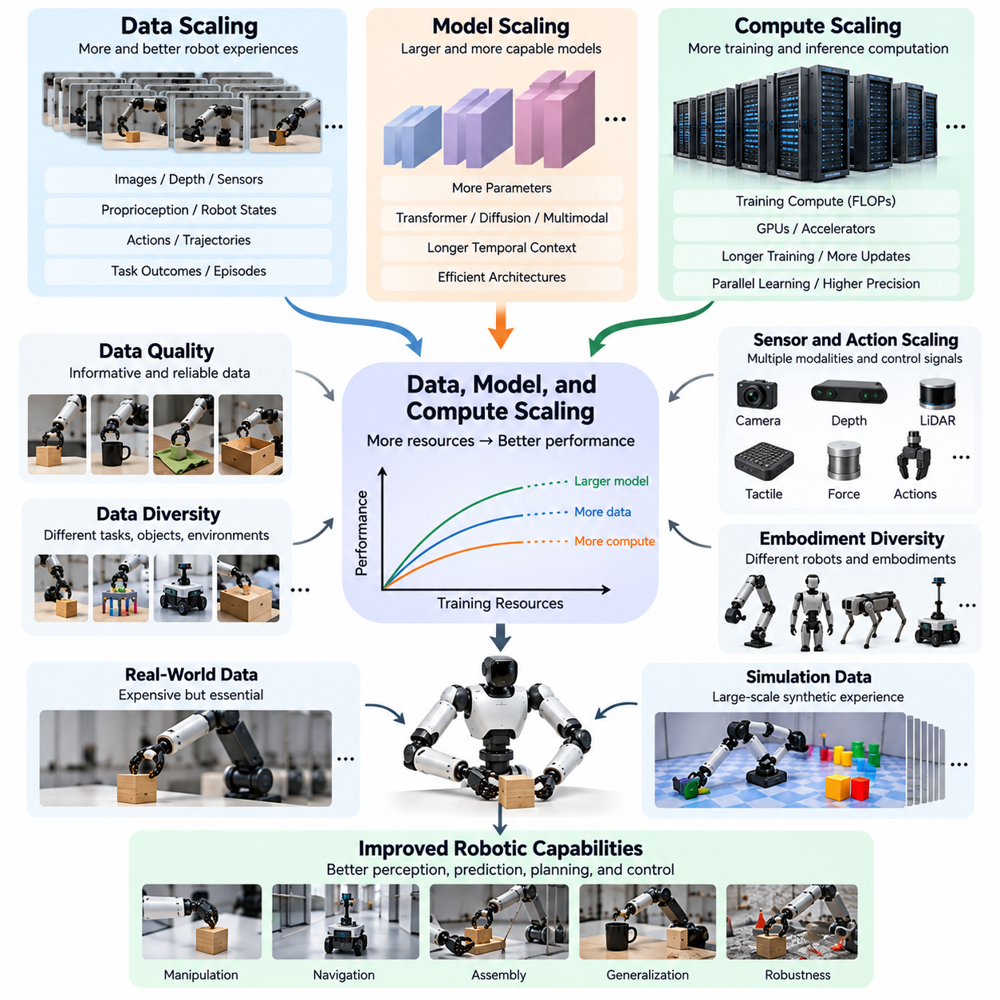{width="7.268055555555556in" height="7.268055555555556in"}

Data, model capacity, and computational resources form the three primary dimensions of artificial intelligence scaling. Data determines the range of experiences available for learning, model capacity determines the complexity of relationships that can be represented, and compute determines how extensively the model can be optimized. In Physical AI, these dimensions interact to influence perception, prediction, planning, and robotic control performance.

Data scaling examines how increasing the amount of training information affects learned capabilities. For robotic systems, training data includes camera images, depth measurements, proprioceptive states, control commands, object interactions, and task outcomes. Unlike static datasets, robotic data often consists of temporally connected trajectories. Increasing dataset size can improve performance when additional experiences contribute meaningful information.

The relationship between dataset size and model performance is frequently described through empirical scaling curves. Within certain experimental ranges, prediction error or training loss may decrease approximately according to a power-law relationship as data volume increases. However, these relationships depend on dataset quality, model architecture, and evaluation conditions. Physical AI requires additional validation because lower prediction loss does not always imply better robotic task execution.

Robot episodes represent a fundamental unit of data scaling. An episode typically contains observations, actions, state transitions, and outcomes associated with a particular interaction or task attempt. Increasing the number of episodes expands the available behavioral experience, but episode duration, task difficulty, and environmental variation also matter. Therefore, episode count alone is an incomplete measure of effective training data.

Model scaling investigates how increasing neural network capacity affects the ability to learn complex physical relationships. Larger models can potentially represent richer visual features, longer temporal dependencies, and more sophisticated action policies. Transformer architectures, diffusion-based policies, and multimodal networks provide different approaches to increasing representational capacity. Their effectiveness depends on sufficient data and appropriate training objectives.

Model parameter count is commonly used as a measure of network size, but it does not fully describe useful capacity. Architecture, attention mechanisms, temporal context, and action representation influence how efficiently parameters support robotic learning. A smaller model designed for structured control may outperform a larger general-purpose network on specific tasks. Consequently, scaling comparisons must consider architectural efficiency alongside parameter growth.

Compute scaling concerns the computational resources required to train and operate increasingly capable models. Training computation depends on parameter count, processed training examples, sequence length, numerical precision, and optimization procedures. Graphics processing units and specialized accelerators enable large-scale parallel learning. Nevertheless, increased computational expenditure improves performance only when the training process uses those resources effectively.

The interaction among data, model size, and compute creates important resource allocation problems. A large model trained on insufficient data may overfit or fail to utilize its representational capacity. Conversely, a small model trained on enormous datasets may reach a capacity limit. Compute-optimal scaling seeks an effective balance between model parameters and training information under a fixed computational budget.

Physical AI complicates compute-optimal scaling because training examples differ substantially in cost and information content. A short grasping demonstration may contain relatively few observations, while a long navigation episode includes extensive temporal dependencies. High-resolution video, tactile sensing, and multiple camera streams increase processing requirements. Computational budgets must therefore account for the structure and complexity of robotic experiences.

Data quality changes the effective relationship between dataset volume and learning performance. Repeated trajectories collected under identical conditions may provide diminishing additional information. In contrast, carefully selected examples involving difficult objects, unusual environments, or corrective actions can improve coverage. Quality-adjusted scaling considers whether new data contributes useful learning signals rather than merely increasing storage volume.

Data diversity is particularly important when training general-purpose robotic models. A dataset containing many manipulation episodes may still provide limited generalization if all episodes involve similar objects and workspaces. Expanding task categories, environmental conditions, and interaction strategies can expose models to broader physical relationships. However, diversity must remain compatible with the intended learning objectives and robot capabilities.

Model scaling also influences the integration of multiple sensor modalities. Vision-language-action models combine visual observations, linguistic instructions, and robotic action representations within shared learning architectures. Increasing model capacity may support more complex cross-modal relationships. However, successful multimodal scaling requires synchronized data, consistent representations, and training objectives that connect perception with executable behavior.

Temporal context introduces another relationship between model capacity and computational demand. Robotic decisions often depend on previous observations, earlier actions, and evolving environmental states. Increasing the context window can help models capture long-term dependencies, but it also increases memory consumption and processing cost. Efficient temporal representations are therefore essential for scaling models that perform extended physical tasks.

Pretraining provides an approach for utilizing large and diverse datasets before adapting models to particular robotic applications. Broad pretraining can establish reusable representations of objects, motion, and task relationships. Fine-tuning then specializes these representations using smaller task-specific datasets. The effectiveness of this strategy depends on the relevance of pretraining experiences and the compatibility between source and target environments.

Synthetic data can reduce some limitations associated with physical data collection. Simulation environments generate trajectories through controlled variations in objects, robot configurations, and environmental parameters. Large synthetic datasets may support extensive training without requiring equivalent real-world interaction time. However, scaling synthetic data must consider simulation fidelity and whether learned behaviors transfer successfully to physical hardware.

The combination of real and synthetic data creates a mixture optimization problem. Real-world trajectories provide direct evidence of physical interactions, while simulated trajectories can increase scenario coverage at lower marginal collection cost. Human demonstrations may contribute additional behavioral knowledge. Selecting effective proportions among these sources requires empirical evaluation because their relative usefulness depends on the target task and model.

Training compute must also be distinguished from inference compute. Training computation supports parameter optimization across datasets, whereas inference computation produces predictions and actions during operation. Large models may achieve improved capabilities but require more memory, processing power, and energy during deployment. Physical AI systems must satisfy real-time constraints, making inference efficiency an important consideration in model scaling.

Edge computing platforms introduce practical limitations on deployable model size. Mobile robots, manipulators, and autonomous machines often operate with restricted electrical power, thermal capacity, and onboard processing resources. Techniques such as quantization, pruning, distillation, and efficient attention can reduce inference requirements. These methods allow developers to pursue larger training models while maintaining practical deployment performance.

Scaling experiments should measure more than training loss or benchmark prediction accuracy. Robotic performance must be evaluated through task success rates, completion time, trajectory stability, intervention frequency, and recovery behavior. A model that achieves lower prediction error may still produce unsafe or ineffective physical actions. Consequently, empirical scaling curves should connect computational investment with measurable improvements in deployed robotic capabilities.

Diminishing returns emerge when additional data, parameters, or computation provide progressively smaller performance gains. Such behavior may indicate limited dataset diversity, insufficient model capacity, optimization inefficiency, or task-specific performance ceilings. Identifying these limitations helps determine whether further investment should expand data collection, improve training methods, modify architectures, or address hardware constraints.

A practical scaling study trains several model configurations using systematically varied dataset sizes and computational budgets. Each configuration is evaluated under consistent conditions to estimate performance trends. Researchers can then compare resource efficiency and identify promising operating regions. Reliable conclusions require repeated measurements, carefully controlled datasets, and evaluation environments that distinguish memorization from genuine generalization.

The economic implications of scaling are especially significant in Physical AI because data acquisition and computation have different cost structures. Collecting additional robot trajectories may require operators, equipment, maintenance, and physical operating time. Increasing model capacity may instead require accelerator infrastructure and greater energy consumption. Resource allocation should therefore consider total development cost rather than computational expenditure alone.

Data, model, and compute scaling ultimately form an interconnected optimization framework for Physical AI development. Increasing one dimension without considering the others can produce inefficient learning or limited capability improvements. Effective scaling requires coordinated investment in informative data, suitable model architectures, computational efficiency, and rigorous physical evaluation. This balance provides the foundation for developing increasingly capable, adaptable, and reliable robotic intelligence.

데이터(Data), 모델 용량(Model Capacity), 계산 자원(Computational Resources)은 인공지능 스케일링(Artificial Intelligence Scaling)의 세 가지 주요 차원을 구성합니다. 데이터는 학습에 활용할 수 있는 경험의 범위를 결정하고, 모델 용량은 표현할 수 있는 관계의 복잡성을 결정하며, 계산 자원은 모델을 얼마나 광범위하게 최적화할 수 있는지를 결정합니다. 피지컬 AI(Physical AI)에서 이러한 차원들은 상호작용하면서 인식(Perception), 예측(Prediction), 계획(Planning), 로봇 제어 성능(Robotic Control Performance)에 영향을 미칩니다.

데이터 스케일링(Data Scaling)은 학습 정보(Training Information)의 양을 증가시키는 것이 학습된 능력(Learned Capabilities)에 어떤 영향을 미치는지 분석합니다. 로봇 시스템(Robotic Systems)의 학습 데이터에는 카메라 영상(Camera Images), 깊이 측정값(Depth Measurements), 고유수용성 상태(Proprioceptive States), 제어 명령(Control Commands), 물체 상호작용(Object Interactions), 작업 결과(Task Outcomes)가 포함됩니다. 정적 데이터셋(Static Datasets)과 달리 로봇 데이터는 시간적으로 연결된 궤적(Trajectories)으로 구성되는 경우가 많습니다. 추가적인 경험이 의미 있는 정보를 제공한다면 데이터셋 크기를 늘리는 것이 성능 향상으로 이어질 수 있습니다.

데이터셋 크기(Dataset Size)와 모델 성능(Model Performance) 사이의 관계는 실증적 스케일링 곡선(Empirical Scaling Curves)을 통해 설명되는 경우가 많습니다. 특정 실험 범위에서는 데이터 양이 증가함에 따라 예측 오차(Prediction Error)나 학습 손실(Training Loss)이 멱법칙 관계(Power-Law Relationship)에 근사하여 감소할 수 있습니다. 그러나 이러한 관계는 데이터셋 품질(Dataset Quality), 모델 아키텍처(Model Architecture), 평가 조건(Evaluation Conditions)에 따라 달라집니다. 피지컬 AI에서는 예측 손실 감소가 반드시 더 나은 로봇 작업 수행으로 이어지지는 않으므로 추가적인 검증이 필요합니다.

로봇 에피소드(Robot Episodes)는 데이터 스케일링의 기본 단위입니다. 하나의 에피소드(Episode)는 일반적으로 특정 상호작용이나 작업 시도(Task Attempt)와 관련된 관측(Observations), 행동(Actions), 상태 전이(State Transitions), 결과(Outcomes)를 포함합니다. 에피소드 수를 증가시키면 활용 가능한 행동 경험(Behavioral Experience)이 확장되지만 에피소드 지속 시간(Episode Duration), 작업 난이도(Task Difficulty), 환경 변화(Environmental Variation) 역시 중요합니다. 따라서 에피소드 수만으로는 유효 학습 데이터(Effective Training Data)를 완전하게 측정할 수 없습니다.

모델 스케일링(Model Scaling)은 신경망 용량(Neural Network Capacity)을 증가시키는 것이 복잡한 물리적 관계(Physical Relationships)를 학습하는 능력에 어떤 영향을 미치는지 연구합니다. 더 큰 모델은 풍부한 시각적 특징(Visual Features), 긴 시간적 의존성(Temporal Dependencies), 정교한 행동 정책(Action Policies)을 표현할 가능성이 있습니다. 트랜스포머 아키텍처(Transformer Architectures), 확산 기반 정책(Diffusion-Based Policies), 멀티모달 네트워크(Multimodal Networks)는 표현 용량(Representational Capacity)을 확장하기 위한 서로 다른 접근법을 제공합니다. 이러한 방법의 효과는 충분한 데이터와 적절한 학습 목표(Training Objectives)에 달려 있습니다.

모델 매개변수 수(Model Parameter Count)는 일반적으로 네트워크 크기(Network Size)를 측정하는 지표로 사용되지만 실제로 유용한 모델 용량(Useful Capacity)을 완전히 설명하지는 못합니다. 아키텍처(Architecture), 어텐션 메커니즘(Attention Mechanisms), 시간적 문맥(Temporal Context), 행동 표현(Action Representation)은 매개변수가 로봇 학습을 얼마나 효율적으로 지원하는지에 영향을 미칩니다. 구조화된 제어(Structured Control)에 맞게 설계된 작은 모델이 특정 작업에서는 더 큰 범용 네트워크(General-Purpose Network)보다 우수한 성능을 보일 수 있습니다. 따라서 스케일링 비교에서는 매개변수 증가와 함께 아키텍처 효율성(Architectural Efficiency)을 고려해야 합니다.

계산 스케일링(Compute Scaling)은 점점 더 높은 성능을 갖는 모델을 학습하고 운영하는 데 필요한 계산 자원(Computational Resources)을 다룹니다. 학습 연산량(Training Computation)은 매개변수 수(Parameter Count), 처리된 학습 예제(Training Examples), 시퀀스 길이(Sequence Length), 수치 정밀도(Numerical Precision), 최적화 절차(Optimization Procedures)에 따라 달라집니다. 그래픽 처리 장치(Graphics Processing Units, GPUs)와 특수 목적 가속기(Specialized Accelerators)는 대규모 병렬 학습(Large-Scale Parallel Learning)을 가능하게 합니다. 그러나 계산 자원을 효과적으로 활용하는 학습 과정이 뒷받침될 때에만 계산량 증가가 성능 향상으로 이어집니다.

데이터(Data), 모델 크기(Model Size), 계산 자원(Compute) 사이의 상호작용은 중요한 자원 배분 문제(Resource Allocation Problems)를 발생시킵니다. 데이터가 부족한 상태에서 학습된 대형 모델(Large Model)은 과적합(Overfitting)이 발생하거나 표현 용량(Representational Capacity)을 충분히 활용하지 못할 수 있습니다. 반대로 방대한 데이터셋으로 학습된 작은 모델은 용량 한계(Capacity Limit)에 도달할 수 있습니다. 계산 최적 스케일링(Compute-Optimal Scaling)은 고정된 계산 예산(Computational Budget)에서 모델 매개변수와 학습 정보 사이의 효과적인 균형을 찾는 것을 목표로 합니다.

피지컬 AI에서는 학습 예제(Training Examples)마다 비용과 정보량이 크게 다르기 때문에 계산 최적 스케일링이 더욱 복잡해집니다. 짧은 파지 시연(Grasping Demonstration)은 비교적 적은 관측값을 포함할 수 있지만 긴 내비게이션 에피소드(Navigation Episode)는 광범위한 시간적 의존성(Temporal Dependencies)을 포함합니다. 고해상도 영상(High-Resolution Video), 촉각 센싱(Tactile Sensing), 다중 카메라 스트림(Multiple Camera Streams)은 처리 요구량을 증가시킵니다. 따라서 계산 예산은 로봇 경험(Robotic Experiences)의 구조와 복잡성을 반영해야 합니다.

데이터 품질(Data Quality)은 데이터셋 규모와 학습 성능(Learning Performance) 사이의 실질적인 관계를 변화시킵니다. 동일한 조건에서 수집된 반복적인 궤적(Repetitive Trajectories)은 추가적인 정보 제공 효과가 점차 감소할 수 있습니다. 반면 어려운 물체(Difficult Objects), 특이한 환경(Unusual Environments), 교정 행동(Corrective Actions)을 포함하도록 신중하게 선택된 예제는 데이터 범위(Coverage)를 개선할 수 있습니다. 품질 조정 스케일링(Quality-Adjusted Scaling)은 새로운 데이터가 단순히 저장 용량(Storage Volume)을 늘리는 것이 아니라 유용한 학습 신호(Learning Signals)를 제공하는지 고려합니다.

데이터 다양성(Data Diversity)은 범용 로봇 모델(General-Purpose Robotic Models)을 학습할 때 특히 중요합니다. 많은 조작 에피소드(Manipulation Episodes)를 포함하는 데이터셋이라도 모든 에피소드가 유사한 물체와 작업 공간(Workspaces)을 다룬다면 일반화(Generalization)는 제한될 수 있습니다. 작업 범주(Task Categories), 환경 조건(Environmental Conditions), 상호작용 전략(Interaction Strategies)을 확장하면 모델이 더 폭넓은 물리적 관계(Physical Relationships)를 학습할 수 있습니다. 그러나 다양성은 의도된 학습 목표(Learning Objectives)와 로봇 능력(Robot Capabilities)에 부합해야 합니다.

모델 스케일링은 여러 센서 모달리티(Sensor Modalities)의 통합에도 영향을 미칩니다. 시각-언어-행동 모델(Vision-Language-Action Models, VLA)은 시각적 관측(Visual Observations), 언어 명령(Linguistic Instructions), 로봇 행동 표현(Robotic Action Representations)을 공유 학습 아키텍처(Shared Learning Architectures) 내에서 결합합니다. 모델 용량이 증가하면 더욱 복잡한 교차 모달 관계(Cross-Modal Relationships)를 표현할 수 있습니다. 그러나 성공적인 멀티모달 스케일링(Multimodal Scaling)을 위해서는 동기화된 데이터(Synchronized Data), 일관된 표현(Consistent Representations), 인식과 실행 가능한 행동을 연결하는 학습 목표가 필요합니다.

시간적 문맥(Temporal Context)은 모델 용량과 계산 요구량 사이에 또 다른 관계를 형성합니다. 로봇의 의사결정(Robotic Decision-Making)은 이전 관측(Previous Observations), 과거 행동(Earlier Actions), 변화하는 환경 상태(Evolving Environmental States)에 의존하는 경우가 많습니다. 문맥 창(Context Window)을 확장하면 모델이 장기 의존성(Long-Term Dependencies)을 포착하는 데 도움이 되지만 메모리 사용량(Memory Consumption)과 처리 비용(Processing Cost)도 증가합니다. 따라서 장시간 물리적 작업(Extended Physical Tasks)을 수행하는 모델을 확장하려면 효율적인 시간적 표현(Temporal Representations)이 필수적입니다.

사전학습(Pretraining)은 특정 로봇 응용 분야(Robotic Applications)에 모델을 적응시키기 전에 크고 다양한 데이터셋을 활용하는 접근법을 제공합니다. 광범위한 사전학습은 물체(Objects), 움직임(Motion), 작업 관계(Task Relationships)에 대한 재사용 가능한 표현(Reusable Representations)을 형성할 수 있습니다. 이후 미세조정(Fine-Tuning)은 더 작은 작업별 데이터셋(Task-Specific Datasets)을 사용하여 이러한 표현을 특화합니다. 이 전략의 효과는 사전학습 경험(Pretraining Experiences)의 관련성과 원본 환경(Source Environments) 및 대상 환경(Target Environments) 사이의 호환성(Compatibility)에 달려 있습니다.

합성 데이터(Synthetic Data)는 물리적 데이터 수집(Physical Data Collection)과 관련된 일부 제약을 완화할 수 있습니다. 시뮬레이션 환경(Simulation Environments)은 물체, 로봇 구성(Robot Configurations), 환경 매개변수(Environmental Parameters)를 통제된 방식으로 변화시키면서 궤적(Trajectories)을 생성합니다. 대규모 합성 데이터셋(Large Synthetic Datasets)은 동일한 수준의 실세계 상호작용 시간(Real-World Interaction Time)을 요구하지 않으면서 광범위한 학습을 지원할 수 있습니다. 그러나 합성 데이터 스케일링에서는 시뮬레이션 충실도(Simulation Fidelity)와 학습된 행동이 실제 하드웨어(Physical Hardware)로 성공적으로 전이되는지를 고려해야 합니다.

실제 데이터(Real Data)와 합성 데이터(Synthetic Data)의 결합은 데이터 혼합 최적화 문제(Mixture Optimization Problem)를 발생시킵니다. 실세계 궤적(Real-World Trajectories)은 물리적 상호작용에 대한 직접적인 증거를 제공하는 반면 시뮬레이션 궤적(Simulated Trajectories)은 더 낮은 한계 수집 비용(Marginal Collection Cost)으로 시나리오 범위(Scenario Coverage)를 확장할 수 있습니다. 인간 시연(Human Demonstrations)은 추가적인 행동 지식(Behavioral Knowledge)을 제공할 수 있습니다. 이러한 데이터 원천의 효과적인 혼합 비율(Mixture Proportions)을 선택하려면 대상 작업(Target Task)과 모델에 따라 상대적 유용성이 달라지므로 실증적 평가(Empirical Evaluation)가 필요합니다.

학습 연산량(Training Compute)은 추론 연산량(Inference Compute)과 구분해야 합니다. 학습 연산은 데이터셋을 기반으로 매개변수 최적화(Parameter Optimization)를 수행하는 데 사용되며, 추론 연산은 실제 운영 중 예측(Predictions)과 행동(Actions)을 생성하는 데 사용됩니다. 대형 모델은 향상된 능력을 제공할 수 있지만 배포(Deployment) 과정에서 더 많은 메모리(Memory), 처리 능력(Processing Power), 에너지(Energy)를 요구할 수 있습니다. 피지컬 AI 시스템은 실시간 제약(Real-Time Constraints)을 충족해야 하므로 추론 효율성(Inference Efficiency)은 모델 스케일링에서 중요한 고려사항입니다.

엣지 컴퓨팅 플랫폼(Edge Computing Platforms)은 배포 가능한 모델 크기(Deployable Model Size)에 실질적인 제약을 부과합니다. 모바일 로봇(Mobile Robots), 매니퓰레이터(Manipulators), 자율 기계(Autonomous Machines)는 제한된 전력(Electrical Power), 열 처리 용량(Thermal Capacity), 온보드 처리 자원(Onboard Processing Resources)으로 작동하는 경우가 많습니다. 양자화(Quantization), 가지치기(Pruning), 지식 증류(Distillation), 효율적인 어텐션(Efficient Attention)과 같은 기술은 추론 요구량(Inference Requirements)을 줄일 수 있습니다. 이러한 방법을 통해 개발자는 더 큰 학습 모델을 활용하면서도 실용적인 배포 성능(Deployment Performance)을 유지할 수 있습니다.

스케일링 실험(Scaling Experiments)에서는 학습 손실(Training Loss)이나 벤치마크 예측 정확도(Benchmark Prediction Accuracy) 이상의 지표를 측정해야 합니다. 로봇 성능(Robotic Performance)은 작업 성공률(Task Success Rates), 완료 시간(Completion Time), 궤적 안정성(Trajectory Stability), 개입 빈도(Intervention Frequency), 복구 행동(Recovery Behavior)을 통해 평가해야 합니다. 예측 오차가 낮은 모델이라도 안전하지 않거나 비효율적인 물리적 행동을 생성할 수 있습니다. 따라서 실증적 스케일링 곡선(Empirical Scaling Curves)은 계산 투자(Computational Investment)를 실제 배포된 로봇 능력(Deployed Robotic Capabilities)의 측정 가능한 향상과 연결해야 합니다.

수익 체감(Diminishing Returns)은 추가적인 데이터, 매개변수, 계산 자원이 점차 작은 성능 향상만을 제공할 때 나타납니다. 이러한 현상은 제한된 데이터셋 다양성(Limited Dataset Diversity), 불충분한 모델 용량(Insufficient Model Capacity), 최적화 비효율성(Optimization Inefficiency), 작업별 성능 상한(Task-Specific Performance Ceilings)을 나타낼 수 있습니다. 이러한 한계를 식별하면 추가 투자를 데이터 수집(Data Collection) 확대, 학습 방법(Training Methods) 개선, 아키텍처(Architectures) 수정, 하드웨어 제약(Hardware Constraints) 해결 중 어디에 집중해야 하는지 결정하는 데 도움이 됩니다.

실용적인 스케일링 연구(Practical Scaling Study)는 데이터셋 크기(Dataset Sizes)와 계산 예산(Computational Budgets)을 체계적으로 변화시키면서 여러 모델 구성(Model Configurations)을 학습합니다. 각 구성은 일관된 조건(Consistent Conditions)에서 평가되어 성능 추세(Performance Trends)를 추정합니다. 이후 연구자들은 자원 효율성(Resource Efficiency)을 비교하고 유망한 운영 영역(Operating Regions)을 식별할 수 있습니다. 신뢰할 수 있는 결론을 얻으려면 반복 측정(Repeated Measurements), 신중하게 통제된 데이터셋(Controlled Datasets), 암기(Memorization)와 진정한 일반화(Genuine Generalization)를 구분할 수 있는 평가 환경(Evaluation Environments)이 필요합니다.

스케일링의 경제적 영향(Economic Implications)은 데이터 획득(Data Acquisition)과 계산 자원(Compute)의 비용 구조(Cost Structures)가 서로 다르기 때문에 피지컬 AI에서 특히 중요합니다. 추가적인 로봇 궤적(Robot Trajectories)을 수집하려면 작업자(Operators), 장비(Equipment), 유지보수(Maintenance), 물리적 운영 시간(Physical Operating Time)이 필요할 수 있습니다. 반면 모델 용량(Model Capacity)을 증가시키려면 가속기 인프라(Accelerator Infrastructure)와 더 많은 에너지 소비(Energy Consumption)가 필요할 수 있습니다. 따라서 자원 배분(Resource Allocation)은 계산 비용만이 아니라 전체 개발 비용(Total Development Cost)을 고려해야 합니다.

궁극적으로 데이터 스케일링(Data Scaling), 모델 스케일링(Model Scaling), 계산 스케일링(Compute Scaling)은 피지컬 AI 개발을 위한 상호 연결된 최적화 프레임워크(Optimization Framework)를 구성합니다. 다른 차원을 고려하지 않고 하나의 차원만 확장하면 비효율적인 학습(Inefficient Learning)이나 제한적인 능력 향상(Limited Capability Improvements)이 발생할 수 있습니다. 효과적인 스케일링(Effective Scaling)을 위해서는 정보 가치가 높은 데이터(Informative Data), 적절한 모델 아키텍처(Model Architectures), 계산 효율성(Computational Efficiency), 엄격한 물리적 평가(Rigorous Physical Evaluation)에 대한 조정된 투자가 필요합니다. 이러한 균형은 점점 더 높은 능력(Capability), 적응성(Adaptability), 신뢰성(Reliability)을 갖춘 로봇 지능(Robotic Intelligence)을 개발하기 위한 기반을 제공합니다.

##  

## 07.03. Why Physical AI Scaling is Different

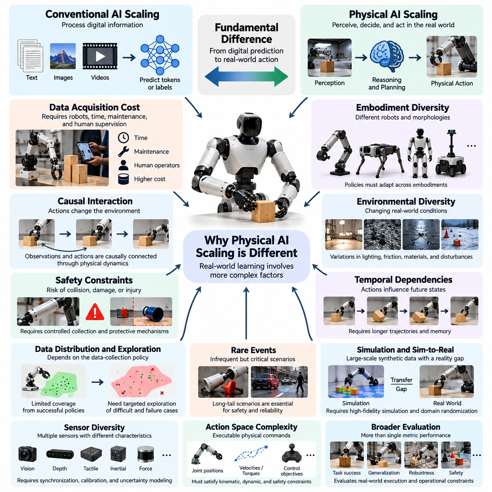{width="7.268055555555556in" height="7.268055555555556in"}

Physical AI scaling differs fundamentally from conventional artificial intelligence scaling because learning must produce reliable behavior in the physical world rather than accurate predictions in digital environments. Language and image models primarily process information, while embodied systems must perceive, decide, and act through physical mechanisms. Their performance depends on the interaction among learned intelligence, hardware capabilities, environmental dynamics, and operational constraints.

In conventional AI, training examples can often be collected, duplicated, processed, and evaluated without affecting the external environment. Physical AI data emerges from interactions involving motion, contact, force, and changing physical states. Every action may alter the environment and influence subsequent observations. Consequently, robotic learning requires understanding causal relationships between actions and outcomes rather than relying exclusively on statistical correlations.

The cost of acquiring training data represents one of the most significant differences. Digital datasets can often be expanded through automated collection and processing, whereas robotic demonstrations require physical platforms, operating time, maintenance, and sometimes human supervision. A single manipulation episode may involve preparation, execution, resetting, and verification. These operational requirements make physical data scaling considerably more expensive and time-consuming.

Physical interaction introduces safety constraints that are largely absent from conventional offline learning. Robots can collide with obstacles, damage objects, injure people, or destabilize themselves during exploration. Collecting diverse experiences therefore requires controlled procedures and protective mechanisms. Unsafe actions cannot simply be treated as inexpensive training failures, making unrestricted exploration impractical for many real-world robotic applications.

Embodiment diversity creates another fundamental scaling challenge. Robots differ in morphology, actuator arrangements, degrees of freedom, sensor placement, and control interfaces. A policy trained on one manipulator may not directly operate another robot with different kinematic properties. Scaling across embodiments requires representations that preserve transferable task knowledge while adapting actions to the mechanical capabilities and constraints of each platform.

Physical environments also exhibit continuous variability that is difficult to capture completely. Lighting, friction, surface geometry, material properties, object placement, and external disturbances can change unexpectedly. Even apparently identical tasks may produce different outcomes because of subtle environmental differences. As a result, Physical AI scaling must emphasize environmental coverage and robustness rather than assuming that larger datasets automatically provide sufficient generalization.

Temporal dependencies are especially important in robotic learning because actions influence future states. A grasping error may cause an object to slip, while an incorrect navigation decision may lead to an unrecoverable position. Successful behavior requires maintaining information about previous actions, current observations, and expected consequences. Scaling therefore involves longer trajectories and structured interaction histories, not merely increasing the number of independent examples.

The distribution of robotic data is strongly influenced by the behavior of the data-collection policy. Unlike passive digital datasets, robot observations depend on which actions the robot or operator chooses to execute. Successful policies may repeatedly visit familiar states while avoiding difficult situations. This creates coverage limitations and motivates active exploration, corrective demonstrations, and targeted collection of unfamiliar or failure-prone scenarios.

Rare events present a particularly difficult scaling problem. Industrial robots and autonomous vehicles may operate successfully for long periods while encountering occasional hazardous or unusual situations. These events are statistically infrequent but operationally critical. Simply collecting more routine data may not provide sufficient examples. Effective scaling requires deliberate identification, simulation, and evaluation of long-tail scenarios that influence safety and reliability.

Simulation offers an important mechanism for overcoming physical data limitations, but it introduces a distinctive transfer challenge. Simulated environments can generate large numbers of interactions efficiently, yet their dynamics and sensory outputs may differ from reality. Increasing synthetic data volume does not guarantee improved real-world behavior. Physical AI scaling must therefore consider simulation fidelity, domain randomization, and empirical sim-to-real transfer performance.

Sensor diversity further distinguishes embodied learning from conventional model scaling. Robots combine visual, depth, tactile, inertial, proprioceptive, and sometimes force measurements to estimate physical states. These modalities operate at different frequencies and exhibit different noise characteristics. Scaling multimodal robotic datasets requires accurate synchronization, calibration, and representation of sensor uncertainty to preserve meaningful relationships between observations and actions.

Action spaces introduce additional complexity because robotic outputs must correspond to executable physical commands. Language models generate symbolic tokens, whereas robots may produce joint positions, velocities, torques, trajectories, or high-level control objectives. These actions must satisfy kinematic, dynamic, and safety constraints. Consequently, larger models must learn not only appropriate decisions but also physically feasible and temporally consistent execution.

Real-time operation creates another limitation on model scaling. A robotic controller must often respond within strict deadlines to maintain stability and avoid collisions. Increasing model parameters or inference computation may improve prediction quality while introducing unacceptable latency. Physical AI systems therefore require careful coordination between model capacity, computational hardware, control frequency, and deployment architecture.

The relationship between model accuracy and task success is also more complex in Physical AI. A small prediction error can produce a large physical consequence when operating near obstacles or manipulating fragile objects. Conversely, some prediction errors may have little practical effect when control policies are robust. Scaling evaluations must therefore examine complete task outcomes, trajectory quality, recovery behavior, and operational safety rather than relying exclusively on prediction loss.

Long-horizon tasks amplify these differences because successful execution requires many coordinated decisions. A robot performing assembly, inspection, or household assistance may need to complete numerous dependent subtasks. Errors can accumulate, and a single failure may invalidate earlier progress. Scaling robotic intelligence consequently requires improvements in planning, memory, feedback control, and error recovery alongside improvements in individual action prediction.

Hardware limitations establish performance boundaries that additional training cannot always overcome. A robot with insufficient actuator torque cannot lift an object beyond its mechanical capability, regardless of model size. Limited sensor resolution, restricted reachability, battery capacity, and thermal constraints similarly affect achievable behavior. Physical AI scaling must distinguish limitations arising from learning from those imposed by the physical platform.

Cross-robot data sharing introduces opportunities and difficulties for large-scale learning. Data collected from multiple robots can increase task coverage and behavioral diversity, but differences in coordinate systems, sensor configurations, control frequencies, and action representations complicate integration. Effective scaling requires standardized metadata, compatible representations, and methods for separating transferable knowledge from embodiment-specific behavior.

Data quality has an unusually strong influence on robotic scaling because incorrect action labels or misaligned sensor measurements can directly teach unsafe behavior. Missing timestamps, inaccurate calibration, inconsistent demonstrations, and corrupted trajectories may undermine learning. Increasing dataset volume without addressing these problems can reduce effective information content. Robust data engines must therefore integrate validation, filtering, and quality-aware sampling.

Physical AI scaling also depends on feedback from deployed systems. Robots operating in factories, warehouses, farms, and public environments encounter situations that cannot be fully anticipated during development. Field observations reveal weaknesses in perception, planning, and control. These experiences can support iterative improvement through data collection, retraining, evaluation, and controlled redeployment, creating a fleet-scale learning process.

Economic constraints further differentiate Physical AI scaling because expanding robotic datasets often requires additional machines, facilities, operators, and maintenance resources. Computational infrastructure remains important, but physical experimentation introduces substantial operational costs. Efficient development must balance real-world data acquisition, simulation, model training, and deployment expenses while prioritizing improvements that deliver measurable operational value.

Another important distinction is that robotic capabilities may not improve smoothly with increasing training resources. Performance can remain limited until a model acquires sufficient coverage of particular interactions or learns reliable coordination among multiple subtasks. Apparent capability transitions may depend on task structure, evaluation thresholds, and hardware conditions. Such behavior requires careful empirical investigation rather than assuming universal scaling relationships.

Ultimately, Physical AI scaling is a multidimensional engineering problem involving data, models, computation, embodiment, environments, and physical interaction. Larger datasets and networks remain valuable, but their benefits depend on coverage, transferability, hardware compatibility, and real-world reliability. Understanding these differences is essential for designing scaling strategies that transform increasing learning resources into safe, adaptable, and effective robotic capabilities.

피지컬 AI 스케일링(Physical AI Scaling)은 학습이 디지털 환경(Digital Environments)에서 정확한 예측을 생성하는 것을 넘어 물리적 세계(Physical World)에서 신뢰할 수 있는 행동(Reliable Behavior)을 만들어야 한다는 점에서 기존 인공지능 스케일링(Conventional Artificial Intelligence Scaling)과 근본적으로 다릅니다. 언어 모델(Language Models)과 이미지 모델(Image Models)은 주로 정보를 처리하지만, 체화 시스템(Embodied Systems)은 물리적 메커니즘(Physical Mechanisms)을 통해 인식하고 판단하며 행동해야 합니다. 이러한 시스템의 성능은 학습된 지능(Learned Intelligence), 하드웨어 성능(Hardware Capabilities), 환경 동역학(Environmental Dynamics), 운영 제약(Operational Constraints) 사이의 상호작용에 따라 결정됩니다.

기존 인공지능(Conventional AI)에서는 학습 예제(Training Examples)를 수집하고 복제하며 처리하고 평가하는 과정이 외부 환경(External Environment)에 영향을 주지 않는 경우가 많습니다. 반면 피지컬 AI 데이터(Physical AI Data)는 움직임(Motion), 접촉(Contact), 힘(Force), 변화하는 물리적 상태(Physical States)를 포함하는 상호작용에서 생성됩니다. 모든 행동(Action)은 환경을 변화시키고 이후 관측(Subsequent Observations)에 영향을 미칠 수 있습니다. 따라서 로봇 학습(Robotic Learning)은 통계적 상관관계(Statistical Correlations)에만 의존하지 않고 행동과 결과 사이의 인과관계(Causal Relationships)를 이해해야 합니다.

학습 데이터 획득 비용(Training Data Acquisition Cost)은 가장 중요한 차이점 중 하나입니다. 디지털 데이터셋(Digital Datasets)은 자동화된 수집과 처리(Automated Collection and Processing)를 통해 확장할 수 있는 경우가 많지만, 로봇 시연(Robotic Demonstrations)에는 물리적 플랫폼(Physical Platforms), 운영 시간(Operating Time), 유지보수(Maintenance), 경우에 따라 인간의 감독(Human Supervision)이 필요합니다. 하나의 조작 에피소드(Manipulation Episode)에도 준비(Preparation), 실행(Execution), 초기화(Resetting), 검증(Verification)이 포함될 수 있습니다. 이러한 운영 요구사항으로 인해 물리적 데이터 스케일링(Physical Data Scaling)은 훨씬 많은 비용과 시간을 필요로 합니다.

물리적 상호작용(Physical Interaction)은 기존의 오프라인 학습(Offline Learning)에서는 상대적으로 중요성이 낮은 안전 제약(Safety Constraints)을 발생시킵니다. 로봇은 탐색(Exploration) 과정에서 장애물과 충돌하거나 물체를 손상시키고 사람에게 상해를 입히거나 자체적으로 불안정해질 수 있습니다. 따라서 다양한 경험을 수집하려면 통제된 절차(Controlled Procedures)와 보호 메커니즘(Protective Mechanisms)이 필요합니다. 안전하지 않은 행동을 단순히 비용이 적게 드는 학습 실패(Training Failures)로 취급할 수 없으므로 많은 실세계 로봇 응용 분야(Real-World Robotic Applications)에서 무제한 탐색(Unrestricted Exploration)은 실용적이지 않습니다.

체화 다양성(Embodiment Diversity)은 또 다른 근본적인 스케일링 과제(Scaling Challenge)를 발생시킵니다. 로봇은 형태(Morphology), 액추에이터 배치(Actuator Arrangements), 자유도(Degrees of Freedom), 센서 배치(Sensor Placement), 제어 인터페이스(Control Interfaces)가 서로 다릅니다. 하나의 매니퓰레이터(Manipulator)에서 학습된 정책(Policy)은 운동학적 특성(Kinematic Properties)이 다른 로봇에서 직접 작동하지 않을 수 있습니다. 체화 간 스케일링(Cross-Embodiment Scaling)을 위해서는 전이 가능한 작업 지식(Transferable Task Knowledge)을 유지하면서 각 플랫폼의 기계적 성능(Mechanical Capabilities)과 제약에 맞게 행동을 적응시키는 표현(Representations)이 필요합니다.

물리적 환경(Physical Environments)은 완전하게 포착하기 어려운 연속적인 변동성(Continuous Variability)을 나타냅니다. 조명(Lighting), 마찰(Friction), 표면 형상(Surface Geometry), 재료 특성(Material Properties), 물체 배치(Object Placement), 외부 교란(External Disturbances)은 예기치 않게 변할 수 있습니다. 겉보기에 동일한 작업이라도 미세한 환경 차이(Environmental Differences)로 인해 서로 다른 결과가 발생할 수 있습니다. 따라서 피지컬 AI 스케일링은 단순히 데이터셋을 확대하면 충분한 일반화(Generalization)가 이루어진다고 가정하기보다 환경 범위(Environmental Coverage)와 강건성(Robustness)을 강조해야 합니다.

시간적 의존성(Temporal Dependencies)은 행동이 미래 상태(Future States)에 영향을 미치기 때문에 로봇 학습에서 특히 중요합니다. 파지 오류(Grasping Error)는 물체의 미끄러짐(Object Slippage)을 유발할 수 있으며, 잘못된 내비게이션 결정(Navigation Decision)은 복구할 수 없는 위치(Unrecoverable Position)로 이어질 수 있습니다. 성공적인 행동을 위해서는 이전 행동(Previous Actions), 현재 관측(Current Observations), 예상 결과(Expected Consequences)에 관한 정보를 유지해야 합니다. 따라서 스케일링은 독립적인 예제(Independent Examples)의 수를 증가시키는 것뿐만 아니라 더 긴 궤적(Longer Trajectories)과 구조화된 상호작용 이력(Structured Interaction Histories)을 포함합니다.

로봇 데이터 분포(Robotic Data Distribution)는 데이터 수집 정책(Data-Collection Policy)의 행동에 크게 영향을 받습니다. 수동적으로 수집되는 디지털 데이터셋(Passive Digital Datasets)과 달리 로봇 관측(Robot Observations)은 로봇이나 작업자가 어떤 행동을 실행하도록 선택하는지에 따라 달라집니다. 성공적인 정책(Successful Policies)은 어려운 상황을 피하면서 익숙한 상태(Familiar States)를 반복적으로 방문할 수 있습니다. 이는 데이터 범위의 한계(Coverage Limitations)를 발생시키며, 능동 탐색(Active Exploration), 교정 시연(Corrective Demonstrations), 익숙하지 않거나 실패 가능성이 높은 시나리오(Failure-Prone Scenarios)를 대상으로 하는 데이터 수집의 필요성을 높입니다.

희귀 사건(Rare Events)은 특히 어려운 스케일링 문제를 제기합니다. 산업용 로봇(Industrial Robots)과 자율주행차(Autonomous Vehicles)는 장시간 성공적으로 작동하면서도 가끔 위험하거나 특이한 상황(Hazardous or Unusual Situations)에 직면할 수 있습니다. 이러한 사건은 통계적으로 드물지만 운영 측면에서는 매우 중요합니다. 일상적인 데이터(Routine Data)를 단순히 더 많이 수집하는 것만으로는 충분한 사례를 확보하지 못할 수 있습니다. 효과적인 스케일링을 위해서는 안전성(Safety)과 신뢰성(Reliability)에 영향을 미치는 롱테일 시나리오(Long-Tail Scenarios)를 의도적으로 식별하고 시뮬레이션하며 평가해야 합니다.

시뮬레이션(Simulation)은 물리적 데이터의 한계(Physical Data Limitations)를 극복하는 중요한 수단이지만 고유한 전이 과제(Transfer Challenge)를 발생시킵니다. 시뮬레이션 환경(Simulated Environments)은 대량의 상호작용을 효율적으로 생성할 수 있지만 동역학(Dynamics)과 센서 출력(Sensory Outputs)이 현실과 다를 수 있습니다. 합성 데이터 양(Synthetic Data Volume)을 증가시킨다고 해서 실세계 행동(Real-World Behavior)이 반드시 개선되는 것은 아닙니다. 따라서 피지컬 AI 스케일링에서는 시뮬레이션 충실도(Simulation Fidelity), 도메인 무작위화(Domain Randomization), 실증적인 시뮬레이션-현실 전이 성능(Sim-to-Real Transfer Performance)을 고려해야 합니다.

센서 다양성(Sensor Diversity)은 체화 학습(Embodied Learning)을 기존 모델 스케일링(Conventional Model Scaling)과 구분하는 또 다른 요소입니다. 로봇은 시각(Visual), 깊이(Depth), 촉각(Tactile), 관성(Inertial), 고유수용성(Proprioceptive), 경우에 따라 힘 측정값(Force Measurements)을 결합하여 물리적 상태(Physical States)를 추정합니다. 이러한 모달리티(Modalities)는 서로 다른 주파수(Frequencies)에서 작동하며 서로 다른 잡음 특성(Noise Characteristics)을 나타냅니다. 멀티모달 로봇 데이터셋(Multimodal Robotic Datasets)을 확장하려면 관측과 행동 사이의 의미 있는 관계를 유지하기 위해 정확한 동기화(Synchronization), 보정(Calibration), 센서 불확실성(Sensor Uncertainty)의 표현이 필요합니다.

행동 공간(Action Spaces)은 로봇 출력(Robotic Outputs)이 실행 가능한 물리적 명령(Executable Physical Commands)에 대응해야 하므로 추가적인 복잡성을 발생시킵니다. 언어 모델(Language Models)은 기호 토큰(Symbolic Tokens)을 생성하지만 로봇은 관절 위치(Joint Positions), 속도(Velocities), 토크(Torques), 궤적(Trajectories), 상위 수준 제어 목표(High-Level Control Objectives)를 생성할 수 있습니다. 이러한 행동은 운동학적 제약(Kinematic Constraints), 동역학적 제약(Dynamic Constraints), 안전 제약(Safety Constraints)을 충족해야 합니다. 따라서 더 큰 모델은 적절한 의사결정뿐만 아니라 물리적으로 실행 가능하고 시간적으로 일관된 실행(Physically Feasible and Temporally Consistent Execution)도 학습해야 합니다.

실시간 운영(Real-Time Operation)은 모델 스케일링에 또 다른 제약을 부과합니다. 로봇 제어기(Robotic Controller)는 안정성을 유지하고 충돌을 방지하기 위해 엄격한 시간 제한(Strict Deadlines) 내에서 응답해야 하는 경우가 많습니다. 모델 매개변수(Model Parameters)나 추론 연산량(Inference Computation)을 증가시키면 예측 품질(Prediction Quality)이 향상될 수 있지만 허용할 수 없는 지연시간(Unacceptable Latency)이 발생할 수 있습니다. 따라서 피지컬 AI 시스템은 모델 용량(Model Capacity), 계산 하드웨어(Computational Hardware), 제어 주파수(Control Frequency), 배포 아키텍처(Deployment Architecture)를 신중하게 조정해야 합니다.

모델 정확도(Model Accuracy)와 작업 성공(Task Success) 사이의 관계 역시 피지컬 AI에서는 더욱 복잡합니다. 장애물 근처에서 작동하거나 깨지기 쉬운 물체(Fragile Objects)를 조작할 때 작은 예측 오차(Prediction Error)가 큰 물리적 결과(Physical Consequence)를 초래할 수 있습니다. 반대로 제어 정책(Control Policies)이 강건하다면 일부 예측 오차는 실제 성능에 거의 영향을 미치지 않을 수 있습니다. 따라서 스케일링 평가(Scaling Evaluations)는 예측 손실(Prediction Loss)에만 의존하지 않고 전체 작업 결과(Task Outcomes), 궤적 품질(Trajectory Quality), 복구 행동(Recovery Behavior), 운영 안전성(Operational Safety)을 검토해야 합니다.

장기 시간 범위 작업(Long-Horizon Tasks)은 성공적인 실행을 위해 많은 의사결정이 조정되어야 하므로 이러한 차이를 더욱 확대합니다. 조립(Assembly), 검사(Inspection), 가정 지원(Household Assistance)을 수행하는 로봇은 상호 의존적인 여러 하위 작업(Subtasks)을 완료해야 할 수 있습니다. 오류가 누적될 수 있으며 단 한 번의 실패가 이전 진행 결과를 무효화할 수도 있습니다. 따라서 로봇 지능(Robotic Intelligence)의 스케일링에는 개별 행동 예측(Individual Action Prediction)의 향상과 함께 계획(Planning), 기억(Memory), 피드백 제어(Feedback Control), 오류 복구(Error Recovery)의 개선이 필요합니다.

하드웨어 제약(Hardware Limitations)은 추가적인 학습만으로는 항상 극복할 수 없는 성능 한계(Performance Boundaries)를 설정합니다. 액추에이터 토크(Actuator Torque)가 부족한 로봇은 모델 크기(Model Size)와 관계없이 기계적 성능(Mechanical Capability)을 초과하는 물체를 들어 올릴 수 없습니다. 제한된 센서 해상도(Sensor Resolution), 도달 가능 범위(Reachability), 배터리 용량(Battery Capacity), 열적 제약(Thermal Constraints)도 달성 가능한 행동(Achievable Behavior)에 영향을 미칩니다. 피지컬 AI 스케일링은 학습에서 발생하는 한계와 물리적 플랫폼(Physical Platform)이 부과하는 한계를 구분해야 합니다.

로봇 간 데이터 공유(Cross-Robot Data Sharing)는 대규모 학습(Large-Scale Learning)을 위한 기회와 어려움을 동시에 제공합니다. 여러 로봇에서 수집한 데이터는 작업 범위(Task Coverage)와 행동 다양성(Behavioral Diversity)을 확장할 수 있지만 좌표계(Coordinate Systems), 센서 구성(Sensor Configurations), 제어 주파수(Control Frequencies), 행동 표현(Action Representations)의 차이는 데이터 통합(Data Integration)을 복잡하게 만듭니다. 효과적인 스케일링을 위해서는 표준화된 메타데이터(Standardized Metadata), 호환 가능한 표현(Compatible Representations), 전이 가능한 지식(Transferable Knowledge)과 체화별 행동(Embodiment-Specific Behavior)을 구분하는 방법이 필요합니다.

데이터 품질(Data Quality)은 잘못된 행동 레이블(Incorrect Action Labels)이나 정렬되지 않은 센서 측정값(Misaligned Sensor Measurements)이 직접적으로 안전하지 않은 행동을 학습시킬 수 있기 때문에 로봇 스케일링에 매우 큰 영향을 미칩니다. 누락된 타임스탬프(Missing Timestamps), 부정확한 보정(Inaccurate Calibration), 일관되지 않은 시연(Inconsistent Demonstrations), 손상된 궤적(Corrupted Trajectories)은 학습을 저해할 수 있습니다. 이러한 문제를 해결하지 않고 데이터셋 규모만 증가시키면 유효 정보량(Effective Information Content)이 감소할 수 있습니다. 따라서 강건한 데이터 엔진(Robust Data Engines)은 검증(Validation), 필터링(Filtering), 품질 인식 샘플링(Quality-Aware Sampling)을 통합해야 합니다.

피지컬 AI 스케일링은 배포된 시스템(Deployed Systems)으로부터 얻는 피드백(Feedback)에도 의존합니다. 공장(Factories), 창고(Warehouses), 농장(Farms), 공공 환경(Public Environments)에서 작동하는 로봇은 개발 과정에서 완전히 예상할 수 없었던 상황을 경험합니다. 현장 관측(Field Observations)은 인식(Perception), 계획(Planning), 제어(Control)의 약점을 드러냅니다. 이러한 경험은 데이터 수집(Data Collection), 재학습(Retraining), 평가(Evaluation), 통제된 재배포(Controlled Redeployment)를 통한 반복적 개선(Iterative Improvement)을 지원하며, 플릿 규모 학습 프로세스(Fleet-Scale Learning Process)를 형성합니다.

경제적 제약(Economic Constraints)은 로봇 데이터셋을 확장하는 데 추가적인 기계(Machines), 시설(Facilities), 작업자(Operators), 유지보수 자원(Maintenance Resources)이 필요한 경우가 많기 때문에 피지컬 AI 스케일링을 더욱 차별화합니다. 계산 인프라(Computational Infrastructure)는 여전히 중요하지만 물리적 실험(Physical Experimentation)은 상당한 운영 비용(Operational Costs)을 발생시킵니다. 효율적인 개발을 위해서는 실세계 데이터 획득(Real-World Data Acquisition), 시뮬레이션(Simulation), 모델 학습(Model Training), 배포 비용(Deployment Expenses) 사이의 균형을 유지하면서 측정 가능한 운영 가치(Measurable Operational Value)를 제공하는 개선에 우선순위를 두어야 합니다.

또 다른 중요한 차이점은 학습 자원(Training Resources)이 증가하더라도 로봇 능력(Robotic Capabilities)이 항상 부드럽고 연속적으로 향상되지는 않을 수 있다는 것입니다. 모델이 특정 상호작용(Interactions)에 대한 충분한 범위(Coverage)를 확보하거나 여러 하위 작업(Subtasks) 사이의 신뢰할 수 있는 조정(Reliable Coordination)을 학습하기 전까지 성능이 제한될 수 있습니다. 겉으로 나타나는 능력 전환(Capability Transitions)은 작업 구조(Task Structure), 평가 임계값(Evaluation Thresholds), 하드웨어 조건(Hardware Conditions)에 따라 달라질 수 있습니다. 이러한 현상은 보편적인 스케일링 관계(Universal Scaling Relationships)를 가정하기보다 신중한 실증 연구(Empirical Investigation)를 필요로 합니다.

궁극적으로 피지컬 AI 스케일링(Physical AI Scaling)은 데이터(Data), 모델(Models), 계산(Computation), 체화(Embodiment), 환경(Environments), 물리적 상호작용(Physical Interaction)을 포함하는 다차원 공학 문제(Multidimensional Engineering Problem)입니다. 더 큰 데이터셋(Datasets)과 신경망(Networks)은 여전히 가치가 있지만 그 효과는 데이터 범위(Coverage), 전이 가능성(Transferability), 하드웨어 호환성(Hardware Compatibility), 실세계 신뢰성(Real-World Reliability)에 따라 달라집니다. 이러한 차이를 이해하는 것은 증가하는 학습 자원(Learning Resources)을 안전하고 적응 가능하며 효과적인 로봇 능력(Robotic Capabilities)으로 전환하는 스케일링 전략(Scaling Strategies)을 설계하는 데 필수적입니다.

##  

## 07.04. Episode and Trajectory Scaling

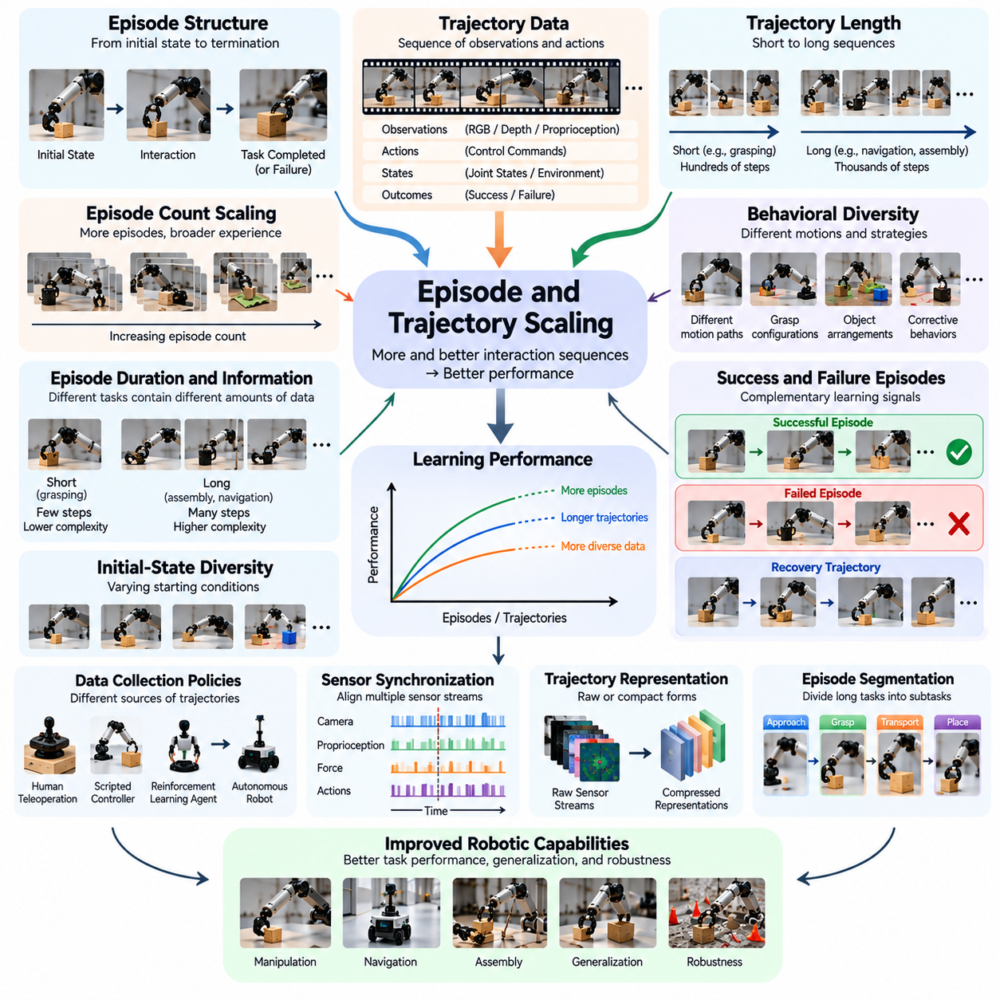{width="7.268055555555556in" height="7.268055555555556in"}

Episode and trajectory scaling examines how increasing the number, length, and diversity of robotic interaction sequences influences learning performance. Unlike conventional datasets composed of independent examples, Physical AI datasets contain temporally connected experiences. Each episode represents an interaction with an environment, while trajectories describe the evolving sequence of observations, actions, states, and outcomes generated during execution.

A robot episode typically begins from an initial state and continues until a task is completed, interrupted, or terminated by a predefined condition. During this interval, the robot records sensory observations, proprioceptive measurements, control commands, and environmental changes. These records preserve the relationship between decisions and their physical consequences, allowing learning systems to analyze complete behaviors rather than isolated actions.

Trajectory scaling focuses on expanding the collection of state-action sequences available for training. A trajectory may contain hundreds or thousands of time steps, depending on the task duration and control frequency. Increasing trajectory volume exposes models to additional motion patterns, object interactions, and state transitions. However, the resulting learning benefit depends on whether new trajectories introduce meaningful behavioral information.

Episode count is a convenient measure of dataset size, but it does not fully represent the amount of learning experience. Ten thousand short grasping attempts differ substantially from ten thousand extended assembly operations. Episode duration, sampling frequency, action complexity, and task structure determine the actual information contained in each sequence. Effective scaling therefore requires more detailed measurements than episode count alone.

Trajectory length introduces an important dimension because robotic behavior develops over time. Short trajectories may capture individual actions such as reaching or grasping, while longer trajectories represent navigation, manipulation sequences, and multistep tasks. Increasing sequence length can help models learn temporal dependencies and delayed consequences. Nevertheless, longer recordings also increase storage, memory, and computational requirements.

The relationship between trajectory length and useful information is not necessarily linear. Long episodes may contain repeated observations, stationary periods, or routine movements that contribute little additional learning value. Conversely, a brief recovery maneuver following an unexpected disturbance may contain highly informative state transitions. Scaling strategies should therefore distinguish informative interaction segments from redundant temporal data.

Behavioral diversity is a critical factor in episode scaling. Repeated demonstrations of the same successful action can improve consistency, but they may provide limited exposure to alternative strategies or unexpected conditions. Including different motion paths, grasp configurations, object arrangements, and corrective behaviors expands the learned action distribution. This diversity supports more flexible policies capable of responding to changing physical situations.

Successful and unsuccessful episodes provide complementary learning signals. Successful demonstrations illustrate effective strategies and desired outcomes, while failed attempts reveal limitations, unsafe transitions, and conditions that require correction. Recovery trajectories are particularly valuable because they show how a robot can return from undesirable states. Balanced episode collections can therefore support both task competence and behavioral robustness.

Initial-state diversity influences the generalization achieved through trajectory scaling. A robot trained exclusively from identical starting positions may learn highly specialized movement sequences rather than adaptable control strategies. Varying initial poses, object locations, environmental configurations, and task conditions exposes the policy to broader state distributions. Such variation helps distinguish generalizable behavior from memorized execution patterns.

The distribution of trajectories also depends on the policy used to collect them. Human teleoperators, scripted controllers, reinforcement learning agents, and autonomous robots generate different behavioral patterns. Expert demonstrations often emphasize successful execution, whereas exploratory policies may encounter unfamiliar states and failures. Combining these sources can improve coverage, provided their differences are represented consistently during training.

Temporal synchronization is essential when scaling trajectory datasets across multiple sensors and control systems. Camera frames, joint encoders, force measurements, and action commands may operate at different sampling frequencies. Misaligned timestamps can distort the apparent relationship between actions and outcomes. Large-scale trajectory processing therefore requires reliable time alignment, calibration, and validation before sequences are used for model optimization.

Trajectory representation affects both learning efficiency and scalability. Raw sensor streams preserve detailed observations but require substantial storage and processing resources. Compressed representations, latent states, and action abstractions can reduce computational demands while retaining task-relevant information. The appropriate representation depends on whether the learning objective emphasizes perception, motion prediction, control, or long-horizon reasoning.

Episode segmentation provides a mechanism for organizing long interaction histories into meaningful units. Complex tasks may contain subtasks such as approaching an object, grasping it, transporting it, and placing it at a destination. Identifying these boundaries enables models to learn reusable behavioral components. However, segmentation must preserve relevant transitions because dependencies between subtasks can influence overall task success.

Trajectory scaling is closely connected to imitation learning, where models learn policies from recorded demonstrations. Increasing demonstration coverage can improve action prediction across familiar and unfamiliar states. Nevertheless, imitation learning may suffer from distribution shift when small errors move the robot into states absent from the training data. Corrective demonstrations and interactive data collection help address this limitation.

Reinforcement learning introduces a different scaling relationship because trajectories are generated through interaction with an environment and evaluated using rewards or other feedback signals. Larger collections of exploratory episodes can improve policy learning when they provide useful state coverage. However, inefficient exploration may generate substantial redundant data. Experience replay, curriculum design, and prioritized sampling can improve the value of collected trajectories.

Simulation enables large-scale episode generation without requiring equivalent physical robot operating time. Parallel environments can produce diverse trajectories by varying objects, dynamics, disturbances, and task configurations. This approach supports extensive exploration and controlled experimentation. However, simulated trajectory scaling must be evaluated against real-world performance because additional synthetic episodes may reinforce inaccurate physical assumptions.

Cross-task trajectory scaling investigates whether experience from multiple tasks improves shared robotic capabilities. Reaching, grasping, pushing, lifting, and placing involve overlapping perceptual and motor skills. Training across these behaviors may help models develop transferable representations of objects and interactions. The benefit depends on task compatibility, data balance, and the ability of the model to separate shared knowledge from task-specific requirements.

Cross-embodiment trajectory scaling extends this principle to datasets collected from different robotic platforms. Manipulators, mobile robots, humanoids, and quadrupeds produce trajectories with different state and action structures. Shared learning requires coordinate transformations, embodiment metadata, and compatible action representations. Without these mechanisms, increasing the number of robots may introduce inconsistencies rather than useful training diversity.

Long-horizon trajectory scaling presents additional challenges because errors can accumulate across extended action sequences. A policy may perform individual subtasks reliably while failing to complete an entire workflow. Learning from long episodes requires maintaining relevant context, predicting delayed outcomes, and recovering from intermediate failures. Evaluation should therefore measure complete task success rather than relying exclusively on local action accuracy.

Data curation becomes increasingly important as episode collections grow. Large datasets may contain duplicate trajectories, corrupted recordings, incomplete demonstrations, or inconsistent control signals. Automated quality checks can identify missing observations, invalid timestamps, abnormal actions, and unreliable outcomes. Filtering and targeted sampling help maintain useful training information while reducing unnecessary storage and computation.

Scaling curves can be estimated by training comparable models on progressively larger collections of episodes or trajectory transitions. Performance may be measured through task success rates, action prediction errors, recovery effectiveness, and generalization to unseen conditions. Experimental comparisons should control for trajectory quality and diversity. Otherwise, observed improvements may reflect changes in data composition rather than dataset size alone.

The economic efficiency of episode scaling depends on the cost of generating informative interactions. Teleoperation requires skilled operators, physical robots consume maintenance resources, and simulation requires computational infrastructure. Active data collection can prioritize states where models exhibit uncertainty or repeated failures. Such strategies may achieve greater performance improvements per collected episode than indiscriminate expansion.

Ultimately, episode and trajectory scaling is not simply the accumulation of longer recordings or larger interaction datasets. Its purpose is to expand the useful coverage of physical states, actions, transitions, and outcomes represented during learning. Effective scaling combines sufficient episode volume with behavioral diversity, temporal consistency, data quality, and targeted collection. These principles support increasingly reliable and generalizable Physical AI systems.

에피소드 및 궤적 스케일링(Episode and Trajectory Scaling)은 로봇 상호작용 시퀀스(Robotic Interaction Sequences)의 수, 길이, 다양성을 증가시키는 것이 학습 성능(Learning Performance)에 어떤 영향을 미치는지 분석합니다. 독립적인 예제(Independent Examples)로 구성된 기존 데이터셋과 달리 피지컬 AI 데이터셋(Physical AI Datasets)은 시간적으로 연결된 경험(Temporally Connected Experiences)을 포함합니다. 각 에피소드(Episode)는 환경과의 상호작용을 나타내며, 궤적(Trajectory)은 실행 과정에서 생성되는 관측(Observations), 행동(Actions), 상태(States), 결과(Outcomes)의 변화하는 시퀀스를 설명합니다.

로봇 에피소드(Robot Episode)는 일반적으로 초기 상태(Initial State)에서 시작하여 작업이 완료되거나 중단되거나 사전에 정의된 종료 조건(Termination Condition)에 도달할 때까지 계속됩니다. 이 과정에서 로봇은 센서 관측(Sensory Observations), 고유수용성 측정값(Proprioceptive Measurements), 제어 명령(Control Commands), 환경 변화(Environmental Changes)를 기록합니다. 이러한 기록은 의사결정(Decisions)과 물리적 결과(Physical Consequences) 사이의 관계를 보존하여 학습 시스템(Learning Systems)이 개별 행동(Isolated Actions)이 아닌 완전한 행동 과정(Complete Behaviors)을 분석할 수 있도록 합니다.

궤적 스케일링(Trajectory Scaling)은 학습에 사용할 수 있는 상태-행동 시퀀스(State-Action Sequences)의 집합을 확장하는 데 중점을 둡니다. 하나의 궤적은 작업 지속 시간(Task Duration)과 제어 주파수(Control Frequency)에 따라 수백 또는 수천 개의 시간 단계(Time Steps)를 포함할 수 있습니다. 궤적 데이터의 양을 늘리면 모델이 추가적인 움직임 패턴(Motion Patterns), 물체 상호작용(Object Interactions), 상태 전이(State Transitions)를 경험할 수 있습니다. 그러나 학습 효과는 새로운 궤적이 의미 있는 행동 정보(Behavioral Information)를 제공하는지에 따라 달라집니다.

에피소드 수(Episode Count)는 데이터셋 크기(Dataset Size)를 측정하는 편리한 지표이지만 학습 경험(Learning Experience)의 양을 완전하게 나타내지는 못합니다. 짧은 파지 시도(Grasping Attempts) 10,000회와 장시간 조립 작업(Extended Assembly Operations) 10,000회는 상당히 다릅니다. 에피소드 지속 시간(Episode Duration), 샘플링 주파수(Sampling Frequency), 행동 복잡성(Action Complexity), 작업 구조(Task Structure)는 각 시퀀스에 포함된 실제 정보량을 결정합니다. 따라서 효과적인 스케일링(Effective Scaling)을 위해서는 단순한 에피소드 수보다 세부적인 측정 지표가 필요합니다.

궤적 길이(Trajectory Length)는 로봇 행동(Robotic Behavior)이 시간에 따라 발전하기 때문에 중요한 스케일링 차원(Scaling Dimension)을 형성합니다. 짧은 궤적은 도달(Reaching)이나 파지(Grasping)와 같은 개별 행동을 포착할 수 있으며, 긴 궤적은 내비게이션(Navigation), 조작 시퀀스(Manipulation Sequences), 다단계 작업(Multistep Tasks)을 표현합니다. 시퀀스 길이를 늘리면 모델이 시간적 의존성(Temporal Dependencies)과 지연된 결과(Delayed Consequences)를 학습하는 데 도움이 될 수 있습니다. 그러나 기록 길이가 증가하면 저장 공간(Storage), 메모리(Memory), 계산 자원(Computational Resources)에 대한 요구도 함께 증가합니다.

궤적 길이와 유용한 정보(Useful Information) 사이의 관계는 반드시 선형적(Linear)이지 않습니다. 긴 에피소드에는 반복적인 관측(Repetitive Observations), 정지 구간(Stationary Periods), 일상적인 움직임(Routine Movements)이 포함되어 추가적인 학습 가치가 거의 없을 수 있습니다. 반대로 예상하지 못한 교란(Unexpected Disturbance) 이후 수행되는 짧은 복구 동작(Recovery Maneuver)은 매우 유익한 상태 전이(State Transitions)를 포함할 수 있습니다. 따라서 스케일링 전략(Scaling Strategies)은 정보 가치가 높은 상호작용 구간(Informative Interaction Segments)과 중복된 시간적 데이터(Redundant Temporal Data)를 구분해야 합니다.

행동 다양성(Behavioral Diversity)은 에피소드 스케일링(Episode Scaling)의 핵심 요소입니다. 동일한 성공 행동(Successful Action)을 반복적으로 시연하면 일관성(Consistency)을 높일 수 있지만 대안적인 전략(Alternative Strategies)이나 예상하지 못한 조건(Unexpected Conditions)에 대한 경험은 제한될 수 있습니다. 서로 다른 이동 경로(Motion Paths), 파지 구성(Grasp Configurations), 물체 배치(Object Arrangements), 교정 행동(Corrective Behaviors)을 포함하면 학습된 행동 분포(Learned Action Distribution)가 확장됩니다. 이러한 다양성은 변화하는 물리적 상황에 대응할 수 있는 유연한 정책(Flexible Policies)을 지원합니다.

성공 에피소드(Successful Episodes)와 실패 에피소드(Unsuccessful Episodes)는 상호 보완적인 학습 신호(Learning Signals)를 제공합니다. 성공적인 시연(Successful Demonstrations)은 효과적인 전략(Effective Strategies)과 원하는 결과(Desired Outcomes)를 보여주는 반면, 실패한 시도(Failed Attempts)는 한계(Limitations), 안전하지 않은 상태 전이(Unsafe Transitions), 교정이 필요한 조건을 드러냅니다. 복구 궤적(Recovery Trajectories)은 로봇이 바람직하지 않은 상태(Undesirable States)에서 어떻게 복귀할 수 있는지 보여주기 때문에 특히 가치가 높습니다. 따라서 균형 잡힌 에피소드 집합(Balanced Episode Collections)은 작업 수행 능력(Task Competence)과 행동 강건성(Behavioral Robustness)을 모두 지원할 수 있습니다.

초기 상태 다양성(Initial-State Diversity)은 궤적 스케일링을 통해 달성되는 일반화(Generalization)에 영향을 미칩니다. 동일한 시작 위치(Starting Positions)에서만 학습된 로봇은 적응 가능한 제어 전략(Adaptable Control Strategies)보다 고도로 특화된 움직임 시퀀스(Movement Sequences)를 학습할 수 있습니다. 초기 자세(Initial Poses), 물체 위치(Object Locations), 환경 구성(Environmental Configurations), 작업 조건(Task Conditions)을 변화시키면 정책(Policy)이 더 넓은 상태 분포(State Distributions)를 경험할 수 있습니다. 이러한 변화는 일반화 가능한 행동(Generalizable Behavior)과 암기된 실행 패턴(Memorized Execution Patterns)을 구분하는 데 도움이 됩니다.

궤적 분포(Trajectory Distribution)는 데이터를 수집하는 데 사용된 정책(Collection Policy)에 따라서도 달라집니다. 인간 원격조작자(Human Teleoperators), 스크립트 기반 제어기(Scripted Controllers), 강화학습 에이전트(Reinforcement Learning Agents), 자율 로봇(Autonomous Robots)은 서로 다른 행동 패턴(Behavioral Patterns)을 생성합니다. 전문가 시연(Expert Demonstrations)은 성공적인 실행을 강조하는 경우가 많지만 탐색 정책(Exploratory Policies)은 익숙하지 않은 상태와 실패를 경험할 수 있습니다. 이러한 데이터 원천을 결합하면 학습 범위(Coverage)를 개선할 수 있지만 학습 과정에서 데이터 간 차이가 일관되게 표현되어야 합니다.

시간 동기화(Temporal Synchronization)는 여러 센서와 제어 시스템(Control Systems)에 걸쳐 궤적 데이터셋(Trajectory Datasets)을 확장할 때 필수적입니다. 카메라 프레임(Camera Frames), 관절 엔코더(Joint Encoders), 힘 측정값(Force Measurements), 행동 명령(Action Commands)은 서로 다른 샘플링 주파수(Sampling Frequencies)로 작동할 수 있습니다. 정렬되지 않은 타임스탬프(Misaligned Timestamps)는 행동과 결과 사이의 관계를 왜곡할 수 있습니다. 따라서 대규모 궤적 처리(Large-Scale Trajectory Processing)에서는 모델 최적화(Model Optimization)에 시퀀스를 사용하기 전에 신뢰할 수 있는 시간 정렬(Time Alignment), 보정(Calibration), 검증(Validation)이 필요합니다.

궤적 표현(Trajectory Representation)은 학습 효율성(Learning Efficiency)과 확장성(Scalability)에 모두 영향을 미칩니다. 원시 센서 스트림(Raw Sensor Streams)은 상세한 관측 정보를 보존하지만 상당한 저장 공간과 처리 자원을 요구합니다. 압축 표현(Compressed Representations), 잠재 상태(Latent States), 행동 추상화(Action Abstractions)는 작업 관련 정보(Task-Relevant Information)를 유지하면서 계산 요구량(Computational Demands)을 줄일 수 있습니다. 적절한 표현 방식은 학습 목표(Learning Objective)가 인식(Perception), 움직임 예측(Motion Prediction), 제어(Control), 장기 추론(Long-Horizon Reasoning) 중 무엇을 강조하는지에 따라 달라집니다.

에피소드 분할(Episode Segmentation)은 긴 상호작용 이력(Interaction Histories)을 의미 있는 단위로 구성하는 방법을 제공합니다. 복잡한 작업(Complex Tasks)은 물체에 접근하기(Approaching an Object), 파지하기(Grasping), 운반하기(Transporting), 목적지에 배치하기(Placing)와 같은 하위 작업(Subtasks)을 포함할 수 있습니다. 이러한 경계(Boundaries)를 식별하면 모델이 재사용 가능한 행동 구성요소(Reusable Behavioral Components)를 학습할 수 있습니다. 그러나 하위 작업 사이의 의존성(Dependencies)은 전체 작업 성공(Overall Task Success)에 영향을 미칠 수 있으므로 분할 과정에서도 관련 상태 전이(Relevant Transitions)를 보존해야 합니다.

궤적 스케일링(Trajectory Scaling)은 기록된 시연(Recorded Demonstrations)으로부터 정책(Policies)을 학습하는 모방학습(Imitation Learning)과 밀접하게 연결됩니다. 시연 데이터의 범위(Demonstration Coverage)를 확장하면 익숙한 상태와 익숙하지 않은 상태에서 행동 예측(Action Prediction)을 개선할 수 있습니다. 그러나 작은 오류(Small Errors)로 인해 로봇이 학습 데이터에 존재하지 않는 상태로 이동하면 모방학습은 분포 이동(Distribution Shift) 문제를 겪을 수 있습니다. 교정 시연(Corrective Demonstrations)과 상호작용형 데이터 수집(Interactive Data Collection)은 이러한 한계를 해결하는 데 도움이 됩니다.

강화학습(Reinforcement Learning)은 환경과의 상호작용을 통해 궤적(Trajectories)을 생성하고 보상(Rewards)이나 다른 피드백 신호(Feedback Signals)를 사용하여 평가하기 때문에 다른 스케일링 관계(Scaling Relationship)를 형성합니다. 더 많은 탐색 에피소드(Exploratory Episodes)는 유용한 상태 범위(State Coverage)를 제공할 경우 정책 학습(Policy Learning)을 개선할 수 있습니다. 그러나 비효율적인 탐색(Inefficient Exploration)은 상당한 양의 중복 데이터(Redundant Data)를 생성할 수 있습니다. 경험 재생(Experience Replay), 커리큘럼 설계(Curriculum Design), 우선순위 샘플링(Prioritized Sampling)은 수집된 궤적의 가치를 높일 수 있습니다.

시뮬레이션(Simulation)은 동일한 수준의 물리적 로봇 운영 시간(Physical Robot Operating Time)을 요구하지 않으면서 대규모 에피소드 생성(Large-Scale Episode Generation)을 가능하게 합니다. 병렬 환경(Parallel Environments)은 물체(Objects), 동역학(Dynamics), 교란(Disturbances), 작업 구성(Task Configurations)을 변화시키면서 다양한 궤적을 생성할 수 있습니다. 이러한 접근법은 광범위한 탐색(Extensive Exploration)과 통제된 실험(Controlled Experimentation)을 지원합니다. 그러나 추가적인 합성 에피소드(Synthetic Episodes)가 부정확한 물리적 가정(Inaccurate Physical Assumptions)을 강화할 수 있으므로 시뮬레이션 궤적 스케일링(Simulated Trajectory Scaling)은 실세계 성능(Real-World Performance)을 기준으로 평가해야 합니다.

교차 작업 궤적 스케일링(Cross-Task Trajectory Scaling)은 여러 작업에서 얻은 경험이 공유 로봇 능력(Shared Robotic Capabilities)을 향상시키는지 연구합니다. 도달(Reaching), 파지(Grasping), 밀기(Pushing), 들어 올리기(Lifting), 배치하기(Placing)는 서로 겹치는 지각 및 운동 기술(Perceptual and Motor Skills)을 포함합니다. 이러한 행동을 함께 학습하면 모델이 물체와 상호작용에 대한 전이 가능한 표현(Transferable Representations)을 개발하는 데 도움이 될 수 있습니다. 그 효과는 작업 호환성(Task Compatibility), 데이터 균형(Data Balance), 공유 지식(Shared Knowledge)과 작업별 요구사항(Task-Specific Requirements)을 구분하는 모델의 능력에 따라 달라집니다.

교차 체화 궤적 스케일링(Cross-Embodiment Trajectory Scaling)은 이러한 원리를 서로 다른 로봇 플랫폼(Robotic Platforms)에서 수집한 데이터셋으로 확장합니다. 매니퓰레이터(Manipulators), 모바일 로봇(Mobile Robots), 휴머노이드(Humanoids), 사족보행 로봇(Quadrupeds)은 서로 다른 상태 및 행동 구조(State and Action Structures)를 가진 궤적을 생성합니다. 공유 학습(Shared Learning)을 위해서는 좌표 변환(Coordinate Transformations), 체화 메타데이터(Embodiment Metadata), 호환 가능한 행동 표현(Compatible Action Representations)이 필요합니다. 이러한 메커니즘이 없다면 로봇 수의 증가는 유용한 학습 다양성(Training Diversity)보다 데이터 불일치(Inconsistencies)를 증가시킬 수 있습니다.

장기 시간 범위 궤적 스케일링(Long-Horizon Trajectory Scaling)은 확장된 행동 시퀀스(Action Sequences)에서 오류가 누적될 수 있기 때문에 추가적인 과제를 제시합니다. 하나의 정책(Policy)이 개별 하위 작업(Subtasks)을 안정적으로 수행하더라도 전체 작업 흐름(Workflow)을 완료하지 못할 수 있습니다. 긴 에피소드(Long Episodes)로부터 학습하려면 관련 문맥(Relevant Context)을 유지하고 지연된 결과(Delayed Outcomes)를 예측하며 중간 실패(Intermediate Failures)에서 복구해야 합니다. 따라서 평가는 국소적인 행동 정확도(Local Action Accuracy)에만 의존하지 않고 전체 작업 성공률(Complete Task Success)을 측정해야 합니다.

에피소드 데이터 집합(Episode Collections)이 커질수록 데이터 큐레이션(Data Curation)의 중요성도 증가합니다. 대규모 데이터셋(Large Datasets)에는 중복 궤적(Duplicate Trajectories), 손상된 기록(Corrupted Recordings), 불완전한 시연(Incomplete Demonstrations), 일관되지 않은 제어 신호(Inconsistent Control Signals)가 포함될 수 있습니다. 자동화된 품질 검사(Automated Quality Checks)는 누락된 관측(Missing Observations), 유효하지 않은 타임스탬프(Invalid Timestamps), 비정상적인 행동(Abnormal Actions), 신뢰할 수 없는 결과(Unreliable Outcomes)를 식별할 수 있습니다. 필터링(Filtering)과 표적 샘플링(Targeted Sampling)은 불필요한 저장 및 계산 비용을 줄이면서 유용한 학습 정보를 유지하는 데 도움이 됩니다.

스케일링 곡선(Scaling Curves)은 점진적으로 증가하는 에피소드 집합(Episode Collections)이나 궤적 전이(Trajectory Transitions)를 사용하여 비교 가능한 모델(Comparable Models)을 학습함으로써 추정할 수 있습니다. 성능은 작업 성공률(Task Success Rates), 행동 예측 오차(Action Prediction Errors), 복구 효과(Recovery Effectiveness), 학습에서 보지 못한 조건에 대한 일반화(Generalization to Unseen Conditions)를 통해 측정할 수 있습니다. 실험 비교(Experimental Comparisons)에서는 궤적 품질(Trajectory Quality)과 다양성(Diversity)을 통제해야 합니다. 그렇지 않으면 관측된 성능 향상이 데이터셋 크기 자체가 아니라 데이터 구성(Data Composition)의 변화에서 비롯될 수 있습니다.

에피소드 스케일링의 경제적 효율성(Economic Efficiency)은 정보 가치가 높은 상호작용(Informative Interactions)을 생성하는 비용에 따라 달라집니다. 원격조작(Teleoperation)에는 숙련된 작업자(Skilled Operators)가 필요하고, 물리적 로봇(Physical Robots)은 유지보수 자원(Maintenance Resources)을 소비하며, 시뮬레이션(Simulation)에는 계산 인프라(Computational Infrastructure)가 필요합니다. 능동적 데이터 수집(Active Data Collection)은 모델이 불확실성(Uncertainty)을 보이거나 반복적인 실패(Repeated Failures)를 경험하는 상태에 우선순위를 부여할 수 있습니다. 이러한 전략은 무분별한 데이터 확장보다 수집된 에피소드당 더 높은 성능 향상을 달성할 수 있습니다.

궁극적으로 에피소드 및 궤적 스케일링(Episode and Trajectory Scaling)은 단순히 더 긴 기록이나 더 큰 상호작용 데이터셋(Interaction Datasets)을 축적하는 것이 아닙니다. 그 목적은 학습 과정에서 표현되는 물리적 상태(Physical States), 행동(Actions), 상태 전이(Transitions), 결과(Outcomes)의 유용한 범위(Useful Coverage)를 확장하는 것입니다. 효과적인 스케일링(Effective Scaling)은 충분한 에피소드 양(Episode Volume)과 행동 다양성(Behavioral Diversity), 시간적 일관성(Temporal Consistency), 데이터 품질(Data Quality), 표적 데이터 수집(Targeted Collection)을 결합합니다. 이러한 원리는 더욱 신뢰할 수 있고 일반화 능력이 높은 피지컬 AI 시스템(Physical AI Systems)의 개발을 지원합니다.

##  

## 07.05. Task and Environment Diversity Scaling

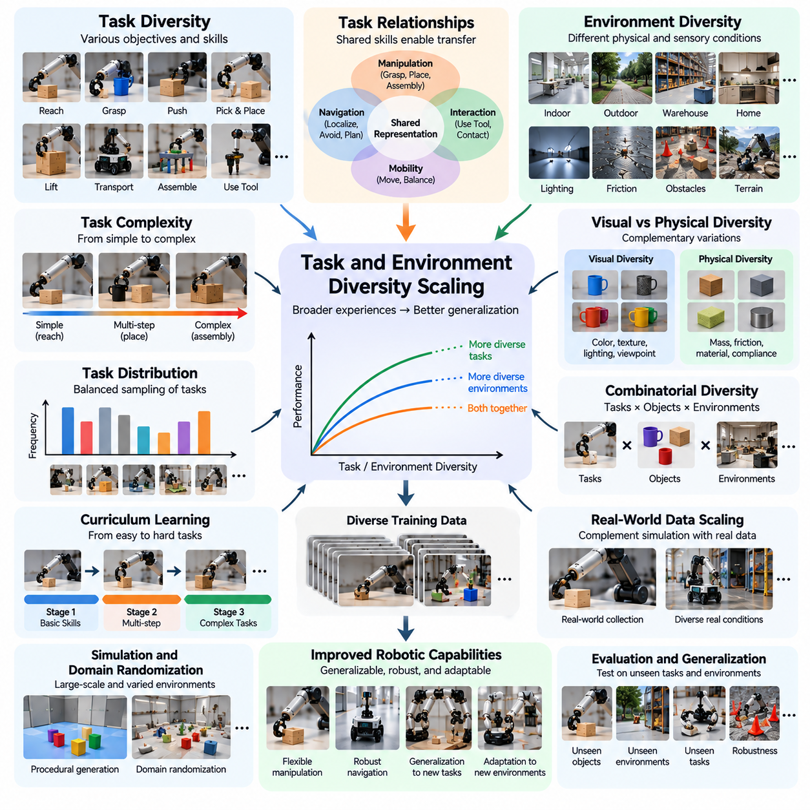{width="7.268055555555556in" height="7.268055555555556in"}

Task and environment diversity scaling examines how expanding the variety of robotic objectives and operating conditions influences learning, generalization, and adaptability. Unlike data scaling based solely on episode counts, diversity scaling emphasizes the range of experiences represented during training. Physical AI systems must learn reusable capabilities that remain effective across different tasks, environments, and interaction conditions rather than memorizing isolated behaviors.

Task diversity refers to the variation in objectives, action sequences, required skills, and success conditions represented in a training dataset. A robot may learn reaching, grasping, pushing, lifting, transporting, and assembling as separate activities. When these tasks share underlying physical principles, joint training can encourage transferable representations. However, the benefits depend on task relationships, model capacity, and balanced learning objectives.

Environment diversity describes variations in the physical and sensory conditions under which robotic tasks are performed. These variations include lighting, surface friction, workspace geometry, obstacle arrangements, object placement, and environmental disturbances. Exposure to different conditions can improve robustness by reducing dependence on a narrow operating distribution. Effective scaling requires environments that represent meaningful operational differences.

The relationship between task diversity and performance is not necessarily linear. Introducing additional tasks may improve shared representations when their underlying skills overlap. However, unrelated tasks can create competing optimization objectives and reduce performance on previously learned behaviors. This phenomenon, sometimes called negative transfer, demonstrates that expanding task counts does not automatically improve general-purpose robotic intelligence.

Task similarity provides an important organizing principle for diversity scaling. Manipulation tasks such as grasping, placing, and stacking share object perception, spatial reasoning, and motion control requirements. Navigation tasks share localization, obstacle avoidance, and path planning components. Grouping tasks according to common skills can improve learning efficiency while helping models distinguish transferable capabilities from task-specific constraints.

Task complexity introduces another dimension beyond task count. A simple reaching operation may require one continuous movement, while assembly involves perception, alignment, contact management, and sequential decision-making. Increasing the number of complex tasks expands the range of temporal and physical relationships that models must learn. Consequently, diversity measurements should consider task structure, difficulty, and required skill combinations.

Environmental variation affects the reliability of learned policies because physical interactions depend on local conditions. A grasp that succeeds on a rigid surface may fail when an object is slippery or deformable. Similarly, navigation policies trained in open corridors may struggle in crowded spaces. Diverse training environments expose models to these variations and can encourage policies that respond to changing conditions rather than fixed assumptions.

Visual diversity and physical diversity should be distinguished during dataset construction. Changes in color, texture, lighting, and camera viewpoint primarily affect perception, while variations in mass, friction, compliance, and contact geometry influence physical dynamics. Both forms are important, but their contributions differ. A model that generalizes visually may still fail when unfamiliar forces or material properties alter the required actions.

Combinatorial diversity emerges when tasks, objects, environments, and behaviors are varied together. A robot trained to grasp multiple objects in several workspace configurations encounters more combinations than one trained under fixed conditions. However, the number of possible combinations grows rapidly. Practical scaling therefore requires systematic coverage strategies rather than attempting to collect every conceivable interaction.

Procedural environment generation provides a scalable method for expanding environmental coverage. Simulation systems can vary room layouts, obstacle locations, object distributions, lighting conditions, and physical parameters automatically. These variations create controlled experiments for measuring robustness. Nevertheless, generated environments must remain physically plausible and relevant to deployment conditions to provide useful learning experiences.

Domain randomization is frequently used to expose robotic policies to broad environmental variation during simulation training. By changing visual appearances, dynamics parameters, sensor noise, and object properties, researchers attempt to reduce dependence on specific simulation conditions. This approach can support sim-to-real transfer, but excessive randomization may introduce unrealistic experiences that reduce learning efficiency or task performance.

Task distribution design determines how frequently different objectives appear during training. If simple tasks dominate the dataset, models may optimize for common behaviors while neglecting difficult or rare capabilities. Conversely, excessive emphasis on challenging tasks may slow acquisition of foundational skills. Balanced sampling, curriculum learning, and adaptive task selection can improve the allocation of learning resources across task categories.

Curriculum learning organizes training experiences according to increasing difficulty or strategically selected learning stages. A manipulation policy may first learn stable grasping before progressing to object reorientation and multistep assembly. Such sequencing can improve optimization when advanced tasks depend on foundational skills. However, curriculum effectiveness depends on the model, task dependencies, and transitions between learning stages.

Environment coverage must be evaluated relative to the intended deployment distribution. A warehouse robot requires experience with shelving arrangements, moving workers, pallet configurations, and varying floor conditions. An agricultural robot encounters plants, soil, weather, and seasonal changes. Training diversity should therefore reflect realistic operational uncertainty rather than maximizing variation without considering application requirements.

Generalization evaluation requires separating training environments from testing conditions. A model may perform well on familiar combinations of tasks and objects while failing on genuinely novel configurations. Researchers should evaluate unseen task compositions, environmental layouts, and physical parameters. These tests help determine whether diversity scaling produces transferable understanding or merely broader memorization of training examples.

Task and environment diversity also influence model capacity requirements. As training distributions expand, models must represent more objects, behaviors, dynamics, and contextual relationships. Insufficient capacity may cause interference between tasks or prevent accurate representation of diverse conditions. Larger models can potentially support broader capabilities, but improvements depend on training quality, architecture, and effective optimization.

Multimodal representations can support diversity scaling by connecting visual observations, language instructions, proprioceptive states, and action sequences. Language provides a flexible mechanism for describing different objectives, while sensory inputs specify current environmental conditions. Vision-language-action models can exploit these relationships to learn conditional behaviors. Their effectiveness depends on consistent task descriptions and reliable sensor-action alignment.

Data collection strategies should prioritize diversity that contributes measurable learning value. Repeated examples from already well-covered conditions may provide limited improvement, while new failure cases or unfamiliar object interactions can reveal important gaps. Active learning and uncertainty-based sampling can identify underrepresented regions of task and environment space. These methods help expand useful coverage without requiring indiscriminate dataset growth.

Diversity scaling can be analyzed through controlled experiments that vary the number of tasks, environments, or their combinations while holding other factors as consistent as possible. Performance should be measured on both familiar and unseen conditions. Such experiments can reveal whether additional diversity improves average success, worst-case robustness, or cross-task transfer. Results may differ substantially across robotic platforms and applications.

A major challenge is distinguishing beneficial diversity from distribution mismatch. Training on environments that are too narrow can cause overfitting, while training on irrelevant conditions may consume resources without improving deployment performance. Effective diversity scaling seeks a balance between broad physical experience and application-specific relevance. This balance must be established through empirical evaluation rather than assumed from dataset size.

Cross-task transfer represents one of the most important potential benefits of diversity scaling. Skills learned through pushing, grasping, and object placement may support unfamiliar manipulation tasks requiring similar physical interactions. Environmental variation can also encourage reusable perception and control strategies. However, successful transfer depends on shared structure between source and target tasks and the model\'s ability to exploit that structure.

The economic value of diversity scaling depends on how efficiently additional experiences improve operational capability. Collecting every possible task and environment combination is impractical because physical data acquisition is expensive. Simulation, targeted teleoperation, automated scenario generation, and fleet data mining can reduce collection costs. Resource allocation should prioritize diversity that improves task success, reliability, and adaptation under realistic conditions.

Ultimately, task and environment diversity scaling provides a foundation for developing generalizable Physical AI systems. The objective is not simply to maximize the number of tasks or environments but to construct learning distributions that capture transferable skills and meaningful physical variation. Effective diversity scaling combines systematic coverage, balanced sampling, realistic environments, and rigorous evaluation to support adaptable and reliable robotic intelligence.

작업 및 환경 다양성 스케일링(Task and Environment Diversity Scaling)은 로봇의 작업 목표(Robotic Objectives)와 운영 조건(Operating Conditions)의 다양성을 확장하는 것이 학습(Learning), 일반화(Generalization), 적응성(Adaptability)에 어떤 영향을 미치는지 분석합니다. 단순히 에피소드 수(Episode Counts)에 기반한 데이터 스케일링(Data Scaling)과 달리 다양성 스케일링(Diversity Scaling)은 학습 과정에서 표현되는 경험의 범위(Range of Experiences)를 강조합니다. 피지컬 AI 시스템(Physical AI Systems)은 개별 행동을 암기하는 대신 서로 다른 작업, 환경, 상호작용 조건에서도 효과적으로 작동하는 재사용 가능한 능력(Reusable Capabilities)을 학습해야 합니다.

작업 다양성(Task Diversity)은 학습 데이터셋(Training Dataset)에 포함된 목표(Objectives), 행동 시퀀스(Action Sequences), 요구 기술(Required Skills), 성공 조건(Success Conditions)의 변화를 의미합니다. 로봇은 도달(Reaching), 파지(Grasping), 밀기(Pushing), 들어 올리기(Lifting), 운반(Transporting), 조립(Assembling)을 개별 활동으로 학습할 수 있습니다. 이러한 작업이 공통적인 물리적 원리(Physical Principles)를 공유한다면 공동 학습(Joint Training)은 전이 가능한 표현(Transferable Representations)의 형성을 촉진할 수 있습니다. 그러나 그 효과는 작업 간 관계(Task Relationships), 모델 용량(Model Capacity), 균형 잡힌 학습 목표(Balanced Learning Objectives)에 따라 달라집니다.

환경 다양성(Environment Diversity)은 로봇 작업이 수행되는 물리적 조건(Physical Conditions)과 센서 조건(Sensory Conditions)의 변화를 설명합니다. 이러한 변화에는 조명(Lighting), 표면 마찰(Surface Friction), 작업 공간 형상(Workspace Geometry), 장애물 배치(Obstacle Arrangements), 물체 위치(Object Placement), 환경 교란(Environmental Disturbances)이 포함됩니다. 서로 다른 조건에 노출되면 제한된 운영 분포(Operating Distribution)에 대한 의존도가 감소하여 강건성(Robustness)이 향상될 수 있습니다. 효과적인 스케일링을 위해서는 실제 운영상 의미 있는 차이를 나타내는 환경이 필요합니다.

작업 다양성(Task Diversity)과 성능(Performance) 사이의 관계는 반드시 선형적(Linear)이지 않습니다. 추가적인 작업을 도입하면 작업 간에 기초 기술(Underlying Skills)이 중복되는 경우 공유 표현(Shared Representations)이 개선될 수 있습니다. 그러나 관련성이 낮은 작업은 서로 경쟁하는 최적화 목표(Competing Optimization Objectives)를 형성하여 이전에 학습한 행동의 성능을 저하시킬 수 있습니다. 이러한 현상은 부정적 전이(Negative Transfer)라고도 하며, 작업 수를 늘리는 것이 범용 로봇 지능(General-Purpose Robotic Intelligence)의 향상을 자동으로 보장하지는 않는다는 사실을 보여줍니다.

작업 유사성(Task Similarity)은 다양성 스케일링(Diversity Scaling)을 구성하는 중요한 원리입니다. 파지(Grasping), 배치(Placing), 적층(Stacking)과 같은 조작 작업(Manipulation Tasks)은 물체 인식(Object Perception), 공간 추론(Spatial Reasoning), 운동 제어(Motion Control)에 대한 요구사항을 공유합니다. 내비게이션 작업(Navigation Tasks)은 위치 추정(Localization), 장애물 회피(Obstacle Avoidance), 경로 계획(Path Planning) 요소를 공유합니다. 공통 기술(Common Skills)에 따라 작업을 그룹화하면 학습 효율성(Learning Efficiency)을 높이는 동시에 모델이 전이 가능한 능력(Transferable Capabilities)과 작업별 제약(Task-Specific Constraints)을 구분하는 데 도움이 됩니다.

작업 복잡성(Task Complexity)은 작업 수(Task Count)를 넘어서는 또 다른 차원을 형성합니다. 단순한 도달 작업(Reaching Operation)은 하나의 연속적인 움직임만 필요할 수 있지만 조립(Assembly)은 인식(Perception), 정렬(Alignment), 접촉 관리(Contact Management), 순차적 의사결정(Sequential Decision-Making)을 포함합니다. 복잡한 작업의 수를 증가시키면 모델이 학습해야 하는 시간적 관계(Temporal Relationships)와 물리적 관계(Physical Relationships)의 범위가 확장됩니다. 따라서 다양성 측정(Diversity Measurements)에서는 작업 구조(Task Structure), 난이도(Difficulty), 필요한 기술 조합(Required Skill Combinations)을 고려해야 합니다.

환경 변화(Environmental Variation)는 물리적 상호작용(Physical Interactions)이 국소적인 조건(Local Conditions)에 의존하기 때문에 학습된 정책(Learned Policies)의 신뢰성(Reliability)에 영향을 미칩니다. 단단한 표면(Rigid Surface)에서 성공한 파지 동작은 물체가 미끄럽거나 변형 가능한 경우 실패할 수 있습니다. 마찬가지로 개방된 복도(Open Corridors)에서 학습된 내비게이션 정책(Navigation Policies)은 혼잡한 공간(Crowded Spaces)에서 어려움을 겪을 수 있습니다. 다양한 학습 환경(Training Environments)은 모델을 이러한 변화에 노출시켜 고정된 가정(Fixed Assumptions)이 아니라 변화하는 조건에 대응하는 정책을 학습하도록 촉진할 수 있습니다.

데이터셋을 구성할 때 시각적 다양성(Visual Diversity)과 물리적 다양성(Physical Diversity)을 구분해야 합니다. 색상(Color), 질감(Texture), 조명(Lighting), 카메라 시점(Camera Viewpoint)의 변화는 주로 인식(Perception)에 영향을 미치는 반면 질량(Mass), 마찰(Friction), 순응성(Compliance), 접촉 형상(Contact Geometry)의 변화는 물리적 동역학(Physical Dynamics)에 영향을 미칩니다. 두 형태의 다양성 모두 중요하지만 기여하는 방식은 서로 다릅니다. 시각적으로 일반화된 모델(Visually Generalized Model)이라도 익숙하지 않은 힘이나 재료 특성(Material Properties)이 필요한 행동을 변화시키면 실패할 수 있습니다.

조합적 다양성(Combinatorial Diversity)은 작업(Tasks), 물체(Objects), 환경(Environments), 행동(Behaviors)을 함께 변화시킬 때 나타납니다. 여러 작업 공간 구성(Workspace Configurations)에서 다양한 물체를 파지하도록 학습된 로봇은 고정된 조건에서 학습된 로봇보다 더 많은 조합을 경험합니다. 그러나 가능한 조합의 수(Number of Possible Combinations)는 빠르게 증가합니다. 따라서 실용적인 스케일링(Practical Scaling)을 위해서는 생각할 수 있는 모든 상호작용을 수집하려 하기보다 체계적인 범위 확보 전략(Systematic Coverage Strategies)이 필요합니다.

절차적 환경 생성(Procedural Environment Generation)은 환경 범위(Environmental Coverage)를 확장하기 위한 확장 가능한 방법(Scalable Method)을 제공합니다. 시뮬레이션 시스템(Simulation Systems)은 실내 배치(Room Layouts), 장애물 위치(Obstacle Locations), 물체 분포(Object Distributions), 조명 조건(Lighting Conditions), 물리적 매개변수(Physical Parameters)를 자동으로 변화시킬 수 있습니다. 이러한 변화는 강건성(Robustness)을 측정하기 위한 통제 실험(Controlled Experiments)을 가능하게 합니다. 그러나 생성된 환경이 유용한 학습 경험(Useful Learning Experiences)을 제공하려면 물리적으로 타당하고(Physically Plausible) 실제 배포 조건(Deployment Conditions)과 관련성이 있어야 합니다.

도메인 무작위화(Domain Randomization)는 시뮬레이션 학습(Simulation Training) 과정에서 로봇 정책(Robotic Policies)을 광범위한 환경 변화(Environmental Variation)에 노출시키기 위해 자주 사용됩니다. 연구자들은 시각적 외관(Visual Appearances), 동역학 매개변수(Dynamics Parameters), 센서 잡음(Sensor Noise), 물체 특성(Object Properties)을 변화시켜 특정 시뮬레이션 조건(Simulation Conditions)에 대한 의존도를 줄이려고 합니다. 이러한 접근법은 시뮬레이션-현실 전이(Sim-to-Real Transfer)를 지원할 수 있지만 지나친 무작위화(Excessive Randomization)는 비현실적인 경험(Unrealistic Experiences)을 도입하여 학습 효율성(Learning Efficiency)이나 작업 성능(Task Performance)을 저하시킬 수 있습니다.

작업 분포 설계(Task Distribution Design)는 학습 과정에서 서로 다른 목표(Objectives)가 얼마나 자주 등장하는지를 결정합니다. 단순한 작업(Simple Tasks)이 데이터셋을 지배하면 모델은 일반적인 행동(Common Behaviors)에 최적화되는 반면 어렵거나 드문 능력(Rare Capabilities)을 충분히 학습하지 못할 수 있습니다. 반대로 어려운 작업(Challenging Tasks)을 지나치게 강조하면 기초 기술(Foundational Skills)의 습득이 느려질 수 있습니다. 균형 샘플링(Balanced Sampling), 커리큘럼 학습(Curriculum Learning), 적응형 작업 선택(Adaptive Task Selection)은 작업 범주(Task Categories) 전반에 걸쳐 학습 자원(Learning Resources)을 효율적으로 배분하는 데 도움이 됩니다.

커리큘럼 학습(Curriculum Learning)은 난이도가 증가하는 순서 또는 전략적으로 선택된 학습 단계(Learning Stages)에 따라 학습 경험(Training Experiences)을 구성합니다. 조작 정책(Manipulation Policy)은 먼저 안정적인 파지(Stable Grasping)를 학습한 다음 물체 방향 변경(Object Reorientation)과 다단계 조립(Multistep Assembly)으로 발전할 수 있습니다. 이러한 순차적 학습(Sequential Learning)은 고급 작업(Advanced Tasks)이 기초 기술(Foundational Skills)에 의존하는 경우 최적화(Optimization)를 개선할 수 있습니다. 그러나 커리큘럼의 효과는 모델(Model), 작업 의존성(Task Dependencies), 학습 단계 사이의 전환(Transitions)에 따라 달라집니다.

환경 범위(Environment Coverage)는 의도된 배포 분포(Intended Deployment Distribution)를 기준으로 평가해야 합니다. 창고 로봇(Warehouse Robot)은 선반 배치(Shelving Arrangements), 이동하는 작업자(Moving Workers), 팔레트 구성(Pallet Configurations), 변화하는 바닥 조건(Floor Conditions)에 대한 경험이 필요합니다. 농업용 로봇(Agricultural Robot)은 식물(Plants), 토양(Soil), 날씨(Weather), 계절 변화(Seasonal Changes)를 경험합니다. 따라서 학습 다양성(Training Diversity)은 응용 분야의 요구사항(Application Requirements)을 고려하지 않고 변화량만 극대화하기보다 현실적인 운영 불확실성(Operational Uncertainty)을 반영해야 합니다.

일반화 평가(Generalization Evaluation)를 위해서는 학습 환경(Training Environments)과 시험 조건(Testing Conditions)을 분리해야 합니다. 모델은 익숙한 작업과 물체의 조합(Familiar Combinations of Tasks and Objects)에서는 우수한 성능을 보이지만 실제로 새로운 구성(Novel Configurations)에서는 실패할 수 있습니다. 연구자들은 학습에서 보지 못한 작업 조합(Unseen Task Compositions), 환경 배치(Environmental Layouts), 물리적 매개변수(Physical Parameters)를 평가해야 합니다. 이러한 시험은 다양성 스케일링(Diversity Scaling)이 전이 가능한 이해(Transferable Understanding)를 형성하는지, 아니면 학습 예제(Training Examples)를 더 폭넓게 암기하는 데 그치는지 판단하는 데 도움이 됩니다.

작업 및 환경 다양성(Task and Environment Diversity)은 모델 용량 요구사항(Model Capacity Requirements)에도 영향을 미칩니다. 학습 분포(Training Distributions)가 확장되면 모델은 더 많은 물체(Objects), 행동(Behaviors), 동역학(Dynamics), 문맥 관계(Contextual Relationships)를 표현해야 합니다. 모델 용량이 부족하면 작업 간 간섭(Interference Between Tasks)이 발생하거나 다양한 조건을 정확하게 표현하지 못할 수 있습니다. 더 큰 모델은 폭넓은 능력(Broader Capabilities)을 지원할 가능성이 있지만 성능 향상은 학습 품질(Training Quality), 아키텍처(Architecture), 효과적인 최적화(Effective Optimization)에 따라 달라집니다.

멀티모달 표현(Multimodal Representations)은 시각적 관측(Visual Observations), 언어 명령(Language Instructions), 고유수용성 상태(Proprioceptive States), 행동 시퀀스(Action Sequences)를 연결하여 다양성 스케일링(Diversity Scaling)을 지원할 수 있습니다. 언어(Language)는 서로 다른 목표를 설명하는 유연한 수단을 제공하며 센서 입력(Sensory Inputs)은 현재 환경 조건(Current Environmental Conditions)을 지정합니다. 시각-언어-행동 모델(Vision-Language-Action Models, VLA)은 이러한 관계를 활용하여 조건부 행동(Conditional Behaviors)을 학습할 수 있습니다. 그 효과는 일관된 작업 설명(Consistent Task Descriptions)과 신뢰할 수 있는 센서-행동 정렬(Sensor-Action Alignment)에 달려 있습니다.

데이터 수집 전략(Data Collection Strategies)은 측정 가능한 학습 가치(Measurable Learning Value)에 기여하는 다양성을 우선시해야 합니다. 이미 충분히 포함된 조건(Well-Covered Conditions)에서 반복적으로 수집한 예제는 추가적인 개선 효과가 제한적일 수 있지만 새로운 실패 사례(Failure Cases)나 익숙하지 않은 물체 상호작용(Unfamiliar Object Interactions)은 중요한 데이터 공백(Data Gaps)을 드러낼 수 있습니다. 능동학습(Active Learning)과 불확실성 기반 샘플링(Uncertainty-Based Sampling)은 작업 및 환경 공간(Task and Environment Space)에서 충분히 표현되지 않은 영역(Underrepresented Regions)을 식별할 수 있습니다. 이러한 방법은 무분별한 데이터셋 증가 없이 유용한 범위(Useful Coverage)를 확장하는 데 도움이 됩니다.

다양성 스케일링(Diversity Scaling)은 다른 요인을 가능한 한 일정하게 유지하면서 작업 수(Number of Tasks), 환경 수(Number of Environments), 또는 그 조합을 변화시키는 통제 실험(Controlled Experiments)을 통해 분석할 수 있습니다. 성능은 익숙한 조건(Familiar Conditions)과 학습에서 보지 못한 조건(Unseen Conditions) 모두에서 측정해야 합니다. 이러한 실험은 추가적인 다양성이 평균 성공률(Average Success), 최악 조건 강건성(Worst-Case Robustness), 교차 작업 전이(Cross-Task Transfer)를 개선하는지 보여줄 수 있습니다. 결과는 로봇 플랫폼(Robotic Platforms)과 응용 분야(Applications)에 따라 상당히 달라질 수 있습니다.

주요 과제 중 하나는 유익한 다양성(Beneficial Diversity)과 분포 불일치(Distribution Mismatch)를 구분하는 것입니다. 지나치게 제한된 환경(Narrow Environments)에서 학습하면 과적합(Overfitting)이 발생할 수 있지만 관련성이 낮은 조건(Irrelevant Conditions)에서 학습하면 배포 성능(Deployment Performance)을 개선하지 못한 채 자원만 소비할 수 있습니다. 효과적인 다양성 스케일링은 광범위한 물리적 경험(Broad Physical Experience)과 응용 분야별 관련성(Application-Specific Relevance) 사이의 균형을 추구합니다. 이러한 균형은 데이터셋 크기(Dataset Size)만으로 가정해서는 안 되며 실증적 평가(Empirical Evaluation)를 통해 확립해야 합니다.

교차 작업 전이(Cross-Task Transfer)는 다양성 스케일링의 가장 중요한 잠재적 이점 중 하나입니다. 밀기(Pushing), 파지(Grasping), 물체 배치(Object Placement)를 통해 학습된 기술은 유사한 물리적 상호작용(Physical Interactions)을 요구하는 익숙하지 않은 조작 작업(Unfamiliar Manipulation Tasks)을 지원할 수 있습니다. 환경 변화(Environmental Variation) 역시 재사용 가능한 인식 및 제어 전략(Reusable Perception and Control Strategies)의 형성을 촉진할 수 있습니다. 그러나 성공적인 전이(Successful Transfer)는 원본 작업(Source Tasks)과 대상 작업(Target Tasks) 사이의 공유 구조(Shared Structure), 그리고 그 구조를 활용하는 모델의 능력에 달려 있습니다.

다양성 스케일링의 경제적 가치(Economic Value)는 추가적인 경험이 운영 능력(Operational Capability)을 얼마나 효율적으로 개선하는지에 따라 달라집니다. 물리적 데이터 획득(Physical Data Acquisition)에는 많은 비용이 들기 때문에 가능한 모든 작업과 환경의 조합(Task and Environment Combinations)을 수집하는 것은 비현실적입니다. 시뮬레이션(Simulation), 표적 원격조작(Targeted Teleoperation), 자동화된 시나리오 생성(Automated Scenario Generation), 플릿 데이터 마이닝(Fleet Data Mining)은 수집 비용(Collection Costs)을 줄일 수 있습니다. 자원 배분(Resource Allocation)은 현실적인 조건에서 작업 성공률(Task Success), 신뢰성(Reliability), 적응성(Adaptation)을 개선하는 다양성에 우선순위를 두어야 합니다.

궁극적으로 작업 및 환경 다양성 스케일링(Task and Environment Diversity Scaling)은 일반화 가능한 피지컬 AI 시스템(Generalizable Physical AI Systems)을 개발하기 위한 기반을 제공합니다. 목표는 단순히 작업이나 환경의 수를 최대화하는 것이 아니라 전이 가능한 기술(Transferable Skills)과 의미 있는 물리적 변화(Meaningful Physical Variation)를 포착하는 학습 분포(Learning Distributions)를 구성하는 것입니다. 효과적인 다양성 스케일링은 체계적인 범위 확보(Systematic Coverage), 균형 잡힌 샘플링(Balanced Sampling), 현실적인 환경(Realistic Environments), 엄격한 평가(Rigorous Evaluation)를 결합하여 적응 가능하고 신뢰할 수 있는 로봇 지능(Robotic Intelligence)의 개발을 지원합니다.

##  

## 07.06. Object and Behavior Diversity Scaling

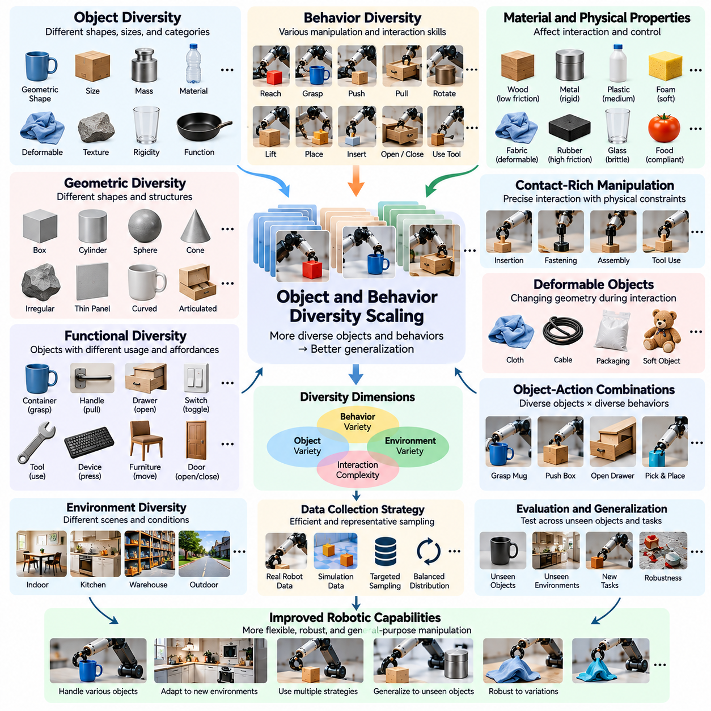{width="7.268055555555556in" height="7.268055555555556in"}

Object and behavior diversity scaling examines how increasing the variety of physical objects and robotic interaction patterns influences learning performance and generalization. Physical AI systems must operate on objects with different geometries, materials, functions, and mechanical properties. They must also execute multiple behaviors under changing conditions. Scaling these dimensions enables models to develop broader manipulation capabilities rather than memorizing actions associated with familiar objects.

Object diversity extends beyond the number of distinct items included in a dataset. Objects differ in shape, size, mass, texture, rigidity, friction, and deformability, all of which influence physical interaction. Two visually similar objects may require different grasping forces because their weights or surface properties differ. Effective scaling therefore requires representations that capture both observable appearance and interaction-relevant physical characteristics.

Behavior diversity describes the range of actions and interaction strategies represented in robotic training data. Common behaviors include reaching, grasping, pushing, pulling, rotating, lifting, placing, inserting, and manipulating articulated objects. Each behavior involves different combinations of perception, motion planning, force control, and feedback. Expanding behavioral coverage helps robots select appropriate actions across increasingly varied physical situations.

The relationship between object count and robotic capability is not necessarily proportional. Adding many objects with nearly identical shapes and mechanical properties may provide limited new information. Conversely, introducing a small number of objects with unusual geometry or contact behavior may significantly expand learning coverage. Object scaling should therefore consider physical diversity and interaction complexity rather than relying exclusively on category counts.

Geometric diversity plays a central role in manipulation learning because object shape determines feasible contact points and grasp configurations. Cylindrical containers, flat panels, irregular tools, and flexible packages require different manipulation strategies. Training across these geometries can improve spatial reasoning and grasp adaptation. However, models must learn generalizable geometric relationships rather than memorize object-specific poses or fixed contact locations.

Material diversity introduces additional challenges because interaction outcomes depend on physical properties that may not be directly visible. Metal, plastic, rubber, fabric, and glass exhibit different friction, compliance, and deformation characteristics. A manipulation policy must adapt contact forces and movement speeds accordingly. Learning these relationships requires combining visual observations with tactile, force, or motion feedback when such measurements are available.

Functional object diversity concerns how objects are intended to be used rather than only how they appear. Handles, switches, drawers, doors, and tools impose distinct interaction constraints and affordances. A robot must recognize which actions are possible and appropriate for each object. Scaling functional diversity encourages models to connect object structure with action opportunities, supporting more flexible and task-oriented behavior.

Behavioral diversity is particularly important when multiple strategies can achieve the same objective. An object may be repositioned through grasping, pushing, sliding, or controlled rotation. Different strategies involve different risks, precision requirements, and environmental dependencies. Training on alternative behaviors can help policies choose effective actions when preferred methods become unavailable or unsuitable.

Object and behavior diversity interact through the combinations of objects and actions represented during learning. A robot that grasps many objects but never pushes them may have limited understanding of pushing dynamics. Similarly, a robot trained to push only rigid blocks may struggle with deformable materials. Effective scaling must expand meaningful object-action combinations rather than increasing each dimension independently.

The number of possible object-action combinations grows rapidly as datasets become more diverse. Collecting every interaction across all objects, behaviors, and environmental conditions is generally impractical. Structured sampling can prioritize representative combinations based on geometry, material properties, task relevance, and expected learning value. Such approaches improve coverage while controlling the operational cost of physical data acquisition.

Affordance learning provides a useful framework for connecting object diversity with behavioral capabilities. An affordance describes an action opportunity supported by an object\'s properties and the robot\'s capabilities. A handle may support pulling, while a stable horizontal surface may support placing. Learning affordances across diverse objects helps robots predict feasible interactions without requiring an independent action rule for every object instance.

Contact-rich manipulation creates distinctive scaling challenges because small differences in geometry or force can change task outcomes. Insertion, fastening, folding, and tool use require precise coordination between motion and contact feedback. Training data must capture transitions between free motion, initial contact, sustained interaction, and release. Diverse contact experiences support policies that adapt to uncertain physical constraints.

Deformable objects introduce further complexity because their geometry changes during interaction. Cloth, cables, flexible packaging, and soft materials can bend, stretch, twist, or fold in response to applied forces. Their behavior often depends on interaction history and environmental constraints. Scaling deformable-object datasets therefore requires varied configurations, manipulation sequences, and observations that capture changing object states.

Articulated objects also require specialized coverage because their motion is constrained by joints, hinges, sliders, or linked components. Opening a drawer differs mechanically from rotating a door or operating a lever. Robots must infer movement constraints and apply forces along feasible directions. Exposure to different articulated mechanisms can improve generalization across unfamiliar objects with related kinematic structures.

Behavior diversity should include unsuccessful actions and recovery strategies alongside successful demonstrations. Failed grasps, slipping objects, unexpected collisions, and incomplete insertions reveal limitations that successful trajectories may not expose. Recovery behaviors demonstrate how to correct these situations without restarting the entire task. Such experiences improve robustness and help policies respond to unexpected physical outcomes.

Cross-object generalization measures whether a robot can apply learned behaviors to objects absent from its training dataset. Evaluation should include unfamiliar shapes, materials, dimensions, and functional configurations. Success on new object instances within familiar categories differs from success on entirely new object types. Distinguishing these evaluation conditions helps identify whether scaling produces transferable physical understanding or category-specific memorization.

Cross-behavior generalization examines whether previously learned interaction skills can support new combinations or sequences of actions. A robot familiar with grasping and rotation may be better prepared to manipulate unfamiliar tools or articulated mechanisms. However, combining known actions does not guarantee successful execution when contact dynamics or task constraints change. Evaluation must therefore include genuinely novel behavioral compositions.

Multimodal sensing can improve object and behavior diversity scaling by connecting appearance with physical interaction feedback. Vision estimates geometry and object identity, while tactile and force sensing provide information about contact, friction, and resistance. Proprioception records the robot\'s motion and configuration. Integrating these modalities helps models distinguish visually similar objects that require different manipulation strategies.

Simulation can expand object-action coverage by generating variations in geometry, mass, friction, stiffness, and contact conditions. Procedural asset generation and randomized physical parameters enable systematic experimentation across large interaction spaces. Nevertheless, simulated contact dynamics and deformable behavior may differ from reality. Real-world validation remains necessary to determine whether synthetic diversity improves physical manipulation performance.

Dataset balancing is important because frequently encountered objects and behaviors can dominate training. A model exposed mainly to rigid containers and simple grasps may perform poorly on flexible materials or precision insertion. Balanced sampling, targeted demonstrations, and difficulty-aware curricula can improve coverage of underrepresented interactions. The objective is not equal sampling in every case but sufficient exposure to operationally important capabilities.

Scaling experiments should distinguish the effects of object diversity, behavior diversity, and their interaction. Researchers can vary object categories while holding behaviors constant, then expand action types under comparable conditions. Performance should be evaluated on familiar and unseen object-action combinations. Such experiments reveal whether improvements arise from broader physical representations, richer behavioral skills, or their combined contribution.

Data quality becomes increasingly important as object and behavior diversity grows. Incorrect object attributes, inconsistent action labels, missing contact measurements, and poorly synchronized sensor streams can obscure meaningful relationships. Reliable metadata should describe object properties, interaction objectives, action representations, and observed outcomes. Quality-aware curation helps ensure that additional diversity contributes useful information rather than introducing contradictory training signals.

Ultimately, object and behavior diversity scaling aims to develop robotic intelligence that transfers physical knowledge across unfamiliar objects and interaction requirements. Increasing dataset size alone is insufficient when new examples repeat existing physical relationships. Effective scaling combines meaningful object variation, diverse action strategies, multimodal feedback, systematic coverage, and rigorous generalization testing to support adaptable and reliable Physical AI systems.

물체 및 행동 다양성 스케일링(Object and Behavior Diversity Scaling)은 물리적 물체(Physical Objects)와 로봇 상호작용 패턴(Robotic Interaction Patterns)의 다양성을 증가시키는 것이 학습 성능(Learning Performance)과 일반화(Generalization)에 어떤 영향을 미치는지 분석합니다. 피지컬 AI 시스템(Physical AI Systems)은 서로 다른 형상(Geometry), 재료(Materials), 기능(Functions), 기계적 특성(Mechanical Properties)을 가진 물체를 다룰 수 있어야 합니다. 또한 변화하는 조건에서 다양한 행동(Behaviors)을 실행해야 합니다. 이러한 차원을 확장하면 모델이 익숙한 물체에 연결된 행동을 암기하는 대신 폭넓은 조작 능력(Manipulation Capabilities)을 개발할 수 있습니다.

물체 다양성(Object Diversity)은 데이터셋(Dataset)에 포함된 서로 다른 물체의 수를 넘어서는 개념입니다. 물체는 형상(Shape), 크기(Size), 질량(Mass), 질감(Texture), 강성(Rigidity), 마찰(Friction), 변형 가능성(Deformability)이 서로 다르며, 이러한 특성은 모두 물리적 상호작용(Physical Interaction)에 영향을 미칩니다. 시각적으로 유사한 두 물체라도 무게나 표면 특성(Surface Properties)이 다르면 서로 다른 파지력(Grasping Forces)이 필요할 수 있습니다. 따라서 효과적인 스케일링(Effective Scaling)을 위해서는 관측 가능한 외형(Observable Appearance)과 상호작용에 중요한 물리적 특성(Interaction-Relevant Physical Characteristics)을 모두 포착하는 표현(Representations)이 필요합니다.

행동 다양성(Behavior Diversity)은 로봇 학습 데이터(Robotic Training Data)에 포함된 행동(Action)과 상호작용 전략(Interaction Strategies)의 범위를 설명합니다. 일반적인 행동에는 도달(Reaching), 파지(Grasping), 밀기(Pushing), 당기기(Pulling), 회전(Rotating), 들어 올리기(Lifting), 배치(Placing), 삽입(Inserting), 관절형 물체 조작(Manipulating Articulated Objects)이 포함됩니다. 각 행동은 인식(Perception), 동작 계획(Motion Planning), 힘 제어(Force Control), 피드백(Feedback)의 서로 다른 조합을 필요로 합니다. 행동 범위(Behavioral Coverage)를 확장하면 로봇이 더욱 다양한 물리적 상황에서 적절한 행동을 선택하는 데 도움이 됩니다.

물체 수(Object Count)와 로봇 능력(Robotic Capability) 사이의 관계는 반드시 비례하지 않습니다. 형상과 기계적 특성이 거의 동일한 물체를 많이 추가하더라도 새로운 정보는 제한적일 수 있습니다. 반대로 특이한 형상(Unusual Geometry)이나 접촉 거동(Contact Behavior)을 가진 소수의 물체를 도입하면 학습 범위(Learning Coverage)가 크게 확장될 수 있습니다. 따라서 물체 스케일링(Object Scaling)은 단순히 물체 범주 수(Category Counts)에 의존하기보다 물리적 다양성(Physical Diversity)과 상호작용 복잡성(Interaction Complexity)을 고려해야 합니다.

기하학적 다양성(Geometric Diversity)은 물체 형상(Object Shape)이 실행 가능한 접촉점(Feasible Contact Points)과 파지 구성(Grasp Configurations)을 결정하기 때문에 조작 학습(Manipulation Learning)에서 핵심적인 역할을 합니다. 원통형 용기(Cylindrical Containers), 평판(Flat Panels), 불규칙한 도구(Irregular Tools), 유연한 포장재(Flexible Packages)는 서로 다른 조작 전략(Manipulation Strategies)을 요구합니다. 이러한 형상에 걸쳐 학습하면 공간 추론(Spatial Reasoning)과 파지 적응(Grasp Adaptation)이 향상될 수 있습니다. 그러나 모델은 물체별 자세(Object-Specific Poses)나 고정된 접촉 위치(Fixed Contact Locations)를 암기하기보다 일반화 가능한 기하학적 관계(Generalizable Geometric Relationships)를 학습해야 합니다.

재료 다양성(Material Diversity)은 상호작용 결과(Interaction Outcomes)가 직접적으로 보이지 않을 수 있는 물리적 특성(Physical Properties)에 의존하기 때문에 추가적인 과제를 발생시킵니다. 금속(Metal), 플라스틱(Plastic), 고무(Rubber), 직물(Fabric), 유리(Glass)는 서로 다른 마찰(Friction), 순응성(Compliance), 변형 특성(Deformation Characteristics)을 나타냅니다. 조작 정책(Manipulation Policy)은 이에 따라 접촉력(Contact Forces)과 이동 속도(Movement Speeds)를 조절해야 합니다. 이러한 관계를 학습하려면 관련 측정값을 사용할 수 있는 경우 시각적 관측(Visual Observations)을 촉각(Tactile), 힘(Force), 동작 피드백(Motion Feedback)과 결합해야 합니다.

기능적 물체 다양성(Functional Object Diversity)은 물체의 외형뿐만 아니라 물체가 어떤 용도로 사용되는지에 관한 개념입니다. 손잡이(Handles), 스위치(Switches), 서랍(Drawers), 문(Doors), 도구(Tools)는 서로 다른 상호작용 제약(Interaction Constraints)과 행동 가능성(Affordances)을 부여합니다. 로봇은 각 물체에 대해 어떤 행동이 가능하고 적절한지 인식해야 합니다. 기능적 다양성의 확장(Functional Diversity Scaling)은 모델이 물체 구조(Object Structure)와 행동 기회(Action Opportunities)를 연결하도록 촉진하여 더욱 유연하고 작업 지향적인 행동(Task-Oriented Behavior)을 지원합니다.

행동 다양성(Behavioral Diversity)은 동일한 목표(Objective)를 달성할 수 있는 전략이 여러 가지 존재할 때 특히 중요합니다. 물체는 파지(Grasping), 밀기(Pushing), 미끄러뜨리기(Sliding), 제어된 회전(Controlled Rotation)을 통해 위치를 변경할 수 있습니다. 서로 다른 전략은 각기 다른 위험(Risks), 정밀도 요구사항(Precision Requirements), 환경 의존성(Environmental Dependencies)을 가집니다. 대안적인 행동(Alternative Behaviors)을 학습하면 선호하는 방법이 사용 불가능하거나 적합하지 않을 때 정책(Policies)이 효과적인 행동을 선택하는 데 도움이 됩니다.

물체 다양성(Object Diversity)과 행동 다양성(Behavior Diversity)은 학습 과정에서 표현되는 물체와 행동의 조합(Object-Action Combinations)을 통해 상호작용합니다. 여러 물체를 파지하지만 밀어 본 경험이 없는 로봇은 밀기 동역학(Pushing Dynamics)에 대한 이해가 제한적일 수 있습니다. 마찬가지로 단단한 블록(Rigid Blocks)만 밀도록 학습된 로봇은 변형 가능한 재료(Deformable Materials)를 다루는 데 어려움을 겪을 수 있습니다. 효과적인 스케일링은 각 차원을 독립적으로 증가시키기보다 의미 있는 물체-행동 조합을 확장해야 합니다.

데이터셋(Datasets)이 다양해질수록 가능한 물체-행동 조합(Possible Object-Action Combinations)의 수는 빠르게 증가합니다. 모든 물체, 행동, 환경 조건(Environmental Conditions)에 걸친 모든 상호작용을 수집하는 것은 일반적으로 비현실적입니다. 구조화된 샘플링(Structured Sampling)은 형상(Geometry), 재료 특성(Material Properties), 작업 관련성(Task Relevance), 예상 학습 가치(Expected Learning Value)를 기준으로 대표적인 조합(Representative Combinations)에 우선순위를 부여할 수 있습니다. 이러한 접근법은 물리적 데이터 획득(Physical Data Acquisition)의 운영 비용(Operational Cost)을 통제하면서 학습 범위(Coverage)를 개선합니다.

행동 가능성 학습(Affordance Learning)은 물체 다양성(Object Diversity)과 행동 능력(Behavioral Capabilities)을 연결하는 유용한 프레임워크(Framework)를 제공합니다. 행동 가능성(Affordance)은 물체의 특성과 로봇의 능력(Robot Capabilities)이 허용하는 행동 기회(Action Opportunity)를 의미합니다. 손잡이(Handle)는 당기기(Pulling)를 가능하게 하며, 안정적인 수평 표면(Stable Horizontal Surface)은 물체 배치(Placing)를 가능하게 할 수 있습니다. 다양한 물체에 걸쳐 행동 가능성을 학습하면 로봇이 모든 물체 인스턴스(Object Instance)에 대해 독립적인 행동 규칙(Action Rule)을 필요로 하지 않고 실행 가능한 상호작용(Feasible Interactions)을 예측할 수 있습니다.

접촉 중심 조작(Contact-Rich Manipulation)은 형상이나 힘의 작은 차이가 작업 결과(Task Outcomes)를 변화시킬 수 있기 때문에 고유한 스케일링 과제를 발생시킵니다. 삽입(Insertion), 체결(Fastening), 접기(Folding), 도구 사용(Tool Use)은 움직임(Motion)과 접촉 피드백(Contact Feedback) 사이의 정밀한 조정을 요구합니다. 학습 데이터(Training Data)는 자유 운동(Free Motion), 초기 접촉(Initial Contact), 지속적인 상호작용(Sustained Interaction), 접촉 해제(Release) 사이의 상태 전이(Transitions)를 포착해야 합니다. 다양한 접촉 경험(Contact Experiences)은 불확실한 물리적 제약(Physical Constraints)에 적응하는 정책을 지원합니다.

변형 가능한 물체(Deformable Objects)는 상호작용 중 형상이 변화하기 때문에 추가적인 복잡성을 발생시킵니다. 천(Cloth), 케이블(Cables), 유연한 포장재(Flexible Packaging), 연질 재료(Soft Materials)는 가해지는 힘(Applied Forces)에 따라 굽혀지거나 늘어나거나 비틀리거나 접힐 수 있습니다. 이러한 물체의 거동(Behavior)은 상호작용 이력(Interaction History)과 환경 제약(Environmental Constraints)에 의존하는 경우가 많습니다. 따라서 변형 가능 물체 데이터셋 스케일링(Deformable-Object Dataset Scaling)에는 다양한 구성(Configurations), 조작 시퀀스(Manipulation Sequences), 변화하는 물체 상태(Object States)를 포착하는 관측이 필요합니다.

관절형 물체(Articulated Objects) 역시 관절(Joints), 힌지(Hinges), 슬라이더(Sliders), 연결된 구성요소(Linked Components)에 의해 움직임이 제한되므로 특화된 학습 범위(Specialized Coverage)가 필요합니다. 서랍을 여는 동작은 문을 회전시키거나 레버(Lever)를 조작하는 동작과 기계적으로 다릅니다. 로봇은 움직임 제약(Movement Constraints)을 추론하고 실행 가능한 방향(Feasible Directions)으로 힘을 가해야 합니다. 서로 다른 관절 메커니즘(Articulated Mechanisms)에 대한 경험은 관련된 운동학적 구조(Kinematic Structures)를 가진 익숙하지 않은 물체에 대한 일반화(Generalization)를 개선할 수 있습니다.

행동 다양성(Behavior Diversity)에는 성공적인 시연(Successful Demonstrations)뿐만 아니라 실패한 행동(Unsuccessful Actions)과 복구 전략(Recovery Strategies)도 포함되어야 합니다. 파지 실패(Failed Grasps), 물체 미끄러짐(Slipping Objects), 예상하지 못한 충돌(Unexpected Collisions), 불완전한 삽입(Incomplete Insertions)은 성공 궤적(Successful Trajectories)만으로는 드러나지 않는 한계를 보여줍니다. 복구 행동(Recovery Behaviors)은 전체 작업을 처음부터 다시 시작하지 않고 이러한 상황을 교정하는 방법을 보여줍니다. 이러한 경험은 강건성(Robustness)을 개선하고 정책이 예상하지 못한 물리적 결과(Physical Outcomes)에 대응하도록 돕습니다.

교차 물체 일반화(Cross-Object Generalization)는 로봇이 학습 데이터셋(Training Dataset)에 포함되지 않은 물체에 학습된 행동(Learned Behaviors)을 적용할 수 있는지를 측정합니다. 평가(Evaluation)에는 익숙하지 않은 형상(Shapes), 재료(Materials), 치수(Dimensions), 기능적 구성(Functional Configurations)이 포함되어야 합니다. 익숙한 범주(Familiar Categories)에 속한 새로운 물체 인스턴스(New Object Instances)에서의 성공은 완전히 새로운 물체 유형(Entirely New Object Types)에서의 성공과 다릅니다. 이러한 평가 조건(Evaluation Conditions)을 구분하면 스케일링이 전이 가능한 물리적 이해(Transferable Physical Understanding)를 형성하는지, 아니면 범주별 암기(Category-Specific Memorization)에 그치는지 파악할 수 있습니다.

교차 행동 일반화(Cross-Behavior Generalization)는 이전에 학습된 상호작용 기술(Interaction Skills)이 새로운 행동 조합(New Action Combinations)이나 행동 시퀀스(Action Sequences)를 지원할 수 있는지를 분석합니다. 파지(Grasping)와 회전(Rotation)에 익숙한 로봇은 익숙하지 않은 도구(Unfamiliar Tools)나 관절형 메커니즘(Articulated Mechanisms)을 조작하는 데 더 잘 준비되어 있을 수 있습니다. 그러나 접촉 동역학(Contact Dynamics)이나 작업 제약(Task Constraints)이 달라지면 이미 알고 있는 행동을 결합하더라도 성공적인 실행이 보장되지는 않습니다. 따라서 평가에는 실제로 새로운 행동 조합(Novel Behavioral Compositions)이 포함되어야 합니다.

멀티모달 센싱(Multimodal Sensing)은 물체의 외형(Appearance)과 물리적 상호작용 피드백(Physical Interaction Feedback)을 연결하여 물체 및 행동 다양성 스케일링(Object and Behavior Diversity Scaling)을 개선할 수 있습니다. 시각(Vision)은 형상(Geometry)과 물체 정체성(Object Identity)을 추정하고, 촉각 및 힘 센싱(Tactile and Force Sensing)은 접촉(Contact), 마찰(Friction), 저항(Resistance)에 관한 정보를 제공합니다. 고유수용성 감각(Proprioception)은 로봇의 움직임(Motion)과 구성(Configuration)을 기록합니다. 이러한 모달리티(Modalities)를 통합하면 모델이 시각적으로 유사하지만 서로 다른 조작 전략(Manipulation Strategies)을 요구하는 물체를 구분하는 데 도움이 됩니다.

시뮬레이션(Simulation)은 형상(Geometry), 질량(Mass), 마찰(Friction), 강성(Stiffness), 접촉 조건(Contact Conditions)의 변화를 생성하여 물체-행동 범위(Object-Action Coverage)를 확장할 수 있습니다. 절차적 자산 생성(Procedural Asset Generation)과 무작위화된 물리적 매개변수(Randomized Physical Parameters)는 대규모 상호작용 공간(Large Interaction Spaces)에 걸친 체계적인 실험(Systematic Experimentation)을 가능하게 합니다. 그러나 시뮬레이션된 접촉 동역학(Simulated Contact Dynamics)과 변형 거동(Deformable Behavior)은 현실과 다를 수 있습니다. 합성 다양성(Synthetic Diversity)이 실제 물리적 조작 성능(Physical Manipulation Performance)을 개선하는지 판단하려면 실세계 검증(Real-World Validation)이 여전히 필요합니다.

자주 등장하는 물체와 행동(Frequently Encountered Objects and Behaviors)이 학습을 지배할 수 있으므로 데이터셋 균형(Dataset Balancing)이 중요합니다. 주로 단단한 용기(Rigid Containers)와 단순한 파지(Simple Grasps)에 노출된 모델은 유연한 재료(Flexible Materials)나 정밀 삽입(Precision Insertion)에서 성능이 저하될 수 있습니다. 균형 샘플링(Balanced Sampling), 표적 시연(Targeted Demonstrations), 난이도 인식 커리큘럼(Difficulty-Aware Curricula)은 충분히 표현되지 않은 상호작용(Underrepresented Interactions)의 학습 범위를 개선할 수 있습니다. 목표는 모든 경우에 동일한 비율로 샘플링하는 것이 아니라 운영상 중요한 능력(Operationally Important Capabilities)에 충분히 노출되도록 하는 것입니다.

스케일링 실험(Scaling Experiments)에서는 물체 다양성(Object Diversity), 행동 다양성(Behavior Diversity), 두 요소 사이의 상호작용(Interaction)이 미치는 영향을 구분해야 합니다. 연구자들은 행동을 일정하게 유지하면서 물체 범주(Object Categories)를 변화시킨 다음 유사한 조건에서 행동 유형(Action Types)을 확장할 수 있습니다. 성능은 익숙한 물체-행동 조합(Familiar Object-Action Combinations)과 학습에서 보지 못한 조합(Unseen Combinations) 모두에서 평가해야 합니다. 이러한 실험은 성능 향상이 더 폭넓은 물리적 표현(Physical Representations), 풍부한 행동 기술(Behavioral Skills), 또는 두 요소의 결합된 기여(Combined Contribution)에서 비롯되는지를 보여줍니다.

물체 및 행동 다양성(Object and Behavior Diversity)이 증가할수록 데이터 품질(Data Quality)의 중요성도 커집니다. 잘못된 물체 속성(Incorrect Object Attributes), 일관되지 않은 행동 레이블(Inconsistent Action Labels), 누락된 접촉 측정값(Missing Contact Measurements), 동기화가 불량한 센서 스트림(Poorly Synchronized Sensor Streams)은 의미 있는 관계를 불분명하게 만들 수 있습니다. 신뢰할 수 있는 메타데이터(Reliable Metadata)는 물체 특성(Object Properties), 상호작용 목표(Interaction Objectives), 행동 표현(Action Representations), 관측된 결과(Observed Outcomes)를 설명해야 합니다. 품질 인식 데이터 큐레이션(Quality-Aware Data Curation)은 추가적인 다양성이 상충되는 학습 신호(Contradictory Training Signals)를 도입하는 대신 유용한 정보를 제공하도록 돕습니다.

궁극적으로 물체 및 행동 다양성 스케일링(Object and Behavior Diversity Scaling)은 익숙하지 않은 물체와 상호작용 요구사항(Interaction Requirements) 전반에 걸쳐 물리적 지식(Physical Knowledge)을 전이할 수 있는 로봇 지능(Robotic Intelligence)을 개발하는 것을 목표로 합니다. 새로운 예제가 기존의 물리적 관계(Physical Relationships)를 반복하는 경우 데이터셋 크기(Dataset Size)를 증가시키는 것만으로는 충분하지 않습니다. 효과적인 스케일링(Effective Scaling)은 의미 있는 물체 변화(Object Variation), 다양한 행동 전략(Action Strategies), 멀티모달 피드백(Multimodal Feedback), 체계적인 학습 범위(Systematic Coverage), 엄격한 일반화 시험(Rigorous Generalization Testing)을 결합하여 적응 가능하고 신뢰할 수 있는 피지컬 AI 시스템(Physical AI Systems)을 지원합니다.

##  

## 07.07. Robot and Embodiment Scaling

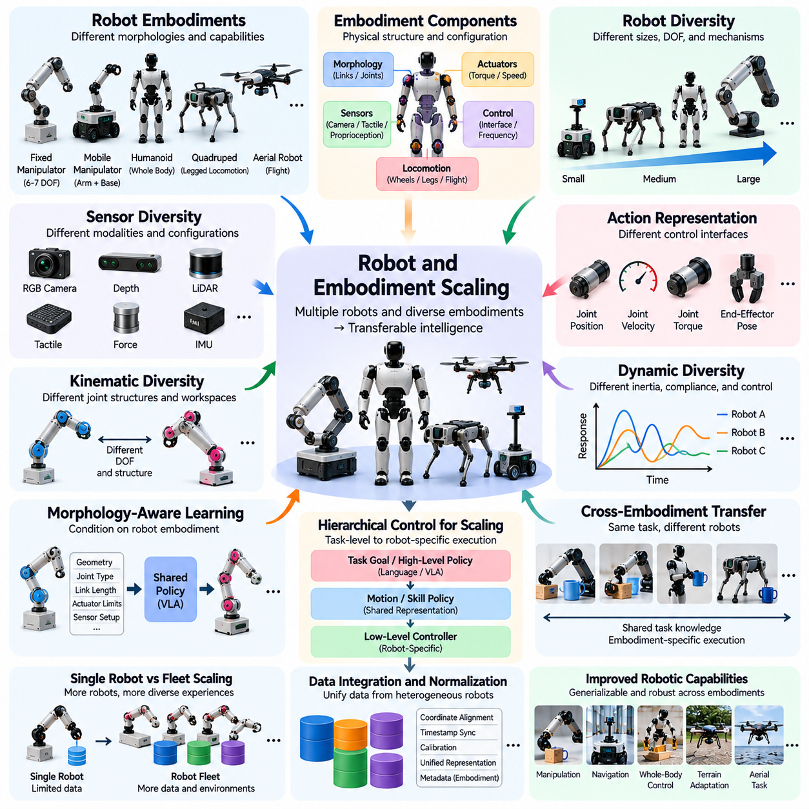{width="7.268055555555556in" height="7.268055555555556in"}

Robot and embodiment scaling examines how increasing the number and diversity of robotic platforms influences learning, generalization, and transferable intelligence. Unlike conventional AI systems operating through standardized digital interfaces, robots possess different physical structures and control mechanisms. Scaling across embodiments requires models to learn shared behavioral principles while respecting the mechanical constraints and operational characteristics of each robot.

Embodiment refers to the physical configuration through which an intelligent system perceives and interacts with its environment. It includes morphology, joint arrangements, actuators, sensors, locomotion mechanisms, and manipulation capabilities. A robot\'s embodiment determines which actions are physically possible and how those actions affect the environment. Consequently, learned intelligence cannot be separated completely from the body executing it.

Robot diversity introduces variations in size, mass, degrees of freedom, kinematic structure, and dynamic response. Industrial manipulators, mobile robots, humanoids, quadrupeds, and aerial robots operate through substantially different mechanical systems. Their observations and action spaces may also differ. Effective scaling must distinguish knowledge that can be shared across platforms from capabilities that depend on specific hardware configurations.

Increasing the number of robots contributing training data can expand the range of physical experiences available to a learning system. Multiple platforms may encounter different objects, tasks, environments, and failure conditions. Aggregating these experiences can improve coverage and reduce dependence on a single robot configuration. However, simply combining recordings does not guarantee useful transfer when their representations and control conventions are incompatible.

Cross-embodiment learning seeks representations that preserve common task knowledge despite differences in robot morphology. For example, two manipulators may perform the same object-placement task using different joint trajectories. A shared model should recognize the common objective while generating actions appropriate to each mechanism. This requires separating task-level intentions from embodiment-specific execution and control constraints.

Kinematic diversity is a fundamental challenge because robots possess different joint structures, link lengths, reachable workspaces, and motion constraints. A six-axis industrial arm cannot directly reproduce every configuration available to a seven-axis manipulator. Joint-space actions are therefore difficult to transfer without adaptation. Task-space representations and inverse kinematics can provide useful interfaces, although feasibility remains embodiment dependent.

Dynamic diversity introduces differences in inertia, actuator torque, friction, compliance, and control bandwidth. Robots with similar geometry may respond differently to identical commands because their mechanical and electrical properties differ. Policies must account for these characteristics to maintain stable and accurate motion. Scaling across dynamic systems therefore requires adaptation beyond simple coordinate transformations or geometric normalization.

Sensor diversity further complicates robot scaling because platforms may use different cameras, depth sensors, force sensors, tactile arrays, and proprioceptive measurements. Sensor placement, resolution, sampling frequency, and calibration influence the resulting observations. Shared learning requires representations that preserve relevant information despite these differences. Missing modalities must also be considered when deploying a model on robots with limited sensing capabilities.

Action representation is particularly important for cross-robot transfer. Some robots accept joint positions, while others require velocities, torques, end-effector poses, or high-level motion commands. A unified policy may use abstract action targets that are translated into robot-specific commands. Such interfaces can improve interoperability, but the translation must preserve timing, feasibility, and safety under each platform\'s control architecture.

Morphology-aware learning explicitly incorporates robot structure into the model\'s inputs or internal representations. Joint connectivity, link geometry, actuator properties, and sensor configuration can be encoded as embodiment descriptors. These descriptors allow a shared model to condition its predictions on the physical system being controlled. The objective is to learn reusable behavior without assuming that all robots possess identical bodies or action capabilities.

Robot scaling can also involve increasing the number of identical platforms rather than introducing new embodiments. A fleet of similar robots can collect parallel experiences across many locations and operating conditions. This improves data throughput and exposes the model to environmental variation. Nevertheless, fleet-scale learning still requires consistent calibration, software versions, logging conventions, and procedures for identifying hardware degradation.

Heterogeneous robot fleets provide broader experience but introduce additional integration complexity. A mobile manipulator may combine navigation and grasping, while a humanoid coordinates locomotion, balance, and dexterous manipulation. Combining their datasets requires explicit descriptions of task objectives, physical capabilities, and control interfaces. Without appropriate normalization, apparent behavioral differences may reflect hardware limitations rather than learning quality.

Cross-embodiment transfer can be organized through hierarchical control architectures. A high-level policy selects task goals or motion objectives, while lower-level controllers convert them into feasible robot-specific actions. This separation enables shared planning knowledge to operate across different mechanisms. However, high-level goals must remain achievable within each robot\'s workspace, stability limits, and available actuation capabilities.

Simulation provides an efficient environment for studying embodiment scaling because virtual robots can be modified without constructing new hardware. Researchers can vary link lengths, joint limits, actuator strengths, sensor placements, and body proportions. Training across these configurations may improve morphological robustness. However, simulation results must be validated on physical platforms because modeled dynamics and contact interactions can differ from reality.

Embodiment randomization extends domain randomization by varying robot morphology and mechanical parameters during training. A policy exposed to multiple configurations may learn behaviors that tolerate structural differences. This can improve transfer to related robots, particularly when variation remains within feasible mechanical ranges. Excessive randomization, however, may create incompatible control requirements and reduce learning efficiency.

Data standardization is essential when scaling learning across multiple robot platforms. Recorded trajectories should include robot identity, morphology metadata, coordinate frames, joint definitions, sensor calibration, action units, and control frequencies. Standardized schemas allow datasets to be interpreted consistently and reduce integration errors. They also support reproducibility when comparing learning outcomes across different embodiments.

Cross-robot generalization must be evaluated on platforms that were not included in training. Testing only additional units of familiar robot models measures fleet transfer rather than true embodiment transfer. Stronger evaluations introduce unfamiliar joint configurations, actuator characteristics, or sensing arrangements. Performance should be assessed through task completion, motion accuracy, safety, and adaptation requirements rather than action prediction alone.

Model capacity influences how effectively shared policies can represent multiple embodiments. A small model may struggle to accommodate conflicting action mappings or diverse physical constraints. Larger architectures may capture more reusable relationships, but additional parameters do not automatically resolve representation mismatches. Effective scaling depends on suitable conditioning mechanisms, balanced datasets, and optimization methods that prevent dominant platforms from overwhelming smaller groups.

Embodiment diversity can produce both positive and negative transfer. Shared experiences may improve perception, object understanding, and task planning, while incompatible motion patterns may interfere with control learning. These effects depend on how much structure the robots share and which model components are transferred. Separating universal task knowledge from embodiment-dependent control can reduce interference and improve training efficiency.

Few-shot adaptation offers a practical approach when deploying shared models on new robots. A pretrained policy may require a limited collection of demonstrations, calibration trials, or interaction episodes to adjust to unfamiliar hardware. Adaptation can involve fine-tuning, parameter conditioning, or learning a robot-specific control interface. Its effectiveness should be measured through the amount of new data and physical experimentation required.

Safety becomes increasingly important as policies transfer between embodiments. An action feasible for one robot may exceed another platform\'s torque limits, joint ranges, or stability margins. Shared models therefore require robot-specific safety constraints and execution monitoring. Validation should include collision avoidance, actuator limits, emergency stopping, and recovery behavior before deploying transferred policies in uncontrolled environments.

The economic benefits of embodiment scaling depend on whether shared learning reduces the cost of developing intelligence for additional robot platforms. Training a separate model for every morphology can duplicate data collection and computational effort. Shared representations may lower these costs, but integration, calibration, and adaptation introduce additional engineering requirements. Scaling strategies should evaluate transfer efficiency alongside operational reliability.

Ultimately, robot and embodiment scaling aims to transform experiences collected across diverse physical platforms into reusable robotic intelligence. Its success depends not merely on the number of robots or morphologies represented, but on the compatibility of data, representations, control interfaces, and physical capabilities. Effective scaling combines standardized datasets, morphology-aware models, adaptive control, and rigorous transfer evaluation to support reliable intelligence across heterogeneous robots.

로봇 및 체화 스케일링(Robot and Embodiment Scaling)은 로봇 플랫폼(Robotic Platforms)의 수와 다양성을 증가시키는 것이 학습(Learning), 일반화(Generalization), 전이 가능한 지능(Transferable Intelligence)에 어떤 영향을 미치는지 분석합니다. 표준화된 디지털 인터페이스(Standardized Digital Interfaces)를 통해 작동하는 기존 인공지능 시스템(Conventional AI Systems)과 달리 로봇은 서로 다른 물리적 구조(Physical Structures)와 제어 메커니즘(Control Mechanisms)을 가지고 있습니다. 체화 간 스케일링(Cross-Embodiment Scaling)을 위해서는 각 로봇의 기계적 제약(Mechanical Constraints)과 운영 특성(Operational Characteristics)을 준수하면서 공통적인 행동 원리(Shared Behavioral Principles)를 학습해야 합니다.

체화(Embodiment)는 지능형 시스템(Intelligent System)이 환경을 인식하고 상호작용하는 데 사용하는 물리적 구성(Physical Configuration)을 의미합니다. 여기에는 형태(Morphology), 관절 배치(Joint Arrangements), 액추에이터(Actuators), 센서(Sensors), 이동 메커니즘(Locomotion Mechanisms), 조작 능력(Manipulation Capabilities)이 포함됩니다. 로봇의 체화는 어떤 행동이 물리적으로 가능한지와 이러한 행동이 환경에 어떤 영향을 미치는지를 결정합니다. 따라서 학습된 지능(Learned Intelligence)은 이를 실행하는 신체(Body)와 완전히 분리될 수 없습니다.

로봇 다양성(Robot Diversity)은 크기(Size), 질량(Mass), 자유도(Degrees of Freedom), 운동학적 구조(Kinematic Structure), 동적 응답(Dynamic Response)의 차이를 발생시킵니다. 산업용 매니퓰레이터(Industrial Manipulators), 모바일 로봇(Mobile Robots), 휴머노이드(Humanoids), 사족보행 로봇(Quadrupeds), 비행 로봇(Aerial Robots)은 상당히 다른 기계 시스템(Mechanical Systems)을 통해 작동합니다. 이들의 관측 공간(Observation Spaces)과 행동 공간(Action Spaces)도 서로 다를 수 있습니다. 효과적인 스케일링(Effective Scaling)은 플랫폼 간에 공유할 수 있는 지식(Shared Knowledge)과 특정 하드웨어 구성(Hardware Configurations)에 의존하는 능력을 구분해야 합니다.

학습 데이터(Training Data)를 제공하는 로봇의 수를 증가시키면 학습 시스템(Learning System)이 활용할 수 있는 물리적 경험(Physical Experiences)의 범위가 확장될 수 있습니다. 여러 플랫폼은 서로 다른 물체(Objects), 작업(Tasks), 환경(Environments), 실패 조건(Failure Conditions)을 경험할 수 있습니다. 이러한 경험을 통합(Aggregation)하면 데이터 범위(Coverage)가 개선되고 단일 로봇 구성(Single Robot Configuration)에 대한 의존도가 감소할 수 있습니다. 그러나 데이터 표현(Representations)과 제어 규약(Control Conventions)이 호환되지 않는다면 기록을 단순히 결합하는 것만으로는 유용한 전이(Useful Transfer)가 보장되지 않습니다.

교차 체화 학습(Cross-Embodiment Learning)은 로봇 형태(Robot Morphology)의 차이에도 불구하고 공통적인 작업 지식(Common Task Knowledge)을 보존하는 표현(Representations)을 추구합니다. 예를 들어 두 매니퓰레이터(Manipulators)는 서로 다른 관절 궤적(Joint Trajectories)을 사용하여 동일한 물체 배치 작업(Object-Placement Task)을 수행할 수 있습니다. 공유 모델(Shared Model)은 공통 목표(Common Objective)를 인식하면서 각 메커니즘에 적합한 행동을 생성해야 합니다. 이를 위해서는 작업 수준 의도(Task-Level Intentions)를 체화별 실행(Embodiment-Specific Execution) 및 제어 제약(Control Constraints)과 분리해야 합니다.

운동학적 다양성(Kinematic Diversity)은 로봇마다 관절 구조(Joint Structures), 링크 길이(Link Lengths), 도달 가능한 작업 공간(Reachable Workspaces), 움직임 제약(Motion Constraints)이 다르기 때문에 근본적인 과제가 됩니다. 6축 산업용 로봇 팔(Six-Axis Industrial Arm)은 7축 매니퓰레이터(Seven-Axis Manipulator)가 구현할 수 있는 모든 구성을 직접 재현할 수 없습니다. 따라서 관절 공간 행동(Joint-Space Actions)은 적응(Adaptation) 없이 전이하기 어렵습니다. 작업 공간 표현(Task-Space Representations)과 역운동학(Inverse Kinematics)은 유용한 인터페이스를 제공할 수 있지만 실행 가능성(Feasibility)은 여전히 체화에 따라 달라집니다.

동역학적 다양성(Dynamic Diversity)은 관성(Inertia), 액추에이터 토크(Actuator Torque), 마찰(Friction), 순응성(Compliance), 제어 대역폭(Control Bandwidth)의 차이를 발생시킵니다. 형상이 유사한 로봇이라도 기계적 특성(Mechanical Properties)과 전기적 특성(Electrical Properties)이 다르면 동일한 명령에 서로 다르게 반응할 수 있습니다. 정책(Policies)은 안정적이고 정확한 움직임(Stable and Accurate Motion)을 유지하기 위해 이러한 특성을 고려해야 합니다. 따라서 동역학 시스템(Dynamic Systems) 간 스케일링에는 단순한 좌표 변환(Coordinate Transformations)이나 기하학적 정규화(Geometric Normalization)를 넘어서는 적응이 필요합니다.

센서 다양성(Sensor Diversity)은 플랫폼마다 카메라(Cameras), 깊이 센서(Depth Sensors), 힘 센서(Force Sensors), 촉각 배열(Tactile Arrays), 고유수용성 측정값(Proprioceptive Measurements)이 다를 수 있기 때문에 로봇 스케일링(Robot Scaling)을 더욱 복잡하게 만듭니다. 센서 배치(Sensor Placement), 해상도(Resolution), 샘플링 주파수(Sampling Frequency), 보정(Calibration)은 관측 결과에 영향을 미칩니다. 공유 학습(Shared Learning)을 위해서는 이러한 차이에도 불구하고 관련 정보를 보존하는 표현이 필요합니다. 또한 센싱 능력이 제한된 로봇에 모델을 배포할 때는 누락된 모달리티(Missing Modalities)도 고려해야 합니다.

행동 표현(Action Representation)은 로봇 간 전이(Cross-Robot Transfer)에서 특히 중요합니다. 일부 로봇은 관절 위치(Joint Positions)를 입력받지만 다른 로봇은 속도(Velocities), 토크(Torques), 엔드이펙터 자세(End-Effector Poses), 상위 수준 동작 명령(High-Level Motion Commands)을 요구합니다. 통합 정책(Unified Policy)은 로봇별 명령(Robot-Specific Commands)으로 변환되는 추상적 행동 목표(Abstract Action Targets)를 사용할 수 있습니다. 이러한 인터페이스는 상호운용성(Interoperability)을 개선할 수 있지만 변환 과정에서 각 플랫폼의 제어 아키텍처(Control Architecture)에 따른 시간적 일관성(Timing), 실행 가능성(Feasibility), 안전성(Safety)을 유지해야 합니다.

형태 인식 학습(Morphology-Aware Learning)은 로봇 구조(Robot Structure)를 모델의 입력(Inputs)이나 내부 표현(Internal Representations)에 명시적으로 포함합니다. 관절 연결성(Joint Connectivity), 링크 형상(Link Geometry), 액추에이터 특성(Actuator Properties), 센서 구성(Sensor Configuration)은 체화 기술자(Embodiment Descriptors)로 인코딩할 수 있습니다. 이러한 기술자를 사용하면 공유 모델이 제어 대상인 물리적 시스템(Physical System)에 따라 예측을 조건화(Conditioning)할 수 있습니다. 목표는 모든 로봇이 동일한 신체나 행동 능력(Action Capabilities)을 가지고 있다고 가정하지 않으면서 재사용 가능한 행동(Reusable Behavior)을 학습하는 것입니다.

로봇 스케일링(Robot Scaling)은 새로운 체화(New Embodiments)를 도입하는 대신 동일한 플랫폼(Identical Platforms)의 수를 증가시키는 방식으로도 이루어질 수 있습니다. 유사한 로봇으로 구성된 플릿(Fleet)은 여러 위치와 운영 조건(Operating Conditions)에서 병렬 경험(Parallel Experiences)을 수집할 수 있습니다. 이는 데이터 처리량(Data Throughput)을 높이고 모델을 환경 변화(Environmental Variation)에 노출시킵니다. 그러나 플릿 규모 학습(Fleet-Scale Learning)에서도 일관된 보정(Calibration), 소프트웨어 버전(Software Versions), 로깅 규약(Logging Conventions), 하드웨어 성능 저하(Hardware Degradation)를 식별하는 절차가 필요합니다.

이기종 로봇 플릿(Heterogeneous Robot Fleets)은 더 폭넓은 경험을 제공하지만 추가적인 통합 복잡성(Integration Complexity)을 발생시킵니다. 모바일 매니퓰레이터(Mobile Manipulator)는 내비게이션(Navigation)과 파지(Grasping)를 결합할 수 있으며, 휴머노이드(Humanoid)는 이동(Locomotion), 균형(Balance), 정교한 조작(Dexterous Manipulation)을 조정합니다. 이들의 데이터셋을 결합하려면 작업 목표(Task Objectives), 물리적 능력(Physical Capabilities), 제어 인터페이스(Control Interfaces)에 대한 명시적인 설명이 필요합니다. 적절한 정규화(Normalization)가 없다면 겉으로 드러나는 행동 차이(Behavioral Differences)는 학습 품질(Learning Quality)이 아니라 하드웨어 한계(Hardware Limitations)를 반영할 수 있습니다.

교차 체화 전이(Cross-Embodiment Transfer)는 계층적 제어 아키텍처(Hierarchical Control Architectures)를 통해 구성할 수 있습니다. 상위 수준 정책(High-Level Policy)은 작업 목표(Task Goals)나 동작 목표(Motion Objectives)를 선택하고, 하위 수준 제어기(Lower-Level Controllers)는 이를 실행 가능한 로봇별 행동(Robot-Specific Actions)으로 변환합니다. 이러한 분리는 공유된 계획 지식(Shared Planning Knowledge)이 서로 다른 메커니즘에서 작동할 수 있도록 합니다. 그러나 상위 수준 목표는 각 로봇의 작업 공간(Workspace), 안정성 한계(Stability Limits), 사용 가능한 구동 능력(Available Actuation Capabilities) 내에서 달성 가능해야 합니다.

시뮬레이션(Simulation)은 새로운 하드웨어를 제작하지 않고도 가상 로봇(Virtual Robots)을 변경할 수 있기 때문에 체화 스케일링(Embodiment Scaling)을 연구하는 효율적인 환경을 제공합니다. 연구자들은 링크 길이(Link Lengths), 관절 한계(Joint Limits), 액추에이터 출력(Actuator Strengths), 센서 배치(Sensor Placements), 신체 비율(Body Proportions)을 변화시킬 수 있습니다. 이러한 구성에 걸친 학습은 형태적 강건성(Morphological Robustness)을 개선할 수 있습니다. 그러나 모델링된 동역학(Modeled Dynamics)과 접촉 상호작용(Contact Interactions)이 현실과 다를 수 있으므로 시뮬레이션 결과는 물리적 플랫폼(Physical Platforms)에서 검증해야 합니다.

체화 무작위화(Embodiment Randomization)는 학습 과정에서 로봇 형태(Robot Morphology)와 기계적 매개변수(Mechanical Parameters)를 변화시킴으로써 도메인 무작위화(Domain Randomization)를 확장합니다. 여러 구성에 노출된 정책(Policy)은 구조적 차이(Structural Differences)를 허용하는 행동을 학습할 수 있습니다. 이러한 접근법은 특히 변화 범위가 실행 가능한 기계적 범위(Feasible Mechanical Ranges) 내에 있을 때 관련 로봇(Related Robots)으로의 전이를 개선할 수 있습니다. 그러나 과도한 무작위화(Excessive Randomization)는 호환되지 않는 제어 요구사항(Incompatible Control Requirements)을 발생시켜 학습 효율성(Learning Efficiency)을 저하시킬 수 있습니다.

데이터 표준화(Data Standardization)는 여러 로봇 플랫폼(Robot Platforms)에 걸쳐 학습을 확장할 때 필수적입니다. 기록된 궤적(Recorded Trajectories)에는 로봇 식별 정보(Robot Identity), 형태 메타데이터(Morphology Metadata), 좌표계(Coordinate Frames), 관절 정의(Joint Definitions), 센서 보정(Sensor Calibration), 행동 단위(Action Units), 제어 주파수(Control Frequencies)가 포함되어야 합니다. 표준화된 스키마(Standardized Schemas)는 데이터셋을 일관되게 해석하도록 하고 통합 오류(Integration Errors)를 줄입니다. 또한 서로 다른 체화 간 학습 결과(Learning Outcomes)를 비교할 때 재현성(Reproducibility)을 지원합니다.

교차 로봇 일반화(Cross-Robot Generalization)는 학습에 포함되지 않았던 플랫폼(Platforms)에서 평가해야 합니다. 익숙한 로봇 모델(Familiar Robot Models)의 추가 개체만 시험하는 것은 진정한 체화 전이(Embodiment Transfer)가 아니라 플릿 전이(Fleet Transfer)를 측정하는 것입니다. 더 엄격한 평가에서는 익숙하지 않은 관절 구성(Joint Configurations), 액추에이터 특성(Actuator Characteristics), 센싱 구성(Sensing Arrangements)을 도입합니다. 성능은 행동 예측(Action Prediction)뿐만 아니라 작업 완료(Task Completion), 동작 정확도(Motion Accuracy), 안전성(Safety), 적응 요구사항(Adaptation Requirements)을 통해 평가해야 합니다.

모델 용량(Model Capacity)은 공유 정책(Shared Policies)이 여러 체화를 얼마나 효과적으로 표현할 수 있는지에 영향을 미칩니다. 작은 모델(Small Model)은 상충하는 행동 매핑(Conflicting Action Mappings)이나 다양한 물리적 제약(Physical Constraints)을 수용하는 데 어려움을 겪을 수 있습니다. 더 큰 아키텍처(Larger Architectures)는 재사용 가능한 관계(Reusable Relationships)를 더 많이 포착할 수 있지만 매개변수(Parameters)를 추가한다고 해서 표현 불일치(Representation Mismatches)가 자동으로 해결되는 것은 아닙니다. 효과적인 스케일링은 적절한 조건화 메커니즘(Conditioning Mechanisms), 균형 잡힌 데이터셋(Balanced Datasets), 데이터가 많은 플랫폼(Dominant Platforms)이 소규모 그룹을 압도하지 않도록 하는 최적화 방법(Optimization Methods)에 달려 있습니다.

체화 다양성(Embodiment Diversity)은 긍정적 전이(Positive Transfer)와 부정적 전이(Negative Transfer)를 모두 발생시킬 수 있습니다. 공유된 경험(Shared Experiences)은 인식(Perception), 물체 이해(Object Understanding), 작업 계획(Task Planning)을 개선할 수 있지만 호환되지 않는 움직임 패턴(Incompatible Motion Patterns)은 제어 학습(Control Learning)을 방해할 수 있습니다. 이러한 효과는 로봇이 얼마나 많은 구조를 공유하는지와 어떤 모델 구성요소(Model Components)가 전이되는지에 따라 달라집니다. 보편적인 작업 지식(Universal Task Knowledge)과 체화 의존적 제어(Embodiment-Dependent Control)를 분리하면 간섭(Interference)을 줄이고 학습 효율성을 개선할 수 있습니다.

소수 샷 적응(Few-Shot Adaptation)은 새로운 로봇(New Robots)에 공유 모델(Shared Models)을 배포할 때 실용적인 접근법을 제공합니다. 사전학습된 정책(Pretrained Policy)은 익숙하지 않은 하드웨어에 적응하기 위해 제한된 수의 시연(Demonstrations), 보정 시험(Calibration Trials), 상호작용 에피소드(Interaction Episodes)만 필요할 수 있습니다. 적응(Adaptation)에는 미세조정(Fine-Tuning), 매개변수 조건화(Parameter Conditioning), 로봇별 제어 인터페이스(Robot-Specific Control Interface)의 학습이 포함될 수 있습니다. 그 효과는 필요한 신규 데이터(New Data)의 양과 물리적 실험(Physical Experimentation)의 규모를 통해 측정해야 합니다.

정책(Policies)이 서로 다른 체화 간에 전이될수록 안전성(Safety)은 더욱 중요해집니다. 한 로봇에서 실행 가능한 행동(Action Feasible for One Robot)이 다른 플랫폼의 토크 한계(Torque Limits), 관절 범위(Joint Ranges), 안정성 여유(Stability Margins)를 초과할 수 있습니다. 따라서 공유 모델에는 로봇별 안전 제약(Robot-Specific Safety Constraints)과 실행 모니터링(Execution Monitoring)이 필요합니다. 통제되지 않은 환경(Uncontrolled Environments)에 전이된 정책을 배포하기 전에 충돌 회피(Collision Avoidance), 액추에이터 한계(Actuator Limits), 비상 정지(Emergency Stopping), 복구 행동(Recovery Behavior)을 검증해야 합니다.

체화 스케일링의 경제적 이점(Economic Benefits)은 공유 학습(Shared Learning)이 추가적인 로봇 플랫폼(Additional Robot Platforms)을 위한 지능 개발 비용(Development Cost)을 줄일 수 있는지에 따라 달라집니다. 모든 형태(Morphology)에 대해 별도의 모델을 학습하면 데이터 수집(Data Collection)과 계산 노력(Computational Effort)이 중복될 수 있습니다. 공유 표현(Shared Representations)은 이러한 비용을 줄일 수 있지만 통합(Integration), 보정(Calibration), 적응(Adaptation)에는 추가적인 엔지니어링 요구사항(Engineering Requirements)이 발생합니다. 따라서 스케일링 전략(Scaling Strategies)은 운영 신뢰성(Operational Reliability)과 함께 전이 효율성(Transfer Efficiency)을 평가해야 합니다.

궁극적으로 로봇 및 체화 스케일링(Robot and Embodiment Scaling)은 다양한 물리적 플랫폼(Physical Platforms)에서 수집한 경험을 재사용 가능한 로봇 지능(Reusable Robotic Intelligence)으로 전환하는 것을 목표로 합니다. 성공 여부는 단순히 포함된 로봇이나 형태의 수가 아니라 데이터(Data), 표현(Representations), 제어 인터페이스(Control Interfaces), 물리적 능력(Physical Capabilities)의 호환성(Compatibility)에 달려 있습니다. 효과적인 스케일링은 표준화된 데이터셋(Standardized Datasets), 형태 인식 모델(Morphology-Aware Models), 적응형 제어(Adaptive Control), 엄격한 전이 평가(Rigorous Transfer Evaluation)를 결합하여 이기종 로봇(Heterogeneous Robots) 전반에 걸쳐 신뢰할 수 있는 지능을 지원합니다.

##  

## 07.08. Sensor and Action Space Scaling

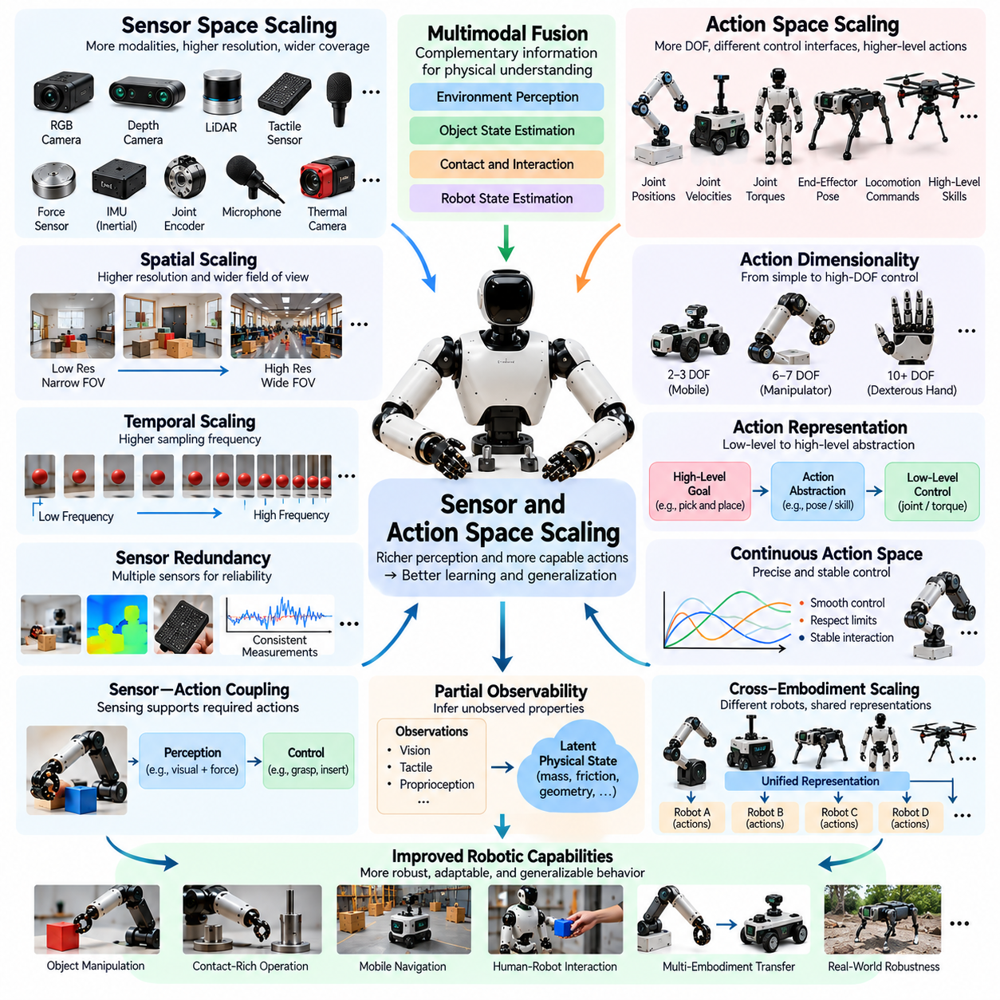{width="7.268055555555556in" height="7.268055555555556in"}

Sensor and action space scaling examines how expanding sensory inputs and executable actions influences the learning capacity, generalization, and control performance of Physical AI systems. Unlike conventional AI models that operate on relatively standardized digital representations, robots interact through heterogeneous sensors and physical actuators. Scaling these spaces requires balancing information richness, computational efficiency, physical feasibility, and real-time reliability.

Sensor space refers to the collection of measurements available to a robot for perceiving its environment and internal state. These measurements may include RGB images, depth maps, LiDAR point clouds, tactile signals, joint positions, inertial measurements, and force readings. Each modality captures different aspects of physical reality. Expanding sensor coverage can improve state estimation, but additional measurements do not automatically provide useful information.

Action space defines the set of commands through which a robot influences its physical environment. Depending on the platform, actions may represent joint positions, velocities, torques, end-effector poses, locomotion commands, or abstract task objectives. The dimensionality and structure of this space determine the complexity of policy learning. Larger action spaces increase flexibility while introducing additional constraints on control accuracy and stability.

Sensor scaling can occur through higher resolution, increased sampling frequency, additional modalities, or wider spatial coverage. High-resolution cameras reveal small geometric details, while tactile arrays capture local contact conditions. Additional sensors may improve perception under occlusion or uncertainty. However, increasing sensory bandwidth also raises requirements for communication, synchronization, memory, and inference computation.

Multimodal sensing is particularly valuable because different modalities provide complementary information. Vision estimates object geometry and scene structure, while tactile and force sensors reveal contact conditions and mechanical resistance. Proprioception provides information about joint configuration and robot motion. Combining these signals can improve physical state understanding, especially when individual sensors provide incomplete or ambiguous observations.

Sensor redundancy can improve reliability when multiple measurements describe the same physical phenomenon. Cameras and depth sensors may jointly estimate object position, while inertial and joint measurements support motion estimation. Redundant sensing can help detect faults and reduce uncertainty. Nevertheless, correlated sensor errors or inconsistent calibration may limit these benefits, making sensor fusion quality more important than sensor quantity alone.

Temporal resolution introduces another scaling dimension because physical interactions evolve at different speeds. Slow navigation decisions may tolerate relatively low observation frequencies, while contact-rich manipulation can require rapid feedback. High-frequency sensing captures short-duration events such as impacts, slips, and sudden force changes. Effective sensor scaling must therefore match sampling rates to the dynamics of the behaviors being controlled.

Sensor synchronization becomes increasingly difficult as modalities and sampling frequencies expand. Camera frames, tactile measurements, motor commands, and force readings may arrive with different delays. Incorrect alignment can make an action appear to precede or follow the wrong physical event. Accurate timestamps, clock synchronization, and latency compensation are essential for preserving meaningful observation-action relationships in large robotic datasets.

Action dimensionality strongly influences the difficulty of policy optimization. A mobile robot controlling forward and angular velocity has a relatively compact action space, while a dexterous robotic hand may coordinate many joints simultaneously. Higher-dimensional actions enable complex behavior but increase the number of possible control combinations. Learning therefore requires suitable representations, structured exploration, and constraints that reduce unnecessary complexity.

Action abstraction provides a mechanism for managing large control spaces. Instead of predicting every actuator command independently, a model may generate end-effector targets, motion primitives, or high-level skills. Lower-level controllers translate these abstractions into executable commands. This hierarchical approach can improve scalability, although abstract actions must remain compatible with the robot\'s kinematic and dynamic limitations.

Continuous action spaces introduce challenges that differ from discrete decision spaces. Small changes in torque, velocity, or position commands can produce substantially different physical outcomes near contact boundaries. Policies must learn smooth and stable control while respecting actuator limits. Action normalization, bounded outputs, and feedback control can help manage these requirements, but their effectiveness depends on the physical system.

Sensor and action spaces are coupled because the information required for control depends on the actions a robot performs. Precision insertion may require force feedback, while obstacle avoidance relies heavily on spatial perception. Adding action capabilities without corresponding sensing can create uncertainty and unsafe behavior. Effective scaling therefore considers whether sensory information is sufficient to support the intended control precision and interaction complexity.

Partial observability remains a central challenge even with extensive sensor coverage. Robots cannot always directly observe object mass, hidden geometry, friction, or internal mechanical states. These properties may need to be inferred through interaction histories and active probing. Scaling sensor inputs can reduce uncertainty, but memory, state estimation, and predictive models remain necessary for reliable decisions under incomplete information.

Active perception connects sensing and action by allowing robots to move specifically to acquire useful observations. A manipulator may reposition its camera to inspect an occluded object, while a mobile robot may change viewpoint to improve localization. Such behaviors demonstrate that sensing is not purely passive. Scaling action capabilities can expand perception opportunities, while better perception can guide more effective actions.

Representation learning helps manage the complexity of large sensor spaces by converting raw observations into compact task-relevant features. Visual encoders, point-cloud networks, and multimodal transformers can integrate different measurements into shared latent representations. These representations may reduce computational demands and improve transfer across tasks. However, excessive compression can remove details essential for precise contact or safety-critical control.

Action representation learning similarly seeks compact structures within complex motor commands. Models may learn reusable motion patterns, coordinated joint behaviors, or latent action codes from demonstrations. Such representations can simplify policy optimization and support transfer between related tasks. Their usefulness depends on whether the learned action structure preserves controllability, precision, and compatibility with the target robot.

Cross-robot scaling creates additional challenges because platforms often possess incompatible sensor configurations and action interfaces. One robot may use stereo cameras and joint torque control, while another relies on depth sensing and position commands. Shared models must account for missing modalities and different command semantics. Embodiment-aware conditioning and robot-specific adapters can improve transfer without requiring identical hardware.

Simulation provides a controlled environment for evaluating sensor and action space scaling. Researchers can vary sensor noise, resolution, sampling rates, actuator limits, and control frequencies while measuring task performance. Synthetic experiments can identify which modalities and action representations provide measurable benefits. Nevertheless, simulated sensor artifacts and actuator dynamics may differ from physical systems, requiring real-world validation.

Computational constraints become more significant as sensor bandwidth and action frequency increase. High-resolution visual streams, dense tactile measurements, and rapid control updates can overwhelm onboard processors. Model inference latency may compromise stability even when prediction accuracy improves. Efficient architectures must balance sensory detail, action precision, hardware acceleration, and deterministic execution deadlines.

Data quality is essential because scaling sensor and action dimensions increases opportunities for calibration errors, missing measurements, inconsistent units, and timestamp drift. Incorrect coordinate transformations or action labels can produce misleading training signals. Standardized schemas should describe sensor geometry, measurement units, action conventions, and timing information. Automated validation helps maintain consistency across large multimodal trajectory datasets.

Scaling experiments should distinguish the effects of sensor richness, action dimensionality, and their interaction. Researchers can compare models trained with different modality combinations while holding action representations constant, then evaluate alternative action spaces under comparable sensing conditions. Task success, control accuracy, robustness, latency, and safety provide complementary metrics. These comparisons reveal whether additional complexity produces meaningful capability improvements.

The economic efficiency of sensor and action scaling depends on the operational value gained from additional hardware and computation. More sensors increase equipment cost, calibration effort, data storage, and maintenance requirements. Higher-dimensional control may require more capable actuators and sophisticated safety mechanisms. System designers should prioritize configurations that improve measurable task performance rather than maximizing sensor counts or action dimensions.

Ultimately, sensor and action space scaling is a coordinated process of expanding what robots can observe and what they can physically execute. Larger sensory and control spaces create opportunities for more capable behavior, but their value depends on alignment, representation quality, computational feasibility, and closed-loop reliability. Effective scaling integrates multimodal perception, structured action representations, adaptive control, and rigorous evaluation to support increasingly capable Physical AI systems.

센서 및 행동 공간 스케일링(Sensor and Action Space Scaling)은 감각 입력(Sensory Inputs)과 실행 가능한 행동(Executable Actions)을 확장하는 것이 피지컬 AI 시스템(Physical AI Systems)의 학습 능력(Learning Capacity), 일반화(Generalization), 제어 성능(Control Performance)에 어떤 영향을 미치는지 분석합니다. 비교적 표준화된 디지털 표현(Standardized Digital Representations)을 사용하는 기존 인공지능 모델(Conventional AI Models)과 달리 로봇은 이기종 센서(Heterogeneous Sensors)와 물리적 액추에이터(Physical Actuators)를 통해 상호작용합니다. 이러한 공간의 확장에는 정보의 풍부함(Information Richness), 계산 효율성(Computational Efficiency), 물리적 실행 가능성(Physical Feasibility), 실시간 신뢰성(Real-Time Reliability) 사이의 균형이 필요합니다.

센서 공간(Sensor Space)은 로봇이 환경과 내부 상태(Internal State)를 인식하기 위해 사용할 수 있는 측정값(Measurements)의 집합을 의미합니다. 이러한 측정값에는 RGB 이미지(RGB Images), 깊이 맵(Depth Maps), 라이다 포인트 클라우드(LiDAR Point Clouds), 촉각 신호(Tactile Signals), 관절 위치(Joint Positions), 관성 측정값(Inertial Measurements), 힘 측정값(Force Readings)이 포함될 수 있습니다. 각 모달리티(Modality)는 물리적 현실(Physical Reality)의 서로 다른 측면을 포착합니다. 센서 범위(Sensor Coverage)를 확장하면 상태 추정(State Estimation)이 개선될 수 있지만 측정값을 추가한다고 해서 자동으로 유용한 정보가 제공되는 것은 아닙니다.

행동 공간(Action Space)은 로봇이 물리적 환경(Physical Environment)에 영향을 미치기 위해 사용할 수 있는 명령(Commands)의 집합을 정의합니다. 플랫폼에 따라 행동은 관절 위치(Joint Positions), 속도(Velocities), 토크(Torques), 엔드이펙터 자세(End-Effector Poses), 이동 명령(Locomotion Commands), 추상적 작업 목표(Abstract Task Objectives)를 나타낼 수 있습니다. 이러한 공간의 차원 수(Dimensionality)와 구조(Structure)는 정책 학습(Policy Learning)의 복잡성을 결정합니다. 더 큰 행동 공간은 유연성(Flexibility)을 높이지만 제어 정확도(Control Accuracy)와 안정성(Stability)에 대한 추가적인 제약을 발생시킵니다.

센서 스케일링(Sensor Scaling)은 해상도(Resolution) 향상, 샘플링 주파수(Sampling Frequency) 증가, 모달리티(Modalities) 추가, 공간적 관측 범위(Spatial Coverage) 확장을 통해 이루어질 수 있습니다. 고해상도 카메라(High-Resolution Cameras)는 작은 기하학적 세부사항(Geometric Details)을 식별하고, 촉각 배열(Tactile Arrays)은 국소 접촉 조건(Local Contact Conditions)을 포착합니다. 추가 센서는 가림(Occlusion)이나 불확실성(Uncertainty)이 존재하는 상황에서 인식(Perception)을 개선할 수 있습니다. 그러나 감각 대역폭(Sensory Bandwidth)이 증가하면 통신(Communication), 동기화(Synchronization), 메모리(Memory), 추론 연산(Inference Computation)에 대한 요구사항도 증가합니다.

멀티모달 센싱(Multimodal Sensing)은 서로 다른 모달리티(Modalities)가 상호 보완적인 정보(Complementary Information)를 제공하기 때문에 특히 유용합니다. 시각(Vision)은 물체 형상(Object Geometry)과 장면 구조(Scene Structure)를 추정하고, 촉각 및 힘 센서(Tactile and Force Sensors)는 접촉 조건(Contact Conditions)과 기계적 저항(Mechanical Resistance)을 파악합니다. 고유수용성 감각(Proprioception)은 관절 구성(Joint Configuration)과 로봇 움직임(Robot Motion)에 관한 정보를 제공합니다. 이러한 신호를 결합하면 개별 센서가 불완전하거나 모호한 관측(Incomplete or Ambiguous Observations)을 제공하는 상황에서 물리적 상태 이해(Physical State Understanding)를 개선할 수 있습니다.

센서 중복성(Sensor Redundancy)은 여러 측정값이 동일한 물리적 현상(Physical Phenomenon)을 설명할 때 신뢰성(Reliability)을 개선할 수 있습니다. 카메라와 깊이 센서(Depth Sensors)는 물체 위치(Object Position)를 공동으로 추정할 수 있으며, 관성 측정값(Inertial Measurements)과 관절 측정값(Joint Measurements)은 움직임 추정(Motion Estimation)을 지원합니다. 중복 센싱(Redundant Sensing)은 고장 탐지(Fault Detection)와 불확실성 감소(Uncertainty Reduction)에 도움이 될 수 있습니다. 그러나 상관된 센서 오류(Correlated Sensor Errors)나 일관되지 않은 보정(Inconsistent Calibration)은 이러한 이점을 제한할 수 있으므로 센서 수 자체보다 센서 융합 품질(Sensor Fusion Quality)이 중요합니다.

시간 해상도(Temporal Resolution)는 물리적 상호작용(Physical Interactions)이 서로 다른 속도로 변화하기 때문에 또 다른 스케일링 차원(Scaling Dimension)을 형성합니다. 느린 내비게이션 의사결정(Navigation Decisions)은 상대적으로 낮은 관측 주파수(Observation Frequencies)를 허용할 수 있지만, 접촉 중심 조작(Contact-Rich Manipulation)은 빠른 피드백(Rapid Feedback)을 요구할 수 있습니다. 고주파 센싱(High-Frequency Sensing)은 충격(Impacts), 미끄러짐(Slips), 갑작스러운 힘 변화(Sudden Force Changes)와 같은 짧은 지속시간의 사건을 포착합니다. 따라서 효과적인 센서 스케일링은 샘플링 속도(Sampling Rates)를 제어 대상 행동의 동역학(Dynamics)에 맞추어야 합니다.

센서 동기화(Sensor Synchronization)는 모달리티와 샘플링 주파수가 증가할수록 더욱 어려워집니다. 카메라 프레임(Camera Frames), 촉각 측정값(Tactile Measurements), 모터 명령(Motor Commands), 힘 측정값(Force Readings)은 서로 다른 지연시간(Delays)을 가지고 도착할 수 있습니다. 잘못된 시간 정렬(Incorrect Alignment)은 특정 행동이 실제와 다른 물리적 사건(Physical Event)의 이전이나 이후에 발생한 것처럼 보이게 만들 수 있습니다. 정확한 타임스탬프(Accurate Timestamps), 시계 동기화(Clock Synchronization), 지연시간 보상(Latency Compensation)은 대규모 로봇 데이터셋(Large Robotic Datasets)에서 의미 있는 관측-행동 관계(Observation-Action Relationships)를 보존하는 데 필수적입니다.

행동 차원 수(Action Dimensionality)는 정책 최적화(Policy Optimization)의 난이도에 큰 영향을 미칩니다. 전진 속도(Forward Velocity)와 각속도(Angular Velocity)를 제어하는 모바일 로봇(Mobile Robot)은 상대적으로 작은 행동 공간(Compact Action Space)을 가지지만, 정교한 로봇 손(Dexterous Robotic Hand)은 많은 관절을 동시에 조정해야 할 수 있습니다. 고차원 행동(Higher-Dimensional Actions)은 복잡한 행동을 가능하게 하지만 가능한 제어 조합(Control Combinations)의 수도 증가시킵니다. 따라서 학습에는 적절한 표현(Representations), 구조화된 탐색(Structured Exploration), 불필요한 복잡성을 줄이는 제약(Constraints)이 필요합니다.

행동 추상화(Action Abstraction)는 대규모 제어 공간(Large Control Spaces)을 관리하기 위한 메커니즘을 제공합니다. 모델은 모든 액추에이터 명령(Actuator Commands)을 독립적으로 예측하는 대신 엔드이펙터 목표(End-Effector Targets), 동작 프리미티브(Motion Primitives), 상위 수준 기술(High-Level Skills)을 생성할 수 있습니다. 하위 수준 제어기(Lower-Level Controllers)는 이러한 추상적 표현(Abstract Representations)을 실행 가능한 명령(Executable Commands)으로 변환합니다. 이러한 계층적 접근법(Hierarchical Approach)은 확장성(Scalability)을 개선할 수 있지만 추상적 행동은 로봇의 운동학적 한계(Kinematic Limitations)와 동역학적 한계(Dynamic Limitations)에 부합해야 합니다.

연속 행동 공간(Continuous Action Spaces)은 이산 의사결정 공간(Discrete Decision Spaces)과 다른 과제를 발생시킵니다. 접촉 경계(Contact Boundaries) 근처에서는 토크(Torque), 속도(Velocity), 위치 명령(Position Commands)의 작은 변화가 상당히 다른 물리적 결과(Physical Outcomes)를 만들어낼 수 있습니다. 정책(Policies)은 액추에이터 한계(Actuator Limits)를 준수하면서 부드럽고 안정적인 제어(Smooth and Stable Control)를 학습해야 합니다. 행동 정규화(Action Normalization), 출력 범위 제한(Bounded Outputs), 피드백 제어(Feedback Control)는 이러한 요구사항을 관리하는 데 도움이 될 수 있지만 효과는 물리적 시스템(Physical System)에 따라 달라집니다.

센서 공간(Sensor Space)과 행동 공간(Action Space)은 로봇이 수행하는 행동에 따라 제어에 필요한 정보가 달라지기 때문에 서로 결합되어 있습니다. 정밀 삽입(Precision Insertion)에는 힘 피드백(Force Feedback)이 필요할 수 있으며, 장애물 회피(Obstacle Avoidance)는 공간 인식(Spatial Perception)에 크게 의존합니다. 이에 대응하는 센싱(Sensing) 없이 행동 능력(Action Capabilities)만 추가하면 불확실성(Uncertainty)과 안전하지 않은 행동(Unsafe Behavior)이 발생할 수 있습니다. 따라서 효과적인 스케일링은 의도한 제어 정밀도(Control Precision)와 상호작용 복잡성(Interaction Complexity)을 지원하기에 감각 정보(Sensory Information)가 충분한지 고려해야 합니다.

부분 관측 가능성(Partial Observability)은 광범위한 센서 범위(Extensive Sensor Coverage)를 확보하더라도 여전히 핵심적인 과제로 남습니다. 로봇은 물체 질량(Object Mass), 숨겨진 형상(Hidden Geometry), 마찰(Friction), 내부 기계 상태(Internal Mechanical States)를 항상 직접 관측할 수 있는 것은 아닙니다. 이러한 특성은 상호작용 이력(Interaction Histories)과 능동적 탐색(Active Probing)을 통해 추론해야 할 수 있습니다. 센서 입력(Sensor Inputs)의 확장은 불확실성을 줄일 수 있지만 불완전한 정보(Incomplete Information) 아래에서 신뢰할 수 있는 의사결정(Reliable Decisions)을 수행하려면 메모리(Memory), 상태 추정(State Estimation), 예측 모델(Predictive Models)이 여전히 필요합니다.

능동 인식(Active Perception)은 로봇이 유용한 관측(Useful Observations)을 획득하기 위해 의도적으로 움직일 수 있도록 함으로써 센싱(Sensing)과 행동(Action)을 연결합니다. 매니퓰레이터(Manipulator)는 가려진 물체(Occluded Object)를 검사하기 위해 카메라 위치를 변경할 수 있으며, 모바일 로봇(Mobile Robot)은 위치 추정(Localization)을 개선하기 위해 관측 시점(Viewpoint)을 변경할 수 있습니다. 이러한 행동은 센싱이 단순히 수동적인 과정(Passive Process)이 아니라는 점을 보여줍니다. 행동 능력(Action Capabilities)을 확장하면 인식 기회(Perception Opportunities)가 증가하고, 개선된 인식은 더욱 효과적인 행동을 유도할 수 있습니다.

표현 학습(Representation Learning)은 원시 관측(Raw Observations)을 작업 관련 특징(Task-Relevant Features)으로 압축하여 대규모 센서 공간(Large Sensor Spaces)의 복잡성을 관리하는 데 도움이 됩니다. 시각 인코더(Visual Encoders), 포인트 클라우드 네트워크(Point-Cloud Networks), 멀티모달 트랜스포머(Multimodal Transformers)는 서로 다른 측정값을 공유 잠재 표현(Shared Latent Representations)으로 통합할 수 있습니다. 이러한 표현은 계산 요구량(Computational Demands)을 줄이고 작업 간 전이(Cross-Task Transfer)를 개선할 수 있습니다. 그러나 과도한 압축(Excessive Compression)은 정밀 접촉(Precise Contact)이나 안전 필수 제어(Safety-Critical Control)에 필요한 세부 정보를 제거할 수 있습니다.

행동 표현 학습(Action Representation Learning)도 복잡한 모터 명령(Motor Commands) 내부에서 간결한 구조(Compact Structures)를 찾는 것을 목표로 합니다. 모델은 시연(Demonstrations)으로부터 재사용 가능한 동작 패턴(Reusable Motion Patterns), 조정된 관절 행동(Coordinated Joint Behaviors), 잠재 행동 코드(Latent Action Codes)를 학습할 수 있습니다. 이러한 표현은 정책 최적화(Policy Optimization)를 단순화하고 관련 작업(Related Tasks) 간 전이를 지원할 수 있습니다. 그 유용성은 학습된 행동 구조(Learned Action Structure)가 제어 가능성(Controllability), 정밀도(Precision), 대상 로봇(Target Robot)과의 호환성(Compatibility)을 보존하는지에 달려 있습니다.

교차 로봇 스케일링(Cross-Robot Scaling)은 플랫폼마다 호환되지 않는 센서 구성(Sensor Configurations)과 행동 인터페이스(Action Interfaces)를 사용하는 경우가 많기 때문에 추가적인 과제를 발생시킵니다. 한 로봇은 스테레오 카메라(Stereo Cameras)와 관절 토크 제어(Joint Torque Control)를 사용하지만 다른 로봇은 깊이 센싱(Depth Sensing)과 위치 명령(Position Commands)에 의존할 수 있습니다. 공유 모델(Shared Models)은 누락된 모달리티(Missing Modalities)와 서로 다른 명령 의미(Command Semantics)를 고려해야 합니다. 체화 인식 조건화(Embodiment-Aware Conditioning)와 로봇별 어댑터(Robot-Specific Adapters)는 동일한 하드웨어를 요구하지 않으면서 전이(Transfer)를 개선할 수 있습니다.

시뮬레이션(Simulation)은 센서 및 행동 공간 스케일링(Sensor and Action Space Scaling)을 평가하기 위한 통제된 환경(Controlled Environment)을 제공합니다. 연구자들은 작업 성능(Task Performance)을 측정하면서 센서 노이즈(Sensor Noise), 해상도(Resolution), 샘플링 속도(Sampling Rates), 액추에이터 한계(Actuator Limits), 제어 주파수(Control Frequencies)를 변화시킬 수 있습니다. 합성 실험(Synthetic Experiments)은 어떤 모달리티와 행동 표현(Action Representations)이 측정 가능한 이점(Measurable Benefits)을 제공하는지 식별할 수 있습니다. 그러나 시뮬레이션된 센서 아티팩트(Simulated Sensor Artifacts)와 액추에이터 동역학(Actuator Dynamics)은 실제 시스템과 다를 수 있으므로 실세계 검증(Real-World Validation)이 필요합니다.

센서 대역폭(Sensor Bandwidth)과 행동 주파수(Action Frequency)가 증가할수록 계산 제약(Computational Constraints)은 더욱 중요해집니다. 고해상도 영상 스트림(High-Resolution Visual Streams), 고밀도 촉각 측정값(Dense Tactile Measurements), 빠른 제어 업데이트(Rapid Control Updates)는 온보드 프로세서(Onboard Processors)의 처리 능력을 초과할 수 있습니다. 예측 정확도(Prediction Accuracy)가 개선되더라도 모델 추론 지연시간(Model Inference Latency)은 안정성(Stability)을 저하시킬 수 있습니다. 효율적인 아키텍처(Efficient Architectures)는 감각 정보의 세밀함(Sensory Detail), 행동 정밀도(Action Precision), 하드웨어 가속(Hardware Acceleration), 결정적 실행 마감시간(Deterministic Execution Deadlines) 사이의 균형을 유지해야 합니다.

센서 및 행동 차원(Sensor and Action Dimensions)이 확장되면 보정 오류(Calibration Errors), 누락된 측정값(Missing Measurements), 일관되지 않은 단위(Inconsistent Units), 타임스탬프 드리프트(Timestamp Drift)가 발생할 가능성이 증가하므로 데이터 품질(Data Quality)이 필수적입니다. 잘못된 좌표 변환(Coordinate Transformations)이나 행동 레이블(Action Labels)은 오해를 유발하는 학습 신호(Misleading Training Signals)를 생성할 수 있습니다. 표준화된 스키마(Standardized Schemas)는 센서 형상(Sensor Geometry), 측정 단위(Measurement Units), 행동 규약(Action Conventions), 시간 정보(Timing Information)를 설명해야 합니다. 자동 검증(Automated Validation)은 대규모 멀티모달 궤적 데이터셋(Large Multimodal Trajectory Datasets) 전반의 일관성을 유지하는 데 도움이 됩니다.

스케일링 실험(Scaling Experiments)은 센서 정보의 풍부함(Sensor Richness), 행동 차원 수(Action Dimensionality), 두 요소의 상호작용(Interaction)이 미치는 영향을 구분해야 합니다. 연구자들은 행동 표현(Action Representations)을 일정하게 유지하면서 서로 다른 모달리티 조합(Modality Combinations)으로 학습한 모델을 비교한 다음, 유사한 센싱 조건(Sensing Conditions)에서 대안적인 행동 공간(Alternative Action Spaces)을 평가할 수 있습니다. 작업 성공률(Task Success), 제어 정확도(Control Accuracy), 강건성(Robustness), 지연시간(Latency), 안전성(Safety)은 상호 보완적인 평가 지표(Complementary Metrics)를 제공합니다. 이러한 비교를 통해 추가적인 복잡성이 의미 있는 능력 향상(Capability Improvements)으로 이어지는지 확인할 수 있습니다.

센서 및 행동 스케일링의 경제적 효율성(Economic Efficiency)은 추가적인 하드웨어(Hardware)와 계산 자원(Computation)을 통해 얻는 운영 가치(Operational Value)에 따라 달라집니다. 센서가 증가하면 장비 비용(Equipment Cost), 보정 작업(Calibration Effort), 데이터 저장(Data Storage), 유지보수 요구사항(Maintenance Requirements)이 증가합니다. 고차원 제어(Higher-Dimensional Control)에는 더 높은 성능의 액추에이터(More Capable Actuators)와 정교한 안전 메커니즘(Sophisticated Safety Mechanisms)이 필요할 수 있습니다. 시스템 설계자(System Designers)는 센서 수(Sensor Counts)나 행동 차원(Action Dimensions)을 최대화하기보다 측정 가능한 작업 성능(Measurable Task Performance)을 개선하는 구성을 우선해야 합니다.

궁극적으로 센서 및 행동 공간 스케일링(Sensor and Action Space Scaling)은 로봇이 관측할 수 있는 대상과 물리적으로 실행할 수 있는 행동을 함께 확장하는 조정된 과정(Coordinated Process)입니다. 더 큰 감각 공간(Sensory Spaces)과 제어 공간(Control Spaces)은 더욱 높은 수준의 행동 능력(Behavioral Capabilities)을 제공하지만, 그 가치는 정렬(Alignment), 표현 품질(Representation Quality), 계산 실행 가능성(Computational Feasibility), 폐루프 신뢰성(Closed-Loop Reliability)에 달려 있습니다. 효과적인 스케일링(Effective Scaling)은 멀티모달 인식(Multimodal Perception), 구조화된 행동 표현(Structured Action Representations), 적응형 제어(Adaptive Control), 엄격한 평가(Rigorous Evaluation)를 통합하여 점점 더 높은 능력을 갖춘 피지컬 AI 시스템(Physical AI Systems)을 지원합니다.

##  

## 07.09. Real Synthetic and Human Data Scaling

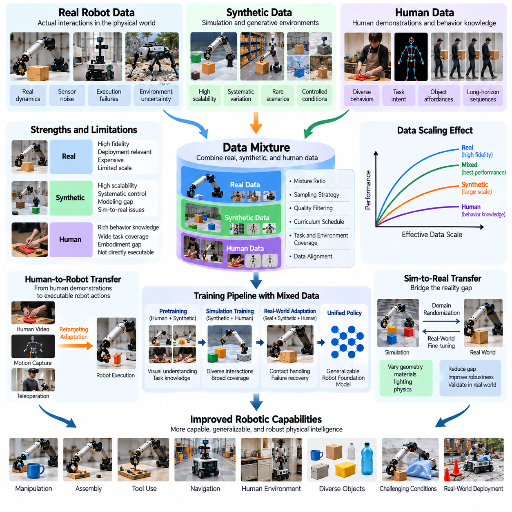{width="7.268055555555556in" height="7.268055555555556in"}

Real, synthetic, and human data scaling examines how different sources of physical experience contribute to the development of capable and generalizable robotic intelligence. Real robot data captures actual interactions, synthetic data provides controlled and scalable experiences, and human data introduces diverse behavioral knowledge. Effective Physical AI scaling requires understanding the strengths, limitations, and complementary roles of these sources.

Real robot data consists of observations, actions, and outcomes recorded during physical robot operation. It captures authentic contact dynamics, sensor noise, actuator limitations, environmental uncertainty, and execution failures. These properties make real data essential for grounding learned policies in physical reality. However, collecting large quantities of robot trajectories requires hardware, operators, maintenance, and substantial operational time.

Synthetic data is generated through simulation, procedural environments, physics engines, or learned generative models. It can represent diverse objects, tasks, lighting conditions, materials, and interaction scenarios without repeatedly operating physical robots. Synthetic generation offers high throughput and systematic control over experimental variables. Its primary limitation is the mismatch between generated experiences and real-world physical behavior.

Human data includes demonstrations, videos, motion capture recordings, wearable sensor measurements, and direct human control of robotic systems. Such data contains valuable information about task objectives, manipulation strategies, object affordances, and long-horizon behavior. Human activities cover a much wider range of everyday situations than most robot datasets. Nevertheless, human actions cannot always be transferred directly to robotic bodies.

The three data sources differ in cost, physical fidelity, behavioral diversity, and scalability. Real robot experiences offer strong deployment relevance but are expensive to acquire. Synthetic experiences are comparatively inexpensive to generate after infrastructure development but may contain modeling errors. Human demonstrations provide rich behavioral knowledge, although their action representations and embodiment characteristics often differ from those of robots.

Scaling laws for mixed data cannot be described accurately using total episode counts alone. One million simulated interactions may not provide the same learning value as an equivalent number of real robot trajectories. Similarly, human videos may improve visual understanding without supplying executable motor commands. Effective scaling analysis must consider the information content, physical relevance, and transferability of each data source.

Real data plays a particularly important role in learning contact-rich behaviors and validating deployment performance. Grasping, insertion, locomotion, and tool manipulation depend on mechanical properties that are difficult to reproduce perfectly. Physical recordings reveal unexpected friction, deformation, backlash, and sensor imperfections. These experiences help models correct assumptions acquired from simplified simulations or indirect observations.

Synthetic data is especially useful for expanding coverage of rare events, unfamiliar environments, and systematically varied physical conditions. Simulation can generate thousands of object configurations, obstacle arrangements, and task variations. Domain randomization introduces changes in geometry, mass, friction, lighting, and sensor characteristics. These variations can improve robustness when they approximate meaningful uncertainties encountered during deployment.

Human demonstrations contribute task-level knowledge that is difficult to acquire through autonomous robot exploration alone. Videos of cooking, assembly, cleaning, and object handling reveal sequences of purposeful actions. Models can learn object relationships, temporal structure, and possible interaction strategies from these observations. However, translating human motion into robotic control requires addressing differences in morphology, reachability, and physical constraints.

Cross-embodiment transfer is therefore central to human-to-robot data scaling. Human hands possess dexterity, compliance, and tactile capabilities that many robotic manipulators cannot reproduce. A robot may need to achieve the same objective using a different grasp, motion trajectory, or interaction strategy. Effective transfer separates task intent from embodiment-specific movement while preserving the physical requirements necessary for successful execution.

Data mixture design determines how real, synthetic, and human experiences contribute during training. Fixed mixture ratios are simple to implement but may not remain optimal as model capability increases. Early training may benefit from abundant synthetic and human observations, while later adaptation may require more targeted real robot interactions. The appropriate balance depends on task complexity, data quality, model architecture, and deployment conditions.

Curriculum learning provides a structured approach to combining these sources over time. A model may first acquire visual representations and broad task knowledge from human videos, then learn executable behaviors through simulation and robot demonstrations. Subsequent real-world interaction can refine contact handling and recovery strategies. This progression is useful when each stage addresses limitations that remain after the preceding stage.

Synthetic-to-real transfer depends on whether learned behaviors remain effective when simulation assumptions are violated. Visual differences, inaccurate friction models, actuator delays, and contact instability can produce performance degradation. Domain adaptation and real-world fine-tuning help reduce these discrepancies. Evaluation must measure actual robot performance rather than relying exclusively on simulated success rates or visual similarity.

Data provenance and quality control become increasingly important when combining heterogeneous sources. Every trajectory should identify its origin, embodiment, sensing configuration, action representation, and collection conditions. Synthetic records should preserve simulator parameters, while human demonstrations require clear interpretation of inferred actions. Consistent metadata enables source-aware sampling, reproducible experiments, and reliable assessment of transfer performance.

Duplicate information and distribution imbalance can distort scaling measurements. Large volumes of nearly identical simulated episodes may overwhelm smaller but highly informative real-world datasets. Human video collections may also overrepresent common activities while excluding difficult physical interactions. Quality-aware weighting and diversity-based sampling can reduce redundancy and preserve experiences that contribute distinctive learning signals.

Active data collection can improve scaling efficiency by selecting new experiences according to model uncertainty and observed failure patterns. Real robots can record difficult interactions, simulations can reproduce related scenarios, and human demonstrations can provide alternative strategies. This coordinated process directs resources toward weaknesses that existing datasets do not resolve. It also supports iterative improvement without requiring uniform growth across every data source.

Evaluation should distinguish improvements obtained from each source and from their combinations. Controlled experiments can compare real-only, synthetic-only, human-only, and mixed-data training under consistent model and compute budgets. Tests should include unseen objects, environments, behaviors, and physical conditions. Such comparisons reveal whether additional sources provide complementary knowledge or merely repeat information already represented.

Data scaling efficiency can be expressed through performance improvement relative to collection cost, training computation, and adaptation effort. Synthetic data may offer inexpensive volume, but extensive generation can become wasteful when transfer benefits saturate. Real data may remain valuable despite high acquisition costs because it directly reflects deployment conditions. Human data may provide exceptional breadth while requiring additional processing to produce usable supervision.

Privacy, licensing, and safety constraints also influence mixed-source scaling. Human recordings may contain identifiable individuals or sensitive environments, while externally acquired datasets can impose restrictions on reuse. Real robot collection introduces physical risks and equipment wear. Synthetic generation reduces some collection hazards but does not eliminate the need for validation. Responsible scaling requires traceable permissions, secure storage, and appropriate operational safeguards.

As models become more capable, the optimal data mixture may change. Broad pretraining benefits from diverse visual and behavioral experiences, whereas precision manipulation and reliable deployment require accurate physical feedback. Increasing model capacity may improve the ability to integrate heterogeneous observations, but incompatible labels and misleading dynamics can still cause negative transfer. Scaling strategies must therefore evolve alongside model capabilities and evaluation evidence.

Ultimately, real, synthetic, and human data scaling is not simply a process of accumulating more trajectories. It is the coordinated expansion of physical fidelity, behavioral diversity, and transferable knowledge. Effective Physical AI data engines combine real-world grounding, scalable synthetic exploration, and human behavioral understanding through quality-aware mixtures, adaptive collection, and rigorous deployment evaluation.

실제 데이터, 합성 데이터 및 인간 데이터 스케일링(Real, Synthetic, and Human Data Scaling)은 서로 다른 물리적 경험(Physical Experience)의 데이터 소스(Data Sources)가 높은 능력과 일반화 성능을 갖춘 로봇 지능(Robotic Intelligence)의 개발에 어떻게 기여하는지 분석합니다. 실제 로봇 데이터(Real Robot Data)는 실제 상호작용(Actual Interactions)을 포착하고, 합성 데이터(Synthetic Data)는 통제 가능하고 확장 가능한 경험(Scalable Experiences)을 제공하며, 인간 데이터(Human Data)는 다양한 행동 지식(Behavioral Knowledge)을 도입합니다. 효과적인 피지컬 AI 스케일링(Physical AI Scaling)을 위해서는 이러한 데이터 소스의 강점(Strengths), 한계(Limitations), 상호 보완적 역할(Complementary Roles)을 이해해야 합니다.

실제 로봇 데이터(Real Robot Data)는 물리적 로봇 운영(Physical Robot Operation) 과정에서 기록된 관측(Observations), 행동(Actions), 결과(Outcomes)로 구성됩니다. 이 데이터는 실제 접촉 동역학(Contact Dynamics), 센서 노이즈(Sensor Noise), 액추에이터 한계(Actuator Limitations), 환경 불확실성(Environmental Uncertainty), 실행 실패(Execution Failures)를 포착합니다. 이러한 특성으로 인해 실제 데이터는 학습된 정책(Learned Policies)을 물리적 현실(Physical Reality)에 기반하도록 만드는 데 필수적입니다. 그러나 대량의 로봇 궤적(Robot Trajectories)을 수집하려면 하드웨어(Hardware), 운영자(Operators), 유지보수(Maintenance), 상당한 운영 시간(Operational Time)이 필요합니다.

합성 데이터(Synthetic Data)는 시뮬레이션(Simulation), 절차적 환경(Procedural Environments), 물리 엔진(Physics Engines), 학습 기반 생성 모델(Learned Generative Models)을 통해 생성됩니다. 합성 데이터는 물리적 로봇을 반복적으로 작동시키지 않고도 다양한 물체(Objects), 작업(Tasks), 조명 조건(Lighting Conditions), 재료(Materials), 상호작용 시나리오(Interaction Scenarios)를 표현할 수 있습니다. 합성 데이터 생성(Synthetic Generation)은 높은 처리량(High Throughput)과 실험 변수(Experimental Variables)에 대한 체계적인 제어를 제공합니다. 주요 한계는 생성된 경험(Generated Experiences)과 실세계 물리적 거동(Real-World Physical Behavior) 사이의 불일치(Mismatch)입니다.

인간 데이터(Human Data)에는 시연(Demonstrations), 비디오(Videos), 동작 캡처 기록(Motion Capture Recordings), 웨어러블 센서 측정값(Wearable Sensor Measurements), 인간에 의한 로봇 직접 제어(Direct Human Control of Robotic Systems)가 포함됩니다. 이러한 데이터에는 작업 목표(Task Objectives), 조작 전략(Manipulation Strategies), 물체의 행동 가능성(Object Affordances), 장기 행동(Long-Horizon Behavior)에 관한 유용한 정보가 포함되어 있습니다. 인간 활동(Human Activities)은 대부분의 로봇 데이터셋(Robot Datasets)보다 훨씬 광범위한 일상 상황(Everyday Situations)을 포괄합니다. 그러나 인간의 행동(Human Actions)을 로봇 신체(Robotic Bodies)에 항상 직접 전이할 수 있는 것은 아닙니다.

세 가지 데이터 소스(Data Sources)는 비용(Cost), 물리적 충실도(Physical Fidelity), 행동 다양성(Behavioral Diversity), 확장성(Scalability) 측면에서 서로 다릅니다. 실제 로봇 경험(Real Robot Experiences)은 배포 환경과의 관련성(Deployment Relevance)이 높지만 획득 비용이 많이 듭니다. 합성 경험(Synthetic Experiences)은 인프라 구축(Infrastructure Development) 이후 상대적으로 저렴하게 생성할 수 있지만 모델링 오류(Modeling Errors)가 포함될 수 있습니다. 인간 시연(Human Demonstrations)은 풍부한 행동 지식을 제공하지만 행동 표현(Action Representations)과 체화 특성(Embodiment Characteristics)이 로봇과 다른 경우가 많습니다.

혼합 데이터(Mixed Data)에 대한 스케일링 법칙(Scaling Laws)은 전체 에피소드 수(Total Episode Counts)만으로 정확하게 설명할 수 없습니다. 백만 개의 시뮬레이션 상호작용(Simulated Interactions)이 동일한 수의 실제 로봇 궤적(Real Robot Trajectories)과 같은 학습 가치(Learning Value)를 제공하지 않을 수 있습니다. 마찬가지로 인간 비디오(Human Videos)는 실행 가능한 모터 명령(Executable Motor Commands)을 제공하지 않더라도 시각적 이해(Visual Understanding)를 개선할 수 있습니다. 따라서 효과적인 스케일링 분석(Scaling Analysis)은 각 데이터 소스의 정보량(Information Content), 물리적 관련성(Physical Relevance), 전이 가능성(Transferability)을 고려해야 합니다.

실제 데이터(Real Data)는 접촉 중심 행동(Contact-Rich Behaviors)을 학습하고 배포 성능(Deployment Performance)을 검증하는 데 특히 중요한 역할을 합니다. 파지(Grasping), 삽입(Insertion), 이동(Locomotion), 도구 조작(Tool Manipulation)은 완벽하게 재현하기 어려운 기계적 특성(Mechanical Properties)에 의존합니다. 물리적 기록(Physical Recordings)은 예상하지 못한 마찰(Friction), 변형(Deformation), 백래시(Backlash), 센서 불완전성(Sensor Imperfections)을 드러냅니다. 이러한 경험은 모델이 단순화된 시뮬레이션(Simplified Simulations)이나 간접 관측(Indirect Observations)으로부터 학습한 가정을 수정하는 데 도움이 됩니다.

합성 데이터(Synthetic Data)는 희귀 사건(Rare Events), 익숙하지 않은 환경(Unfamiliar Environments), 체계적으로 변화하는 물리적 조건(Physical Conditions)에 대한 학습 범위(Coverage)를 확장하는 데 특히 유용합니다. 시뮬레이션(Simulation)은 수천 가지의 물체 구성(Object Configurations), 장애물 배치(Obstacle Arrangements), 작업 변형(Task Variations)을 생성할 수 있습니다. 도메인 무작위화(Domain Randomization)는 형상(Geometry), 질량(Mass), 마찰(Friction), 조명(Lighting), 센서 특성(Sensor Characteristics)에 변화를 도입합니다. 이러한 변화가 실제 배포 과정에서 발생하는 의미 있는 불확실성(Meaningful Uncertainties)을 근사한다면 강건성(Robustness)을 개선할 수 있습니다.

인간 시연(Human Demonstrations)은 자율 로봇 탐색(Autonomous Robot Exploration)만으로는 획득하기 어려운 작업 수준 지식(Task-Level Knowledge)을 제공합니다. 요리(Cooking), 조립(Assembly), 청소(Cleaning), 물체 취급(Object Handling)에 관한 비디오는 목적을 가진 행동(Purposeful Actions)의 시퀀스를 보여줍니다. 모델은 이러한 관측으로부터 물체 관계(Object Relationships), 시간적 구조(Temporal Structure), 가능한 상호작용 전략(Interaction Strategies)을 학습할 수 있습니다. 그러나 인간 동작(Human Motion)을 로봇 제어(Robotic Control)로 변환하려면 형태(Morphology), 도달 가능성(Reachability), 물리적 제약(Physical Constraints)의 차이를 해결해야 합니다.

따라서 교차 체화 전이(Cross-Embodiment Transfer)는 인간에서 로봇으로의 데이터 스케일링(Human-to-Robot Data Scaling)에서 핵심적인 요소입니다. 인간의 손(Human Hands)은 많은 로봇 매니퓰레이터(Robotic Manipulators)가 재현할 수 없는 정교한 조작 능력(Dexterity), 순응성(Compliance), 촉각 능력(Tactile Capabilities)을 가지고 있습니다. 로봇은 동일한 목표(Objective)를 달성하기 위해 다른 파지 방식(Grasp), 동작 궤적(Motion Trajectory), 상호작용 전략(Interaction Strategy)을 사용해야 할 수 있습니다. 효과적인 전이(Effective Transfer)는 성공적인 실행에 필요한 물리적 요구사항(Physical Requirements)을 유지하면서 작업 의도(Task Intent)를 체화별 움직임(Embodiment-Specific Movement)과 분리합니다.

데이터 혼합 설계(Data Mixture Design)는 실제 데이터(Real Data), 합성 데이터(Synthetic Data), 인간 경험(Human Experiences)이 학습 과정에 어떻게 기여하는지를 결정합니다. 고정된 혼합 비율(Fixed Mixture Ratios)은 구현하기 쉽지만 모델 능력(Model Capability)이 향상됨에 따라 최적의 상태를 유지하지 못할 수 있습니다. 초기 학습(Early Training)에서는 풍부한 합성 관측(Synthetic Observations)과 인간 관측(Human Observations)이 유용할 수 있지만, 이후 적응(Later Adaptation)에는 더욱 표적화된 실제 로봇 상호작용(Targeted Real Robot Interactions)이 필요할 수 있습니다. 적절한 균형은 작업 복잡성(Task Complexity), 데이터 품질(Data Quality), 모델 아키텍처(Model Architecture), 배포 조건(Deployment Conditions)에 따라 달라집니다.

커리큘럼 학습(Curriculum Learning)은 이러한 데이터 소스를 시간에 따라 결합하는 구조화된 접근법(Structured Approach)을 제공합니다. 모델은 먼저 인간 비디오(Human Videos)에서 시각적 표현(Visual Representations)과 폭넓은 작업 지식(Broad Task Knowledge)을 획득한 다음, 시뮬레이션(Simulation)과 로봇 시연(Robot Demonstrations)을 통해 실행 가능한 행동(Executable Behaviors)을 학습할 수 있습니다. 이후 실세계 상호작용(Real-World Interaction)을 통해 접촉 처리(Contact Handling)와 복구 전략(Recovery Strategies)을 정교화할 수 있습니다. 이러한 진행 과정은 각 단계가 이전 단계 이후에도 남아 있는 한계를 해결할 때 유용합니다.

합성에서 실제 환경으로의 전이(Synthetic-to-Real Transfer)는 시뮬레이션 가정(Simulation Assumptions)이 충족되지 않을 때에도 학습된 행동(Learned Behaviors)이 효과적으로 유지되는지에 달려 있습니다. 시각적 차이(Visual Differences), 부정확한 마찰 모델(Inaccurate Friction Models), 액추에이터 지연(Actuator Delays), 접촉 불안정성(Contact Instability)은 성능 저하(Performance Degradation)를 발생시킬 수 있습니다. 도메인 적응(Domain Adaptation)과 실세계 미세조정(Real-World Fine-Tuning)은 이러한 차이를 줄이는 데 도움이 됩니다. 평가는 시뮬레이션 성공률(Simulated Success Rates)이나 시각적 유사성(Visual Similarity)에만 의존하지 않고 실제 로봇 성능(Actual Robot Performance)을 측정해야 합니다.

데이터 출처 추적(Data Provenance)과 품질 관리(Quality Control)는 이기종 데이터 소스(Heterogeneous Sources)를 결합할수록 더욱 중요해집니다. 모든 궤적(Trajectory)에는 데이터 출처(Origin), 체화(Embodiment), 센싱 구성(Sensing Configuration), 행동 표현(Action Representation), 수집 조건(Collection Conditions)이 명시되어야 합니다. 합성 기록(Synthetic Records)은 시뮬레이터 매개변수(Simulator Parameters)를 보존해야 하며, 인간 시연(Human Demonstrations)은 추론된 행동(Inferred Actions)에 대한 명확한 해석이 필요합니다. 일관된 메타데이터(Consistent Metadata)는 소스 인식 샘플링(Source-Aware Sampling), 재현 가능한 실험(Reproducible Experiments), 신뢰할 수 있는 전이 성능 평가(Transfer Performance Assessment)를 가능하게 합니다.

중복 정보(Duplicate Information)와 분포 불균형(Distribution Imbalance)은 스케일링 측정(Scaling Measurements)을 왜곡할 수 있습니다. 거의 동일한 시뮬레이션 에피소드(Simulated Episodes)가 대량으로 포함되면 규모는 작지만 정보 가치가 높은 실제 데이터셋(Real-World Datasets)의 영향력이 약화될 수 있습니다. 인간 비디오 컬렉션(Human Video Collections) 역시 일반적인 활동(Common Activities)을 과도하게 포함하면서 어려운 물리적 상호작용(Difficult Physical Interactions)은 제외할 수 있습니다. 품질 인식 가중치 부여(Quality-Aware Weighting)와 다양성 기반 샘플링(Diversity-Based Sampling)은 중복성(Redundancy)을 줄이고 차별화된 학습 신호(Distinctive Learning Signals)를 제공하는 경험을 보존할 수 있습니다.

능동적 데이터 수집(Active Data Collection)은 모델 불확실성(Model Uncertainty)과 관측된 실패 패턴(Observed Failure Patterns)에 따라 새로운 경험을 선택함으로써 스케일링 효율성(Scaling Efficiency)을 개선할 수 있습니다. 실제 로봇(Real Robots)은 어려운 상호작용(Difficult Interactions)을 기록하고, 시뮬레이션(Simulations)은 관련 시나리오(Related Scenarios)를 재현하며, 인간 시연(Human Demonstrations)은 대안적인 전략(Alternative Strategies)을 제공할 수 있습니다. 이러한 조정된 과정(Coordinated Process)은 기존 데이터셋(Existing Datasets)이 해결하지 못하는 약점(Weaknesses)에 자원을 집중시킵니다. 또한 모든 데이터 소스를 균일하게 증가시키지 않고도 반복적인 개선(Iterative Improvement)을 지원합니다.

평가(Evaluation)는 각 데이터 소스에서 얻은 성능 향상(Performance Improvements)과 데이터 소스의 조합에서 얻은 향상을 구분해야 합니다. 통제된 실험(Controlled Experiments)은 일관된 모델 및 계산 예산(Model and Compute Budgets) 아래에서 실제 데이터만 사용한 학습(Real-Only Training), 합성 데이터만 사용한 학습(Synthetic-Only Training), 인간 데이터만 사용한 학습(Human-Only Training), 혼합 데이터 학습(Mixed-Data Training)을 비교할 수 있습니다. 시험에는 학습에서 보지 못한 물체(Unseen Objects), 환경(Environments), 행동(Behaviors), 물리적 조건(Physical Conditions)이 포함되어야 합니다. 이러한 비교는 추가 데이터 소스가 상호 보완적인 지식(Complementary Knowledge)을 제공하는지, 아니면 이미 표현된 정보를 반복하는지 보여줍니다.

데이터 스케일링 효율성(Data Scaling Efficiency)은 수집 비용(Collection Cost), 학습 연산량(Training Computation), 적응 노력(Adaptation Effort) 대비 성능 향상(Performance Improvement)을 통해 표현할 수 있습니다. 합성 데이터(Synthetic Data)는 저렴한 비용으로 대량의 데이터를 제공할 수 있지만 전이 효과(Transfer Benefits)가 포화(Saturation)되면 광범위한 데이터 생성이 낭비가 될 수 있습니다. 실제 데이터(Real Data)는 획득 비용(Acquisition Costs)이 높더라도 배포 조건(Deployment Conditions)을 직접 반영하기 때문에 계속해서 가치가 있을 수 있습니다. 인간 데이터(Human Data)는 매우 폭넓은 경험을 제공하지만 활용 가능한 지도 정보(Usable Supervision)를 생성하기 위해 추가적인 처리가 필요할 수 있습니다.

개인정보 보호(Privacy), 라이선싱(Licensing), 안전 제약(Safety Constraints)도 혼합 데이터 스케일링(Mixed-Source Scaling)에 영향을 미칩니다. 인간 기록(Human Recordings)에는 식별 가능한 개인(Identifiable Individuals)이나 민감한 환경(Sensitive Environments)이 포함될 수 있으며, 외부에서 획득한 데이터셋(Externally Acquired Datasets)은 재사용(Reuse)에 제한을 부과할 수 있습니다. 실제 로봇 데이터 수집(Real Robot Collection)은 물리적 위험(Physical Risks)과 장비 마모(Equipment Wear)를 수반합니다. 합성 데이터 생성(Synthetic Generation)은 일부 수집 위험을 줄이지만 검증(Validation)의 필요성을 없애지는 않습니다. 책임 있는 스케일링(Responsible Scaling)에는 추적 가능한 사용 권한(Traceable Permissions), 안전한 저장(Secure Storage), 적절한 운영 안전장치(Operational Safeguards)가 필요합니다.

모델의 능력(Model Capabilities)이 향상됨에 따라 최적의 데이터 혼합(Optimal Data Mixture)은 변화할 수 있습니다. 광범위한 사전학습(Broad Pretraining)은 다양한 시각적 경험(Visual Experiences)과 행동 경험(Behavioral Experiences)에서 이점을 얻지만, 정밀 조작(Precision Manipulation)과 신뢰할 수 있는 배포(Reliable Deployment)에는 정확한 물리적 피드백(Physical Feedback)이 필요합니다. 모델 용량(Model Capacity)의 증가는 이기종 관측(Heterogeneous Observations)을 통합하는 능력을 개선할 수 있지만 호환되지 않는 레이블(Incompatible Labels)과 잘못된 동역학 정보(Misleading Dynamics)는 여전히 부정적 전이(Negative Transfer)를 발생시킬 수 있습니다. 따라서 스케일링 전략(Scaling Strategies)은 모델 능력과 평가 증거(Evaluation Evidence)에 맞추어 발전해야 합니다.

궁극적으로 실제 데이터, 합성 데이터 및 인간 데이터 스케일링(Real, Synthetic, and Human Data Scaling)은 단순히 더 많은 궤적(Trajectories)을 축적하는 과정이 아닙니다. 이는 물리적 충실도(Physical Fidelity), 행동 다양성(Behavioral Diversity), 전이 가능한 지식(Transferable Knowledge)을 조화롭게 확장하는 과정입니다. 효과적인 피지컬 AI 데이터 엔진(Physical AI Data Engines)은 품질 인식 데이터 혼합(Quality-Aware Mixtures), 적응형 데이터 수집(Adaptive Collection), 엄격한 배포 평가(Rigorous Deployment Evaluation)를 통해 실세계 기반 학습(Real-World Grounding), 확장 가능한 합성 탐색(Scalable Synthetic Exploration), 인간 행동 이해(Human Behavioral Understanding)를 결합합니다.

##  

## 07.10. Pretraining vs Fine Tuning Data Scaling

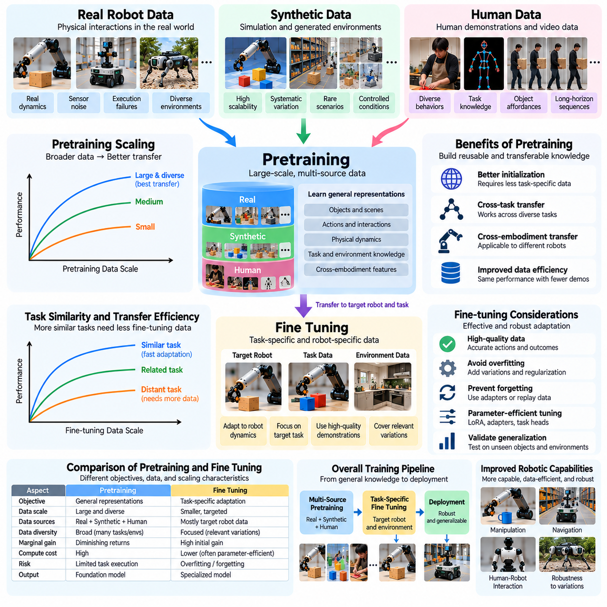{width="7.268055555555556in" height="7.268055555555556in"}

Pretraining and fine-tuning data scaling examines how the quantity, diversity, and quality of training experiences influence different stages of Physical AI development. Pretraining builds broad representations and reusable behavioral knowledge from large datasets, while fine-tuning adapts these capabilities to specific robots, tasks, and environments. Their scaling characteristics differ because they optimize different objectives and operate under different data constraints.

Pretraining typically uses heterogeneous datasets containing robot trajectories, human demonstrations, simulation experiences, images, videos, and language instructions. Its objective is to acquire transferable representations of objects, actions, environments, and physical interactions. Large-scale exposure helps models identify common structures across diverse experiences. However, broad coverage does not guarantee reliable execution of a particular robotic task.

Fine-tuning concentrates learning on narrower operational requirements, such as precision assembly, warehouse picking, or mobile manipulation. Training examples often originate from the target robot or closely related platforms. These datasets provide information about actuator behavior, sensor configuration, contact dynamics, and task-specific constraints. Fine-tuning transforms general knowledge into capabilities suitable for a defined deployment setting.

The relationship between pretraining data volume and downstream performance often exhibits diminishing returns. Initial increases in dataset size can substantially improve representation quality and task transfer. As coverage expands, additional examples may contribute progressively smaller improvements. The resulting scaling curve depends on model capacity, data diversity, optimization methods, and the similarity between pretraining experiences and downstream tasks.

Fine-tuning data frequently provides high marginal value because it directly addresses deployment requirements. A relatively small collection of accurate demonstrations may improve a specialized task more than a much larger collection of unrelated pretraining examples. Nevertheless, the benefit depends on the quality of the pretrained model. Weak foundational representations may require extensive adaptation data before acceptable performance becomes possible.

Pretraining and fine-tuning should therefore be evaluated as complementary investments rather than interchangeable sources of training volume. Pretraining reduces the amount of specialized experience needed for new tasks, while fine-tuning corrects limitations that remain after broad learning. The optimal allocation depends on how many downstream applications will reuse the same foundation model and how different their physical requirements are.

Transfer efficiency is a central metric for understanding the relationship between these stages. It measures how much task-specific data is required to achieve a defined performance level after pretraining. A stronger pretrained model should ideally reach the same target performance with fewer demonstrations or interaction episodes. Comparing adaptation curves across different pretraining scales reveals whether additional broad data produces practical savings.

Task similarity strongly influences fine-tuning efficiency. A model pretrained on grasping and object placement may adapt quickly to related warehouse manipulation tasks. Adapting the same model to dynamic locomotion or contact-intensive tool use may require substantially more data. Similarity should be evaluated through physical dynamics, action requirements, sensory information, and task structure rather than semantic labels alone.

Data quality plays different roles during pretraining and fine-tuning. Large pretraining datasets can tolerate some variability when useful patterns remain sufficiently represented. Fine-tuning datasets are often smaller, making incorrect actions, inconsistent labels, and synchronization errors more damaging. High-quality demonstrations, accurate calibration, and reliable outcome measurements are therefore especially important during task-specific adaptation.

Fine-tuning also introduces the risk of overfitting when limited demonstrations cover only a narrow range of conditions. A policy may perform well on familiar objects and initial configurations while failing under modest environmental changes. Data augmentation, regularization, and controlled variation can improve robustness. Evaluation should include unseen conditions that remain relevant to the intended deployment rather than measuring training-task success alone.

Catastrophic forgetting is another challenge because specialized adaptation may degrade capabilities acquired during pretraining. Updating model parameters for one robot or task can interfere with previously learned behaviors. Parameter-efficient adaptation, selective freezing, replay data, and modular architectures can reduce this interference. The appropriate method depends on whether the system must preserve broad generality or prioritize specialized performance.

Parameter-efficient fine-tuning can reduce computational requirements by updating only selected components of a pretrained model. Adapters, low-rank updates, and task-specific output heads allow shared representations to remain largely unchanged. This approach can support multiple robotic applications without maintaining a completely separate model for each task. However, limited adaptation capacity may restrict performance when substantial physical differences exist.

The ratio between pretraining and fine-tuning data should not be treated as a universal constant. Models with extensive pretraining may require fewer task-specific examples, but some precision tasks demand substantial real-world interaction regardless of foundation model scale. Contact dynamics, actuator characteristics, and safety constraints can create irreducible adaptation requirements. Optimal ratios must therefore be established empirically for each application family.

Simulation can contribute to both stages but serves different purposes. During pretraining, synthetic environments provide broad variation in objects, tasks, and physical conditions. During fine-tuning, simulation can reproduce deployment-specific scenarios and difficult failure cases. Targeted synthetic adaptation may reduce physical collection costs, although real-world validation remains necessary to detect simulation-to-reality discrepancies.

Human demonstrations can similarly support broad pretraining and specialized adaptation. Large video collections provide information about task intentions, object affordances, and action sequences. Direct teleoperation or carefully mapped demonstrations can supply more executable supervision for fine-tuning. The value of each source depends on how accurately its observations and actions correspond to the target robot\'s capabilities.

Compute allocation also affects the efficiency of the two stages. Pretraining generally requires substantial computational resources to process large heterogeneous datasets and optimize high-capacity models. Fine-tuning typically uses smaller datasets and fewer updates, although repeated adaptation across many robots can become expensive. Scaling analysis should consider total lifecycle computation rather than comparing individual training runs in isolation.

Joint optimization of pretraining and fine-tuning budgets can reveal more efficient development strategies. Increasing pretraining scale may reduce adaptation costs across many tasks, but the savings eventually diminish. Alternatively, investing in targeted fine-tuning data may produce faster improvements for a limited application portfolio. The economically preferred strategy depends on expected task reuse, deployment volume, and performance requirements.

Evaluation protocols should measure performance before and after fine-tuning across multiple downstream tasks. Useful metrics include zero-shot success, few-shot adaptation efficiency, final task success, robustness, and retained capabilities. Experiments should vary pretraining volume and fine-tuning volume independently whenever possible. This separation helps identify whether improvements originate from stronger general representations or additional specialized experience.

Active learning can improve fine-tuning efficiency by selecting examples that address the model\'s remaining weaknesses. Robots may collect demonstrations for uncertain states, repeated failures, or underrepresented object configurations. These experiences can be added to targeted adaptation datasets rather than expanding collection uniformly. The resulting feedback loop focuses expensive physical interaction on situations with high expected learning value.

Continual learning extends fine-tuning beyond a single adaptation stage. Deployed robots encounter new objects, environments, and operational constraints that were absent from their original datasets. Carefully curated field experiences can support periodic updates while preserving previously acquired capabilities. Version control, regression testing, and safety validation are necessary to prevent performance degradation during repeated deployment updates.

Scaling laws should ultimately describe performance as a function of pretraining data, fine-tuning data, model capacity, and computation. Controlled experiments can estimate how these variables interact and where additional investment yields diminishing returns. Such models are empirical approximations rather than universal guarantees. Their usefulness depends on consistent evaluation conditions and representative deployment tasks.

Ultimately, pretraining and fine-tuning data scaling concerns the efficient conversion of broad experience into reliable specialized behavior. Pretraining establishes reusable physical and behavioral knowledge, while fine-tuning aligns that knowledge with specific embodiments and operational demands. Effective Physical AI development balances both stages through quality-aware data selection, transfer evaluation, adaptive collection, and careful resource allocation.

사전학습 및 미세조정 데이터 스케일링(Pretraining and Fine-Tuning Data Scaling)은 학습 경험(Training Experiences)의 양(Quantity), 다양성(Diversity), 품질(Quality)이 피지컬 AI 개발(Physical AI Development)의 서로 다른 단계에 어떤 영향을 미치는지 분석합니다. 사전학습(Pretraining)은 대규모 데이터셋(Large Datasets)으로부터 광범위한 표현(Broad Representations)과 재사용 가능한 행동 지식(Reusable Behavioral Knowledge)을 구축하는 반면, 미세조정(Fine-Tuning)은 이러한 능력을 특정 로봇(Robots), 작업(Tasks), 환경(Environments)에 적응시킵니다. 두 단계는 서로 다른 목표(Objectives)를 최적화하고 서로 다른 데이터 제약(Data Constraints) 아래에서 작동하기 때문에 스케일링 특성(Scaling Characteristics)이 다릅니다.

사전학습(Pretraining)은 일반적으로 로봇 궤적(Robot Trajectories), 인간 시연(Human Demonstrations), 시뮬레이션 경험(Simulation Experiences), 이미지(Images), 비디오(Videos), 언어 지시(Language Instructions)를 포함하는 이기종 데이터셋(Heterogeneous Datasets)을 사용합니다. 사전학습의 목표는 물체(Objects), 행동(Actions), 환경(Environments), 물리적 상호작용(Physical Interactions)에 대한 전이 가능한 표현(Transferable Representations)을 획득하는 것입니다. 대규모 경험에 노출되면 모델이 다양한 경험에 걸쳐 공통 구조(Common Structures)를 식별하는 데 도움이 됩니다. 그러나 광범위한 학습 범위(Broad Coverage)가 특정 로봇 작업(Robotic Task)의 신뢰할 수 있는 실행(Reliable Execution)을 보장하지는 않습니다.

미세조정(Fine-Tuning)은 정밀 조립(Precision Assembly), 창고 피킹(Warehouse Picking), 모바일 조작(Mobile Manipulation)과 같은 보다 제한된 운영 요구사항(Operational Requirements)에 학습을 집중합니다. 학습 예제(Training Examples)는 대상 로봇(Target Robot)이나 밀접하게 관련된 플랫폼(Related Platforms)에서 수집되는 경우가 많습니다. 이러한 데이터셋은 액추에이터 거동(Actuator Behavior), 센서 구성(Sensor Configuration), 접촉 동역학(Contact Dynamics), 작업별 제약(Task-Specific Constraints)에 관한 정보를 제공합니다. 미세조정은 일반적인 지식(General Knowledge)을 정의된 배포 환경(Deployment Setting)에 적합한 능력으로 전환합니다.

사전학습 데이터 양(Pretraining Data Volume)과 다운스트림 성능(Downstream Performance) 사이의 관계는 일반적으로 수확 체감(Diminishing Returns)을 나타냅니다. 초기 데이터셋 크기(Dataset Size)의 증가는 표현 품질(Representation Quality)과 작업 전이(Task Transfer)를 크게 개선할 수 있습니다. 학습 범위가 확장됨에 따라 추가적인 예제(Additional Examples)가 제공하는 성능 향상은 점차 작아질 수 있습니다. 이러한 스케일링 곡선(Scaling Curve)은 모델 용량(Model Capacity), 데이터 다양성(Data Diversity), 최적화 방법(Optimization Methods), 사전학습 경험(Pretraining Experiences)과 다운스트림 작업(Downstream Tasks) 사이의 유사성(Similarity)에 따라 달라집니다.

미세조정 데이터(Fine-Tuning Data)는 배포 요구사항(Deployment Requirements)을 직접적으로 해결하기 때문에 높은 한계 가치(Marginal Value)를 제공하는 경우가 많습니다. 상대적으로 적은 수의 정확한 시연(Accurate Demonstrations)이 관련성이 낮은 대규모 사전학습 예제(Pretraining Examples)보다 특정 작업의 성능을 더 크게 개선할 수 있습니다. 그러나 이러한 효과는 사전학습된 모델(Pretrained Model)의 품질에 따라 달라집니다. 기반 표현(Foundational Representations)이 취약한 경우 허용 가능한 성능(Acceptable Performance)에 도달하기 위해 상당한 양의 적응 데이터(Adaptation Data)가 필요할 수 있습니다.

따라서 사전학습(Pretraining)과 미세조정(Fine-Tuning)은 서로 대체 가능한 학습 데이터 양(Training Volume)의 원천이 아니라 상호 보완적인 투자(Complementary Investments)로 평가해야 합니다. 사전학습은 새로운 작업에 필요한 특화된 경험(Specialized Experience)의 양을 줄이고, 미세조정은 광범위한 학습 이후에도 남아 있는 한계를 수정합니다. 최적의 자원 배분(Optimal Allocation)은 동일한 파운데이션 모델(Foundation Model)을 재사용할 다운스트림 애플리케이션(Downstream Applications)의 수와 각 애플리케이션의 물리적 요구사항(Physical Requirements)이 얼마나 다른지에 따라 달라집니다.

전이 효율성(Transfer Efficiency)은 이러한 두 단계의 관계를 이해하기 위한 핵심 지표(Central Metric)입니다. 이는 사전학습 이후 정의된 성능 수준(Defined Performance Level)에 도달하는 데 필요한 작업별 데이터(Task-Specific Data)의 양을 측정합니다. 더 강력한 사전학습 모델(Pretrained Model)은 이상적으로 더 적은 시연(Demonstrations)이나 상호작용 에피소드(Interaction Episodes)로 동일한 목표 성능(Target Performance)에 도달해야 합니다. 서로 다른 사전학습 규모(Pretraining Scales)에 따른 적응 곡선(Adaptation Curves)을 비교하면 광범위한 데이터의 추가가 실질적인 비용 절감(Practical Savings)을 제공하는지 확인할 수 있습니다.

작업 유사성(Task Similarity)은 미세조정 효율성(Fine-Tuning Efficiency)에 큰 영향을 미칩니다. 파지(Grasping)와 물체 배치(Object Placement)에 대해 사전학습된 모델은 관련된 창고 조작 작업(Warehouse Manipulation Tasks)에 빠르게 적응할 수 있습니다. 그러나 동일한 모델을 동적 이동(Dynamic Locomotion)이나 접촉 집약적 도구 사용(Contact-Intensive Tool Use)에 적응시키려면 훨씬 많은 데이터가 필요할 수 있습니다. 유사성은 의미적 레이블(Semantic Labels)만이 아니라 물리적 동역학(Physical Dynamics), 행동 요구사항(Action Requirements), 감각 정보(Sensory Information), 작업 구조(Task Structure)를 기준으로 평가해야 합니다.

데이터 품질(Data Quality)은 사전학습과 미세조정에서 서로 다른 역할을 합니다. 대규모 사전학습 데이터셋(Large Pretraining Datasets)은 유용한 패턴(Useful Patterns)이 충분히 표현되어 있다면 어느 정도의 변동성(Variability)을 허용할 수 있습니다. 반면 미세조정 데이터셋(Fine-Tuning Datasets)은 일반적으로 규모가 작기 때문에 잘못된 행동(Incorrect Actions), 일관되지 않은 레이블(Inconsistent Labels), 동기화 오류(Synchronization Errors)가 더 큰 손상을 초래할 수 있습니다. 따라서 고품질 시연(High-Quality Demonstrations), 정확한 보정(Accurate Calibration), 신뢰할 수 있는 결과 측정(Reliable Outcome Measurements)은 작업별 적응(Task-Specific Adaptation)에서 특히 중요합니다.

미세조정(Fine-Tuning)은 제한된 시연(Limited Demonstrations)이 좁은 범위의 조건만 포함할 경우 과적합(Overfitting)의 위험도 발생시킵니다. 정책(Policy)은 익숙한 물체(Familiar Objects)와 초기 구성(Initial Configurations)에서는 우수한 성능을 보이지만 작은 환경 변화(Environmental Changes)에도 실패할 수 있습니다. 데이터 증강(Data Augmentation), 정규화(Regularization), 통제된 변형(Controlled Variation)은 강건성(Robustness)을 개선할 수 있습니다. 평가는 학습 작업 성공률(Training-Task Success)만 측정하는 것이 아니라 의도한 배포 환경(Intended Deployment)에 관련된 미관측 조건(Unseen Conditions)을 포함해야 합니다.

파국적 망각(Catastrophic Forgetting)은 특화된 적응(Specialized Adaptation)이 사전학습에서 획득한 능력을 저하시킬 수 있기 때문에 또 다른 과제가 됩니다. 특정 로봇이나 작업을 위해 모델 매개변수(Model Parameters)를 업데이트하면 이전에 학습한 행동(Previously Learned Behaviors)에 간섭(Interference)이 발생할 수 있습니다. 매개변수 효율적 적응(Parameter-Efficient Adaptation), 선택적 동결(Selective Freezing), 재생 데이터(Replay Data), 모듈형 아키텍처(Modular Architectures)는 이러한 간섭을 줄일 수 있습니다. 적절한 방법은 시스템이 광범위한 일반성(Broad Generality)을 유지해야 하는지, 특화된 성능(Specialized Performance)을 우선해야 하는지에 따라 달라집니다.

매개변수 효율적 미세조정(Parameter-Efficient Fine-Tuning)은 사전학습 모델의 일부 구성요소만 업데이트하여 계산 요구량(Computational Requirements)을 줄일 수 있습니다. 어댑터(Adapters), 저랭크 업데이트(Low-Rank Updates), 작업별 출력 헤드(Task-Specific Output Heads)는 공유 표현(Shared Representations)을 대부분 변경하지 않고 유지할 수 있도록 합니다. 이러한 접근법은 각 작업마다 완전히 별도의 모델을 유지하지 않고도 여러 로봇 애플리케이션(Robotic Applications)을 지원할 수 있습니다. 그러나 물리적 차이(Physical Differences)가 큰 경우 제한된 적응 용량(Adaptation Capacity)이 성능을 제약할 수 있습니다.

사전학습 데이터(Pretraining Data)와 미세조정 데이터(Fine-Tuning Data)의 비율을 보편적인 상수(Universal Constant)로 취급해서는 안 됩니다. 광범위한 사전학습을 거친 모델은 더 적은 작업별 예제(Task-Specific Examples)를 필요로 할 수 있지만, 일부 정밀 작업(Precision Tasks)은 파운데이션 모델 규모(Foundation Model Scale)와 관계없이 상당한 실세계 상호작용(Real-World Interaction)을 요구합니다. 접촉 동역학(Contact Dynamics), 액추에이터 특성(Actuator Characteristics), 안전 제약(Safety Constraints)은 제거하기 어려운 적응 요구사항(Irreducible Adaptation Requirements)을 발생시킬 수 있습니다. 따라서 최적의 비율은 각 애플리케이션 계열(Application Family)에 대해 실험적으로 결정해야 합니다.

시뮬레이션(Simulation)은 두 단계 모두에 기여할 수 있지만 서로 다른 목적을 수행합니다. 사전학습 단계에서 합성 환경(Synthetic Environments)은 물체(Objects), 작업(Tasks), 물리적 조건(Physical Conditions)에 대한 광범위한 변화를 제공합니다. 미세조정 단계에서는 시뮬레이션을 통해 배포 환경별 시나리오(Deployment-Specific Scenarios)와 어려운 실패 사례(Difficult Failure Cases)를 재현할 수 있습니다. 표적화된 합성 적응(Targeted Synthetic Adaptation)은 물리적 데이터 수집 비용(Physical Collection Costs)을 줄일 수 있지만 시뮬레이션과 현실 사이의 차이(Simulation-to-Reality Discrepancies)를 탐지하기 위한 실세계 검증(Real-World Validation)은 여전히 필요합니다.

인간 시연(Human Demonstrations)도 광범위한 사전학습(Broad Pretraining)과 특화된 적응(Specialized Adaptation)을 모두 지원할 수 있습니다. 대규모 비디오 컬렉션(Large Video Collections)은 작업 의도(Task Intentions), 물체의 행동 가능성(Object Affordances), 행동 시퀀스(Action Sequences)에 관한 정보를 제공합니다. 직접 원격조작(Direct Teleoperation)이나 신중하게 매핑된 시연(Carefully Mapped Demonstrations)은 미세조정을 위한 실행 가능성이 더 높은 지도 정보(Executable Supervision)를 제공할 수 있습니다. 각 데이터 소스의 가치는 관측(Observations)과 행동(Actions)이 대상 로봇(Target Robot)의 능력과 얼마나 정확하게 대응하는지에 따라 달라집니다.

계산 자원 배분(Compute Allocation)도 두 단계의 효율성에 영향을 미칩니다. 사전학습(Pretraining)은 일반적으로 대규모 이기종 데이터셋(Large Heterogeneous Datasets)을 처리하고 고용량 모델(High-Capacity Models)을 최적화하기 위해 상당한 계산 자원(Computational Resources)을 요구합니다. 미세조정(Fine-Tuning)은 일반적으로 더 작은 데이터셋과 적은 업데이트(Fewer Updates)를 사용하지만 여러 로봇에 걸쳐 반복적으로 적응하면 비용이 커질 수 있습니다. 스케일링 분석(Scaling Analysis)은 개별 학습 실행(Individual Training Runs)을 따로 비교하기보다 전체 수명주기 계산량(Total Lifecycle Computation)을 고려해야 합니다.

사전학습 및 미세조정 예산(Pretraining and Fine-Tuning Budgets)의 공동 최적화(Joint Optimization)는 더욱 효율적인 개발 전략(Development Strategies)을 제시할 수 있습니다. 사전학습 규모(Pretraining Scale)를 증가시키면 여러 작업에 걸친 적응 비용(Adaptation Costs)을 줄일 수 있지만 이러한 절감 효과는 결국 감소합니다. 반대로 표적화된 미세조정 데이터(Targeted Fine-Tuning Data)에 투자하면 제한된 애플리케이션 포트폴리오(Application Portfolio)에서 더 빠른 성능 향상을 얻을 수 있습니다. 경제적으로 선호되는 전략(Economically Preferred Strategy)은 예상 작업 재사용(Expected Task Reuse), 배포 규모(Deployment Volume), 성능 요구사항(Performance Requirements)에 따라 달라집니다.

평가 프로토콜(Evaluation Protocols)은 여러 다운스트림 작업(Downstream Tasks)에 걸쳐 미세조정 전후의 성능을 측정해야 합니다. 유용한 지표에는 제로샷 성공률(Zero-Shot Success), 소수 샷 적응 효율성(Few-Shot Adaptation Efficiency), 최종 작업 성공률(Final Task Success), 강건성(Robustness), 유지된 능력(Retained Capabilities)이 포함됩니다. 실험에서는 가능할 때마다 사전학습 데이터 양(Pretraining Volume)과 미세조정 데이터 양(Fine-Tuning Volume)을 독립적으로 변화시켜야 합니다. 이러한 분리는 성능 향상이 더 강력한 일반 표현(General Representations)에서 비롯되는지, 추가적인 특화 경험(Specialized Experience)에서 비롯되는지 식별하는 데 도움이 됩니다.

능동 학습(Active Learning)은 모델에 남아 있는 약점(Remaining Weaknesses)을 해결하는 예제를 선택하여 미세조정 효율성(Fine-Tuning Efficiency)을 개선할 수 있습니다. 로봇은 불확실한 상태(Uncertain States), 반복적인 실패(Repeated Failures), 충분히 표현되지 않은 물체 구성(Underrepresented Object Configurations)에 대한 시연(Demonstrations)을 수집할 수 있습니다. 이러한 경험은 전체 데이터 수집을 균일하게 확장하는 대신 표적화된 적응 데이터셋(Targeted Adaptation Datasets)에 추가할 수 있습니다. 그 결과 형성되는 피드백 루프(Feedback Loop)는 높은 학습 가치(Expected Learning Value)가 예상되는 상황에 비용이 많이 드는 물리적 상호작용(Physical Interaction)을 집중시킵니다.

지속 학습(Continual Learning)은 미세조정을 단일 적응 단계(Single Adaptation Stage) 이후까지 확장합니다. 배포된 로봇(Deployed Robots)은 원래 데이터셋(Original Datasets)에 없었던 새로운 물체(Objects), 환경(Environments), 운영 제약(Operational Constraints)을 경험합니다. 신중하게 큐레이션된 현장 경험(Curated Field Experiences)은 이전에 획득한 능력을 유지하면서 주기적인 업데이트(Periodic Updates)를 지원할 수 있습니다. 반복적인 배포 업데이트(Deployment Updates) 과정에서 성능 저하(Performance Degradation)를 방지하려면 버전 관리(Version Control), 회귀 시험(Regression Testing), 안전 검증(Safety Validation)이 필요합니다.

스케일링 법칙(Scaling Laws)은 궁극적으로 사전학습 데이터(Pretraining Data), 미세조정 데이터(Fine-Tuning Data), 모델 용량(Model Capacity), 계산량(Computation)의 함수로 성능을 설명해야 합니다. 통제된 실험(Controlled Experiments)은 이러한 변수들이 어떻게 상호작용하는지와 추가 투자가 수확 체감(Diminishing Returns)을 나타내는 지점을 추정할 수 있습니다. 이러한 모델은 보편적인 보장(Universal Guarantees)이 아니라 경험적 근사(Empirical Approximations)입니다. 그 유용성은 일관된 평가 조건(Consistent Evaluation Conditions)과 대표적인 배포 작업(Representative Deployment Tasks)에 달려 있습니다.

궁극적으로 사전학습 및 미세조정 데이터 스케일링(Pretraining and Fine-Tuning Data Scaling)은 광범위한 경험(Broad Experience)을 신뢰할 수 있는 특화 행동(Reliable Specialized Behavior)으로 효율적으로 전환하는 과정입니다. 사전학습은 재사용 가능한 물리적 지식(Reusable Physical Knowledge)과 행동 지식(Behavioral Knowledge)을 구축하고, 미세조정은 이러한 지식을 특정 체화(Embodiments)와 운영 요구사항(Operational Demands)에 맞추어 조정합니다. 효과적인 피지컬 AI 개발(Physical AI Development)은 품질 인식 데이터 선택(Quality-Aware Data Selection), 전이 평가(Transfer Evaluation), 적응형 데이터 수집(Adaptive Collection), 신중한 자원 배분(Careful Resource Allocation)을 통해 두 단계의 균형을 유지합니다.

##  

## 07.11. Model Size and Robot Capability

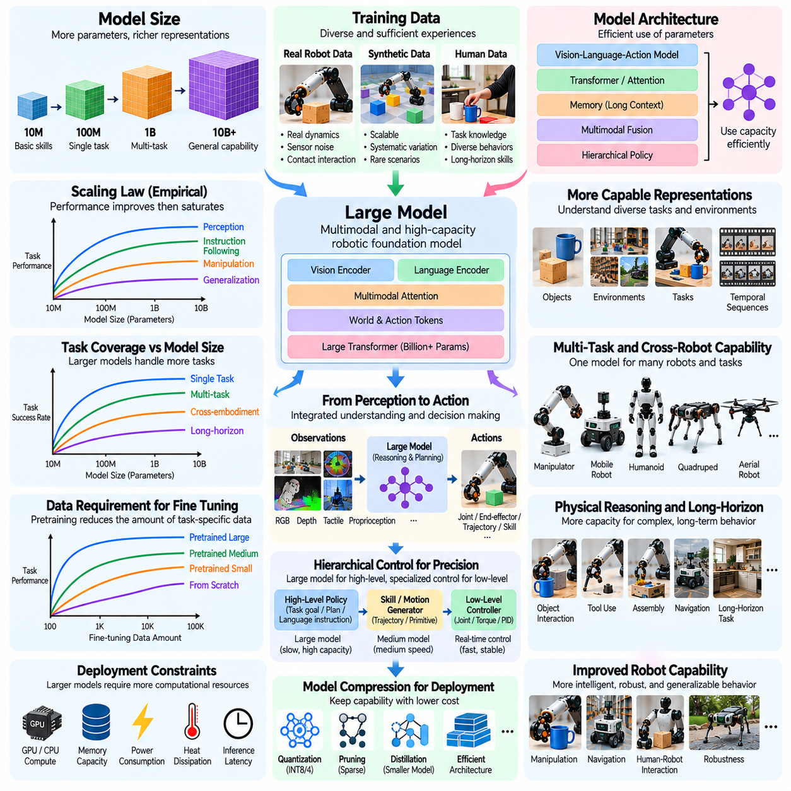{width="7.268055555555556in" height="7.268055555555556in"}

Model size and robot capability scaling examines how increasing neural network capacity influences the intelligence, adaptability, and physical performance of robotic systems. Larger models can represent more complex relationships among perception, language, motion, and environmental dynamics. However, parameter count alone does not determine robotic competence. Effective scaling depends on training data, model architecture, computational resources, and the physical constraints of deployment.

Model size is commonly measured by the number of trainable parameters, although parameter count provides only a partial description of computational capacity. Architecture, attention mechanisms, memory structures, and activation patterns influence how efficiently parameters represent knowledge. Two models with similar sizes may exhibit different robotic capabilities. Scaling analysis must therefore consider both parameter quantity and the functional organization of the model.

Larger models can improve representation learning by capturing relationships across diverse objects, tasks, environments, and robot embodiments. They may integrate visual observations, language instructions, proprioceptive signals, and action histories into shared representations. This capacity supports broader task understanding and more flexible behavior selection. Nevertheless, improvements depend on whether training experiences contain sufficient information to learn meaningful physical relationships.

The relationship between model size and task performance often follows empirical scaling trends, but these trends vary across robotic applications. Increasing parameters may initially improve prediction accuracy and task success before gains become smaller. Some capabilities may improve rapidly within particular model ranges. Such changes should be established through controlled experiments rather than assumed to represent universal thresholds or guaranteed emergent behavior.

Data availability strongly influences the benefits of increasing model capacity. Large networks trained on limited robotic trajectories may memorize demonstrations without developing transferable control strategies. Diverse data helps expose the model to different physical conditions and interaction outcomes. Consequently, model scaling should be coordinated with data scaling to avoid overfitting, inefficient computation, and poor generalization.

Model capacity also affects the ability to learn multiple robotic tasks within a shared architecture. Smaller policies may perform well on narrowly defined behaviors but struggle when required to represent many unrelated skills. Larger models can potentially share knowledge across manipulation, navigation, perception, and planning. However, competing objectives may still produce negative transfer when tasks require incompatible representations or control strategies.

Vision-language-action models illustrate how increased capacity can support integrated robotic intelligence. These architectures connect visual perception, linguistic instructions, and action generation within a common learning framework. Larger representations may improve semantic understanding and instruction following. Yet successful physical execution also requires accurate spatial reasoning, contact awareness, and compatibility with robot-specific action interfaces.

Long-horizon robotic tasks introduce additional demands on model capacity because successful execution requires maintaining information across multiple decisions. Assembly, cleaning, and mobile manipulation involve changing goals, intermediate states, and unexpected disturbances. Larger models may support richer task representations and planning. However, reliable long-horizon behavior also depends on memory, feedback, error recovery, and hierarchical control.

Physical reasoning presents a distinctive challenge because robots must predict the consequences of actions in environments governed by mechanics. Understanding friction, mass, compliance, and contact dynamics requires information beyond visual appearance. Larger models may represent more complex physical relationships, but parameter growth cannot compensate for missing interaction evidence. Accurate physical intelligence requires appropriately grounded training experiences.

The relationship between model size and control precision is not straightforward. A large policy may understand task objectives while producing actions that lack the timing or accuracy required for insertion and grasp stabilization. Low-level control depends on actuator characteristics, feedback frequency, and deterministic execution. Combining high-capacity models with specialized controllers can therefore be more effective than assigning every control decision to one network.

Inference latency becomes a major constraint as model size increases. Robotic systems must often generate actions within strict real-time deadlines, especially during dynamic movement and contact-rich manipulation. Larger networks may require more memory bandwidth and computational throughput. If inference delays exceed control requirements, additional model capacity can reduce operational performance despite improvements in offline prediction accuracy.

Onboard computing limitations further restrict practical model scaling. Mobile robots, drones, and compact manipulators operate under constraints involving processor capability, battery consumption, heat dissipation, and physical space. Cloud inference can provide additional computation but introduces communication latency and connectivity risks. Deployment architectures must balance model capacity with local autonomy, reliability, and energy efficiency.

Model compression offers one approach to preserving capabilities while reducing deployment costs. Quantization, pruning, knowledge distillation, and efficient attention mechanisms can decrease memory usage and computational requirements. A smaller deployed model may inherit useful representations from a larger teacher model. However, compression must be evaluated against task success, control stability, safety, and performance under unfamiliar physical conditions.

Mixture-of-experts architectures provide another scaling strategy by activating selected model components for particular inputs or tasks. This can increase total parameter capacity without requiring every parameter to participate in each inference step. Specialized components may represent different skills or perceptual domains. Nevertheless, routing errors, communication overhead, and inconsistent behavior across experts can complicate robotic deployment.

Model size can influence cross-task and cross-embodiment transfer by increasing the capacity to represent shared patterns. A sufficiently trained model may reuse object understanding and task planning across different robot platforms. However, differences in joint structures, sensors, and actuator dynamics still require explicit adaptation. Embodiment-aware representations and robot-specific control interfaces remain important even when the shared model becomes substantially larger.

Pretraining and fine-tuning interact with model capacity in important ways. Larger pretrained models may provide stronger initial representations and reduce the number of demonstrations needed for downstream adaptation. However, this advantage depends on the relevance and quality of pretraining data. Specialized fine-tuning may remain essential for precision tasks, unusual robot configurations, and deployment environments with distinctive physical constraints.

Scaling experiments should compare models under carefully controlled data and computational conditions. Researchers can vary parameter counts while maintaining consistent training distributions, evaluation tasks, and optimization procedures. Performance should be measured across familiar and unseen objects, tasks, and environments. These experiments help distinguish improvements caused by model capacity from gains attributable to additional data or computation.

Capability evaluation should extend beyond prediction loss and benchmark accuracy. Robotic intelligence must be assessed through task completion, physical precision, robustness, adaptation efficiency, safety, and recovery from unexpected events. A larger model that performs better on offline datasets may not necessarily achieve higher real-world success. Deployment-oriented metrics are therefore essential for determining the practical value of scaling.

The economic efficiency of model scaling depends on performance improvement relative to training and inference costs. Larger models require additional accelerators, memory, energy, and engineering resources. These investments may be justified when a shared model supports many robots or applications. For narrowly defined tasks, smaller specialized policies may provide better operational value. The optimal model size depends on workload, deployment scale, and reliability requirements.

Safety considerations become increasingly important as models acquire broader behavioral capabilities. High-capacity policies may generate actions that appear reasonable but violate physical limits or operational constraints. Increasing parameter count does not inherently guarantee safer decisions. Robot-specific safety filters, constrained controllers, monitoring systems, and systematic validation remain necessary regardless of model size.

A practical scaling strategy often separates high-level intelligence from time-critical physical control. Large models can interpret instructions, reason about task structure, and propose action objectives, while compact controllers execute precise movements using rapid sensor feedback. This division allows systems to benefit from greater representational capacity without sacrificing control responsiveness. The appropriate boundary depends on task dynamics and hardware capabilities.

Ultimately, model size and robot capability scaling is a multidimensional engineering problem rather than a simple relationship between parameters and intelligence. Larger models can enable broader representations, stronger transfer, and more complex behavior, but only when supported by suitable data and execution infrastructure. Effective Physical AI scaling coordinates model capacity, physical experience, efficient inference, adaptive control, and rigorous real-world evaluation.

모델 크기와 로봇 능력의 스케일링(Model Size and Robot Capability Scaling)은 신경망 용량(Neural Network Capacity)의 증가가 로봇 시스템(Robotic Systems)의 지능(Intelligence), 적응성(Adaptability), 물리적 성능(Physical Performance)에 어떤 영향을 미치는지 분석합니다. 더 큰 모델(Larger Models)은 인식(Perception), 언어(Language), 동작(Motion), 환경 동역학(Environmental Dynamics) 사이의 복잡한 관계를 표현할 수 있습니다. 그러나 매개변수 수(Parameter Count)만으로 로봇의 능력(Robotic Competence)이 결정되는 것은 아닙니다. 효과적인 스케일링(Effective Scaling)은 학습 데이터(Training Data), 모델 아키텍처(Model Architecture), 계산 자원(Computational Resources), 배포 환경의 물리적 제약(Physical Constraints of Deployment)에 따라 달라집니다.

모델 크기(Model Size)는 일반적으로 학습 가능한 매개변수(Trainable Parameters)의 수로 측정하지만, 매개변수 수는 계산 용량(Computational Capacity)의 일부 특성만 설명합니다. 아키텍처(Architecture), 어텐션 메커니즘(Attention Mechanisms), 메모리 구조(Memory Structures), 활성화 패턴(Activation Patterns)은 매개변수가 지식을 얼마나 효율적으로 표현하는지에 영향을 미칩니다. 크기가 비슷한 두 모델이라도 서로 다른 로봇 능력(Robotic Capabilities)을 나타낼 수 있습니다. 따라서 스케일링 분석(Scaling Analysis)은 매개변수의 양(Parameter Quantity)과 모델의 기능적 구성(Functional Organization)을 모두 고려해야 합니다.

더 큰 모델(Larger Models)은 다양한 물체(Objects), 작업(Tasks), 환경(Environments), 로봇 체화(Robot Embodiments) 사이의 관계를 포착하여 표현 학습(Representation Learning)을 개선할 수 있습니다. 이러한 모델은 시각적 관측(Visual Observations), 언어 지시(Language Instructions), 고유수용감각 신호(Proprioceptive Signals), 행동 이력(Action Histories)을 공유 표현(Shared Representations)으로 통합할 수 있습니다. 이러한 용량은 폭넓은 작업 이해(Task Understanding)와 유연한 행동 선택(Behavior Selection)을 지원합니다. 그러나 성능 향상은 학습 경험(Training Experiences)에 의미 있는 물리적 관계(Physical Relationships)를 학습하기 위한 충분한 정보가 포함되어 있는지에 따라 달라집니다.

모델 크기(Model Size)와 작업 성능(Task Performance) 사이의 관계는 경험적 스케일링 경향(Empirical Scaling Trends)을 따르는 경우가 많지만, 이러한 경향은 로봇 애플리케이션(Robotic Applications)에 따라 달라집니다. 매개변수(Parameters)를 증가시키면 초기에는 예측 정확도(Prediction Accuracy)와 작업 성공률(Task Success)이 향상되지만, 이후에는 개선 폭이 작아질 수 있습니다. 일부 능력(Capabilities)은 특정 모델 크기 범위(Model Ranges)에서 빠르게 향상될 수 있습니다. 이러한 변화는 보편적인 임계값(Universal Thresholds)이나 보장된 창발적 행동(Guaranteed Emergent Behavior)으로 가정하기보다 통제된 실험(Controlled Experiments)을 통해 확인해야 합니다.

데이터 가용성(Data Availability)은 모델 용량(Model Capacity) 증가의 효과에 큰 영향을 미칩니다. 제한된 로봇 궤적(Robotic Trajectories)으로 학습한 대규모 신경망(Large Networks)은 전이 가능한 제어 전략(Transferable Control Strategies)을 개발하지 못하고 시연(Demonstrations)을 암기할 수 있습니다. 다양한 데이터(Diverse Data)는 모델이 서로 다른 물리적 조건(Physical Conditions)과 상호작용 결과(Interaction Outcomes)를 경험하도록 돕습니다. 따라서 모델 스케일링(Model Scaling)은 과적합(Overfitting), 비효율적인 계산(Inefficient Computation), 낮은 일반화 성능(Poor Generalization)을 방지하기 위해 데이터 스케일링(Data Scaling)과 함께 조정되어야 합니다.

모델 용량(Model Capacity)은 공유 아키텍처(Shared Architecture) 내에서 여러 로봇 작업(Robotic Tasks)을 학습하는 능력에도 영향을 미칩니다. 작은 정책 모델(Smaller Policies)은 제한적으로 정의된 행동(Narrowly Defined Behaviors)에서는 우수한 성능을 보일 수 있지만, 서로 관련성이 낮은 여러 기술(Skills)을 표현해야 할 때 어려움을 겪을 수 있습니다. 더 큰 모델은 조작(Manipulation), 내비게이션(Navigation), 인식(Perception), 계획(Planning) 전반에 걸쳐 지식을 공유할 가능성이 있습니다. 그러나 작업마다 호환되지 않는 표현(Incompatible Representations)이나 제어 전략(Control Strategies)이 필요한 경우 상충하는 목표(Competing Objectives)로 인해 부정적 전이(Negative Transfer)가 발생할 수 있습니다.

시각-언어-행동 모델(Vision-Language-Action Models)은 증가된 모델 용량(Model Capacity)이 통합된 로봇 지능(Integrated Robotic Intelligence)을 어떻게 지원할 수 있는지 보여줍니다. 이러한 아키텍처(Architectures)는 시각적 인식(Visual Perception), 언어 지시(Linguistic Instructions), 행동 생성(Action Generation)을 공통 학습 프레임워크(Common Learning Framework) 안에서 연결합니다. 더 큰 표현(Larger Representations)은 의미적 이해(Semantic Understanding)와 지시 이행(Instruction Following)을 개선할 수 있습니다. 그러나 성공적인 물리적 실행(Physical Execution)을 위해서는 정확한 공간 추론(Spatial Reasoning), 접촉 인식(Contact Awareness), 로봇별 행동 인터페이스(Robot-Specific Action Interfaces)와의 호환성도 필요합니다.

장기 작업(Long-Horizon Tasks)은 여러 의사결정(Multiple Decisions)에 걸쳐 정보를 유지해야 성공적으로 실행할 수 있으므로 모델 용량(Model Capacity)에 추가적인 요구사항을 부과합니다. 조립(Assembly), 청소(Cleaning), 모바일 조작(Mobile Manipulation)은 변화하는 목표(Changing Goals), 중간 상태(Intermediate States), 예상하지 못한 외란(Unexpected Disturbances)을 포함합니다. 더 큰 모델은 더욱 풍부한 작업 표현(Task Representations)과 계획(Planning)을 지원할 수 있습니다. 그러나 신뢰할 수 있는 장기 행동(Long-Horizon Behavior)은 메모리(Memory), 피드백(Feedback), 오류 복구(Error Recovery), 계층적 제어(Hierarchical Control)에도 의존합니다.

물리적 추론(Physical Reasoning)은 로봇이 역학 법칙(Mechanics)에 의해 지배되는 환경에서 행동의 결과(Action Consequences)를 예측해야 한다는 점에서 독특한 과제를 제시합니다. 마찰(Friction), 질량(Mass), 순응성(Compliance), 접촉 동역학(Contact Dynamics)을 이해하려면 시각적 외형(Visual Appearance) 이상의 정보가 필요합니다. 더 큰 모델은 복잡한 물리적 관계(Physical Relationships)를 표현할 수 있지만, 매개변수 증가(Parameter Growth)만으로 부족한 상호작용 증거(Interaction Evidence)를 보완할 수는 없습니다. 정확한 물리적 지능(Physical Intelligence)을 위해서는 물리적 현실에 적절하게 기반한 학습 경험(Grounded Training Experiences)이 필요합니다.

모델 크기(Model Size)와 제어 정밀도(Control Precision) 사이의 관계는 단순하지 않습니다. 대규모 정책 모델(Large Policy)은 작업 목표(Task Objectives)를 이해하면서도 삽입(Insertion)이나 파지 안정화(Grasp Stabilization)에 필요한 타이밍(Timing) 또는 정확도(Accuracy)를 충족하지 못하는 행동을 생성할 수 있습니다. 저수준 제어(Low-Level Control)는 액추에이터 특성(Actuator Characteristics), 피드백 주파수(Feedback Frequency), 결정론적 실행(Deterministic Execution)에 의존합니다. 따라서 고용량 모델(High-Capacity Models)을 특화된 제어기(Specialized Controllers)와 결합하는 것이 모든 제어 결정을 하나의 신경망(Network)에 맡기는 것보다 효과적일 수 있습니다.

모델 크기(Model Size)가 증가하면 추론 지연(Inference Latency)이 주요 제약으로 작용합니다. 로봇 시스템(Robotic Systems)은 특히 동적 이동(Dynamic Movement)과 접촉 중심 조작(Contact-Rich Manipulation) 과정에서 엄격한 실시간 마감시간(Real-Time Deadlines) 내에 행동을 생성해야 하는 경우가 많습니다. 더 큰 신경망(Larger Networks)은 더 높은 메모리 대역폭(Memory Bandwidth)과 계산 처리량(Computational Throughput)을 요구할 수 있습니다. 추론 지연(Inference Delays)이 제어 요구사항(Control Requirements)을 초과하면 오프라인 예측 정확도(Offline Prediction Accuracy)가 향상되더라도 추가적인 모델 용량이 실제 운영 성능(Operational Performance)을 저하시킬 수 있습니다.

온보드 컴퓨팅(Onboard Computing)의 한계는 실제 모델 스케일링(Practical Model Scaling)을 더욱 제한합니다. 모바일 로봇(Mobile Robots), 드론(Drones), 소형 매니퓰레이터(Compact Manipulators)는 프로세서 성능(Processor Capability), 배터리 소비(Battery Consumption), 열 방출(Heat Dissipation), 물리적 공간(Physical Space)의 제약 아래에서 작동합니다. 클라우드 추론(Cloud Inference)은 추가적인 계산 능력을 제공할 수 있지만 통신 지연(Communication Latency)과 연결성 위험(Connectivity Risks)을 발생시킵니다. 배포 아키텍처(Deployment Architectures)는 모델 용량(Model Capacity)과 로컬 자율성(Local Autonomy), 신뢰성(Reliability), 에너지 효율성(Energy Efficiency) 사이의 균형을 유지해야 합니다.

모델 압축(Model Compression)은 배포 비용(Deployment Costs)을 줄이면서 모델 능력(Capabilities)을 유지하기 위한 하나의 접근법입니다. 양자화(Quantization), 가지치기(Pruning), 지식 증류(Knowledge Distillation), 효율적인 어텐션 메커니즘(Efficient Attention Mechanisms)은 메모리 사용량(Memory Usage)과 계산 요구량(Computational Requirements)을 줄일 수 있습니다. 배포되는 소형 모델(Smaller Deployed Model)은 더 큰 교사 모델(Teacher Model)로부터 유용한 표현(Useful Representations)을 전달받을 수 있습니다. 그러나 압축(Compression)은 작업 성공률(Task Success), 제어 안정성(Control Stability), 안전성(Safety), 익숙하지 않은 물리적 조건(Unfamiliar Physical Conditions)에서의 성능을 기준으로 평가해야 합니다.

전문가 혼합 아키텍처(Mixture-of-Experts Architectures)는 특정 입력(Inputs)이나 작업(Tasks)에 대해 선택된 모델 구성요소(Model Components)만 활성화하는 또 다른 스케일링 전략(Scaling Strategy)을 제공합니다. 이를 통해 매 추론 단계(Inference Step)에서 모든 매개변수를 사용하지 않고도 전체 매개변수 용량(Total Parameter Capacity)을 증가시킬 수 있습니다. 특화된 구성요소(Specialized Components)는 서로 다른 기술(Skills)이나 인식 영역(Perceptual Domains)을 표현할 수 있습니다. 그러나 라우팅 오류(Routing Errors), 통신 오버헤드(Communication Overhead), 전문가 간 일관되지 않은 행동(Inconsistent Behavior Across Experts)은 로봇 배포(Robotic Deployment)를 복잡하게 만들 수 있습니다.

모델 크기(Model Size)는 공유 패턴(Shared Patterns)을 표현하는 용량을 증가시켜 작업 간 전이(Cross-Task Transfer)와 체화 간 전이(Cross-Embodiment Transfer)에 영향을 미칠 수 있습니다. 충분히 학습된 모델은 서로 다른 로봇 플랫폼(Robot Platforms)에서 물체 이해(Object Understanding)와 작업 계획(Task Planning)을 재사용할 수 있습니다. 그러나 관절 구조(Joint Structures), 센서(Sensors), 액추에이터 동역학(Actuator Dynamics)의 차이는 여전히 명시적인 적응(Explicit Adaptation)을 요구합니다. 공유 모델(Shared Model)의 크기가 상당히 커지더라도 체화 인식 표현(Embodiment-Aware Representations)과 로봇별 제어 인터페이스(Robot-Specific Control Interfaces)는 계속 중요합니다.

사전학습(Pretraining)과 미세조정(Fine-Tuning)은 모델 용량(Model Capacity)과 중요한 방식으로 상호작용합니다. 더 큰 사전학습 모델(Larger Pretrained Models)은 더 강력한 초기 표현(Initial Representations)을 제공하고 다운스트림 적응(Downstream Adaptation)에 필요한 시연(Demonstrations)의 수를 줄일 수 있습니다. 그러나 이러한 이점은 사전학습 데이터(Pretraining Data)의 관련성(Relevance)과 품질(Quality)에 따라 달라집니다. 정밀 작업(Precision Tasks), 특수한 로봇 구성(Unusual Robot Configurations), 독특한 물리적 제약(Physical Constraints)을 가진 배포 환경(Deployment Environments)에서는 특화된 미세조정(Specialized Fine-Tuning)이 여전히 필수적일 수 있습니다.

스케일링 실험(Scaling Experiments)은 데이터와 계산 조건(Data and Computational Conditions)을 신중하게 통제한 상태에서 모델을 비교해야 합니다. 연구자는 일관된 학습 분포(Training Distributions), 평가 작업(Evaluation Tasks), 최적화 절차(Optimization Procedures)를 유지하면서 매개변수 수(Parameter Counts)를 변화시킬 수 있습니다. 성능은 익숙한 물체(Familiar Objects)와 미관측 물체(Unseen Objects), 작업(Tasks), 환경(Environments) 전반에서 측정해야 합니다. 이러한 실험은 모델 용량(Model Capacity)에 의한 개선과 추가 데이터(Additional Data) 또는 계산량(Computation)에 의한 개선을 구분하는 데 도움이 됩니다.

능력 평가(Capability Evaluation)는 예측 손실(Prediction Loss)과 벤치마크 정확도(Benchmark Accuracy)를 넘어 확장되어야 합니다. 로봇 지능(Robotic Intelligence)은 작업 완료(Task Completion), 물리적 정밀도(Physical Precision), 강건성(Robustness), 적응 효율성(Adaptation Efficiency), 안전성(Safety), 예상하지 못한 사건(Unexpected Events)으로부터의 복구 능력(Recovery)을 통해 평가해야 합니다. 오프라인 데이터셋(Offline Datasets)에서 더 좋은 성능을 보이는 대규모 모델(Larger Model)이 반드시 더 높은 실세계 성공률(Real-World Success)을 달성하는 것은 아닙니다. 따라서 배포 중심 지표(Deployment-Oriented Metrics)는 스케일링의 실질적인 가치(Practical Value)를 결정하는 데 필수적입니다.

모델 스케일링(Model Scaling)의 경제적 효율성(Economic Efficiency)은 학습 및 추론 비용(Training and Inference Costs) 대비 성능 향상(Performance Improvement)에 따라 달라집니다. 더 큰 모델은 추가적인 가속기(Accelerators), 메모리(Memory), 에너지(Energy), 엔지니어링 자원(Engineering Resources)을 요구합니다. 공유 모델(Shared Model)이 많은 로봇이나 애플리케이션(Applications)을 지원한다면 이러한 투자는 정당화될 수 있습니다. 반면 제한적으로 정의된 작업(Narrowly Defined Tasks)에서는 더 작은 특화 정책(Smaller Specialized Policies)이 더 높은 운영 가치(Operational Value)를 제공할 수 있습니다. 최적의 모델 크기(Optimal Model Size)는 작업 부하(Workload), 배포 규모(Deployment Scale), 신뢰성 요구사항(Reliability Requirements)에 따라 달라집니다.

모델이 더 폭넓은 행동 능력(Behavioral Capabilities)을 획득함에 따라 안전 고려사항(Safety Considerations)은 더욱 중요해집니다. 고용량 정책(High-Capacity Policies)은 겉보기에는 합리적이지만 물리적 한계(Physical Limits)나 운영 제약(Operational Constraints)을 위반하는 행동을 생성할 수 있습니다. 매개변수 수(Parameter Count)를 늘린다고 해서 본질적으로 더 안전한 의사결정(Safer Decisions)이 보장되는 것은 아닙니다. 로봇별 안전 필터(Robot-Specific Safety Filters), 제약 기반 제어기(Constrained Controllers), 모니터링 시스템(Monitoring Systems), 체계적인 검증(Systematic Validation)은 모델 크기와 관계없이 계속 필요합니다.

실용적인 스케일링 전략(Practical Scaling Strategy)은 종종 고수준 지능(High-Level Intelligence)과 시간에 민감한 물리적 제어(Time-Critical Physical Control)를 분리합니다. 대규모 모델(Large Models)은 지시를 해석하고 작업 구조(Task Structure)를 추론하며 행동 목표(Action Objectives)를 제안할 수 있고, 소형 제어기(Compact Controllers)는 빠른 센서 피드백(Rapid Sensor Feedback)을 사용하여 정밀한 움직임(Precise Movements)을 실행할 수 있습니다. 이러한 역할 분담(Division)은 제어 응답성(Control Responsiveness)을 희생하지 않으면서 더 큰 표현 용량(Representational Capacity)의 이점을 활용하도록 합니다. 적절한 역할 분담의 경계(Boundary)는 작업 동역학(Task Dynamics)과 하드웨어 능력(Hardware Capabilities)에 따라 달라집니다.

궁극적으로 모델 크기와 로봇 능력의 스케일링(Model Size and Robot Capability Scaling)은 매개변수(Parameters)와 지능(Intelligence) 사이의 단순한 관계가 아니라 다차원적인 엔지니어링 문제(Multidimensional Engineering Problem)입니다. 더 큰 모델은 폭넓은 표현(Broader Representations), 강력한 전이(Strong Transfer), 복잡한 행동(Complex Behavior)을 가능하게 할 수 있지만, 적절한 데이터(Data)와 실행 인프라(Execution Infrastructure)가 뒷받침될 때에만 이러한 이점을 실현할 수 있습니다. 효과적인 피지컬 AI 스케일링(Physical AI Scaling)은 모델 용량(Model Capacity), 물리적 경험(Physical Experience), 효율적인 추론(Efficient Inference), 적응형 제어(Adaptive Control), 엄격한 실세계 평가(Rigorous Real-World Evaluation)를 통합적으로 조정하는 과정입니다.

##  

## 07.12. Compute and Test Time Compute Scaling

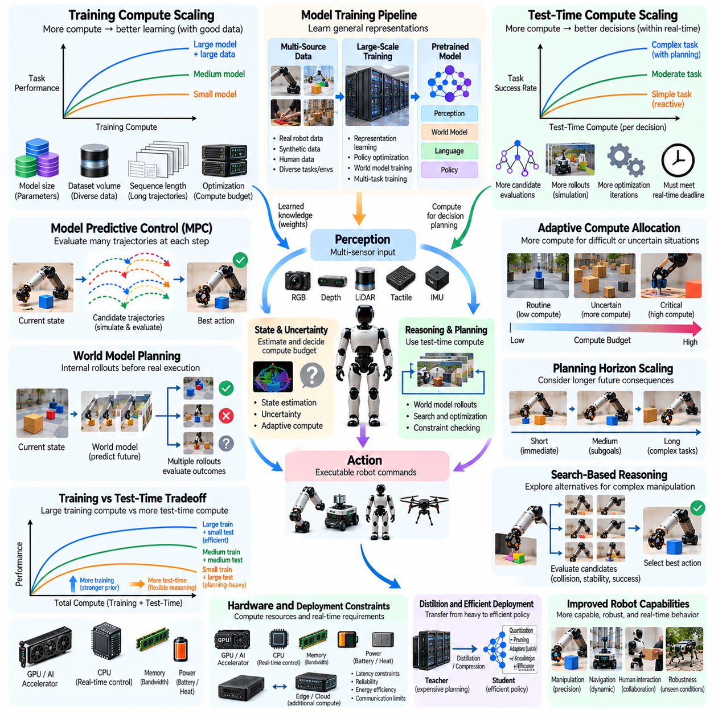{width="7.268055555555556in" height="7.268055555555556in"}

Compute scaling and test-time compute scaling examine how computational resources influence the learning, reasoning, and execution capabilities of Physical AI systems. Training compute determines how extensively models can learn from physical experiences, while test-time compute determines how much computation can be devoted to decisions during deployment. Effective scaling requires balancing model accuracy, planning quality, response latency, and operational reliability.

Training compute includes the processing required for representation learning, policy optimization, world model training, and simulation-based exploration. Its demand depends on model size, dataset volume, sequence length, and optimization procedures. Increasing compute can improve learning when sufficient informative data is available. However, additional computation cannot automatically compensate for poor demonstrations, missing physical interactions, or biased datasets.

Test-time compute refers to computational resources allocated after training to produce predictions, plans, or actions. A robot may use additional computation to evaluate candidate trajectories, simulate possible outcomes, or refine manipulation strategies. Unlike training compute, these resources are consumed during operation. Their usefulness depends on whether additional reasoning improves decisions before real-time deadlines are reached.

Physical AI differs from conventional language modeling because computation must interact with continuously evolving physical environments. A robot cannot indefinitely delay an action while considering alternatives. Moving objects, unstable grasps, and dynamic obstacles impose strict response requirements. Consequently, test-time scaling must account for elapsed time, environmental changes, and the physical consequences of delayed decisions.

Model predictive control provides a practical example of test-time computation. At each planning cycle, the robot predicts future states, evaluates candidate control sequences, and selects an action. Increasing the number of sampled trajectories or optimization iterations may improve decision quality. However, larger search budgets also increase latency, making computational efficiency essential for responsive control.

World models enable robots to perform internal rollouts before executing physical actions. These models estimate how environments may change under different control inputs. Additional rollouts can improve planning by revealing collisions, unstable contacts, or inefficient trajectories. Their value depends on prediction accuracy because extensive computation with an inaccurate world model can reinforce incorrect decisions.

Planning horizon is another important scaling variable. Longer horizons allow robots to consider delayed consequences and coordinate multiple actions toward distant objectives. Assembly and navigation tasks may benefit from anticipating future constraints. Nevertheless, prediction errors accumulate over extended horizons, while search complexity increases. Effective planning therefore balances horizon length, model uncertainty, and available computation.

Search-based reasoning can support complex manipulation by exploring alternative grasps, object placements, and motion sequences. Larger search budgets may discover solutions that simple reactive policies overlook. However, physical feasibility must be verified through collision constraints, joint limits, and contact stability. Search quality depends not only on the number of candidates but also on how accurately the system evaluates them.

Adaptive compute allocation improves efficiency by assigning different computational budgets to different situations. Routine movements may require only lightweight policy inference, while uncertain or unfamiliar conditions justify additional planning. A robot approaching a narrow insertion target may increase computation before contact. Such strategies allocate resources according to task difficulty, estimated uncertainty, and potential failure consequences.

Uncertainty estimation provides a mechanism for deciding when additional computation is valuable. Models can assess confidence in state estimates, predicted outcomes, or candidate actions. High uncertainty may trigger additional sensing, trajectory evaluation, or replanning. However, uncertainty estimates must be calibrated because excessive confidence can suppress necessary reasoning, while excessive caution can waste computational resources.

Training-time and test-time computation can sometimes substitute for one another. Extensive training may produce policies that generate effective actions with minimal inference, whereas smaller models may require additional online search. This tradeoff is task dependent. Highly repetitive operations often favor strong offline learning, while unfamiliar environments may benefit from flexible planning during deployment.

Distillation can transfer knowledge from computationally expensive planners into efficient reactive policies. A teacher system may generate high-quality trajectories using extensive simulation or optimization. A student policy then learns to reproduce useful decisions with fewer operations. This approach reduces deployment latency, although the student may struggle when encountering situations outside the teacher\'s training distribution.

Hardware architecture determines how effectively computational scaling can be implemented. GPUs and specialized accelerators support large neural networks, while CPUs and real-time controllers manage deterministic execution. Memory bandwidth, thermal limits, and power consumption constrain onboard processing. Distributed or cloud computation can extend capacity, but communication delays and connectivity failures must be considered.

Hierarchical architectures separate computationally intensive reasoning from time-critical control. High-level planners may operate at relatively low frequencies to determine goals and action sequences. Low-level controllers execute movements using rapid sensor feedback. This separation allows robots to perform sophisticated reasoning without interrupting stabilization or safety-critical responses. Coordination between layers remains essential.

Compute scaling also interacts with perception and sensor processing. Higher-resolution images, additional camera streams, and dense point clouds increase the cost of state estimation. More computation may improve scene understanding, but processing delays can make observations outdated. Efficient feature extraction, selective sensing, and asynchronous processing help preserve timely information for action generation.

Energy efficiency becomes particularly important for battery-powered robots. Additional inference and planning consume electricity and generate heat, potentially reducing operating duration. A computationally expensive strategy may improve individual decisions while lowering overall productivity. System-level optimization should therefore consider task success per unit of energy, total mission time, and the availability of onboard resources.

Safety imposes limits on how computational budgets can be expanded. Robots must maintain collision avoidance, force limits, and emergency responses even when complex planning is incomplete. Anytime algorithms can provide usable solutions early and improve them when additional time remains. Safe fallback policies and independent monitoring systems help prevent planning delays from compromising physical operation.

Evaluating test-time compute scaling requires controlled experiments across different inference and planning budgets. Researchers can measure task success, trajectory quality, latency, energy consumption, and recovery performance. Results should distinguish computational improvements from changes in model architecture or training data. Testing under real-time constraints is necessary because offline performance may overestimate deployment benefits.

Scaling curves may reveal diminishing returns as additional planning iterations provide progressively smaller improvements. In some cases, longer computation can even reduce performance when decisions become outdated or model errors accumulate. The optimal budget therefore depends on environmental dynamics and decision complexity. Adaptive stopping criteria can terminate reasoning when further computation is unlikely to improve outcomes.

Ultimately, compute and test-time compute scaling concerns the intelligent allocation of computational effort across learning and execution. Larger training budgets can strengthen representations and policies, while additional deployment computation can improve planning and adaptation. Reliable Physical AI systems coordinate both resources with physical dynamics, hardware constraints, uncertainty, and safety requirements to maximize real-world performance.

계산 자원 스케일링(Compute Scaling)과 테스트 시점 계산 자원 스케일링(Test-Time Compute Scaling)은 계산 자원(Computational Resources)이 피지컬 AI 시스템(Physical AI Systems)의 학습(Learning), 추론(Reasoning), 실행 능력(Execution Capabilities)에 어떤 영향을 미치는지 분석합니다. 학습 계산량(Training Compute)은 모델이 물리적 경험(Physical Experiences)으로부터 얼마나 광범위하게 학습할 수 있는지를 결정하며, 테스트 시점 계산량(Test-Time Compute)은 배포 과정에서 의사결정(Decisions)에 얼마나 많은 계산 자원을 투입할 수 있는지를 결정합니다. 효과적인 스케일링(Effective Scaling)을 위해서는 모델 정확도(Model Accuracy), 계획 품질(Planning Quality), 응답 지연(Response Latency), 운영 신뢰성(Operational Reliability) 사이의 균형이 필요합니다.

학습 계산량(Training Compute)에는 표현 학습(Representation Learning), 정책 최적화(Policy Optimization), 월드 모델 학습(World Model Training), 시뮬레이션 기반 탐색(Simulation-Based Exploration)에 필요한 연산이 포함됩니다. 계산 요구량(Computational Demand)은 모델 크기(Model Size), 데이터셋 규모(Dataset Volume), 시퀀스 길이(Sequence Length), 최적화 절차(Optimization Procedures)에 따라 달라집니다. 충분한 정보가 포함된 데이터(Informative Data)를 사용할 수 있다면 계산량 증가는 학습 성능을 개선할 수 있습니다. 그러나 추가적인 계산(Additional Computation)만으로 품질이 낮은 시연(Poor Demonstrations), 누락된 물리적 상호작용(Missing Physical Interactions), 편향된 데이터셋(Biased Datasets)의 문제를 자동으로 해결할 수는 없습니다.

테스트 시점 계산량(Test-Time Compute)은 학습이 완료된 이후 예측(Predictions), 계획(Plans), 행동(Actions)을 생성하기 위해 할당되는 계산 자원(Computational Resources)을 의미합니다. 로봇은 추가적인 계산을 사용하여 후보 궤적(Candidate Trajectories)을 평가하고, 가능한 결과(Possible Outcomes)를 시뮬레이션하며, 조작 전략(Manipulation Strategies)을 정교화할 수 있습니다. 학습 계산량(Training Compute)과 달리 이러한 자원은 실제 운영(Operation) 중에 소비됩니다. 추가적인 추론(Additional Reasoning)이 실시간 마감시간(Real-Time Deadlines)에 도달하기 전에 의사결정 품질(Decision Quality)을 개선할 수 있는지가 그 유용성을 결정합니다.

피지컬 AI(Physical AI)는 계산 과정이 지속적으로 변화하는 물리적 환경(Continuously Evolving Physical Environments)과 상호작용해야 한다는 점에서 기존 언어 모델링(Conventional Language Modeling)과 다릅니다. 로봇은 여러 대안을 검토하는 동안 행동(Action)을 무기한 지연할 수 없습니다. 움직이는 물체(Moving Objects), 불안정한 파지(Unstable Grasps), 동적 장애물(Dynamic Obstacles)은 엄격한 응답 요구사항(Response Requirements)을 부과합니다. 따라서 테스트 시점 스케일링(Test-Time Scaling)은 경과 시간(Elapsed Time), 환경 변화(Environmental Changes), 지연된 의사결정(Delayed Decisions)의 물리적 결과(Physical Consequences)를 고려해야 합니다.

모델 예측 제어(Model Predictive Control)는 테스트 시점 계산(Test-Time Computation)의 실용적인 사례입니다. 각 계획 주기(Planning Cycle)에서 로봇은 미래 상태(Future States)를 예측하고, 후보 제어 시퀀스(Candidate Control Sequences)를 평가하며, 실행할 행동(Action)을 선택합니다. 샘플링된 궤적(Sampled Trajectories)의 수나 최적화 반복 횟수(Optimization Iterations)를 증가시키면 의사결정 품질(Decision Quality)이 향상될 수 있습니다. 그러나 탐색 예산(Search Budgets)이 커질수록 지연 시간(Latency)도 증가하므로 반응성 높은 제어(Responsive Control)를 위해서는 계산 효율성(Computational Efficiency)이 필수적입니다.

월드 모델(World Models)은 로봇이 물리적 행동(Physical Actions)을 실행하기 전에 내부 롤아웃(Internal Rollouts)을 수행할 수 있도록 합니다. 이러한 모델은 서로 다른 제어 입력(Control Inputs)에 따라 환경(Environments)이 어떻게 변화할지를 추정합니다. 추가적인 롤아웃(Additional Rollouts)은 충돌(Collisions), 불안정한 접촉(Unstable Contacts), 비효율적인 궤적(Inefficient Trajectories)을 사전에 파악하여 계획 성능(Planning Performance)을 개선할 수 있습니다. 그러나 부정확한 월드 모델(Inaccurate World Model)을 사용한 광범위한 계산은 잘못된 의사결정(Incorrect Decisions)을 오히려 강화할 수 있으므로 예측 정확도(Prediction Accuracy)가 중요합니다.

계획 지평(Planning Horizon)은 또 다른 중요한 스케일링 변수(Scaling Variable)입니다. 더 긴 계획 지평(Longer Horizons)은 로봇이 지연된 결과(Delayed Consequences)를 고려하고 여러 행동(Multiple Actions)을 장기 목표(Distant Objectives)에 맞추어 조정할 수 있도록 합니다. 조립(Assembly)과 내비게이션(Navigation) 작업은 미래 제약(Future Constraints)을 미리 예측함으로써 이점을 얻을 수 있습니다. 그러나 계획 지평이 길어질수록 예측 오류(Prediction Errors)가 누적되고 탐색 복잡도(Search Complexity)가 증가합니다. 따라서 효과적인 계획(Effective Planning)은 계획 지평의 길이(Horizon Length), 모델 불확실성(Model Uncertainty), 사용 가능한 계산량(Available Computation) 사이의 균형을 유지해야 합니다.

탐색 기반 추론(Search-Based Reasoning)은 대안적인 파지(Alternative Grasps), 물체 배치(Object Placements), 동작 시퀀스(Motion Sequences)를 탐색하여 복잡한 조작(Complex Manipulation)을 지원할 수 있습니다. 더 큰 탐색 예산(Larger Search Budgets)은 단순한 반응형 정책(Reactive Policies)이 발견하지 못하는 해결책(Solutions)을 찾아낼 수 있습니다. 그러나 물리적 실행 가능성(Physical Feasibility)은 충돌 제약(Collision Constraints), 관절 한계(Joint Limits), 접촉 안정성(Contact Stability)을 통해 검증해야 합니다. 탐색 품질(Search Quality)은 후보의 수(Number of Candidates)뿐만 아니라 시스템이 후보를 얼마나 정확하게 평가하는지에도 달려 있습니다.

적응형 계산 자원 할당(Adaptive Compute Allocation)은 상황에 따라 서로 다른 계산 예산(Computational Budgets)을 배정하여 효율성을 개선합니다. 일상적인 움직임(Routine Movements)에는 경량 정책 추론(Lightweight Policy Inference)만 필요할 수 있지만, 불확실하거나 익숙하지 않은 조건(Uncertain or Unfamiliar Conditions)에서는 추가적인 계획(Additional Planning)이 정당화됩니다. 좁은 삽입 목표(Narrow Insertion Target)에 접근하는 로봇은 접촉(Contact) 전에 계산량을 증가시킬 수 있습니다. 이러한 전략은 작업 난이도(Task Difficulty), 추정된 불확실성(Estimated Uncertainty), 잠재적 실패 결과(Potential Failure Consequences)에 따라 자원을 할당합니다.

불확실성 추정(Uncertainty Estimation)은 추가적인 계산이 언제 유용한지 결정하는 메커니즘(Mechanism)을 제공합니다. 모델은 상태 추정(State Estimates), 예측 결과(Predicted Outcomes), 후보 행동(Candidate Actions)에 대한 신뢰도(Confidence)를 평가할 수 있습니다. 높은 불확실성(High Uncertainty)은 추가 센싱(Additional Sensing), 궤적 평가(Trajectory Evaluation), 재계획(Replanning)을 유발할 수 있습니다. 그러나 과도한 확신(Excessive Confidence)은 필요한 추론(Necessary Reasoning)을 억제할 수 있고, 지나친 신중함(Excessive Caution)은 계산 자원을 낭비할 수 있으므로 불확실성 추정값(Uncertainty Estimates)은 적절하게 보정되어야 합니다.

학습 시점 계산량(Training-Time Computation)과 테스트 시점 계산량(Test-Time Computation)은 경우에 따라 서로 대체할 수 있습니다. 광범위한 학습(Extensive Training)을 통해 최소한의 추론(Minimal Inference)만으로 효과적인 행동을 생성하는 정책(Policies)을 만들 수 있는 반면, 작은 모델(Smaller Models)은 추가적인 온라인 탐색(Online Search)이 필요할 수 있습니다. 이러한 절충 관계(Tradeoff)는 작업에 따라 달라집니다. 반복성이 높은 작업(Highly Repetitive Operations)은 강력한 오프라인 학습(Offline Learning)에 유리한 경우가 많지만, 익숙하지 않은 환경(Unfamiliar Environments)에서는 배포 중 유연한 계획(Flexible Planning)이 더 효과적일 수 있습니다.

지식 증류(Distillation)는 계산 비용이 높은 계획기(Computationally Expensive Planners)의 지식을 효율적인 반응형 정책(Efficient Reactive Policies)으로 전달할 수 있습니다. 교사 시스템(Teacher System)은 광범위한 시뮬레이션(Simulation)이나 최적화(Optimization)를 사용하여 고품질 궤적(High-Quality Trajectories)을 생성할 수 있습니다. 이후 학생 정책(Student Policy)은 더 적은 연산(Fewer Operations)으로 유용한 의사결정(Useful Decisions)을 재현하도록 학습합니다. 이러한 접근법은 배포 지연(Deployment Latency)을 줄이지만, 학생 모델(Student Model)은 교사 모델의 학습 분포(Teacher\'s Training Distribution)를 벗어나는 상황에서 어려움을 겪을 수 있습니다.

하드웨어 아키텍처(Hardware Architecture)는 계산 자원 스케일링(Compute Scaling)을 얼마나 효과적으로 구현할 수 있는지 결정합니다. GPU(Graphics Processing Units)와 특수 가속기(Specialized Accelerators)는 대규모 신경망(Large Neural Networks)을 지원하며, CPU(Central Processing Units)와 실시간 제어기(Real-Time Controllers)는 결정론적 실행(Deterministic Execution)을 관리합니다. 메모리 대역폭(Memory Bandwidth), 열적 한계(Thermal Limits), 전력 소비(Power Consumption)는 온보드 처리(Onboard Processing)를 제약합니다. 분산 컴퓨팅(Distributed Computing)이나 클라우드 컴퓨팅(Cloud Computing)은 계산 용량을 확장할 수 있지만 통신 지연(Communication Delays)과 연결 실패(Connectivity Failures)를 고려해야 합니다.

계층적 아키텍처(Hierarchical Architectures)는 계산 집약적인 추론(Computationally Intensive Reasoning)과 시간에 민감한 제어(Time-Critical Control)를 분리합니다. 고수준 계획기(High-Level Planners)는 상대적으로 낮은 주파수(Low Frequencies)에서 작동하면서 목표(Goals)와 행동 시퀀스(Action Sequences)를 결정할 수 있습니다. 저수준 제어기(Low-Level Controllers)는 빠른 센서 피드백(Rapid Sensor Feedback)을 사용하여 움직임을 실행합니다. 이러한 분리는 로봇이 안정화(Stabilization)나 안전 필수 응답(Safety-Critical Responses)을 방해하지 않으면서 정교한 추론(Sophisticated Reasoning)을 수행할 수 있도록 합니다. 그러나 계층 간 조정(Coordination Between Layers)은 여전히 필수적입니다.

계산 자원 스케일링(Compute Scaling)은 인식(Perception)과 센서 처리(Sensor Processing)에도 영향을 미칩니다. 고해상도 이미지(Higher-Resolution Images), 추가 카메라 스트림(Additional Camera Streams), 고밀도 포인트 클라우드(Dense Point Clouds)는 상태 추정(State Estimation)의 계산 비용을 증가시킵니다. 더 많은 계산은 장면 이해(Scene Understanding)를 개선할 수 있지만 처리 지연(Processing Delays)으로 인해 관측 정보(Observations)가 오래된 상태가 될 수 있습니다. 효율적인 특징 추출(Efficient Feature Extraction), 선택적 센싱(Selective Sensing), 비동기 처리(Asynchronous Processing)는 행동 생성(Action Generation)에 필요한 정보의 적시성(Timeliness)을 유지하는 데 도움이 됩니다.

에너지 효율성(Energy Efficiency)은 배터리 구동 로봇(Battery-Powered Robots)에서 특히 중요합니다. 추가적인 추론(Inference)과 계획(Planning)은 전력을 소비하고 열을 발생시켜 운영 시간(Operating Duration)을 단축할 수 있습니다. 계산 비용이 높은 전략(Computationally Expensive Strategy)은 개별 의사결정(Individual Decisions)을 개선하면서도 전체 생산성(Overall Productivity)을 저하시킬 수 있습니다. 따라서 시스템 수준 최적화(System-Level Optimization)는 단위 에너지당 작업 성공률(Task Success per Unit of Energy), 전체 임무 시간(Total Mission Time), 온보드 자원의 가용성(Availability of Onboard Resources)을 고려해야 합니다.

안전성(Safety)은 계산 예산(Computational Budgets)을 확장할 수 있는 범위에 한계를 부과합니다. 로봇은 복잡한 계획(Complex Planning)이 완료되지 않은 상황에서도 충돌 회피(Collision Avoidance), 힘 제한(Force Limits), 비상 대응(Emergency Responses)을 유지해야 합니다. 애니타임 알고리즘(Anytime Algorithms)은 초기 단계에서 사용 가능한 해결책(Usable Solutions)을 제공하고 추가 시간이 확보되면 이를 개선할 수 있습니다. 안전한 대체 정책(Safe Fallback Policies)과 독립적인 모니터링 시스템(Independent Monitoring Systems)은 계획 지연(Planning Delays)이 물리적 운영(Physical Operation)의 안전성을 훼손하지 않도록 지원합니다.

테스트 시점 계산 자원 스케일링(Test-Time Compute Scaling)을 평가하려면 서로 다른 추론 및 계획 예산(Inference and Planning Budgets)에 대한 통제된 실험(Controlled Experiments)이 필요합니다. 연구자는 작업 성공률(Task Success), 궤적 품질(Trajectory Quality), 지연 시간(Latency), 에너지 소비(Energy Consumption), 복구 성능(Recovery Performance)을 측정할 수 있습니다. 평가 결과는 계산량 증가(Computational Improvements)에 따른 개선과 모델 아키텍처(Model Architecture) 또는 학습 데이터(Training Data)의 변화에 따른 개선을 구분해야 합니다. 오프라인 성능(Offline Performance)은 실제 배포 효과(Deployment Benefits)를 과대평가할 수 있으므로 실시간 제약(Real-Time Constraints) 아래에서의 시험이 필요합니다.

스케일링 곡선(Scaling Curves)은 추가적인 계획 반복(Planning Iterations)이 점차 작은 성능 향상(Performance Improvements)을 제공하는 수확 체감(Diminishing Returns)을 보여줄 수 있습니다. 일부 경우에는 의사결정(Decisions)이 오래된 정보에 기반하게 되거나 모델 오류(Model Errors)가 누적되면서 계산 시간이 길어질수록 성능이 오히려 저하될 수 있습니다. 따라서 최적의 계산 예산(Optimal Compute Budget)은 환경 동역학(Environmental Dynamics)과 의사결정 복잡도(Decision Complexity)에 따라 달라집니다. 적응형 종료 기준(Adaptive Stopping Criteria)은 추가 계산이 결과를 개선할 가능성이 낮을 때 추론(Reasoning)을 종료할 수 있습니다.

궁극적으로 계산 자원 스케일링(Compute Scaling)과 테스트 시점 계산 자원 스케일링(Test-Time Compute Scaling)은 학습(Learning)과 실행(Execution) 전반에 걸쳐 계산 노력(Computational Effort)을 지능적으로 배분하는 문제입니다. 더 큰 학습 예산(Training Budgets)은 표현(Representations)과 정책(Policies)을 강화할 수 있으며, 추가적인 배포 시점 계산(Deployment Computation)은 계획(Planning)과 적응(Adaptation)을 개선할 수 있습니다. 신뢰할 수 있는 피지컬 AI 시스템(Reliable Physical AI Systems)은 실세계 성능(Real-World Performance)을 극대화하기 위해 이러한 자원을 물리적 동역학(Physical Dynamics), 하드웨어 제약(Hardware Constraints), 불확실성(Uncertainty), 안전 요구사항(Safety Requirements)과 통합적으로 조정합니다.

##  

## 07.13. Scaling Generalization and Transfer

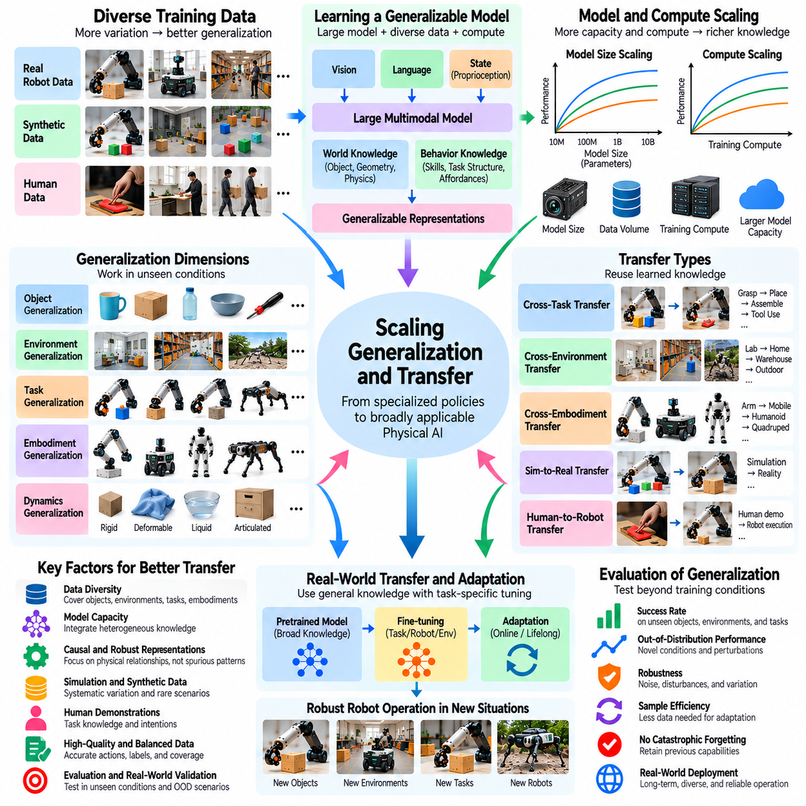{width="7.268055555555556in" height="7.268055555555556in"}

Scaling generalization and transfer examines how increasing data, model capacity, and computational resources improves a robot\'s ability to operate beyond its original training conditions. Generalization refers to successful behavior in previously unseen situations, while transfer describes the reuse of learned knowledge across tasks, environments, or robot platforms. Both capabilities are essential for transforming specialized robotic policies into broadly applicable Physical AI systems.

Traditional robot learning often produces policies optimized for narrowly defined environments and repetitive tasks. These systems may achieve high success rates under familiar conditions but fail when objects, lighting, geometry, or physical properties change. Scaling introduces broader experiences that can reduce dependence on specific training configurations. However, increasing dataset size does not automatically produce robust generalization when important variations remain unrepresented.

Generalization can be examined across several dimensions, including objects, environments, tasks, embodiments, and physical dynamics. Object generalization involves manipulating unfamiliar shapes and materials, while environmental generalization requires adapting to new layouts and operating conditions. Task generalization concerns new objectives or action sequences. Embodiment transfer extends learned capabilities across robots with different mechanical and sensing characteristics.

Data diversity is a major determinant of generalization performance because it exposes models to different relationships between observations, actions, and outcomes. Large datasets containing only repetitive demonstrations may provide limited transferable knowledge. In contrast, carefully selected experiences covering diverse interactions can improve robustness. Effective scaling therefore requires expanding meaningful variation rather than simply accumulating more trajectories.

Model capacity influences how effectively a system can integrate knowledge from heterogeneous experiences. Larger networks may learn shared representations of object affordances, spatial relationships, and physical interactions. These representations can support adaptation to unfamiliar situations. Nevertheless, increased parameter count cannot guarantee transfer when training data lacks relevant physical evidence or when the learned representations depend on misleading correlations.

Transfer learning allows robots to reuse knowledge acquired during pretraining or previous task execution. A manipulation policy trained on diverse grasping experiences may adapt more efficiently to new object categories. Similarly, navigation knowledge can transfer between environments that share geometric structures. The degree of transfer depends on the similarity of underlying physical requirements, not merely the semantic similarity of task descriptions.

Cross-task generalization requires models to understand reusable behavioral components rather than memorize complete action sequences. Skills such as reaching, grasping, placing, and obstacle avoidance can contribute to multiple tasks. Compositional learning enables these components to be combined into unfamiliar procedures. However, successful composition requires accurate state estimation, reliable skill transitions, and mechanisms for detecting and recovering from execution errors.

Cross-environment transfer presents challenges involving lighting, textures, object arrangements, floor conditions, and sensor characteristics. Policies trained in controlled laboratories may behave unpredictably in warehouses, homes, or outdoor environments. Domain randomization and environmental diversification can improve resilience to these changes. Yet transfer remains limited when deployment conditions introduce physical phenomena absent from the training distribution.

Cross-embodiment transfer is particularly difficult because robots differ in joint configurations, actuator dynamics, sensing capabilities, and reachable workspaces. A behavior learned on one manipulator may not be directly executable on another. Embodiment-aware representations can separate task objectives from robot-specific motion commands. Adaptation mechanisms then translate shared behavioral knowledge into actions compatible with each platform\'s physical constraints.

Simulation contributes to generalization by enabling systematic variation of environmental and physical parameters. Synthetic environments can expose policies to unfamiliar objects, disturbances, and task configurations at large scale. However, simulated diversity must reflect plausible real-world conditions. Excessive randomization or inaccurate contact models may introduce irrelevant experiences, making real-world validation necessary for determining actual transfer benefits.

Human demonstrations provide additional opportunities for transferring task knowledge across embodiments. Videos and motion recordings contain information about object use, manipulation sequences, and goal-directed behavior. Models can extract high-level intentions that remain useful despite differences between human and robotic motion. Converting these intentions into executable robot actions still requires physical grounding, embodiment adaptation, and appropriate feedback control.

Scaling generalization also depends on learning representations that distinguish causal physical relationships from superficial visual patterns. A robot should recognize that grasp stability depends on geometry, friction, and contact forces rather than background appearance. Training across varied conditions can reduce reliance on spurious correlations. However, causal robustness must be tested through controlled interventions and physical experiments rather than inferred from dataset diversity alone.

Out-of-distribution generalization evaluates performance when deployment conditions differ substantially from the training distribution. Such conditions may involve unfamiliar objects, unexpected disturbances, or combinations of known factors. Performance often declines as distribution shift increases, although the relationship depends on the model and task. Reliable systems must estimate uncertainty and recognize situations where learned behavior may no longer be dependable.

Few-shot adaptation provides a practical measure of transfer efficiency. A model with strong general representations should require fewer demonstrations or interaction episodes to learn a new task. Adaptation curves can quantify performance as additional task-specific data becomes available. Comparing these curves across model and dataset scales reveals whether broader pretraining reduces the cost of deploying robots in unfamiliar applications.

Continual learning extends transfer beyond initial deployment by allowing robots to incorporate new experiences over time. Field data can reveal recurring failures, novel object configurations, and environmental changes. Updating models with these experiences may improve future generalization. However, continual adaptation must prevent catastrophic forgetting and unintended degradation of previously reliable behaviors through replay, validation, and controlled model updates.

Generalization evaluation requires carefully designed training and testing partitions. Randomly separating episodes from the same environments may overestimate transfer because similar objects and configurations appear in both sets. Stronger protocols hold out entire object categories, task combinations, environments, or robot platforms. Such evaluation helps distinguish genuine generalization from memorization of familiar conditions and repeated experimental patterns.

Scaling curves for generalization should measure performance across increasing levels of distribution shift. Researchers can vary training data volume, task diversity, model size, and adaptation budgets while maintaining consistent evaluation conditions. Results may reveal that additional data improves familiar-task performance faster than unseen-task performance. These differences expose limitations that conventional aggregate success rates can conceal.

Negative transfer occurs when previously learned knowledge interferes with adaptation to a new task or embodiment. Shared representations may encode assumptions that are inappropriate for different contact dynamics or control interfaces. Increasing training diversity can reduce some conflicts but may also introduce competing objectives. Task-conditioned policies, modular architectures, and selective adaptation can help preserve useful shared knowledge while limiting harmful interference.

Safety becomes increasingly important when robots generalize beyond familiar operating conditions. A model may produce plausible actions without accurately predicting their physical consequences in unfamiliar situations. Confidence estimation, constrained control, runtime monitoring, and fallback procedures can reduce deployment risks. Generalization should therefore be evaluated alongside safety, recovery capability, and compliance with operational limits.

Ultimately, scaling generalization and transfer requires more than expanding datasets or neural networks. It requires identifying reusable physical knowledge, exposing models to meaningful variation, and measuring performance under genuine distribution shifts. Effective Physical AI systems combine diverse experience, transferable representations, embodiment-aware adaptation, uncertainty management, and rigorous real-world evaluation to achieve reliable behavior across changing tasks and environments.

일반화 및 전이 스케일링(Scaling Generalization and Transfer)은 데이터(Data), 모델 용량(Model Capacity), 계산 자원(Computational Resources)의 증가가 로봇이 기존 학습 조건(Training Conditions)을 벗어난 환경에서도 작동하는 능력을 어떻게 향상시키는지 분석합니다. 일반화(Generalization)는 이전에 경험하지 못한 상황(Unseen Situations)에서 성공적으로 행동하는 능력을 의미하며, 전이(Transfer)는 작업(Tasks), 환경(Environments), 로봇 플랫폼(Robot Platforms) 전반에서 학습된 지식(Learned Knowledge)을 재사용하는 것을 의미합니다. 두 능력 모두 특화된 로봇 정책(Specialized Robotic Policies)을 폭넓게 적용할 수 있는 피지컬 AI 시스템(Physical AI Systems)으로 발전시키는 데 필수적입니다.

전통적인 로봇 학습(Traditional Robot Learning)은 제한적으로 정의된 환경(Narrowly Defined Environments)과 반복적인 작업(Repetitive Tasks)에 최적화된 정책(Policies)을 생성하는 경우가 많습니다. 이러한 시스템은 익숙한 조건(Familiar Conditions)에서는 높은 성공률(Success Rates)을 달성할 수 있지만 물체(Objects), 조명(Lighting), 형상(Geometry), 물리적 특성(Physical Properties)이 변화하면 실패할 수 있습니다. 스케일링(Scaling)은 특정 학습 구성(Training Configurations)에 대한 의존성을 줄일 수 있는 폭넓은 경험(Broader Experiences)을 도입합니다. 그러나 중요한 변화 요인(Important Variations)이 데이터에 포함되지 않았다면 데이터셋 크기(Dataset Size)를 증가시키는 것만으로 강건한 일반화(Robust Generalization)가 자동으로 달성되지는 않습니다.

일반화(Generalization)는 물체(Objects), 환경(Environments), 작업(Tasks), 체화(Embodiments), 물리적 동역학(Physical Dynamics)을 포함한 여러 차원에서 분석할 수 있습니다. 물체 일반화(Object Generalization)는 익숙하지 않은 형상(Shapes)과 재료(Materials)를 조작하는 능력을 의미하며, 환경 일반화(Environmental Generalization)는 새로운 배치(Layouts)와 운영 조건(Operating Conditions)에 적응하는 능력을 요구합니다. 작업 일반화(Task Generalization)는 새로운 목표(Objectives)나 행동 시퀀스(Action Sequences)를 다룹니다. 체화 전이(Embodiment Transfer)는 서로 다른 기계적 특성(Mechanical Characteristics)과 센싱 특성(Sensing Characteristics)을 가진 로봇 사이에서 학습된 능력을 확장합니다.

데이터 다양성(Data Diversity)은 관측(Observations), 행동(Actions), 결과(Outcomes) 사이의 다양한 관계를 모델에 경험하게 하므로 일반화 성능(Generalization Performance)을 결정하는 주요 요소입니다. 반복적인 시연(Repetitive Demonstrations)만 포함하는 대규모 데이터셋(Large Datasets)은 제한적인 전이 가능 지식(Transferable Knowledge)만 제공할 수 있습니다. 반면 다양한 상호작용(Diverse Interactions)을 포함하도록 신중하게 선택된 경험은 강건성(Robustness)을 개선할 수 있습니다. 따라서 효과적인 스케일링(Effective Scaling)은 단순히 더 많은 궤적(Trajectories)을 축적하는 것이 아니라 의미 있는 변화(Meaningful Variation)를 확장해야 합니다.

모델 용량(Model Capacity)은 시스템이 이기종 경험(Heterogeneous Experiences)으로부터 얻은 지식을 얼마나 효과적으로 통합할 수 있는지에 영향을 미칩니다. 더 큰 신경망(Larger Networks)은 물체의 행동 가능성(Object Affordances), 공간적 관계(Spatial Relationships), 물리적 상호작용(Physical Interactions)에 대한 공유 표현(Shared Representations)을 학습할 수 있습니다. 이러한 표현은 익숙하지 않은 상황(Unfamiliar Situations)에 대한 적응(Adaptation)을 지원합니다. 그러나 학습 데이터(Training Data)에 관련된 물리적 증거(Physical Evidence)가 부족하거나 학습된 표현이 잘못된 상관관계(Misleading Correlations)에 의존한다면 매개변수 수(Parameter Count)의 증가만으로 전이(Transfer)를 보장할 수 없습니다.

전이 학습(Transfer Learning)은 로봇이 사전학습(Pretraining)이나 이전 작업 실행(Previous Task Execution) 과정에서 획득한 지식을 재사용할 수 있도록 합니다. 다양한 파지 경험(Grasping Experiences)으로 학습된 조작 정책(Manipulation Policy)은 새로운 물체 범주(Object Categories)에 더 효율적으로 적응할 수 있습니다. 마찬가지로 내비게이션 지식(Navigation Knowledge)은 공통된 기하학적 구조(Geometric Structures)를 가진 환경 사이에서 전이될 수 있습니다. 전이 정도(Degree of Transfer)는 작업 설명(Task Descriptions)의 의미적 유사성(Semantic Similarity)만이 아니라 근본적인 물리적 요구사항(Underlying Physical Requirements)의 유사성에 따라 달라집니다.

작업 간 일반화(Cross-Task Generalization)를 위해서는 모델이 완전한 행동 시퀀스(Complete Action Sequences)를 암기하는 대신 재사용 가능한 행동 구성요소(Reusable Behavioral Components)를 이해해야 합니다. 도달(Reaching), 파지(Grasping), 배치(Placing), 장애물 회피(Obstacle Avoidance)와 같은 기술(Skills)은 여러 작업에 기여할 수 있습니다. 조합적 학습(Compositional Learning)은 이러한 구성요소를 익숙하지 않은 절차(Unfamiliar Procedures)로 결합할 수 있도록 합니다. 그러나 성공적인 조합(Successful Composition)을 위해서는 정확한 상태 추정(State Estimation), 신뢰할 수 있는 기술 전환(Skill Transitions), 실행 오류(Execution Errors)를 탐지하고 복구하는 메커니즘(Mechanisms)이 필요합니다.

환경 간 전이(Cross-Environment Transfer)는 조명(Lighting), 질감(Textures), 물체 배치(Object Arrangements), 바닥 조건(Floor Conditions), 센서 특성(Sensor Characteristics)과 관련된 과제를 제시합니다. 통제된 실험실(Controlled Laboratories)에서 학습된 정책(Policies)은 창고(Warehouses), 가정(Homes), 실외 환경(Outdoor Environments)에서 예측하기 어려운 행동을 보일 수 있습니다. 도메인 무작위화(Domain Randomization)와 환경 다양화(Environmental Diversification)는 이러한 변화에 대한 회복탄력성(Resilience)을 개선할 수 있습니다. 그러나 배포 조건(Deployment Conditions)에 학습 분포(Training Distribution)에 없었던 물리적 현상(Physical Phenomena)이 포함되면 전이 성능(Transfer Performance)은 여전히 제한됩니다.

체화 간 전이(Cross-Embodiment Transfer)는 로봇마다 관절 구성(Joint Configurations), 액추에이터 동역학(Actuator Dynamics), 센싱 능력(Sensing Capabilities), 도달 가능한 작업 공간(Reachable Workspaces)이 다르기 때문에 특히 어렵습니다. 한 매니퓰레이터(Manipulator)에서 학습된 행동(Behavior)을 다른 매니퓰레이터에서 직접 실행하지 못할 수 있습니다. 체화 인식 표현(Embodiment-Aware Representations)은 작업 목표(Task Objectives)를 로봇별 동작 명령(Robot-Specific Motion Commands)과 분리할 수 있습니다. 이후 적응 메커니즘(Adaptation Mechanisms)은 공유된 행동 지식(Shared Behavioral Knowledge)을 각 플랫폼의 물리적 제약(Physical Constraints)에 적합한 행동(Actions)으로 변환합니다.

시뮬레이션(Simulation)은 환경 및 물리적 매개변수(Environmental and Physical Parameters)를 체계적으로 변화시킬 수 있도록 하여 일반화(Generalization)에 기여합니다. 합성 환경(Synthetic Environments)은 대규모로 익숙하지 않은 물체(Unfamiliar Objects), 외란(Disturbances), 작업 구성(Task Configurations)을 정책에 경험하게 할 수 있습니다. 그러나 시뮬레이션 다양성(Simulated Diversity)은 현실적으로 가능한 실세계 조건(Plausible Real-World Conditions)을 반영해야 합니다. 과도한 무작위화(Excessive Randomization)나 부정확한 접촉 모델(Inaccurate Contact Models)은 관련성이 낮은 경험(Irrelevant Experiences)을 도입할 수 있으므로 실제 전이 효과(Actual Transfer Benefits)를 판단하기 위한 실세계 검증(Real-World Validation)이 필요합니다.

인간 시연(Human Demonstrations)은 체화(Embodiments) 전반에 걸쳐 작업 지식(Task Knowledge)을 전이할 수 있는 추가적인 기회를 제공합니다. 비디오(Videos)와 동작 기록(Motion Recordings)에는 물체 사용(Object Use), 조작 시퀀스(Manipulation Sequences), 목표 지향적 행동(Goal-Directed Behavior)에 관한 정보가 포함되어 있습니다. 모델은 인간과 로봇의 동작(Human and Robotic Motion) 사이에 차이가 있더라도 유용하게 활용할 수 있는 고수준 의도(High-Level Intentions)를 추출할 수 있습니다. 이러한 의도를 실행 가능한 로봇 행동(Executable Robot Actions)으로 변환하려면 여전히 물리적 기반 학습(Physical Grounding), 체화 적응(Embodiment Adaptation), 적절한 피드백 제어(Feedback Control)가 필요합니다.

일반화 스케일링(Scaling Generalization)은 표면적인 시각적 패턴(Superficial Visual Patterns)과 인과적 물리 관계(Causal Physical Relationships)를 구분하는 표현(Representations)을 학습하는 데에도 의존합니다. 로봇은 파지 안정성(Grasp Stability)이 배경 외형(Background Appearance)이 아니라 형상(Geometry), 마찰(Friction), 접촉력(Contact Forces)에 의해 결정된다는 사실을 인식해야 합니다. 다양한 조건(Varied Conditions)에 걸친 학습은 허위 상관관계(Spurious Correlations)에 대한 의존성을 줄일 수 있습니다. 그러나 인과적 강건성(Causal Robustness)은 데이터셋 다양성(Dataset Diversity)만으로 추론하기보다 통제된 개입(Controlled Interventions)과 물리적 실험(Physical Experiments)을 통해 검증해야 합니다.

분포 외 일반화(Out-of-Distribution Generalization)는 배포 조건(Deployment Conditions)이 학습 분포(Training Distribution)와 상당히 다른 상황에서의 성능을 평가합니다. 이러한 조건에는 익숙하지 않은 물체(Unfamiliar Objects), 예상하지 못한 외란(Unexpected Disturbances), 기존에 알려진 요인들의 새로운 조합(Combinations of Known Factors)이 포함될 수 있습니다. 일반적으로 분포 이동(Distribution Shift)이 증가하면 성능이 저하되지만, 그 관계는 모델(Model)과 작업(Task)에 따라 달라집니다. 신뢰할 수 있는 시스템(Reliable Systems)은 불확실성(Uncertainty)을 추정하고 학습된 행동(Learned Behavior)을 더 이상 신뢰하기 어려운 상황을 인식해야 합니다.

소수 샷 적응(Few-Shot Adaptation)은 전이 효율성(Transfer Efficiency)을 측정하는 실용적인 방법을 제공합니다. 강력한 일반 표현(General Representations)을 갖춘 모델은 새로운 작업(New Task)을 학습하는 데 더 적은 시연(Demonstrations)이나 상호작용 에피소드(Interaction Episodes)를 필요로 해야 합니다. 적응 곡선(Adaptation Curves)은 추가적인 작업별 데이터(Task-Specific Data)가 제공됨에 따른 성능을 정량화할 수 있습니다. 서로 다른 모델 규모(Model Scales)와 데이터셋 규모(Dataset Scales)에 걸쳐 이러한 곡선을 비교하면 광범위한 사전학습(Broad Pretraining)이 익숙하지 않은 애플리케이션(Unfamiliar Applications)에 로봇을 배포하는 비용을 줄이는지 확인할 수 있습니다.

지속 학습(Continual Learning)은 로봇이 시간에 따라 새로운 경험(New Experiences)을 통합할 수 있도록 하여 초기 배포(Initial Deployment) 이후까지 전이(Transfer)를 확장합니다. 현장 데이터(Field Data)는 반복적인 실패(Recurring Failures), 새로운 물체 구성(Novel Object Configurations), 환경 변화(Environmental Changes)를 드러낼 수 있습니다. 이러한 경험으로 모델을 업데이트하면 향후 일반화(Future Generalization)를 개선할 수 있습니다. 그러나 지속적인 적응(Continual Adaptation)은 재생(Replay), 검증(Validation), 통제된 모델 업데이트(Controlled Model Updates)를 통해 파국적 망각(Catastrophic Forgetting)과 이전에 신뢰할 수 있었던 행동의 의도하지 않은 성능 저하(Unintended Degradation)를 방지해야 합니다.

일반화 평가(Generalization Evaluation)를 위해서는 신중하게 설계된 학습 및 시험 데이터 분할(Training and Testing Partitions)이 필요합니다. 동일한 환경에서 수집한 에피소드(Episodes)를 무작위로 분리하면 유사한 물체(Objects)와 구성(Configurations)이 두 데이터셋에 모두 나타나기 때문에 전이 성능(Transfer Performance)을 과대평가할 수 있습니다. 더 엄격한 평가 프로토콜(Evaluation Protocols)은 전체 물체 범주(Object Categories), 작업 조합(Task Combinations), 환경(Environments), 로봇 플랫폼(Robot Platforms)을 학습에서 제외한 후 시험에 사용합니다. 이러한 평가는 진정한 일반화(Genuine Generalization)를 익숙한 조건(Familiar Conditions)과 반복된 실험 패턴(Repeated Experimental Patterns)의 암기(Memorization)와 구분하는 데 도움이 됩니다.

일반화 스케일링 곡선(Generalization Scaling Curves)은 분포 이동(Distribution Shift)의 수준이 증가함에 따른 성능을 측정해야 합니다. 연구자는 일관된 평가 조건(Consistent Evaluation Conditions)을 유지하면서 학습 데이터 양(Training Data Volume), 작업 다양성(Task Diversity), 모델 크기(Model Size), 적응 예산(Adaptation Budgets)을 변화시킬 수 있습니다. 결과는 추가 데이터(Additional Data)가 미관측 작업 성능(Unseen-Task Performance)보다 익숙한 작업 성능(Familiar-Task Performance)을 더 빠르게 개선한다는 사실을 보여줄 수 있습니다. 이러한 차이는 기존의 종합 성공률(Aggregate Success Rates)이 감출 수 있는 한계를 드러냅니다.

부정적 전이(Negative Transfer)는 이전에 학습한 지식(Previously Learned Knowledge)이 새로운 작업(New Task)이나 체화(Embodiment)에 대한 적응을 방해할 때 발생합니다. 공유 표현(Shared Representations)은 서로 다른 접촉 동역학(Contact Dynamics)이나 제어 인터페이스(Control Interfaces)에 적합하지 않은 가정(Assumptions)을 인코딩할 수 있습니다. 학습 다양성(Training Diversity)을 증가시키면 일부 충돌을 줄일 수 있지만 상충하는 목표(Competing Objectives)를 도입할 수도 있습니다. 작업 조건부 정책(Task-Conditioned Policies), 모듈형 아키텍처(Modular Architectures), 선택적 적응(Selective Adaptation)은 유용한 공유 지식(Shared Knowledge)을 보존하면서 유해한 간섭(Harmful Interference)을 제한하는 데 도움이 됩니다.

로봇이 익숙한 운영 조건(Familiar Operating Conditions)을 벗어나 일반화할수록 안전성(Safety)은 더욱 중요해집니다. 모델은 익숙하지 않은 상황(Unfamiliar Situations)에서 행동의 물리적 결과(Physical Consequences)를 정확하게 예측하지 못하면서도 겉보기에는 합리적인 행동(Plausible Actions)을 생성할 수 있습니다. 신뢰도 추정(Confidence Estimation), 제약 기반 제어(Constrained Control), 런타임 모니터링(Runtime Monitoring), 대체 절차(Fallback Procedures)는 배포 위험(Deployment Risks)을 줄일 수 있습니다. 따라서 일반화(Generalization)는 안전성(Safety), 복구 능력(Recovery Capability), 운영 한계(Operational Limits) 준수 여부와 함께 평가해야 합니다.

궁극적으로 일반화 및 전이 스케일링(Scaling Generalization and Transfer)은 데이터셋(Datasets)이나 신경망(Neural Networks)을 단순히 확장하는 것 이상의 노력을 요구합니다. 재사용 가능한 물리적 지식(Reusable Physical Knowledge)을 식별하고, 모델이 의미 있는 변화(Meaningful Variation)를 경험하도록 하며, 실제 분포 이동(Genuine Distribution Shifts) 아래에서 성능을 측정해야 합니다. 효과적인 피지컬 AI 시스템(Physical AI Systems)은 다양한 경험(Diverse Experience), 전이 가능한 표현(Transferable Representations), 체화 인식 적응(Embodiment-Aware Adaptation), 불확실성 관리(Uncertainty Management), 엄격한 실세계 평가(Rigorous Real-World Evaluation)를 결합하여 변화하는 작업과 환경 전반에서 신뢰할 수 있는 행동(Reliable Behavior)을 달성합니다.

##  

## 07.14. Scaling Long Horizon and Emergent Behavior

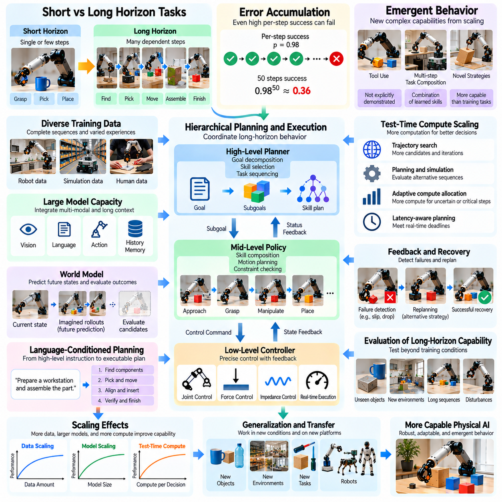{width="7.268055555555556in" height="7.268055555555556in"}

Scaling long-horizon and emergent behavior examines how increasing data diversity, model capacity, and computational resources influences a robot\'s ability to perform extended tasks and develop complex behavioral capabilities. Long-horizon behavior requires coordinating multiple actions over time, while emergent behavior refers to capabilities that become observable through interactions among learned representations and skills. Both are important indicators of progress toward general-purpose Physical AI.

Short-horizon robotic tasks involve relatively immediate objectives, such as grasping an object or moving toward a target. Long-horizon tasks require sequences of dependent actions, where early decisions influence later outcomes. Preparing a workspace, assembling components, and organizing objects may involve dozens of intermediate steps. Successful execution requires maintaining task context, tracking progress, and adapting plans when unexpected events occur.

Long-horizon performance is particularly sensitive to accumulated errors. Even when individual actions have high success probabilities, the probability of completing an extended sequence can decrease rapidly. For example, if each independent step succeeds with probability 0.98, a sequence of fifty required steps succeeds with probability approximately 0.36. This simplified calculation illustrates why reliable recovery and verification become increasingly important as task duration grows.

Scaling training data can improve long-horizon competence by exposing models to complete task sequences rather than isolated actions. Extended demonstrations reveal dependencies between subtasks, intermediate objectives, and successful recovery strategies. However, collecting long trajectories is expensive and often produces uneven coverage of failure conditions. Dataset design must therefore balance complete demonstrations with targeted examples of difficult transitions and recovery events.

Temporal representation learning helps robots identify relationships between actions separated by many time steps. Sequence models, recurrent architectures, and attention mechanisms can encode historical observations and evolving task states. Larger context windows may improve access to relevant information, but they also increase computational demands. Effective memory must distinguish important events from redundant observations rather than preserving every sensor measurement.

Hierarchical control provides a practical foundation for scaling extended behavior. High-level policies select goals or reusable skills, while low-level controllers execute precise movements using immediate feedback. A complex assembly task can be decomposed into locating components, grasping parts, aligning surfaces, and completing insertion. Hierarchical organization reduces planning complexity and allows successful subtasks to be reused across different applications.

Skill composition is central to the development of more complex robotic behavior. Models trained on reaching, grasping, placing, navigation, and tool use may learn to combine these capabilities into unfamiliar procedures. Such composition can appear emergent when the resulting task was not explicitly demonstrated as a complete sequence. Nevertheless, successful combinations require compatible skill interfaces, reliable state transitions, and accurate evaluation of intermediate outcomes.

Emergent behavior should be distinguished from improvements caused by additional training exposure or changes in evaluation methodology. A capability may appear suddenly when performance crosses a benchmark threshold, even if the underlying improvement is gradual. Genuine behavioral emergence requires evidence that new functional combinations or strategies arise beyond memorized examples. Controlled experiments are necessary to separate model scaling effects from data contamination and measurement artifacts.

Model capacity influences the ability to represent multiple goals, task dependencies, and alternative action strategies. Larger models may integrate visual observations, language instructions, physical constraints, and previous execution outcomes. This integration can support flexible planning across diverse situations. However, parameter growth alone does not guarantee coherent long-horizon behavior, particularly when training data lacks extended physical interactions.

World models can support long-horizon planning by predicting how actions affect future environmental states. A robot may simulate alternative manipulation sequences before selecting a strategy. Increasing the number or depth of imagined rollouts can improve anticipation of delayed consequences. However, prediction errors accumulate across simulated steps, so practical systems must combine model-based planning with frequent observation and corrective feedback.

Test-time computation offers another mechanism for improving extended task execution. Additional planning iterations can evaluate alternative subtask orders, recovery strategies, and resource constraints. Robots may allocate more computation when uncertainty increases or a critical decision approaches. Nevertheless, physical environments continue changing during reasoning, making latency-aware planning essential for maintaining responsiveness and operational safety.

Language-conditioned planning can help robots organize complex objectives into interpretable subgoals. Instructions such as preparing a workstation or sorting equipment imply multiple actions and ordering constraints. Large multimodal models may infer reasonable task decompositions from prior experience. However, generated plans must be checked against physical feasibility, available tools, workspace conditions, and the robot\'s actual capabilities.

Feedback and recovery mechanisms are essential for preventing small failures from terminating extended operations. Robots must detect unsuccessful grasps, misplaced objects, blocked paths, and unexpected contact events. Recovery may involve retrying an action, selecting an alternative strategy, or revising the overall plan. Training on both successful and failed trajectories can improve these responses, provided that outcomes and corrective actions are accurately represented.

Long-horizon learning also benefits from explicit representations of task progress. State machines, structured memories, and goal-conditioned policies can track completed subtasks and remaining requirements. These mechanisms reduce repeated actions and help prevent the loss of task context. Progress estimation must remain grounded in sensor observations because an internally predicted success does not necessarily correspond to a physically completed operation.

Behavioral diversity influences the emergence of reusable strategies. Exposure to different objects, environments, and task sequences may encourage models to discover common structures across activities. Skills such as clearing obstacles before manipulation or repositioning objects for access can transfer between tasks. However, apparent generality must be tested on genuinely unseen combinations to determine whether the model has learned transferable principles.

Curriculum learning can gradually increase task complexity during training. Robots may first master isolated actions, then short sequences, and eventually extended procedures involving multiple dependencies. This progression can improve optimization stability and reduce the difficulty of learning sparse rewards. Nevertheless, overly restrictive curricula may limit exploration, so training should eventually include diverse and imperfect execution conditions.

Evaluating emergent capabilities requires more than measuring aggregate task success. Researchers should examine novel skill combinations, adaptation to unexpected disturbances, recovery efficiency, and the ability to complete tasks with unfamiliar subgoal structures. Evaluation protocols must control training exposure and distinguish previously observed behaviors from genuinely new combinations. Repeated trials are necessary to assess reliability rather than isolated demonstrations.

Scaling curves for long-horizon behavior should consider task length, subtask complexity, model size, data volume, and planning computation. Performance may improve unevenly across these dimensions, with short-task success increasing faster than extended-task reliability. Measuring completion probability against sequence length can reveal compounding failure effects. Additional metrics should capture recovery frequency, execution time, and cumulative intervention requirements.

Safety challenges grow as robots execute increasingly autonomous and extended procedures. Small planning errors can propagate into hazardous physical states, particularly when tools, moving machinery, or human collaborators are involved. Runtime monitoring, constrained actions, and independent safety controllers help maintain operational boundaries. Long-horizon autonomy should therefore expand only when verification, interruption, and recovery mechanisms remain dependable.

Ultimately, scaling long-horizon and emergent behavior requires coordinated advances in data collection, representation learning, hierarchical planning, physical prediction, and feedback control. Larger models and datasets can support more complex behavioral organization, but reliable execution depends on controlling accumulated errors and maintaining physical grounding. Progress should be measured through repeatable, safe performance on extended tasks and genuinely novel behavioral combinations.

장기 행동 및 창발적 행동 스케일링(Scaling Long-Horizon and Emergent Behavior)은 데이터 다양성(Data Diversity), 모델 용량(Model Capacity), 계산 자원(Computational Resources)의 증가가 로봇의 장시간 작업 수행 능력과 복잡한 행동 능력(Behavioral Capabilities)의 발달에 어떤 영향을 미치는지 분석합니다. 장기 행동(Long-Horizon Behavior)은 시간에 걸쳐 여러 행동을 조정하는 능력을 요구하며, 창발적 행동(Emergent Behavior)은 학습된 표현(Learned Representations)과 기술(Skills) 사이의 상호작용을 통해 관찰 가능해지는 능력을 의미합니다. 두 가지 모두 범용 피지컬 AI(General-Purpose Physical AI)를 향한 발전을 나타내는 중요한 지표입니다.

단기 로봇 작업(Short-Horizon Robotic Tasks)은 물체를 파지하거나 목표 지점으로 이동하는 것처럼 비교적 즉각적인 목표(Immediate Objectives)를 포함합니다. 장기 작업(Long-Horizon Tasks)은 초기 의사결정(Early Decisions)이 이후 결과(Later Outcomes)에 영향을 미치는 상호 의존적인 행동 시퀀스(Dependent Action Sequences)를 요구합니다. 작업 공간 준비(Workspace Preparation), 부품 조립(Component Assembly), 물체 정리(Object Organization)에는 수십 개의 중간 단계(Intermediate Steps)가 포함될 수 있습니다. 성공적인 실행(Successful Execution)을 위해서는 작업 맥락(Task Context)을 유지하고 진행 상황(Progress)을 추적하며 예상하지 못한 사건(Unexpected Events)이 발생할 때 계획을 조정해야 합니다.

장기 작업 성능(Long-Horizon Performance)은 누적 오류(Accumulated Errors)에 특히 민감합니다. 개별 행동(Individual Actions)의 성공 확률(Success Probabilities)이 높더라도 긴 시퀀스(Extended Sequence)를 완료할 확률은 빠르게 감소할 수 있습니다. 예를 들어 각 단계가 독립적으로 0.98의 확률로 성공한다면, 반드시 수행해야 하는 50개 단계로 구성된 시퀀스의 성공 확률은 약 0.36입니다. 이러한 단순화된 계산(Simplified Calculation)은 작업 지속 시간(Task Duration)이 증가할수록 신뢰할 수 있는 복구(Recovery)와 검증(Verification)이 더욱 중요해지는 이유를 보여줍니다.

학습 데이터 스케일링(Training Data Scaling)은 모델이 개별 행동(Isolated Actions)이 아닌 완전한 작업 시퀀스(Complete Task Sequences)를 경험하도록 하여 장기 작업 수행 능력(Long-Horizon Competence)을 개선할 수 있습니다. 장시간 시연(Extended Demonstrations)은 하위 작업(Subtasks) 사이의 의존 관계(Dependencies), 중간 목표(Intermediate Objectives), 성공적인 복구 전략(Recovery Strategies)을 보여줍니다. 그러나 긴 궤적(Long Trajectories)을 수집하는 데는 많은 비용이 들며 실패 조건(Failure Conditions)에 대한 학습 범위가 불균형해지는 경우가 많습니다. 따라서 데이터셋 설계(Dataset Design)는 완전한 시연(Complete Demonstrations)과 어려운 전환(Difficult Transitions) 및 복구 사건(Recovery Events)에 대한 표적화된 예제(Targeted Examples) 사이의 균형을 유지해야 합니다.

시간적 표현 학습(Temporal Representation Learning)은 로봇이 여러 시간 단계(Time Steps)에 걸쳐 떨어져 있는 행동 사이의 관계를 식별하도록 돕습니다. 시퀀스 모델(Sequence Models), 순환 아키텍처(Recurrent Architectures), 어텐션 메커니즘(Attention Mechanisms)은 과거 관측(Historical Observations)과 변화하는 작업 상태(Evolving Task States)를 인코딩할 수 있습니다. 더 긴 문맥 창(Larger Context Windows)은 관련 정보(Relevant Information)에 대한 접근성을 개선할 수 있지만 계산 요구량(Computational Demands)도 증가시킵니다. 효과적인 메모리(Effective Memory)는 모든 센서 측정값(Sensor Measurements)을 보존하기보다 중요한 사건(Important Events)과 중복 관측(Redundant Observations)을 구분해야 합니다.

계층적 제어(Hierarchical Control)는 장기 행동(Extended Behavior)을 확장하기 위한 실용적인 기반을 제공합니다. 고수준 정책(High-Level Policies)은 목표(Goals)나 재사용 가능한 기술(Reusable Skills)을 선택하고, 저수준 제어기(Low-Level Controllers)는 즉각적인 피드백(Immediate Feedback)을 사용하여 정밀한 움직임(Precise Movements)을 실행합니다. 복잡한 조립 작업(Complex Assembly Task)은 부품 위치 파악(Locating Components), 부품 파지(Grasping Parts), 표면 정렬(Aligning Surfaces), 삽입 완료(Completing Insertion)로 분해할 수 있습니다. 계층적 구성(Hierarchical Organization)은 계획 복잡도(Planning Complexity)를 줄이고 성공적으로 수행된 하위 작업을 서로 다른 애플리케이션(Applications)에서 재사용할 수 있도록 합니다.

기술 조합(Skill Composition)은 더욱 복잡한 로봇 행동(Complex Robotic Behavior)의 발달에서 핵심적인 역할을 합니다. 도달(Reaching), 파지(Grasping), 배치(Placing), 내비게이션(Navigation), 도구 사용(Tool Use)을 학습한 모델은 이러한 능력을 익숙하지 않은 절차(Unfamiliar Procedures)로 결합하는 방법을 학습할 수 있습니다. 완전한 시퀀스(Complete Sequence)로 명시적으로 시연되지 않은 작업을 수행할 때 이러한 조합은 창발적 행동(Emergent Behavior)으로 나타날 수 있습니다. 그러나 성공적인 조합(Successful Composition)을 위해서는 호환 가능한 기술 인터페이스(Compatible Skill Interfaces), 신뢰할 수 있는 상태 전환(Reliable State Transitions), 중간 결과(Intermediate Outcomes)에 대한 정확한 평가가 필요합니다.

창발적 행동(Emergent Behavior)은 추가적인 학습 경험(Additional Training Exposure)이나 평가 방법론(Evaluation Methodology)의 변화로 발생한 성능 향상과 구분해야 합니다. 기반 성능(Underlying Performance)이 점진적으로 개선되더라도 벤치마크 임계값(Benchmark Threshold)을 넘는 순간 특정 능력(Capability)이 갑자기 나타나는 것처럼 보일 수 있습니다. 진정한 행동 창발(Genuine Behavioral Emergence)을 확인하려면 암기된 예제(Memorized Examples)를 넘어 새로운 기능적 조합(Functional Combinations)이나 전략(Strategies)이 형성된다는 증거가 필요합니다. 모델 스케일링 효과(Model Scaling Effects)를 데이터 오염(Data Contamination)과 측정 인공물(Measurement Artifacts)로부터 구분하기 위해서는 통제된 실험(Controlled Experiments)이 필요합니다.

모델 용량(Model Capacity)은 여러 목표(Multiple Goals), 작업 의존 관계(Task Dependencies), 대안적인 행동 전략(Alternative Action Strategies)을 표현하는 능력에 영향을 미칩니다. 더 큰 모델(Larger Models)은 시각적 관측(Visual Observations), 언어 지시(Language Instructions), 물리적 제약(Physical Constraints), 이전 실행 결과(Previous Execution Outcomes)를 통합할 수 있습니다. 이러한 통합(Integration)은 다양한 상황에서 유연한 계획(Flexible Planning)을 지원할 수 있습니다. 그러나 특히 학습 데이터(Training Data)에 장시간 물리적 상호작용(Extended Physical Interactions)이 부족한 경우 매개변수 증가(Parameter Growth)만으로 일관된 장기 행동(Coherent Long-Horizon Behavior)을 보장할 수 없습니다.

월드 모델(World Models)은 행동이 미래 환경 상태(Future Environmental States)에 미치는 영향을 예측하여 장기 계획(Long-Horizon Planning)을 지원할 수 있습니다. 로봇은 전략(Strategy)을 선택하기 전에 대안적인 조작 시퀀스(Alternative Manipulation Sequences)를 시뮬레이션할 수 있습니다. 가상 롤아웃(Imagined Rollouts)의 수나 깊이(Depth)를 증가시키면 지연된 결과(Delayed Consequences)를 예측하는 능력이 향상될 수 있습니다. 그러나 시뮬레이션 단계(Simulated Steps)가 길어질수록 예측 오류(Prediction Errors)가 누적되므로 실용적인 시스템(Practical Systems)은 모델 기반 계획(Model-Based Planning)을 빈번한 관측(Frequent Observation) 및 교정 피드백(Corrective Feedback)과 결합해야 합니다.

테스트 시점 계산(Test-Time Computation)은 장기 작업 실행(Extended Task Execution)을 개선하기 위한 또 다른 메커니즘(Mechanism)을 제공합니다. 추가적인 계획 반복(Additional Planning Iterations)을 통해 대안적인 하위 작업 순서(Subtask Orders), 복구 전략(Recovery Strategies), 자원 제약(Resource Constraints)을 평가할 수 있습니다. 로봇은 불확실성(Uncertainty)이 증가하거나 중요한 의사결정(Critical Decision)이 가까워질 때 더 많은 계산 자원(Computational Resources)을 할당할 수 있습니다. 그러나 추론(Reasoning)이 진행되는 동안에도 물리적 환경(Physical Environments)은 계속 변화하므로 응답성(Responsiveness)과 운영 안전성(Operational Safety)을 유지하기 위해 지연 인식 계획(Latency-Aware Planning)이 필수적입니다.

언어 조건부 계획(Language-Conditioned Planning)은 로봇이 복잡한 목표(Complex Objectives)를 해석 가능한 하위 목표(Interpretable Subgoals)로 구성하도록 도울 수 있습니다. 작업대 준비(Preparing a Workstation)나 장비 분류(Sorting Equipment)와 같은 지시(Instructions)에는 여러 행동(Multiple Actions)과 순서 제약(Ordering Constraints)이 내포되어 있습니다. 대규모 멀티모달 모델(Large Multimodal Models)은 이전 경험(Prior Experience)을 바탕으로 합리적인 작업 분해(Task Decomposition)를 추론할 수 있습니다. 그러나 생성된 계획(Generated Plans)은 물리적 실행 가능성(Physical Feasibility), 사용 가능한 도구(Available Tools), 작업 공간 조건(Workspace Conditions), 로봇의 실제 능력(Actual Capabilities)을 기준으로 검증해야 합니다.

피드백 및 복구 메커니즘(Feedback and Recovery Mechanisms)은 작은 실패(Small Failures)가 장시간 작업(Extended Operations) 전체를 중단시키지 않도록 하는 데 필수적입니다. 로봇은 실패한 파지(Unsuccessful Grasps), 잘못 배치된 물체(Misplaced Objects), 차단된 경로(Blocked Paths), 예상하지 못한 접촉 사건(Unexpected Contact Events)을 탐지해야 합니다. 복구(Recovery)에는 행동 재시도(Retrying an Action), 대안적인 전략 선택(Selecting an Alternative Strategy), 전체 계획 수정(Revising the Overall Plan)이 포함될 수 있습니다. 성공 궤적(Successful Trajectories)과 실패 궤적(Failed Trajectories)을 모두 활용한 학습은 결과(Outcomes)와 교정 행동(Corrective Actions)이 정확하게 표현된다면 이러한 대응 능력을 개선할 수 있습니다.

장기 학습(Long-Horizon Learning)은 작업 진행 상황(Task Progress)에 대한 명시적 표현(Explicit Representations)을 통해서도 이점을 얻습니다. 상태 기계(State Machines), 구조화된 메모리(Structured Memories), 목표 조건부 정책(Goal-Conditioned Policies)은 완료된 하위 작업(Completed Subtasks)과 남아 있는 요구사항(Remaining Requirements)을 추적할 수 있습니다. 이러한 메커니즘은 반복 행동(Repeated Actions)을 줄이고 작업 맥락(Task Context)의 손실을 방지하는 데 도움이 됩니다. 내부적으로 예측된 성공(Internally Predicted Success)이 반드시 물리적으로 완료된 작업(Physically Completed Operation)을 의미하지는 않으므로 진행 상황 추정(Progress Estimation)은 센서 관측(Sensor Observations)에 기반해야 합니다.

행동 다양성(Behavioral Diversity)은 재사용 가능한 전략(Reusable Strategies)의 창발(Emergence)에 영향을 미칩니다. 서로 다른 물체(Objects), 환경(Environments), 작업 시퀀스(Task Sequences)에 대한 경험은 모델이 다양한 활동(Activities)에 걸쳐 공통 구조(Common Structures)를 발견하도록 촉진할 수 있습니다. 조작 전에 장애물을 제거하거나 접근성을 높이기 위해 물체의 위치를 변경하는 기술(Skills)은 작업 사이에서 전이될 수 있습니다. 그러나 모델이 전이 가능한 원리(Transferable Principles)를 학습했는지 판단하려면 실제로 경험하지 못한 조합(Genuinely Unseen Combinations)에 대해 겉으로 나타나는 일반성(Apparent Generality)을 검증해야 합니다.

커리큘럼 학습(Curriculum Learning)은 학습 과정에서 작업 복잡도(Task Complexity)를 점진적으로 증가시킬 수 있습니다. 로봇은 먼저 개별 행동(Isolated Actions)을 숙달한 다음 짧은 시퀀스(Short Sequences)를 학습하고, 최종적으로 여러 의존 관계(Multiple Dependencies)를 포함하는 장시간 절차(Extended Procedures)를 수행할 수 있습니다. 이러한 진행 과정은 최적화 안정성(Optimization Stability)을 개선하고 희소 보상(Sparse Rewards)을 학습하는 어려움을 줄일 수 있습니다. 그러나 지나치게 제한적인 커리큘럼(Overly Restrictive Curricula)은 탐색(Exploration)을 제한할 수 있으므로 최종적으로는 다양하고 불완전한 실행 조건(Diverse and Imperfect Execution Conditions)을 학습에 포함해야 합니다.

창발적 능력(Emergent Capabilities)을 평가하려면 종합 작업 성공률(Aggregate Task Success)만 측정하는 것 이상이 필요합니다. 연구자는 새로운 기술 조합(Novel Skill Combinations), 예상하지 못한 외란(Unexpected Disturbances)에 대한 적응(Adaptation), 복구 효율성(Recovery Efficiency), 익숙하지 않은 하위 목표 구조(Unfamiliar Subgoal Structures)를 가진 작업을 완료하는 능력을 조사해야 합니다. 평가 프로토콜(Evaluation Protocols)은 학습 경험(Training Exposure)을 통제하고 이전에 관측된 행동(Previously Observed Behaviors)과 실제로 새로운 조합(Genuinely New Combinations)을 구분해야 합니다. 단발적인 시연(Isolated Demonstrations)이 아니라 신뢰성(Reliability)을 평가하기 위해 반복 시험(Repeated Trials)이 필요합니다.

장기 행동 스케일링 곡선(Scaling Curves for Long-Horizon Behavior)은 작업 길이(Task Length), 하위 작업 복잡도(Subtask Complexity), 모델 크기(Model Size), 데이터 양(Data Volume), 계획 계산량(Planning Computation)을 고려해야 합니다. 이러한 차원에 따른 성능 향상(Performance Improvements)은 균일하지 않을 수 있으며, 단기 작업 성공률(Short-Task Success)이 장기 작업 신뢰성(Extended-Task Reliability)보다 빠르게 증가할 수 있습니다. 시퀀스 길이(Sequence Length)에 따른 완료 확률(Completion Probability)을 측정하면 실패가 누적되는 효과(Compounding Failure Effects)를 파악할 수 있습니다. 추가적인 지표(Metrics)에는 복구 빈도(Recovery Frequency), 실행 시간(Execution Time), 누적 개입 요구량(Cumulative Intervention Requirements)이 포함되어야 합니다.

로봇이 점점 더 자율적이고 장시간에 걸친 절차(Autonomous and Extended Procedures)를 실행함에 따라 안전 과제(Safety Challenges)도 증가합니다. 작은 계획 오류(Planning Errors)는 특히 도구(Tools), 움직이는 기계(Moving Machinery), 인간 협력자(Human Collaborators)가 관련된 상황에서 위험한 물리적 상태(Hazardous Physical States)로 전파될 수 있습니다. 런타임 모니터링(Runtime Monitoring), 제약된 행동(Constrained Actions), 독립적인 안전 제어기(Independent Safety Controllers)는 운영 경계(Operational Boundaries)를 유지하는 데 도움이 됩니다. 따라서 장기 자율성(Long-Horizon Autonomy)은 검증(Verification), 중단(Interruption), 복구 메커니즘(Recovery Mechanisms)의 신뢰성이 유지되는 경우에만 확장되어야 합니다.

궁극적으로 장기 행동 및 창발적 행동 스케일링(Scaling Long-Horizon and Emergent Behavior)을 위해서는 데이터 수집(Data Collection), 표현 학습(Representation Learning), 계층적 계획(Hierarchical Planning), 물리적 예측(Physical Prediction), 피드백 제어(Feedback Control)의 조화로운 발전이 필요합니다. 더 큰 모델(Larger Models)과 데이터셋(Datasets)은 더욱 복잡한 행동 구성(Behavioral Organization)을 지원할 수 있지만, 신뢰할 수 있는 실행(Reliable Execution)은 누적 오류(Accumulated Errors)를 제어하고 물리적 기반(Physical Grounding)을 유지하는 능력에 달려 있습니다. 발전 수준(Progress)은 장시간 작업(Extended Tasks)과 실제로 새로운 행동 조합(Genuinely Novel Behavioral Combinations)에 대한 반복 가능하고 안전한 성능(Repeatable and Safe Performance)을 통해 측정해야 합니다.

##  

## 07.15. Data Quality Adjusted Scaling

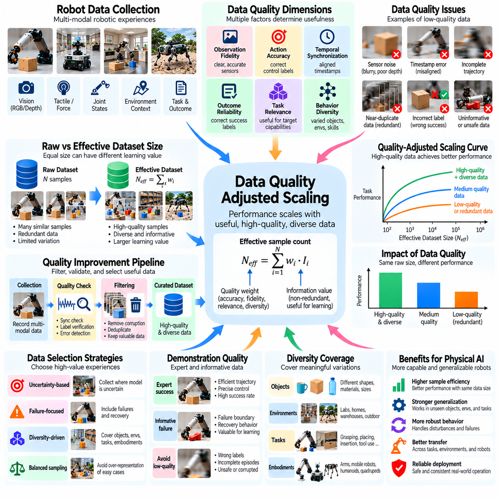{width="7.268055555555556in" height="7.268055555555556in"}

Data quality-adjusted scaling examines how the usefulness of training data influences the relationship between dataset size and Physical AI performance. Conventional scaling analysis often treats data volume as a primary variable, but robotic experiences differ substantially in accuracy, diversity, relevance, and reliability. Quality-adjusted scaling recognizes that equal numbers of demonstrations or trajectories may contribute very different amounts of useful learning information.

Physical AI datasets contain observations, actions, robot states, environmental conditions, and task outcomes. Their quality depends on whether these components accurately describe physical interactions. Sensor noise, timestamp errors, incomplete action records, and incorrect success labels can distort learned relationships. Consequently, increasing dataset volume without controlling measurement quality may produce limited improvements or even degrade policy performance.

A useful distinction exists between raw dataset size and effective dataset size. Raw size measures the number of episodes, trajectories, frames, or interaction steps collected. Effective size represents the amount of information that meaningfully contributes to learning. Repeated demonstrations of nearly identical behavior may add little new knowledge, while a smaller collection of diverse, accurately recorded interactions may produce stronger generalization.

Data quality can be represented through multiple dimensions rather than a single universal score. Important dimensions include observation fidelity, action accuracy, temporal synchronization, task relevance, behavioral diversity, and outcome reliability. Each dimension influences learning differently. For example, precise action labels support control learning, while diverse environments improve robustness against unfamiliar deployment conditions.

Quality-adjusted scaling can be conceptualized using an effective sample count that weights individual experiences according to their estimated usefulness. A simplified expression is N_eff = Σw_i, where w_i represents the quality weight of sample i. However, this formulation is only an approximation because correlated samples contribute overlapping information. Reliable estimation requires considering redundancy, coverage, task difficulty, and model-dependent learning value.

Demonstration quality strongly affects imitation learning because policies reproduce patterns contained in recorded behavior. Expert demonstrations may provide efficient trajectories and precise manipulation strategies, but they can omit recovery behaviors and exploratory actions. Less successful demonstrations may still contain valuable information about failure boundaries. Quality assessment should therefore distinguish informative failures from corrupted or misleading records.

Temporal consistency is especially important for robotic datasets because observations and actions are causally linked through physical dynamics. Incorrect timestamps can associate motor commands with the wrong sensor states, producing distorted control relationships. Even small synchronization errors may matter during fast manipulation or contact-rich operations. Quality control should verify sensor alignment, action timing, and consistency between recorded state transitions.

Trajectory completeness also influences learning effectiveness. Missing initialization states, interrupted recordings, and incomplete termination labels can obscure the relationship between goals and outcomes. Long-horizon tasks are particularly vulnerable because omitted transitions may remove essential dependencies. Dataset pipelines should preserve episode boundaries, task context, intervention records, and recovery events whenever these elements are necessary for interpreting behavior.

Diversity-adjusted quality evaluates whether collected experiences cover meaningful variations in tasks, objects, environments, and robot embodiments. A large dataset dominated by one operating condition may produce strong local performance but weak transfer. Balanced coverage can improve robustness, although uniform sampling is not always optimal. Difficult, safety-critical, or underrepresented situations may deserve greater representation than routine interactions.

Redundancy reduction can improve computational efficiency by removing repeated experiences that contribute little additional information. Near-duplicate frames, repetitive trajectories, and highly correlated demonstrations can dominate training without expanding behavioral knowledge. However, aggressive deduplication may eliminate useful variations in contact dynamics or execution timing. Effective filtering must preserve physically meaningful differences rather than relying only on visual similarity.

Uncertainty-based data selection prioritizes experiences where models lack confidence or encounter prediction errors. These samples may provide greater learning value than familiar examples already handled reliably. Active learning and targeted data collection can direct robots toward informative conditions. Nevertheless, uncertainty alone does not guarantee usefulness, since sensor corruption and fundamentally ambiguous observations may also produce high uncertainty.

Failure-focused sampling is particularly valuable for improving reliability. Rare collisions, unstable grasps, navigation deadlocks, and unsuccessful insertions reveal weaknesses that successful demonstrations may conceal. Including recovery trajectories helps models learn corrective behavior rather than merely avoiding observed failures. However, failure data must be accurately labeled and interpreted to prevent models from imitating unsafe actions without understanding their consequences.

Data provenance and annotation consistency support trustworthy scaling experiments. Records should identify collection platforms, sensor configurations, software versions, operator interventions, and labeling procedures. Without this context, apparent performance improvements may reflect hidden changes in collection methods. Versioned datasets and reproducible preprocessing make it possible to evaluate whether quality improvements genuinely affect learned capabilities.

Quality-adjusted scaling curves compare model performance against both raw data volume and estimated effective data volume. Researchers can train identical architectures using datasets with different filtering, weighting, or diversity characteristics. Improvements should be measured on independent evaluation tasks rather than the training distribution alone. Such experiments can reveal whether data curation produces greater gains than simply collecting additional episodes.

The relationship between quality and quantity is not always monotonic. Extremely strict filtering may produce clean datasets that exclude unusual but realistic operating conditions. Conversely, broad inclusion can introduce noise that overwhelms useful signals. Optimal curation balances measurement reliability with behavioral coverage. The appropriate balance depends on task complexity, model capacity, training objectives, and deployment requirements.

Quality-aware sampling can allocate training effort according to estimated learning value. Samples may receive different probabilities or loss weights based on difficulty, rarity, reliability, and relevance. This approach can improve utilization of limited computational resources. However, weighting schemes require validation because excessive emphasis on rare or difficult examples may distort the deployment distribution and reduce performance on common tasks.

Synthetic data introduces additional quality considerations because generated experiences may be abundant but physically imperfect. Simulation fidelity, contact modeling, sensor realism, and scenario diversity determine their usefulness. Synthetic trajectories can improve coverage of rare conditions, yet unrealistic dynamics may teach incorrect action consequences. Quality-adjusted scaling should therefore evaluate synthetic samples according to demonstrated transfer benefits rather than generation volume.

Human video and teleoperation datasets also require source-specific quality assessment. Human videos may contain rich task semantics but incomplete information about forces and robot-compatible actions. Teleoperation provides executable robot trajectories but may include operator delays, corrections, and inconsistent control styles. Combining these sources effectively requires preserving their strengths while accounting for differences in embodiment, observability, and action precision.

Ultimately, data quality-adjusted scaling shifts attention from how much robotic data is collected to how much useful physical knowledge that data provides. Reliable scaling requires accurate measurements, informative diversity, consistent annotations, careful filtering, and independent validation. As Physical AI systems expand across tasks and embodiments, improving effective data quality can become as important as increasing dataset size, model capacity, or computational resources.

데이터 품질 보정 스케일링(Data Quality-Adjusted Scaling)은 학습 데이터(Training Data)의 유용성이 데이터셋 크기(Dataset Size)와 피지컬 AI 성능(Physical AI Performance) 사이의 관계에 어떤 영향을 미치는지 분석합니다. 기존의 스케일링 분석(Conventional Scaling Analysis)은 데이터 양(Data Volume)을 주요 변수로 취급하는 경우가 많지만, 로봇 경험(Robotic Experiences)은 정확도(Accuracy), 다양성(Diversity), 관련성(Relevance), 신뢰성(Reliability) 측면에서 상당한 차이를 보입니다. 품질 보정 스케일링은 동일한 수의 시연(Demonstrations)이나 궤적(Trajectories)이라도 학습에 유용한 정보의 양은 크게 다를 수 있다는 점을 반영합니다.

피지컬 AI 데이터셋(Physical AI Datasets)에는 관측(Observations), 행동(Actions), 로봇 상태(Robot States), 환경 조건(Environmental Conditions), 작업 결과(Task Outcomes)가 포함됩니다. 데이터 품질(Data Quality)은 이러한 구성요소가 물리적 상호작용(Physical Interactions)을 얼마나 정확하게 설명하는지에 따라 결정됩니다. 센서 잡음(Sensor Noise), 타임스탬프 오류(Timestamp Errors), 불완전한 행동 기록(Incomplete Action Records), 잘못된 성공 레이블(Incorrect Success Labels)은 학습된 관계(Learned Relationships)를 왜곡할 수 있습니다. 따라서 측정 품질(Measurement Quality)을 관리하지 않고 데이터셋 규모만 증가시키면 성능 향상이 제한되거나 정책 성능(Policy Performance)이 오히려 저하될 수 있습니다.

원시 데이터셋 크기(Raw Dataset Size)와 유효 데이터셋 크기(Effective Dataset Size) 사이에는 중요한 차이가 있습니다. 원시 크기(Raw Size)는 수집된 에피소드(Episodes), 궤적(Trajectories), 프레임(Frames), 상호작용 단계(Interaction Steps)의 수를 측정합니다. 유효 크기(Effective Size)는 학습에 실질적으로 기여하는 정보의 양을 나타냅니다. 거의 동일한 행동을 반복한 시연은 새로운 지식을 거의 추가하지 못할 수 있지만, 다양하고 정확하게 기록된 소규모 상호작용 데이터는 더 강력한 일반화(Generalization)를 제공할 수 있습니다.

데이터 품질(Data Quality)은 하나의 보편적인 점수(Universal Score)가 아니라 여러 차원(Multiple Dimensions)을 통해 표현할 수 있습니다. 중요한 차원에는 관측 충실도(Observation Fidelity), 행동 정확도(Action Accuracy), 시간적 동기화(Temporal Synchronization), 작업 관련성(Task Relevance), 행동 다양성(Behavioral Diversity), 결과 신뢰성(Outcome Reliability)이 포함됩니다. 각 차원은 학습에 서로 다른 영향을 미칩니다. 예를 들어 정밀한 행동 레이블(Precise Action Labels)은 제어 학습(Control Learning)을 지원하며, 다양한 환경(Diverse Environments)은 익숙하지 않은 배포 조건(Unfamiliar Deployment Conditions)에 대한 강건성(Robustness)을 개선합니다.

품질 보정 스케일링(Quality-Adjusted Scaling)은 개별 경험(Individual Experiences)의 추정된 유용성(Estimated Usefulness)에 따라 가중치를 부여하는 유효 샘플 수(Effective Sample Count)를 사용하여 개념화할 수 있습니다. 단순화된 표현은 N_eff = Σw_i이며, 여기서 w_i는 샘플 i의 품질 가중치(Quality Weight)를 의미합니다. 그러나 상관관계가 있는 샘플(Correlated Samples)은 중복되는 정보(Overlapping Information)를 제공하므로 이 공식은 근사치(Approximation)에 불과합니다. 신뢰할 수 있는 추정(Reliable Estimation)을 위해서는 중복성(Redundancy), 포괄 범위(Coverage), 작업 난이도(Task Difficulty), 모델 의존적 학습 가치(Model-Dependent Learning Value)를 고려해야 합니다.

시연 품질(Demonstration Quality)은 정책(Policies)이 기록된 행동(Recorded Behavior)에 포함된 패턴을 재현하기 때문에 모방 학습(Imitation Learning)에 큰 영향을 미칩니다. 전문가 시연(Expert Demonstrations)은 효율적인 궤적(Efficient Trajectories)과 정밀한 조작 전략(Precise Manipulation Strategies)을 제공할 수 있지만, 복구 행동(Recovery Behaviors)과 탐색 행동(Exploratory Actions)은 포함하지 않을 수 있습니다. 성공하지 못한 시연(Less Successful Demonstrations)에도 실패 경계(Failure Boundaries)에 관한 유용한 정보가 포함될 수 있습니다. 따라서 품질 평가(Quality Assessment)는 정보 가치가 있는 실패(Informative Failures)와 손상되거나 오해를 유발하는 기록(Corrupted or Misleading Records)을 구분해야 합니다.

시간적 일관성(Temporal Consistency)은 관측(Observations)과 행동(Actions)이 물리적 동역학(Physical Dynamics)을 통해 인과적으로 연결되기 때문에 로봇 데이터셋(Robotic Datasets)에서 특히 중요합니다. 잘못된 타임스탬프(Incorrect Timestamps)는 모터 명령(Motor Commands)을 잘못된 센서 상태(Sensor States)와 연결하여 제어 관계(Control Relationships)를 왜곡할 수 있습니다. 빠른 조작(Fast Manipulation)이나 접촉이 많은 작업(Contact-Rich Operations)에서는 작은 동기화 오류(Synchronization Errors)도 중요할 수 있습니다. 품질 관리(Quality Control)는 센서 정렬(Sensor Alignment), 행동 타이밍(Action Timing), 기록된 상태 전이(Recorded State Transitions)의 일관성을 검증해야 합니다.

궤적 완전성(Trajectory Completeness)도 학습 효과(Learning Effectiveness)에 영향을 미칩니다. 누락된 초기 상태(Missing Initialization States), 중단된 기록(Interrupted Recordings), 불완전한 종료 레이블(Incomplete Termination Labels)은 목표(Goals)와 결과(Outcomes) 사이의 관계를 불명확하게 만들 수 있습니다. 장기 작업(Long-Horizon Tasks)은 누락된 전이(Missing Transitions)로 인해 필수적인 의존 관계(Essential Dependencies)가 사라질 수 있으므로 특히 취약합니다. 따라서 데이터셋 파이프라인(Dataset Pipelines)은 행동을 해석하는 데 필요한 경우 에피소드 경계(Episode Boundaries), 작업 맥락(Task Context), 개입 기록(Intervention Records), 복구 사건(Recovery Events)을 보존해야 합니다.

다양성 보정 품질(Diversity-Adjusted Quality)은 수집된 경험이 작업(Tasks), 물체(Objects), 환경(Environments), 로봇 체화(Robot Embodiments)의 의미 있는 변화를 얼마나 포괄하는지 평가합니다. 하나의 운영 조건(Operating Condition)에 집중된 대규모 데이터셋(Large Dataset)은 특정 조건에서 높은 성능을 보일 수 있지만 전이 성능(Transfer Performance)은 낮을 수 있습니다. 균형 잡힌 포괄 범위(Balanced Coverage)는 강건성(Robustness)을 개선할 수 있지만 균등 샘플링(Uniform Sampling)이 항상 최적인 것은 아닙니다. 어렵거나 안전에 중요한 상황(Safety-Critical Situations), 충분히 표현되지 않은 상황(Underrepresented Situations)은 일상적인 상호작용(Routine Interactions)보다 더 높은 비중으로 포함할 필요가 있습니다.

중복성 감소(Redundancy Reduction)는 추가적인 정보 기여도가 낮은 반복 경험(Repeated Experiences)을 제거하여 계산 효율성(Computational Efficiency)을 개선할 수 있습니다. 거의 중복된 프레임(Near-Duplicate Frames), 반복적인 궤적(Repetitive Trajectories), 높은 상관관계를 가진 시연(Highly Correlated Demonstrations)은 행동 지식(Behavioral Knowledge)을 확장하지 못하면서 학습 데이터에서 큰 비중을 차지할 수 있습니다. 그러나 지나치게 공격적인 중복 제거(Aggressive Deduplication)는 접촉 동역학(Contact Dynamics)이나 실행 타이밍(Execution Timing)의 유용한 변화를 제거할 수 있습니다. 효과적인 필터링(Effective Filtering)은 시각적 유사성(Visual Similarity)에만 의존하지 않고 물리적으로 의미 있는 차이(Physically Meaningful Differences)를 보존해야 합니다.

불확실성 기반 데이터 선택(Uncertainty-Based Data Selection)은 모델의 신뢰도(Confidence)가 낮거나 예측 오류(Prediction Errors)가 발생하는 경험을 우선적으로 선택합니다. 이러한 샘플은 이미 안정적으로 처리할 수 있는 익숙한 예제(Familiar Examples)보다 더 높은 학습 가치(Learning Value)를 제공할 수 있습니다. 능동 학습(Active Learning)과 표적 데이터 수집(Targeted Data Collection)은 로봇이 정보 가치가 높은 조건(Informative Conditions)을 중심으로 데이터를 수집하도록 유도할 수 있습니다. 그러나 센서 손상(Sensor Corruption)이나 본질적으로 모호한 관측(Fundamentally Ambiguous Observations)도 높은 불확실성을 발생시킬 수 있으므로 불확실성만으로 유용성을 보장할 수는 없습니다.

실패 중심 샘플링(Failure-Focused Sampling)은 신뢰성(Reliability)을 개선하는 데 특히 유용합니다. 드물게 발생하는 충돌(Rare Collisions), 불안정한 파지(Unstable Grasps), 내비게이션 교착 상태(Navigation Deadlocks), 실패한 삽입(Unsuccessful Insertions)은 성공적인 시연(Successful Demonstrations)이 드러내지 못하는 취약점을 보여줍니다. 복구 궤적(Recovery Trajectories)을 포함하면 모델이 관측된 실패를 단순히 회피하는 것을 넘어 교정 행동(Corrective Behavior)을 학습하도록 도울 수 있습니다. 그러나 모델이 결과를 이해하지 못한 채 위험한 행동(Unsafe Actions)을 모방하지 않도록 실패 데이터(Failure Data)를 정확하게 레이블링하고 해석해야 합니다.

데이터 출처(Data Provenance)와 주석 일관성(Annotation Consistency)은 신뢰할 수 있는 스케일링 실험(Trustworthy Scaling Experiments)을 지원합니다. 기록에는 데이터 수집 플랫폼(Collection Platforms), 센서 구성(Sensor Configurations), 소프트웨어 버전(Software Versions), 운영자 개입(Operator Interventions), 레이블링 절차(Labeling Procedures)가 명시되어야 합니다. 이러한 맥락이 없으면 겉으로 나타나는 성능 향상(Apparent Performance Improvements)이 실제로는 수집 방법(Collection Methods)의 숨겨진 변화에 따른 것일 수 있습니다. 버전 관리된 데이터셋(Versioned Datasets)과 재현 가능한 전처리(Reproducible Preprocessing)를 사용하면 품질 개선(Quality Improvements)이 실제로 학습된 능력(Learned Capabilities)에 영향을 미치는지 평가할 수 있습니다.

품질 보정 스케일링 곡선(Quality-Adjusted Scaling Curves)은 원시 데이터 양(Raw Data Volume)과 추정된 유효 데이터 양(Estimated Effective Data Volume)을 기준으로 모델 성능(Model Performance)을 비교합니다. 연구자는 서로 다른 필터링(Filtering), 가중치 부여(Weighting), 다양성 특성(Diversity Characteristics)을 가진 데이터셋을 사용하여 동일한 아키텍처(Identical Architectures)를 학습시킬 수 있습니다. 성능 향상은 학습 분포(Training Distribution)만이 아니라 독립적인 평가 작업(Independent Evaluation Tasks)에서 측정해야 합니다. 이러한 실험은 단순히 에피소드(Episodes)를 추가로 수집하는 것보다 데이터 큐레이션(Data Curation)이 더 큰 성능 향상을 제공하는지 보여줄 수 있습니다.

품질(Quality)과 양(Quantity) 사이의 관계가 항상 단조적(Monotonic)인 것은 아닙니다. 지나치게 엄격한 필터링(Extremely Strict Filtering)은 깨끗한 데이터셋(Clean Datasets)을 생성하지만 비정상적이면서도 현실적인 운영 조건(Unusual but Realistic Operating Conditions)을 제외할 수 있습니다. 반대로 광범위한 데이터 포함(Broad Inclusion)은 유용한 신호(Useful Signals)를 압도하는 잡음(Noise)을 도입할 수 있습니다. 최적의 큐레이션(Optimal Curation)은 측정 신뢰성(Measurement Reliability)과 행동 포괄 범위(Behavioral Coverage) 사이의 균형을 유지합니다. 적절한 균형은 작업 복잡도(Task Complexity), 모델 용량(Model Capacity), 학습 목표(Training Objectives), 배포 요구사항(Deployment Requirements)에 따라 달라집니다.

품질 인식 샘플링(Quality-Aware Sampling)은 추정된 학습 가치(Estimated Learning Value)에 따라 학습 자원(Training Effort)을 할당할 수 있습니다. 샘플은 난이도(Difficulty), 희소성(Rarity), 신뢰성(Reliability), 관련성(Relevance)에 따라 서로 다른 선택 확률(Selection Probabilities)이나 손실 가중치(Loss Weights)를 부여받을 수 있습니다. 이러한 접근법은 제한된 계산 자원(Limited Computational Resources)의 활용도를 개선할 수 있습니다. 그러나 드물거나 어려운 예제(Rare or Difficult Examples)에 지나치게 높은 가중치를 부여하면 배포 분포(Deployment Distribution)가 왜곡되고 일반적인 작업(Common Tasks)의 성능이 저하될 수 있으므로 가중치 부여 방식(Weighting Schemes)에 대한 검증이 필요합니다.

합성 데이터(Synthetic Data)는 생성된 경험(Generated Experiences)의 양은 많지만 물리적으로 불완전할 수 있다는 점에서 추가적인 품질 고려사항(Quality Considerations)을 제시합니다. 시뮬레이션 충실도(Simulation Fidelity), 접촉 모델링(Contact Modeling), 센서 현실성(Sensor Realism), 시나리오 다양성(Scenario Diversity)이 합성 데이터의 유용성을 결정합니다. 합성 궤적(Synthetic Trajectories)은 드문 조건(Rare Conditions)에 대한 포괄 범위를 개선할 수 있지만 비현실적인 동역학(Unrealistic Dynamics)은 잘못된 행동 결과(Incorrect Action Consequences)를 학습시킬 수 있습니다. 따라서 품질 보정 스케일링(Quality-Adjusted Scaling)은 생성량(Generation Volume)이 아니라 검증된 전이 효과(Demonstrated Transfer Benefits)를 기준으로 합성 샘플(Synthetic Samples)을 평가해야 합니다.

인간 비디오 데이터셋(Human Video Datasets)과 원격조작 데이터셋(Teleoperation Datasets)에도 데이터 출처별 품질 평가(Source-Specific Quality Assessment)가 필요합니다. 인간 비디오(Human Videos)는 풍부한 작업 의미 정보(Task Semantics)를 포함할 수 있지만 힘(Forces)이나 로봇과 호환되는 행동(Robot-Compatible Actions)에 관한 정보는 불완전할 수 있습니다. 원격조작(Teleoperation)은 실행 가능한 로봇 궤적(Executable Robot Trajectories)을 제공하지만 운영자 지연(Operator Delays), 교정 동작(Corrections), 일관되지 않은 제어 방식(Inconsistent Control Styles)을 포함할 수 있습니다. 이러한 데이터 소스를 효과적으로 결합하려면 각 데이터의 장점을 보존하면서 체화(Embodiment), 관측 가능성(Observability), 행동 정밀도(Action Precision)의 차이를 고려해야 합니다.

궁극적으로 데이터 품질 보정 스케일링(Data Quality-Adjusted Scaling)은 얼마나 많은 로봇 데이터(Robotic Data)를 수집했는지에서 해당 데이터가 얼마나 많은 유용한 물리적 지식(Useful Physical Knowledge)을 제공하는지로 관심을 전환합니다. 신뢰할 수 있는 스케일링(Reliable Scaling)을 위해서는 정확한 측정(Accurate Measurements), 정보 가치가 높은 다양성(Informative Diversity), 일관된 주석(Consistent Annotations), 신중한 필터링(Careful Filtering), 독립적인 검증(Independent Validation)이 필요합니다. 피지컬 AI 시스템(Physical AI Systems)이 다양한 작업(Tasks)과 체화(Embodiments)로 확장됨에 따라 유효 데이터 품질(Effective Data Quality)의 개선은 데이터셋 크기(Dataset Size), 모델 용량(Model Capacity), 계산 자원(Computational Resources)의 증가만큼 중요해질 수 있습니다.

##  

## 07.16. Diminishing Returns and Data Bottlenecks

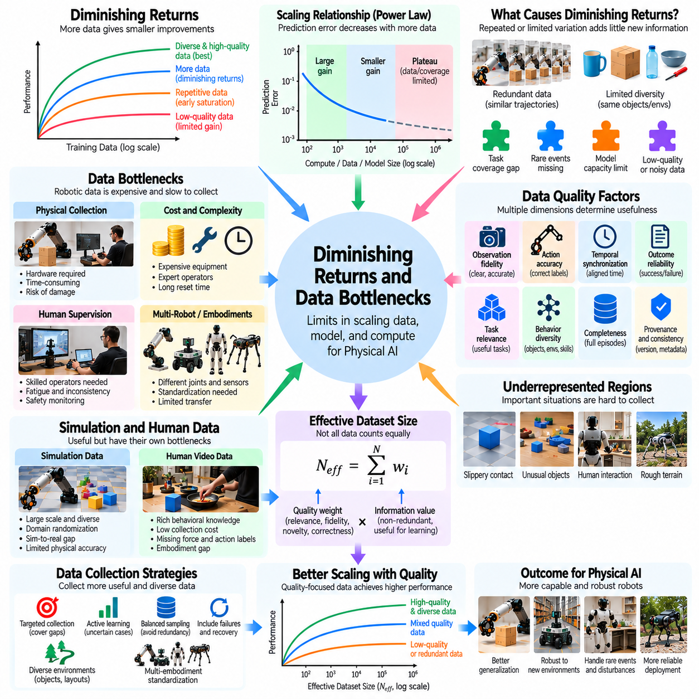{width="7.268055555555556in" height="7.268055555555556in"}

Diminishing returns and data bottlenecks describe the limits encountered when expanding Physical AI training datasets, model capacity, and computational resources. Early increases in data volume often produce substantial improvements because models acquire fundamental perception and control capabilities. As training progresses, additional data may contribute progressively smaller gains. Understanding these limitations is essential for designing efficient and sustainable robotic learning systems.

Diminishing returns occur when each additional unit of training data produces less performance improvement than previous units. This behavior can emerge as models master frequently encountered objects, environments, and action patterns. Repeated exposure strengthens existing capabilities but may provide little new information. Consequently, increasing dataset size does not necessarily improve performance on rare events, unfamiliar tasks, or difficult physical interactions.

Scaling relationships are often approximated using power laws, where prediction error decreases as training resources increase. However, empirical curves may flatten when data quality, task coverage, or model capacity becomes limiting. A plateau does not necessarily indicate that further scaling is impossible. Instead, it may reveal that the current data distribution or learning architecture cannot provide the information required for continued improvement.

Data bottlenecks arise when useful training experiences cannot be collected at the rate required by model development. Unlike internet-scale text, robotic data often requires physical hardware, controlled environments, human operators, and repeated experiments. Collection speed is constrained by robot motion, task duration, equipment availability, and maintenance. These factors make physical interaction data substantially more expensive to expand.

The cost of collecting demonstrations increases when tasks require precision, specialized equipment, or expert intervention. Contact-rich assembly, deformable object manipulation, and dynamic navigation may demand carefully supervised trials. Failures can damage hardware or require lengthy resets. As a result, collecting another thousand trajectories may involve much greater operational effort than simply recording additional sensor frames.

Data redundancy is a major cause of diminishing returns. Large collections of nearly identical trajectories may improve performance on familiar situations without expanding generalization. A robot repeatedly grasping the same object under similar conditions encounters limited behavioral variation. Effective scaling therefore depends on increasing informative diversity, including different objects, initial states, disturbances, and recovery outcomes.

Coverage bottlenecks occur when important regions of the task distribution remain underrepresented. Rare collisions, unusual object geometries, slippery contacts, and unexpected human interactions may be difficult to capture systematically. Models trained primarily on routine operations can become highly accurate in common conditions while remaining fragile elsewhere. Targeted collection is needed to address these gaps.

Long-horizon tasks create additional bottlenecks because complete demonstrations require many successful intermediate actions. A single failure can interrupt an episode and increase collection time. Successful trajectories may also underrepresent recovery behavior, leaving models unprepared for unexpected deviations. Collecting partial sequences, failure transitions, and corrective actions can improve coverage without requiring every example to contain a complete successful task.

Embodiment diversity introduces another constraint. Data collected from one robot may not transfer directly to platforms with different joints, sensors, actuators, or control frequencies. Building large datasets across multiple embodiments requires standardized representations and calibration procedures. Without these mechanisms, additional robot-specific data may increase storage and training costs while contributing limited reusable knowledge.

Sensor bandwidth and synchronization can become bottlenecks as recording systems grow. High-resolution cameras, depth sensors, tactile arrays, and joint-state streams generate substantial data volumes. However, storing more measurements does not guarantee more useful learning information. Poor synchronization, inconsistent calibration, and missing metadata may reduce the effective value of otherwise extensive recordings.

Human supervision creates a practical scaling limit. Teleoperation, demonstration labeling, quality inspection, and safety monitoring require skilled personnel. Operator fatigue and inconsistent control strategies can reduce data quality as collection expands. Automation can lower these costs, but autonomous collection must still detect failures and prevent unsafe behavior. Human effort should increasingly focus on difficult cases rather than routine repetitions.

Simulation offers a partial solution by generating large quantities of trajectories without consuming equivalent physical robot time. Domain randomization can broaden object, environment, and disturbance coverage. Nevertheless, simulation introduces its own bottlenecks through inaccurate contact dynamics, unrealistic sensing, and incomplete environmental models. Additional synthetic data may yield diminishing returns when the simulation-to-reality gap dominates learning performance.

Human video data can expand behavioral diversity at relatively low collection cost. Such data provides examples of object use, task sequencing, and environmental interactions. However, missing force measurements, uncertain action parameters, and differences between human and robot embodiments limit direct transfer. Increasing video volume alone may not resolve these physical grounding problems, making targeted robot interaction data necessary.

Model capacity can also constrain data scaling. Small models may lack sufficient representational power to integrate diverse experiences, causing performance to saturate despite additional data. Conversely, large models trained on narrow datasets may overfit recurring patterns. Effective resource allocation requires matching model size, data diversity, and training computation rather than increasing one component independently.

Compute bottlenecks emerge when larger datasets require longer training cycles, greater memory capacity, and more expensive optimization. Processing redundant or low-value experiences consumes resources that could support informative experiments. Data filtering, balanced sampling, and curriculum learning can improve computational efficiency. However, aggressive filtering may remove rare physical events that are important for deployment reliability.

Active learning and uncertainty-driven collection can reduce data bottlenecks by prioritizing experiences with high expected learning value. Robots may request demonstrations for unfamiliar objects or collect additional trials after prediction failures. These approaches direct limited resources toward weaknesses rather than repeating mastered tasks. Their effectiveness depends on calibrated uncertainty and reliable identification of genuinely informative situations.

Evaluating diminishing returns requires controlled scaling experiments. Researchers should compare performance across increasing dataset sizes while keeping model architecture, training procedures, and evaluation conditions consistent. Separate measurements are needed for familiar tasks, unseen environments, rare failures, and long-horizon execution. Aggregate success rates alone can conceal bottlenecks affecting safety or generalization.

Marginal learning efficiency provides a useful basis for resource decisions. It measures how much additional performance is obtained from extra data, computation, or collection cost. When marginal gains decline, investment may shift toward improved annotations, targeted exploration, better sensors, or architectural changes. Such decisions should consider real-world deployment value rather than benchmark accuracy alone.

Ultimately, diminishing returns and data bottlenecks reveal that Physical AI scaling is constrained by the availability of informative physical experience. Sustainable progress requires reducing redundancy, expanding difficult-case coverage, improving collection automation, and coordinating real, synthetic, and human-derived data. The objective is not unlimited data accumulation but maximizing transferable capability, reliability, and safety from available learning resources.

수확 체감(Diminishing Returns)과 데이터 병목 현상(Data Bottlenecks)은 피지컬 AI(Physical AI)의 학습 데이터셋(Training Datasets), 모델 용량(Model Capacity), 계산 자원(Computational Resources)을 확장할 때 직면하는 한계를 설명합니다. 초기 데이터 양(Data Volume)의 증가는 모델이 기본적인 인식(Perception) 및 제어 능력(Control Capabilities)을 습득하기 때문에 상당한 성능 향상을 가져오는 경우가 많습니다. 그러나 학습이 진행될수록 추가 데이터(Additional Data)가 제공하는 성능 향상은 점차 감소할 수 있습니다. 이러한 한계를 이해하는 것은 효율적이고 지속 가능한 로봇 학습 시스템(Robotic Learning Systems)을 설계하는 데 필수적입니다.

수확 체감(Diminishing Returns)은 학습 데이터(Training Data)가 추가될 때마다 이전보다 더 작은 성능 향상(Performance Improvement)이 발생하는 현상입니다. 이러한 현상은 모델이 자주 접하는 물체(Objects), 환경(Environments), 행동 패턴(Action Patterns)을 충분히 학습하면서 나타날 수 있습니다. 반복적인 경험(Repeated Exposure)은 기존 능력(Existing Capabilities)을 강화하지만 새로운 정보(New Information)는 거의 제공하지 못할 수 있습니다. 따라서 데이터셋 크기(Dataset Size)를 증가시키더라도 드문 사건(Rare Events), 익숙하지 않은 작업(Unfamiliar Tasks), 어려운 물리적 상호작용(Difficult Physical Interactions)에 대한 성능이 반드시 개선되는 것은 아닙니다.

스케일링 관계(Scaling Relationships)는 학습 자원(Training Resources)이 증가함에 따라 예측 오류(Prediction Error)가 감소하는 멱법칙(Power Laws)을 사용하여 근사하는 경우가 많습니다. 그러나 데이터 품질(Data Quality), 작업 포괄 범위(Task Coverage), 모델 용량(Model Capacity)이 제한 요인으로 작용하면 실험적 곡선(Empirical Curves)이 평탄해질 수 있습니다. 이러한 성능 정체(Plateau)가 반드시 추가적인 스케일링(Further Scaling)이 불가능하다는 의미는 아닙니다. 오히려 현재의 데이터 분포(Data Distribution)나 학습 아키텍처(Learning Architecture)가 지속적인 성능 향상에 필요한 정보를 제공하지 못하고 있음을 나타낼 수 있습니다.

데이터 병목 현상(Data Bottlenecks)은 모델 개발(Model Development)에 필요한 속도로 유용한 학습 경험(Useful Training Experiences)을 수집할 수 없을 때 발생합니다. 인터넷 규모의 텍스트 데이터(Internet-Scale Text Data)와 달리 로봇 데이터(Robotic Data)는 물리적 하드웨어(Physical Hardware), 통제된 환경(Controlled Environments), 인간 운영자(Human Operators), 반복 실험(Repeated Experiments)을 필요로 하는 경우가 많습니다. 수집 속도(Collection Speed)는 로봇 움직임(Robot Motion), 작업 지속 시간(Task Duration), 장비 가용성(Equipment Availability), 유지보수(Maintenance)에 의해 제한됩니다. 이러한 요인으로 인해 물리적 상호작용 데이터(Physical Interaction Data)의 확장에는 훨씬 높은 비용이 발생합니다.

시연 수집 비용(Demonstration Collection Cost)은 작업에 정밀도(Precision), 특수 장비(Specialized Equipment), 전문가 개입(Expert Intervention)이 필요할 때 증가합니다. 접촉이 많은 조립(Contact-Rich Assembly), 변형 가능한 물체 조작(Deformable Object Manipulation), 동적 내비게이션(Dynamic Navigation)은 신중하게 감독되는 시험(Supervised Trials)을 요구할 수 있습니다. 실패(Failures)는 하드웨어를 손상시키거나 긴 초기화 과정(Resets)을 필요로 할 수 있습니다. 따라서 추가로 1,000개의 궤적(Trajectories)을 수집하는 작업은 단순히 센서 프레임(Sensor Frames)을 추가로 기록하는 것보다 훨씬 많은 운영 노력(Operational Effort)을 요구할 수 있습니다.

데이터 중복성(Data Redundancy)은 수확 체감(Diminishing Returns)의 주요 원인입니다. 거의 동일한 궤적(Nearly Identical Trajectories)을 대량으로 수집하면 익숙한 상황(Familiar Situations)에 대한 성능은 개선할 수 있지만 일반화(Generalization)는 확장하지 못할 수 있습니다. 로봇이 유사한 조건(Similar Conditions)에서 동일한 물체(Same Object)를 반복적으로 파지하면 제한적인 행동 변화(Behavioral Variation)만 경험하게 됩니다. 따라서 효과적인 스케일링(Effective Scaling)을 위해서는 서로 다른 물체(Different Objects), 초기 상태(Initial States), 외란(Disturbances), 복구 결과(Recovery Outcomes)를 포함하는 정보 가치가 높은 다양성(Informative Diversity)을 증가시켜야 합니다.

포괄 범위 병목 현상(Coverage Bottlenecks)은 작업 분포(Task Distribution)의 중요한 영역이 충분히 표현되지 않을 때 발생합니다. 드문 충돌(Rare Collisions), 특이한 물체 형상(Unusual Object Geometries), 미끄러운 접촉(Slippery Contacts), 예상하지 못한 인간 상호작용(Unexpected Human Interactions)은 체계적으로 수집하기 어려울 수 있습니다. 주로 일상적인 작업(Routine Operations)으로 학습된 모델은 일반적인 조건(Common Conditions)에서는 높은 정확도를 달성하면서도 다른 상황에서는 취약할 수 있습니다. 이러한 격차(Gaps)를 해결하려면 표적 데이터 수집(Targeted Data Collection)이 필요합니다.

장기 작업(Long-Horizon Tasks)은 완전한 시연(Complete Demonstrations)을 수집하기 위해 여러 중간 행동(Intermediate Actions)을 성공적으로 수행해야 하므로 추가적인 병목 현상을 발생시킵니다. 단 한 번의 실패(Single Failure)로도 에피소드(Episode)가 중단되고 수집 시간(Collection Time)이 증가할 수 있습니다. 성공 궤적(Successful Trajectories)은 복구 행동(Recovery Behavior)을 충분히 포함하지 않아 예상하지 못한 편차(Unexpected Deviations)에 모델이 대응하지 못하게 할 수도 있습니다. 부분 시퀀스(Partial Sequences), 실패 전이(Failure Transitions), 교정 행동(Corrective Actions)을 수집하면 모든 예제에 완전한 성공 작업(Complete Successful Task)을 포함하지 않고도 데이터 포괄 범위(Data Coverage)를 개선할 수 있습니다.

체화 다양성(Embodiment Diversity)은 또 다른 제약 요인입니다. 한 로봇에서 수집된 데이터(Data)는 서로 다른 관절(Joints), 센서(Sensors), 액추에이터(Actuators), 제어 주파수(Control Frequencies)를 가진 플랫폼으로 직접 전이되지 않을 수 있습니다. 여러 체화(Multiple Embodiments)에 걸쳐 대규모 데이터셋(Large Datasets)을 구축하려면 표준화된 표현(Standardized Representations)과 보정 절차(Calibration Procedures)가 필요합니다. 이러한 메커니즘이 없다면 로봇별 데이터(Robot-Specific Data)를 추가하더라도 저장 비용(Storage Costs)과 학습 비용(Training Costs)만 증가하고 재사용 가능한 지식(Reusable Knowledge)에 대한 기여는 제한적일 수 있습니다.

센서 대역폭(Sensor Bandwidth)과 동기화(Synchronization)는 기록 시스템(Recording Systems)이 확장되면서 병목 현상이 될 수 있습니다. 고해상도 카메라(High-Resolution Cameras), 깊이 센서(Depth Sensors), 촉각 센서 배열(Tactile Arrays), 관절 상태 스트림(Joint-State Streams)은 상당한 데이터 양(Data Volumes)을 생성합니다. 그러나 더 많은 측정값(Measurements)을 저장한다고 해서 반드시 더 유용한 학습 정보(Useful Learning Information)가 확보되는 것은 아닙니다. 부정확한 동기화(Poor Synchronization), 일관되지 않은 보정(Inconsistent Calibration), 누락된 메타데이터(Missing Metadata)는 방대한 기록 데이터(Extensive Recordings)의 유효 가치(Effective Value)를 감소시킬 수 있습니다.

인간 감독(Human Supervision)은 실질적인 스케일링 한계(Scaling Limit)를 형성합니다. 원격조작(Teleoperation), 시연 레이블링(Demonstration Labeling), 품질 검사(Quality Inspection), 안전 모니터링(Safety Monitoring)에는 숙련된 인력(Skilled Personnel)이 필요합니다. 운영자 피로(Operator Fatigue)와 일관되지 않은 제어 전략(Inconsistent Control Strategies)은 데이터 수집 규모(Collection Scale)가 확대될수록 데이터 품질(Data Quality)을 저하시킬 수 있습니다. 자동화(Automation)는 이러한 비용을 줄일 수 있지만 자율 데이터 수집(Autonomous Collection)에서도 실패를 탐지하고 위험한 행동(Unsafe Behavior)을 방지해야 합니다. 인간의 노력(Human Effort)은 일상적인 반복 작업보다 어려운 사례(Difficult Cases)에 점차 집중되어야 합니다.

시뮬레이션(Simulation)은 동일한 수준의 물리적 로봇 운영 시간(Physical Robot Time)을 소비하지 않고 대량의 궤적(Trajectories)을 생성할 수 있으므로 부분적인 해결책을 제공합니다. 도메인 무작위화(Domain Randomization)는 물체(Object), 환경(Environment), 외란(Disturbance)에 대한 포괄 범위를 확대할 수 있습니다. 그러나 시뮬레이션은 부정확한 접촉 동역학(Inaccurate Contact Dynamics), 비현실적인 센싱(Unrealistic Sensing), 불완전한 환경 모델(Incomplete Environmental Models)이라는 자체적인 병목 현상을 발생시킵니다. 시뮬레이션과 현실 사이의 격차(Simulation-to-Reality Gap)가 학습 성능(Learning Performance)을 지배하게 되면 추가적인 합성 데이터(Synthetic Data)의 효과는 점차 감소할 수 있습니다.

인간 비디오 데이터(Human Video Data)는 상대적으로 낮은 수집 비용(Collection Cost)으로 행동 다양성(Behavioral Diversity)을 확장할 수 있습니다. 이러한 데이터는 물체 사용(Object Use), 작업 순서(Task Sequencing), 환경 상호작용(Environmental Interactions)에 관한 예제를 제공합니다. 그러나 누락된 힘 측정값(Missing Force Measurements), 불확실한 행동 매개변수(Uncertain Action Parameters), 인간과 로봇의 체화 차이(Differences Between Human and Robot Embodiments)는 직접적인 전이(Direct Transfer)를 제한합니다. 비디오 데이터 양(Video Volume)을 증가시키는 것만으로 이러한 물리적 기반 문제(Physical Grounding Problems)를 해결할 수는 없으므로 표적화된 로봇 상호작용 데이터(Targeted Robot Interaction Data)가 필요합니다.

모델 용량(Model Capacity) 역시 데이터 스케일링(Data Scaling)을 제한할 수 있습니다. 작은 모델(Small Models)은 다양한 경험(Diverse Experiences)을 통합할 충분한 표현 능력(Representational Power)이 부족하여 추가 데이터에도 불구하고 성능이 포화(Saturation)될 수 있습니다. 반대로 제한적인 데이터셋(Narrow Datasets)으로 학습된 대규모 모델(Large Models)은 반복적인 패턴(Recurring Patterns)에 과적합(Overfitting)될 수 있습니다. 효과적인 자원 할당(Effective Resource Allocation)을 위해서는 하나의 구성요소만 독립적으로 증가시키기보다 모델 크기(Model Size), 데이터 다양성(Data Diversity), 학습 계산량(Training Computation)을 적절하게 조정해야 합니다.

계산 병목 현상(Compute Bottlenecks)은 대규모 데이터셋(Larger Datasets)이 더 긴 학습 주기(Training Cycles), 더 큰 메모리 용량(Memory Capacity), 더 높은 최적화 비용(Optimization Costs)을 요구할 때 발생합니다. 중복되거나 가치가 낮은 경험(Redundant or Low-Value Experiences)을 처리하면 정보 가치가 높은 실험(Informative Experiments)에 사용할 수 있는 자원이 소비됩니다. 데이터 필터링(Data Filtering), 균형 잡힌 샘플링(Balanced Sampling), 커리큘럼 학습(Curriculum Learning)은 계산 효율성(Computational Efficiency)을 개선할 수 있습니다. 그러나 지나치게 공격적인 필터링(Aggressive Filtering)은 배포 신뢰성(Deployment Reliability)에 중요한 드문 물리적 사건(Rare Physical Events)을 제거할 수 있습니다.

능동 학습(Active Learning)과 불확실성 기반 수집(Uncertainty-Driven Collection)은 예상 학습 가치(Expected Learning Value)가 높은 경험을 우선적으로 선택하여 데이터 병목 현상(Data Bottlenecks)을 완화할 수 있습니다. 로봇은 익숙하지 않은 물체(Unfamiliar Objects)에 대한 시연(Demonstrations)을 요청하거나 예측 실패(Prediction Failures) 이후 추가 시험(Additional Trials)을 수집할 수 있습니다. 이러한 접근법은 이미 숙달한 작업(Mastered Tasks)을 반복하는 대신 제한된 자원(Limited Resources)을 취약점(Weaknesses)에 집중시킵니다. 그 효과는 보정된 불확실성(Calibrated Uncertainty)과 실제로 정보 가치가 높은 상황(Genuinely Informative Situations)을 신뢰성 있게 식별하는 능력에 달려 있습니다.

수확 체감(Diminishing Returns)을 평가하려면 통제된 스케일링 실험(Controlled Scaling Experiments)이 필요합니다. 연구자는 모델 아키텍처(Model Architecture), 학습 절차(Training Procedures), 평가 조건(Evaluation Conditions)을 일정하게 유지하면서 데이터셋 크기(Dataset Sizes)를 증가시켜 성능을 비교해야 합니다. 익숙한 작업(Familiar Tasks), 미관측 환경(Unseen Environments), 드문 실패(Rare Failures), 장기 작업 실행(Long-Horizon Execution)에 대해서는 별도의 측정이 필요합니다. 종합 성공률(Aggregate Success Rates)만으로는 안전성(Safety)이나 일반화(Generalization)에 영향을 미치는 병목 현상을 파악하기 어려울 수 있습니다.

한계 학습 효율성(Marginal Learning Efficiency)은 자원 관련 의사결정(Resource Decisions)에 유용한 기준을 제공합니다. 이는 추가 데이터(Extra Data), 계산량(Computation), 수집 비용(Collection Cost)을 투입했을 때 얻어지는 추가적인 성능 향상(Additional Performance Improvement)을 측정합니다. 한계 성능 향상(Marginal Gains)이 감소하면 투자(Investment)를 개선된 주석(Improved Annotations), 표적 탐색(Targeted Exploration), 더 나은 센서(Better Sensors), 아키텍처 변경(Architectural Changes)으로 전환할 수 있습니다. 이러한 의사결정은 벤치마크 정확도(Benchmark Accuracy)뿐만 아니라 실세계 배포 가치(Real-World Deployment Value)를 고려해야 합니다.

궁극적으로 수확 체감(Diminishing Returns)과 데이터 병목 현상(Data Bottlenecks)은 피지컬 AI 스케일링(Physical AI Scaling)이 정보 가치가 높은 물리적 경험(Informative Physical Experience)의 가용성(Availability)에 의해 제한된다는 사실을 보여줍니다. 지속 가능한 발전(Sustainable Progress)을 위해서는 중복성(Redundancy)을 줄이고, 어려운 사례에 대한 포괄 범위(Difficult-Case Coverage)를 확대하며, 수집 자동화(Collection Automation)를 개선하고, 실제 데이터(Real Data), 합성 데이터(Synthetic Data), 인간 유래 데이터(Human-Derived Data)를 조화롭게 활용해야 합니다. 목표는 무제한적인 데이터 축적(Unlimited Data Accumulation)이 아니라 사용 가능한 학습 자원(Available Learning Resources)으로부터 전이 가능한 능력(Transferable Capability), 신뢰성(Reliability), 안전성(Safety)을 극대화하는 것입니다.

##  

## 07.17. Estimating Physical AI Scaling Curves [w/Code]

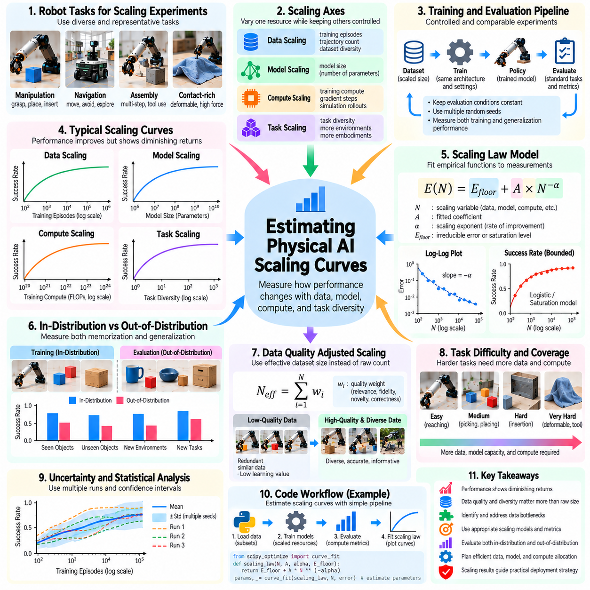{width="7.268055555555556in" height="7.268055555555556in"}

Estimating Physical AI scaling curves involves measuring how robotic learning performance changes with increasing data volume, model capacity, and computational resources. Unlike conventional AI benchmarks, robotic performance depends on physical interactions, task diversity, embodiment, and environmental conditions. Reliable scaling estimates therefore require carefully controlled experiments that connect training resources with measurable real-world capabilities.

A scaling curve describes the relationship between a resource variable and a performance metric. Common variables include training episodes, trajectory counts, model parameters, training compute, and task diversity. Performance may be measured through success rates, prediction errors, or execution efficiency. The objective is to identify systematic trends that support resource planning rather than assume that larger datasets always produce better robots.

Experimental design begins by selecting a representative collection of robotic tasks. Manipulation, navigation, assembly, and contact-rich operations may exhibit different scaling characteristics. Researchers should define training and evaluation conditions before collecting results. Holding evaluation procedures constant is essential because changing task difficulty, object distributions, or success criteria can create misleading improvements.

Data scaling experiments typically train identical model architectures using progressively larger datasets. Each dataset should preserve known sampling rules so that changes in performance can be attributed to additional training experiences. Multiple random seeds help estimate variability. When dataset composition changes with size, researchers should separately measure the effects of volume, diversity, and quality.

Model scaling experiments vary network capacity while controlling training data and optimization procedures. Increasing parameters may improve representation learning, but insufficient training compute can prevent larger models from reaching their potential. Conversely, small models may saturate despite additional data. Meaningful comparisons should report model size, training duration, computational budget, and convergence behavior.

Compute scaling experiments examine performance as training operations or optimization budgets increase. Researchers may vary gradient updates, simulation rollouts, or total accelerator usage. However, additional computation can improve results through longer optimization rather than larger models. Distinguishing these mechanisms is important for identifying efficient training configurations and understanding resource-dependent performance trends.

A common empirical approximation expresses error as E(N) = E_floor + A × N\^(-α), where N represents a scaling variable, A is a fitted coefficient, α is the scaling exponent, and E_floor is an estimated irreducible error floor. This formulation describes diminishing improvements as resources increase. Its validity must be established experimentally because robotic learning curves may contain discontinuities, saturation, or regime changes.

Estimating scaling coefficients requires fitting candidate functions to measured observations. Logarithmic transformations can help visualize power-law relationships, while nonlinear regression can estimate parameters directly. Researchers should inspect residual errors and compare alternative functional forms. A curve that fits a narrow experimental range should not automatically be trusted for predictions far beyond the observed data.

Success rates require special treatment because they are bounded between zero and one. A simple power law may predict impossible values when extrapolated. Logistic functions, bounded saturation models, or transformations of failure probability may provide more appropriate descriptions. Model selection should reflect the mathematical properties of each metric and the expected behavior near performance limits.

Physical AI scaling curves should distinguish training performance from generalization performance. A robot may improve rapidly on familiar objects while making little progress on unseen environments or tasks. Separate curves for in-distribution and out-of-distribution evaluation reveal these differences. Cross-embodiment transfer and long-horizon execution may require additional measurements because their scaling behavior can differ substantially.

Task difficulty also changes the interpretation of scaling results. Simple reaching tasks may approach saturation with modest data, while deformable manipulation or complex assembly may require much broader experience. Combining all tasks into one average can conceal important differences. Difficulty-stratified evaluation helps identify which capabilities benefit from scaling and which remain limited by missing knowledge.

Data quality-adjusted scaling introduces effective dataset size as an alternative to raw sample count. Repeated trajectories, inaccurate labels, and poorly synchronized sensor streams may contribute less useful information than diverse, reliable interactions. Researchers can compare curves before and after filtering or reweighting. Such experiments help determine whether better data selection produces larger gains than additional collection.

Statistical uncertainty is essential when interpreting scaling estimates. Robot experiments exhibit variability from initial states, contact dynamics, sensor noise, and environmental disturbances. Confidence intervals and repeated trials help distinguish genuine improvements from random fluctuations. Hierarchical analysis may be needed when observations are grouped by task, environment, robot, or collection session rather than statistically independent.

Experimental budgets often prevent exhaustive evaluation across every model size and dataset scale. Carefully selected logarithmic resource levels can reveal trends efficiently. Pilot experiments may identify regions where performance changes rapidly or begins to saturate. Adaptive experimentation can then allocate additional trials to uncertain regions, improving curve estimates without requiring uniformly dense measurements.

Joint scaling analysis examines interactions among data, model capacity, and compute. Increasing one resource may provide limited benefit when another becomes the bottleneck. Researchers can fit multivariable response surfaces or compare controlled resource combinations. These analyses support compute-optimal and data-efficient training decisions, although interactions may vary across robotic tasks and embodiments.

Scaling curves can also estimate marginal learning efficiency. The slope of a performance curve indicates how much improvement is associated with additional resources. Flattening slopes suggest diminishing returns and motivate investment in task diversity, data quality, or architectural improvements. Cost-aware analysis should include robot operating hours, human supervision, hardware wear, and energy consumption.

Extrapolation is one of the most useful but riskiest applications of scaling curves. A fitted relationship may predict the resources required to reach a target success rate, yet future performance can depart from historical trends. New failure modes, distribution shifts, or architectural limitations may appear at larger scales. Predictions should therefore include uncertainty ranges and clearly state the experimental conditions supporting them.

A practical scaling study should maintain reproducible records of dataset versions, model configurations, training procedures, evaluation tasks, and computational costs. Automated experiment tracking reduces inconsistencies and supports comparison across research iterations. Independent validation datasets help prevent benchmark-specific overfitting. Periodic refitting allows estimates to incorporate new evidence as robotic capabilities improve.

Ultimately, estimating Physical AI scaling curves is an empirical process for understanding how learning resources translate into physical capabilities. Reliable conclusions require controlled experiments, appropriate mathematical models, uncertainty analysis, and realistic deployment evaluation. Rather than treating scaling laws as universal guarantees, researchers should use them as decision tools for identifying bottlenecks, forecasting resource needs, and guiding efficient robotic development.

피지컬 AI 스케일링 곡선 추정(Estimating Physical AI Scaling Curves)은 데이터 양(Data Volume), 모델 용량(Model Capacity), 계산 자원(Computational Resources)이 증가함에 따라 로봇 학습 성능(Robotic Learning Performance)이 어떻게 변화하는지 측정하는 과정입니다. 기존 AI 벤치마크(Conventional AI Benchmarks)와 달리 로봇 성능(Robotic Performance)은 물리적 상호작용(Physical Interactions), 작업 다양성(Task Diversity), 체화(Embodiment), 환경 조건(Environmental Conditions)에 따라 달라집니다. 따라서 신뢰할 수 있는 스케일링 추정(Reliable Scaling Estimates)을 위해서는 학습 자원(Training Resources)과 측정 가능한 실세계 능력(Measurable Real-World Capabilities)을 연결하는 신중하게 통제된 실험(Controlled Experiments)이 필요합니다.

스케일링 곡선(Scaling Curve)은 자원 변수(Resource Variable)와 성능 지표(Performance Metric) 사이의 관계를 설명합니다. 일반적인 변수에는 학습 에피소드(Training Episodes), 궤적 수(Trajectory Counts), 모델 매개변수(Model Parameters), 학습 계산량(Training Compute), 작업 다양성(Task Diversity)이 포함됩니다. 성능은 성공률(Success Rates), 예측 오류(Prediction Errors), 실행 효율성(Execution Efficiency)을 통해 측정할 수 있습니다. 목표는 데이터셋이 커질수록 로봇 성능이 항상 향상된다고 가정하는 것이 아니라 자원 계획(Resource Planning)을 지원하는 체계적인 경향(Systematic Trends)을 식별하는 것입니다.

실험 설계(Experimental Design)는 대표적인 로봇 작업(Robotic Tasks)을 선정하는 것에서 시작합니다. 조작(Manipulation), 내비게이션(Navigation), 조립(Assembly), 접촉이 많은 작업(Contact-Rich Operations)은 서로 다른 스케일링 특성(Scaling Characteristics)을 보일 수 있습니다. 연구자는 결과를 수집하기 전에 학습 조건(Training Conditions)과 평가 조건(Evaluation Conditions)을 정의해야 합니다. 작업 난이도(Task Difficulty), 물체 분포(Object Distributions), 성공 기준(Success Criteria)의 변화가 잘못된 성능 향상으로 해석될 수 있으므로 평가 절차(Evaluation Procedures)를 일정하게 유지하는 것이 필수적입니다.

데이터 스케일링 실험(Data Scaling Experiments)은 일반적으로 동일한 모델 아키텍처(Identical Model Architectures)를 사용하면서 데이터셋 크기(Dataset Sizes)를 점진적으로 증가시켜 학습을 수행합니다. 각 데이터셋은 알려진 샘플링 규칙(Sampling Rules)을 유지해야 하며, 이를 통해 성능 변화(Performance Changes)가 추가적인 학습 경험(Additional Training Experiences)에 기인하는지 판단할 수 있습니다. 여러 무작위 시드(Random Seeds)를 사용하면 변동성(Variability)을 추정하는 데 도움이 됩니다. 데이터셋 크기에 따라 데이터 구성(Dataset Composition)이 달라진다면 데이터 양(Volume), 다양성(Diversity), 품질(Quality)의 영향을 별도로 측정해야 합니다.

모델 스케일링 실험(Model Scaling Experiments)은 학습 데이터(Training Data)와 최적화 절차(Optimization Procedures)를 통제하면서 신경망 용량(Network Capacity)을 변화시킵니다. 매개변수(Parameters)를 증가시키면 표현 학습(Representation Learning)이 개선될 수 있지만, 학습 계산량(Training Compute)이 부족하면 더 큰 모델(Larger Models)이 잠재적인 성능을 충분히 발휘하지 못할 수 있습니다. 반대로 작은 모델(Small Models)은 추가 데이터에도 불구하고 성능이 포화(Saturation)될 수 있습니다. 의미 있는 비교를 위해서는 모델 크기(Model Size), 학습 시간(Training Duration), 계산 예산(Computational Budget), 수렴 특성(Convergence Behavior)을 보고해야 합니다.

계산 자원 스케일링 실험(Compute Scaling Experiments)은 학습 연산량(Training Operations)이나 최적화 예산(Optimization Budgets)이 증가할 때 성능이 어떻게 변화하는지 분석합니다. 연구자는 경사도 업데이트(Gradient Updates), 시뮬레이션 롤아웃(Simulation Rollouts), 전체 가속기 사용량(Total Accelerator Usage)을 변화시킬 수 있습니다. 그러나 추가적인 계산(Additional Computation)은 모델 크기 증가가 아니라 더 긴 최적화(Longer Optimization)를 통해 결과를 개선할 수도 있습니다. 이러한 메커니즘을 구분하는 것은 효율적인 학습 구성(Efficient Training Configurations)을 식별하고 자원 의존적 성능 경향(Resource-Dependent Performance Trends)을 이해하는 데 중요합니다.

일반적인 경험적 근사식(Empirical Approximation)은 오류(Error)를 E(N) = E_floor + A × N\^(-α)로 표현합니다. 여기서 N은 스케일링 변수(Scaling Variable), A는 적합 계수(Fitted Coefficient), α는 스케일링 지수(Scaling Exponent), E_floor는 추정된 비가역적 오류 하한(Estimated Irreducible Error Floor)을 의미합니다. 이 공식은 자원(Resources)이 증가함에 따라 성능 개선 폭이 감소하는 현상을 설명합니다. 그러나 로봇 학습 곡선(Robotic Learning Curves)에는 불연속성(Discontinuities), 포화(Saturation), 체제 변화(Regime Changes)가 나타날 수 있으므로 공식의 유효성(Validity)은 실험적으로 검증해야 합니다.

스케일링 계수(Scaling Coefficients)를 추정하려면 측정된 관측값(Measured Observations)에 후보 함수(Candidate Functions)를 적합해야 합니다. 로그 변환(Logarithmic Transformations)은 멱법칙 관계(Power-Law Relationships)를 시각화하는 데 도움이 되며, 비선형 회귀(Nonlinear Regression)는 매개변수(Parameters)를 직접 추정할 수 있습니다. 연구자는 잔차(Residual Errors)를 검토하고 대안적인 함수 형태(Alternative Functional Forms)를 비교해야 합니다. 좁은 실험 범위(Narrow Experimental Range)에 잘 적합하는 곡선이라도 관측된 데이터 범위를 크게 벗어나는 예측(Extrapolation)에 자동으로 신뢰성을 부여해서는 안 됩니다.

성공률(Success Rates)은 0과 1 사이로 제한되기 때문에 특별한 처리가 필요합니다. 단순한 멱법칙(Simple Power Law)은 외삽(Extrapolation) 과정에서 불가능한 값을 예측할 수 있습니다. 로지스틱 함수(Logistic Functions), 경계가 있는 포화 모델(Bounded Saturation Models), 실패 확률 변환(Transformations of Failure Probability)은 더 적절한 설명을 제공할 수 있습니다. 모델 선택(Model Selection)은 각 지표(Metric)의 수학적 특성(Mathematical Properties)과 성능 한계(Performance Limits)에 가까워질 때 예상되는 거동(Expected Behavior)을 반영해야 합니다.

피지컬 AI 스케일링 곡선(Physical AI Scaling Curves)은 학습 성능(Training Performance)과 일반화 성능(Generalization Performance)을 구분해야 합니다. 로봇은 익숙한 물체(Familiar Objects)에 대해서는 빠르게 성능이 향상되지만 미관측 환경(Unseen Environments)이나 작업(Tasks)에서는 거의 발전하지 못할 수 있습니다. 분포 내 평가(In-Distribution Evaluation)와 분포 외 평가(Out-of-Distribution Evaluation)에 대한 별도의 곡선은 이러한 차이를 보여줍니다. 체화 간 전이(Cross-Embodiment Transfer)와 장기 작업 실행(Long-Horizon Execution)은 스케일링 거동(Scaling Behavior)이 상당히 다를 수 있으므로 추가적인 측정이 필요할 수 있습니다.

작업 난이도(Task Difficulty) 역시 스케일링 결과(Scaling Results)의 해석을 변화시킵니다. 단순한 도달 작업(Simple Reaching Tasks)은 적은 데이터로도 포화 상태(Saturation)에 접근할 수 있지만, 변형 가능한 물체 조작(Deformable Manipulation)이나 복잡한 조립(Complex Assembly)은 훨씬 폭넓은 경험(Broader Experience)을 요구할 수 있습니다. 모든 작업을 하나의 평균(Average)으로 통합하면 중요한 차이가 감춰질 수 있습니다. 난이도별 계층화 평가(Difficulty-Stratified Evaluation)는 어떤 능력이 스케일링의 이점을 얻고 어떤 능력이 부족한 지식(Missing Knowledge)에 의해 제한되는지 식별하는 데 도움이 됩니다.

데이터 품질 보정 스케일링(Data Quality-Adjusted Scaling)은 원시 샘플 수(Raw Sample Count)의 대안으로 유효 데이터셋 크기(Effective Dataset Size)를 도입합니다. 반복적인 궤적(Repeated Trajectories), 부정확한 레이블(Inaccurate Labels), 동기화가 불량한 센서 스트림(Poorly Synchronized Sensor Streams)은 다양하고 신뢰할 수 있는 상호작용(Diverse, Reliable Interactions)보다 유용한 정보를 적게 제공할 수 있습니다. 연구자는 필터링(Filtering)이나 재가중치 부여(Reweighting) 전후의 곡선을 비교할 수 있습니다. 이러한 실험은 더 나은 데이터 선택(Better Data Selection)이 추가적인 데이터 수집(Additional Collection)보다 큰 성능 향상을 제공하는지 판단하는 데 도움이 됩니다.

통계적 불확실성(Statistical Uncertainty)은 스케일링 추정(Scaling Estimates)을 해석할 때 필수적입니다. 로봇 실험(Robot Experiments)은 초기 상태(Initial States), 접촉 동역학(Contact Dynamics), 센서 잡음(Sensor Noise), 환경 외란(Environmental Disturbances)으로 인해 변동성(Variability)을 나타냅니다. 신뢰구간(Confidence Intervals)과 반복 시험(Repeated Trials)은 실제 성능 향상(Genuine Improvements)을 무작위 변동(Random Fluctuations)과 구분하는 데 도움이 됩니다. 관측값(Observations)이 통계적으로 독립적이지 않고 작업(Task), 환경(Environment), 로봇(Robot), 수집 세션(Collection Session)에 따라 그룹화되어 있다면 계층적 분석(Hierarchical Analysis)이 필요할 수 있습니다.

실험 예산(Experimental Budgets)은 모든 모델 크기(Model Sizes)와 데이터셋 규모(Dataset Scales)에 걸친 포괄적인 평가(Exhaustive Evaluation)를 제한하는 경우가 많습니다. 신중하게 선택된 로그 간격의 자원 수준(Logarithmic Resource Levels)은 경향(Trends)을 효율적으로 파악하는 데 도움이 됩니다. 예비 실험(Pilot Experiments)은 성능이 빠르게 변화하거나 포화되기 시작하는 영역(Regions)을 식별할 수 있습니다. 이후 적응형 실험(Adaptive Experimentation)은 불확실성이 높은 영역(Uncertain Regions)에 추가 시험(Additional Trials)을 배정하여 모든 구간에서 균일하게 조밀한 측정(Uniformly Dense Measurements)을 수행하지 않고도 곡선 추정(Curve Estimates)을 개선할 수 있습니다.

결합 스케일링 분석(Joint Scaling Analysis)은 데이터(Data), 모델 용량(Model Capacity), 계산 자원(Compute) 사이의 상호작용을 분석합니다. 하나의 자원(Resource)을 증가시키더라도 다른 자원이 병목 현상(Bottleneck)을 형성하면 성능 향상이 제한될 수 있습니다. 연구자는 다변수 반응 표면(Multivariable Response Surfaces)을 적합하거나 통제된 자원 조합(Controlled Resource Combinations)을 비교할 수 있습니다. 이러한 분석은 계산 최적 학습(Compute-Optimal Training)과 데이터 효율적 학습(Data-Efficient Training)에 관한 의사결정을 지원하지만, 자원 간 상호작용(Interactions)은 로봇 작업(Robotic Tasks)과 체화(Embodiments)에 따라 달라질 수 있습니다.

스케일링 곡선(Scaling Curves)은 한계 학습 효율성(Marginal Learning Efficiency)을 추정하는 데에도 사용할 수 있습니다. 성능 곡선(Performance Curve)의 기울기(Slope)는 추가 자원(Additional Resources)과 관련된 성능 향상(Improvement)의 크기를 나타냅니다. 기울기가 완만해지는 현상(Flattening Slopes)은 수확 체감(Diminishing Returns)을 시사하며 작업 다양성(Task Diversity), 데이터 품질(Data Quality), 아키텍처 개선(Architectural Improvements)에 대한 투자를 고려하도록 합니다. 비용 인식 분석(Cost-Aware Analysis)에는 로봇 운영 시간(Robot Operating Hours), 인간 감독(Human Supervision), 하드웨어 마모(Hardware Wear), 에너지 소비(Energy Consumption)가 포함되어야 합니다.

외삽(Extrapolation)은 스케일링 곡선(Scaling Curves)의 가장 유용하면서도 위험성이 높은 활용 방법 중 하나입니다. 적합된 관계(Fitted Relationship)는 목표 성공률(Target Success Rate)에 도달하기 위해 필요한 자원(Resources)을 예측할 수 있지만, 미래 성능(Future Performance)은 과거 경향(Historical Trends)에서 벗어날 수 있습니다. 규모가 커지면서 새로운 실패 유형(New Failure Modes), 분포 이동(Distribution Shifts), 아키텍처 한계(Architectural Limitations)가 나타날 수 있습니다. 따라서 예측(Predictions)에는 불확실성 범위(Uncertainty Ranges)를 포함하고 이를 뒷받침하는 실험 조건(Experimental Conditions)을 명확하게 제시해야 합니다.

실용적인 스케일링 연구(Practical Scaling Study)는 데이터셋 버전(Dataset Versions), 모델 구성(Model Configurations), 학습 절차(Training Procedures), 평가 작업(Evaluation Tasks), 계산 비용(Computational Costs)에 대한 재현 가능한 기록(Reproducible Records)을 유지해야 합니다. 자동화된 실험 추적(Automated Experiment Tracking)은 불일치(Inconsistencies)를 줄이고 연구 반복 과정(Research Iterations) 사이의 비교를 지원합니다. 독립적인 검증 데이터셋(Independent Validation Datasets)은 벤치마크 특화 과적합(Benchmark-Specific Overfitting)을 방지하는 데 도움이 됩니다. 주기적인 재적합(Periodic Refitting)은 로봇 능력(Robotic Capabilities)이 향상됨에 따라 새로운 증거(New Evidence)를 추정값(Estimates)에 반영할 수 있도록 합니다.

궁극적으로 피지컬 AI 스케일링 곡선 추정(Estimating Physical AI Scaling Curves)은 학습 자원(Learning Resources)이 물리적 능력(Physical Capabilities)으로 어떻게 전환되는지 이해하기 위한 경험적 과정(Empirical Process)입니다. 신뢰할 수 있는 결론(Reliable Conclusions)을 얻으려면 통제된 실험(Controlled Experiments), 적절한 수학적 모델(Appropriate Mathematical Models), 불확실성 분석(Uncertainty Analysis), 현실적인 배포 평가(Realistic Deployment Evaluation)가 필요합니다. 연구자는 스케일링 법칙(Scaling Laws)을 보편적인 보장(Universal Guarantees)으로 간주하기보다 병목 현상(Bottlenecks)을 식별하고 자원 요구량(Resource Needs)을 예측하며 효율적인 로봇 개발(Efficient Robotic Development)을 안내하는 의사결정 도구(Decision Tools)로 활용해야 합니다.
