**Volume 04. Data Engines and Scaling for Physical AI**


# Chapter 08. Data Governance and Privacy

##  

## 08.01. Data Governance for Physical AI

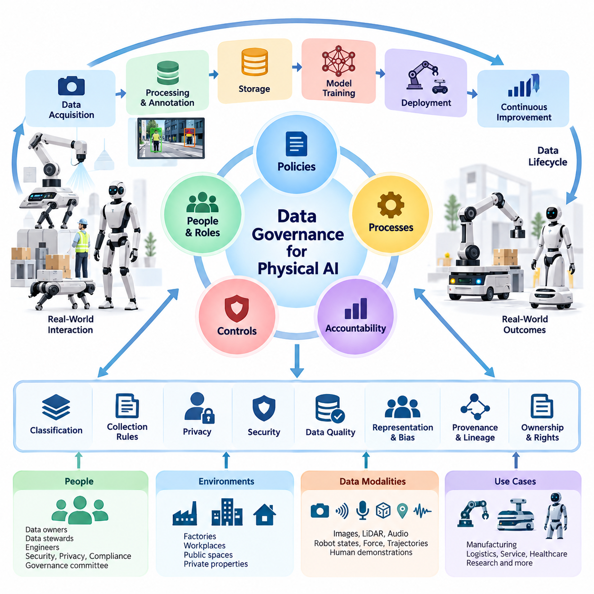{width="7.268055555555556in" height="7.268055555555556in"}

Data governance for Physical AI establishes the policies, responsibilities, technical controls, and operational processes required to manage data throughout its lifecycle. Unlike conventional digital AI, Physical AI collects information through robots interacting with real environments. These interactions generate sensitive observations about people, workplaces, objects, movements, and physical activities, making governance essential for responsible system development.

Physical AI data governance extends beyond database administration or regulatory compliance. It connects data acquisition, processing, annotation, storage, model training, deployment, and continuous improvement within a unified accountability framework. Every stage must define who can collect information, which purposes justify its use, how its integrity is maintained, and what conditions govern its sharing, retention, or deletion.

The distinctive challenge of Physical AI arises from the relationship between observation, action, and outcome. A robot may simultaneously record camera images, LiDAR measurements, audio, joint positions, force feedback, navigation trajectories, and operator commands. These synchronized streams can reveal information that individual measurements do not expose, requiring governance policies that consider combined datasets and their potential implications.

A governance framework begins by establishing clear organizational roles and decision-making authority. Data owners define permissible business uses, data stewards maintain quality and metadata, engineering teams implement technical safeguards, and security personnel manage threats and incidents. Privacy and compliance specialists evaluate applicable obligations, while governance committees resolve conflicts involving access, ownership, operational necessity, and responsible AI development.

Data classification provides the foundation for applying appropriate controls to different information categories. Physical AI datasets may contain public environmental observations, internal operational records, confidential industrial information, personal data, or highly sensitive biometric measurements. Classification should reflect both the original information and what can reasonably be inferred from it, since apparently harmless sensor recordings may reveal identities, behaviors, or protected operational details.

Data governance must begin before information enters the collection pipeline. Robot developers should establish legitimate collection purposes, determine whether permissions or other legal bases are required, and limit acquisition to information necessary for defined objectives. Collection policies should specify operating environments, permitted sensors, recording conditions, authorized personnel, and restrictions associated with public spaces, industrial facilities, and private properties.

Human demonstration and teleoperation datasets introduce additional governance responsibilities because they capture the behavior of operators performing physical tasks. Recorded movements, reaction times, intervention patterns, and task completion statistics may reveal individual performance characteristics. Governance policies should distinguish legitimate robot training requirements from employee monitoring and prevent secondary uses that exceed the original collection purpose.

Data provenance and lineage enable organizations to understand where information originated and how it evolved. Each robot episode should ideally contain metadata describing the collection device, sensor configuration, software version, timestamp, operating environment, task definition, and relevant permissions. Subsequent transformations, annotations, filtering operations, and dataset merges should remain traceable so that training inputs can be investigated and reproduced.

Ownership and usage rights become complicated when multiple organizations contribute to Physical AI development. Robot manufacturers, facility operators, teleoperation providers, annotation contractors, and cloud service companies may each possess different contractual interests. Governance agreements should explicitly define collection authority, intellectual property rights, permitted training activities, redistribution restrictions, derivative datasets, and responsibilities following contract termination.

Data quality governance ensures that collected information remains suitable for its intended engineering purpose. Inaccurate timestamps, inconsistent coordinate systems, missing sensor measurements, incorrect labels, and corrupted trajectories can undermine robot learning and evaluation. Organizations should establish measurable quality criteria, validation procedures, documented acceptance thresholds, and escalation mechanisms for datasets that fail to satisfy operational requirements.

Representation and coverage are equally important because governance must address the environments and populations represented in training data. A robot trained predominantly in controlled laboratories may perform poorly in crowded workplaces or unfamiliar physical conditions. Governance reviews should examine environmental diversity, object distributions, human interaction patterns, rare events, and potential biases that could produce unequal reliability across deployment scenarios.

Security governance protects robot datasets against unauthorized disclosure, alteration, destruction, and misuse. Role-based or attribute-based access controls can restrict sensitive information to approved personnel and services. Encryption during transmission and storage, secure credential management, network segmentation, and audit logging strengthen protection, while periodic access reviews help ensure that permissions remain appropriate as organizational responsibilities change.

Privacy engineering should be integrated into data processing rather than treated as a final compliance step. Techniques such as facial blurring, audio redaction, identifier removal, pseudonymization, and selective recording can reduce unnecessary exposure. However, anonymization is not always irreversible, particularly when movement trajectories, location histories, or multimodal observations allow individuals to be reidentified through additional information.

Physical AI systems often distribute data across robots, edge computers, on-premise servers, and cloud infrastructure. This architecture creates governance boundaries whenever information moves between devices, facilities, service providers, or jurisdictions. Organizations should define approved transfer paths, encryption requirements, processing locations, access conditions, and restrictions on cross-border movement, while maintaining consistent policies across distributed infrastructure.

Edge processing can reduce governance risks by filtering sensitive information before transmission to centralized systems. Robots may retain raw recordings locally while uploading selected events, anonymized observations, or compact learning representations. Nevertheless, local processing does not eliminate security responsibilities. Edge devices require secure storage, authenticated software updates, physical tamper protection, and reliable procedures for recovering or deleting information.

Retention and deletion policies should reflect the different operational purposes of robot data. Short-lived diagnostic recordings may require different retention periods from validated training datasets, safety incident evidence, or regulatory records. Governance systems should document retention schedules, deletion triggers, backup handling, and applicable legal preservation obligations, ensuring that information is not retained indefinitely merely because storage remains available.

Model training introduces additional governance questions because information may influence learned parameters even after original files are removed. Organizations should maintain relationships between dataset versions, training configurations, model checkpoints, and deployment releases. When data must be withdrawn, these records support impact assessments and decisions about retraining, model replacement, or other remediation, although removing specific learned information can remain technically difficult.

Synthetic data and simulation-generated datasets also require governance despite their artificial origins. Simulation assets may incorporate proprietary CAD models, confidential facility layouts, licensed textures, or measurements derived from real environments. Governance procedures should document asset origins, usage permissions, simulation configurations, and restrictions on redistribution, ensuring that synthetic generation does not unintentionally reproduce sensitive or unauthorized information.

Data sharing across robot fleets creates opportunities for collective learning while increasing governance complexity. A failure episode recorded at one industrial site may help improve robots operating elsewhere, but the recording could expose proprietary equipment or confidential workflows. Controlled sharing mechanisms should separate reusable behavioral information from site-specific sensitive content and enforce contractual boundaries between participating organizations.

Federated learning and privacy-preserving computation offer alternative approaches when centralized collection is undesirable. Participating robots or facilities may train local models and exchange selected updates instead of transferring raw observations. These approaches can reduce certain exposure risks, but model updates may still leak information, and additional protections such as secure aggregation, differential privacy, and update validation may be necessary.

Auditing provides evidence that governance policies are functioning as intended. Audit records should document data collection events, access requests, permission changes, processing activities, dataset exports, training usage, and deletion operations. Automated monitoring can identify unusual transfers, unauthorized access attempts, or policy violations, while independent reviews assess whether implemented safeguards remain effective as robot capabilities and operating environments evolve.

Incident management must address both cybersecurity failures and inappropriate data practices. A compromised robot may expose recorded video, navigation maps, or confidential operational information, while an incorrectly configured pipeline may distribute sensitive datasets to unauthorized recipients. Response procedures should include containment, evidence preservation, impact assessment, notification where required, remediation, and documented improvements to prevent recurrence.

Governance effectiveness can be evaluated through measurable operational indicators. Relevant metrics include dataset provenance completeness, classification coverage, unauthorized access incidents, unresolved privacy risks, deletion compliance, annotation quality, and the percentage of training data with verified usage rights. These indicators help organizations identify weaknesses, prioritize improvements, and demonstrate that governance requirements are implemented consistently.

A mature Physical AI governance program should operate as part of the continuous data engine rather than as a separate administrative function. Collection policies inform sensor configuration, metadata standards guide ingestion, quality rules influence curation, and access permissions control training workflows. Evaluation results and field incidents then feed back into governance decisions, allowing policies to evolve alongside robot capabilities and deployment conditions.

Ultimately, data governance enables Physical AI systems to scale without sacrificing accountability, privacy, security, or data reliability. As robots expand into factories, warehouses, hospitals, construction sites, and public environments, governance becomes a fundamental engineering capability. Organizations that integrate responsible data management into their technical architecture can develop more trustworthy learning systems while supporting sustainable innovation and operational growth.

피지컬 인공지능(Physical AI)의 데이터 거버넌스(Data Governance)는 데이터 생명주기(Data Lifecycle) 전반에서 데이터를 관리하는 데 필요한 정책(Policies), 책임(Responsibilities), 기술적 통제(Technical Controls), 운영 절차(Operational Processes)를 수립하는 체계이다. 기존 디지털 인공지능(Digital AI)과 달리 피지컬 인공지능은 실제 환경과 상호작용하는 로봇을 통해 정보를 수집한다. 이러한 상호작용은 사람, 작업장, 객체, 움직임, 물리적 활동에 관한 민감한 관측 데이터(Sensitive Observation Data)를 생성하므로 책임 있는 시스템 개발을 위한 데이터 거버넌스가 필수적이다.

피지컬 인공지능의 데이터 거버넌스는 단순한 데이터베이스 관리(Database Administration)나 규제 준수(Regulatory Compliance)를 넘어선다. 데이터 수집(Data Acquisition), 처리(Processing), 주석 처리(Annotation), 저장(Storage), 모델 학습(Model Training), 배포(Deployment), 지속적 개선(Continuous Improvement)을 통합된 책임 관리 체계(Accountability Framework)로 연결한다. 각 단계에서는 정보 수집 권한, 데이터 사용 목적, 무결성(Integrity) 유지 방법, 공유(Sharing), 보존(Retention), 삭제(Deletion)에 적용되는 조건을 명확하게 정의해야 한다.

피지컬 인공지능의 고유한 과제는 관측(Observation), 행동(Action), 결과(Outcome) 사이의 관계에서 발생한다. 로봇은 카메라 영상(Camera Images), 라이다(LiDAR) 측정값, 오디오(Audio), 관절 위치(Joint Positions), 힘 피드백(Force Feedback), 내비게이션 궤적(Navigation Trajectories), 조작자 명령(Operator Commands)을 동시에 기록할 수 있다. 이러한 동기화된 데이터 스트림(Synchronized Data Streams)은 개별 측정값만으로는 드러나지 않는 정보를 노출할 수 있으므로, 데이터 거버넌스 정책은 결합된 데이터셋(Combined Datasets)과 그 잠재적 영향을 함께 고려해야 한다.

데이터 거버넌스 체계(Governance Framework)는 명확한 조직적 역할(Organizational Roles)과 의사결정 권한(Decision-Making Authority)을 설정하는 것에서 시작한다. 데이터 소유자(Data Owners)는 허용되는 업무적 활용 범위를 정의하고, 데이터 관리자(Data Stewards)는 품질과 메타데이터(Metadata)를 관리하며, 엔지니어링 팀(Engineering Teams)은 기술적 보호 조치를 구현한다. 보안 담당자(Security Personnel)는 위협과 사고를 관리하고, 개인정보 보호 및 규정 준수 전문가(Privacy and Compliance Specialists)는 적용되는 의무를 평가한다. 거버넌스 위원회(Governance Committees)는 접근 권한, 소유권, 운영상 필요성, 책임 있는 인공지능 개발 사이에서 발생하는 갈등을 조정한다.

데이터 분류(Data Classification)는 서로 다른 정보 범주에 적절한 통제 조치를 적용하기 위한 기반을 제공한다. 피지컬 인공지능 데이터셋에는 공개된 환경 관측 정보(Public Environmental Observations), 내부 운영 기록(Internal Operational Records), 산업 기밀 정보(Confidential Industrial Information), 개인정보(Personal Data), 매우 민감한 생체인식 측정값(Biometric Measurements)이 포함될 수 있다. 데이터 분류는 원본 정보뿐 아니라 합리적으로 추론할 수 있는 정보까지 반영해야 한다. 겉으로는 무해한 센서 기록이라도 개인의 신원, 행동 또는 보호 대상 운영 정보를 드러낼 수 있기 때문이다.

데이터 거버넌스는 정보가 수집 파이프라인(Collection Pipeline)에 입력되기 전에 시작되어야 한다. 로봇 개발자는 정당한 수집 목적(Legitimate Collection Purposes)을 수립하고, 동의나 기타 법적 근거(Legal Bases)가 필요한지 판단하며, 정의된 목표에 필요한 정보만 수집하도록 제한해야 한다. 수집 정책(Collection Policies)에는 운영 환경(Operating Environments), 허용되는 센서(Permitted Sensors), 기록 조건(Recording Conditions), 승인된 인력(Authorized Personnel), 공공장소(Public Spaces), 산업 시설(Industrial Facilities), 사유지(Private Properties)에 적용되는 제한 사항을 명시해야 한다.

인간 시연 데이터(Human Demonstration Data)와 원격조작 데이터(Teleoperation Data)는 물리적 작업을 수행하는 조작자의 행동을 기록하기 때문에 추가적인 거버넌스 책임이 발생한다. 기록된 움직임(Movements), 반응 시간(Reaction Times), 개입 패턴(Intervention Patterns), 작업 완료 통계(Task Completion Statistics)는 개인의 수행 능력과 관련된 특성을 드러낼 수 있다. 거버넌스 정책은 정당한 로봇 학습 요구사항과 직원 감시(Employee Monitoring)를 구분하고, 최초 수집 목적을 벗어나는 이차적 활용(Secondary Uses)을 방지해야 한다.

데이터 출처(Data Provenance)와 데이터 계보(Data Lineage)는 정보가 어디에서 생성되었고 어떻게 변화했는지 이해할 수 있도록 한다. 각 로봇 에피소드(Robot Episode)에는 수집 장치(Collection Device), 센서 구성(Sensor Configuration), 소프트웨어 버전(Software Version), 타임스탬프(Timestamp), 운영 환경(Operating Environment), 작업 정의(Task Definition), 관련 권한(Permissions)을 설명하는 메타데이터를 포함하는 것이 바람직하다. 이후의 데이터 변환(Transformations), 주석 처리(Annotations), 필터링(Filtering), 데이터셋 병합(Dataset Merges) 과정도 추적 가능해야 학습 입력 데이터를 조사하고 재현할 수 있다.

여러 조직이 피지컬 인공지능 개발에 참여하면 데이터 소유권(Data Ownership)과 사용 권한(Usage Rights)이 복잡해진다. 로봇 제조업체(Robot Manufacturers), 시설 운영자(Facility Operators), 원격조작 서비스 제공업체(Teleoperation Providers), 데이터 주석 처리 업체(Annotation Contractors), 클라우드 서비스 기업(Cloud Service Companies)은 각각 서로 다른 계약상 권리를 가질 수 있다. 거버넌스 계약(Governance Agreements)에는 데이터 수집 권한, 지식재산권(Intellectual Property Rights), 허용되는 학습 활동, 재배포 제한, 파생 데이터셋(Derivative Datasets), 계약 종료 이후의 책임을 명확하게 정의해야 한다.

데이터 품질 거버넌스(Data Quality Governance)는 수집된 정보가 의도된 엔지니어링 목적에 적합하도록 보장한다. 부정확한 타임스탬프(Inaccurate Timestamps), 일관되지 않은 좌표계(Inconsistent Coordinate Systems), 누락된 센서 측정값(Missing Sensor Measurements), 잘못된 레이블(Incorrect Labels), 손상된 궤적(Corrupted Trajectories)은 로봇 학습과 평가의 신뢰성을 저하시킬 수 있다. 조직은 측정 가능한 품질 기준(Quality Criteria), 검증 절차(Validation Procedures), 문서화된 승인 임계값(Acceptance Thresholds), 운영 요구사항을 충족하지 못하는 데이터셋에 대한 문제 상향 보고 절차(Escalation Mechanisms)를 수립해야 한다.

데이터 대표성(Representation)과 포괄 범위(Coverage) 역시 중요하다. 거버넌스는 학습 데이터에 어떤 환경과 인구 집단이 포함되어 있는지를 다루어야 하기 때문이다. 통제된 실험실 환경에서 주로 학습한 로봇은 혼잡한 작업장이나 익숙하지 않은 물리적 조건에서 성능이 저하될 수 있다. 거버넌스 검토(Governance Reviews)에서는 환경 다양성(Environmental Diversity), 객체 분포(Object Distributions), 인간 상호작용 패턴(Human Interaction Patterns), 희귀 사건(Rare Events), 배포 환경에 따라 신뢰성의 불균형을 유발할 수 있는 잠재적 편향(Potential Biases)을 검토해야 한다.

보안 거버넌스(Security Governance)는 로봇 데이터셋을 무단 공개(Unauthorized Disclosure), 변경(Alteration), 파괴(Destruction), 오용(Misuse)으로부터 보호한다. 역할 기반 접근 제어(Role-Based Access Control) 또는 속성 기반 접근 제어(Attribute-Based Access Control)를 활용하면 민감한 정보를 승인된 인력과 서비스로 제한할 수 있다. 전송 및 저장 중 암호화(Encryption), 안전한 자격 증명 관리(Secure Credential Management), 네트워크 분할(Network Segmentation), 감사 로그(Audit Logging)는 보호 수준을 강화한다. 정기적인 접근 권한 검토(Access Reviews)는 조직의 책임이 변화하더라도 권한이 적절하게 유지되도록 지원한다.

개인정보 보호 공학(Privacy Engineering)은 최종적인 규정 준수 단계가 아니라 데이터 처리 과정에 통합되어야 한다. 얼굴 흐림 처리(Facial Blurring), 오디오 삭제 또는 가림(Audio Redaction), 식별자 제거(Identifier Removal), 가명처리(Pseudonymization), 선택적 기록(Selective Recording)과 같은 기술은 불필요한 정보 노출을 줄일 수 있다. 그러나 익명화(Anonymization)가 항상 되돌릴 수 없는 것은 아니다. 특히 이동 궤적(Movement Trajectories), 위치 기록(Location Histories), 다중모달 관측(Multimodal Observations)을 추가 정보와 결합하면 개인을 재식별(Reidentification)할 가능성이 있기 때문이다.

피지컬 인공지능 시스템은 로봇(Robots), 엣지 컴퓨터(Edge Computers), 온프레미스 서버(On-Premise Servers), 클라우드 인프라(Cloud Infrastructure)에 데이터를 분산하여 처리하는 경우가 많다. 이러한 아키텍처(Architecture)에서는 정보가 장치, 시설, 서비스 제공업체, 국가 또는 관할권(Jurisdictions) 사이를 이동할 때마다 거버넌스 경계(Governance Boundaries)가 형성된다. 조직은 승인된 전송 경로(Approved Transfer Paths), 암호화 요구사항(Encryption Requirements), 처리 위치(Processing Locations), 접근 조건(Access Conditions), 국경 간 데이터 이동(Cross-Border Data Movement)에 대한 제한을 정의하고, 분산 인프라 전반에 일관된 정책을 유지해야 한다.

엣지 처리(Edge Processing)는 민감한 정보를 중앙 시스템으로 전송하기 전에 필터링하여 거버넌스 위험을 줄일 수 있다. 로봇은 원본 기록(Raw Recordings)을 로컬에 보관하면서 선택된 이벤트(Selected Events), 익명화된 관측 데이터(Anonymized Observations), 압축된 학습 표현(Compact Learning Representations)만 업로드할 수 있다. 그러나 로컬 처리가 보안 책임을 제거하는 것은 아니다. 엣지 장치(Edge Devices)에는 안전한 저장(Secure Storage), 인증된 소프트웨어 업데이트(Authenticated Software Updates), 물리적 변조 방지(Physical Tamper Protection), 신뢰할 수 있는 정보 복구 및 삭제 절차가 필요하다.

데이터 보존 및 삭제 정책(Data Retention and Deletion Policies)은 로봇 데이터의 서로 다른 운영 목적을 반영해야 한다. 단기간 사용하는 진단 기록(Diagnostic Recordings)은 검증된 학습 데이터셋(Validated Training Datasets), 안전 사고 증거(Safety Incident Evidence), 규제 관련 기록(Regulatory Records)과 다른 보존 기간이 필요할 수 있다. 거버넌스 시스템은 보존 일정(Retention Schedules), 삭제 조건(Deletion Triggers), 백업 처리(Backup Handling), 적용 가능한 법적 보존 의무(Legal Preservation Obligations)를 문서화하여 저장 공간이 충분하다는 이유만으로 정보를 무기한 보관하지 않도록 해야 한다.

모델 학습(Model Training)은 원본 파일이 삭제된 이후에도 정보가 학습된 매개변수(Learned Parameters)에 영향을 남길 수 있기 때문에 추가적인 거버넌스 문제를 발생시킨다. 조직은 데이터셋 버전(Dataset Versions), 학습 구성(Training Configurations), 모델 체크포인트(Model Checkpoints), 배포 릴리스(Deployment Releases) 사이의 관계를 유지해야 한다. 데이터를 철회해야 할 경우 이러한 기록은 영향 평가(Impact Assessments), 재학습(Retraining), 모델 교체(Model Replacement), 기타 시정 조치(Remedial Actions)에 관한 의사결정을 지원한다. 다만 특정 학습 정보를 제거하는 것은 기술적으로 어려울 수 있다.

합성 데이터(Synthetic Data)와 시뮬레이션 생성 데이터(Simulation-Generated Data)도 인공적으로 생성되었다는 이유만으로 거버넌스 대상에서 제외되지 않는다. 시뮬레이션 자산(Simulation Assets)에는 독점적인 CAD 모델(Proprietary CAD Models), 기밀 시설 배치도(Confidential Facility Layouts), 라이선스가 적용된 텍스처(Licensed Textures), 실제 환경에서 추출한 측정값이 포함될 수 있다. 거버넌스 절차는 자산 출처(Asset Origins), 사용 권한(Usage Permissions), 시뮬레이션 구성(Simulation Configurations), 재배포 제한(Redistribution Restrictions)을 문서화하여 합성 데이터 생성 과정에서 민감하거나 승인되지 않은 정보가 의도치 않게 재현되지 않도록 해야 한다.

로봇 군집(Robot Fleets) 간 데이터 공유(Data Sharing)는 집단 학습(Collective Learning)의 기회를 제공하지만 거버넌스의 복잡성을 증가시킨다. 특정 산업 현장에서 기록된 고장 에피소드(Failure Episode)는 다른 현장에서 운영되는 로봇의 성능 개선에 도움이 될 수 있지만, 해당 기록이 독점 장비(Proprietary Equipment)나 기밀 작업 절차(Confidential Workflows)를 노출할 수도 있다. 통제된 공유 메커니즘(Controlled Sharing Mechanisms)은 재사용 가능한 행동 정보(Reusable Behavioral Information)와 현장별 민감 정보(Site-Specific Sensitive Content)를 분리하고, 참여 조직 사이의 계약상 경계를 준수해야 한다.

연합학습(Federated Learning)과 개인정보 보호 계산(Privacy-Preserving Computation)은 중앙 집중식 데이터 수집(Centralized Data Collection)이 바람직하지 않은 경우 대안적인 접근 방식을 제공한다. 참여 로봇이나 시설은 원본 관측 데이터(Raw Observations)를 전송하는 대신 로컬 모델(Local Models)을 학습하고 선택된 업데이트(Selected Updates)를 교환할 수 있다. 이러한 방식은 일부 정보 노출 위험을 줄이지만, 모델 업데이트(Model Updates)에서도 정보가 유출될 수 있다. 따라서 보안 집계(Secure Aggregation), 차등 개인정보 보호(Differential Privacy), 업데이트 검증(Update Validation)과 같은 추가 보호 기술이 필요할 수 있다.

감사(Auditing)는 거버넌스 정책이 의도대로 작동하고 있다는 증거를 제공한다. 감사 기록(Audit Records)에는 데이터 수집 이벤트(Data Collection Events), 접근 요청(Access Requests), 권한 변경(Permission Changes), 처리 활동(Processing Activities), 데이터셋 반출(Dataset Exports), 학습 사용 이력(Training Usage), 삭제 작업(Deletion Operations)을 문서화해야 한다. 자동화된 모니터링(Automated Monitoring)은 비정상적인 전송, 무단 접근 시도, 정책 위반을 식별할 수 있으며, 독립적인 검토(Independent Reviews)는 로봇의 기능과 운영 환경이 변화함에 따라 구현된 보호 조치가 계속 효과적으로 작동하는지 평가한다.

사고 관리(Incident Management)는 사이버보안 실패(Cybersecurity Failures)와 부적절한 데이터 처리 관행(Inappropriate Data Practices)을 모두 다루어야 한다. 침해된 로봇(Compromised Robot)은 기록된 영상, 내비게이션 지도(Navigation Maps), 기밀 운영 정보를 노출할 수 있으며, 잘못 구성된 파이프라인(Misconfigured Pipeline)은 민감한 데이터셋을 승인되지 않은 수신자에게 배포할 수 있다. 대응 절차(Response Procedures)에는 사고 격리(Containment), 증거 보존(Evidence Preservation), 영향 평가(Impact Assessment), 필요한 경우 통지(Notification), 시정 조치(Remediation), 재발 방지를 위한 개선 사항의 문서화가 포함되어야 한다.

거버넌스 효과성(Governance Effectiveness)은 측정 가능한 운영 지표(Operational Indicators)를 통해 평가할 수 있다. 주요 지표에는 데이터셋 출처 정보의 완전성(Provenance Completeness), 데이터 분류 적용 범위(Classification Coverage), 무단 접근 사고(Unauthorized Access Incidents), 해결되지 않은 개인정보 보호 위험(Unresolved Privacy Risks), 삭제 정책 준수(Deletion Compliance), 주석 품질(Annotation Quality), 사용 권한이 검증된 학습 데이터의 비율(Percentage of Training Data with Verified Usage Rights)이 포함된다. 이러한 지표는 조직이 취약점을 식별하고 개선 우선순위를 결정하며 거버넌스 요구사항이 일관되게 구현되고 있음을 입증하는 데 도움을 준다.

성숙한 피지컬 인공지능 거버넌스 프로그램(Mature Physical AI Governance Program)은 별도의 행정 기능이 아니라 지속적으로 운영되는 데이터 엔진(Continuous Data Engine)의 일부로 작동해야 한다. 수집 정책(Collection Policies)은 센서 구성(Sensor Configuration)에 영향을 주고, 메타데이터 표준(Metadata Standards)은 데이터 수집 및 입력(Ingestion)을 안내하며, 품질 규칙(Quality Rules)은 데이터 큐레이션(Data Curation)에 반영된다. 접근 권한(Access Permissions)은 학습 워크플로(Training Workflows)를 통제한다. 이후 평가 결과(Evaluation Results)와 현장 사고(Field Incidents)는 거버넌스 의사결정에 피드백(Feedback)되어 로봇 기능과 배포 조건의 변화에 맞추어 정책이 발전하도록 한다.

궁극적으로 데이터 거버넌스(Data Governance)는 책임성(Accountability), 개인정보 보호(Privacy), 보안(Security), 데이터 신뢰성(Data Reliability)을 희생하지 않으면서 피지컬 인공지능 시스템을 확장할 수 있도록 한다. 로봇이 공장(Factories), 창고(Warehouses), 병원(Hospitals), 건설 현장(Construction Sites), 공공 환경(Public Environments)으로 확산됨에 따라 거버넌스는 핵심적인 엔지니어링 역량(Fundamental Engineering Capability)이 된다. 책임 있는 데이터 관리(Responsible Data Management)를 기술 아키텍처(Technical Architecture)에 통합하는 조직은 지속 가능한 혁신(Sustainable Innovation)과 운영 성장(Operational Growth)을 지원하면서 더욱 신뢰할 수 있는 학습 시스템(Trustworthy Learning Systems)을 개발할 수 있다.

##  

## 08.02. Data Ownership Sovereignty and Provenance

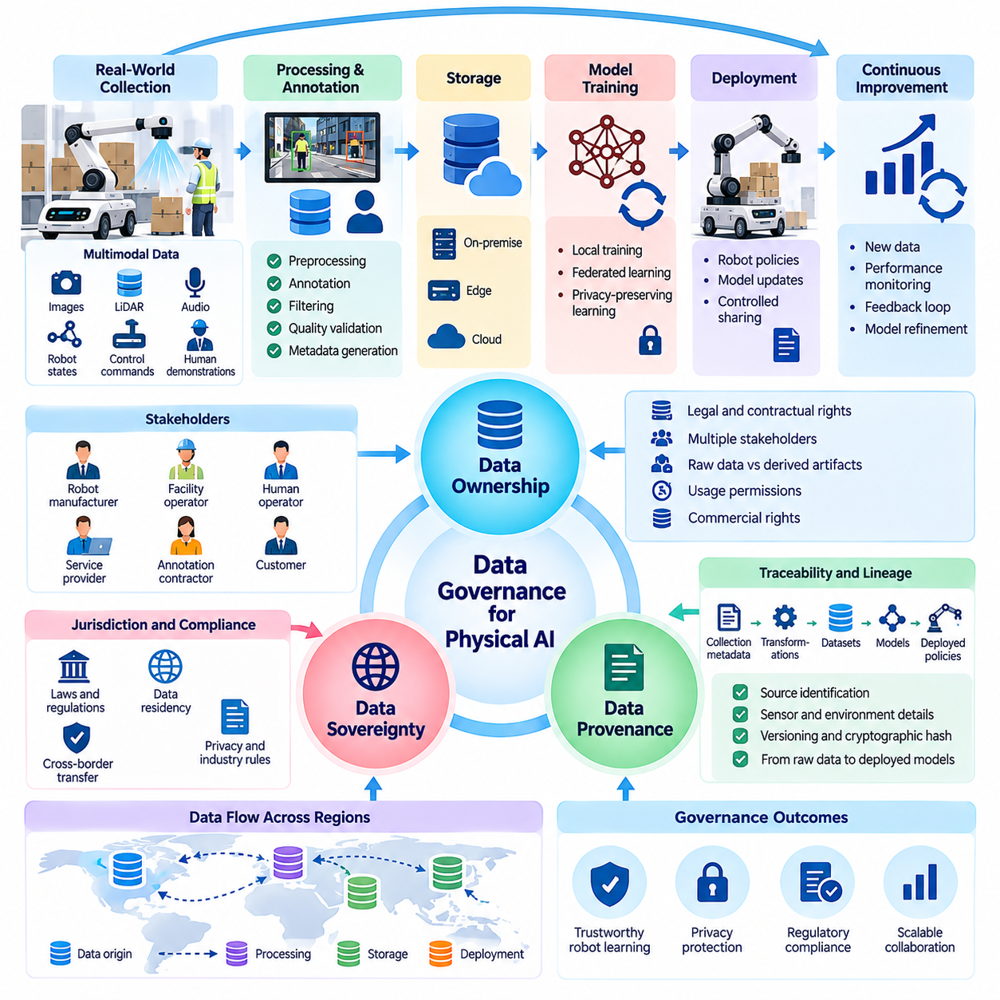{width="7.268055555555556in" height="7.268055555555556in"}

Data ownership, sovereignty, and provenance are fundamental principles governing how Physical AI systems collect, control, process, and reuse information generated through interactions with the physical world. Robot datasets often originate from multiple organizations, devices, operators, and environments. Establishing clear rights, jurisdictional responsibilities, and traceable origins is essential for developing trustworthy and scalable data engines.

Data ownership describes the legal, contractual, and operational rights associated with collected information. In Physical AI, ownership cannot always be assigned to the robot manufacturer or the organization operating the equipment. Facility owners, customers, human operators, software providers, and data processing contractors may hold different rights. Governance must distinguish ownership claims from permissions to access, process, train on, or distribute datasets.

A warehouse robot illustrates the complexity of ownership relationships. Its cameras may record customer inventory, employee movements, proprietary facility layouts, and operational procedures while navigation software generates trajectories and performance logs. The warehouse operator may control facility information, while the robotics provider may possess contractual rights to selected diagnostic records. These arrangements require explicit agreements rather than assumptions.

Data sovereignty concerns the legal authority and jurisdictional requirements governing information throughout its lifecycle. Robot observations collected in one country may be processed in another and incorporated into models deployed internationally. Such transfers can trigger privacy, industrial security, and sector-specific obligations. Sovereignty therefore requires understanding where information originates, where it is stored, who controls processing, and which laws apply.

Data residency and data sovereignty are related but distinct concepts. Residency identifies the physical or geographic location of stored information, while sovereignty concerns the legal and regulatory authority applicable to that information. Keeping datasets within national borders may satisfy certain residency requirements without resolving access by foreign service providers or conflicting legal obligations. Governance architectures must address both dimensions independently.

Physical AI data provenance establishes verifiable records of how observations and derived information were created. Provenance should identify the collecting robot, sensor configuration, operating environment, acquisition timestamp, software version, and relevant permissions. It should also document transformations applied during preprocessing, annotation, filtering, and aggregation. These records support reproducibility, accountability, and investigations into model behavior.

Provenance differs from data lineage, although the two concepts are closely connected. Provenance emphasizes origin, authenticity, and the circumstances under which information was obtained. Lineage tracks the subsequent movement and transformation of information across processing systems. Together, they establish a traceable relationship between raw sensor observations, curated datasets, training experiments, model checkpoints, and deployed robot policies.

Robot episodes provide a practical unit for implementing provenance management. Each episode may include synchronized camera frames, LiDAR measurements, proprioceptive states, control commands, task descriptions, and outcome labels. A unique episode identifier can connect these streams to collection metadata and governance records. Maintaining this association allows engineers to identify which observations contributed to particular training datasets.

Reliable provenance requires more than recording filenames or timestamps. Metadata should include stable dataset identifiers, sensor calibration versions, coordinate reference conventions, annotation revisions, and processing software configurations. Cryptographic hashes can help detect unauthorized modifications, while signed records can strengthen evidence of origin when signing keys and identity controls are properly managed. Versioned manifests preserve relationships between data artifacts.

Ownership becomes particularly complicated when human demonstrations are converted into robot learning datasets. Operators may contribute expertise, movements, verbal instructions, and task strategies, while employers provide equipment and facilities. Contracts must address permitted collection, compensation where applicable, intellectual property, and secondary training uses. Privacy rights and employment protections may remain relevant regardless of contractual dataset ownership.

Synthetic data introduces another layer of ownership and provenance requirements. Simulated robot trajectories may be generated using proprietary CAD assets, licensed textures, physics engines, and real-world calibration measurements. Although the resulting observations are synthetic, underlying assets may carry contractual restrictions. Provenance records should identify simulation versions, source assets, generation parameters, and permitted downstream uses.

Cross-organizational data sharing requires explicit governance boundaries. Robot manufacturers may seek to combine observations from several customer facilities to improve general-purpose policies. Customers may permit safety-related learning while prohibiting disclosure of confidential workflows or production layouts. Data-sharing agreements should specify permitted purposes, access restrictions, derivative model rights, retention periods, and responsibilities following termination.

A useful governance approach separates raw data ownership from rights over derived artifacts. Original sensor recordings, annotated episodes, learned representations, aggregated statistics, and trained models may be governed by different agreements. Derivation does not automatically eliminate privacy, confidentiality, or licensing restrictions. Organizations should assess whether downstream artifacts retain protected information and whether their intended uses remain authorized.

Data sovereignty also influences the design of distributed Physical AI infrastructure. Edge devices, on-premise servers, regional clouds, and centralized training clusters may operate under different legal conditions. Sensitive observations can remain within approved environments while selected features or model updates are transferred elsewhere. However, derived information must still be evaluated for confidentiality, reidentification risks, and applicable transfer restrictions.

Technical enforcement mechanisms translate ownership and sovereignty requirements into operational controls. Identity management, role-based permissions, encryption, geographic storage restrictions, and policy-aware data pipelines can limit unauthorized processing. Dataset catalogs may associate each artifact with permitted purposes and geographic constraints. Automated policy checks can prevent restricted data from entering incompatible training or sharing workflows.

Auditable provenance is particularly important when robot behavior causes safety incidents or operational failures. Investigators may need to determine whether a model learned from corrupted recordings, incorrectly labeled demonstrations, or unauthorized datasets. Traceable training records can connect deployed model versions to their source data and evaluation results. This evidence supports root-cause analysis, corrective action, and responsible accountability.

Dataset withdrawal and deletion demonstrate the practical importance of maintaining lineage. When a contributor revokes permission where legally or contractually applicable, organizations must identify affected copies, derivatives, and training workflows. Removing raw files may not remove their influence from existing model parameters. Provenance records enable impact assessment and help determine whether retraining, model replacement, or other remediation is necessary.

Provenance quality should be measured systematically rather than assumed. Useful indicators include the percentage of episodes with verified collection metadata, completeness of transformation histories, consistency of dataset identifiers, and coverage of documented usage rights. Missing or contradictory provenance records should trigger investigation before data enters production training pipelines. Automated validation can improve consistency across large robot fleets.

Fleet-scale Physical AI systems require governance mechanisms that remain effective across thousands of robots and multiple organizations. Standardized metadata schemas, interoperable identifiers, distributed audit records, and centralized policy definitions help maintain consistency. Each collection site may retain local authority while participating in shared learning. Such architectures must preserve the relationship between global model improvement and site-specific data restrictions.

Ultimately, ownership defines who possesses particular rights, sovereignty determines which legal authorities and jurisdictional obligations apply, and provenance establishes where information originated and how it evolved. These principles are complementary rather than interchangeable. Integrating them into Physical AI data engines enables responsible data sharing, reproducible learning, regulatory accountability, and sustainable development of increasingly capable robotic systems.

데이터 소유권(Data Ownership), 데이터 주권(Data Sovereignty), 데이터 출처 추적(Data Provenance)은 피지컬 인공지능(Physical AI) 시스템이 물리적 세계와의 상호작용을 통해 생성한 정보를 수집, 통제, 처리, 재사용하는 방식을 관리하는 핵심 원칙이다. 로봇 데이터셋(Robot Datasets)은 여러 조직, 장치, 조작자, 환경에서 생성되는 경우가 많다. 명확한 권리 관계, 관할권에 따른 책임, 추적 가능한 데이터 출처를 확립하는 것은 신뢰할 수 있고 확장 가능한 데이터 엔진(Data Engines)을 개발하는 데 필수적이다.

데이터 소유권(Data Ownership)은 수집된 정보와 관련된 법적 권리(Legal Rights), 계약상 권리(Contractual Rights), 운영상 권한(Operational Rights)을 의미한다. 피지컬 인공지능에서는 데이터 소유권을 항상 로봇 제조업체(Robot Manufacturer)나 장비 운영 조직에 귀속시킬 수 없다. 시설 소유자(Facility Owners), 고객(Customers), 인간 조작자(Human Operators), 소프트웨어 제공업체(Software Providers), 데이터 처리 계약업체(Data Processing Contractors)는 서로 다른 권리를 가질 수 있다. 거버넌스(Governance)는 소유권 주장과 데이터셋의 접근, 처리, 학습, 배포에 대한 허가를 명확하게 구분해야 한다.

창고 로봇(Warehouse Robot)은 데이터 소유권 관계의 복잡성을 보여주는 대표적인 사례이다. 로봇의 카메라는 고객 재고(Customer Inventory), 직원 움직임(Employee Movements), 독점적인 시설 배치도(Proprietary Facility Layouts), 운영 절차(Operational Procedures)를 기록할 수 있으며, 내비게이션 소프트웨어(Navigation Software)는 이동 궤적(Trajectories)과 성능 로그(Performance Logs)를 생성한다. 창고 운영자는 시설 정보를 통제할 수 있지만, 로봇 공급업체는 특정 진단 기록(Diagnostic Records)에 대한 계약상 권리를 보유할 수 있다. 이러한 관계는 추정이 아니라 명시적인 계약(Explicit Agreements)을 통해 정의되어야 한다.

데이터 주권(Data Sovereignty)은 정보의 생명주기(Data Lifecycle) 전반에 적용되는 법적 권한(Legal Authority)과 관할권 요구사항(Jurisdictional Requirements)을 의미한다. 한 국가에서 수집된 로봇 관측 데이터(Robot Observations)는 다른 국가에서 처리되고 국제적으로 배포되는 모델에 통합될 수 있다. 이러한 데이터 이전(Data Transfers)은 개인정보 보호(Privacy), 산업 보안(Industrial Security), 산업별 규제 의무(Sector-Specific Obligations)를 발생시킬 수 있다. 따라서 데이터 주권을 관리하려면 정보의 생성 위치, 저장 위치, 처리 통제 주체, 적용 법률을 이해해야 한다.

데이터 상주성(Data Residency)과 데이터 주권(Data Sovereignty)은 관련되어 있지만 서로 다른 개념이다. 데이터 상주성은 정보가 저장되는 물리적 또는 지리적 위치(Geographic Location)를 의미하며, 데이터 주권은 해당 정보에 적용되는 법적·규제적 권한(Legal and Regulatory Authority)을 의미한다. 데이터셋을 국가 경계 내부에 보관하면 특정 데이터 상주성 요구사항을 충족할 수 있지만, 해외 서비스 제공업체(Foreign Service Providers)의 접근이나 상충하는 법적 의무(Conflicting Legal Obligations)까지 해결되는 것은 아니다. 거버넌스 아키텍처(Governance Architectures)는 두 가지 측면을 독립적으로 다루어야 한다.

피지컬 인공지능의 데이터 출처 추적(Data Provenance)은 관측 데이터와 파생 정보(Derived Information)가 생성된 과정을 검증 가능한 기록으로 확립하는 것이다. 출처 정보에는 데이터를 수집한 로봇, 센서 구성(Sensor Configuration), 운영 환경(Operating Environment), 수집 타임스탬프(Acquisition Timestamp), 소프트웨어 버전(Software Version), 관련 권한(Permissions)이 포함되어야 한다. 또한 전처리(Preprocessing), 주석 처리(Annotation), 필터링(Filtering), 집계(Aggregation) 과정에서 적용된 변환(Transformations)을 문서화해야 한다. 이러한 기록은 재현성(Reproducibility), 책임성(Accountability), 모델 행동(Model Behavior)에 대한 조사에 활용된다.

데이터 출처 추적(Data Provenance)은 데이터 계보(Data Lineage)와 밀접하게 연결되어 있지만 서로 다른 개념이다. 데이터 출처 추적은 정보의 기원(Origin), 진위성(Authenticity), 수집 당시의 상황(Circumstances)을 강조한다. 반면 데이터 계보는 처리 시스템 전반에서 정보가 이동하고 변환되는 과정을 추적한다. 두 개념을 결합하면 원시 센서 관측 데이터(Raw Sensor Observations), 정제된 데이터셋(Curated Datasets), 학습 실험(Training Experiments), 모델 체크포인트(Model Checkpoints), 배포된 로봇 정책(Deployed Robot Policies) 사이의 추적 가능한 관계를 구축할 수 있다.

로봇 에피소드(Robot Episodes)는 데이터 출처 관리(Provenance Management)를 구현하기 위한 실용적인 단위이다. 각 에피소드에는 동기화된 카메라 프레임(Camera Frames), 라이다(LiDAR) 측정값, 고유수용감각 상태(Proprioceptive States), 제어 명령(Control Commands), 작업 설명(Task Descriptions), 결과 레이블(Outcome Labels)이 포함될 수 있다. 고유한 에피소드 식별자(Unique Episode Identifier)는 이러한 데이터 스트림을 수집 메타데이터(Collection Metadata) 및 거버넌스 기록(Governance Records)과 연결할 수 있다. 이러한 연결 관계를 유지하면 엔지니어가 특정 학습 데이터셋에 어떤 관측 데이터가 기여했는지 식별할 수 있다.

신뢰할 수 있는 데이터 출처 추적(Reliable Provenance)은 단순히 파일명이나 타임스탬프를 기록하는 것 이상을 요구한다. 메타데이터(Metadata)에는 안정적인 데이터셋 식별자(Stable Dataset Identifiers), 센서 보정 버전(Sensor Calibration Versions), 좌표 참조 규약(Coordinate Reference Conventions), 주석 수정 이력(Annotation Revisions), 처리 소프트웨어 구성(Processing Software Configurations)이 포함되어야 한다. 암호학적 해시(Cryptographic Hashes)는 무단 변경을 탐지하는 데 도움을 주며, 서명된 기록(Signed Records)은 서명 키(Signing Keys)와 신원 통제(Identity Controls)가 적절하게 관리될 경우 출처 증거를 강화할 수 있다. 버전 관리된 매니페스트(Versioned Manifests)는 데이터 산출물(Data Artifacts) 사이의 관계를 보존한다.

인간 시연 데이터(Human Demonstration Data)가 로봇 학습 데이터셋(Robot Learning Datasets)으로 변환될 때 데이터 소유권은 더욱 복잡해진다. 조작자는 전문 지식(Expertise), 움직임(Movements), 구두 지시(Verbal Instructions), 작업 전략(Task Strategies)을 제공할 수 있으며, 고용주는 장비와 시설을 제공한다. 계약에서는 허용되는 데이터 수집(Permitted Collection), 해당되는 경우 보상(Compensation), 지식재산권(Intellectual Property), 이차적 학습 활용(Secondary Training Uses)을 다루어야 한다. 개인정보 보호 권리(Privacy Rights)와 고용 관련 보호(Employment Protections)는 계약상 데이터셋 소유권과 관계없이 계속 적용될 수 있다.

합성 데이터(Synthetic Data)는 데이터 소유권과 출처 추적에 또 다른 요구사항을 추가한다. 시뮬레이션된 로봇 궤적(Simulated Robot Trajectories)은 독점적인 CAD 자산(Proprietary CAD Assets), 라이선스가 적용된 텍스처(Licensed Textures), 물리 엔진(Physics Engines), 실제 환경에서 얻은 보정 측정값(Real-World Calibration Measurements)을 활용하여 생성될 수 있다. 결과적으로 생성된 관측 데이터가 합성 데이터이더라도 기반 자산에는 계약상 제한(Contractual Restrictions)이 적용될 수 있다. 출처 기록에는 시뮬레이션 버전(Simulation Versions), 원본 자산(Source Assets), 생성 매개변수(Generation Parameters), 허용되는 후속 활용(Permitted Downstream Uses)을 명시해야 한다.

조직 간 데이터 공유(Cross-Organizational Data Sharing)에는 명확한 거버넌스 경계(Governance Boundaries)가 필요하다. 로봇 제조업체는 범용 정책(General-Purpose Policies)을 개선하기 위해 여러 고객 시설에서 수집한 관측 데이터를 결합하려 할 수 있다. 고객은 안전 관련 학습(Safety-Related Learning)은 허용하면서 기밀 작업 절차(Confidential Workflows)나 생산 시설 배치도(Production Layouts)의 공개는 금지할 수 있다. 데이터 공유 계약(Data-Sharing Agreements)에는 허용 목적(Permitted Purposes), 접근 제한(Access Restrictions), 파생 모델 권리(Derivative Model Rights), 보존 기간(Retention Periods), 계약 종료 이후의 책임을 명시해야 한다.

유용한 거버넌스 접근 방식은 원시 데이터 소유권(Raw Data Ownership)과 파생 산출물(Derived Artifacts)에 대한 권리를 구분하는 것이다. 원본 센서 기록(Original Sensor Recordings), 주석 처리된 에피소드(Annotated Episodes), 학습된 표현(Learned Representations), 집계 통계(Aggregated Statistics), 학습된 모델(Trained Models)은 서로 다른 계약에 의해 관리될 수 있다. 데이터가 파생되었다는 사실만으로 개인정보 보호(Privacy), 기밀성(Confidentiality), 라이선스 제한(Licensing Restrictions)이 자동으로 사라지는 것은 아니다. 조직은 후속 산출물에 보호 대상 정보가 남아 있는지, 의도된 활용이 여전히 승인된 범위에 속하는지 평가해야 한다.

데이터 주권(Data Sovereignty)은 분산형 피지컬 인공지능 인프라(Distributed Physical AI Infrastructure)의 설계에도 영향을 미친다. 엣지 장치(Edge Devices), 온프레미스 서버(On-Premise Servers), 지역별 클라우드(Regional Clouds), 중앙 집중식 학습 클러스터(Centralized Training Clusters)는 서로 다른 법적 조건에서 운영될 수 있다. 민감한 관측 데이터(Sensitive Observations)는 승인된 환경 내부에 유지하면서 선택된 특징(Selected Features)이나 모델 업데이트(Model Updates)만 다른 위치로 전송할 수 있다. 그러나 파생 정보 역시 기밀성, 재식별 위험(Reidentification Risks), 적용되는 데이터 이전 제한(Transfer Restrictions)에 대한 평가가 필요하다.

기술적 강제 적용 메커니즘(Technical Enforcement Mechanisms)은 데이터 소유권과 주권 요구사항을 실제 운영 통제(Operational Controls)로 전환한다. 신원 관리(Identity Management), 역할 기반 권한(Role-Based Permissions), 암호화(Encryption), 지리적 저장 제한(Geographic Storage Restrictions), 정책 인식 데이터 파이프라인(Policy-Aware Data Pipelines)은 승인되지 않은 데이터 처리를 제한할 수 있다. 데이터셋 카탈로그(Dataset Catalogs)는 각 데이터 산출물에 허용 목적과 지리적 제약(Geographic Constraints)을 연결할 수 있다. 자동화된 정책 검사(Automated Policy Checks)는 제한된 데이터가 호환되지 않는 학습 또는 공유 워크플로(Workflows)에 유입되는 것을 방지할 수 있다.

감사 가능한 데이터 출처(Auditable Provenance)는 로봇 행동으로 인해 안전 사고(Safety Incidents)나 운영 장애(Operational Failures)가 발생했을 때 특히 중요하다. 조사 담당자는 모델이 손상된 기록(Corrupted Recordings), 잘못된 레이블이 부여된 시연 데이터(Incorrectly Labeled Demonstrations), 승인되지 않은 데이터셋(Unauthorized Datasets)을 학습했는지 확인해야 할 수 있다. 추적 가능한 학습 기록(Traceable Training Records)은 배포된 모델 버전(Deployed Model Versions)을 원본 데이터 및 평가 결과(Evaluation Results)와 연결한다. 이러한 증거는 근본 원인 분석(Root-Cause Analysis), 시정 조치(Corrective Action), 책임성 확보(Responsible Accountability)를 지원한다.

데이터셋 철회(Dataset Withdrawal)와 삭제(Deletion)는 데이터 계보(Data Lineage)를 유지하는 것이 실질적으로 얼마나 중요한지 보여준다. 데이터 제공자가 법률이나 계약에 따라 허가를 철회할 수 있는 경우, 조직은 영향을 받는 데이터 복사본(Copies), 파생물(Derivatives), 학습 워크플로(Training Workflows)를 식별해야 한다. 원시 파일(Raw Files)을 제거하더라도 기존 모델 매개변수(Model Parameters)에 남아 있는 영향까지 제거되는 것은 아니다. 데이터 출처 기록(Provenance Records)은 영향 평가(Impact Assessment)를 가능하게 하며, 재학습(Retraining), 모델 교체(Model Replacement), 기타 시정 조치(Remediation)가 필요한지 판단하는 데 도움을 준다.

데이터 출처 품질(Provenance Quality)은 당연하게 확보된 것으로 가정하지 않고 체계적으로 측정해야 한다. 유용한 지표에는 검증된 수집 메타데이터(Verified Collection Metadata)를 가진 에피소드의 비율, 변환 이력(Transformation Histories)의 완전성, 데이터셋 식별자(Dataset Identifiers)의 일관성, 문서화된 사용 권한(Documented Usage Rights)의 적용 범위가 포함된다. 누락되거나 서로 모순되는 출처 기록(Missing or Contradictory Provenance Records)은 데이터가 운영용 학습 파이프라인(Production Training Pipelines)에 입력되기 전에 조사를 유발해야 한다. 자동화된 검증(Automated Validation)은 대규모 로봇 군집(Robot Fleets) 전반에서 일관성을 향상시킬 수 있다.

군집 규모의 피지컬 인공지능 시스템(Fleet-Scale Physical AI Systems)은 수천 대의 로봇과 여러 조직에 걸쳐 효과적으로 작동하는 거버넌스 메커니즘(Governance Mechanisms)을 필요로 한다. 표준화된 메타데이터 스키마(Standardized Metadata Schemas), 상호운용 가능한 식별자(Interoperable Identifiers), 분산 감사 기록(Distributed Audit Records), 중앙 집중식 정책 정의(Centralized Policy Definitions)는 일관성 유지에 도움을 준다. 각 데이터 수집 현장(Collection Site)은 공유 학습(Shared Learning)에 참여하면서도 로컬 권한(Local Authority)을 유지할 수 있다. 이러한 아키텍처는 전역 모델 개선(Global Model Improvement)과 현장별 데이터 제한(Site-Specific Data Restrictions) 사이의 관계를 보존해야 한다.

궁극적으로 데이터 소유권(Data Ownership)은 특정 권리를 누가 보유하는지 정의하고, 데이터 주권(Data Sovereignty)은 어떤 법적 권한과 관할권 의무(Jurisdictional Obligations)가 적용되는지 결정하며, 데이터 출처 추적(Data Provenance)은 정보가 어디에서 생성되고 어떻게 변화했는지를 규명한다. 이러한 원칙은 서로 대체 가능한 개념이 아니라 상호 보완적인 개념이다. 이를 피지컬 인공지능 데이터 엔진(Physical AI Data Engines)에 통합하면 책임 있는 데이터 공유(Responsible Data Sharing), 재현 가능한 학습(Reproducible Learning), 규제 책임성(Regulatory Accountability), 점점 더 높은 역량을 갖추는 로봇 시스템의 지속 가능한 개발(Sustainable Development)을 실현할 수 있다.

##  

## 08.03. Data Licensing and Usage Rights

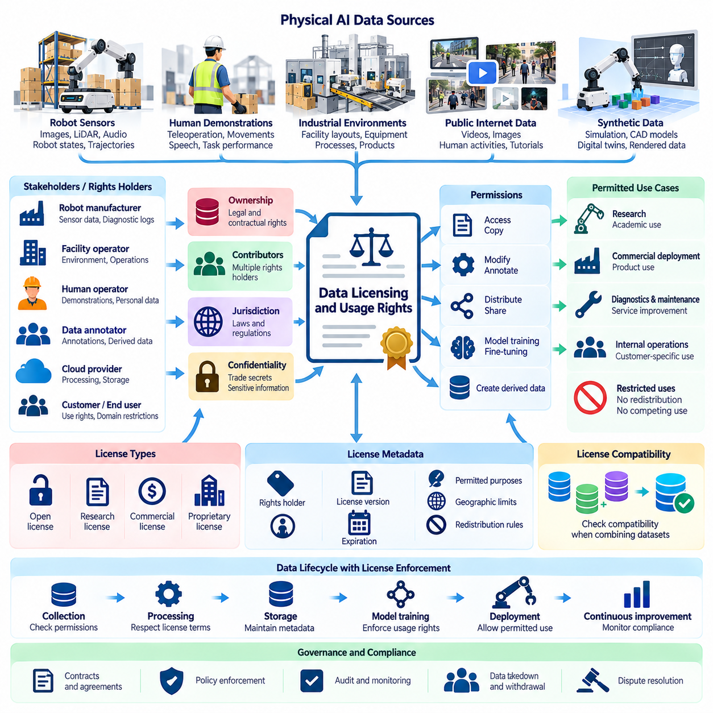{width="7.268055555555556in" height="7.268055555555556in"}

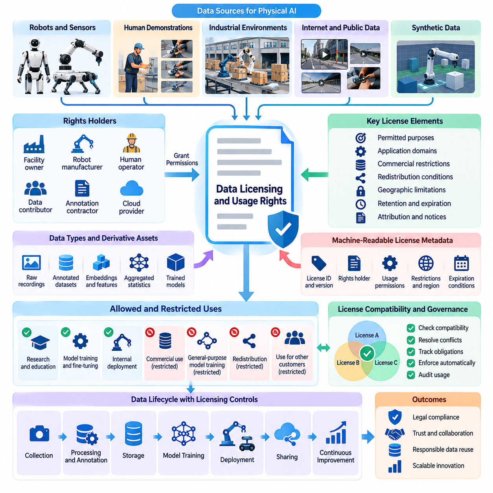{width="7.268055555555556in" height="7.268055555555556in"}

Data licensing and usage rights establish the legal and contractual conditions under which Physical AI datasets can be collected, processed, shared, and used for machine learning. Unlike conventional digital datasets, robot data frequently contains observations of people, industrial facilities, proprietary objects, and operational behaviors. Licensing frameworks must therefore address intellectual property, privacy, confidentiality, and permitted applications throughout the data lifecycle.

A data license defines the permissions granted by a rights holder to another organization or individual. These permissions may include accessing, copying, modifying, annotating, distributing, or using datasets for model training. Licensing does not necessarily transfer ownership, and possession of a dataset does not automatically authorize every form of exploitation. Physical AI developers must distinguish ownership, access privileges, and explicitly granted usage rights.

Physical AI datasets often involve multiple contributors with different legal interests. A robot manufacturer may provide sensing equipment, a factory operator may control the operating environment, and human workers may appear in recorded demonstrations. Annotation contractors and cloud providers may subsequently process the information. Effective licensing requires identifying relevant rights holders and establishing which permissions are necessary for each processing activity.

The scope of permitted use is a central element of data licensing. A dataset licensed for academic research may not be authorized for commercial robot deployment, while information collected for maintenance diagnostics may not be available for foundation model training. Agreements should define approved purposes, application domains, commercial restrictions, redistribution conditions, and whether data may contribute to general-purpose or customer-specific models.

Licensing arrangements should distinguish between raw observations and derived data products. Camera recordings, synchronized robot trajectories, annotated episodes, embeddings, aggregated statistics, and trained models may be subject to different contractual terms. Transforming raw data into a learned representation does not automatically eliminate underlying restrictions. Developers must evaluate whether derivative artifacts remain covered by source licenses or other legal obligations.

Open data licenses can accelerate Physical AI research by enabling shared benchmarks, reproducible experiments, and collaborative model development. However, the term open does not imply unrestricted use. Some licenses require attribution, preservation of notices, or distribution under compatible terms. Others restrict commercial applications or redistribution. Each dataset must be evaluated against its actual license rather than assumptions based on public availability.

Publicly accessible internet videos present particular licensing challenges for robot learning. Instructional recordings and human activity videos may provide valuable examples of manipulation, navigation, and tool use, but online accessibility does not establish permission for downloading, redistribution, or model training. Copyright, platform terms, privacy rights, and applicable exceptions must be assessed before incorporating such materials into Physical AI datasets.

Human demonstration datasets require agreements that address both intellectual property and personal information. Teleoperation recordings may capture operator movements, speech, reaction patterns, and task performance. Employment agreements or contributor contracts may establish certain usage permissions, but they do not automatically override privacy protections. Organizations should define collection purposes, permitted training activities, retention conditions, and applicable withdrawal procedures.

Industrial datasets introduce additional confidentiality requirements because robot observations may reveal production processes, equipment configurations, facility layouts, and proprietary products. A customer may permit data collection for improving robot reliability while prohibiting use for unrelated customers or competitors. Licensing agreements should establish confidentiality boundaries and clarify whether aggregated learning outcomes can be incorporated into shared commercial models.

Synthetic datasets are not necessarily free from licensing restrictions. Simulation environments may incorporate commercial CAD models, licensed textures, proprietary digital twins, and third-party software assets. Generated trajectories and rendered images may inherit contractual limitations depending on the applicable agreements. Developers should record source asset licenses, simulation dependencies, and permitted uses of resulting synthetic datasets.

Data licensing also influences the design of collaborative robot learning ecosystems. Multiple organizations may contribute datasets to a shared training repository while retaining different rights over their contributions. One participant may allow research training but prohibit commercial redistribution, while another may permit broad reuse. Dataset aggregation systems must preserve these distinctions and prevent incompatible licensing conditions from being overlooked.

Machine-readable licensing metadata can help enforce usage rights across automated data pipelines. Each dataset or episode can include identifiers describing the rights holder, license version, permitted purposes, geographic limitations, redistribution restrictions, and expiration conditions. Policy-aware ingestion and training systems can compare these attributes against intended operations before accepting data into a processing workflow.

License compatibility becomes especially important when combining datasets from multiple sources. Training mixtures may include public research collections, proprietary industrial recordings, licensed human videos, and synthetic simulations. Their terms may impose conflicting obligations concerning commercial use, attribution, modification, or redistribution. Compatibility reviews should occur before dataset integration rather than after expensive model training has been completed.

Usage rights should also address model outputs and derivative intellectual property. Contracts may specify whether trained models can be commercially deployed, transferred to customers, or incorporated into general-purpose robotic platforms. However, rights over trained parameters are not determined solely by dataset ownership. Applicable law, contractual provisions, confidentiality obligations, and the possibility of reproducing protected information must all be considered.

Time-limited licenses and revocable permissions introduce operational challenges for continuously learning robot systems. A dataset may become unavailable when a contract expires, a supplier relationship ends, or a legally valid withdrawal request occurs. Data management systems should track these conditions and identify affected copies, training runs, and model versions. Remediation may require deletion, restricted use, retraining, or replacement of affected artifacts.

Geographic restrictions may determine where licensed data can be stored, processed, or accessed. Industrial customers and public-sector organizations may require on-premise processing or prohibit transfers to particular jurisdictions. These conditions must be coordinated with data sovereignty and privacy requirements. Cloud training pipelines should verify that storage regions, processing services, and subcontractors comply with applicable contractual restrictions.

Licensing governance requires reliable provenance and auditability. Organizations should maintain records connecting each dataset to its source, rights holder, license agreement, collection authorization, and processing history. Training manifests can identify which licensed materials contributed to particular model versions. Such traceability supports compliance reviews, contractual reporting, dispute resolution, and investigations involving unauthorized data usage.

Technical controls can reduce dependence on manual interpretation of licensing obligations. Access management, dataset tagging, automated policy validation, and restricted training environments can enforce defined permissions. However, automated systems cannot independently resolve every legal ambiguity. Human review remains necessary when agreements contain unclear language, conflicting terms, unusual derivative rights, or complex jurisdictional requirements.

Licensing compliance should be evaluated throughout the Physical AI data engine rather than only during initial acquisition. New annotations, dataset merges, model fine-tuning, external sharing, and commercial deployment may introduce uses not covered by original permissions. Periodic reviews should examine whether actual processing activities remain consistent with contractual commitments and whether updated agreements are required.

A mature licensing framework combines legal clarity with engineering traceability and operational enforcement. Standardized agreements, machine-readable rights metadata, versioned provenance records, and automated policy checks can support large-scale data reuse. As Physical AI systems increasingly learn from diverse organizations and environments, effective licensing becomes essential for protecting contributors while enabling responsible innovation and sustainable robotic intelligence.

데이터 라이선싱(Data Licensing)과 사용 권한(Usage Rights)은 피지컬 인공지능(Physical AI) 데이터셋을 수집, 처리, 공유하고 기계학습(Machine Learning)에 활용할 수 있는 법적·계약적 조건을 수립한다. 기존 디지털 데이터셋(Digital Datasets)과 달리 로봇 데이터(Robot Data)에는 사람, 산업 시설, 독점적 객체(Proprietary Objects), 운영 행동(Operational Behaviors)에 관한 관측 정보가 포함되는 경우가 많다. 따라서 라이선싱 체계(Licensing Frameworks)는 데이터 생명주기(Data Lifecycle) 전반에서 지식재산권(Intellectual Property), 개인정보 보호(Privacy), 기밀성(Confidentiality), 허용된 활용 범위(Permitted Applications)를 다루어야 한다.

데이터 라이선스(Data License)는 권리 보유자(Rights Holder)가 다른 조직이나 개인에게 부여하는 허가를 정의한다. 이러한 허가에는 데이터셋에 대한 접근(Access), 복사(Copying), 수정(Modification), 주석 처리(Annotation), 배포(Distribution), 모델 학습(Model Training)을 위한 활용이 포함될 수 있다. 라이선싱이 반드시 소유권(Ownership)의 이전을 의미하는 것은 아니며, 데이터셋을 보유하고 있다는 사실만으로 모든 형태의 활용이 자동으로 허용되는 것도 아니다. 피지컬 인공지능 개발자는 소유권, 접근 권한(Access Privileges), 명시적으로 부여된 사용 권한을 구분해야 한다.

피지컬 인공지능 데이터셋에는 서로 다른 법적 이해관계(Legal Interests)를 가진 여러 기여자(Contributors)가 참여하는 경우가 많다. 로봇 제조업체(Robot Manufacturer)는 센싱 장비(Sensing Equipment)를 제공하고, 공장 운영자(Factory Operator)는 운영 환경(Operating Environment)을 관리하며, 인간 작업자(Human Workers)는 기록된 시연 데이터(Recorded Demonstrations)에 등장할 수 있다. 이후 주석 처리 계약업체(Annotation Contractors)와 클라우드 서비스 제공업체(Cloud Providers)가 정보를 처리할 수 있다. 효과적인 라이선싱을 위해서는 관련 권리 보유자를 식별하고 각 처리 활동에 필요한 허가를 확립해야 한다.

허용된 사용 범위(Scope of Permitted Use)는 데이터 라이선싱의 핵심 요소이다. 학술 연구(Academic Research)를 위해 라이선스가 부여된 데이터셋은 상업용 로봇 배포(Commercial Robot Deployment)에 사용할 권한이 없을 수 있으며, 유지보수 진단(Maintenance Diagnostics)을 위해 수집된 정보는 파운데이션 모델 학습(Foundation Model Training)에 사용할 수 없을 수 있다. 계약에서는 승인된 목적(Approved Purposes), 적용 분야(Application Domains), 상업적 제한(Commercial Restrictions), 재배포 조건(Redistribution Conditions), 범용 모델(General-Purpose Models) 또는 고객 맞춤형 모델(Customer-Specific Models)에 대한 데이터 활용 가능 여부를 정의해야 한다.

라이선싱 계약(Licensing Arrangements)은 원시 관측 데이터(Raw Observations)와 파생 데이터 제품(Derived Data Products)을 구분해야 한다. 카메라 기록(Camera Recordings), 동기화된 로봇 궤적(Synchronized Robot Trajectories), 주석 처리된 에피소드(Annotated Episodes), 임베딩(Embeddings), 집계 통계(Aggregated Statistics), 학습된 모델(Trained Models)에는 서로 다른 계약 조건이 적용될 수 있다. 원시 데이터를 학습된 표현(Learned Representation)으로 변환한다고 해서 기존 제한이 자동으로 사라지는 것은 아니다. 개발자는 파생 산출물(Derivative Artifacts)에 원본 라이선스(Source Licenses)나 기타 법적 의무(Legal Obligations)가 계속 적용되는지 평가해야 한다.

공개 데이터 라이선스(Open Data Licenses)는 공유 벤치마크(Shared Benchmarks), 재현 가능한 실험(Reproducible Experiments), 협력적 모델 개발(Collaborative Model Development)을 가능하게 하여 피지컬 인공지능 연구를 가속할 수 있다. 그러나 공개(Open)라는 표현이 제한 없는 사용을 의미하지는 않는다. 일부 라이선스는 출처 표시(Attribution), 고지사항 유지(Preservation of Notices), 호환 가능한 조건에 따른 배포(Distribution Under Compatible Terms)를 요구한다. 다른 라이선스는 상업적 활용(Commercial Applications)이나 재배포(Redistribution)를 제한한다. 따라서 각 데이터셋은 공개 여부에 대한 추정이 아니라 실제 라이선스 조건에 따라 평가해야 한다.

공개적으로 접근할 수 있는 인터넷 동영상(Publicly Accessible Internet Videos)은 로봇 학습(Robot Learning)에 특별한 라이선싱 문제를 발생시킨다. 교육용 영상(Instructional Recordings)과 인간 활동 영상(Human Activity Videos)은 조작(Manipulation), 내비게이션(Navigation), 도구 사용(Tool Use)에 관한 유용한 사례를 제공할 수 있지만, 온라인에서 접근할 수 있다는 사실만으로 다운로드(Downloading), 재배포(Redistribution), 모델 학습에 대한 허가가 성립하는 것은 아니다. 이러한 자료를 피지컬 인공지능 데이터셋에 통합하기 전에 저작권(Copyright), 플랫폼 이용약관(Platform Terms), 개인정보 보호 권리(Privacy Rights), 적용 가능한 예외 규정(Applicable Exceptions)을 평가해야 한다.

인간 시연 데이터셋(Human Demonstration Datasets)은 지식재산권(Intellectual Property)과 개인정보(Personal Information)를 모두 다루는 계약이 필요하다. 원격조작 기록(Teleoperation Recordings)에는 조작자의 움직임(Operator Movements), 음성(Speech), 반응 패턴(Reaction Patterns), 작업 수행 능력(Task Performance)이 포함될 수 있다. 고용 계약(Employment Agreements)이나 기여자 계약(Contributor Contracts)은 특정 사용 권한을 설정할 수 있지만, 개인정보 보호 조치를 자동으로 무효화하지는 않는다. 조직은 수집 목적(Collection Purposes), 허용된 학습 활동(Permitted Training Activities), 보존 조건(Retention Conditions), 적용 가능한 철회 절차(Withdrawal Procedures)를 정의해야 한다.

산업 데이터셋(Industrial Datasets)은 로봇 관측 데이터가 생산 공정(Production Processes), 장비 구성(Equipment Configurations), 시설 배치도(Facility Layouts), 독점 제품(Proprietary Products)을 노출할 수 있기 때문에 추가적인 기밀성 요구사항(Confidentiality Requirements)을 발생시킨다. 고객은 로봇 신뢰성(Robot Reliability) 향상을 위한 데이터 수집은 허용하면서 다른 고객이나 경쟁사를 위한 활용은 금지할 수 있다. 라이선싱 계약은 기밀성 경계(Confidentiality Boundaries)를 설정하고, 집계된 학습 결과(Aggregated Learning Outcomes)를 공유 상용 모델(Shared Commercial Models)에 통합할 수 있는지 명확히 해야 한다.

합성 데이터셋(Synthetic Datasets)도 반드시 라이선스 제한에서 자유로운 것은 아니다. 시뮬레이션 환경(Simulation Environments)에는 상용 CAD 모델(Commercial CAD Models), 라이선스가 적용된 텍스처(Licensed Textures), 독점 디지털 트윈(Proprietary Digital Twins), 제3자 소프트웨어 자산(Third-Party Software Assets)이 포함될 수 있다. 생성된 궤적(Generated Trajectories)과 렌더링된 이미지(Rendered Images)는 적용되는 계약에 따라 계약상 제한(Contractual Limitations)을 받을 수 있다. 개발자는 원본 자산 라이선스(Source Asset Licenses), 시뮬레이션 의존성(Simulation Dependencies), 생성된 합성 데이터셋의 허용 사용 범위(Permitted Uses)를 기록해야 한다.

데이터 라이선싱은 협력적 로봇 학습 생태계(Collaborative Robot Learning Ecosystems)의 설계에도 영향을 미친다. 여러 조직이 공유 학습 저장소(Shared Training Repository)에 데이터셋을 제공하면서 각자의 기여 데이터에 대해 서로 다른 권리를 유지할 수 있다. 한 참여자는 연구 목적의 학습(Research Training)은 허용하지만 상업적 재배포(Commercial Redistribution)는 금지할 수 있으며, 다른 참여자는 광범위한 재사용(Broad Reuse)을 허용할 수 있다. 데이터셋 집계 시스템(Dataset Aggregation Systems)은 이러한 차이를 보존하고 서로 호환되지 않는 라이선스 조건(Incompatible Licensing Conditions)이 간과되지 않도록 해야 한다.

기계 판독 가능한 라이선싱 메타데이터(Machine-Readable Licensing Metadata)는 자동화된 데이터 파이프라인(Automated Data Pipelines) 전반에서 사용 권한을 적용하는 데 도움을 줄 수 있다. 각 데이터셋 또는 에피소드(Episode)에는 권리 보유자(Rights Holder), 라이선스 버전(License Version), 허용 목적(Permitted Purposes), 지리적 제한(Geographic Limitations), 재배포 제한(Redistribution Restrictions), 만료 조건(Expiration Conditions)을 설명하는 식별자가 포함될 수 있다. 정책 인식 데이터 수집 및 학습 시스템(Policy-Aware Ingestion and Training Systems)은 데이터를 처리 워크플로(Processing Workflow)에 수용하기 전에 이러한 속성을 의도된 작업과 비교할 수 있다.

라이선스 호환성(License Compatibility)은 여러 출처의 데이터셋을 결합할 때 특히 중요하다. 학습 데이터 혼합물(Training Mixtures)에는 공개 연구 데이터셋(Public Research Collections), 독점 산업 기록(Proprietary Industrial Recordings), 라이선스가 적용된 인간 영상(Licensed Human Videos), 합성 시뮬레이션(Synthetic Simulations)이 포함될 수 있다. 이러한 데이터의 조건은 상업적 사용(Commercial Use), 출처 표시(Attribution), 수정(Modification), 재배포(Redistribution)에 관해 서로 충돌하는 의무를 부과할 수 있다. 호환성 검토(Compatibility Reviews)는 많은 비용이 드는 모델 학습이 완료된 이후가 아니라 데이터셋 통합 전에 수행되어야 한다.

사용 권한(Usage Rights)은 모델 출력(Model Outputs)과 파생 지식재산권(Derivative Intellectual Property)도 다루어야 한다. 계약에는 학습된 모델을 상업적으로 배포(Commercial Deployment)하거나 고객에게 이전(Transfer)하거나 범용 로봇 플랫폼(General-Purpose Robotic Platforms)에 통합할 수 있는지 명시할 수 있다. 그러나 학습된 매개변수(Trained Parameters)에 대한 권리는 데이터셋 소유권만으로 결정되지 않는다. 적용 법률(Applicable Law), 계약 조항(Contractual Provisions), 기밀 유지 의무(Confidentiality Obligations), 보호 대상 정보(Protected Information)의 재현 가능성을 모두 고려해야 한다.

기간이 제한된 라이선스(Time-Limited Licenses)와 철회 가능한 허가(Revocable Permissions)는 지속적으로 학습하는 로봇 시스템(Continuously Learning Robot Systems)에 운영상의 과제를 발생시킨다. 계약이 만료되거나 공급업체 관계(Supplier Relationship)가 종료되거나 법적으로 유효한 철회 요청(Legally Valid Withdrawal Request)이 발생하면 데이터셋을 더 이상 사용할 수 없게 될 수 있다. 데이터 관리 시스템(Data Management Systems)은 이러한 조건을 추적하고 영향을 받는 복사본(Copies), 학습 실행(Training Runs), 모델 버전(Model Versions)을 식별해야 한다. 시정 조치(Remediation)에는 삭제(Deletion), 사용 제한(Restricted Use), 재학습(Retraining), 영향을 받은 산출물의 교체(Replacement)가 필요할 수 있다.

지리적 제한(Geographic Restrictions)은 라이선스가 적용된 데이터를 저장, 처리, 접근할 수 있는 위치를 결정할 수 있다. 산업 고객(Industrial Customers)과 공공 부문 조직(Public-Sector Organizations)은 온프레미스 처리(On-Premise Processing)를 요구하거나 특정 관할권(Jurisdictions)으로의 데이터 이전을 금지할 수 있다. 이러한 조건은 데이터 주권(Data Sovereignty) 및 개인정보 보호 요구사항(Privacy Requirements)과 조정되어야 한다. 클라우드 학습 파이프라인(Cloud Training Pipelines)은 저장 지역(Storage Regions), 처리 서비스(Processing Services), 하도급업체(Subcontractors)가 적용되는 계약상 제한을 준수하는지 검증해야 한다.

라이선싱 거버넌스(Licensing Governance)에는 신뢰할 수 있는 데이터 출처 추적(Data Provenance)과 감사 가능성(Auditability)이 필요하다. 조직은 각 데이터셋을 원본 출처(Source), 권리 보유자(Rights Holder), 라이선스 계약(License Agreement), 수집 승인(Collection Authorization), 처리 이력(Processing History)과 연결하는 기록을 유지해야 한다. 학습 매니페스트(Training Manifests)는 특정 모델 버전(Model Versions)에 어떤 라이선스 자료(Licensed Materials)가 기여했는지 식별할 수 있다. 이러한 추적 가능성(Traceability)은 규정 준수 검토(Compliance Reviews), 계약상 보고(Contractual Reporting), 분쟁 해결(Dispute Resolution), 무단 데이터 사용(Unauthorized Data Usage)에 대한 조사를 지원한다.

기술적 통제(Technical Controls)는 라이선싱 의무를 수동으로 해석하는 데 대한 의존도를 줄일 수 있다. 접근 관리(Access Management), 데이터셋 태깅(Dataset Tagging), 자동화된 정책 검증(Automated Policy Validation), 제한된 학습 환경(Restricted Training Environments)은 정의된 권한을 강제 적용할 수 있다. 그러나 자동화된 시스템이 모든 법적 모호성(Legal Ambiguity)을 독립적으로 해결할 수 있는 것은 아니다. 계약에 불명확한 표현(Unclear Language), 상충하는 조건(Conflicting Terms), 특수한 파생 권리(Unusual Derivative Rights), 복잡한 관할권 요구사항(Complex Jurisdictional Requirements)이 포함된 경우에는 인간 검토(Human Review)가 여전히 필요하다.

라이선싱 규정 준수(Licensing Compliance)는 초기 데이터 확보(Initial Acquisition) 단계에서만 확인하는 것이 아니라 피지컬 인공지능 데이터 엔진(Physical AI Data Engine) 전반에서 평가되어야 한다. 새로운 주석 처리(New Annotations), 데이터셋 병합(Dataset Merges), 모델 미세조정(Model Fine-Tuning), 외부 공유(External Sharing), 상업적 배포(Commercial Deployment)는 최초 허가에 포함되지 않은 새로운 사용 형태를 발생시킬 수 있다. 정기적인 검토(Periodic Reviews)를 통해 실제 데이터 처리 활동이 계약상 약속(Contractual Commitments)과 일치하는지, 갱신된 계약(Updated Agreements)이 필요한지 확인해야 한다.

성숙한 라이선싱 체계(Mature Licensing Framework)는 법적 명확성(Legal Clarity), 엔지니어링 추적 가능성(Engineering Traceability), 운영상 강제 적용(Operational Enforcement)을 결합한다. 표준화된 계약(Standardized Agreements), 기계 판독 가능한 권리 메타데이터(Machine-Readable Rights Metadata), 버전 관리된 출처 기록(Versioned Provenance Records), 자동화된 정책 검사(Automated Policy Checks)는 대규모 데이터 재사용(Large-Scale Data Reuse)을 지원할 수 있다. 피지컬 인공지능 시스템이 다양한 조직과 환경에서 수집된 데이터를 활용하여 학습하는 방향으로 발전함에 따라 효과적인 라이선싱은 데이터 기여자(Contributors)를 보호하고, 책임 있는 혁신(Responsible Innovation)과 지속 가능한 로봇 지능(Sustainable Robotic Intelligence)을 실현하기 위한 필수 요소가 된다.

##  

## 08.04. Human Demonstration and Operator Privacy

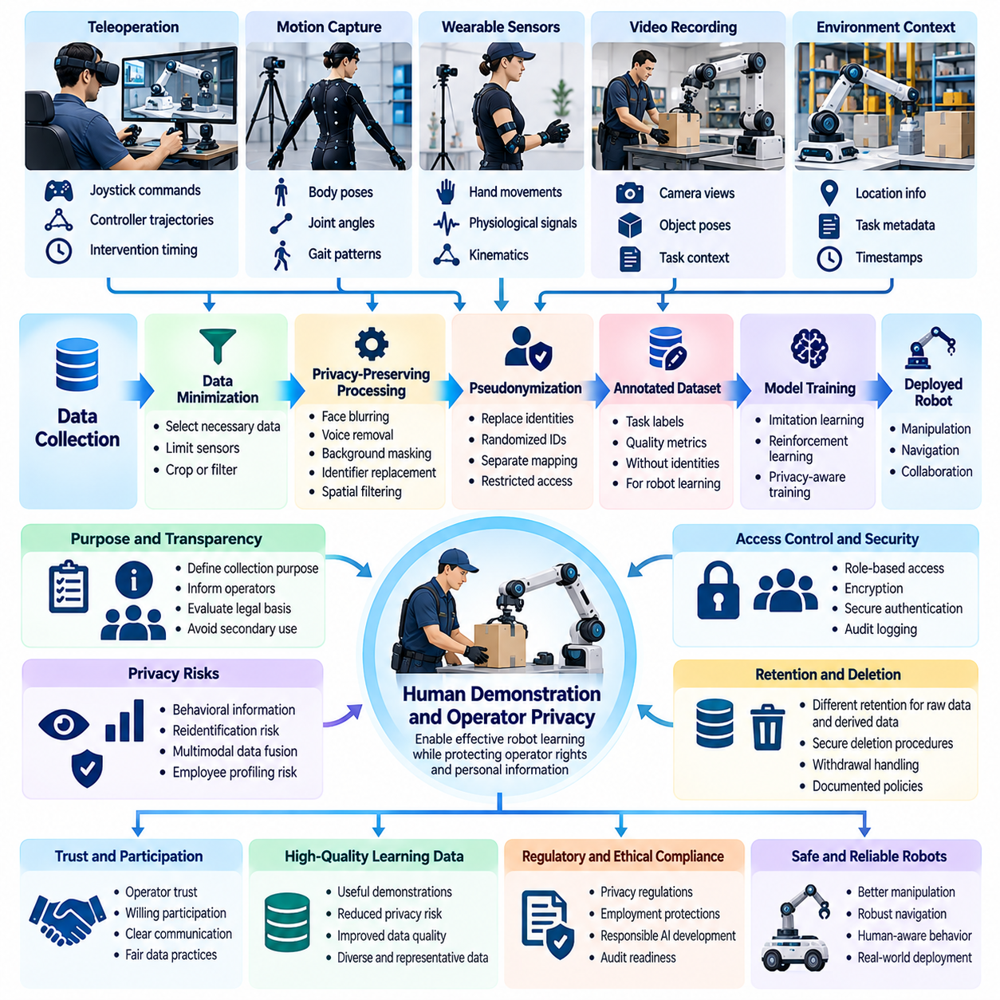{width="7.268055555555556in" height="7.268055555555556in"}

Human demonstration data is essential for training Physical AI systems to perform complex manipulation, navigation, and collaborative tasks. Teleoperation, motion capture, wearable sensors, and video recordings allow robots to learn from human expertise. However, these collection methods also capture information about operators themselves, creating privacy challenges that must be addressed throughout data acquisition, processing, training, and deployment.

Operator privacy concerns extend beyond conventional personally identifiable information. Demonstration datasets may reveal movement patterns, reaction times, physical capabilities, working habits, and individual decision-making strategies. When combined with timestamps, task assignments, or workplace records, these observations can potentially identify specific individuals. Privacy governance must therefore consider behavioral information as well as direct identifiers.

Teleoperation systems create particularly detailed records of human behavior because operator commands are synchronized with robot observations and outcomes. Joystick movements, virtual reality controller trajectories, hand poses, and intervention timing can reveal skill levels and response characteristics. Although such information improves imitation learning, it may also enable unintended employee profiling, productivity monitoring, or behavioral assessment.

Motion capture and wearable sensing introduce additional privacy considerations. Body tracking systems may record skeletal poses, joint angles, gait patterns, hand movements, and physiological measurements. Some of these signals can function as biometric identifiers when processed for identification purposes. Organizations must distinguish measurements necessary for robot learning from information that could expose sensitive personal characteristics or enable persistent identification.

Privacy protection begins with clearly defining the purpose of demonstration collection. Operators should understand whether recordings will support imitation learning, reinforcement learning, safety evaluation, or system diagnostics. Collection programs should specify which data streams are necessary and avoid gathering unrelated information. Purpose limitation reduces the possibility that demonstration datasets will later be reused for incompatible monitoring or commercial activities.

Meaningful transparency is especially important when demonstrations are collected in employment settings. Workers should receive understandable information about recording methods, data recipients, retention periods, and intended uses. Consent may not always provide an appropriate legal basis where employment relationships create power imbalances. Organizations should evaluate applicable legal requirements and provide appropriate safeguards rather than relying exclusively on consent forms.

Data minimization offers a practical way to reduce privacy risks without eliminating useful training information. A manipulation task may require hand trajectories, object poses, and robot actions but not facial images or unrelated background conversations. Collection systems can selectively disable unnecessary sensors, crop video regions, or extract task-relevant representations. These choices should be made before recording whenever possible.

Privacy-preserving preprocessing can further limit exposure after collection. Facial blurring, voice removal, background masking, identifier replacement, and spatial filtering can reduce the amount of recognizable information retained. However, these techniques have limitations because movement trajectories and behavioral signatures may remain distinctive. Anonymization claims should therefore be supported by reidentification risk assessments rather than visual inspection alone.

Pseudonymization separates operator identities from demonstration records while preserving selected relationships needed for research and quality evaluation. Randomized operator identifiers can support analysis of demonstration consistency without exposing names. The mapping between identifiers and real individuals should be stored separately with restricted access. Because reidentification remains possible, pseudonymized records generally require continued privacy protection.

Temporal and multimodal data fusion can increase privacy risks even when individual sensor streams appear harmless. Combining camera images, hand trajectories, voice recordings, location information, and task timestamps may reconstruct an operator\'s activities in considerable detail. Privacy reviews should evaluate the combined information available to downstream users and models rather than assessing each sensor independently.

Operator privacy must also be considered during demonstration labeling and quality assessment. Annotators may evaluate task success, intervention frequency, movement efficiency, or execution errors. These labels are valuable for training robust robot policies, but they can also become indicators of individual worker performance. Governance policies should prevent training-oriented quality metrics from being repurposed for employment decisions without an appropriate legal and organizational basis.

Access control is necessary because demonstration datasets often contain information that is more sensitive than ordinary robot telemetry. Engineers may need robot action trajectories without access to operator identities, while privacy administrators may require identity mappings for authorized requests. Role-based access control, encryption, secure authentication, and audit logging can enforce these distinctions across storage and processing environments.

Retention policies should distinguish between raw demonstration recordings and derived learning representations. High-resolution videos and identifiable operator records may be necessary during initial annotation but unnecessary after validated trajectories have been extracted. Organizations should establish retention periods based on legitimate operational needs and applicable obligations. Deletion procedures must also address backups, temporary files, exported datasets, and replicated storage.

Human demonstration datasets frequently move between robot manufacturers, research institutions, annotation vendors, and cloud training providers. Each transfer creates additional privacy and contractual responsibilities. Data-sharing agreements should define authorized processing purposes, confidentiality requirements, security safeguards, and restrictions on onward transfers. International transfers may require additional assessments under applicable data protection laws.

Privacy risks can persist after model training because learned representations may retain information about individual contributors. Memorization, membership inference, or reconstruction attacks can sometimes reveal properties of training data. Although these risks vary across architectures and training methods, organizations should evaluate them before distributing models trained on sensitive demonstrations. Model access restrictions and privacy testing can reduce exposure.

Privacy-preserving learning techniques provide additional safeguards when centralized demonstration storage is undesirable. Federated learning allows local training without routinely transferring raw recordings, while secure aggregation can protect selected model updates. Differential privacy may reduce information leakage under defined assumptions. These techniques involve utility, computational, and implementation tradeoffs and should complement rather than replace broader governance controls.

Operators should have accessible mechanisms for raising concerns about data collection and use. Depending on applicable law and contractual arrangements, individuals may possess rights to access information, request correction, object to certain processing, or seek deletion. Organizations need documented procedures for handling such requests and identifying affected datasets. Clear communication helps establish accountability and trust in demonstration collection programs.

Privacy impact assessments are particularly useful before deploying large-scale human demonstration programs. These assessments examine collection purposes, categories of personal information, potential harms, access arrangements, retention practices, and available safeguards. Higher-risk activities, such as continuous workplace recording or biometric identification, may require additional scrutiny. Assessment findings should influence system architecture and operational procedures.

Continuous monitoring ensures that privacy protections remain effective as Physical AI data engines evolve. New sensors, annotation tools, model architectures, and sharing arrangements can introduce risks not anticipated during initial collection. Periodic audits should examine access records, processing activities, retention compliance, and unauthorized secondary uses. Incident response procedures must address accidental disclosure, improper access, and misuse of operator information.

Responsible human demonstration governance balances the value of human expertise with the dignity, autonomy, and privacy of contributors. High-quality robot learning does not require unrestricted observation of the people providing demonstrations. By integrating transparency, minimization, technical safeguards, contractual protections, and ongoing oversight, Physical AI organizations can build scalable demonstration datasets while maintaining trustworthy relationships with human operators.

인간 시연 데이터(Human Demonstration Data)는 피지컬 인공지능(Physical AI) 시스템이 복잡한 조작(Manipulation), 내비게이션(Navigation), 협업 작업(Collaborative Tasks)을 수행하도록 학습시키는 데 필수적이다. 원격조작(Teleoperation), 모션 캡처(Motion Capture), 웨어러블 센서(Wearable Sensors), 영상 기록(Video Recordings)을 통해 로봇은 인간의 전문 지식(Human Expertise)을 학습할 수 있다. 그러나 이러한 수집 방식은 조작자(Operators) 자신에 관한 정보도 함께 기록하므로, 데이터 수집(Data Acquisition), 처리(Processing), 학습(Training), 배포(Deployment) 전반에서 개인정보 보호 문제(Privacy Challenges)를 해결해야 한다.

조작자 개인정보 보호(Operator Privacy)는 기존의 개인 식별 정보(Personally Identifiable Information)를 넘어서는 문제이다. 시연 데이터셋(Demonstration Datasets)은 움직임 패턴(Movement Patterns), 반응 시간(Reaction Times), 신체적 능력(Physical Capabilities), 작업 습관(Working Habits), 개인별 의사결정 전략(Individual Decision-Making Strategies)을 드러낼 수 있다. 이러한 관측 정보를 타임스탬프(Timestamps), 작업 할당 정보(Task Assignments), 작업장 기록(Workplace Records)과 결합하면 특정 개인을 식별할 가능성이 있다. 따라서 개인정보 보호 거버넌스(Privacy Governance)는 직접적인 식별자(Direct Identifiers)뿐 아니라 행동 정보(Behavioral Information)도 고려해야 한다.

원격조작 시스템(Teleoperation Systems)은 조작자 명령(Operator Commands)이 로봇 관측 데이터(Robot Observations) 및 작업 결과(Outcomes)와 동기화되기 때문에 인간 행동에 관한 매우 상세한 기록을 생성한다. 조이스틱 움직임(Joystick Movements), 가상현실 컨트롤러 궤적(Virtual Reality Controller Trajectories), 손 자세(Hand Poses), 개입 시점(Intervention Timing)은 숙련도(Skill Levels)와 반응 특성(Response Characteristics)을 드러낼 수 있다. 이러한 정보는 모방학습(Imitation Learning)을 개선하지만, 의도하지 않은 직원 프로파일링(Employee Profiling), 생산성 모니터링(Productivity Monitoring), 행동 평가(Behavioral Assessment)에 활용될 위험도 있다.

모션 캡처(Motion Capture)와 웨어러블 센싱(Wearable Sensing)은 추가적인 개인정보 보호 고려사항을 발생시킨다. 신체 추적 시스템(Body Tracking Systems)은 골격 자세(Skeletal Poses), 관절 각도(Joint Angles), 보행 패턴(Gait Patterns), 손 움직임(Hand Movements), 생리학적 측정값(Physiological Measurements)을 기록할 수 있다. 이러한 신호 중 일부는 개인 식별 목적으로 처리될 경우 생체인식 식별자(Biometric Identifiers)로 기능할 수 있다. 조직은 로봇 학습에 필요한 측정값과 민감한 개인 특성(Sensitive Personal Characteristics)을 노출하거나 지속적인 개인 식별(Persistent Identification)을 가능하게 하는 정보를 구분해야 한다.

개인정보 보호(Privacy Protection)는 시연 데이터 수집(Demonstration Collection)의 목적을 명확하게 정의하는 것에서 시작한다. 조작자는 기록된 데이터가 모방학습(Imitation Learning), 강화학습(Reinforcement Learning), 안전성 평가(Safety Evaluation), 시스템 진단(System Diagnostics) 중 어떤 목적으로 활용되는지 이해해야 한다. 데이터 수집 프로그램(Collection Programs)은 필요한 데이터 스트림(Data Streams)을 명시하고 관련 없는 정보의 수집을 피해야 한다. 목적 제한(Purpose Limitation)은 시연 데이터셋이 이후 호환되지 않는 감시 활동(Monitoring Activities)이나 상업적 활동(Commercial Activities)에 재사용될 가능성을 줄인다.

실질적인 투명성(Meaningful Transparency)은 고용 환경(Employment Settings)에서 시연 데이터를 수집할 때 특히 중요하다. 작업자는 기록 방식(Recording Methods), 데이터 수신자(Data Recipients), 보존 기간(Retention Periods), 사용 목적(Intended Uses)에 관한 이해하기 쉬운 정보를 제공받아야 한다. 고용 관계에서 권력 불균형(Power Imbalances)이 존재하는 경우 동의(Consent)가 항상 적절한 법적 근거(Legal Basis)가 되는 것은 아니다. 조직은 동의서(Consent Forms)에만 의존하기보다 적용 가능한 법적 요구사항(Applicable Legal Requirements)을 평가하고 적절한 보호 조치(Safeguards)를 제공해야 한다.

데이터 최소화(Data Minimization)는 유용한 학습 정보를 제거하지 않으면서 개인정보 보호 위험(Privacy Risks)을 줄일 수 있는 실용적인 방법이다. 조작 작업(Manipulation Task)에는 손 궤적(Hand Trajectories), 객체 자세(Object Poses), 로봇 행동(Robot Actions)이 필요할 수 있지만 얼굴 영상(Facial Images)이나 관련 없는 배경 대화(Background Conversations)는 필요하지 않을 수 있다. 데이터 수집 시스템(Collection Systems)은 불필요한 센서를 선택적으로 비활성화하거나 영상 영역을 잘라내고, 작업 관련 표현(Task-Relevant Representations)을 추출할 수 있다. 가능한 경우 이러한 결정은 기록이 시작되기 전에 이루어져야 한다.

개인정보 보호 전처리(Privacy-Preserving Preprocessing)는 데이터 수집 이후의 정보 노출을 추가로 제한할 수 있다. 얼굴 흐림 처리(Facial Blurring), 음성 제거(Voice Removal), 배경 마스킹(Background Masking), 식별자 대체(Identifier Replacement), 공간 필터링(Spatial Filtering)은 보존되는 정보에서 개인을 알아볼 수 있는 요소를 줄일 수 있다. 그러나 움직임 궤적(Movement Trajectories)과 행동 특징(Behavioral Signatures)은 여전히 개인을 구별할 수 있으므로 이러한 기술에는 한계가 있다. 따라서 익명화(Anonymization)의 효과는 단순한 시각적 확인이 아니라 재식별 위험 평가(Reidentification Risk Assessments)를 통해 검증되어야 한다.

가명처리(Pseudonymization)는 연구 및 품질 평가(Quality Evaluation)에 필요한 일부 관계를 유지하면서 조작자의 신원(Operator Identities)을 시연 기록(Demonstration Records)에서 분리한다. 무작위로 생성된 조작자 식별자(Randomized Operator Identifiers)를 사용하면 이름을 노출하지 않고도 시연의 일관성(Demonstration Consistency)을 분석할 수 있다. 식별자와 실제 개인을 연결하는 매핑 정보(Mapping Information)는 접근이 제한된 별도 저장소에 보관해야 한다. 재식별(Reidentification)이 여전히 가능하기 때문에 가명처리된 기록(Pseudonymized Records)에도 지속적인 개인정보 보호 조치가 필요하다.

시간적 데이터와 다중모달 데이터의 융합(Temporal and Multimodal Data Fusion)은 개별 센서 스트림(Sensor Streams)이 무해해 보이는 경우에도 개인정보 보호 위험을 증가시킬 수 있다. 카메라 영상(Camera Images), 손 궤적(Hand Trajectories), 음성 기록(Voice Recordings), 위치 정보(Location Information), 작업 타임스탬프(Task Timestamps)를 결합하면 조작자의 활동을 상당히 상세하게 재구성할 수 있다. 개인정보 보호 검토(Privacy Reviews)는 각 센서를 독립적으로 평가하기보다 후속 데이터 사용자(Downstream Users)와 모델(Models)이 이용할 수 있는 결합된 정보를 평가해야 한다.

시연 데이터의 레이블링(Demonstration Labeling)과 품질 평가(Quality Assessment) 과정에서도 조작자 개인정보 보호를 고려해야 한다. 주석 작업자(Annotators)는 작업 성공(Task Success), 개입 빈도(Intervention Frequency), 움직임 효율성(Movement Efficiency), 실행 오류(Execution Errors)를 평가할 수 있다. 이러한 레이블(Labels)은 강건한 로봇 정책(Robust Robot Policies)을 학습하는 데 유용하지만, 개인별 작업 성과(Individual Worker Performance)를 나타내는 지표가 될 수도 있다. 거버넌스 정책(Governance Policies)은 적절한 법적·조직적 근거 없이 학습 목적의 품질 지표(Training-Oriented Quality Metrics)가 고용 관련 의사결정(Employment Decisions)에 재사용되는 것을 방지해야 한다.

접근 제어(Access Control)는 시연 데이터셋(Demonstration Datasets)에 일반적인 로봇 원격측정 데이터(Robot Telemetry)보다 민감한 정보가 포함되는 경우가 많기 때문에 필수적이다. 엔지니어는 조작자 신원에 접근하지 않고도 로봇 행동 궤적(Robot Action Trajectories)을 사용할 수 있어야 하며, 개인정보 보호 관리자(Privacy Administrators)는 승인된 요청을 처리하기 위해 신원 매핑 정보(Identity Mappings)가 필요할 수 있다. 역할 기반 접근 제어(Role-Based Access Control), 암호화(Encryption), 안전한 인증(Secure Authentication), 감사 로그(Audit Logging)는 저장 및 처리 환경 전반에서 이러한 권한 구분을 강제할 수 있다.

데이터 보존 정책(Retention Policies)은 원시 시연 기록(Raw Demonstration Recordings)과 파생 학습 표현(Derived Learning Representations)을 구분해야 한다. 고해상도 영상(High-Resolution Videos)과 식별 가능한 조작자 기록(Identifiable Operator Records)은 초기 주석 처리(Initial Annotation) 과정에서는 필요할 수 있지만, 검증된 궤적(Validated Trajectories)을 추출한 이후에는 불필요할 수 있다. 조직은 정당한 운영상 필요(Legitimate Operational Needs)와 적용 가능한 의무(Applicable Obligations)에 따라 보존 기간을 설정해야 한다. 삭제 절차(Deletion Procedures)는 백업(Backups), 임시 파일(Temporary Files), 외부로 반출된 데이터셋(Exported Datasets), 복제 저장소(Replicated Storage)도 다루어야 한다.

인간 시연 데이터셋(Human Demonstration Datasets)은 로봇 제조업체(Robot Manufacturers), 연구기관(Research Institutions), 주석 처리 공급업체(Annotation Vendors), 클라우드 학습 서비스 제공업체(Cloud Training Providers) 사이에서 자주 이동한다. 이러한 데이터 이전(Data Transfers)은 각각 추가적인 개인정보 보호 및 계약상 책임(Privacy and Contractual Responsibilities)을 발생시킨다. 데이터 공유 계약(Data-Sharing Agreements)은 승인된 처리 목적(Authorized Processing Purposes), 기밀 유지 요구사항(Confidentiality Requirements), 보안 보호 조치(Security Safeguards), 후속 이전 제한(Onward Transfer Restrictions)을 정의해야 한다. 국제 데이터 이전(International Transfers)에는 적용되는 개인정보 보호법(Data Protection Laws)에 따른 추가 평가가 필요할 수 있다.

개인정보 보호 위험(Privacy Risks)은 학습된 표현(Learned Representations)이 개별 데이터 기여자(Individual Contributors)에 관한 정보를 유지할 수 있기 때문에 모델 학습 이후에도 지속될 수 있다. 암기 현상(Memorization), 멤버십 추론 공격(Membership Inference Attacks), 재구성 공격(Reconstruction Attacks)은 경우에 따라 학습 데이터의 특성을 드러낼 수 있다. 이러한 위험은 모델 아키텍처(Model Architectures)와 학습 방법(Training Methods)에 따라 달라지지만, 조직은 민감한 시연 데이터(Sensitive Demonstrations)로 학습한 모델을 배포하기 전에 이를 평가해야 한다. 모델 접근 제한(Model Access Restrictions)과 개인정보 보호 테스트(Privacy Testing)는 정보 노출을 줄이는 데 도움이 된다.

개인정보 보호 학습 기술(Privacy-Preserving Learning Techniques)은 중앙 집중식 시연 데이터 저장(Centralized Demonstration Storage)이 바람직하지 않은 경우 추가적인 보호 조치를 제공한다. 연합학습(Federated Learning)은 원시 기록(Raw Recordings)을 일상적으로 전송하지 않고도 로컬 학습(Local Training)을 수행할 수 있도록 하며, 보안 집계(Secure Aggregation)는 선택된 모델 업데이트(Model Updates)를 보호할 수 있다. 차등 개인정보 보호(Differential Privacy)는 정의된 가정(Defined Assumptions) 아래에서 정보 유출(Information Leakage)을 줄일 수 있다. 이러한 기술은 학습 유용성(Utility), 계산 비용(Computational Cost), 구현 복잡성(Implementation Complexity) 사이의 절충 관계(Tradeoffs)를 수반하며, 광범위한 거버넌스 통제(Governance Controls)를 대체하기보다 보완해야 한다.

조작자는 데이터 수집과 사용에 관한 우려를 제기할 수 있는 접근 가능한 절차(Accessible Mechanisms)를 제공받아야 한다. 적용 법률(Applicable Law)과 계약 관계(Contractual Arrangements)에 따라 개인은 정보 접근권(Right of Access), 정정 요청권(Right to Rectification), 특정 처리에 대한 이의제기권(Right to Object), 삭제 요청권(Right to Erasure)을 가질 수 있다. 조직은 이러한 요청을 처리하고 영향을 받는 데이터셋(Affected Datasets)을 식별하기 위한 문서화된 절차(Documented Procedures)를 마련해야 한다. 명확한 의사소통(Clear Communication)은 시연 데이터 수집 프로그램(Demonstration Collection Programs)에 대한 책임성과 신뢰(Accountability and Trust)를 확립하는 데 도움이 된다.

개인정보 영향평가(Privacy Impact Assessments)는 대규모 인간 시연 프로그램(Large-Scale Human Demonstration Programs)을 배포하기 전에 특히 유용하다. 이러한 평가는 수집 목적(Collection Purposes), 개인정보 범주(Categories of Personal Information), 잠재적 피해(Potential Harms), 접근 권한 구성(Access Arrangements), 보존 관행(Retention Practices), 이용 가능한 보호 조치(Available Safeguards)를 검토한다. 지속적인 작업장 기록(Continuous Workplace Recording)이나 생체인식 식별(Biometric Identification)과 같은 고위험 활동(Higher-Risk Activities)은 추가적인 심사가 필요할 수 있다. 평가 결과(Assessment Findings)는 시스템 아키텍처(System Architecture)와 운영 절차(Operational Procedures)에 반영되어야 한다.

지속적인 모니터링(Continuous Monitoring)은 피지컬 인공지능 데이터 엔진(Physical AI Data Engines)이 발전함에 따라 개인정보 보호 조치가 계속 효과적으로 작동하도록 보장한다. 새로운 센서(New Sensors), 주석 처리 도구(Annotation Tools), 모델 아키텍처(Model Architectures), 데이터 공유 방식(Sharing Arrangements)은 초기 수집 단계에서 예상하지 못한 위험을 발생시킬 수 있다. 정기 감사(Periodic Audits)는 접근 기록(Access Records), 처리 활동(Processing Activities), 보존 정책 준수(Retention Compliance), 승인되지 않은 이차적 사용(Unauthorized Secondary Uses)을 검토해야 한다. 사고 대응 절차(Incident Response Procedures)는 우발적인 정보 공개(Accidental Disclosure), 부적절한 접근(Improper Access), 조작자 정보의 오용(Misuse of Operator Information)을 다루어야 한다.

책임 있는 인간 시연 거버넌스(Responsible Human Demonstration Governance)는 인간 전문 지식(Human Expertise)의 가치와 데이터 기여자(Contributors)의 존엄성(Dignity), 자율성(Autonomy), 개인정보 보호(Privacy) 사이의 균형을 유지한다. 고품질 로봇 학습(High-Quality Robot Learning)을 위해 시연을 제공하는 사람들을 제한 없이 관찰할 필요는 없다. 투명성(Transparency), 데이터 최소화(Data Minimization), 기술적 보호 조치(Technical Safeguards), 계약상 보호(Contractual Protections), 지속적인 감독(Ongoing Oversight)을 통합함으로써 피지컬 인공지능 조직은 인간 조작자(Human Operators)와 신뢰할 수 있는 관계(Trustworthy Relationships)를 유지하면서 확장 가능한 시연 데이터셋(Scalable Demonstration Datasets)을 구축할 수 있다.

##  

## 08.05. Public Space and Workplace Robot Data

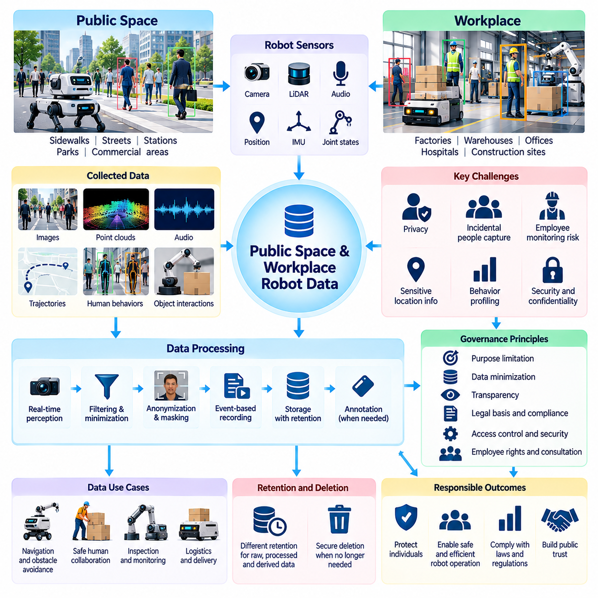{width="7.268055555555556in" height="7.268055555555556in"}

Public spaces and workplaces are important environments for Physical AI systems because robots must perceive, navigate, and interact with dynamic human surroundings. Autonomous mobile robots, delivery platforms, inspection systems, and collaborative machines continuously generate visual, spatial, and behavioral observations. These datasets support intelligent operation but also create privacy, security, and governance challenges involving individuals who may not directly participate in robot development.

Public-space robot data differs from conventional laboratory datasets because collection occurs in environments shared by many people. Cameras, LiDAR sensors, microphones, and positioning systems may capture pedestrians, vehicles, conversations, and surrounding infrastructure. Individuals may be recorded incidentally while robots perform legitimate tasks. Data governance must therefore distinguish operationally necessary observations from unnecessary collection of identifiable or sensitive information.

Workplace robot data introduces additional concerns because employees may be observed repeatedly during normal activities. Warehouse robots can record worker movements, manufacturing robots may capture assembly procedures, and inspection robots can document equipment interactions. Although these observations improve navigation, safety, and operational efficiency, they may also reveal productivity patterns, working habits, or individual performance characteristics.

The distinction between public and workplace environments influences expectations of privacy and organizational responsibility. Public spaces involve diverse individuals with limited awareness of robot sensing activities, while workplaces often contain established employment relationships and access controls. Neither environment automatically eliminates privacy protections. Appropriate governance depends on applicable laws, collection purposes, sensor capabilities, and the reasonable expectations of affected individuals.

Purpose limitation is a foundational requirement for responsible robot data collection. Information gathered for obstacle avoidance, localization, or collision prevention should not automatically become available for behavioral profiling or unrelated surveillance. Organizations must define why particular sensor streams are collected and which secondary uses are permitted. Changes in purpose should trigger renewed assessments of legal authority, proportionality, and potential privacy impacts.

Data minimization can reduce unnecessary exposure while preserving essential robotic capabilities. A navigation system may require obstacle geometry and movement trajectories without retaining recognizable facial images. Depth measurements, occupancy maps, semantic representations, and short-lived sensor buffers can sometimes replace continuous high-resolution video storage. Engineering teams should evaluate which representations provide sufficient operational information with the lowest practical privacy risk.

Real-time perception and persistent recording should be treated as distinct processing activities. Robots may need continuous camera input to operate safely, but this does not necessarily justify indefinite storage of every frame. Temporary processing, selective event recording, and configurable retention periods can reduce accumulated personal information. Safety investigations and regulatory obligations may justify retaining particular records under controlled conditions.

Transparency helps people understand when and why robots collect environmental information. Visible notices, accessible privacy explanations, and clear organizational contact channels can communicate sensing activities and data practices. In workplaces, employee communications should explain recording purposes, access permissions, and potential uses of collected information. Transparency measures must be adapted to practical environments without assuming that notification alone establishes lawful processing.

Public-space deployment creates challenges when obtaining individual consent is impractical. Delivery robots may encounter hundreds of pedestrians during routine operations, making individual authorization difficult. Organizations must determine an appropriate legal basis under applicable regulations rather than assuming public visibility permits unrestricted collection. Privacy impact assessments can help evaluate necessity, proportionality, and safeguards for incidental recording.

Workplace monitoring requires particular attention to power relationships and employee rights. Data collected to improve robot performance could also be used to measure worker speed, movement efficiency, or compliance with procedures. Such secondary uses may create legal, ethical, and organizational concerns. Governance policies should establish boundaries between legitimate robotic operations and employee surveillance, with appropriate consultation and oversight.

Spatial mapping data can reveal sensitive information even when recognizable people are absent. Robot-generated maps may expose building layouts, restricted entrances, security equipment, production lines, or emergency access routes. In public environments, detailed maps may capture infrastructure requiring additional protection. Access controls and classification policies should therefore cover geometric and semantic representations as well as images and audio.

Multimodal sensor fusion increases the possibility of reconstructing individual behavior. Combining camera observations, location histories, timestamps, and object interactions may reveal where people traveled, whom they encountered, or which activities they performed. Even pseudonymized trajectories can become identifiable when linked with external information. Privacy assessments should examine combined datasets and downstream analytical capabilities rather than evaluating each sensor independently.

Anonymization and redaction provide useful protections for recorded robot observations. Facial blurring, license plate masking, voice removal, and exclusion of private areas can reduce identifiable content. However, removing obvious identifiers does not guarantee anonymity when clothing, movement patterns, or location histories remain distinctive. Organizations should validate privacy transformations and account for reidentification risks before distributing datasets.

Edge computing can support privacy-preserving public and workplace robotics by processing sensitive observations near their source. Robots may extract obstacle positions, object categories, or navigation features locally while discarding unnecessary raw recordings. Only selected diagnostic events or approved representations need to reach centralized infrastructure. Nevertheless, edge devices require secure storage, authenticated software, and protection against unauthorized physical access.

Data sharing between robot manufacturers and facility operators requires explicit agreements. A warehouse customer may authorize operational logging but restrict the use of recordings for training models deployed at other facilities. Public-sector deployments may impose additional conditions on infrastructure information and cross-border transfers. Contracts should define permitted purposes, ownership arrangements, confidentiality obligations, retention limits, and authorized recipients.

Event-triggered recording offers a practical balance between operational learning and data minimization. Robots can preserve short observation windows surrounding collisions, emergency stops, navigation failures, or human interventions rather than continuously uploading all sensor streams. Recording policies should specify triggering conditions, buffer durations, access restrictions, and retention schedules. Sensitive events may require additional review before inclusion in shared training datasets.

Security controls are essential because public and workplace robot datasets can expose both personal information and operational vulnerabilities. Encryption, role-based access control, secure transmission, and audit logging help prevent unauthorized disclosure or modification. Dataset segmentation can separate safety evidence, navigation records, and confidential industrial observations. Access should reflect legitimate responsibilities rather than broad organizational convenience.

Retention and deletion policies should distinguish temporary perception data, routine operational logs, training datasets, and incident evidence. Different categories may require different storage periods based on their purposes and applicable obligations. Organizations should establish procedures for removing expired records, managing backups, and responding to valid deletion requests. Dataset lineage helps identify copies and derived artifacts affected by retention decisions.

Governance effectiveness depends on continuous evaluation as robots encounter new environments and operating conditions. Sensor upgrades, expanded service areas, new analytics functions, and additional data recipients can alter privacy risks. Periodic audits should examine collection scope, access histories, secondary uses, and compliance with established policies. Incident response procedures must address accidental recording, unauthorized sharing, and security breaches.

Responsible governance of public-space and workplace robot data enables Physical AI systems to learn from real environments without treating every observed person as an unrestricted data source. Privacy-aware sensing, purpose limitation, transparent practices, secure infrastructure, and accountable oversight should operate together. These principles support scalable robotic intelligence while respecting individual rights, organizational confidentiality, and public trust.

공공장소(Public Spaces)와 작업장(Workplaces)은 로봇이 역동적인 인간 주변 환경을 인식하고 탐색하며 상호작용해야 하므로 피지컬 인공지능(Physical AI) 시스템에 중요한 운영 환경이다. 자율이동로봇(Autonomous Mobile Robots), 배송 로봇 플랫폼(Delivery Platforms), 검사 시스템(Inspection Systems), 협업 기계(Collaborative Machines)는 시각적·공간적·행동적 관측 데이터(Visual, Spatial, and Behavioral Observations)를 지속적으로 생성한다. 이러한 데이터셋은 지능형 운영(Intelligent Operation)을 지원하지만, 로봇 개발에 직접 참여하지 않는 개인과 관련된 개인정보 보호(Privacy), 보안(Security), 거버넌스(Governance) 문제도 발생시킨다.

공공장소 로봇 데이터(Public-Space Robot Data)는 많은 사람이 공유하는 환경에서 수집된다는 점에서 기존 실험실 데이터셋(Conventional Laboratory Datasets)과 다르다. 카메라(Cameras), 라이다 센서(LiDAR Sensors), 마이크(Microphones), 위치 측정 시스템(Positioning Systems)은 보행자(Pedestrians), 차량(Vehicles), 대화(Conversations), 주변 기반시설(Surrounding Infrastructure)을 기록할 수 있다. 로봇이 정당한 작업(Legitimate Tasks)을 수행하는 동안 개인이 부수적으로 기록(Incidental Recording)될 수 있다. 따라서 데이터 거버넌스(Data Governance)는 운영상 필요한 관측 정보(Operationally Necessary Observations)와 식별 가능하거나 민감한 정보(Identifiable or Sensitive Information)의 불필요한 수집을 구분해야 한다.

작업장 로봇 데이터(Workplace Robot Data)는 직원들이 일상적인 활동 중 반복적으로 관측될 수 있기 때문에 추가적인 문제를 발생시킨다. 창고 로봇(Warehouse Robots)은 작업자의 움직임(Worker Movements)을 기록할 수 있고, 제조 로봇(Manufacturing Robots)은 조립 절차(Assembly Procedures)를 촬영할 수 있으며, 검사 로봇(Inspection Robots)은 장비와의 상호작용(Equipment Interactions)을 기록할 수 있다. 이러한 관측 정보는 내비게이션(Navigation), 안전성(Safety), 운영 효율성(Operational Efficiency)을 개선하지만, 생산성 패턴(Productivity Patterns), 작업 습관(Working Habits), 개인별 업무 수행 특성(Individual Performance Characteristics)을 드러낼 수도 있다.

공공 환경(Public Environments)과 작업장 환경(Workplace Environments)의 차이는 개인정보 보호에 대한 기대(Expectations of Privacy)와 조직의 책임(Organizational Responsibility)에 영향을 미친다. 공공장소에는 로봇의 센싱 활동(Robot Sensing Activities)을 충분히 인식하지 못하는 다양한 개인이 존재하며, 작업장에는 일반적으로 확립된 고용 관계(Employment Relationships)와 접근 통제(Access Controls)가 존재한다. 어느 환경에서도 개인정보 보호 조치가 자동으로 면제되는 것은 아니다. 적절한 거버넌스는 적용 법률(Applicable Laws), 수집 목적(Collection Purposes), 센서 성능(Sensor Capabilities), 영향을 받는 개인의 합리적인 기대(Reasonable Expectations)에 따라 결정된다.

목적 제한(Purpose Limitation)은 책임 있는 로봇 데이터 수집(Responsible Robot Data Collection)의 기본 요구사항이다. 장애물 회피(Obstacle Avoidance), 위치 추정(Localization), 충돌 방지(Collision Prevention)를 위해 수집한 정보가 행동 프로파일링(Behavioral Profiling)이나 관련 없는 감시 활동(Unrelated Surveillance)에 자동으로 활용되어서는 안 된다. 조직은 특정 센서 데이터 스트림(Sensor Streams)을 수집하는 이유와 허용되는 이차적 사용(Secondary Uses)을 정의해야 한다. 사용 목적이 변경되면 법적 권한(Legal Authority), 비례성(Proportionality), 잠재적인 개인정보 보호 영향(Potential Privacy Impacts)에 대한 재평가가 이루어져야 한다.

데이터 최소화(Data Minimization)는 필수적인 로봇 기능(Essential Robotic Capabilities)을 유지하면서 불필요한 정보 노출(Unnecessary Exposure)을 줄일 수 있다. 내비게이션 시스템(Navigation System)은 식별 가능한 얼굴 영상(Recognizable Facial Images)을 보존하지 않고도 장애물 기하정보(Obstacle Geometry)와 이동 궤적(Movement Trajectories)을 활용할 수 있다. 깊이 측정값(Depth Measurements), 점유 지도(Occupancy Maps), 의미적 표현(Semantic Representations), 단기 센서 버퍼(Short-Lived Sensor Buffers)는 경우에 따라 지속적인 고해상도 영상 저장(Continuous High-Resolution Video Storage)을 대체할 수 있다. 엔지니어링 팀(Engineering Teams)은 실용적으로 가능한 가장 낮은 개인정보 보호 위험으로 충분한 운영 정보를 제공하는 데이터 표현 방식을 평가해야 한다.

실시간 인식(Real-Time Perception)과 영구적인 기록(Persistent Recording)은 서로 다른 데이터 처리 활동(Processing Activities)으로 취급해야 한다. 로봇은 안전한 작동을 위해 지속적인 카메라 입력(Continuous Camera Input)이 필요할 수 있지만, 이것이 모든 프레임(Frame)을 무기한 저장하는 것을 정당화하지는 않는다. 임시 처리(Temporary Processing), 선택적 이벤트 기록(Selective Event Recording), 설정 가능한 보존 기간(Configurable Retention Periods)은 누적되는 개인정보(Personal Information)를 줄일 수 있다. 다만 안전사고 조사(Safety Investigations)와 규제상 의무(Regulatory Obligations)에 따라 특정 기록을 통제된 조건에서 보존해야 할 수 있다.

투명성(Transparency)은 사람들이 로봇이 언제, 왜 환경 정보를 수집하는지 이해하도록 돕는다. 눈에 잘 띄는 안내문(Visible Notices), 접근 가능한 개인정보 보호 설명(Accessible Privacy Explanations), 명확한 조직 연락 창구(Organizational Contact Channels)는 센싱 활동과 데이터 처리 관행(Data Practices)을 전달할 수 있다. 작업장에서는 직원 대상 안내(Employee Communications)를 통해 기록 목적(Recording Purposes), 접근 권한(Access Permissions), 수집 정보의 잠재적 활용(Potential Uses)을 설명해야 한다. 투명성 조치는 실제 운영 환경에 맞게 조정되어야 하며, 단순한 고지만으로 적법한 처리(Lawful Processing)가 성립한다고 가정해서는 안 된다.

공공장소 배포(Public-Space Deployment)는 개별 동의(Individual Consent)를 얻기 어려운 경우 특별한 문제를 발생시킨다. 배송 로봇(Delivery Robots)은 일상적인 운영 중 수백 명의 보행자(Pedestrians)와 마주칠 수 있으므로 개별적인 승인(Individual Authorization)을 확보하기 어렵다. 조직은 공공장소에서 관측할 수 있다는 이유만으로 무제한적인 데이터 수집(Unrestricted Collection)이 허용된다고 가정하지 말고, 적용 규정(Applicable Regulations)에 따라 적절한 법적 근거(Legal Basis)를 결정해야 한다. 개인정보 영향평가(Privacy Impact Assessments)는 부수적 기록(Incidental Recording)의 필요성(Necessity), 비례성(Proportionality), 보호 조치(Safeguards)를 평가하는 데 도움이 된다.

작업장 모니터링(Workplace Monitoring)은 권력 관계(Power Relationships)와 직원 권리(Employee Rights)에 특별한 주의를 기울여야 한다. 로봇 성능(Robot Performance)을 개선하기 위해 수집한 데이터가 작업 속도(Worker Speed), 움직임 효율성(Movement Efficiency), 절차 준수 여부(Compliance with Procedures)를 측정하는 데 활용될 수도 있다. 이러한 이차적 사용(Secondary Uses)은 법적·윤리적·조직적 문제(Legal, Ethical, and Organizational Concerns)를 발생시킬 수 있다. 거버넌스 정책(Governance Policies)은 적절한 협의(Consultation)와 감독(Oversight)을 바탕으로 정당한 로봇 운영(Legitimate Robotic Operations)과 직원 감시(Employee Surveillance) 사이의 경계를 설정해야 한다.

공간 매핑 데이터(Spatial Mapping Data)는 식별 가능한 사람이 존재하지 않더라도 민감한 정보를 드러낼 수 있다. 로봇이 생성한 지도(Robot-Generated Maps)는 건물 배치(Building Layouts), 출입 제한 구역(Restricted Entrances), 보안 장비(Security Equipment), 생산 라인(Production Lines), 비상 접근 경로(Emergency Access Routes)를 노출할 수 있다. 공공 환경에서는 상세한 지도가 추가적인 보호가 필요한 기반시설(Infrastructure)을 기록할 수도 있다. 따라서 접근 제어(Access Controls)와 데이터 분류 정책(Classification Policies)은 영상 및 음성뿐 아니라 기하학적 표현(Geometric Representations)과 의미적 표현(Semantic Representations)에도 적용되어야 한다.

다중모달 센서 융합(Multimodal Sensor Fusion)은 개인의 행동(Individual Behavior)을 재구성할 가능성을 높인다. 카메라 관측(Camera Observations), 위치 이력(Location Histories), 타임스탬프(Timestamps), 객체 상호작용(Object Interactions)을 결합하면 사람들이 어디로 이동했는지, 누구를 만났는지, 어떤 활동을 수행했는지를 드러낼 수 있다. 가명처리된 궤적(Pseudonymized Trajectories)조차 외부 정보(External Information)와 연결되면 개인을 식별할 수 있다. 개인정보 보호 평가(Privacy Assessments)는 각 센서를 독립적으로 평가하기보다 결합된 데이터셋(Combined Datasets)과 후속 분석 기능(Downstream Analytical Capabilities)을 검토해야 한다.

익명화(Anonymization)와 비식별 정보 제거(Redaction)는 기록된 로봇 관측 데이터(Recorded Robot Observations)를 보호하는 데 유용하다. 얼굴 흐림 처리(Facial Blurring), 차량 번호판 마스킹(License Plate Masking), 음성 제거(Voice Removal), 사적 공간 제외(Exclusion of Private Areas)는 식별 가능한 콘텐츠(Identifiable Content)를 줄일 수 있다. 그러나 명백한 식별자(Obvious Identifiers)를 제거하더라도 의복(Clothing), 움직임 패턴(Movement Patterns), 위치 이력(Location Histories)이 여전히 개인을 구별할 수 있으므로 익명성이 보장되는 것은 아니다. 조직은 데이터셋을 배포하기 전에 개인정보 보호 변환(Privacy Transformations)을 검증하고 재식별 위험(Reidentification Risks)을 고려해야 한다.

엣지 컴퓨팅(Edge Computing)은 민감한 관측 정보(Sensitive Observations)를 데이터 발생 위치 가까이에서 처리함으로써 개인정보 보호형 공공장소 및 작업장 로봇 시스템(Privacy-Preserving Public and Workplace Robotics)을 지원할 수 있다. 로봇은 장애물 위치(Obstacle Positions), 객체 범주(Object Categories), 내비게이션 특징(Navigation Features)을 로컬에서 추출하면서 불필요한 원시 기록(Raw Recordings)을 폐기할 수 있다. 선택된 진단 이벤트(Diagnostic Events)나 승인된 표현(Approved Representations)만 중앙 집중식 인프라(Centralized Infrastructure)로 전송하면 된다. 그러나 엣지 장치(Edge Devices)에도 안전한 저장소(Secure Storage), 인증된 소프트웨어(Authenticated Software), 무단 물리적 접근(Unauthorized Physical Access)에 대한 보호가 필요하다.

로봇 제조업체(Robot Manufacturers)와 시설 운영자(Facility Operators) 간 데이터 공유(Data Sharing)에는 명시적인 계약(Explicit Agreements)이 필요하다. 창고 고객(Warehouse Customer)은 운영 로그 수집(Operational Logging)을 허용하면서 다른 시설에 배포되는 모델의 학습에 기록을 사용하는 것은 제한할 수 있다. 공공 부문 배포(Public-Sector Deployments)에서는 기반시설 정보(Infrastructure Information)와 국경 간 데이터 이전(Cross-Border Transfers)에 추가 조건을 부과할 수 있다. 계약은 허용 목적(Permitted Purposes), 소유권 관계(Ownership Arrangements), 기밀 유지 의무(Confidentiality Obligations), 보존 기간 제한(Retention Limits), 승인된 수신자(Authorized Recipients)를 정의해야 한다.

이벤트 기반 기록(Event-Triggered Recording)은 운영 학습(Operational Learning)과 데이터 최소화(Data Minimization) 사이에서 실용적인 균형을 제공한다. 로봇은 모든 센서 스트림(Sensor Streams)을 지속적으로 업로드하는 대신 충돌(Collisions), 비상 정지(Emergency Stops), 내비게이션 실패(Navigation Failures), 인간 개입(Human Interventions) 전후의 짧은 관측 구간(Observation Windows)을 보존할 수 있다. 기록 정책(Recording Policies)은 트리거 조건(Triggering Conditions), 버퍼 지속 시간(Buffer Durations), 접근 제한(Access Restrictions), 보존 일정(Retention Schedules)을 명시해야 한다. 민감한 이벤트(Sensitive Events)는 공유 학습 데이터셋(Shared Training Datasets)에 포함되기 전에 추가 검토가 필요할 수 있다.

보안 통제(Security Controls)는 공공장소 및 작업장 로봇 데이터셋이 개인정보(Personal Information)와 운영상 취약점(Operational Vulnerabilities)을 모두 노출할 수 있기 때문에 필수적이다. 암호화(Encryption), 역할 기반 접근 제어(Role-Based Access Control), 보안 전송(Secure Transmission), 감사 로그(Audit Logging)는 무단 공개(Unauthorized Disclosure)나 변조(Modification)를 방지하는 데 도움이 된다. 데이터셋 분리(Dataset Segmentation)는 안전 관련 증거(Safety Evidence), 내비게이션 기록(Navigation Records), 기밀 산업 관측 정보(Confidential Industrial Observations)를 구분할 수 있다. 접근 권한은 조직 전체의 편의성이 아니라 정당한 업무 책임(Legitimate Responsibilities)에 따라 부여되어야 한다.

데이터 보존 및 삭제 정책(Retention and Deletion Policies)은 임시 인식 데이터(Temporary Perception Data), 일상적인 운영 로그(Routine Operational Logs), 학습 데이터셋(Training Datasets), 사고 증거(Incident Evidence)를 구분해야 한다. 각 범주는 사용 목적과 적용 가능한 의무에 따라 서로 다른 저장 기간(Storage Periods)이 필요할 수 있다. 조직은 보존 기간이 만료된 기록(Expired Records)의 삭제, 백업 관리(Backup Management), 유효한 삭제 요청(Valid Deletion Requests)에 대한 대응 절차를 수립해야 한다. 데이터셋 계보(Dataset Lineage)는 보존 관련 결정(Retention Decisions)의 영향을 받는 복사본(Copies)과 파생 산출물(Derived Artifacts)을 식별하는 데 도움이 된다.

거버넌스의 효과성(Governance Effectiveness)은 로봇이 새로운 환경(New Environments)과 운영 조건(Operating Conditions)을 경험함에 따라 지속적으로 평가되어야 한다. 센서 업그레이드(Sensor Upgrades), 서비스 지역 확장(Expanded Service Areas), 새로운 분석 기능(New Analytics Functions), 추가 데이터 수신자(Additional Data Recipients)는 개인정보 보호 위험을 변화시킬 수 있다. 정기 감사(Periodic Audits)는 수집 범위(Collection Scope), 접근 이력(Access Histories), 이차적 사용(Secondary Uses), 확립된 정책의 준수 여부(Policy Compliance)를 검토해야 한다. 사고 대응 절차(Incident Response Procedures)는 우발적 기록(Accidental Recording), 무단 공유(Unauthorized Sharing), 보안 침해(Security Breaches)를 다루어야 한다.

공공장소 및 작업장 로봇 데이터의 책임 있는 거버넌스(Responsible Governance of Public-Space and Workplace Robot Data)는 관측된 모든 사람을 제한 없이 활용할 수 있는 데이터 출처(Unrestricted Data Source)로 취급하지 않으면서 피지컬 인공지능 시스템이 실제 환경(Real Environments)에서 학습할 수 있도록 한다. 개인정보 보호를 고려한 센싱(Privacy-Aware Sensing), 목적 제한(Purpose Limitation), 투명한 운영 관행(Transparent Practices), 안전한 인프라(Secure Infrastructure), 책임 있는 감독(Accountable Oversight)은 상호 연계되어 작동해야 한다. 이러한 원칙은 개인의 권리(Individual Rights), 조직의 기밀성(Organizational Confidentiality), 공공의 신뢰(Public Trust)를 존중하면서 확장 가능한 로봇 지능(Scalable Robotic Intelligence)을 지원한다.

##  

## 08.06. Biometric Audio and Location Privacy

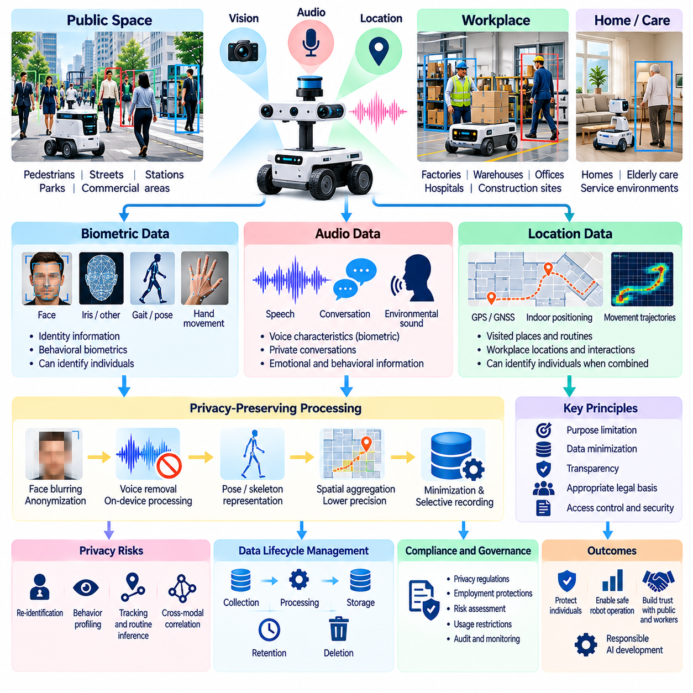{width="7.268055555555556in" height="7.268055555555556in"}

Biometric, audio, and location data introduce distinctive privacy challenges for Physical AI systems because these signals can reveal identity, behavior, and personal activities. Robots operating in homes, workplaces, hospitals, and public environments may collect facial images, voice recordings, movement patterns, and positioning information. Effective governance must address the sensitivity of these data types while preserving the perception and navigation capabilities required for safe operation.

Biometric data refers to information derived from physical, physiological, or behavioral characteristics that can support individual identification. Facial geometry, fingerprints, iris patterns, gait signatures, and voice characteristics are common examples. Not every recording of these characteristics constitutes biometric identification data under every law. The classification depends on processing methods, intended purposes, and applicable legal definitions.

Robot vision systems may capture recognizable faces even when facial identification is not required for the assigned task. A mobile robot navigating a crowded corridor needs to detect people and estimate their positions but may not need to establish their identities. Privacy-aware perception can prioritize human detection, pose estimation, and obstacle geometry while avoiding unnecessary facial recognition, identity matching, or persistent tracking.

Behavioral biometrics create additional risks because distinctive movement patterns may identify individuals without conventional identity records. Walking style, hand coordination, gesture timing, and teleoperation behavior can reveal recurring personal characteristics. These signals are particularly relevant to imitation learning and human-robot interaction. Their collection should be evaluated for identification potential, sensitivity, and the consequences of unauthorized reuse.

Audio sensing supports speech commands, acoustic event detection, environmental awareness, and human-robot communication. However, microphones may also capture private conversations, emotional expressions, background speech, and identifiable voice characteristics. Continuous audio recording can expose information unrelated to robotic operations. Data governance should distinguish real-time acoustic processing from persistent storage and secondary analysis.

Speech recognition systems can reduce privacy exposure by converting spoken commands into task-specific representations. A robot may require the recognized instruction and confidence score rather than retaining the complete waveform. On-device speech processing, wake-word activation, temporary buffering, and selective recording can limit unnecessary collection. Nevertheless, transcripts may still contain personal information and require appropriate protection.

Voice biometrics deserve special attention because vocal characteristics may support speaker recognition or verification. Acoustic features such as pitch, resonance, articulation, and speaking rhythm can contribute to individual identification. A system designed to recognize commands should not automatically create persistent speaker profiles. Where voice identification is necessary, its purpose, authorization, security controls, and retention conditions must be explicitly established.

Location privacy concerns extend beyond geographic coordinates. Robot sensors can reveal where individuals work, travel, gather, or spend time, particularly when observations are linked to timestamps. Indoor positioning systems may reconstruct movement between rooms, workstations, or restricted areas. Repeated observations can expose routines and relationships even when names and direct identifiers have been removed.

High-resolution location trajectories may be especially sensitive because combinations of frequently visited places can distinguish individuals. Robot-generated navigation logs, human tracking records, and facility maps may reveal patterns that were not apparent in isolated measurements. Spatial aggregation, reduced coordinate precision, and shorter retention periods can reduce exposure, although their effectiveness depends on operational requirements and external information.

Multimodal data fusion amplifies privacy risks when biometric, audio, and location signals are combined. A facial image associated with a voice recording and movement trajectory can establish a richer personal profile than any single source. Even datasets that appear pseudonymous may become identifiable through cross-modal correlations. Privacy assessments should therefore examine combined information flows and potential downstream inference capabilities.

Purpose limitation is essential when sensitive sensor data supports multiple robotic functions. Facial observations collected for collision avoidance should not automatically support employee identification, while audio captured for voice commands should not become material for behavioral profiling. Location histories gathered for navigation diagnostics should not be repurposed for unrelated surveillance. Secondary uses require independent assessment of their legal basis and proportionality.

Data minimization should be incorporated into sensor selection, processing architecture, and storage policies. Robots can sometimes replace identifiable images with human bounding boxes, skeletal representations, or occupancy estimates. Audio waveforms may be converted into command labels, while detailed trajectories may be reduced to aggregated movement statistics. These transformations should preserve task performance without retaining unnecessary personal details.

Anonymization techniques can reduce exposure but require careful validation. Facial blurring, voice transformation, identifier removal, and location generalization may conceal obvious personal attributes. However, gait signatures, distinctive voices, and repeated movement trajectories can remain identifying. Organizations should evaluate reidentification risks, linkage attacks, and residual information rather than assuming that removing names or faces guarantees anonymity.

Edge processing provides an important architectural safeguard for sensitive robotic perception. Facial detection, speech recognition, and localization can occur directly on the robot without routinely transmitting raw sensor streams to centralized servers. Local processing reduces exposure during transmission and aggregation, although it does not eliminate risks from device compromise. Secure boot, encryption, access controls, and authenticated updates remain necessary.

Access governance should reflect the differing sensitivity of biometric, audio, and location datasets. Navigation engineers may require anonymized trajectories, while speech developers may need limited acoustic samples for model evaluation. Identity-related processing should be restricted to specifically authorized personnel and systems. Role-based permissions, purpose-based access policies, audit trails, and separation of sensitive datasets can reduce unauthorized use.

Retention policies must account for the persistence and potential misuse of sensitive personal characteristics. Unlike passwords, biometric characteristics generally cannot be replaced easily after compromise. Raw facial recordings, voice samples, and detailed location histories should therefore be retained only for justified periods. Deletion procedures should cover original recordings, derived templates, backups, exported datasets, and relevant processing artifacts.

Training Physical AI models on sensitive data introduces risks that extend beyond conventional storage security. Models may memorize identifiable patterns or reveal information through membership inference and reconstruction attacks. Privacy testing should assess whether training outputs expose facial features, speaker characteristics, or individual trajectories. Differential privacy, controlled model access, and carefully designed training pipelines can reduce selected risks.

Legal requirements for biometric, audio, and location processing differ across jurisdictions and application contexts. Some activities may require specific consent, heightened safeguards, formal impact assessments, or restrictions on biometric identification. Workplace surveillance and public-space monitoring may face additional limitations. Organizations must evaluate applicable legal definitions and obligations rather than applying a single universal compliance assumption.

Privacy impact assessments should examine sensor necessity, collection frequency, identification capabilities, processing locations, retention schedules, and potential harms. Special attention is warranted when robots observe children, patients, employees, or other individuals in circumstances involving heightened vulnerability. Assessments should consider both intended functions and reasonably foreseeable misuse, including tracking, discrimination, unauthorized profiling, and sensitive information disclosure.

Responsible biometric, audio, and location privacy governance requires integrating technical safeguards with legal accountability and organizational oversight. Privacy-aware sensing, local processing, data minimization, restricted access, transparent policies, and continuous auditing can support effective robotic intelligence without unnecessary personal surveillance. As Physical AI expands into everyday environments, protecting these sensitive information streams becomes fundamental to safety, trust, and sustainable deployment.

생체인식 데이터(Biometric Data), 음성 데이터(Audio Data), 위치 데이터(Location Data)는 개인의 신원(Identity), 행동(Behavior), 사적 활동(Personal Activities)을 드러낼 수 있기 때문에 피지컬 인공지능(Physical AI) 시스템에 고유한 개인정보 보호 문제(Privacy Challenges)를 발생시킨다. 가정(Homes), 작업장(Workplaces), 병원(Hospitals), 공공 환경(Public Environments)에서 작동하는 로봇은 얼굴 영상(Facial Images), 음성 기록(Voice Recordings), 움직임 패턴(Movement Patterns), 위치 정보(Positioning Information)를 수집할 수 있다. 효과적인 거버넌스(Effective Governance)는 안전한 작동에 필요한 인식(Perception) 및 내비게이션(Navigation) 기능을 유지하면서 이러한 데이터 유형의 민감성(Sensitivity)을 관리해야 한다.

생체인식 데이터(Biometric Data)는 개인 식별(Individual Identification)을 지원할 수 있는 신체적(Physical), 생리학적(Physiological), 행동적 특성(Behavioral Characteristics)에서 파생된 정보를 의미한다. 얼굴 기하정보(Facial Geometry), 지문(Fingerprints), 홍채 패턴(Iris Patterns), 보행 특징(Gait Signatures), 음성 특성(Voice Characteristics)이 대표적인 사례이다. 이러한 특성을 기록한 모든 데이터가 모든 법률에서 생체인식 식별 데이터(Biometric Identification Data)에 해당하는 것은 아니다. 해당 데이터의 법적 분류(Classification)는 처리 방법(Processing Methods), 사용 목적(Intended Purposes), 적용 가능한 법적 정의(Applicable Legal Definitions)에 따라 달라진다.

로봇 비전 시스템(Robot Vision Systems)은 작업 수행에 얼굴 식별(Facial Identification)이 필요하지 않은 경우에도 알아볼 수 있는 얼굴을 촬영할 수 있다. 혼잡한 복도를 이동하는 이동로봇(Mobile Robot)은 사람을 감지하고 위치를 추정해야 하지만, 개인의 신원(Identity)을 확인할 필요는 없을 수 있다. 개인정보 보호를 고려한 인식(Privacy-Aware Perception)은 불필요한 얼굴 인식(Facial Recognition), 신원 매칭(Identity Matching), 지속적인 추적(Persistent Tracking)을 피하면서 사람 감지(Human Detection), 자세 추정(Pose Estimation), 장애물 기하정보(Obstacle Geometry)를 우선적으로 활용할 수 있다.

행동 생체인식(Behavioral Biometrics)은 고유한 움직임 패턴(Distinctive Movement Patterns)이 기존의 신원 기록(Identity Records) 없이도 개인을 식별할 수 있기 때문에 추가적인 위험을 발생시킨다. 보행 방식(Walking Style), 손의 협응 동작(Hand Coordination), 제스처 타이밍(Gesture Timing), 원격조작 행동(Teleoperation Behavior)은 반복적으로 나타나는 개인적 특성(Personal Characteristics)을 드러낼 수 있다. 이러한 신호는 모방학습(Imitation Learning)과 인간-로봇 상호작용(Human-Robot Interaction)에 특히 중요하다. 따라서 데이터 수집 과정에서는 개인 식별 가능성(Identification Potential), 민감성(Sensitivity), 승인되지 않은 재사용(Unauthorized Reuse)의 결과를 평가해야 한다.

오디오 센싱(Audio Sensing)은 음성 명령(Speech Commands), 음향 이벤트 감지(Acoustic Event Detection), 환경 인식(Environmental Awareness), 인간-로봇 의사소통(Human-Robot Communication)을 지원한다. 그러나 마이크(Microphones)는 사적인 대화(Private Conversations), 감정 표현(Emotional Expressions), 배경 음성(Background Speech), 식별 가능한 음성 특성(Identifiable Voice Characteristics)도 기록할 수 있다. 지속적인 오디오 기록(Continuous Audio Recording)은 로봇 운영과 관련 없는 정보를 노출할 수 있다. 데이터 거버넌스(Data Governance)는 실시간 음향 처리(Real-Time Acoustic Processing)와 영구 저장(Persistent Storage), 이차적 분석(Secondary Analysis)을 구분해야 한다.

음성 인식 시스템(Speech Recognition Systems)은 발화된 명령(Spoken Commands)을 작업별 표현(Task-Specific Representations)으로 변환하여 개인정보 노출(Privacy Exposure)을 줄일 수 있다. 로봇은 전체 음성 파형(Complete Waveform)을 보존하는 대신 인식된 명령(Recognized Instruction)과 신뢰도 점수(Confidence Score)만 필요할 수 있다. 온디바이스 음성 처리(On-Device Speech Processing), 호출어 활성화(Wake-Word Activation), 임시 버퍼링(Temporary Buffering), 선택적 기록(Selective Recording)은 불필요한 수집을 제한할 수 있다. 그러나 음성 전사문(Transcripts)에도 개인정보(Personal Information)가 포함될 수 있으므로 적절한 보호가 필요하다.

음성 생체인식(Voice Biometrics)은 음성 특성(Vocal Characteristics)이 화자 인식(Speaker Recognition)이나 화자 검증(Speaker Verification)을 지원할 수 있기 때문에 특별한 주의가 필요하다. 음높이(Pitch), 공명(Resonance), 조음(Articulation), 발화 리듬(Speaking Rhythm)과 같은 음향 특징(Acoustic Features)은 개인 식별에 활용될 수 있다. 명령을 인식하도록 설계된 시스템이 지속적인 화자 프로파일(Persistent Speaker Profiles)을 자동으로 생성해서는 안 된다. 음성 식별(Voice Identification)이 필요한 경우에는 사용 목적(Purpose), 승인(Authorization), 보안 통제(Security Controls), 보존 조건(Retention Conditions)을 명시적으로 설정해야 한다.

위치 개인정보 보호(Location Privacy)는 지리적 좌표(Geographic Coordinates)를 넘어서는 문제이다. 로봇 센서(Robot Sensors)는 특히 관측 정보가 타임스탬프(Timestamps)와 연결될 때 개인이 어디에서 일하고, 이동하고, 모이고, 시간을 보내는지를 드러낼 수 있다. 실내 위치 측정 시스템(Indoor Positioning Systems)은 방(Rooms), 작업대(Workstations), 출입 제한 구역(Restricted Areas) 사이의 이동을 재구성할 수 있다. 반복적인 관측(Repeated Observations)은 이름이나 직접 식별자(Direct Identifiers)가 제거된 경우에도 일상적인 행동 패턴(Routines)과 인간관계(Relationships)를 노출할 수 있다.

고해상도 위치 궤적(High-Resolution Location Trajectories)은 자주 방문하는 장소(Frequently Visited Places)의 조합을 통해 개인을 구별할 수 있으므로 특히 민감할 수 있다. 로봇이 생성한 내비게이션 로그(Robot-Generated Navigation Logs), 인간 추적 기록(Human Tracking Records), 시설 지도(Facility Maps)는 개별 측정값(Isolated Measurements)만으로는 드러나지 않았던 패턴을 보여줄 수 있다. 공간 집계(Spatial Aggregation), 좌표 정밀도 감소(Reduced Coordinate Precision), 보존 기간 단축(Shorter Retention Periods)은 정보 노출을 줄일 수 있지만, 그 효과는 운영 요구사항(Operational Requirements)과 외부 정보(External Information)에 따라 달라진다.

다중모달 데이터 융합(Multimodal Data Fusion)은 생체인식 신호(Biometric Signals), 오디오 신호(Audio Signals), 위치 신호(Location Signals)가 결합될 때 개인정보 보호 위험을 증폭시킨다. 음성 기록(Voice Recording) 및 이동 궤적(Movement Trajectory)과 연결된 얼굴 영상(Facial Image)은 개별 데이터 출처보다 훨씬 풍부한 개인 프로파일(Personal Profile)을 형성할 수 있다. 가명처리된 것처럼 보이는 데이터셋(Pseudonymous Datasets)도 모달리티 간 상관관계(Cross-Modal Correlations)를 통해 식별 가능해질 수 있다. 따라서 개인정보 영향평가(Privacy Assessments)는 결합된 정보 흐름(Combined Information Flows)과 잠재적인 후속 추론 기능(Downstream Inference Capabilities)을 검토해야 한다.

민감한 센서 데이터(Sensitive Sensor Data)가 여러 로봇 기능을 지원하는 경우 목적 제한(Purpose Limitation)은 필수적이다. 충돌 회피(Collision Avoidance)를 위해 수집한 얼굴 관측 정보(Facial Observations)를 직원 식별(Employee Identification)에 자동으로 활용해서는 안 되며, 음성 명령(Voice Commands)을 위해 수집한 오디오를 행동 프로파일링(Behavioral Profiling)에 사용해서도 안 된다. 내비게이션 진단(Navigation Diagnostics)을 위해 수집한 위치 이력(Location Histories) 역시 관련 없는 감시 활동(Unrelated Surveillance)에 재사용해서는 안 된다. 이차적 사용(Secondary Uses)은 법적 근거(Legal Basis)와 비례성(Proportionality)에 대한 독립적인 평가가 필요하다.

데이터 최소화(Data Minimization)는 센서 선정(Sensor Selection), 처리 아키텍처(Processing Architecture), 저장 정책(Storage Policies)에 통합되어야 한다. 로봇은 경우에 따라 식별 가능한 영상(Identifiable Images)을 사람 경계 상자(Human Bounding Boxes), 골격 표현(Skeletal Representations), 점유 추정값(Occupancy Estimates)으로 대체할 수 있다. 오디오 파형(Audio Waveforms)은 명령 레이블(Command Labels)로 변환할 수 있으며, 상세한 이동 궤적(Detailed Trajectories)은 집계된 이동 통계(Aggregated Movement Statistics)로 축약할 수 있다. 이러한 변환(Transformations)은 불필요한 개인정보(Personal Details)를 보존하지 않으면서 작업 성능(Task Performance)을 유지해야 한다.

익명화 기술(Anonymization Techniques)은 정보 노출을 줄일 수 있지만 신중한 검증(Careful Validation)이 필요하다. 얼굴 흐림 처리(Facial Blurring), 음성 변환(Voice Transformation), 식별자 제거(Identifier Removal), 위치 일반화(Location Generalization)는 명백한 개인 식별 특성(Obvious Personal Attributes)을 숨길 수 있다. 그러나 보행 특징(Gait Signatures), 고유한 음성(Distinctive Voices), 반복적인 이동 궤적(Repeated Movement Trajectories)은 여전히 개인을 식별할 수 있다. 조직은 이름이나 얼굴을 제거하면 익명성이 보장된다고 가정하지 말고 재식별 위험(Reidentification Risks), 연결 공격(Linkage Attacks), 잔여 정보(Residual Information)를 평가해야 한다.

엣지 처리(Edge Processing)는 민감한 로봇 인식(Sensitive Robotic Perception)을 보호하기 위한 중요한 아키텍처 차원의 안전장치(Architectural Safeguard)를 제공한다. 얼굴 감지(Facial Detection), 음성 인식(Speech Recognition), 위치 추정(Localization)은 원시 센서 스트림(Raw Sensor Streams)을 중앙 서버(Centralized Servers)로 지속적으로 전송하지 않고 로봇에서 직접 수행할 수 있다. 로컬 처리(Local Processing)는 전송(Transmission)과 데이터 집계(Aggregation) 과정의 정보 노출을 줄이지만, 장치 침해(Device Compromise)로 인한 위험까지 제거하지는 못한다. 따라서 보안 부팅(Secure Boot), 암호화(Encryption), 접근 제어(Access Controls), 인증된 업데이트(Authenticated Updates)가 여전히 필요하다.

접근 거버넌스(Access Governance)는 생체인식 데이터셋(Biometric Datasets), 오디오 데이터셋(Audio Datasets), 위치 데이터셋(Location Datasets)의 서로 다른 민감성을 반영해야 한다. 내비게이션 엔지니어(Navigation Engineers)는 익명화된 궤적(Anonymized Trajectories)이 필요할 수 있으며, 음성 개발자(Speech Developers)는 모델 평가(Model Evaluation)를 위해 제한된 음향 샘플(Limited Acoustic Samples)이 필요할 수 있다. 신원 관련 처리(Identity-Related Processing)는 특별히 승인된 인력(Personnel)과 시스템(Systems)으로 제한해야 한다. 역할 기반 권한(Role-Based Permissions), 목적 기반 접근 정책(Purpose-Based Access Policies), 감사 추적(Audit Trails), 민감 데이터셋 분리(Separation of Sensitive Datasets)는 무단 사용(Unauthorized Use)을 줄일 수 있다.

데이터 보존 정책(Retention Policies)은 민감한 개인 특성(Sensitive Personal Characteristics)의 지속성과 잠재적인 오용(Potential Misuse)을 고려해야 한다. 비밀번호(Passwords)와 달리 생체인식 특성(Biometric Characteristics)은 일반적으로 유출된 이후 쉽게 변경할 수 없다. 따라서 원시 얼굴 기록(Raw Facial Recordings), 음성 샘플(Voice Samples), 상세한 위치 이력(Detailed Location Histories)은 정당한 보존 기간(Justified Retention Periods) 동안에만 유지해야 한다. 삭제 절차(Deletion Procedures)는 원본 기록(Original Recordings), 파생 템플릿(Derived Templates), 백업(Backups), 외부 반출 데이터셋(Exported Datasets), 관련 처리 산출물(Processing Artifacts)을 포함해야 한다.

민감한 데이터(Sensitive Data)를 활용한 피지컬 인공지능 모델 학습(Physical AI Model Training)은 기존 저장소 보안(Storage Security)을 넘어서는 위험을 발생시킨다. 모델은 식별 가능한 패턴(Identifiable Patterns)을 암기하거나 멤버십 추론 공격(Membership Inference Attacks)과 재구성 공격(Reconstruction Attacks)을 통해 정보를 노출할 수 있다. 개인정보 보호 테스트(Privacy Testing)는 학습 결과(Training Outputs)가 얼굴 특징(Facial Features), 화자 특성(Speaker Characteristics), 개인별 궤적(Individual Trajectories)을 드러내는지 평가해야 한다. 차등 개인정보 보호(Differential Privacy), 통제된 모델 접근(Controlled Model Access), 신중하게 설계된 학습 파이프라인(Carefully Designed Training Pipelines)은 특정 위험을 줄일 수 있다.

생체인식 데이터, 오디오 데이터, 위치 데이터의 처리에 관한 법적 요구사항(Legal Requirements)은 관할권(Jurisdictions)과 적용 환경(Application Contexts)에 따라 다르다. 일부 활동에는 명시적인 동의(Specific Consent), 강화된 보호 조치(Heightened Safeguards), 공식적인 영향평가(Formal Impact Assessments), 생체인식 식별(Biometric Identification)에 대한 제한이 필요할 수 있다. 작업장 감시(Workplace Surveillance)와 공공장소 모니터링(Public-Space Monitoring)에는 추가적인 제한이 적용될 수 있다. 조직은 하나의 보편적인 규정 준수 가정(Universal Compliance Assumption)을 적용하기보다 관련 법적 정의(Legal Definitions)와 의무(Obligations)를 평가해야 한다.

개인정보 영향평가(Privacy Impact Assessments)는 센서의 필요성(Sensor Necessity), 수집 빈도(Collection Frequency), 식별 기능(Identification Capabilities), 처리 위치(Processing Locations), 보존 일정(Retention Schedules), 잠재적 피해(Potential Harms)를 검토해야 한다. 로봇이 아동(Children), 환자(Patients), 직원(Employees), 기타 취약성이 높은 상황에 있는 개인(Individuals in Circumstances Involving Heightened Vulnerability)을 관측하는 경우에는 특별한 주의가 필요하다. 평가에서는 의도된 기능(Intended Functions)뿐 아니라 추적(Tracking), 차별(Discrimination), 무단 프로파일링(Unauthorized Profiling), 민감 정보 공개(Sensitive Information Disclosure)와 같이 합리적으로 예측 가능한 오용(Reasonably Foreseeable Misuse)도 고려해야 한다.

책임 있는 생체인식·오디오·위치 개인정보 보호 거버넌스(Responsible Biometric, Audio, and Location Privacy Governance)는 기술적 보호 조치(Technical Safeguards)를 법적 책임성(Legal Accountability) 및 조직적 감독(Organizational Oversight)과 통합해야 한다. 개인정보 보호를 고려한 센싱(Privacy-Aware Sensing), 로컬 처리(Local Processing), 데이터 최소화(Data Minimization), 제한된 접근(Restricted Access), 투명한 정책(Transparent Policies), 지속적인 감사(Continuous Auditing)는 불필요한 개인 감시(Personal Surveillance) 없이 효과적인 로봇 지능(Effective Robotic Intelligence)을 지원할 수 있다. 피지컬 인공지능이 일상 환경(Everyday Environments)으로 확장됨에 따라 이러한 민감한 정보 흐름(Sensitive Information Streams)을 보호하는 것은 안전성(Safety), 신뢰(Trust), 지속 가능한 배포(Sustainable Deployment)를 위한 핵심 기반이 된다.

##  

## 08.07. Industrial and Confidential Data

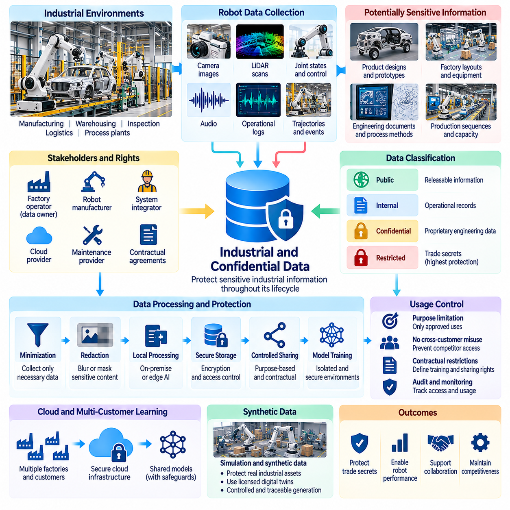{width="7.268055555555556in" height="7.268055555555556in"}

Industrial and confidential data represent critical assets in Physical AI systems because robots operate within environments containing proprietary processes, equipment configurations, and commercially sensitive information. Manufacturing robots, warehouse automation systems, and inspection platforms continuously observe operational activities. Their sensor recordings and execution logs can reveal valuable industrial knowledge that requires protection throughout collection, processing, training, and deployment.

Industrial robot datasets often contain information that extends beyond the immediate task being performed. Camera images may reveal product designs, LiDAR scans may reconstruct factory layouts, and robot trajectories may expose production sequences. Sensor timestamps and operational logs can indicate equipment utilization or manufacturing capacity. Consequently, seemingly ordinary robot telemetry may constitute confidential business information when combined with contextual knowledge.

Confidential industrial information includes trade secrets, proprietary manufacturing methods, product specifications, engineering drawings, and internal operational procedures. These materials may appear directly in robot observations or indirectly through learned patterns. A robot trained to perform assembly operations may acquire information about specialized tooling or production techniques. Governance must therefore consider both explicitly recorded information and knowledge inferred from datasets.

Data ownership and confidentiality obligations frequently involve multiple organizations. A robot manufacturer may own the hardware and software, while a factory operator controls the production environment and associated business information. System integrators, maintenance providers, and cloud vendors may also access operational records. Contracts should distinguish ownership of robot-generated data from confidentiality rights and permitted uses of customer-specific industrial information.

Industrial data classification provides a foundation for appropriate protection. Organizations can distinguish publicly releasable information, internal operational records, confidential engineering data, and highly restricted trade secrets. Classification should reflect potential commercial damage, contractual obligations, and security consequences. Dataset metadata can record sensitivity levels and determine which storage, processing, and sharing controls must be applied.

Industrial camera recordings require particular attention because visual observations can unintentionally capture confidential objects and documents. Product prototypes, production schedules, machine control panels, and engineering diagrams may appear in background regions. Privacy-oriented facial blurring does not protect these business assets. Industrial redaction systems should also detect and mask sensitive equipment, screens, documents, and restricted work areas.

Three-dimensional mapping data can expose industrial infrastructure even without conventional visual imagery. LiDAR point clouds, occupancy maps, and reconstructed digital twins may reveal facility geometry, production-line organization, access routes, and security boundaries. Such information can create competitive or physical security risks if disclosed. Access policies should therefore protect spatial representations according to their industrial sensitivity.

Operational logs and time-series sensor data may reveal commercially valuable production intelligence. Robot cycle times, equipment downtime, task completion rates, and material movement patterns can indicate throughput, process efficiency, or operational bottlenecks. Competitors may infer manufacturing capacity or business performance from aggregated telemetry. Data minimization and controlled aggregation should limit unnecessary exposure of these indicators.

Industrial data collection should follow clearly defined operational purposes. Information gathered for robot calibration, fault diagnosis, or safety monitoring should not automatically become available for unrelated model training or external analytics. Customer agreements may permit improvements to a specific installation while prohibiting reuse across competing facilities. Purpose-based policies must distinguish local optimization from broader commercial exploitation.

On-premise data processing can reduce confidentiality risks when industrial customers cannot permit unrestricted external transfers. Robot logs, images, and production observations may remain within factory-controlled infrastructure while selected diagnostic summaries are shared with vendors. Edge inference and local training can further limit exposure. However, local deployment still requires secure administration, encryption, access management, and vulnerability monitoring.

Cloud-based industrial robot learning introduces additional governance requirements. Centralized training systems may aggregate data from multiple factories, suppliers, or customers, increasing the consequences of unauthorized access. Tenant isolation, encryption, controlled processing regions, and contractual restrictions can reduce these risks. Cloud architecture should prevent confidential information from one customer becoming accessible to another customer or unrelated service.

Cross-customer training presents a difficult balance between improving general robot capabilities and protecting proprietary industrial knowledge. Shared models can benefit from diverse production experiences, but training data may encode customer-specific processes or product characteristics. Agreements should specify whether data can contribute to generalized models and whether resulting models may be deployed to competitors. Technical privacy testing should supplement contractual safeguards.

Synthetic data generation can support industrial learning without directly distributing confidential factory recordings. Simulated production cells, randomized equipment layouts, and artificial workpieces may reproduce useful task dynamics while concealing proprietary designs. Nevertheless, synthetic environments derived from confidential CAD models or digital twins may retain sensitive characteristics. Generated datasets require confidentiality review before external release.

Industrial dataset anonymization differs from conventional personal data anonymization. Removing employee names or faces does not conceal production methods, machinery configurations, or product geometry. Effective industrial deidentification may require geometric abstraction, equipment substitution, process generalization, and removal of proprietary labels. The resulting data must still preserve sufficient physical relationships for meaningful robot learning.

Access control should reflect operational roles and contractual responsibilities. Robot developers may require selected motion trajectories, maintenance engineers may need fault logs, and customer administrators may manage confidential production records. Role-based permissions, attribute-based policies, and approval workflows can restrict unnecessary access. Audit logs should record dataset retrieval, export, modification, and use in training pipelines.

Secure data transfer is essential when industrial datasets move between factories, robot vendors, research partners, and annotation contractors. Encryption in transit, authenticated endpoints, integrity verification, and controlled export procedures reduce unauthorized disclosure. Third-party agreements should establish confidentiality obligations and restrictions on onward sharing. Organizations should verify that external processors apply security controls appropriate to the sensitivity of the information.

Retention policies should account for industrial confidentiality as well as operational requirements. Raw factory recordings may be necessary for incident investigation or model debugging but inappropriate for indefinite storage. Derived features and aggregated performance statistics may support longer-term analysis under separate conditions. Deletion procedures should cover backups, temporary processing files, annotation exports, and replicated training datasets.

Model training creates additional confidentiality risks because proprietary information may persist in learned parameters. Memorization, reconstruction, and model extraction attacks can potentially reveal aspects of protected training data. Evaluations should examine whether models reproduce sensitive product designs, operational sequences, or customer-specific information. Controlled model distribution, privacy testing, and retraining procedures can reduce selected risks.

Industrial data governance also requires incident response and accountability mechanisms. Unauthorized exports, accidental publication, compromised credentials, or cross-tenant exposure may create contractual and commercial consequences. Organizations should maintain provenance records, access histories, and documented escalation procedures. Security incidents must be assessed against applicable contractual obligations, trade secret protections, and relevant reporting requirements.

Responsible management of industrial and confidential data enables Physical AI systems to improve through real operational experience without compromising the organizations that provide it. Effective governance combines classification, purpose limitation, contractual controls, secure infrastructure, restricted sharing, and continuous auditing. As industrial robot fleets expand, protecting proprietary knowledge becomes essential to sustainable data collaboration and trustworthy Physical AI development.

산업 데이터(Industrial Data)와 기밀 데이터(Confidential Data)는 로봇이 독점적인 공정(Proprietary Processes), 장비 구성(Equipment Configurations), 상업적으로 민감한 정보(Commercially Sensitive Information)가 포함된 환경에서 작동하기 때문에 피지컬 인공지능(Physical AI) 시스템의 핵심 자산(Critical Assets)에 해당한다. 제조 로봇(Manufacturing Robots), 창고 자동화 시스템(Warehouse Automation Systems), 검사 플랫폼(Inspection Platforms)은 운영 활동(Operational Activities)을 지속적으로 관측한다. 이러한 센서 기록(Sensor Recordings)과 실행 로그(Execution Logs)는 데이터 수집(Collection), 처리(Processing), 학습(Training), 배포(Deployment) 전반에서 보호해야 하는 가치 있는 산업 지식(Industrial Knowledge)을 노출할 수 있다.

산업용 로봇 데이터셋(Industrial Robot Datasets)에는 수행 중인 직접적인 작업 범위를 넘어서는 정보가 포함되는 경우가 많다. 카메라 영상(Camera Images)은 제품 설계(Product Designs)를 드러낼 수 있고, 라이다 스캔(LiDAR Scans)은 공장 배치도(Factory Layouts)를 재구성할 수 있으며, 로봇 궤적(Robot Trajectories)은 생산 순서(Production Sequences)를 노출할 수 있다. 센서 타임스탬프(Sensor Timestamps)와 운영 로그(Operational Logs)는 장비 가동률(Equipment Utilization)이나 제조 생산능력(Manufacturing Capacity)을 나타낼 수 있다. 따라서 일반적인 로봇 원격측정 데이터(Robot Telemetry)처럼 보이는 정보도 상황적 지식(Contextual Knowledge)과 결합되면 기업 기밀 정보(Confidential Business Information)가 될 수 있다.

기밀 산업 정보(Confidential Industrial Information)에는 영업비밀(Trade Secrets), 독점 제조 방법(Proprietary Manufacturing Methods), 제품 사양(Product Specifications), 엔지니어링 도면(Engineering Drawings), 내부 운영 절차(Internal Operational Procedures)가 포함된다. 이러한 자료는 로봇 관측 데이터(Robot Observations)에 직접 나타나거나 학습된 패턴(Learned Patterns)을 통해 간접적으로 드러날 수 있다. 조립 작업(Assembly Operations)을 수행하도록 학습된 로봇은 특수 공구(Specialized Tooling)나 생산 기술(Production Techniques)에 관한 정보를 습득할 수 있다. 따라서 거버넌스(Governance)는 명시적으로 기록된 정보뿐 아니라 데이터셋에서 추론된 지식(Inferred Knowledge)도 고려해야 한다.

데이터 소유권(Data Ownership)과 기밀 유지 의무(Confidentiality Obligations)는 여러 조직과 관련되는 경우가 많다. 로봇 제조업체(Robot Manufacturer)는 하드웨어(Hardware)와 소프트웨어(Software)를 소유할 수 있지만, 공장 운영자(Factory Operator)는 생산 환경(Production Environment)과 관련 사업 정보(Business Information)를 통제한다. 시스템 통합업체(System Integrators), 유지보수 제공업체(Maintenance Providers), 클라우드 공급업체(Cloud Vendors)도 운영 기록(Operational Records)에 접근할 수 있다. 계약은 로봇 생성 데이터(Robot-Generated Data)의 소유권과 고객별 산업 정보(Customer-Specific Industrial Information)에 대한 기밀 유지 권리(Confidentiality Rights) 및 허용된 사용(Permitted Uses)을 구분해야 한다.

산업 데이터 분류(Industrial Data Classification)는 적절한 보호를 위한 기반을 제공한다. 조직은 공개 가능한 정보(Publicly Releasable Information), 내부 운영 기록(Internal Operational Records), 기밀 엔지니어링 데이터(Confidential Engineering Data), 접근이 엄격하게 제한된 영업비밀(Highly Restricted Trade Secrets)을 구분할 수 있다. 데이터 분류(Classification)는 잠재적인 상업적 피해(Potential Commercial Damage), 계약상 의무(Contractual Obligations), 보안상 결과(Security Consequences)를 반영해야 한다. 데이터셋 메타데이터(Dataset Metadata)는 민감도 수준(Sensitivity Levels)을 기록하고 적용해야 할 저장(Storage), 처리(Processing), 공유 통제(Sharing Controls)를 결정할 수 있다.

산업용 카메라 기록(Industrial Camera Recordings)은 시각적 관측(Visual Observations)이 의도치 않게 기밀 객체(Confidential Objects)와 문서(Documents)를 촬영할 수 있으므로 특별한 주의가 필요하다. 제품 시제품(Product Prototypes), 생산 일정(Production Schedules), 기계 제어 패널(Machine Control Panels), 엔지니어링 도면(Engineering Diagrams)이 배경 영역(Background Regions)에 나타날 수 있다. 개인정보 보호를 위한 얼굴 흐림 처리(Privacy-Oriented Facial Blurring)만으로는 이러한 기업 자산(Business Assets)을 보호할 수 없다. 산업용 정보 가림 처리 시스템(Industrial Redaction Systems)은 민감한 장비(Sensitive Equipment), 화면(Screens), 문서(Documents), 출입 제한 작업 구역(Restricted Work Areas)도 감지하고 마스킹해야 한다.

3차원 매핑 데이터(Three-Dimensional Mapping Data)는 일반적인 시각 영상(Visual Imagery)이 없더라도 산업 기반시설(Industrial Infrastructure)을 노출할 수 있다. 라이다 포인트 클라우드(LiDAR Point Clouds), 점유 지도(Occupancy Maps), 재구성된 디지털 트윈(Reconstructed Digital Twins)은 시설 기하구조(Facility Geometry), 생산라인 구성(Production-Line Organization), 접근 경로(Access Routes), 보안 경계(Security Boundaries)를 드러낼 수 있다. 이러한 정보가 공개되면 경쟁상 위험(Competitive Risks)이나 물리적 보안 위험(Physical Security Risks)이 발생할 수 있다. 따라서 접근 정책(Access Policies)은 공간적 표현(Spatial Representations)의 산업적 민감도(Industrial Sensitivity)에 따라 이를 보호해야 한다.

운영 로그(Operational Logs)와 시계열 센서 데이터(Time-Series Sensor Data)는 상업적으로 가치 있는 생산 정보(Production Intelligence)를 드러낼 수 있다. 로봇 사이클 시간(Robot Cycle Times), 장비 가동 중단 시간(Equipment Downtime), 작업 완료율(Task Completion Rates), 자재 이동 패턴(Material Movement Patterns)은 처리량(Throughput), 공정 효율성(Process Efficiency), 운영 병목 현상(Operational Bottlenecks)을 나타낼 수 있다. 경쟁업체(Competitors)는 집계된 원격측정 데이터(Aggregated Telemetry)를 통해 제조 생산능력(Manufacturing Capacity)이나 사업 성과(Business Performance)를 추론할 수 있다. 데이터 최소화(Data Minimization)와 통제된 집계(Controlled Aggregation)는 이러한 지표의 불필요한 노출을 제한해야 한다.

산업 데이터 수집(Industrial Data Collection)은 명확하게 정의된 운영 목적(Operational Purposes)에 따라 이루어져야 한다. 로봇 보정(Robot Calibration), 고장 진단(Fault Diagnosis), 안전 모니터링(Safety Monitoring)을 위해 수집한 정보가 관련 없는 모델 학습(Unrelated Model Training)이나 외부 분석(External Analytics)에 자동으로 활용되어서는 안 된다. 고객 계약(Customer Agreements)은 특정 설치 환경(Specific Installation)의 개선은 허용하면서 경쟁 시설(Competing Facilities) 간 데이터 재사용은 금지할 수 있다. 목적 기반 정책(Purpose-Based Policies)은 로컬 최적화(Local Optimization)와 광범위한 상업적 활용(Broader Commercial Exploitation)을 구분해야 한다.

온프레미스 데이터 처리(On-Premise Data Processing)는 산업 고객(Industrial Customers)이 제한 없는 외부 데이터 전송(Unrestricted External Transfers)을 허용할 수 없는 경우 기밀성 위험(Confidentiality Risks)을 줄일 수 있다. 로봇 로그(Robot Logs), 영상(Images), 생산 관측 데이터(Production Observations)는 공장이 통제하는 인프라(Factory-Controlled Infrastructure)에 유지하면서 선택된 진단 요약(Selected Diagnostic Summaries)만 공급업체(Vendors)와 공유할 수 있다. 엣지 추론(Edge Inference)과 로컬 학습(Local Training)은 정보 노출을 추가로 제한할 수 있다. 그러나 로컬 배포(Local Deployment)에도 안전한 관리(Secure Administration), 암호화(Encryption), 접근 관리(Access Management), 취약점 모니터링(Vulnerability Monitoring)이 필요하다.

클라우드 기반 산업용 로봇 학습(Cloud-Based Industrial Robot Learning)은 추가적인 거버넌스 요구사항(Governance Requirements)을 발생시킨다. 중앙 집중식 학습 시스템(Centralized Training Systems)은 여러 공장(Factories), 공급업체(Suppliers), 고객(Customers)의 데이터를 집계할 수 있으므로 무단 접근(Unauthorized Access)이 발생했을 때의 피해가 커질 수 있다. 테넌트 격리(Tenant Isolation), 암호화(Encryption), 통제된 처리 지역(Controlled Processing Regions), 계약상 제한(Contractual Restrictions)은 이러한 위험을 줄일 수 있다. 클라우드 아키텍처(Cloud Architecture)는 한 고객의 기밀 정보(Confidential Information)가 다른 고객이나 관련 없는 서비스에 노출되지 않도록 설계되어야 한다.

고객 간 공동 학습(Cross-Customer Training)은 범용 로봇 기능(General Robot Capabilities)의 개선과 독점 산업 지식(Proprietary Industrial Knowledge)의 보호 사이에서 어려운 균형을 요구한다. 공유 모델(Shared Models)은 다양한 생산 경험(Diverse Production Experiences)을 통해 성능을 개선할 수 있지만, 학습 데이터(Training Data)에는 고객별 공정(Customer-Specific Processes)이나 제품 특성(Product Characteristics)이 포함될 수 있다. 계약은 데이터가 일반화된 모델(Generalized Models)에 기여할 수 있는지, 학습 결과 모델(Resulting Models)을 경쟁업체에 배포할 수 있는지를 명시해야 한다. 기술적 개인정보 보호 테스트(Technical Privacy Testing)는 계약상 보호 조치(Contractual Safeguards)를 보완해야 한다.

합성 데이터 생성(Synthetic Data Generation)은 기밀 공장 기록(Confidential Factory Recordings)을 직접 배포하지 않고도 산업용 로봇 학습(Industrial Robot Learning)을 지원할 수 있다. 시뮬레이션된 생산 셀(Simulated Production Cells), 무작위화된 장비 배치(Randomized Equipment Layouts), 인공 작업물(Artificial Workpieces)은 독점 설계(Proprietary Designs)를 숨기면서 유용한 작업 동역학(Task Dynamics)을 재현할 수 있다. 그러나 기밀 CAD 모델(Confidential CAD Models)이나 디지털 트윈(Digital Twins)에서 파생된 합성 환경(Synthetic Environments)은 민감한 특성(Sensitive Characteristics)을 유지할 수 있다. 생성된 데이터셋(Generated Datasets)은 외부 공개 전에 기밀성 검토(Confidentiality Review)를 거쳐야 한다.

산업 데이터셋 익명화(Industrial Dataset Anonymization)는 일반적인 개인정보 익명화(Personal Data Anonymization)와 다르다. 직원 이름(Employee Names)이나 얼굴(Faces)을 제거하더라도 생산 방법(Production Methods), 기계 구성(Machinery Configurations), 제품 기하구조(Product Geometry)가 숨겨지는 것은 아니다. 효과적인 산업 데이터 비식별화(Industrial Deidentification)에는 기하학적 추상화(Geometric Abstraction), 장비 대체(Equipment Substitution), 공정 일반화(Process Generalization), 독점 레이블 제거(Removal of Proprietary Labels)가 필요할 수 있다. 이렇게 변환된 데이터도 의미 있는 로봇 학습(Meaningful Robot Learning)에 필요한 물리적 관계(Physical Relationships)를 충분히 유지해야 한다.

접근 제어(Access Control)는 운영 역할(Operational Roles)과 계약상 책임(Contractual Responsibilities)을 반영해야 한다. 로봇 개발자(Robot Developers)는 선택된 동작 궤적(Selected Motion Trajectories)이 필요할 수 있고, 유지보수 엔지니어(Maintenance Engineers)는 고장 로그(Fault Logs)가 필요할 수 있으며, 고객 관리자(Customer Administrators)는 기밀 생산 기록(Confidential Production Records)을 관리할 수 있다. 역할 기반 권한(Role-Based Permissions), 속성 기반 정책(Attribute-Based Policies), 승인 워크플로(Approval Workflows)는 불필요한 접근을 제한할 수 있다. 감사 로그(Audit Logs)는 데이터셋 검색 및 열람(Dataset Retrieval), 내보내기(Export), 수정(Modification), 학습 파이프라인(Training Pipelines)에서의 사용을 기록해야 한다.

안전한 데이터 전송(Secure Data Transfer)은 산업 데이터셋(Industrial Datasets)이 공장(Factories), 로봇 공급업체(Robot Vendors), 연구 협력기관(Research Partners), 주석 처리 계약업체(Annotation Contractors) 사이에서 이동할 때 필수적이다. 전송 중 암호화(Encryption in Transit), 인증된 엔드포인트(Authenticated Endpoints), 무결성 검증(Integrity Verification), 통제된 데이터 반출 절차(Controlled Export Procedures)는 무단 공개(Unauthorized Disclosure)를 줄인다. 제3자 계약(Third-Party Agreements)은 기밀 유지 의무(Confidentiality Obligations)와 후속 공유 제한(Restrictions on Onward Sharing)을 설정해야 한다. 조직은 외부 처리업체(External Processors)가 정보의 민감도(Sensitivity)에 적합한 보안 통제(Security Controls)를 적용하는지 검증해야 한다.

데이터 보존 정책(Retention Policies)은 운영 요구사항(Operational Requirements)뿐 아니라 산업 정보의 기밀성(Industrial Confidentiality)도 고려해야 한다. 원시 공장 기록(Raw Factory Recordings)은 사고 조사(Incident Investigation)나 모델 디버깅(Model Debugging)에 필요할 수 있지만 무기한 저장(Indefinite Storage)에는 적합하지 않을 수 있다. 파생 특징(Derived Features)과 집계된 성능 통계(Aggregated Performance Statistics)는 별도의 조건에서 장기 분석(Longer-Term Analysis)을 지원할 수 있다. 삭제 절차(Deletion Procedures)는 백업(Backups), 임시 처리 파일(Temporary Processing Files), 주석 데이터 반출본(Annotation Exports), 복제된 학습 데이터셋(Replicated Training Datasets)을 포함해야 한다.

모델 학습(Model Training)은 독점 정보(Proprietary Information)가 학습된 매개변수(Learned Parameters)에 남아 있을 수 있기 때문에 추가적인 기밀성 위험(Confidentiality Risks)을 발생시킨다. 암기 현상(Memorization), 재구성 공격(Reconstruction Attacks), 모델 추출 공격(Model Extraction Attacks)은 보호 대상 학습 데이터(Protected Training Data)의 일부 정보를 잠재적으로 노출할 수 있다. 평가(Evaluations)에서는 모델이 민감한 제품 설계(Sensitive Product Designs), 운영 순서(Operational Sequences), 고객별 정보(Customer-Specific Information)를 재현하는지 검토해야 한다. 통제된 모델 배포(Controlled Model Distribution), 개인정보 보호 테스트(Privacy Testing), 재학습 절차(Retraining Procedures)는 특정 위험을 줄일 수 있다.

산업 데이터 거버넌스(Industrial Data Governance)에는 사고 대응(Incident Response)과 책임성 확보 체계(Accountability Mechanisms)도 필요하다. 무단 데이터 반출(Unauthorized Exports), 우발적 공개(Accidental Publication), 인증정보 유출(Compromised Credentials), 테넌트 간 정보 노출(Cross-Tenant Exposure)은 계약상 및 상업적 결과(Contractual and Commercial Consequences)를 초래할 수 있다. 조직은 데이터 출처 추적 기록(Provenance Records), 접근 이력(Access Histories), 문서화된 보고 및 상향 대응 절차(Documented Escalation Procedures)를 유지해야 한다. 보안 사고(Security Incidents)는 적용 가능한 계약상 의무(Contractual Obligations), 영업비밀 보호(Trade Secret Protections), 관련 보고 요구사항(Reporting Requirements)에 따라 평가되어야 한다.

산업 데이터와 기밀 데이터의 책임 있는 관리(Responsible Management of Industrial and Confidential Data)는 데이터를 제공하는 조직의 이익을 침해하지 않으면서 피지컬 인공지능 시스템이 실제 운영 경험(Real Operational Experience)을 통해 개선될 수 있도록 한다. 효과적인 거버넌스(Effective Governance)는 데이터 분류(Classification), 목적 제한(Purpose Limitation), 계약상 통제(Contractual Controls), 안전한 인프라(Secure Infrastructure), 제한된 공유(Restricted Sharing), 지속적인 감사(Continuous Auditing)를 결합한다. 산업용 로봇 플릿(Industrial Robot Fleets)이 확장됨에 따라 독점 지식(Proprietary Knowledge)의 보호는 지속 가능한 데이터 협력(Sustainable Data Collaboration)과 신뢰할 수 있는 피지컬 인공지능 개발(Trustworthy Physical AI Development)을 위한 필수 요소가 된다.

##  

## 08.08. Anonymization Pseudonymization and Redaction

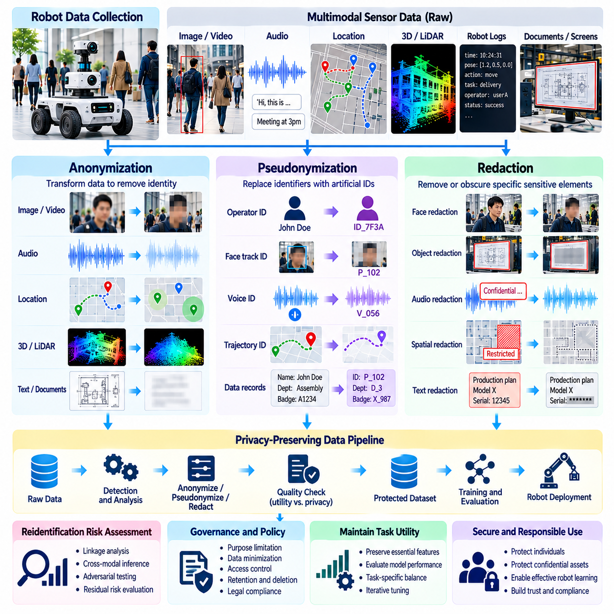{width="7.268055555555556in" height="7.268055555555556in"}

Anonymization, pseudonymization, and redaction are essential privacy protection techniques for Physical AI data engines. Robots continuously collect visual, audio, spatial, and behavioral information that may reveal personal identities or confidential industrial activities. These techniques reduce unnecessary exposure while preserving information needed for perception, imitation learning, navigation, and model evaluation. Their effectiveness depends on the data type, processing context, and potential for reidentification.

Anonymization transforms personal data so individuals are no longer identifiable by means reasonably likely to be used. This requires more than deleting names or replacing identifiers because robot observations often contain distinctive behavioral and environmental patterns. Facial appearance, gait, hand movements, and location histories may support identification through indirect inference. Anonymization must therefore be evaluated against realistic linkage and reconstruction risks.

Pseudonymization replaces direct identifiers with artificial identifiers while preserving controlled relationships between records. Operator names may be replaced with randomized codes, allowing researchers to analyze repeated demonstrations without directly exposing identities. The correspondence between codes and individuals must remain separately protected. Because reidentification remains possible through this mapping or other information, pseudonymized data generally remains personal data.

Redaction removes or obscures selected information within a dataset rather than necessarily transforming the entire dataset into anonymous information. In robot videos, redaction may conceal faces, identification badges, computer screens, or confidential documents. Audio redaction can remove names, conversations, or sensitive spoken content. Spatial redaction may exclude restricted rooms or proprietary equipment from maps and point clouds.

These three techniques serve different governance objectives and should not be treated as interchangeable. Anonymization aims to prevent identification, pseudonymization reduces direct identity exposure while retaining controlled linkability, and redaction suppresses particular sensitive elements. A dataset may use all three methods at different stages. The appropriate combination depends on intended uses, legal obligations, and the information required for robot learning.

Visual anonymization is particularly challenging because robotic cameras capture rich contextual information. Blurring faces may protect obvious identities while leaving recognizable clothing, tattoos, workplace badges, or background locations visible. Human pose estimation and silhouette extraction can reduce facial exposure, but distinctive movement patterns may remain. Privacy validation should examine the complete visual scene rather than isolated facial regions.

Automated video redaction systems commonly combine object detection, segmentation, tracking, and image transformation. Detection models identify sensitive regions, while tracking maintains consistent masking across consecutive frames. Temporal consistency is important because a single unmasked frame can reveal information concealed elsewhere. Processing pipelines should measure detection failures, missed objects, and the effects of redaction on downstream model performance.

Audio anonymization requires protection against both explicit speech content and speaker identification. Removing personal names from transcripts does not necessarily conceal identity when original voice recordings remain available. Voice transformation, speaker masking, speech removal, and conversion to task-level commands provide different levels of protection. The selected method must account for acoustic features needed by speech recognition and human-robot interaction systems.

Location anonymization involves reducing the precision or linkability of spatial observations. Robot navigation logs may contain detailed human trajectories, workstation visits, and timestamps that expose individual routines. Spatial aggregation, coordinate generalization, temporal coarsening, and trajectory truncation can reduce identification risks. However, repeated location patterns may remain distinctive even after names and exact coordinates are removed.

Industrial redaction must protect confidential business information in addition to personal data. Robot observations may capture product prototypes, engineering drawings, machine settings, production schedules, and facility layouts. Conventional facial blurring does not address these exposures. Industrial pipelines may require object masking, document detection, geometry abstraction, and exclusion of sensitive spatial regions before datasets are shared externally.

Privacy transformations must preserve the information required for legitimate Physical AI tasks. Excessive visual masking can remove object boundaries needed for grasp planning, while aggressive audio filtering may destroy command semantics. Spatial generalization may reduce localization accuracy or obscure collision hazards. Data engineers must balance privacy protection with training utility and safety requirements through task-specific evaluation.

Multimodal datasets complicate anonymization because information removed from one modality may remain recoverable from another. A masked face can be associated with a distinctive voice, while pseudonymous motion trajectories may align with identifiable location records. Cross-modal correlations can reconstruct identities or confidential activities. Privacy reviews must therefore evaluate synchronized sensor streams collectively rather than independently.

Reidentification risk assessment provides a practical foundation for evaluating anonymization claims. Analysts can examine whether transformed records remain linkable to known individuals using available auxiliary information. Membership inference, trajectory matching, behavioral recognition, and reconstruction tests may reveal residual vulnerabilities. Assessments should consider reasonably foreseeable attackers, available resources, and the consequences of successful identification.

Privacy-preserving data pipelines should integrate transformation steps as early as operationally feasible. On-robot processing can extract task-relevant features while discarding unnecessary raw images or audio. Edge redaction can reduce sensitive information before transmission to cloud infrastructure. When raw recordings are temporarily necessary, they should remain encrypted, access-restricted, and subject to short retention periods.

Pseudonymization systems require disciplined management of identity mappings and cryptographic secrets. Mapping tables should be stored separately from training datasets, with access limited to authorized administrators. Stable identifiers may support longitudinal analysis but can also enable behavioral profiling across sessions. Rotating identifiers or restricting linkage scope can reduce unnecessary tracking while retaining selected analytical capabilities.

Automated redaction is not infallible, especially in dynamic robotic environments. Motion blur, occlusion, unusual camera angles, reflective surfaces, and crowded scenes can cause detection failures. Privacy-sensitive pipelines should incorporate confidence thresholds, exception handling, and targeted human review. Quality assurance must verify both the removal of protected information and the preservation of task-relevant observations.

Dataset lineage and metadata are essential for managing privacy transformations at scale. Each processed dataset should record the transformation method, software version, parameters, validation results, and source relationship. This information supports reproducibility, compliance audits, and investigations of unexpected disclosures. Versioned records also help determine whether improved redaction methods should be reapplied to previously processed data.

Access policies should distinguish raw, pseudonymized, redacted, and sufficiently anonymized datasets according to their actual risks and applicable laws. Raw recordings may require highly restricted access, while transformed datasets may support broader research use under defined conditions. However, transformation labels alone do not guarantee safety. Sharing decisions should consider residual sensitivity, contractual restrictions, and downstream analytical capabilities.

Continuous monitoring is necessary because advances in recognition models and external data availability can change reidentification risks. A dataset considered difficult to identify today may become linkable through improved facial recognition, gait analysis, or multimodal inference. Periodic reassessment should examine emerging attack methods, changes in data sharing, and newly available auxiliary information. Updated safeguards may require further transformation or restricted access.

Effective anonymization, pseudonymization, and redaction enable Physical AI organizations to reuse valuable robot observations while reducing unnecessary exposure of individuals and industrial assets. No single transformation guarantees complete protection across every dataset and application. A mature data engine combines technical processing, measurable privacy evaluation, secure access controls, provenance tracking, and ongoing governance to support responsible, scalable robot learning.

익명화(Anonymization), 가명처리(Pseudonymization), 민감정보 가림 처리(Redaction)는 피지컬 인공지능(Physical AI) 데이터 엔진(Data Engines)을 위한 필수적인 개인정보 보호 기술(Privacy Protection Techniques)이다. 로봇은 개인의 신원(Personal Identities)이나 기밀 산업 활동(Confidential Industrial Activities)을 드러낼 수 있는 시각적(Visual), 음향적(Audio), 공간적(Spatial), 행동적 정보(Behavioral Information)를 지속적으로 수집한다. 이러한 기술은 인식(Perception), 모방학습(Imitation Learning), 내비게이션(Navigation), 모델 평가(Model Evaluation)에 필요한 정보를 유지하면서 불필요한 정보 노출(Unnecessary Exposure)을 줄인다. 기술의 효과는 데이터 유형(Data Type), 처리 환경(Processing Context), 재식별 가능성(Reidentification Potential)에 따라 달라진다.

익명화(Anonymization)는 합리적으로 사용될 가능성이 있는 수단을 통해 개인을 더 이상 식별할 수 없도록 개인정보(Personal Data)를 변환하는 과정이다. 로봇 관측 데이터(Robot Observations)에는 고유한 행동 및 환경 패턴(Behavioral and Environmental Patterns)이 포함되는 경우가 많으므로 단순히 이름을 삭제하거나 식별자를 대체하는 것만으로는 충분하지 않다. 얼굴 외형(Facial Appearance), 보행(Gait), 손 움직임(Hand Movements), 위치 이력(Location Histories)은 간접적인 추론(Indirect Inference)을 통해 개인 식별을 가능하게 할 수 있다. 따라서 익명화는 현실적인 데이터 연결 위험(Linkage Risks)과 재구성 위험(Reconstruction Risks)을 고려하여 평가해야 한다.

가명처리(Pseudonymization)는 직접 식별자(Direct Identifiers)를 인공 식별자(Artificial Identifiers)로 대체하면서 기록 간의 통제된 연결 관계(Controlled Relationships)를 유지하는 방법이다. 조작자 이름(Operator Names)을 무작위 코드(Randomized Codes)로 대체하면 연구자가 개인의 신원을 직접 노출하지 않고도 반복적인 시연(Repeated Demonstrations)을 분석할 수 있다. 코드와 개인 사이의 대응 관계(Correspondence)는 별도로 보호해야 한다. 이러한 매핑 정보(Mapping Information)나 다른 정보를 통해 재식별(Reidentification)이 가능하므로 가명처리된 데이터(Pseudonymized Data)는 일반적으로 여전히 개인정보에 해당한다.

민감정보 가림 처리(Redaction)는 데이터셋 전체를 익명 정보(Anonymous Information)로 변환하는 것이 아니라 데이터셋 내에서 선택된 정보를 제거하거나 가리는 방법이다. 로봇 영상(Robot Videos)에서는 얼굴(Faces), 신분증 배지(Identification Badges), 컴퓨터 화면(Computer Screens), 기밀 문서(Confidential Documents)를 가릴 수 있다. 오디오 가림 처리(Audio Redaction)는 이름(Names), 대화(Conversations), 민감한 발화 내용(Sensitive Spoken Content)을 제거할 수 있다. 공간정보 가림 처리(Spatial Redaction)는 지도(Maps)와 포인트 클라우드(Point Clouds)에서 출입 제한 구역(Restricted Rooms)이나 독점 장비(Proprietary Equipment)를 제외할 수 있다.

이 세 가지 기술은 서로 다른 거버넌스 목표(Governance Objectives)를 수행하므로 상호 교환 가능한 기술로 취급해서는 안 된다. 익명화(Anonymization)는 개인 식별을 방지하는 것을 목표로 하고, 가명처리(Pseudonymization)는 통제된 연결 가능성(Controlled Linkability)을 유지하면서 직접적인 신원 노출(Direct Identity Exposure)을 줄이며, 민감정보 가림 처리(Redaction)는 특정 민감 요소(Sensitive Elements)를 제거하거나 숨긴다. 하나의 데이터셋에 서로 다른 단계에서 세 가지 방법을 모두 적용할 수 있다. 적절한 조합은 사용 목적(Intended Uses), 법적 의무(Legal Obligations), 로봇 학습(Robot Learning)에 필요한 정보에 따라 결정된다.

시각적 익명화(Visual Anonymization)는 로봇 카메라(Robotic Cameras)가 풍부한 상황적 정보(Contextual Information)를 수집하기 때문에 특히 어렵다. 얼굴 흐림 처리(Facial Blurring)는 명백한 신원 정보(Obvious Identities)를 보호할 수 있지만, 식별 가능한 의복(Recognizable Clothing), 문신(Tattoos), 작업장 배지(Workplace Badges), 배경 위치(Background Locations)는 그대로 남을 수 있다. 인간 자세 추정(Human Pose Estimation)과 실루엣 추출(Silhouette Extraction)은 얼굴 노출을 줄일 수 있지만, 고유한 움직임 패턴(Distinctive Movement Patterns)은 여전히 남을 수 있다. 개인정보 보호 검증(Privacy Validation)은 개별 얼굴 영역(Isolated Facial Regions)이 아니라 전체 시각 장면(Complete Visual Scene)을 대상으로 수행되어야 한다.

자동화된 영상 가림 처리 시스템(Automated Video Redaction Systems)은 일반적으로 객체 감지(Object Detection), 분할(Segmentation), 추적(Tracking), 영상 변환(Image Transformation)을 결합한다. 감지 모델(Detection Models)은 민감한 영역(Sensitive Regions)을 식별하고, 추적 기능은 연속된 프레임(Consecutive Frames)에서 일관된 마스킹(Consistent Masking)을 유지한다. 단 하나의 마스킹되지 않은 프레임(Unmasked Frame)만으로도 다른 프레임에서 가려진 정보가 노출될 수 있으므로 시간적 일관성(Temporal Consistency)이 중요하다. 처리 파이프라인(Processing Pipelines)은 감지 실패(Detection Failures), 누락된 객체(Missed Objects), 가림 처리가 후속 모델 성능(Downstream Model Performance)에 미치는 영향을 측정해야 한다.

오디오 익명화(Audio Anonymization)는 명시적인 발화 내용(Explicit Speech Content)과 화자 식별(Speaker Identification)을 모두 방지해야 한다. 음성 전사문(Transcripts)에서 개인 이름을 제거하더라도 원본 음성 기록(Original Voice Recordings)이 남아 있다면 신원을 충분히 숨기지 못할 수 있다. 음성 변환(Voice Transformation), 화자 마스킹(Speaker Masking), 음성 제거(Speech Removal), 작업 수준 명령(Task-Level Commands)으로의 변환은 서로 다른 수준의 보호를 제공한다. 선택한 방법은 음성 인식(Speech Recognition)과 인간-로봇 상호작용(Human-Robot Interaction) 시스템에 필요한 음향 특징(Acoustic Features)을 고려해야 한다.

위치 익명화(Location Anonymization)는 공간 관측 정보(Spatial Observations)의 정밀도(Precision)나 연결 가능성(Linkability)을 줄이는 과정이다. 로봇 내비게이션 로그(Robot Navigation Logs)에는 개인의 일상적인 행동 패턴(Individual Routines)을 노출하는 상세한 인간 이동 궤적(Human Trajectories), 작업대 방문 기록(Workstation Visits), 타임스탬프(Timestamps)가 포함될 수 있다. 공간 집계(Spatial Aggregation), 좌표 일반화(Coordinate Generalization), 시간적 해상도 축소(Temporal Coarsening), 궤적 절단(Trajectory Truncation)은 개인 식별 위험(Identification Risks)을 줄일 수 있다. 그러나 이름과 정확한 좌표를 제거한 이후에도 반복적인 위치 패턴(Repeated Location Patterns)은 개인을 구별할 수 있다.

산업 데이터 가림 처리(Industrial Redaction)는 개인정보(Personal Data)뿐 아니라 기업의 기밀 정보(Confidential Business Information)도 보호해야 한다. 로봇 관측 데이터(Robot Observations)에는 제품 시제품(Product Prototypes), 엔지니어링 도면(Engineering Drawings), 기계 설정값(Machine Settings), 생산 일정(Production Schedules), 시설 배치도(Facility Layouts)가 포함될 수 있다. 일반적인 얼굴 흐림 처리(Conventional Facial Blurring)만으로는 이러한 정보 노출을 방지할 수 없다. 산업 데이터 처리 파이프라인(Industrial Pipelines)은 외부에 데이터셋을 공유하기 전에 객체 마스킹(Object Masking), 문서 감지(Document Detection), 기하학적 추상화(Geometry Abstraction), 민감한 공간 영역 제외(Exclusion of Sensitive Spatial Regions)를 수행해야 할 수 있다.

개인정보 보호 변환(Privacy Transformations)은 정당한 피지컬 인공지능 작업(Legitimate Physical AI Tasks)에 필요한 정보를 보존해야 한다. 과도한 시각적 마스킹(Excessive Visual Masking)은 파지 계획(Grasp Planning)에 필요한 객체 경계(Object Boundaries)를 제거할 수 있으며, 지나치게 강한 오디오 필터링(Aggressive Audio Filtering)은 명령의 의미(Command Semantics)를 손상시킬 수 있다. 공간 일반화(Spatial Generalization)는 위치 추정 정확도(Localization Accuracy)를 낮추거나 충돌 위험(Collision Hazards)을 가릴 수 있다. 데이터 엔지니어(Data Engineers)는 작업별 평가(Task-Specific Evaluation)를 통해 개인정보 보호(Privacy Protection), 학습 유용성(Training Utility), 안전 요구사항(Safety Requirements) 사이의 균형을 유지해야 한다.

다중모달 데이터셋(Multimodal Datasets)은 하나의 모달리티(Modality)에서 제거된 정보가 다른 모달리티를 통해 복원될 수 있기 때문에 익명화를 더욱 복잡하게 만든다. 마스킹된 얼굴(Masked Face)은 고유한 음성(Distinctive Voice)과 연결될 수 있으며, 가명처리된 움직임 궤적(Pseudonymous Motion Trajectories)은 식별 가능한 위치 기록(Identifiable Location Records)과 일치할 수 있다. 모달리티 간 상관관계(Cross-Modal Correlations)는 개인의 신원(Identities)이나 기밀 활동(Confidential Activities)을 재구성할 수 있다. 따라서 개인정보 보호 검토(Privacy Reviews)는 동기화된 센서 스트림(Synchronized Sensor Streams)을 개별적으로 평가하기보다 통합적으로 평가해야 한다.

재식별 위험 평가(Reidentification Risk Assessment)는 익명화의 효과를 검증하기 위한 실용적인 기반을 제공한다. 분석가는 이용 가능한 보조 정보(Auxiliary Information)를 사용하여 변환된 기록(Transformed Records)이 알려진 개인(Known Individuals)과 연결될 수 있는지 조사할 수 있다. 멤버십 추론(Membership Inference), 궤적 매칭(Trajectory Matching), 행동 인식(Behavioral Recognition), 재구성 테스트(Reconstruction Tests)는 잔여 취약점(Residual Vulnerabilities)을 드러낼 수 있다. 평가는 합리적으로 예측 가능한 공격자(Reasonably Foreseeable Attackers), 이용 가능한 자원(Available Resources), 식별 성공 시 발생할 결과(Consequences of Successful Identification)를 고려해야 한다.

개인정보 보호 데이터 파이프라인(Privacy-Preserving Data Pipelines)은 운영상 가능한 한 초기 단계에서 변환 과정(Transformation Steps)을 통합해야 한다. 로봇 내부 처리(On-Robot Processing)는 작업 관련 특징(Task-Relevant Features)을 추출하면서 불필요한 원시 영상(Raw Images)이나 오디오(Audio)를 폐기할 수 있다. 엣지 가림 처리(Edge Redaction)는 클라우드 인프라(Cloud Infrastructure)로 데이터를 전송하기 전에 민감한 정보(Sensitive Information)를 줄일 수 있다. 원시 기록(Raw Recordings)이 일시적으로 필요한 경우에는 암호화(Encryption), 접근 제한(Access Restrictions), 짧은 보존 기간(Short Retention Periods)을 적용해야 한다.

가명처리 시스템(Pseudonymization Systems)은 신원 매핑 정보(Identity Mappings)와 암호화 비밀정보(Cryptographic Secrets)를 엄격하게 관리해야 한다. 매핑 테이블(Mapping Tables)은 학습 데이터셋(Training Datasets)과 분리하여 저장하고, 승인된 관리자(Authorized Administrators)만 접근할 수 있도록 제한해야 한다. 고정 식별자(Stable Identifiers)는 장기간에 걸친 분석(Longitudinal Analysis)을 지원하지만, 여러 세션(Sessions)에 걸친 행동 프로파일링(Behavioral Profiling)을 가능하게 할 수도 있다. 식별자 순환(Rotating Identifiers)이나 연결 범위 제한(Restricting Linkage Scope)은 필요한 분석 기능(Analytical Capabilities)을 유지하면서 불필요한 추적(Unnecessary Tracking)을 줄일 수 있다.

자동화된 민감정보 가림 처리(Automated Redaction)는 특히 역동적인 로봇 환경(Dynamic Robotic Environments)에서 완벽하게 작동하지 않는다. 모션 블러(Motion Blur), 가림 현상(Occlusion), 비정상적인 카메라 각도(Unusual Camera Angles), 반사 표면(Reflective Surfaces), 혼잡한 장면(Crowded Scenes)은 감지 실패(Detection Failures)를 유발할 수 있다. 개인정보 보호에 민감한 파이프라인(Privacy-Sensitive Pipelines)은 신뢰도 임계값(Confidence Thresholds), 예외 처리(Exception Handling), 선별적인 인간 검토(Targeted Human Review)를 통합해야 한다. 품질 보증(Quality Assurance)은 보호 대상 정보(Protected Information)의 제거와 작업 관련 관측 정보(Task-Relevant Observations)의 보존을 모두 검증해야 한다.

데이터셋 계보(Dataset Lineage)와 메타데이터(Metadata)는 대규모 개인정보 보호 변환(Privacy Transformations)을 관리하는 데 필수적이다. 각 처리된 데이터셋(Processed Dataset)은 변환 방법(Transformation Method), 소프트웨어 버전(Software Version), 매개변수(Parameters), 검증 결과(Validation Results), 원본과의 관계(Source Relationship)를 기록해야 한다. 이러한 정보는 재현성(Reproducibility), 규정 준수 감사(Compliance Audits), 예상하지 못한 정보 공개(Unexpected Disclosures)에 대한 조사를 지원한다. 버전 관리된 기록(Versioned Records)은 개선된 가림 처리 방법(Improved Redaction Methods)을 기존에 처리된 데이터에 다시 적용해야 하는지 판단하는 데도 도움이 된다.

접근 정책(Access Policies)은 실제 위험(Actual Risks)과 적용 법률(Applicable Laws)에 따라 원시 데이터셋(Raw Datasets), 가명처리된 데이터셋(Pseudonymized Datasets), 가림 처리된 데이터셋(Redacted Datasets), 충분히 익명화된 데이터셋(Sufficiently Anonymized Datasets)을 구분해야 한다. 원시 기록(Raw Recordings)은 매우 엄격한 접근 제한(Highly Restricted Access)이 필요할 수 있지만, 변환된 데이터셋(Transformed Datasets)은 정의된 조건에서 더 폭넓은 연구 활용(Broader Research Use)을 지원할 수 있다. 그러나 변환 상태를 나타내는 레이블(Transformation Labels)만으로 안전성이 보장되지는 않는다. 데이터 공유 결정(Sharing Decisions)은 잔여 민감도(Residual Sensitivity), 계약상 제한(Contractual Restrictions), 후속 분석 기능(Downstream Analytical Capabilities)을 고려해야 한다.

인식 모델(Recognition Models)의 발전과 외부 데이터(External Data)의 가용성 변화는 재식별 위험(Reidentification Risks)을 변화시킬 수 있으므로 지속적인 모니터링(Continuous Monitoring)이 필요하다. 현재는 개인 식별이 어렵다고 판단되는 데이터셋도 향상된 얼굴 인식(Facial Recognition), 보행 분석(Gait Analysis), 다중모달 추론(Multimodal Inference)을 통해 식별 가능해질 수 있다. 정기적인 재평가(Periodic Reassessment)는 새로운 공격 방법(Emerging Attack Methods), 데이터 공유 방식의 변화(Changes in Data Sharing), 새롭게 이용 가능한 보조 정보(Newly Available Auxiliary Information)를 검토해야 한다. 갱신된 보호 조치(Updated Safeguards)에 따라 추가적인 데이터 변환(Further Transformation)이나 접근 제한(Restricted Access)이 필요할 수 있다.

효과적인 익명화(Anonymization), 가명처리(Pseudonymization), 민감정보 가림 처리(Redaction)는 피지컬 인공지능 조직(Physical AI Organizations)이 개인과 산업 자산(Industrial Assets)의 불필요한 정보 노출을 줄이면서 가치 있는 로봇 관측 데이터(Robot Observations)를 재사용할 수 있도록 한다. 어떤 단일 변환 방법(Single Transformation)도 모든 데이터셋과 응용 분야에서 완전한 보호(Complete Protection)를 보장하지는 않는다. 성숙한 데이터 엔진(Mature Data Engine)은 기술적 처리(Technical Processing), 측정 가능한 개인정보 보호 평가(Measurable Privacy Evaluation), 안전한 접근 제어(Secure Access Controls), 데이터 출처 추적(Provenance Tracking), 지속적인 거버넌스(Ongoing Governance)를 결합하여 책임 있고 확장 가능한 로봇 학습(Responsible, Scalable Robot Learning)을 지원한다.

##  

## 08.09. Access Control and Data Security

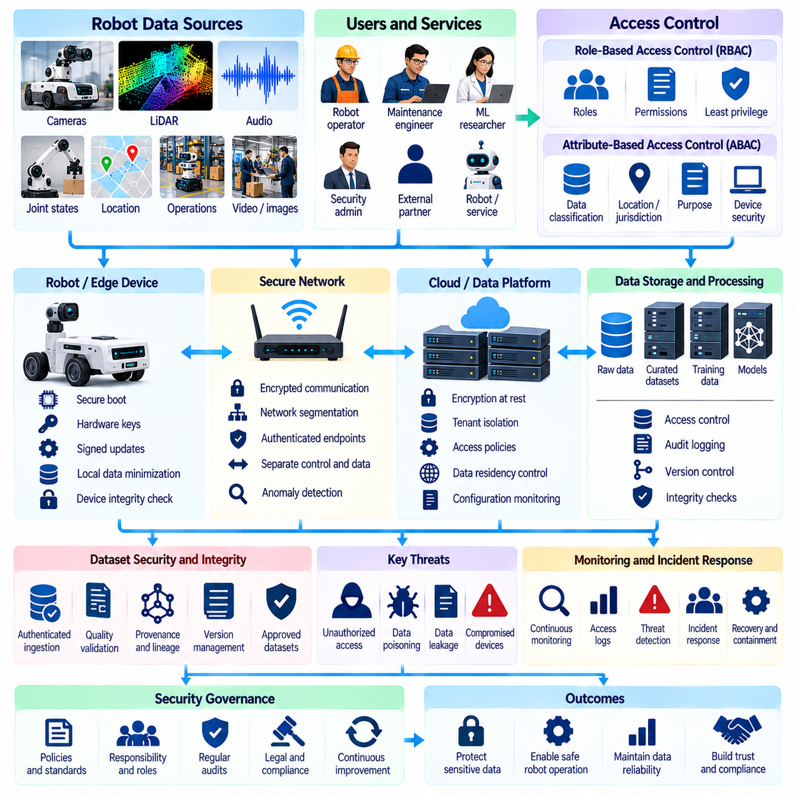{width="7.268055555555556in" height="7.268055555555556in"}

Access control and data security are fundamental requirements for Physical AI data engines because robotic systems continuously generate sensitive information about people, environments, and operational activities. Camera recordings, sensor streams, motion trajectories, and training datasets may contain personal or proprietary information. Protecting these assets requires coordinated security measures across robots, edge devices, communication networks, cloud infrastructure, and machine learning pipelines.

Access control determines which individuals, services, and automated processes can interact with specific data resources. Permissions may govern reading, modifying, exporting, deleting, or using datasets for model training. Physical AI platforms must distinguish authorized operational activities from unnecessary access. A secure architecture applies the principle of least privilege, ensuring that each user or component receives only the permissions required for legitimate responsibilities.

Role-based access control assigns permissions according to organizational responsibilities. Robot operators may access operational dashboards, maintenance engineers may inspect diagnostic logs, and machine learning researchers may use approved training datasets. Security administrators manage credentials and access policies without necessarily requiring unrestricted access to raw recordings. Clearly defined roles reduce accidental disclosure and simplify permission management across large robotic organizations.

Attribute-based access control provides greater flexibility when permissions depend on data sensitivity, location, purpose, or contractual conditions. A dataset may be accessible only to approved researchers working within a particular jurisdiction or secure computing environment. Access decisions can evaluate user identity, dataset classification, processing purpose, and device security status. Such policies are valuable when Physical AI platforms serve multiple customers and regulatory domains.

Identity and authentication systems establish whether users, robots, and services are trustworthy participants. Human access may require multifactor authentication, while robots and software services can use cryptographic certificates or managed machine identities. Credentials should be issued, rotated, revoked, and monitored through controlled processes. Shared accounts and permanently embedded secrets increase the risk of unauthorized access and complicate incident investigation.

Zero-trust security principles are particularly relevant to distributed robotic infrastructure. A robot operating inside a factory network should not automatically be trusted merely because it connects from an internal address. Each access request should be authenticated, authorized, and evaluated against current security conditions. Network segmentation and service-level authorization can limit the consequences of compromised devices or stolen credentials.

Encryption protects Physical AI data against unauthorized disclosure during transmission and storage. Transport encryption secures communication between robots, gateways, and cloud services, while encryption at rest protects stored recordings and datasets. Effective protection also requires secure key generation, distribution, rotation, and revocation. Encryption alone cannot prevent misuse by authorized users, so it must operate alongside access policies and monitoring.

Robotic edge devices introduce unique security challenges because they operate in physically accessible and sometimes uncontrolled environments. Attackers may attempt to extract storage media, modify firmware, or intercept sensor interfaces. Secure boot, hardware-backed key storage, signed software updates, and device integrity verification can reduce these risks. Sensitive raw data should be minimized locally, and compromised devices should be isolated from shared infrastructure.

Network security must account for the continuous exchange of telemetry, control messages, sensor recordings, and model updates. Secure communication protocols, authenticated endpoints, firewall rules, and network segmentation help protect these flows. Safety-critical control traffic should be separated from bulk data uploads when appropriate. Monitoring systems should detect unusual transfers, unexpected connections, and attempts to access unauthorized services.

Cloud-based robot data platforms require strong isolation between customers, projects, and operational environments. Shared storage and computing resources can create cross-tenant exposure risks if permissions are incorrectly configured. Tenant-specific access policies, encryption boundaries, isolated processing environments, and continuous configuration checks reduce these vulnerabilities. Data residency restrictions must also be reflected in cloud deployment and access arrangements.

Training datasets require protection throughout ingestion, annotation, curation, and model development. External contributors may upload corrupted or malicious samples, while unauthorized users may attempt to modify labels or replace training files. Dataset integrity checks, authenticated ingestion, version control, and provenance records can detect unexpected changes. Security governance must protect both confidentiality and the reliability of information used to train robot policies.

Data poisoning represents a distinctive threat because malicious modifications can influence learned robot behavior. Altered demonstrations, incorrect labels, or manipulated sensor observations may cause unsafe decisions or degraded performance. Secure data pipelines should validate source authenticity, inspect anomalous samples, and preserve reproducible training records. Independent evaluation and controlled dataset approval can reduce the likelihood that compromised data reaches production models.

Model artifacts and training infrastructure also require access protection. Learned parameters, checkpoints, evaluation results, and deployment packages may contain valuable intellectual property or information derived from sensitive datasets. Unauthorized modification can introduce malicious behavior, while uncontrolled distribution may expose proprietary capabilities. Signed model packages, artifact registries, access restrictions, and deployment verification support trustworthy model management.

Data loss prevention controls can limit unauthorized movement of sensitive robotic information. Large exports, unusual downloads, transfers to unapproved destinations, and unexpected dataset replication may indicate misuse or compromise. Monitoring should consider legitimate research workflows to avoid unnecessary disruption. Approval mechanisms, export restrictions, and automated alerts help organizations maintain visibility over confidential data movement.

Audit logging establishes accountability by recording who accessed data, what operations occurred, and which systems were involved. Logs should capture dataset retrieval, permission changes, exports, deletions, and training activities where appropriate. Protected timestamps and tamper-resistant storage improve evidentiary reliability. Audit records must themselves be secured because they may reveal sensitive operational information or personal activity patterns.

Security monitoring should combine identity events, network activity, storage access, and robotic operational signals. Unusual access times, repeated authentication failures, unexpected data transfers, or unauthorized model changes may indicate an incident. Automated detection can prioritize suspicious events, but investigations require contextual understanding. Monitoring policies should avoid creating unnecessary surveillance of employees while maintaining operational security.

Third-party access introduces risks when annotation vendors, research partners, cloud providers, or maintenance contractors process robot datasets. Contracts should specify permitted activities, confidentiality obligations, security requirements, and incident notification responsibilities. Temporary access credentials and isolated workspaces can limit exposure. Organizations should verify external security practices and promptly revoke access when contractual relationships end.

Backup and recovery mechanisms protect the availability and integrity of Physical AI data. Ransomware, storage failures, accidental deletion, and infrastructure outages can disrupt training and robot operations. Encrypted backups, immutable recovery copies, and regularly tested restoration procedures improve resilience. Recovery planning should consider dataset versions, metadata, access policies, and dependencies required to reproduce validated robot models.

Incident response procedures must address unauthorized disclosure, data tampering, credential compromise, and malicious model modification. Response teams should be able to isolate affected systems, preserve evidence, assess impacted datasets, and restore trusted operations. Security incidents involving deployed robots may also require immediate safety measures. Documented escalation paths and post-incident reviews help prevent repeated failures.

A mature Physical AI security architecture integrates identity management, least-privilege access, encryption, integrity verification, monitoring, and incident response into a unified governance framework. Security controls must evolve as robot fleets, data volumes, and collaborative learning environments expand. By protecting data confidentiality, integrity, and availability throughout the learning lifecycle, organizations can build scalable robotic intelligence without sacrificing safety, accountability, or trust.

접근 제어(Access Control)와 데이터 보안(Data Security)은 로봇 시스템(Robotic Systems)이 사람, 환경, 운영 활동(Operational Activities)에 관한 민감한 정보(Sensitive Information)를 지속적으로 생성하기 때문에 피지컬 인공지능(Physical AI) 데이터 엔진(Data Engines)의 기본적인 요구사항이다. 카메라 기록(Camera Recordings), 센서 스트림(Sensor Streams), 동작 궤적(Motion Trajectories), 학습 데이터셋(Training Datasets)에는 개인정보(Personal Information)나 독점 정보(Proprietary Information)가 포함될 수 있다. 이러한 자산(Assets)을 보호하려면 로봇(Robots), 엣지 장치(Edge Devices), 통신 네트워크(Communication Networks), 클라우드 인프라(Cloud Infrastructure), 머신러닝 파이프라인(Machine Learning Pipelines) 전반에 걸친 통합적인 보안 조치(Security Measures)가 필요하다.

접근 제어(Access Control)는 어떤 개인(Individuals), 서비스(Services), 자동화된 프로세스(Automated Processes)가 특정 데이터 자원(Data Resources)과 상호작용할 수 있는지를 결정한다. 권한(Permissions)은 데이터셋의 읽기(Reading), 수정(Modifying), 내보내기(Exporting), 삭제(Deleting), 모델 학습(Model Training)에의 사용을 통제할 수 있다. 피지컬 인공지능 플랫폼(Physical AI Platforms)은 승인된 운영 활동(Authorized Operational Activities)과 불필요한 접근(Unnecessary Access)을 구분해야 한다. 안전한 아키텍처(Secure Architecture)는 최소 권한 원칙(Principle of Least Privilege)을 적용하여 각 사용자(User)나 구성요소(Component)에 정당한 책임(Legitimate Responsibilities)을 수행하는 데 필요한 권한만 부여한다.

역할 기반 접근 제어(Role-Based Access Control, RBAC)는 조직 내 책임(Organizational Responsibilities)에 따라 권한을 할당한다. 로봇 운영자(Robot Operators)는 운영 대시보드(Operational Dashboards)에 접근하고, 유지보수 엔지니어(Maintenance Engineers)는 진단 로그(Diagnostic Logs)를 확인하며, 머신러닝 연구자(Machine Learning Researchers)는 승인된 학습 데이터셋(Approved Training Datasets)을 사용할 수 있다. 보안 관리자(Security Administrators)는 원시 기록(Raw Recordings)에 대한 무제한 접근 권한이 반드시 필요한 것은 아니며, 인증정보(Credentials)와 접근 정책(Access Policies)을 관리할 수 있다. 명확하게 정의된 역할(Clearly Defined Roles)은 우발적인 정보 공개(Accidental Disclosure)를 줄이고 대규모 로봇 조직(Large Robotic Organizations)의 권한 관리(Permission Management)를 단순화한다.

속성 기반 접근 제어(Attribute-Based Access Control, ABAC)는 권한이 데이터 민감도(Data Sensitivity), 위치(Location), 목적(Purpose), 계약 조건(Contractual Conditions)에 따라 달라질 때 더 높은 유연성(Flexibility)을 제공한다. 데이터셋(Dataset)은 특정 관할권(Jurisdiction)이나 안전한 컴퓨팅 환경(Secure Computing Environment)에서 작업하는 승인된 연구자(Approved Researchers)에게만 접근이 허용될 수 있다. 접근 결정(Access Decisions)은 사용자 신원(User Identity), 데이터셋 분류(Dataset Classification), 처리 목적(Processing Purpose), 장치 보안 상태(Device Security Status)를 평가할 수 있다. 이러한 정책은 피지컬 인공지능 플랫폼이 여러 고객(Customers)과 규제 영역(Regulatory Domains)에 서비스를 제공할 때 유용하다.

신원 관리 및 인증 시스템(Identity and Authentication Systems)은 사용자(Users), 로봇(Robots), 서비스(Services)가 신뢰할 수 있는 참여자(Trustworthy Participants)인지 확인한다. 사람의 접근(Human Access)에는 다중요소 인증(Multifactor Authentication)이 필요할 수 있으며, 로봇과 소프트웨어 서비스(Software Services)는 암호화 인증서(Cryptographic Certificates)나 관리형 기계 신원(Managed Machine Identities)을 사용할 수 있다. 인증정보(Credentials)는 통제된 절차(Controlled Processes)를 통해 발급(Issued), 교체(Rotated), 폐기(Revoked), 모니터링(Monitored)되어야 한다. 공유 계정(Shared Accounts)과 영구적으로 내장된 비밀정보(Permanently Embedded Secrets)는 무단 접근(Unauthorized Access)의 위험을 높이고 보안 사고 조사(Incident Investigation)를 어렵게 만든다.

제로 트러스트 보안 원칙(Zero-Trust Security Principles)은 분산형 로봇 인프라(Distributed Robotic Infrastructure)에서 특히 중요하다. 공장 네트워크(Factory Network) 내부에서 작동하는 로봇이라고 하더라도 내부 주소(Internal Address)에서 연결되었다는 이유만으로 자동으로 신뢰해서는 안 된다. 모든 접근 요청(Access Requests)은 인증(Authentication), 인가(Authorization), 현재 보안 상태(Current Security Conditions)에 대한 평가를 거쳐야 한다. 네트워크 분할(Network Segmentation)과 서비스 수준 인가(Service-Level Authorization)는 손상된 장치(Compromised Devices)나 탈취된 인증정보(Stolen Credentials)로 인해 발생하는 피해를 제한할 수 있다.

암호화(Encryption)는 전송 및 저장 과정에서 피지컬 인공지능 데이터(Physical AI Data)가 무단으로 공개되는 것을 방지한다. 전송 암호화(Transport Encryption)는 로봇(Robots), 게이트웨이(Gateways), 클라우드 서비스(Cloud Services) 사이의 통신을 보호하며, 저장 데이터 암호화(Encryption at Rest)는 저장된 기록(Stored Recordings)과 데이터셋(Datasets)을 보호한다. 효과적인 보호를 위해서는 안전한 암호화 키 생성(Secure Key Generation), 배포(Distribution), 교체(Rotation), 폐기(Revocation)도 필요하다. 암호화만으로는 승인된 사용자(Authorized Users)의 오용(Misuse)을 방지할 수 없으므로 접근 정책(Access Policies) 및 모니터링(Monitoring)과 함께 적용해야 한다.

로봇 엣지 장치(Robotic Edge Devices)는 물리적으로 접근할 수 있고 때로는 통제되지 않는 환경(Uncontrolled Environments)에서 작동하기 때문에 고유한 보안 문제(Security Challenges)를 발생시킨다. 공격자(Attackers)는 저장 매체(Storage Media)에서 정보를 추출하거나 펌웨어(Firmware)를 수정하거나 센서 인터페이스(Sensor Interfaces)를 가로채려고 시도할 수 있다. 보안 부팅(Secure Boot), 하드웨어 기반 키 저장(Hardware-Backed Key Storage), 서명된 소프트웨어 업데이트(Signed Software Updates), 장치 무결성 검증(Device Integrity Verification)은 이러한 위험을 줄일 수 있다. 민감한 원시 데이터(Sensitive Raw Data)는 로컬 장치에서 최소화해야 하며, 손상된 장치(Compromised Devices)는 공유 인프라(Shared Infrastructure)에서 격리해야 한다.

네트워크 보안(Network Security)은 원격측정 데이터(Telemetry), 제어 메시지(Control Messages), 센서 기록(Sensor Recordings), 모델 업데이트(Model Updates)가 지속적으로 교환되는 특성을 고려해야 한다. 안전한 통신 프로토콜(Secure Communication Protocols), 인증된 엔드포인트(Authenticated Endpoints), 방화벽 규칙(Firewall Rules), 네트워크 분할(Network Segmentation)은 이러한 데이터 흐름(Data Flows)을 보호하는 데 도움이 된다. 필요한 경우 안전 필수 제어 트래픽(Safety-Critical Control Traffic)은 대용량 데이터 업로드(Bulk Data Uploads)와 분리해야 한다. 모니터링 시스템(Monitoring Systems)은 비정상적인 데이터 전송(Unusual Transfers), 예상하지 못한 연결(Unexpected Connections), 승인되지 않은 서비스(Unauthorized Services)에 대한 접근 시도를 감지해야 한다.

클라우드 기반 로봇 데이터 플랫폼(Cloud-Based Robot Data Platforms)은 고객(Customers), 프로젝트(Projects), 운영 환경(Operational Environments) 사이에 강력한 격리(Isolation)를 제공해야 한다. 공유 저장소(Shared Storage)와 컴퓨팅 자원(Computing Resources)은 권한(Permissions)이 잘못 설정되면 테넌트 간 정보 노출 위험(Cross-Tenant Exposure Risks)을 발생시킬 수 있다. 테넌트별 접근 정책(Tenant-Specific Access Policies), 암호화 경계(Encryption Boundaries), 격리된 처리 환경(Isolated Processing Environments), 지속적인 구성 점검(Continuous Configuration Checks)은 이러한 취약점(Vulnerabilities)을 줄인다. 데이터 소재지 제한(Data Residency Restrictions)도 클라우드 배포(Cloud Deployment) 및 접근 체계(Access Arrangements)에 반영되어야 한다.

학습 데이터셋(Training Datasets)은 수집 및 유입(Ingestion), 주석 처리(Annotation), 데이터 정제(Curation), 모델 개발(Model Development)의 전체 과정에서 보호되어야 한다. 외부 기여자(External Contributors)는 손상되거나 악의적으로 조작된 샘플(Corrupted or Malicious Samples)을 업로드할 수 있으며, 승인되지 않은 사용자(Unauthorized Users)는 레이블(Labels)을 수정하거나 학습 파일(Training Files)을 교체하려고 시도할 수 있다. 데이터셋 무결성 검사(Dataset Integrity Checks), 인증된 데이터 수집(Authenticated Ingestion), 버전 관리(Version Control), 데이터 출처 기록(Provenance Records)은 예상하지 못한 변경(Unexpected Changes)을 감지할 수 있다. 보안 거버넌스(Security Governance)는 기밀성(Confidentiality)뿐 아니라 로봇 정책(Robot Policies)을 학습시키는 데 사용되는 정보의 신뢰성(Reliability)도 보호해야 한다.

데이터 포이즈닝(Data Poisoning)은 악의적인 수정(Malicious Modifications)이 학습된 로봇 행동(Learned Robot Behavior)에 영향을 미칠 수 있다는 점에서 독특한 위협(Threat)을 나타낸다. 변경된 시연 데이터(Altered Demonstrations), 잘못된 레이블(Incorrect Labels), 조작된 센서 관측 데이터(Manipulated Sensor Observations)는 안전하지 않은 의사결정(Unsafe Decisions)이나 성능 저하(Degraded Performance)를 유발할 수 있다. 안전한 데이터 파이프라인(Secure Data Pipelines)은 데이터 출처의 진위성(Source Authenticity)을 검증하고, 이상 샘플(Anomalous Samples)을 검사하며, 재현 가능한 학습 기록(Reproducible Training Records)을 보존해야 한다. 독립적인 평가(Independent Evaluation)와 통제된 데이터셋 승인(Controlled Dataset Approval)은 손상된 데이터(Compromised Data)가 운영 모델(Production Models)에 반영될 가능성을 줄일 수 있다.

모델 산출물(Model Artifacts)과 학습 인프라(Training Infrastructure)에도 접근 보호(Access Protection)가 필요하다. 학습된 매개변수(Learned Parameters), 체크포인트(Checkpoints), 평가 결과(Evaluation Results), 배포 패키지(Deployment Packages)에는 가치 있는 지식재산(Intellectual Property)이나 민감한 데이터셋(Sensitive Datasets)에서 파생된 정보가 포함될 수 있다. 무단 수정(Unauthorized Modification)은 악의적인 행동(Malicious Behavior)을 유발할 수 있으며, 통제되지 않은 배포(Uncontrolled Distribution)는 독점적인 기능(Proprietary Capabilities)을 노출할 수 있다. 서명된 모델 패키지(Signed Model Packages), 모델 산출물 저장소(Artifact Registries), 접근 제한(Access Restrictions), 배포 검증(Deployment Verification)은 신뢰할 수 있는 모델 관리(Trustworthy Model Management)를 지원한다.

데이터 유출 방지 통제(Data Loss Prevention Controls)는 민감한 로봇 정보(Sensitive Robotic Information)의 무단 이동을 제한할 수 있다. 대규모 데이터 반출(Large Exports), 비정상적인 다운로드(Unusual Downloads), 승인되지 않은 목적지(Unapproved Destinations)로의 전송, 예상하지 못한 데이터셋 복제(Unexpected Dataset Replication)는 오용(Misuse)이나 시스템 침해(Compromise)를 나타낼 수 있다. 모니터링(Monitoring)은 불필요한 업무 방해를 피하기 위해 정당한 연구 워크플로(Legitimate Research Workflows)를 고려해야 한다. 승인 절차(Approval Mechanisms), 반출 제한(Export Restrictions), 자동화된 경고(Automated Alerts)는 조직이 기밀 데이터 이동(Confidential Data Movement)을 지속적으로 파악하도록 돕는다.

감사 로깅(Audit Logging)은 누가 데이터에 접근했는지, 어떤 작업이 수행되었는지, 어떤 시스템이 관련되었는지를 기록하여 책임성(Accountability)을 확보한다. 감사 로그(Audit Logs)는 적절한 경우 데이터셋 검색 및 열람(Dataset Retrieval), 권한 변경(Permission Changes), 데이터 반출(Exports), 삭제(Deletions), 학습 활동(Training Activities)을 기록해야 한다. 보호된 타임스탬프(Protected Timestamps)와 변조 방지 저장소(Tamper-Resistant Storage)는 증거의 신뢰성(Evidentiary Reliability)을 높인다. 감사 기록(Audit Records) 자체도 민감한 운영 정보(Sensitive Operational Information)나 개인 활동 패턴(Personal Activity Patterns)을 드러낼 수 있으므로 안전하게 보호해야 한다.

보안 모니터링(Security Monitoring)은 신원 관련 이벤트(Identity Events), 네트워크 활동(Network Activity), 저장소 접근(Storage Access), 로봇 운영 신호(Robotic Operational Signals)를 통합해야 한다. 비정상적인 접근 시간(Unusual Access Times), 반복적인 인증 실패(Repeated Authentication Failures), 예상하지 못한 데이터 전송(Unexpected Data Transfers), 승인되지 않은 모델 변경(Unauthorized Model Changes)은 보안 사고(Security Incident)의 징후일 수 있다. 자동화된 탐지(Automated Detection)는 의심스러운 이벤트(Suspicious Events)의 우선순위를 정할 수 있지만, 사고 조사(Investigations)에는 상황에 대한 이해(Contextual Understanding)가 필요하다. 모니터링 정책(Monitoring Policies)은 운영 보안(Operational Security)을 유지하면서 직원(Employee)에 대한 불필요한 감시(Unnecessary Surveillance)를 방지해야 한다.

제3자 접근(Third-Party Access)은 주석 처리 업체(Annotation Vendors), 연구 협력기관(Research Partners), 클라우드 공급업체(Cloud Providers), 유지보수 계약업체(Maintenance Contractors)가 로봇 데이터셋(Robot Datasets)을 처리할 때 추가적인 위험을 발생시킨다. 계약(Contracts)은 허용된 활동(Permitted Activities), 기밀 유지 의무(Confidentiality Obligations), 보안 요구사항(Security Requirements), 사고 통지 책임(Incident Notification Responsibilities)을 명시해야 한다. 임시 접근 인증정보(Temporary Access Credentials)와 격리된 작업 공간(Isolated Workspaces)은 정보 노출을 제한할 수 있다. 조직은 외부 업체의 보안 관행(External Security Practices)을 검증하고 계약 관계(Contractual Relationships)가 종료되면 접근 권한을 신속하게 폐기해야 한다.

백업 및 복구 메커니즘(Backup and Recovery Mechanisms)은 피지컬 인공지능 데이터(Physical AI Data)의 가용성(Availability)과 무결성(Integrity)을 보호한다. 랜섬웨어(Ransomware), 저장장치 장애(Storage Failures), 우발적인 삭제(Accidental Deletion), 인프라 중단(Infrastructure Outages)은 학습(Training)과 로봇 운영(Robot Operations)을 방해할 수 있다. 암호화된 백업(Encrypted Backups), 변경 불가능한 복구 사본(Immutable Recovery Copies), 정기적으로 검증된 복원 절차(Regularly Tested Restoration Procedures)는 복원력(Resilience)을 높인다. 복구 계획(Recovery Planning)은 검증된 로봇 모델(Validated Robot Models)을 재현하는 데 필요한 데이터셋 버전(Dataset Versions), 메타데이터(Metadata), 접근 정책(Access Policies), 종속성(Dependencies)을 고려해야 한다.

사고 대응 절차(Incident Response Procedures)는 무단 정보 공개(Unauthorized Disclosure), 데이터 변조(Data Tampering), 인증정보 침해(Credential Compromise), 악의적인 모델 수정(Malicious Model Modification)에 대응할 수 있어야 한다. 대응팀(Response Teams)은 영향을 받은 시스템(Affected Systems)을 격리하고, 증거(Evidence)를 보존하며, 피해 데이터셋(Impacted Datasets)을 평가하고, 신뢰할 수 있는 운영 상태(Trusted Operations)를 복구할 수 있어야 한다. 배포된 로봇(Deployed Robots)과 관련된 보안 사고(Security Incidents)는 즉각적인 안전 조치(Immediate Safety Measures)가 필요할 수도 있다. 문서화된 보고 및 상향 대응 경로(Documented Escalation Paths)와 사고 후 검토(Post-Incident Reviews)는 반복적인 장애(Repeated Failures)를 방지하는 데 도움이 된다.

성숙한 피지컬 인공지능 보안 아키텍처(Mature Physical AI Security Architecture)는 신원 관리(Identity Management), 최소 권한 접근(Least-Privilege Access), 암호화(Encryption), 무결성 검증(Integrity Verification), 모니터링(Monitoring), 사고 대응(Incident Response)을 통합된 거버넌스 프레임워크(Unified Governance Framework)로 결합한다. 보안 통제(Security Controls)는 로봇 플릿(Robot Fleets), 데이터 규모(Data Volumes), 협력 학습 환경(Collaborative Learning Environments)이 확장됨에 따라 지속적으로 발전해야 한다. 조직은 전체 학습 생명주기(Learning Lifecycle)에 걸쳐 데이터의 기밀성(Confidentiality), 무결성(Integrity), 가용성(Availability)을 보호함으로써 안전성(Safety), 책임성(Accountability), 신뢰(Trust)를 훼손하지 않으면서 확장 가능한 로봇 지능(Scalable Robotic Intelligence)을 구축할 수 있다.

##  

## 08.10. Data Retention Deletion and Auditing

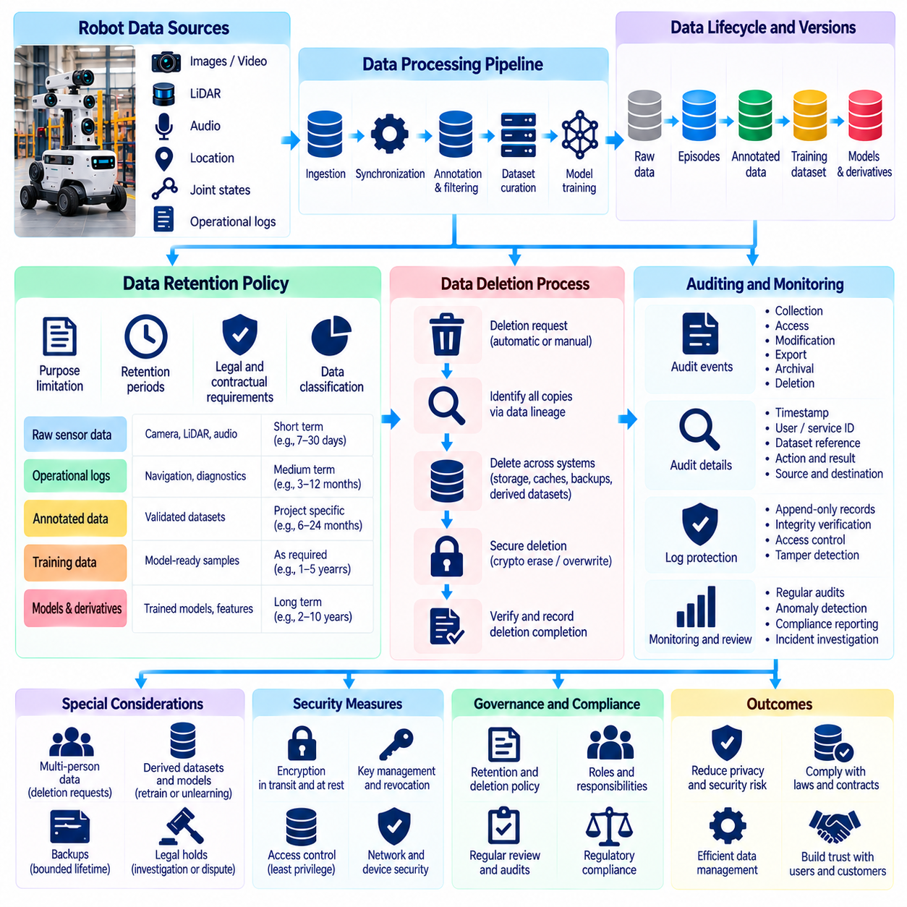{width="7.268055555555556in" height="7.268055555555556in"}

Data retention, deletion, and auditing are essential components of Physical AI data governance because robotic systems continuously generate large volumes of sensor recordings, operational logs, and training data. These records support learning, diagnostics, and safety investigations but may also contain personal or confidential information. Effective governance defines how long data remains available, when it must be removed, and how its lifecycle can be verified.

Data retention policies establish the conditions under which robotic information is stored for operational, research, legal, or contractual purposes. Retention periods should reflect the original collection purpose, data sensitivity, and legitimate business requirements. Raw camera recordings may require shorter retention than validated training features or aggregated performance statistics. Indefinite storage should not become the default simply because storage capacity is inexpensive.

Physical AI datasets often pass through multiple processing stages, creating distinct retention requirements. Raw sensor streams may be converted into synchronized episodes, annotated demonstrations, filtered datasets, and model-ready training samples. Each derivative can contain different levels of sensitive information. Retention schedules should identify which versions remain necessary and whether intermediate files can be deleted after validation.

Purpose limitation provides an important foundation for retention decisions. Information collected for immediate navigation or obstacle avoidance may not require long-term storage, while incident recordings may need preservation for investigation. Data gathered for maintenance diagnostics should not automatically be retained for unrelated model development. Organizations must periodically verify that continued storage remains justified by an approved purpose.

Retention periods should be determined through a combination of risk assessment, operational necessity, and applicable legal requirements. Different jurisdictions and contractual relationships may impose minimum preservation periods or maximum storage limits. A single universal retention duration is therefore inappropriate for every robot deployment. Governance frameworks should document the justification, responsible authority, and review conditions for each retention category.

Automated lifecycle management helps enforce retention policies across large robot fleets. Data management systems can assign expiration dates when recordings are created and trigger archival, transformation, or deletion workflows. Metadata should identify data owners, collection purposes, sensitivity classifications, and retention rules. Automated controls reduce dependence on manual administration while providing consistent enforcement across distributed infrastructure.

Data deletion must address more than removing a file from a visible directory. Robotic datasets may exist in object storage, edge caches, annotation systems, backups, and replicated training environments. Deleting a primary record does not necessarily eliminate its copies. Effective deletion workflows require dataset lineage, dependency tracking, and coordinated removal across systems where the information remains accessible.

Secure deletion techniques depend on the storage technology and the level of confidentiality involved. Cryptographic erasure can make encrypted information inaccessible by securely destroying the relevant encryption keys, provided no usable copies remain. Other systems may require verified overwrite procedures or physical media destruction. Organizations should account for solid-state storage behavior, immutable backups, and infrastructure limitations when selecting deletion methods.

Deletion requests introduce additional complexity when robotic observations contain information about multiple individuals or organizations. A workplace video may simultaneously record employees, equipment, and confidential production activities. Removing one person\'s information without destroying useful operational evidence may require selective redaction or dataset reconstruction. Requests must be evaluated against applicable rights, legal exceptions, and documented retention obligations.

Derived datasets and machine learning artifacts create difficult questions about the scope of deletion. Removing an original recording does not automatically remove information from feature stores, annotated samples, or trained models. Organizations should maintain traceability between source records and downstream derivatives. Where required and technically feasible, remediation may involve deleting derived records, retraining models, or applying validated machine unlearning techniques.

Backup systems require carefully designed deletion and retention procedures. Immutable recovery copies may preserve information beyond its expiration in primary storage. Organizations should establish bounded backup lifetimes, prevent expired records from being restored into active environments, and document exceptions. When immediate selective deletion is technically unavailable, compensating safeguards and scheduled expiration should be assessed against applicable obligations.

Auditing provides evidence that retention and deletion policies are implemented as intended. Audit records should document data collection, access, modification, export, archival, and deletion events. Each event may include timestamps, responsible identities, dataset references, and processing outcomes. Reliable audit trails allow organizations to reconstruct data histories, investigate incidents, and demonstrate compliance with approved governance procedures.

Audit logs require protection against unauthorized modification or deletion. Append-only recording mechanisms, integrity checks, restricted administrative permissions, and secure timestamping can improve evidentiary reliability. Centralized log collection may simplify analysis across distributed robots and cloud services. However, audit records can themselves reveal personal behavior or confidential operations and must therefore follow appropriate access and retention policies.

Data provenance strengthens auditing by connecting datasets to their origins and transformation histories. Provenance records can identify the robot, sensor configuration, collection session, annotation process, and processing software associated with each dataset. These relationships support reproducibility and help determine which downstream assets are affected by a deletion request. Provenance should remain accurate as datasets are filtered, merged, or redistributed.

Periodic retention audits examine whether stored data continues to satisfy approved purposes and policy requirements. Reviewers can identify expired recordings, unnecessary duplicates, excessive access permissions, and undocumented exports. Automated reports may compare actual storage inventories against retention schedules. Corrective actions should be assigned to accountable owners and verified after implementation.

Legal holds and incident investigations may require temporary suspension of routine deletion. Evidence related to safety failures, security incidents, litigation, or regulatory inquiries may need preservation despite ordinary expiration rules. Such exceptions should be authorized, narrowly scoped, documented, and periodically reviewed. Once the preservation requirement ends, normal retention and deletion procedures should resume.

Fleet-scale deployment makes consistent retention governance increasingly difficult because robots operate across facilities, customers, and jurisdictions. Connectivity interruptions may delay synchronization of deletion commands, while local storage may retain information after cloud records expire. Systems should support offline expiration policies, deletion acknowledgments, and reconciliation when connectivity returns. Central governance must remain enforceable without assuming permanent network availability.

Retention and deletion controls should be incorporated into data engineering workflows rather than added after deployment. Dataset registries, annotation platforms, training pipelines, and model repositories should inherit applicable lifecycle metadata. New derived assets should receive explicit retention classifications and documented dependencies. Design-stage integration reduces the risk of uncontrolled data accumulation and simplifies future compliance activities.

Governance effectiveness can be measured through operational indicators such as expired-data removal rates, deletion completion times, audit coverage, and unresolved retention exceptions. These metrics reveal whether written policies translate into practical controls. Independent reviews and simulated deletion exercises can identify hidden copies or broken workflows. Continuous improvement should address both technical failures and organizational accountability gaps.

Responsible retention, deletion, and auditing establish a verifiable lifecycle for Physical AI information from initial collection to final disposition. The objective is not simply to minimize storage but to preserve valuable data only while justified and securely eliminate unnecessary exposure. By combining purpose-based schedules, traceable transformations, enforceable deletion, and trustworthy audit evidence, organizations can support scalable robot learning while maintaining privacy, security, and accountability.

데이터 보존(Data Retention), 삭제(Deletion), 감사(Auditing)는 로봇 시스템(Robotic Systems)이 대량의 센서 기록(Sensor Recordings), 운영 로그(Operational Logs), 학습 데이터(Training Data)를 지속적으로 생성하기 때문에 피지컬 인공지능(Physical AI) 데이터 거버넌스(Data Governance)의 필수 구성요소이다. 이러한 기록은 학습(Learning), 진단(Diagnostics), 안전 사고 조사(Safety Investigations)를 지원하지만 개인정보(Personal Information)나 기밀 정보(Confidential Information)를 포함할 수도 있다. 효과적인 거버넌스(Effective Governance)는 데이터를 얼마나 오랫동안 사용할 수 있도록 유지할 것인지, 언제 삭제해야 하는지, 데이터 생명주기(Data Lifecycle)를 어떻게 검증할 것인지를 정의한다.

데이터 보존 정책(Data Retention Policies)은 로봇 정보(Robotic Information)를 운영(Operational), 연구(Research), 법률(Legal), 계약(Contractual) 목적으로 저장할 수 있는 조건을 설정한다. 보존 기간(Retention Periods)은 최초 수집 목적(Original Collection Purpose), 데이터 민감도(Data Sensitivity), 정당한 사업상 요구사항(Legitimate Business Requirements)을 반영해야 한다. 원시 카메라 기록(Raw Camera Recordings)은 검증된 학습 특징(Validated Training Features)이나 집계된 성능 통계(Aggregated Performance Statistics)보다 짧은 보존 기간이 필요할 수 있다. 저장 용량(Storage Capacity)이 저렴하다는 이유만으로 무기한 저장(Indefinite Storage)을 기본 정책으로 설정해서는 안 된다.

피지컬 인공지능 데이터셋(Physical AI Datasets)은 여러 처리 단계(Processing Stages)를 거치는 경우가 많으며, 각 단계에서 서로 다른 보존 요구사항(Retention Requirements)이 발생한다. 원시 센서 스트림(Raw Sensor Streams)은 동기화된 에피소드(Synchronized Episodes), 주석이 부여된 시연 데이터(Annotated Demonstrations), 필터링된 데이터셋(Filtered Datasets), 모델 학습용 샘플(Model-Ready Training Samples)로 변환될 수 있다. 각 파생 데이터(Derivative)는 서로 다른 수준의 민감한 정보(Sensitive Information)를 포함할 수 있다. 보존 일정(Retention Schedules)은 어떤 버전(Versions)이 계속 필요한지, 검증(Validation) 이후 중간 파일(Intermediate Files)을 삭제할 수 있는지를 명시해야 한다.

목적 제한(Purpose Limitation)은 데이터 보존 결정(Retention Decisions)을 위한 중요한 기반을 제공한다. 즉각적인 내비게이션(Immediate Navigation)이나 장애물 회피(Obstacle Avoidance)를 위해 수집한 정보는 장기 저장(Long-Term Storage)이 필요하지 않을 수 있지만, 사고 기록(Incident Recordings)은 조사를 위해 보존해야 할 수 있다. 유지보수 진단(Maintenance Diagnostics)을 위해 수집한 데이터를 관련 없는 모델 개발(Unrelated Model Development)을 위해 자동으로 보존해서는 안 된다. 조직은 지속적인 데이터 저장(Continued Storage)이 승인된 목적(Approved Purpose)에 의해 여전히 정당화되는지 정기적으로 검증해야 한다.

보존 기간(Retention Periods)은 위험 평가(Risk Assessment), 운영상 필요성(Operational Necessity), 적용 가능한 법적 요구사항(Applicable Legal Requirements)을 종합하여 결정해야 한다. 서로 다른 관할권(Jurisdictions)과 계약 관계(Contractual Relationships)는 최소 보존 기간(Minimum Preservation Periods)이나 최대 저장 기간(Maximum Storage Limits)을 요구할 수 있다. 따라서 모든 로봇 배포 환경(Robot Deployments)에 단일한 보편적 보존 기간(Universal Retention Duration)을 적용하는 것은 적절하지 않다. 거버넌스 프레임워크(Governance Frameworks)는 각 보존 범주(Retention Category)의 정당화 근거(Justification), 책임 권한자(Responsible Authority), 검토 조건(Review Conditions)을 문서화해야 한다.

자동화된 생명주기 관리(Automated Lifecycle Management)는 대규모 로봇 플릿(Robot Fleets) 전반에서 보존 정책(Retention Policies)을 시행하는 데 도움이 된다. 데이터 관리 시스템(Data Management Systems)은 기록이 생성될 때 만료일(Expiration Dates)을 지정하고 보관(Archival), 변환(Transformation), 삭제 워크플로(Deletion Workflows)를 자동으로 실행할 수 있다. 메타데이터(Metadata)는 데이터 소유자(Data Owners), 수집 목적(Collection Purposes), 민감도 분류(Sensitivity Classifications), 보존 규칙(Retention Rules)을 식별해야 한다. 자동화된 통제(Automated Controls)는 수동 관리(Manual Administration)에 대한 의존도를 줄이면서 분산 인프라(Distributed Infrastructure) 전반에서 일관된 정책 집행(Consistent Enforcement)을 제공한다.

데이터 삭제(Data Deletion)는 눈에 보이는 디렉터리(Visible Directory)에서 파일을 제거하는 것 이상의 조치를 포함해야 한다. 로봇 데이터셋(Robotic Datasets)은 객체 저장소(Object Storage), 엣지 캐시(Edge Caches), 주석 처리 시스템(Annotation Systems), 백업(Backups), 복제된 학습 환경(Replicated Training Environments)에 존재할 수 있다. 기본 기록(Primary Record)을 삭제하더라도 복사본(Copies)이 반드시 제거되는 것은 아니다. 효과적인 삭제 워크플로(Effective Deletion Workflows)에는 데이터셋 계보(Dataset Lineage), 종속성 추적(Dependency Tracking), 정보에 계속 접근할 수 있는 여러 시스템에 걸친 조정된 삭제(Coordinated Removal)가 필요하다.

안전한 삭제 기술(Secure Deletion Techniques)은 저장 기술(Storage Technology)과 관련 정보의 기밀성 수준(Confidentiality Level)에 따라 달라진다. 암호학적 삭제(Cryptographic Erasure)는 사용 가능한 복사본이 남아 있지 않다는 전제하에 관련 암호화 키(Encryption Keys)를 안전하게 파기함으로써 암호화된 정보(Encrypted Information)에 접근할 수 없도록 만든다. 다른 시스템에서는 검증된 덮어쓰기 절차(Verified Overwrite Procedures)나 물리적 저장매체 파기(Physical Media Destruction)가 필요할 수 있다. 조직은 삭제 방법(Deletion Methods)을 선택할 때 반도체 저장장치(Solid-State Storage)의 동작 특성, 변경 불가능한 백업(Immutable Backups), 인프라의 한계(Infrastructure Limitations)를 고려해야 한다.

로봇 관측 데이터(Robotic Observations)에 여러 개인이나 조직에 관한 정보가 포함되어 있는 경우 삭제 요청(Deletion Requests)은 추가적인 복잡성을 발생시킨다. 작업장 영상(Workplace Video)은 직원(Employees), 장비(Equipment), 기밀 생산 활동(Confidential Production Activities)을 동시에 기록할 수 있다. 유용한 운영 증거(Operational Evidence)를 훼손하지 않으면서 특정 개인의 정보(Individual Information)를 제거하려면 선택적 가림 처리(Selective Redaction)나 데이터셋 재구성(Dataset Reconstruction)이 필요할 수 있다. 삭제 요청은 적용 가능한 권리(Applicable Rights), 법적 예외(Legal Exceptions), 문서화된 보존 의무(Documented Retention Obligations)를 고려하여 평가해야 한다.

파생 데이터셋(Derived Datasets)과 머신러닝 산출물(Machine Learning Artifacts)은 삭제 범위(Scope of Deletion)에 관한 어려운 문제를 발생시킨다. 원본 기록(Original Recording)을 삭제하더라도 특징 저장소(Feature Stores), 주석이 부여된 샘플(Annotated Samples), 학습된 모델(Trained Models)에 포함된 정보가 자동으로 제거되는 것은 아니다. 조직은 원본 기록(Source Records)과 후속 파생 데이터(Downstream Derivatives) 사이의 추적 가능성(Traceability)을 유지해야 한다. 필요하고 기술적으로 가능한 경우 시정 조치(Remediation)에는 파생 기록 삭제(Deleting Derived Records), 모델 재학습(Retraining Models), 검증된 머신 언러닝 기술(Validated Machine Unlearning Techniques)의 적용이 포함될 수 있다.

백업 시스템(Backup Systems)에는 신중하게 설계된 삭제 및 보존 절차(Deletion and Retention Procedures)가 필요하다. 변경 불가능한 복구 사본(Immutable Recovery Copies)은 기본 저장소(Primary Storage)에서 데이터가 만료된 이후에도 정보를 보존할 수 있다. 조직은 제한된 백업 보존 기간(Bounded Backup Lifetimes)을 설정하고, 만료된 기록(Expired Records)이 활성 환경(Active Environments)으로 복원되지 않도록 방지하며, 예외 사항(Exceptions)을 문서화해야 한다. 즉각적인 선택적 삭제(Immediate Selective Deletion)가 기술적으로 불가능한 경우에는 보완적 보호 조치(Compensating Safeguards)와 예정된 만료(Scheduled Expiration)가 적용 가능한 의무(Applicable Obligations)에 부합하는지 평가해야 한다.

감사(Auditing)는 보존 및 삭제 정책(Retention and Deletion Policies)이 의도한 대로 시행되고 있다는 증거(Evidence)를 제공한다. 감사 기록(Audit Records)은 데이터 수집(Data Collection), 접근(Access), 수정(Modification), 반출(Export), 보관(Archival), 삭제 이벤트(Deletion Events)를 문서화해야 한다. 각 이벤트(Event)에는 타임스탬프(Timestamps), 책임 주체(Responsible Identities), 데이터셋 참조 정보(Dataset References), 처리 결과(Processing Outcomes)가 포함될 수 있다. 신뢰할 수 있는 감사 추적 기록(Reliable Audit Trails)은 조직이 데이터 이력(Data Histories)을 재구성하고, 사고(Incidents)를 조사하며, 승인된 거버넌스 절차(Approved Governance Procedures)의 준수 여부를 입증할 수 있도록 한다.

감사 로그(Audit Logs)는 무단 수정(Unauthorized Modification)이나 삭제(Deletion)로부터 보호되어야 한다. 추가 전용 기록 메커니즘(Append-Only Recording Mechanisms), 무결성 검사(Integrity Checks), 제한된 관리자 권한(Restricted Administrative Permissions), 안전한 타임스탬프 생성(Secure Timestamping)은 증거의 신뢰성(Evidentiary Reliability)을 높일 수 있다. 중앙 집중식 로그 수집(Centralized Log Collection)은 분산 로봇(Distributed Robots)과 클라우드 서비스(Cloud Services) 전반의 분석을 단순화할 수 있다. 그러나 감사 기록 자체도 개인의 행동(Personal Behavior)이나 기밀 운영 활동(Confidential Operations)을 드러낼 수 있으므로 적절한 접근 및 보존 정책(Access and Retention Policies)을 따라야 한다.

데이터 출처 추적(Data Provenance)은 데이터셋(Datasets)을 원본(Origins) 및 변환 이력(Transformation Histories)과 연결함으로써 감사 기능(Auditing)을 강화한다. 출처 기록(Provenance Records)은 각 데이터셋과 관련된 로봇(Robot), 센서 구성(Sensor Configuration), 수집 세션(Collection Session), 주석 처리 과정(Annotation Process), 처리 소프트웨어(Processing Software)를 식별할 수 있다. 이러한 관계(Relationships)는 재현성(Reproducibility)을 지원하고 삭제 요청(Deletion Request)에 의해 영향을 받는 후속 자산(Downstream Assets)을 파악하는 데 도움이 된다. 데이터셋이 필터링(Filtering), 병합(Merging), 재배포(Redistribution)되는 과정에서도 출처 정보(Provenance)는 정확하게 유지되어야 한다.

정기적인 보존 감사(Periodic Retention Audits)는 저장된 데이터(Stored Data)가 승인된 목적(Approved Purposes)과 정책 요구사항(Policy Requirements)을 계속 충족하는지 검토한다. 검토 담당자(Reviewers)는 만료된 기록(Expired Recordings), 불필요한 중복 데이터(Unnecessary Duplicates), 과도한 접근 권한(Excessive Access Permissions), 문서화되지 않은 데이터 반출(Undocumented Exports)을 식별할 수 있다. 자동화된 보고서(Automated Reports)는 실제 저장 데이터 목록(Actual Storage Inventories)을 보존 일정(Retention Schedules)과 비교할 수 있다. 시정 조치(Corrective Actions)는 책임 담당자(Accountable Owners)에게 할당하고 시행 이후 결과를 검증해야 한다.

법적 보존 명령(Legal Holds)과 사고 조사(Incident Investigations)는 정기적인 삭제 절차(Routine Deletion)의 일시적인 중단을 요구할 수 있다. 안전 사고(Safety Failures), 보안 사고(Security Incidents), 소송(Litigation), 규제 조사(Regulatory Inquiries)와 관련된 증거(Evidence)는 일반적인 만료 규칙(Ordinary Expiration Rules)에도 불구하고 보존해야 할 수 있다. 이러한 예외(Exceptions)는 승인(Authorization)을 받아야 하며, 적용 범위를 좁게 제한하고(Narrowly Scoped), 문서화(Documented)하며, 정기적으로 검토(Periodically Reviewed)해야 한다. 보존 요구사항(Preservation Requirement)이 종료되면 정상적인 보존 및 삭제 절차(Normal Retention and Deletion Procedures)를 재개해야 한다.

플릿 규모의 배포(Fleet-Scale Deployment)는 로봇이 여러 시설(Facilities), 고객(Customers), 관할권(Jurisdictions)에서 작동하기 때문에 일관된 보존 거버넌스(Consistent Retention Governance)를 더욱 어렵게 만든다. 연결 중단(Connectivity Interruptions)은 삭제 명령(Deletion Commands)의 동기화(Synchronization)를 지연시킬 수 있으며, 로컬 저장소(Local Storage)는 클라우드 기록(Cloud Records)이 만료된 이후에도 정보를 유지할 수 있다. 시스템은 오프라인 만료 정책(Offline Expiration Policies), 삭제 확인 응답(Deletion Acknowledgments), 연결 복구 후 정합성 조정(Reconciliation)을 지원해야 한다. 중앙 거버넌스(Central Governance)는 영구적인 네트워크 연결(Permanent Network Availability)을 전제로 하지 않더라도 시행 가능해야 한다.

보존 및 삭제 통제(Retention and Deletion Controls)는 배포 이후에 추가하는 것이 아니라 데이터 엔지니어링 워크플로(Data Engineering Workflows)에 통합되어야 한다. 데이터셋 등록 시스템(Dataset Registries), 주석 처리 플랫폼(Annotation Platforms), 학습 파이프라인(Training Pipelines), 모델 저장소(Model Repositories)는 적용 가능한 생명주기 메타데이터(Lifecycle Metadata)를 상속해야 한다. 새롭게 생성된 파생 자산(Derived Assets)에는 명시적인 보존 분류(Retention Classifications)와 문서화된 종속성(Documented Dependencies)을 부여해야 한다. 설계 단계 통합(Design-Stage Integration)은 통제되지 않은 데이터 축적(Uncontrolled Data Accumulation)의 위험을 줄이고 향후 규정 준수 활동(Compliance Activities)을 단순화한다.

거버넌스 효과성(Governance Effectiveness)은 만료 데이터 제거율(Expired-Data Removal Rates), 삭제 완료 시간(Deletion Completion Times), 감사 적용 범위(Audit Coverage), 미해결 보존 예외(Unresolved Retention Exceptions)와 같은 운영 지표(Operational Indicators)를 통해 측정할 수 있다. 이러한 지표(Metrics)는 문서화된 정책(Written Policies)이 실제 통제(Practical Controls)로 구현되는지를 보여준다. 독립적인 검토(Independent Reviews)와 모의 삭제 훈련(Simulated Deletion Exercises)은 숨겨진 복사본(Hidden Copies)이나 정상적으로 작동하지 않는 워크플로(Broken Workflows)를 식별할 수 있다. 지속적인 개선(Continuous Improvement)은 기술적 장애(Technical Failures)와 조직적 책임성의 공백(Organizational Accountability Gaps)을 모두 해결해야 한다.

책임 있는 데이터 보존(Responsible Retention), 삭제(Deletion), 감사(Auditing)는 최초 수집(Initial Collection)부터 최종 처분(Final Disposition)까지 피지컬 인공지능 정보(Physical AI Information)의 검증 가능한 생명주기(Verifiable Lifecycle)를 확립한다. 그 목적은 단순히 저장 공간(Storage)을 최소화하는 것이 아니라 가치 있는 데이터(Valuable Data)를 정당한 필요성이 유지되는 동안에만 보존하고 불필요한 정보 노출(Unnecessary Exposure)을 안전하게 제거하는 것이다. 조직은 목적 기반 보존 일정(Purpose-Based Schedules), 추적 가능한 변환(Traceable Transformations), 시행 가능한 삭제(Enforceable Deletion), 신뢰할 수 있는 감사 증거(Trustworthy Audit Evidence)를 결합함으로써 개인정보 보호(Privacy), 보안(Security), 책임성(Accountability)을 유지하면서 확장 가능한 로봇 학습(Scalable Robot Learning)을 지원할 수 있다.

##  

## 08.11. Bias Representation and Data Quality Governance

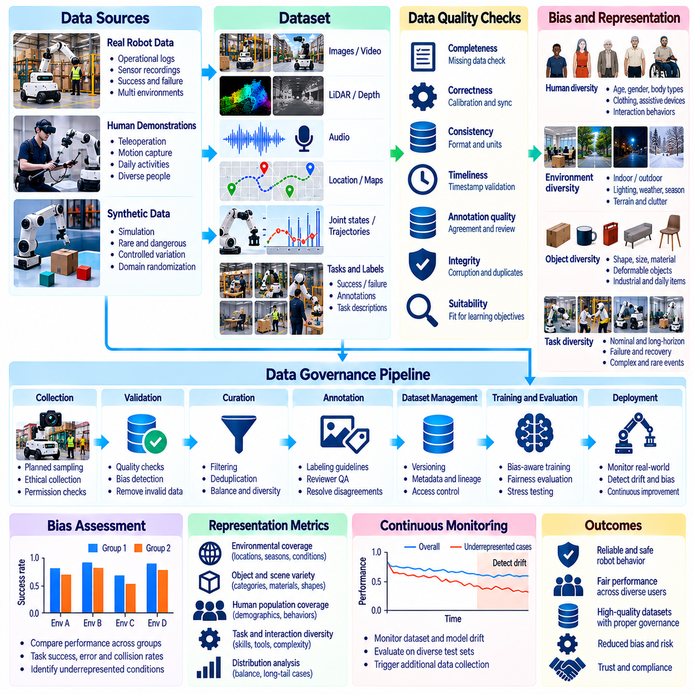{width="7.268055555555556in" height="7.268055555555556in"}

Bias, representation, and data quality governance are fundamental to developing reliable Physical AI systems because robot behavior depends on the environments, objects, people, and actions represented in training data. Datasets collected from limited operating conditions may produce models that perform well during testing but fail in unfamiliar situations. Effective governance must therefore evaluate not only dataset size but also coverage, diversity, accuracy, and the consequences of missing information.

Dataset bias occurs when collected observations systematically overrepresent certain conditions while underrepresenting others. Industrial robots may encounter mostly standardized workpieces, while service robots may be trained primarily in organized indoor environments. Such imbalances can create misleading expectations about real-world performance. Governance processes should identify sampling limitations before models are deployed into environments that differ from their training distributions.

Representation refers to how adequately a dataset captures the variation required for a robot\'s intended operating domain. Relevant dimensions include lighting, weather, object geometry, surface materials, human behavior, equipment configurations, and task complexity. A dataset may contain millions of observations yet provide poor representation of rare obstacles or unusual interactions. Coverage must be measured against operational requirements rather than raw sample counts.

Human representation is particularly important when robots interact with diverse populations. Differences in height, body proportions, mobility, clothing, movement patterns, and assistive devices can affect perception and navigation performance. Training data that excludes these variations may create unequal safety or service outcomes. Evaluation should examine whether relevant groups and interaction conditions receive adequate coverage without collecting unnecessary sensitive attributes.

Environmental bias can emerge when training data originates from a small number of facilities or geographic regions. Robots trained in clean laboratories may struggle with dust, reflections, clutter, uneven surfaces, or variable illumination. Outdoor systems face additional variation from precipitation, seasonal changes, and terrain conditions. Data governance should connect environmental coverage to the operational design domain and explicitly document unsupported conditions.

Task representation requires attention to both successful demonstrations and failure cases. Datasets containing only ideal executions may teach robots efficient nominal behavior without exposing recovery strategies. Failed grasps, interrupted trajectories, unexpected human interventions, and equipment malfunctions provide valuable learning signals. However, unsafe events must be collected and labeled responsibly, with controlled testing preferred when direct experimentation creates unacceptable risks.

Data quality encompasses correctness, completeness, consistency, timeliness, and suitability for intended learning objectives. Sensor calibration errors, missing timestamps, corrupted frames, and inconsistent coordinate systems can degrade model performance even when dataset coverage is broad. Quality governance establishes measurable acceptance criteria for each data source. Automated validation should identify technical defects before observations enter expensive training pipelines.

Annotation quality is a major source of uncertainty in robotic learning. Human annotators may disagree about object boundaries, action phases, contact events, or failure causes. Ambiguous instructions and inconsistent labeling conventions can introduce systematic errors. Governance should define annotation schemas, reviewer qualifications, disagreement resolution procedures, and periodic quality checks to ensure that labels remain interpretable across datasets.

Temporal and multimodal consistency are essential because Physical AI systems learn from synchronized observations and actions. Camera frames, force measurements, joint states, and control commands must refer to compatible moments in time. Synchronization errors may create false relationships between perception and behavior. Data validation should inspect clock drift, missing samples, coordinate transformations, and alignment errors before training sequential decision models.

Sampling strategies strongly influence dataset representation. Random sampling may preserve dominant operating conditions while excluding rare but safety-critical events. Stratified sampling, uncertainty-based selection, and targeted collection can improve coverage of underrepresented scenarios. Governance should document sampling decisions and their intended effects. Oversampling difficult cases must also be evaluated to avoid distorting estimates of normal operating frequencies.

Synthetic data can improve representation by generating conditions that are expensive, dangerous, or uncommon in physical deployments. Simulation environments can vary object arrangements, lighting, friction, sensor noise, and human motion. Nevertheless, synthetic datasets may introduce unrealistic dynamics or visual artifacts. Governance should measure simulation-to-reality gaps and verify that synthetic diversity translates into improved performance on independent real-world evaluations.

Bias assessment requires metrics linked to operational consequences rather than abstract dataset balance alone. Relevant measures may include task success rates, collision frequency, intervention rates, perception errors, and recovery performance across defined conditions. Performance differences should be examined by environment, task type, object category, and relevant human interaction scenarios. Aggregate accuracy can conceal serious weaknesses in small but important operational subsets.

Dataset documentation supports transparency and accountability by recording collection sources, intended uses, known limitations, and quality characteristics. Metadata should describe sensor configurations, geographic or facility coverage, sampling methods, annotation procedures, and validation results. Dataset versioning allows researchers to connect model behavior to specific training inputs. Documentation should also identify conditions where evidence is insufficient to support reliable performance claims.

Continuous quality monitoring is necessary because deployed robot environments evolve over time. New products, equipment modifications, changing human workflows, and seasonal conditions can alter incoming data distributions. Distribution shift detection can identify observations that differ substantially from training experience. Monitoring results should guide targeted data collection, model reevaluation, and controlled updates rather than automatically triggering unrestricted retraining.

Feedback from field failures provides an important mechanism for correcting representation gaps. Unexpected collisions, unsuccessful manipulation attempts, and repeated operator interventions can reveal missing scenarios or mislabeled examples. Incident records should be analyzed to distinguish data deficiencies from hardware, planning, or control failures. Corrective datasets must undergo validation before their incorporation into new training versions.

Governance must also address organizational incentives that influence dataset quality. Teams may prioritize collection volume, benchmark performance, or training speed while neglecting difficult environments and expensive annotation. Quality ownership, independent reviews, and explicit acceptance thresholds help counter these pressures. Data quality metrics should be included in development milestones alongside model performance and deployment readiness indicators.

Privacy and fairness considerations intersect with representation governance. Collecting sensitive personal characteristics solely to improve dataset balance may create unnecessary privacy risks. Organizations should use proportionate evaluation methods, protected access, and appropriate aggregation where sensitive information is genuinely required. Fairness objectives must be connected to measurable safety and service outcomes while respecting legal and contextual constraints.

A mature governance framework establishes accountability for identifying, documenting, and correcting bias and quality defects throughout the data lifecycle. Dataset owners, annotation teams, model developers, and safety reviewers should share clear responsibilities and escalation procedures. Independent validation should challenge assumptions about representativeness. Decisions to expand deployment must consider residual uncertainty and the consequences of failures in underrepresented conditions.

Responsible bias, representation, and data quality governance transforms dataset management from a storage activity into a continuous assurance process. The objective is not perfect statistical balance but sufficient evidence that robots can operate safely and reliably across their intended conditions. By combining systematic coverage analysis, rigorous validation, transparent documentation, and field-driven improvement, Physical AI organizations can develop more dependable and broadly applicable robotic intelligence.

편향(Bias), 대표성(Representation), 데이터 품질 거버넌스(Data Quality Governance)는 로봇의 행동(Robot Behavior)이 학습 데이터(Training Data)에 포함된 환경(Environments), 객체(Objects), 사람(People), 행동(Actions)에 의존하기 때문에 신뢰할 수 있는 피지컬 인공지능(Physical AI) 시스템을 개발하는 데 기본적인 요소이다. 제한된 운영 조건(Limited Operating Conditions)에서 수집된 데이터셋(Datasets)은 테스트(Testing)에서는 우수한 성능을 보이지만 익숙하지 않은 상황(Unfamiliar Situations)에서는 실패하는 모델(Models)을 생성할 수 있다. 따라서 효과적인 거버넌스(Effective Governance)는 데이터셋 크기(Dataset Size)뿐 아니라 포괄 범위(Coverage), 다양성(Diversity), 정확성(Accuracy), 누락된 정보(Missing Information)가 초래하는 결과까지 평가해야 한다.

데이터셋 편향(Dataset Bias)은 수집된 관측 데이터(Collected Observations)가 특정 조건(Certain Conditions)을 체계적으로 과대 대표(Overrepresent)하고 다른 조건은 과소 대표(Underrepresent)할 때 발생한다. 산업용 로봇(Industrial Robots)은 대부분 표준화된 작업물(Standardized Workpieces)을 접할 수 있으며, 서비스 로봇(Service Robots)은 주로 정돈된 실내 환경(Organized Indoor Environments)에서 학습될 수 있다. 이러한 불균형(Imbalances)은 실제 환경 성능(Real-World Performance)에 대한 잘못된 기대(Misleading Expectations)를 형성할 수 있다. 거버넌스 프로세스(Governance Processes)는 모델을 학습 데이터 분포(Training Distributions)와 다른 환경에 배포하기 전에 샘플링의 한계(Sampling Limitations)를 식별해야 한다.

대표성(Representation)은 데이터셋이 로봇의 의도된 운영 영역(Intended Operating Domain)에 필요한 다양한 변동성(Variation)을 얼마나 적절하게 포함하는지를 의미한다. 관련 요소에는 조명(Lighting), 날씨(Weather), 객체 기하구조(Object Geometry), 표면 재질(Surface Materials), 인간 행동(Human Behavior), 장비 구성(Equipment Configurations), 작업 복잡도(Task Complexity)가 포함된다. 데이터셋에 수백만 개의 관측 데이터(Millions of Observations)가 포함되어 있더라도 드문 장애물(Rare Obstacles)이나 비정상적인 상호작용(Unusual Interactions)에 대한 대표성은 부족할 수 있다. 포괄 범위(Coverage)는 단순한 샘플 수(Raw Sample Counts)가 아니라 운영 요구사항(Operational Requirements)을 기준으로 측정해야 한다.

인간 대표성(Human Representation)은 로봇이 다양한 인구 집단(Diverse Populations)과 상호작용할 때 특히 중요하다. 키(Height), 신체 비율(Body Proportions), 이동 능력(Mobility), 의복(Clothing), 움직임 패턴(Movement Patterns), 보조 장치(Assistive Devices)의 차이는 인식(Perception)과 내비게이션(Navigation) 성능에 영향을 미칠 수 있다. 이러한 변동성을 제외한 학습 데이터(Training Data)는 집단에 따라 불균등한 안전성 결과(Unequal Safety Outcomes)나 서비스 결과(Service Outcomes)를 초래할 수 있다. 평가는 불필요한 민감 속성(Sensitive Attributes)을 수집하지 않으면서 관련 집단(Relevant Groups)과 상호작용 조건(Interaction Conditions)이 충분히 포함되어 있는지 검토해야 한다.

환경 편향(Environmental Bias)은 학습 데이터(Training Data)가 소수의 시설(Facilities)이나 지리적 지역(Geographic Regions)에서 수집될 때 발생할 수 있다. 깨끗한 실험실(Clean Laboratories)에서 학습된 로봇은 먼지(Dust), 반사(Reflections), 복잡하게 쌓인 물체(Clutter), 고르지 않은 표면(Uneven Surfaces), 가변적인 조명(Variable Illumination)에 대응하는 데 어려움을 겪을 수 있다. 실외 시스템(Outdoor Systems)은 강수(Precipitation), 계절 변화(Seasonal Changes), 지형 조건(Terrain Conditions)에 따른 추가적인 변동성에 직면한다. 데이터 거버넌스(Data Governance)는 환경 포괄 범위(Environmental Coverage)를 운영 설계 영역(Operational Design Domain)과 연결하고 지원되지 않는 조건(Unsupported Conditions)을 명시적으로 문서화해야 한다.

작업 대표성(Task Representation)은 성공적인 시연(Successful Demonstrations)과 실패 사례(Failure Cases)를 모두 고려해야 한다. 이상적인 실행(Ideal Executions)만 포함된 데이터셋은 로봇에 효율적인 정상 동작(Nominal Behavior)을 학습시킬 수 있지만 복구 전략(Recovery Strategies)을 충분히 제공하지 못할 수 있다. 파지 실패(Failed Grasps), 중단된 궤적(Interrupted Trajectories), 예상하지 못한 인간 개입(Unexpected Human Interventions), 장비 오작동(Equipment Malfunctions)은 가치 있는 학습 신호(Learning Signals)를 제공한다. 그러나 안전하지 않은 사건(Unsafe Events)은 책임 있게 수집하고 레이블링(Labeling)해야 하며, 직접적인 실험(Direct Experimentation)이 허용할 수 없는 위험(Unacceptable Risks)을 발생시키는 경우 통제된 테스트(Controlled Testing)를 우선해야 한다.

데이터 품질(Data Quality)은 정확성(Correctness), 완전성(Completeness), 일관성(Consistency), 적시성(Timeliness), 의도된 학습 목표(Intended Learning Objectives)에 대한 적합성(Suitability)을 포함한다. 센서 보정 오류(Sensor Calibration Errors), 누락된 타임스탬프(Missing Timestamps), 손상된 프레임(Corrupted Frames), 일관되지 않은 좌표계(Inconsistent Coordinate Systems)는 데이터셋의 포괄 범위(Dataset Coverage)가 넓더라도 모델 성능(Model Performance)을 저하시킬 수 있다. 품질 거버넌스(Quality Governance)는 각 데이터 소스(Data Source)에 대해 측정 가능한 수용 기준(Measurable Acceptance Criteria)을 설정한다. 자동화된 검증(Automated Validation)은 관측 데이터가 비용이 많이 드는 학습 파이프라인(Training Pipelines)에 입력되기 전에 기술적 결함(Technical Defects)을 식별해야 한다.

주석 품질(Annotation Quality)은 로봇 학습(Robotic Learning)에서 불확실성(Uncertainty)을 발생시키는 주요 원인이다. 인간 주석 작업자(Human Annotators)는 객체 경계(Object Boundaries), 행동 단계(Action Phases), 접촉 이벤트(Contact Events), 실패 원인(Failure Causes)에 대해 서로 다른 판단을 내릴 수 있다. 모호한 지침(Ambiguous Instructions)과 일관되지 않은 레이블링 규칙(Inconsistent Labeling Conventions)은 체계적인 오류(Systematic Errors)를 유발할 수 있다. 거버넌스는 주석 스키마(Annotation Schemas), 검토자 자격(Reviewer Qualifications), 의견 불일치 해결 절차(Disagreement Resolution Procedures), 정기적인 품질 검사(Periodic Quality Checks)를 정의하여 데이터셋 전반에서 레이블(Labels)의 해석 가능성(Interpretability)을 유지해야 한다.

시간적 및 다중모달 일관성(Temporal and Multimodal Consistency)은 피지컬 인공지능 시스템이 동기화된 관측과 행동(Synchronized Observations and Actions)으로부터 학습하기 때문에 필수적이다. 카메라 프레임(Camera Frames), 힘 측정값(Force Measurements), 관절 상태(Joint States), 제어 명령(Control Commands)은 서로 일치하는 시점(Compatible Moments in Time)을 나타내야 한다. 동기화 오류(Synchronization Errors)는 인식(Perception)과 행동(Behavior) 사이에 잘못된 관계(False Relationships)를 형성할 수 있다. 데이터 검증(Data Validation)은 순차적 의사결정 모델(Sequential Decision Models)을 학습하기 전에 클록 드리프트(Clock Drift), 누락된 샘플(Missing Samples), 좌표 변환(Coordinate Transformations), 정렬 오류(Alignment Errors)를 검사해야 한다.

샘플링 전략(Sampling Strategies)은 데이터셋 대표성(Dataset Representation)에 큰 영향을 미친다. 무작위 샘플링(Random Sampling)은 지배적인 운영 조건(Dominant Operating Conditions)을 유지하는 반면 드물지만 안전에 중요한 사건(Rare but Safety-Critical Events)을 제외할 수 있다. 층화 샘플링(Stratified Sampling), 불확실성 기반 선택(Uncertainty-Based Selection), 표적 데이터 수집(Targeted Collection)은 과소 대표된 시나리오(Underrepresented Scenarios)의 포괄 범위를 개선할 수 있다. 거버넌스는 샘플링 결정(Sampling Decisions)과 그 의도된 효과(Intended Effects)를 문서화해야 한다. 어려운 사례(Difficult Cases)에 대한 과도한 샘플링(Oversampling)도 정상 운영 빈도(Normal Operating Frequencies)의 추정치를 왜곡하지 않는지 평가해야 한다.

합성 데이터(Synthetic Data)는 실제 물리적 배포(Physical Deployments)에서 수집하기에 비용이 많이 들거나 위험하거나 드물게 발생하는 조건을 생성함으로써 대표성(Representation)을 개선할 수 있다. 시뮬레이션 환경(Simulation Environments)은 객체 배치(Object Arrangements), 조명(Lighting), 마찰(Friction), 센서 노이즈(Sensor Noise), 인간 움직임(Human Motion)을 다양하게 변화시킬 수 있다. 그러나 합성 데이터셋(Synthetic Datasets)은 비현실적인 동역학(Unrealistic Dynamics)이나 시각적 인공물(Visual Artifacts)을 포함할 수 있다. 거버넌스는 시뮬레이션과 현실 사이의 격차(Simulation-to-Reality Gaps)를 측정하고 합성 데이터의 다양성(Synthetic Diversity)이 독립적인 실제 환경 평가(Independent Real-World Evaluations)에서 성능 향상으로 이어지는지 검증해야 한다.

편향 평가(Bias Assessment)에는 추상적인 데이터셋 균형(Abstract Dataset Balance)뿐 아니라 운영상 결과(Operational Consequences)와 연결된 지표(Metrics)가 필요하다. 관련 측정 지표에는 작업 성공률(Task Success Rates), 충돌 빈도(Collision Frequency), 개입률(Intervention Rates), 인식 오류(Perception Errors), 복구 성능(Recovery Performance)이 포함될 수 있다. 성능 차이(Performance Differences)는 환경(Environment), 작업 유형(Task Type), 객체 범주(Object Category), 관련 인간 상호작용 시나리오(Human Interaction Scenarios)에 따라 검토해야 한다. 전체 정확도(Aggregate Accuracy)는 규모는 작지만 중요한 운영 하위 집합(Operational Subsets)의 심각한 취약점(Serious Weaknesses)을 감출 수 있다.

데이터셋 문서화(Dataset Documentation)는 수집 출처(Collection Sources), 의도된 사용 목적(Intended Uses), 알려진 한계(Known Limitations), 품질 특성(Quality Characteristics)을 기록함으로써 투명성(Transparency)과 책임성(Accountability)을 지원한다. 메타데이터(Metadata)는 센서 구성(Sensor Configurations), 지리적 또는 시설별 포괄 범위(Geographic or Facility Coverage), 샘플링 방법(Sampling Methods), 주석 처리 절차(Annotation Procedures), 검증 결과(Validation Results)를 설명해야 한다. 데이터셋 버전 관리(Dataset Versioning)는 연구자가 모델 행동(Model Behavior)을 특정 학습 입력(Training Inputs)과 연결할 수 있도록 한다. 문서에는 신뢰할 수 있는 성능 주장(Reliable Performance Claims)을 뒷받침할 증거가 부족한 조건(Conditions with Insufficient Evidence)도 명시해야 한다.

배포된 로봇 환경(Deployed Robot Environments)은 시간이 지남에 따라 변화하므로 지속적인 품질 모니터링(Continuous Quality Monitoring)이 필요하다. 새로운 제품(New Products), 장비 변경(Equipment Modifications), 변화하는 인간 작업 흐름(Changing Human Workflows), 계절적 조건(Seasonal Conditions)은 유입 데이터 분포(Incoming Data Distributions)를 변화시킬 수 있다. 분포 변화 감지(Distribution Shift Detection)는 기존 학습 경험(Training Experience)과 상당히 다른 관측 데이터(Observations)를 식별할 수 있다. 모니터링 결과(Monitoring Results)는 제한 없는 자동 재학습(Unrestricted Retraining)을 유발하기보다 표적 데이터 수집(Targeted Data Collection), 모델 재평가(Model Reevaluation), 통제된 업데이트(Controlled Updates)를 안내해야 한다.

현장 실패(Field Failures)에서 얻은 피드백(Feedback)은 대표성 격차(Representation Gaps)를 수정하기 위한 중요한 메커니즘을 제공한다. 예상하지 못한 충돌(Unexpected Collisions), 실패한 조작 시도(Unsuccessful Manipulation Attempts), 반복적인 운영자 개입(Repeated Operator Interventions)은 누락된 시나리오(Missing Scenarios)나 잘못 레이블링된 사례(Mislabeled Examples)를 드러낼 수 있다. 사고 기록(Incident Records)은 데이터 결함(Data Deficiencies)을 하드웨어(Hardware), 계획(Planning), 제어(Control) 장애와 구분하기 위해 분석해야 한다. 수정된 데이터셋(Corrective Datasets)은 새로운 학습 버전(New Training Versions)에 포함되기 전에 검증(Validation)을 거쳐야 한다.

거버넌스는 데이터셋 품질(Dataset Quality)에 영향을 미치는 조직적 유인(Organizational Incentives)도 다루어야 한다. 개발팀(Teams)은 어려운 환경(Difficult Environments)이나 비용이 많이 드는 주석 작업(Expensive Annotation)을 소홀히 하면서 데이터 수집량(Collection Volume), 벤치마크 성능(Benchmark Performance), 학습 속도(Training Speed)를 우선할 수 있다. 품질 책임 체계(Quality Ownership), 독립적인 검토(Independent Reviews), 명시적인 수용 임계값(Explicit Acceptance Thresholds)은 이러한 압력을 완화하는 데 도움이 된다. 데이터 품질 지표(Data Quality Metrics)는 모델 성능(Model Performance) 및 배포 준비도 지표(Deployment Readiness Indicators)와 함께 개발 마일스톤(Development Milestones)에 포함되어야 한다.

개인정보 보호(Privacy)와 공정성(Fairness)에 대한 고려사항은 대표성 거버넌스(Representation Governance)와 밀접하게 연결된다. 데이터셋 균형(Dataset Balance)을 개선한다는 이유만으로 민감한 개인 특성(Sensitive Personal Characteristics)을 수집하면 불필요한 개인정보 보호 위험(Privacy Risks)이 발생할 수 있다. 조직은 민감한 정보(Sensitive Information)가 실제로 필요한 경우 비례적인 평가 방법(Proportionate Evaluation Methods), 보호된 접근(Protected Access), 적절한 집계(Appropriate Aggregation)를 사용해야 한다. 공정성 목표(Fairness Objectives)는 법적 및 상황적 제약(Legal and Contextual Constraints)을 존중하면서 측정 가능한 안전성 및 서비스 결과(Measurable Safety and Service Outcomes)와 연결되어야 한다.

성숙한 거버넌스 프레임워크(Mature Governance Framework)는 전체 데이터 생명주기(Data Lifecycle)에 걸쳐 편향(Bias)과 품질 결함(Quality Defects)을 식별하고 문서화하며 수정하는 책임성(Accountability)을 확립한다. 데이터셋 소유자(Dataset Owners), 주석 처리팀(Annotation Teams), 모델 개발자(Model Developers), 안전 검토자(Safety Reviewers)는 명확한 책임(Clear Responsibilities)과 상향 보고 절차(Escalation Procedures)를 공유해야 한다. 독립적인 검증(Independent Validation)은 대표성(Representativeness)에 관한 가정을 비판적으로 검토해야 한다. 배포 확대(Deployment Expansion)에 관한 결정은 잔여 불확실성(Residual Uncertainty)과 과소 대표된 조건(Underrepresented Conditions)에서 발생할 수 있는 실패의 결과(Consequences of Failures)를 고려해야 한다.

책임 있는 편향·대표성·데이터 품질 거버넌스(Responsible Bias, Representation, and Data Quality Governance)는 데이터셋 관리(Dataset Management)를 단순한 저장 활동(Storage Activity)에서 지속적인 보증 프로세스(Continuous Assurance Process)로 전환한다. 그 목적은 완벽한 통계적 균형(Perfect Statistical Balance)이 아니라 로봇이 의도된 운영 조건(Intended Operating Conditions) 전반에서 안전하고 신뢰성 있게 작동할 수 있다는 충분한 증거(Sufficient Evidence)를 확보하는 것이다. 피지컬 인공지능 조직(Physical AI Organizations)은 체계적인 포괄 범위 분석(Systematic Coverage Analysis), 엄격한 검증(Rigorous Validation), 투명한 문서화(Transparent Documentation), 현장 피드백 기반 개선(Field-Driven Improvement)을 결합함으로써 더욱 신뢰할 수 있고 폭넓게 적용 가능한 로봇 지능(Dependable and Broadly Applicable Robotic Intelligence)을 개발할 수 있다.

##  

## 08.12. Edge and On Premise Data Governance

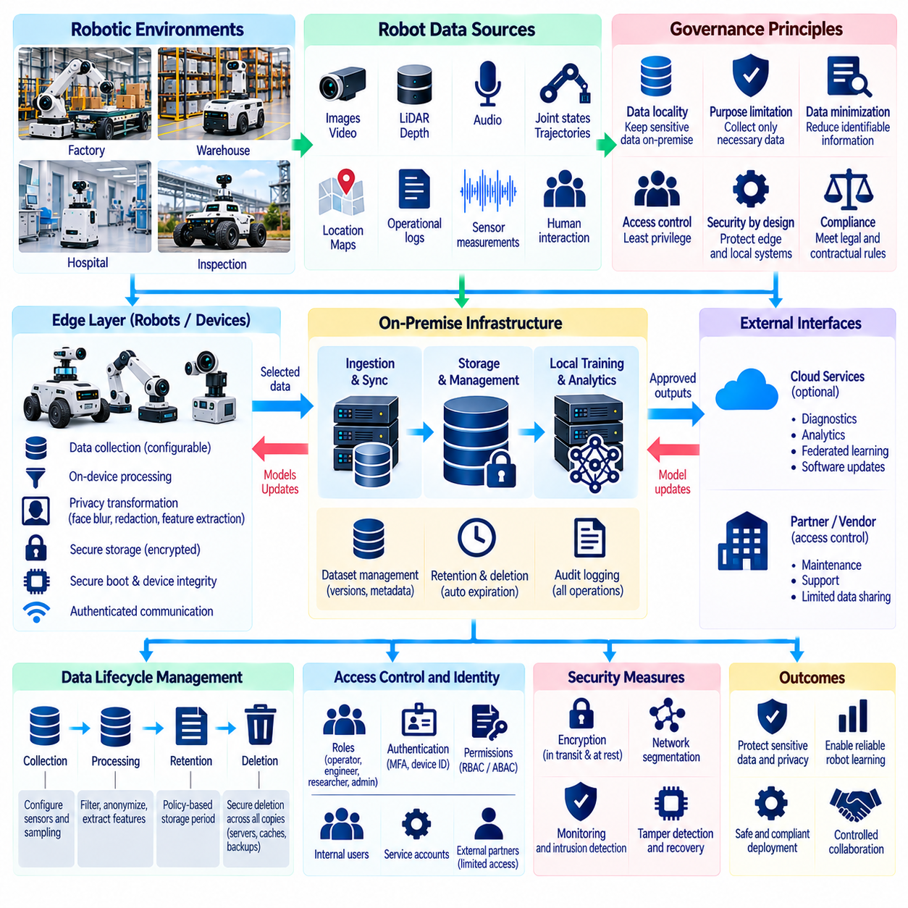{width="7.268055555555556in" height="7.268055555555556in"}

Edge and on-premise data governance is essential for Physical AI systems operating in factories, hospitals, warehouses, and other environments where sensitive information cannot be freely transferred to external infrastructure. Robots continuously generate camera recordings, sensor measurements, operational logs, and human interaction data. Local governance establishes how this information is collected, processed, stored, protected, and shared while maintaining organizational control over critical data assets.

Edge computing processes robotic information close to the sensors and machines that generate it, while on-premise infrastructure provides computing and storage resources within an organization\'s controlled facilities. These approaches reduce dependence on remote cloud services and can support low-latency operations. However, physical proximity does not automatically guarantee privacy or security. Effective governance requires explicit policies for data ownership, access, retention, and processing.

Data locality is a central principle of edge and on-premise governance. Organizations may require raw video, industrial telemetry, engineering drawings, or patient-related observations to remain within designated facilities. Local processing can extract task-relevant features without exporting complete recordings. Governance policies should distinguish data that must remain local from information permitted for external analytics, diagnostics, or collaborative model training.

Edge data collection should follow purpose limitation and data minimization principles. A navigation robot may need temporary visual observations for obstacle avoidance without retaining identifiable human footage. Industrial inspection systems may preserve defect measurements while discarding unnecessary background imagery. Collection policies should define which sensor streams are recorded, their sampling rates, retention periods, and authorized uses before deployment begins.

Local processing pipelines can incorporate privacy transformations before information enters shared storage or communication networks. Facial masking, document redaction, voice removal, and spatial abstraction may reduce exposure of sensitive content. Feature extraction can replace raw recordings when downstream tasks do not require full sensor detail. These transformations must be validated to ensure they preserve the physical information needed for reliable robot behavior.

On-premise architecture should separate operational control, data processing, model training, and administrative functions. Safety-critical robot controllers should not depend on unrestricted access to general-purpose data services. Network segmentation and isolated processing environments reduce the consequences of compromised components. Governance should define trusted communication paths and prohibit unnecessary movement of confidential information between operational zones.

Identity and access management remain necessary even when infrastructure is physically controlled by the customer. Robot operators, maintenance engineers, machine learning developers, and external service providers require different permissions. Role-based and attribute-based access policies can restrict sensitive datasets according to responsibility and purpose. Authentication, temporary credentials, and detailed audit records help prevent unauthorized access and support accountability.

Edge devices present distinctive security risks because they may be installed in publicly accessible or physically exposed locations. Attackers could attempt to remove storage devices, alter firmware, or intercept sensor connections. Secure boot, encrypted storage, hardware-backed credentials, and signed updates can strengthen device protection. Organizations should also establish procedures for detecting tampering, isolating compromised devices, and recovering trusted configurations.

Data synchronization between robots and local servers requires careful governance. Intermittent connectivity may cause delayed uploads, duplicate records, or inconsistent dataset versions. Synchronization protocols should verify authenticity, integrity, and transfer completion. Metadata must preserve collection timestamps, device identities, and processing histories. Conflict resolution procedures should prevent corrupted or outdated records from silently replacing validated information.

Local storage management becomes increasingly complex as robot fleets generate continuous multimodal observations. High-resolution video, LiDAR point clouds, force measurements, and execution traces can consume substantial capacity. Retention policies should prioritize operational value and sensitivity rather than preserving every recording indefinitely. Automated expiration, controlled archival, and secure deletion help prevent uncontrolled accumulation of confidential data.

On-premise learning infrastructure allows organizations to train or fine-tune robot models without transferring complete datasets to external providers. Local training can support customer-specific manipulation, navigation, and inspection capabilities. However, training jobs still require controlled access to sensitive records and computational resources. Dataset lineage, experiment tracking, and model artifact protection are necessary to maintain reproducibility and confidentiality.

Federated learning can extend local governance across multiple facilities while reducing direct exchange of raw observations. Participating sites train models locally and share selected parameter updates or other approved learning outputs. Nevertheless, these updates may reveal information about underlying datasets. Secure aggregation, privacy testing, and controlled participation policies are needed to reduce leakage risks and establish acceptable collaboration boundaries.

Edge inference introduces governance questions about model deployment and update authority. Robots may execute locally stored policies that influence navigation, manipulation, or human interaction. Unauthorized or unvalidated model changes can create safety and security consequences. Signed deployment packages, version approval, rollback capabilities, and staged validation should govern updates. Operational systems must maintain traceability between deployed models and their approved training sources.

Offline operation is a major design requirement for industrial and mobile robots. Devices may temporarily lose connectivity while continuing to collect information and perform authorized tasks. Local governance policies must remain enforceable during these periods. Expiration rules, access restrictions, and event logging should operate without continuous cloud communication. When connectivity returns, systems should reconcile pending changes without violating established data handling restrictions.

Backup and disaster recovery procedures are essential for protecting locally managed robotic information. Hardware failures, ransomware, power interruptions, or accidental deletion can disrupt operations and destroy valuable training records. Encrypted backups, isolated recovery copies, and regularly tested restoration procedures improve resilience. Recovery plans should include dataset metadata, security policies, model versions, and dependencies needed to restore validated system behavior.

Auditing across distributed edge devices requires reliable collection of access events, configuration changes, data exports, and model updates. Local logs should remain protected against tampering and unauthorized deletion. Centralized on-premise monitoring can consolidate evidence while preserving data locality requirements. Audit processes must also account for disconnected devices and verify that delayed event records are incorporated when communication resumes.

Operational governance must clearly assign responsibilities between robot manufacturers, system integrators, infrastructure administrators, and facility owners. The customer may control local data storage while vendors provide software maintenance and diagnostic support. Contracts should specify remote access conditions, data export permissions, incident notification duties, and ownership of derived models. Clear responsibility boundaries reduce uncertainty during failures, upgrades, and security investigations.

Scalable edge governance requires consistent policy enforcement across heterogeneous hardware and software environments. Different robots may use distinct operating systems, sensor formats, storage technologies, and communication protocols. Central policy definitions should be translated into device-specific controls without losing their intended meaning. Configuration management, compliance testing, and standardized metadata help maintain governance consistency as deployments expand.

A mature edge and on-premise governance framework combines local data control, privacy-preserving processing, secure infrastructure, lifecycle management, and continuous auditing. Its purpose is not to eliminate cloud collaboration but to establish explicit boundaries for when and how information may leave controlled environments. By integrating governance into robot architecture from the beginning, Physical AI organizations can support dependable learning and deployment while protecting privacy, industrial confidentiality, and operational autonomy.

엣지 및 온프레미스 데이터 거버넌스(Edge and On-Premise Data Governance)는 민감한 정보(Sensitive Information)를 외부 인프라(External Infrastructure)로 자유롭게 전송할 수 없는 공장(Factories), 병원(Hospitals), 창고(Warehouses) 및 기타 환경에서 운영되는 피지컬 인공지능(Physical AI) 시스템에 필수적이다. 로봇은 카메라 기록(Camera Recordings), 센서 측정값(Sensor Measurements), 운영 로그(Operational Logs), 인간 상호작용 데이터(Human Interaction Data)를 지속적으로 생성한다. 로컬 거버넌스(Local Governance)는 중요한 데이터 자산(Critical Data Assets)에 대한 조직의 통제권(Organizational Control)을 유지하면서 이러한 정보를 수집(Collection), 처리(Processing), 저장(Storage), 보호(Protection), 공유(Sharing)하는 방법을 정의한다.

엣지 컴퓨팅(Edge Computing)은 로봇 정보를 생성하는 센서(Sensors)와 기계(Machines) 가까이에서 데이터를 처리하며, 온프레미스 인프라(On-Premise Infrastructure)는 조직이 통제하는 시설(Controlled Facilities) 내부에 컴퓨팅 및 저장 자원(Computing and Storage Resources)을 제공한다. 이러한 접근 방식은 원격 클라우드 서비스(Remote Cloud Services)에 대한 의존도를 줄이고 저지연 운영(Low-Latency Operations)을 지원할 수 있다. 그러나 물리적으로 가까운 위치(Physical Proximity)에 있다는 사실만으로 개인정보 보호(Privacy)나 보안(Security)이 자동으로 보장되지는 않는다. 효과적인 거버넌스(Effective Governance)를 위해서는 데이터 소유권(Data Ownership), 접근(Access), 보존(Retention), 처리(Processing)에 관한 명시적인 정책(Explicit Policies)이 필요하다.

데이터 지역성(Data Locality)은 엣지 및 온프레미스 거버넌스(Edge and On-Premise Governance)의 핵심 원칙(Central Principle)이다. 조직은 원시 영상(Raw Video), 산업 원격측정 데이터(Industrial Telemetry), 엔지니어링 도면(Engineering Drawings), 환자 관련 관측 데이터(Patient-Related Observations)를 지정된 시설(Designated Facilities) 내부에 유지하도록 요구할 수 있다. 로컬 처리(Local Processing)는 전체 기록(Complete Recordings)을 외부로 반출하지 않고도 작업 관련 특징(Task-Relevant Features)을 추출할 수 있다. 거버넌스 정책(Governance Policies)은 반드시 로컬에 유지해야 하는 데이터와 외부 분석(External Analytics), 진단(Diagnostics), 협력적 모델 학습(Collaborative Model Training)에 사용할 수 있도록 외부 전송이 허용된 정보를 구분해야 한다.

엣지 데이터 수집(Edge Data Collection)은 목적 제한(Purpose Limitation)과 데이터 최소화(Data Minimization) 원칙을 따라야 한다. 내비게이션 로봇(Navigation Robot)은 장애물 회피(Obstacle Avoidance)를 위해 일시적인 시각 관측 데이터(Temporary Visual Observations)가 필요할 수 있지만, 식별 가능한 사람의 영상(Identifiable Human Footage)을 보존할 필요는 없을 수 있다. 산업 검사 시스템(Industrial Inspection Systems)은 불필요한 배경 영상(Unnecessary Background Imagery)을 폐기하면서 결함 측정값(Defect Measurements)을 보존할 수 있다. 데이터 수집 정책(Collection Policies)은 배포(Deployment)가 시작되기 전에 어떤 센서 스트림(Sensor Streams)을 기록할 것인지, 샘플링 속도(Sampling Rates), 보존 기간(Retention Periods), 허용된 사용 목적(Authorized Uses)을 정의해야 한다.

로컬 처리 파이프라인(Local Processing Pipelines)은 정보가 공유 저장소(Shared Storage)나 통신 네트워크(Communication Networks)에 입력되기 전에 개인정보 보호 변환(Privacy Transformations)을 적용할 수 있다. 얼굴 마스킹(Facial Masking), 문서 가림 처리(Document Redaction), 음성 제거(Voice Removal), 공간적 추상화(Spatial Abstraction)는 민감한 콘텐츠(Sensitive Content)의 노출을 줄일 수 있다. 후속 작업(Downstream Tasks)에 전체 센서 정보(Full Sensor Detail)가 필요하지 않은 경우 특징 추출(Feature Extraction)을 통해 원시 기록(Raw Recordings)을 대체할 수 있다. 이러한 변환(Transformations)은 신뢰할 수 있는 로봇 행동(Reliable Robot Behavior)에 필요한 물리적 정보(Physical Information)를 보존하는지 검증해야 한다.

온프레미스 아키텍처(On-Premise Architecture)는 운영 제어(Operational Control), 데이터 처리(Data Processing), 모델 학습(Model Training), 관리 기능(Administrative Functions)을 분리해야 한다. 안전 필수 로봇 제어기(Safety-Critical Robot Controllers)는 범용 데이터 서비스(General-Purpose Data Services)에 대한 제한 없는 접근에 의존해서는 안 된다. 네트워크 분할(Network Segmentation)과 격리된 처리 환경(Isolated Processing Environments)은 구성요소가 침해되었을 때 발생하는 피해를 줄인다. 거버넌스는 신뢰할 수 있는 통신 경로(Trusted Communication Paths)를 정의하고 운영 구역(Operational Zones) 사이에서 기밀 정보(Confidential Information)가 불필요하게 이동하는 것을 금지해야 한다.

인프라(Infrastructure)를 고객이 물리적으로 통제하더라도 신원 및 접근 관리(Identity and Access Management)는 여전히 필요하다. 로봇 운영자(Robot Operators), 유지보수 엔지니어(Maintenance Engineers), 머신러닝 개발자(Machine Learning Developers), 외부 서비스 제공업체(External Service Providers)는 서로 다른 권한(Permissions)이 필요하다. 역할 기반 및 속성 기반 접근 정책(Role-Based and Attribute-Based Access Policies)은 책임(Responsibility)과 목적(Purpose)에 따라 민감한 데이터셋(Sensitive Datasets)에 대한 접근을 제한할 수 있다. 인증(Authentication), 임시 인증정보(Temporary Credentials), 상세한 감사 기록(Detailed Audit Records)은 무단 접근(Unauthorized Access)을 방지하고 책임성(Accountability)을 확보하는 데 도움이 된다.

엣지 장치(Edge Devices)는 공개적으로 접근할 수 있거나 물리적으로 노출된 위치(Publicly Accessible or Physically Exposed Locations)에 설치될 수 있기 때문에 고유한 보안 위험(Security Risks)을 가진다. 공격자(Attackers)는 저장장치(Storage Devices)를 제거하거나 펌웨어(Firmware)를 변경하거나 센서 연결(Sensor Connections)을 가로채려고 시도할 수 있다. 보안 부팅(Secure Boot), 암호화된 저장소(Encrypted Storage), 하드웨어 기반 인증정보(Hardware-Backed Credentials), 서명된 업데이트(Signed Updates)는 장치 보호(Device Protection)를 강화할 수 있다. 조직은 변조 탐지(Tampering Detection), 침해된 장치의 격리(Isolation of Compromised Devices), 신뢰할 수 있는 구성 복구(Recovery of Trusted Configurations)를 위한 절차도 수립해야 한다.

로봇과 로컬 서버(Local Servers) 사이의 데이터 동기화(Data Synchronization)에는 신중한 거버넌스가 필요하다. 간헐적인 연결(Intermittent Connectivity)은 업로드 지연(Delayed Uploads), 중복 기록(Duplicate Records), 일관되지 않은 데이터셋 버전(Inconsistent Dataset Versions)을 발생시킬 수 있다. 동기화 프로토콜(Synchronization Protocols)은 진위성(Authenticity), 무결성(Integrity), 전송 완료 여부(Transfer Completion)를 검증해야 한다. 메타데이터(Metadata)는 수집 타임스탬프(Collection Timestamps), 장치 식별정보(Device Identities), 처리 이력(Processing Histories)을 보존해야 한다. 충돌 해결 절차(Conflict Resolution Procedures)는 손상되거나 오래된 기록(Corrupted or Outdated Records)이 검증된 정보(Validated Information)를 인지하지 못한 상태에서 대체하지 않도록 해야 한다.

로봇 플릿(Robot Fleets)이 지속적으로 다중모달 관측 데이터(Multimodal Observations)를 생성함에 따라 로컬 저장소 관리(Local Storage Management)는 점점 복잡해진다. 고해상도 영상(High-Resolution Video), 라이다 포인트 클라우드(LiDAR Point Clouds), 힘 측정값(Force Measurements), 실행 추적 기록(Execution Traces)은 상당한 저장 용량(Storage Capacity)을 소비할 수 있다. 보존 정책(Retention Policies)은 모든 기록을 무기한 보존하기보다 운영상 가치(Operational Value)와 민감도(Sensitivity)를 우선적으로 고려해야 한다. 자동 만료(Automated Expiration), 통제된 보관(Controlled Archival), 안전한 삭제(Secure Deletion)는 기밀 데이터(Confidential Data)가 통제되지 않은 상태로 축적되는 것을 방지하는 데 도움이 된다.

온프레미스 학습 인프라(On-Premise Learning Infrastructure)를 활용하면 조직은 전체 데이터셋(Complete Datasets)을 외부 공급업체(External Providers)에 전송하지 않고도 로봇 모델(Robot Models)을 학습(Training)하거나 미세조정(Fine-Tuning)할 수 있다. 로컬 학습(Local Training)은 고객별 조작(Customer-Specific Manipulation), 내비게이션(Navigation), 검사 기능(Inspection Capabilities)을 지원할 수 있다. 그러나 학습 작업(Training Jobs)에도 민감한 기록(Sensitive Records)과 컴퓨팅 자원(Computational Resources)에 대한 통제된 접근(Controlled Access)이 필요하다. 재현성(Reproducibility)과 기밀성(Confidentiality)을 유지하려면 데이터셋 계보(Dataset Lineage), 실험 추적(Experiment Tracking), 모델 산출물 보호(Model Artifact Protection)가 필요하다.

연합학습(Federated Learning)은 원시 관측 데이터(Raw Observations)의 직접적인 교환을 줄이면서 여러 시설(Multiple Facilities)에 걸쳐 로컬 거버넌스(Local Governance)를 확장할 수 있다. 참여 시설(Participating Sites)은 모델을 로컬에서 학습하고 선택된 매개변수 업데이트(Parameter Updates)나 승인된 다른 학습 결과(Learning Outputs)를 공유한다. 그러나 이러한 업데이트에서도 기초 데이터셋(Underlying Datasets)에 관한 정보가 노출될 수 있다. 정보 유출 위험(Leakage Risks)을 줄이고 허용 가능한 협력 범위(Acceptable Collaboration Boundaries)를 설정하려면 보안 집계(Secure Aggregation), 개인정보 보호 테스트(Privacy Testing), 통제된 참여 정책(Controlled Participation Policies)이 필요하다.

엣지 추론(Edge Inference)은 모델 배포(Model Deployment)와 업데이트 권한(Update Authority)에 관한 거버넌스 문제를 발생시킨다. 로봇은 내비게이션(Navigation), 조작(Manipulation), 인간 상호작용(Human Interaction)에 영향을 미치는 로컬 저장 정책(Locally Stored Policies)을 실행할 수 있다. 승인되지 않았거나 검증되지 않은 모델 변경(Unauthorized or Unvalidated Model Changes)은 안전 및 보안상 결과(Safety and Security Consequences)를 초래할 수 있다. 서명된 배포 패키지(Signed Deployment Packages), 버전 승인(Version Approval), 롤백 기능(Rollback Capabilities), 단계적 검증(Staged Validation)을 통해 업데이트를 관리해야 한다. 운영 시스템(Operational Systems)은 배포된 모델(Deployed Models)과 승인된 학습 출처(Approved Training Sources) 사이의 추적 가능성(Traceability)을 유지해야 한다.

오프라인 운영(Offline Operation)은 산업용 로봇(Industrial Robots)과 이동 로봇(Mobile Robots)의 주요 설계 요구사항(Design Requirements)이다. 장치는 승인된 작업(Authorized Tasks)을 계속 수행하고 정보를 수집하면서 일시적으로 연결이 끊어질 수 있다. 로컬 거버넌스 정책(Local Governance Policies)은 이러한 기간에도 계속 시행될 수 있어야 한다. 만료 규칙(Expiration Rules), 접근 제한(Access Restrictions), 이벤트 로깅(Event Logging)은 지속적인 클라우드 통신(Continuous Cloud Communication) 없이 작동해야 한다. 연결이 복구되면 시스템은 기존 데이터 처리 제한(Data Handling Restrictions)을 위반하지 않으면서 보류 중인 변경사항(Pending Changes)의 정합성을 조정해야 한다.

백업 및 재해 복구 절차(Backup and Disaster Recovery Procedures)는 로컬에서 관리되는 로봇 정보(Locally Managed Robotic Information)를 보호하는 데 필수적이다. 하드웨어 장애(Hardware Failures), 랜섬웨어(Ransomware), 전원 중단(Power Interruptions), 우발적인 삭제(Accidental Deletion)는 운영을 방해하고 가치 있는 학습 기록(Training Records)을 손실시킬 수 있다. 암호화된 백업(Encrypted Backups), 격리된 복구 사본(Isolated Recovery Copies), 정기적으로 검증된 복원 절차(Regularly Tested Restoration Procedures)는 복원력(Resilience)을 향상시킨다. 복구 계획(Recovery Plans)에는 검증된 시스템 동작(Validated System Behavior)을 복원하는 데 필요한 데이터셋 메타데이터(Dataset Metadata), 보안 정책(Security Policies), 모델 버전(Model Versions), 종속성(Dependencies)이 포함되어야 한다.

분산 엣지 장치(Distributed Edge Devices) 전반의 감사(Auditing)에는 접근 이벤트(Access Events), 구성 변경(Configuration Changes), 데이터 반출(Data Exports), 모델 업데이트(Model Updates)에 대한 신뢰할 수 있는 기록 수집(Reliable Collection)이 필요하다. 로컬 로그(Local Logs)는 변조(Tampering)와 무단 삭제(Unauthorized Deletion)로부터 보호되어야 한다. 중앙 집중식 온프레미스 모니터링(Centralized On-Premise Monitoring)은 데이터 지역성 요구사항(Data Locality Requirements)을 유지하면서 증거(Evidence)를 통합할 수 있다. 감사 프로세스(Audit Processes)는 연결이 끊어진 장치(Disconnected Devices)도 고려해야 하며, 통신이 재개되면 지연된 이벤트 기록(Delayed Event Records)이 반영되었는지 검증해야 한다.

운영 거버넌스(Operational Governance)는 로봇 제조업체(Robot Manufacturers), 시스템 통합업체(System Integrators), 인프라 관리자(Infrastructure Administrators), 시설 소유자(Facility Owners) 사이의 책임을 명확하게 할당해야 한다. 고객(Customer)은 로컬 데이터 저장소(Local Data Storage)를 통제하고 공급업체(Vendors)는 소프트웨어 유지보수(Software Maintenance)와 진단 지원(Diagnostic Support)을 제공할 수 있다. 계약(Contracts)은 원격 접근 조건(Remote Access Conditions), 데이터 반출 권한(Data Export Permissions), 사고 통지 의무(Incident Notification Duties), 파생 모델의 소유권(Ownership of Derived Models)을 명시해야 한다. 명확한 책임 경계(Responsibility Boundaries)는 장애(Failures), 업그레이드(Upgrades), 보안 조사(Security Investigations) 과정에서 발생하는 불확실성(Uncertainty)을 줄인다.

확장 가능한 엣지 거버넌스(Scalable Edge Governance)는 이기종 하드웨어 및 소프트웨어 환경(Heterogeneous Hardware and Software Environments) 전반에서 일관된 정책 집행(Consistent Policy Enforcement)을 요구한다. 서로 다른 로봇은 각기 다른 운영체제(Operating Systems), 센서 형식(Sensor Formats), 저장 기술(Storage Technologies), 통신 프로토콜(Communication Protocols)을 사용할 수 있다. 중앙에서 정의된 정책(Central Policy Definitions)은 본래 의도한 의미(Intended Meaning)를 잃지 않으면서 장치별 통제(Device-Specific Controls)로 변환되어야 한다. 구성 관리(Configuration Management), 규정 준수 테스트(Compliance Testing), 표준화된 메타데이터(Standardized Metadata)는 배포 규모(Deployments)가 확장됨에 따라 거버넌스의 일관성(Governance Consistency)을 유지하는 데 도움이 된다.

성숙한 엣지 및 온프레미스 거버넌스 프레임워크(Mature Edge and On-Premise Governance Framework)는 로컬 데이터 통제(Local Data Control), 개인정보 보호형 처리(Privacy-Preserving Processing), 안전한 인프라(Secure Infrastructure), 생명주기 관리(Lifecycle Management), 지속적인 감사(Continuous Auditing)를 결합한다. 그 목적은 클라우드 협력(Cloud Collaboration)을 제거하는 것이 아니라 정보가 통제된 환경(Controlled Environments)을 언제, 어떤 방식으로 벗어날 수 있는지에 대한 명확한 경계(Explicit Boundaries)를 설정하는 것이다. 피지컬 인공지능 조직(Physical AI Organizations)은 초기 단계부터 로봇 아키텍처(Robot Architecture)에 거버넌스를 통합함으로써 개인정보 보호(Privacy), 산업 기밀성(Industrial Confidentiality), 운영 자율성(Operational Autonomy)을 보호하면서 신뢰할 수 있는 학습 및 배포(Dependable Learning and Deployment)를 지원할 수 있다.

##  

## 08.13. Cloud and Cross Border Data Governance

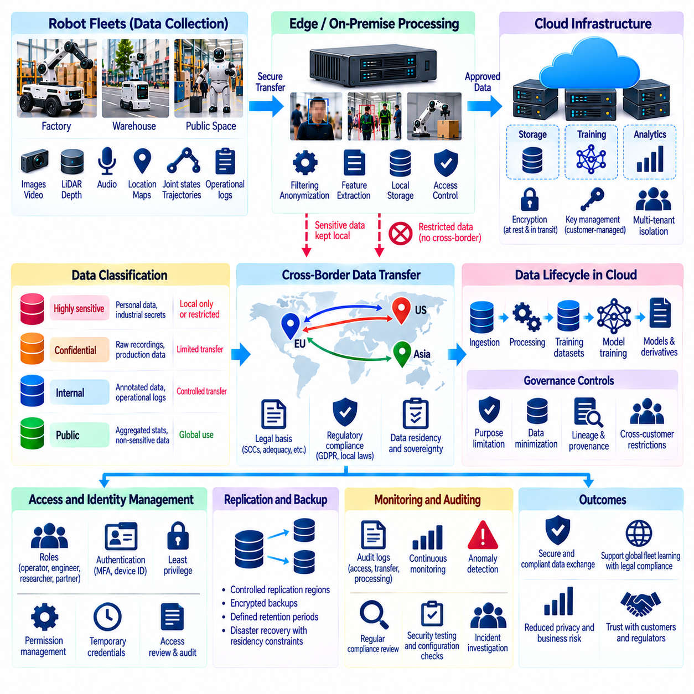{width="7.268055555555556in" height="7.268055555555556in"}

Cloud and cross-border data governance is a critical component of Physical AI because robotic systems increasingly depend on distributed infrastructure for data storage, model training, fleet monitoring, and continuous improvement. Sensor recordings, operational logs, and training datasets may move between robots, local facilities, and cloud regions. Effective governance must preserve security, privacy, accountability, and legal compliance throughout these distributed data flows.

Cloud infrastructure enables organizations to aggregate robotic observations from multiple facilities and geographic regions. Centralized storage and computing resources support large-scale model training, performance analysis, and collaborative development. However, combining datasets from different customers or jurisdictions can introduce conflicting requirements. Governance frameworks must distinguish technical accessibility from legal authorization and ensure that data sharing remains consistent with approved purposes.

Cross-border data transfers occur when information collected in one jurisdiction is stored, processed, accessed, or replicated in another. Such transfers may involve personal information, industrial secrets, or sensitive operational records. Different legal systems impose distinct requirements on international processing. Organizations must identify relevant jurisdictions, applicable transfer restrictions, and contractual obligations before enabling international robotic data exchange.

Data residency and data sovereignty establish important boundaries for cloud deployment. Residency concerns the geographic location where information is stored or processed, while sovereignty addresses the legal authority governing that information. A dataset stored within a particular country may still be accessible to foreign administrators or subject to external legal obligations. Governance must therefore evaluate access arrangements and jurisdictional exposure alongside physical storage locations.

Cloud architecture should classify robotic information according to sensitivity, ownership, and permitted processing locations. Raw camera recordings containing identifiable individuals may require stricter controls than aggregated equipment statistics. Industrial drawings, production parameters, and customer-specific models may also have contractual restrictions. Classification metadata should guide storage placement, encryption, access permissions, and approved transfer destinations.

International data transfers require an appropriate legal basis and applicable safeguards. Depending on the jurisdictions involved, organizations may need contractual transfer mechanisms, adequacy arrangements, regulatory approvals, or documented assessments. Privacy notices and customer agreements must accurately describe relevant processing activities. Governance teams should verify current legal requirements rather than assuming that technical encryption alone authorizes unrestricted transfers.

Data minimization can reduce cross-border exposure by limiting the information transmitted to cloud platforms. Robots may perform local preprocessing to remove unnecessary imagery, identifiers, audio, or precise location details. Only task-relevant features or aggregated metrics may need centralized analysis. However, supposedly anonymized outputs must be evaluated for reidentification risks, especially when multiple datasets can be linked through timestamps or operational context.

Encryption protects robotic information during transmission and storage, but it does not eliminate every governance concern. Transport encryption, storage encryption, and managed key services reduce unauthorized disclosure risks. Key ownership and administrative control determine who can ultimately access protected records. Highly sensitive deployments may require customer-managed keys, hardware security modules, and separation between cloud operators and data controllers.

Identity and access governance must extend across cloud services, robotic fleets, vendors, and geographic regions. Engineers, operators, researchers, and external partners should receive permissions based on documented responsibilities. Least-privilege access, strong authentication, and temporary credentials reduce unnecessary exposure. Cross-border remote access should be treated as a potential international data transfer when applicable regulations define it that way.

Cloud replication and disaster recovery create additional data residency challenges. Providers may distribute storage copies, backups, logs, and metadata across multiple regions to improve availability. These secondary records can fall outside intended geographic boundaries unless configurations are carefully controlled. Governance policies should specify permitted replication regions, backup locations, recovery procedures, and retention periods for both primary and derivative information.

Cloud-based training pipelines can transform customer data into datasets, checkpoints, embeddings, and deployed models. These derivatives may retain confidential patterns even after original recordings are removed. Dataset lineage and model provenance are therefore necessary to track downstream processing. Organizations should establish clear rules for whether customer observations may contribute to shared foundation models, specialized models, or cross-customer learning.

Multi-tenant cloud environments introduce risks when unrelated organizations share physical infrastructure or managed services. Logical isolation, tenant-specific access policies, encryption boundaries, and workload separation reduce unauthorized data exposure. Nevertheless, configuration errors and excessive privileges can undermine isolation. Governance should require regular security testing, configuration reviews, and documented responsibilities between cloud providers and robotic platform operators.

Cloud service agreements must clarify the roles of data controllers, processors, subcontractors, and technology vendors where applicable. Contracts should define authorized processing purposes, security obligations, breach notification procedures, data return rights, and deletion requirements. Subprocessor relationships require particular attention because information may pass through services not directly visible to customers. Contractual governance should reflect actual technical data flows.

Auditing and traceability are essential for demonstrating compliance across distributed cloud environments. Audit records should capture data uploads, downloads, transformations, access events, replication activities, and deletion operations. Logs must identify responsible identities, processing locations, and relevant dataset versions. Centralized monitoring can reveal unauthorized transfers or policy violations, while protected audit trails provide evidence for investigations and regulatory reviews.

International robotic deployments require governance policies that adapt to local legal and operational conditions. A global fleet may operate under different privacy laws, industrial confidentiality requirements, and customer agreements. Uniform technical standards can support consistency, but jurisdiction-specific restrictions may require separate storage regions or processing workflows. Policy engines should translate these requirements into enforceable controls without relying solely on manual decisions.

Incident response becomes more complex when cloud systems and robotic data span national boundaries. Security breaches may affect customers in multiple jurisdictions and trigger different reporting obligations. Response plans should identify responsible organizations, affected data categories, relevant locations, and notification procedures. Evidence preservation must respect legal requirements while supporting timely containment, forensic investigation, and recovery.

Cloud governance must also address service availability, vendor dependence, and operational continuity. Network outages or regional cloud failures should not disable safety-critical robot functions. Local controllers must retain essential autonomy and protective mechanisms when remote services become unavailable. Organizations should evaluate portability, recovery capabilities, and exit strategies to ensure that data and models remain manageable when providers or contractual relationships change.

Effective cloud and cross-border governance requires continuous reassessment because infrastructure, regulations, and robotic applications evolve. New cloud regions, model training services, international partnerships, and data processing techniques may change existing compliance assumptions. Periodic assessments should review transfer inventories, access permissions, contractual safeguards, and technical configurations. Identified gaps must lead to documented corrective actions and verified implementation.

Responsible cloud and cross-border data governance enables Physical AI organizations to benefit from distributed learning without surrendering control over sensitive information. Its objective is to establish transparent, enforceable boundaries for collection, transfer, processing, retention, and reuse. By combining jurisdiction-aware policies, secure cloud architecture, traceable data lineage, and continuous oversight, organizations can scale robotic intelligence while respecting privacy, sovereignty, and contractual trust.

클라우드 및 국경 간 데이터 거버넌스(Cloud and Cross-Border Data Governance)는 로봇 시스템(Robotic Systems)이 데이터 저장(Data Storage), 모델 학습(Model Training), 로봇 플릿 모니터링(Fleet Monitoring), 지속적인 개선(Continuous Improvement)을 위해 분산 인프라(Distributed Infrastructure)에 점점 더 의존하고 있기 때문에 피지컬 인공지능(Physical AI)의 핵심 구성요소이다. 센서 기록(Sensor Recordings), 운영 로그(Operational Logs), 학습 데이터셋(Training Datasets)은 로봇, 로컬 시설(Local Facilities), 클라우드 리전(Cloud Regions) 사이에서 이동할 수 있다. 효과적인 거버넌스(Effective Governance)는 이러한 분산 데이터 흐름(Distributed Data Flows) 전반에서 보안(Security), 개인정보 보호(Privacy), 책임성(Accountability), 법적 규정 준수(Legal Compliance)를 유지해야 한다.

클라우드 인프라(Cloud Infrastructure)는 조직이 여러 시설(Multiple Facilities)과 지리적 지역(Geographic Regions)에서 수집된 로봇 관측 데이터(Robotic Observations)를 통합할 수 있도록 한다. 중앙 집중식 저장 및 컴퓨팅 자원(Centralized Storage and Computing Resources)은 대규모 모델 학습(Large-Scale Model Training), 성능 분석(Performance Analysis), 협력적 개발(Collaborative Development)을 지원한다. 그러나 서로 다른 고객(Customers)이나 관할권(Jurisdictions)의 데이터셋을 결합하면 상충하는 요구사항(Conflicting Requirements)이 발생할 수 있다. 거버넌스 프레임워크(Governance Frameworks)는 기술적 접근 가능성(Technical Accessibility)과 법적 허가(Legal Authorization)를 구분하고 데이터 공유(Data Sharing)가 승인된 목적(Approved Purposes)에 부합하도록 해야 한다.

국경 간 데이터 전송(Cross-Border Data Transfers)은 한 관할권(Jurisdiction)에서 수집된 정보가 다른 관할권에서 저장(Storage), 처리(Processing), 접근(Access), 복제(Replication)될 때 발생한다. 이러한 전송에는 개인정보(Personal Information), 산업 기밀(Industrial Secrets), 민감한 운영 기록(Sensitive Operational Records)이 포함될 수 있다. 서로 다른 법률 체계(Legal Systems)는 국제적 데이터 처리(International Processing)에 대해 각기 다른 요구사항을 부과한다. 조직은 국제적인 로봇 데이터 교환(International Robotic Data Exchange)을 허용하기 전에 관련 관할권(Relevant Jurisdictions), 적용 가능한 전송 제한(Applicable Transfer Restrictions), 계약상 의무(Contractual Obligations)를 식별해야 한다.

데이터 상주성(Data Residency)과 데이터 주권(Data Sovereignty)은 클라우드 배포(Cloud Deployment)에 중요한 경계를 설정한다. 데이터 상주성은 정보가 저장되거나 처리되는 지리적 위치(Geographic Location)를 의미하며, 데이터 주권은 해당 정보에 적용되는 법적 권한(Legal Authority)을 의미한다. 특정 국가에 저장된 데이터셋(Dataset)이라도 외국 관리자(Foreign Administrators)가 접근할 수 있거나 외부 법적 의무(External Legal Obligations)의 적용을 받을 수 있다. 따라서 거버넌스는 물리적 저장 위치(Physical Storage Locations)와 함께 접근 체계(Access Arrangements) 및 관할권에 따른 법적 노출(Jurisdictional Exposure)을 평가해야 한다.

클라우드 아키텍처(Cloud Architecture)는 로봇 정보(Robotic Information)를 민감도(Sensitivity), 소유권(Ownership), 허용된 처리 위치(Permitted Processing Locations)에 따라 분류해야 한다. 식별 가능한 개인(Identifiable Individuals)이 포함된 원시 카메라 기록(Raw Camera Recordings)은 집계된 장비 통계(Aggregated Equipment Statistics)보다 엄격한 통제가 필요할 수 있다. 산업 도면(Industrial Drawings), 생산 매개변수(Production Parameters), 고객별 모델(Customer-Specific Models)에도 계약상 제한(Contractual Restrictions)이 적용될 수 있다. 분류 메타데이터(Classification Metadata)는 저장 위치 선정(Storage Placement), 암호화(Encryption), 접근 권한(Access Permissions), 승인된 전송 목적지(Approved Transfer Destinations)를 결정하는 기준이 되어야 한다.

국제 데이터 전송(International Data Transfers)에는 적절한 법적 근거(Appropriate Legal Basis)와 적용 가능한 보호 조치(Applicable Safeguards)가 필요하다. 관련 관할권에 따라 조직은 계약상 전송 메커니즘(Contractual Transfer Mechanisms), 적정성 인정 체계(Adequacy Arrangements), 규제기관 승인(Regulatory Approvals), 문서화된 평가(Documented Assessments)가 필요할 수 있다. 개인정보 처리 고지(Privacy Notices)와 고객 계약(Customer Agreements)은 관련 처리 활동(Processing Activities)을 정확하게 설명해야 한다. 거버넌스 담당팀(Governance Teams)은 기술적 암호화(Technical Encryption)만으로 제한 없는 데이터 전송(Unrestricted Transfers)이 허용된다고 가정하지 말고 현행 법적 요구사항(Current Legal Requirements)을 검증해야 한다.

데이터 최소화(Data Minimization)는 클라우드 플랫폼(Cloud Platforms)으로 전송되는 정보를 제한함으로써 국경 간 정보 노출(Cross-Border Exposure)을 줄일 수 있다. 로봇은 로컬 전처리(Local Preprocessing)를 수행하여 불필요한 영상(Unnecessary Imagery), 식별자(Identifiers), 오디오(Audio), 정밀 위치 정보(Precise Location Details)를 제거할 수 있다. 중앙 집중식 분석(Centralized Analysis)에는 작업 관련 특징(Task-Relevant Features)이나 집계된 지표(Aggregated Metrics)만 필요할 수 있다. 그러나 익명화되었다고 간주되는 결과(Supposedly Anonymized Outputs)도 재식별 위험(Reidentification Risks)에 대해 평가해야 하며, 특히 타임스탬프(Timestamps)나 운영 맥락(Operational Context)을 통해 여러 데이터셋을 연결할 수 있는 경우 더욱 주의해야 한다.

암호화(Encryption)는 전송 및 저장 과정에서 로봇 정보(Robotic Information)를 보호하지만 모든 거버넌스 문제(Governance Concerns)를 제거하지는 않는다. 전송 암호화(Transport Encryption), 저장 암호화(Storage Encryption), 관리형 키 서비스(Managed Key Services)는 무단 정보 공개(Unauthorized Disclosure)의 위험을 줄인다. 키 소유권(Key Ownership)과 관리 통제권(Administrative Control)은 보호된 기록(Protected Records)에 최종적으로 누가 접근할 수 있는지를 결정한다. 매우 민감한 배포 환경(Highly Sensitive Deployments)에서는 고객 관리형 키(Customer-Managed Keys), 하드웨어 보안 모듈(Hardware Security Modules), 클라우드 운영자(Cloud Operators)와 데이터 통제자(Data Controllers) 사이의 권한 분리(Separation)가 필요할 수 있다.

신원 및 접근 거버넌스(Identity and Access Governance)는 클라우드 서비스(Cloud Services), 로봇 플릿(Robotic Fleets), 공급업체(Vendors), 지리적 지역(Geographic Regions) 전반으로 확장되어야 한다. 엔지니어(Engineers), 운영자(Operators), 연구자(Researchers), 외부 협력업체(External Partners)는 문서화된 책임(Documented Responsibilities)에 따라 권한(Permissions)을 부여받아야 한다. 최소 권한 접근(Least-Privilege Access), 강력한 인증(Strong Authentication), 임시 인증정보(Temporary Credentials)는 불필요한 정보 노출(Unnecessary Exposure)을 줄인다. 적용 가능한 규정(Applicable Regulations)이 국경 간 원격 접근(Cross-Border Remote Access)을 국제 데이터 전송(International Data Transfer)으로 정의하는 경우에는 해당 접근도 잠재적인 국제 데이터 전송으로 취급해야 한다.

클라우드 복제(Cloud Replication)와 재해 복구(Disaster Recovery)는 데이터 상주성(Data Residency)에 추가적인 문제를 발생시킨다. 클라우드 제공업체(Cloud Providers)는 가용성(Availability)을 향상시키기 위해 저장 복사본(Storage Copies), 백업(Backups), 로그(Logs), 메타데이터(Metadata)를 여러 리전(Multiple Regions)에 분산할 수 있다. 이러한 보조 기록(Secondary Records)은 구성을 신중하게 통제하지 않으면 의도된 지리적 경계(Intended Geographic Boundaries)를 벗어날 수 있다. 거버넌스 정책(Governance Policies)은 기본 정보(Primary Information)와 파생 정보(Derivative Information) 모두에 대해 허용된 복제 리전(Permitted Replication Regions), 백업 위치(Backup Locations), 복구 절차(Recovery Procedures), 보존 기간(Retention Periods)을 명시해야 한다.

클라우드 기반 학습 파이프라인(Cloud-Based Training Pipelines)은 고객 데이터(Customer Data)를 데이터셋(Datasets), 체크포인트(Checkpoints), 임베딩(Embeddings), 배포된 모델(Deployed Models)로 변환할 수 있다. 이러한 파생 데이터(Derivatives)는 원본 기록(Original Recordings)이 제거된 이후에도 기밀 패턴(Confidential Patterns)을 유지할 수 있다. 따라서 후속 처리(Downstream Processing)를 추적하려면 데이터셋 계보(Dataset Lineage)와 모델 출처 추적(Model Provenance)이 필요하다. 조직은 고객 관측 데이터(Customer Observations)를 공유 파운데이션 모델(Shared Foundation Models), 특화 모델(Specialized Models), 고객 간 공동 학습(Cross-Customer Learning)에 활용할 수 있는지에 관한 명확한 규칙을 수립해야 한다.

다중 테넌트 클라우드 환경(Multi-Tenant Cloud Environments)은 서로 관련이 없는 조직(Unrelated Organizations)이 물리적 인프라(Physical Infrastructure)나 관리형 서비스(Managed Services)를 공유할 때 위험을 발생시킨다. 논리적 격리(Logical Isolation), 테넌트별 접근 정책(Tenant-Specific Access Policies), 암호화 경계(Encryption Boundaries), 워크로드 분리(Workload Separation)는 무단 데이터 노출(Unauthorized Data Exposure)을 줄인다. 그러나 구성 오류(Configuration Errors)와 과도한 권한(Excessive Privileges)은 격리를 약화시킬 수 있다. 거버넌스는 정기적인 보안 테스트(Regular Security Testing), 구성 검토(Configuration Reviews), 클라우드 제공업체와 로봇 플랫폼 운영자(Robotic Platform Operators) 사이의 문서화된 책임(Documented Responsibilities)을 요구해야 한다.

클라우드 서비스 계약(Cloud Service Agreements)은 적용 가능한 경우 데이터 통제자(Data Controllers), 데이터 처리자(Data Processors), 재위탁 처리업체(Subcontractors), 기술 공급업체(Technology Vendors)의 역할을 명확하게 해야 한다. 계약(Contracts)은 승인된 처리 목적(Authorized Processing Purposes), 보안 의무(Security Obligations), 침해 사고 통지 절차(Breach Notification Procedures), 데이터 반환 권리(Data Return Rights), 삭제 요구사항(Deletion Requirements)을 정의해야 한다. 하위 처리업체 관계(Subprocessor Relationships)는 정보가 고객에게 직접 보이지 않는 서비스(Services)를 거쳐 전달될 수 있기 때문에 특별한 주의가 필요하다. 계약상 거버넌스(Contractual Governance)는 실제 기술적 데이터 흐름(Actual Technical Data Flows)을 반영해야 한다.

감사(Auditing)와 추적 가능성(Traceability)은 분산 클라우드 환경(Distributed Cloud Environments) 전반에서 규정 준수(Compliance)를 입증하는 데 필수적이다. 감사 기록(Audit Records)은 데이터 업로드(Data Uploads), 다운로드(Downloads), 변환(Transformations), 접근 이벤트(Access Events), 복제 활동(Replication Activities), 삭제 작업(Deletion Operations)을 기록해야 한다. 로그(Logs)는 책임 주체(Responsible Identities), 처리 위치(Processing Locations), 관련 데이터셋 버전(Relevant Dataset Versions)을 식별할 수 있어야 한다. 중앙 집중식 모니터링(Centralized Monitoring)은 무단 전송(Unauthorized Transfers)이나 정책 위반(Policy Violations)을 발견할 수 있으며, 보호된 감사 추적 기록(Protected Audit Trails)은 사고 조사(Investigations)와 규제 검토(Regulatory Reviews)를 위한 증거(Evidence)를 제공한다.

국제적인 로봇 배포(International Robotic Deployments)에는 현지 법률 및 운영 조건(Local Legal and Operational Conditions)에 적응하는 거버넌스 정책(Governance Policies)이 필요하다. 글로벌 로봇 플릿(Global Fleet)은 서로 다른 개인정보 보호법(Privacy Laws), 산업 기밀성 요구사항(Industrial Confidentiality Requirements), 고객 계약(Customer Agreements)의 적용을 받을 수 있다. 통일된 기술 표준(Uniform Technical Standards)은 일관성(Consistency)을 지원할 수 있지만 관할권별 제한(Jurisdiction-Specific Restrictions)에 따라 별도의 저장 리전(Storage Regions)이나 처리 워크플로(Processing Workflows)가 필요할 수 있다. 정책 엔진(Policy Engines)은 수동 결정(Manual Decisions)에만 의존하지 않고 이러한 요구사항을 집행 가능한 통제(Enforceable Controls)로 변환해야 한다.

클라우드 시스템(Cloud Systems)과 로봇 데이터(Robotic Data)가 여러 국가에 걸쳐 존재하면 사고 대응(Incident Response)은 더욱 복잡해진다. 보안 침해(Security Breaches)는 여러 관할권(Multiple Jurisdictions)의 고객에게 영향을 미치고 서로 다른 보고 의무(Reporting Obligations)를 발생시킬 수 있다. 대응 계획(Response Plans)은 책임 조직(Responsible Organizations), 영향을 받은 데이터 범주(Affected Data Categories), 관련 위치(Relevant Locations), 통지 절차(Notification Procedures)를 식별해야 한다. 증거 보존(Evidence Preservation)은 신속한 사고 확산 방지(Timely Containment), 디지털 포렌식 조사(Forensic Investigation), 복구(Recovery)를 지원하면서 법적 요구사항(Legal Requirements)을 준수해야 한다.

클라우드 거버넌스(Cloud Governance)는 서비스 가용성(Service Availability), 공급업체 의존성(Vendor Dependence), 운영 연속성(Operational Continuity)도 다루어야 한다. 네트워크 장애(Network Outages)나 리전 단위 클라우드 장애(Regional Cloud Failures)로 인해 안전 필수 로봇 기능(Safety-Critical Robot Functions)이 중단되어서는 안 된다. 로컬 제어기(Local Controllers)는 원격 서비스(Remote Services)를 사용할 수 없을 때에도 필수 자율성(Essential Autonomy)과 보호 메커니즘(Protective Mechanisms)을 유지해야 한다. 조직은 공급업체나 계약 관계(Contractual Relationships)가 변경되더라도 데이터와 모델을 계속 관리할 수 있도록 이식성(Portability), 복구 능력(Recovery Capabilities), 서비스 종료 및 전환 전략(Exit Strategies)을 평가해야 한다.

효과적인 클라우드 및 국경 간 거버넌스(Effective Cloud and Cross-Border Governance)는 인프라(Infrastructure), 규제(Regulations), 로봇 응용 분야(Robotic Applications)가 지속적으로 변화하기 때문에 계속해서 재평가해야 한다. 새로운 클라우드 리전(New Cloud Regions), 모델 학습 서비스(Model Training Services), 국제 협력 관계(International Partnerships), 데이터 처리 기술(Data Processing Techniques)은 기존 규정 준수 가정(Existing Compliance Assumptions)을 변화시킬 수 있다. 정기적인 평가(Periodic Assessments)는 전송 목록(Transfer Inventories), 접근 권한(Access Permissions), 계약상 보호 조치(Contractual Safeguards), 기술적 구성(Technical Configurations)을 검토해야 한다. 식별된 문제점(Identified Gaps)에 대해서는 문서화된 시정 조치(Documented Corrective Actions)와 시행 결과 검증(Verified Implementation)이 이루어져야 한다.

책임 있는 클라우드 및 국경 간 데이터 거버넌스(Responsible Cloud and Cross-Border Data Governance)는 피지컬 인공지능 조직(Physical AI Organizations)이 민감한 정보(Sensitive Information)에 대한 통제권을 포기하지 않으면서 분산 학습(Distributed Learning)의 이점을 활용할 수 있도록 한다. 그 목적은 데이터 수집(Collection), 전송(Transfer), 처리(Processing), 보존(Retention), 재사용(Reuse)에 대해 투명하고 집행 가능한 경계(Transparent, Enforceable Boundaries)를 설정하는 것이다. 조직은 관할권을 고려한 정책(Jurisdiction-Aware Policies), 안전한 클라우드 아키텍처(Secure Cloud Architecture), 추적 가능한 데이터 계보(Traceable Data Lineage), 지속적인 감독(Continuous Oversight)을 결합함으로써 개인정보 보호(Privacy), 데이터 주권(Sovereignty), 계약상 신뢰(Contractual Trust)를 존중하면서 로봇 지능(Robotic Intelligence)을 확장할 수 있다.

##  

## 08.14. Federated and Privacy Preserving Robot Learning

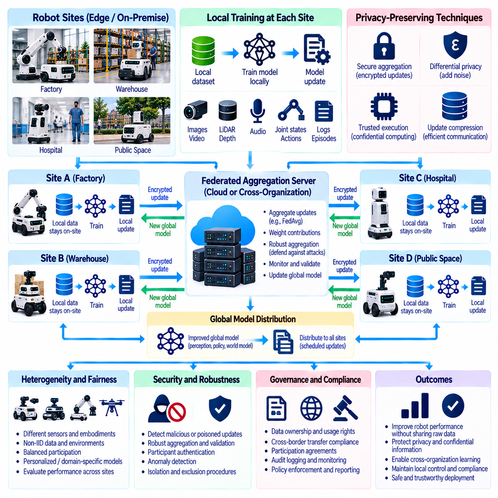{width="7.268055555555556in" height="7.268055555555556in"}

Federated and privacy-preserving robot learning enables Physical AI systems to improve through distributed experience without requiring every participant to transfer raw sensor recordings into a centralized repository. Robots operating in factories, hospitals, warehouses, and public environments generate valuable but potentially sensitive observations. Collaborative learning must therefore balance model improvement with privacy, confidentiality, security, and local control over data.

Federated learning distributes model training across robots, facilities, or organizations while keeping source datasets within their original environments. A coordinating server typically distributes a shared model, receives selected local updates, and combines them into an improved global model. This approach reduces direct exposure of raw information. However, retaining data locally does not automatically prevent sensitive information from leaking through training outputs.

Robotic federated learning differs from conventional distributed learning because participants operate under heterogeneous physical conditions. Robots may have different sensors, actuators, control frequencies, task objectives, and environmental constraints. Their datasets are often non-independent and non-identically distributed. Governance must account for these differences when evaluating whether a shared model improves performance consistently across participating systems.

Local training begins with approved datasets and models that satisfy each participant\'s operational and contractual requirements. A robot or facility computes parameter updates using locally collected demonstrations, sensor observations, or execution histories. Only authorized learning outputs are transmitted to the coordinating infrastructure. Policies should specify eligible datasets, permitted model architectures, training objectives, and restrictions on secondary data use.

Federated aggregation combines contributions from multiple participants to update shared model parameters. Techniques such as federated averaging can weight local updates according to participating sample counts or other criteria. However, unequal dataset sizes and hardware capabilities may cause dominant participants to shape the global model disproportionately. Governance should evaluate contribution weighting, representation balance, and performance across smaller or specialized deployments.

Privacy leakage remains possible because model gradients and parameter updates can reveal properties of training records. Gradient inversion and membership inference attacks may expose sensitive information even when raw observations never leave a facility. Privacy-preserving learning therefore requires explicit threat models rather than assuming that distributed training is inherently confidential. Attack simulations and privacy assessments should examine the actual information released during collaboration.

Secure aggregation reduces exposure by allowing a coordinating service to recover an aggregate update without directly inspecting each participant\'s individual contribution. Cryptographic protocols can protect updates during collection and aggregation. Their security depends on assumptions about participant collusion, dropout handling, and key management. Organizations should verify protocol limitations and avoid treating secure aggregation as protection against every inference attack.

Differential privacy provides a mathematical framework for limiting the influence of individual training records on released learning outputs. Noise can be introduced into clipped gradients or aggregated updates to reduce information leakage. Privacy parameters determine the tradeoff between protection and model utility. For robotics, excessive noise may degrade perception or control performance, so privacy guarantees must be evaluated alongside safety-critical accuracy requirements.

Trusted execution environments can provide additional isolation for selected training or aggregation operations. Hardware-supported protection may reduce exposure to compromised operating systems or cloud administrators. Nevertheless, implementation vulnerabilities, side channels, and configuration errors remain possible. Governance should assess hardware trust assumptions, attestation procedures, and residual risks before relying on confidential computing for sensitive robotic datasets.

Communication efficiency is important because robot fleets may have limited bandwidth, intermittent connectivity, and competing real-time control demands. Update compression, selective parameter sharing, and scheduled synchronization can reduce network overhead. Training traffic should not interfere with safety-critical communication. Governance policies must establish resource limits, update frequencies, and operational priorities so collaborative learning does not compromise robot availability.

Participant heterogeneity creates challenges for model convergence and fairness. A warehouse robot handling standardized packages may generate different experiences from a service robot navigating crowded corridors. Combining incompatible observations can produce negative transfer or unstable optimization. Personalized federated learning and domain-specific model components can preserve local specialization while allowing participants to benefit from shared representations.

Federated systems must defend against malicious or unreliable participants. Compromised robots may submit manipulated gradients, poisoned examples, or updates designed to introduce hidden behaviors. Robust aggregation, anomaly detection, participant authentication, and update validation can reduce these risks. No single defense guarantees protection under every attack scenario. Governance should define exclusion procedures, investigation responsibilities, and recovery mechanisms.

Privacy-preserving learning also requires careful management of metadata. Participant identifiers, update timestamps, communication patterns, and training statistics may reveal facility activity or operational schedules. Encryption of model parameters alone does not protect this contextual information. Systems should minimize metadata collection, restrict monitoring access, and establish retention limits that reflect both operational needs and confidentiality requirements.

Evaluation must measure global model quality and local deployment safety separately. An improvement in average benchmark performance does not guarantee acceptable results for every robot or facility. Validation should examine task success, collision rates, intervention frequency, recovery behavior, and performance under rare conditions. Participants should retain authority to reject updates that fail their approved safety or operational acceptance criteria.

Model versioning and provenance provide accountability throughout federated training. Records should identify participating model versions, aggregation configurations, validation outcomes, and authorized release decisions. Where confidentiality permits, contribution histories can support debugging and incident investigations. Governance must balance auditability with the need to avoid exposing participant-specific information through detailed training records.

Consent, contractual permissions, and data ownership remain relevant even when only model updates are exchanged. Organizations must determine whether collected demonstrations may contribute to shared models and whether resulting intellectual property can be reused commercially. Customer restrictions may prohibit cross-organization learning despite local data storage. Participation agreements should define permitted purposes, withdrawal procedures, model ownership, and responsibility for privacy incidents.

Withdrawal and deletion introduce difficult technical questions because previous contributions may already influence shared model parameters. Removing a participant\'s local dataset does not automatically eliminate its influence from a trained global model. Depending on legal obligations and technical feasibility, remediation may require retraining, checkpoint restoration, or validated machine unlearning. Governance should communicate these limitations before participation begins.

A mature federated learning program integrates privacy engineering, security controls, model validation, and organizational accountability. Participants need clear policies for joining, contributing, receiving updates, reporting incidents, and leaving collaborative training. Independent assessments should test privacy leakage, poisoning resistance, and performance consistency. Continuous monitoring must verify that technical safeguards remain effective as participants and environments change.

Federated and privacy-preserving robot learning offers a practical path toward collaborative Physical AI development without unrestricted centralization of sensitive data. Its value depends on measurable privacy protection, trustworthy aggregation, transparent governance, and verified robotic performance. By combining local autonomy with carefully controlled knowledge sharing, organizations can improve collective robot intelligence while respecting data sovereignty and operational safety.

연합학습 및 개인정보 보호형 로봇 학습(Federated and Privacy-Preserving Robot Learning)은 모든 참여자가 원시 센서 기록(Raw Sensor Recordings)을 중앙 집중식 저장소(Centralized Repository)로 전송하지 않고도 분산된 경험(Distributed Experience)을 통해 피지컬 인공지능(Physical AI) 시스템의 성능을 개선할 수 있도록 한다. 공장(Factories), 병원(Hospitals), 창고(Warehouses), 공공 환경(Public Environments)에서 작동하는 로봇은 가치가 높지만 민감한 정보를 포함할 가능성이 있는 관측 데이터(Observations)를 생성한다. 따라서 협력적 학습(Collaborative Learning)은 모델 개선(Model Improvement)과 개인정보 보호(Privacy), 기밀성(Confidentiality), 보안(Security), 데이터에 대한 로컬 통제(Local Control) 사이의 균형을 유지해야 한다.

연합학습(Federated Learning)은 원본 데이터셋(Source Datasets)을 기존 환경(Original Environments)에 유지하면서 로봇, 시설 또는 조직 전반에 모델 학습(Model Training)을 분산한다. 일반적으로 조정 서버(Coordinating Server)는 공유 모델(Shared Model)을 배포하고, 선택된 로컬 업데이트(Local Updates)를 수신한 다음, 이를 결합하여 개선된 글로벌 모델(Global Model)을 생성한다. 이러한 접근 방식은 원시 정보(Raw Information)의 직접적인 노출을 줄인다. 그러나 데이터를 로컬에 유지한다고 해서 학습 결과(Training Outputs)를 통한 민감한 정보(Sensitive Information)의 유출이 자동으로 방지되는 것은 아니다.

로봇 연합학습(Robotic Federated Learning)은 참여 시스템이 이질적인 물리적 조건(Heterogeneous Physical Conditions)에서 작동한다는 점에서 기존 분산 학습(Conventional Distributed Learning)과 차이가 있다. 로봇은 서로 다른 센서(Sensors), 액추에이터(Actuators), 제어 주파수(Control Frequencies), 작업 목표(Task Objectives), 환경적 제약(Environmental Constraints)을 가질 수 있다. 이들의 데이터셋은 독립적이지 않고 동일한 분포를 따르지 않는 경우(Non-Independent and Non-Identically Distributed)가 많다. 거버넌스(Governance)는 공유 모델(Shared Model)이 참여 시스템 전반에서 일관되게 성능을 개선하는지 평가할 때 이러한 차이를 고려해야 한다.

로컬 학습(Local Training)은 각 참여자의 운영 및 계약상 요구사항(Operational and Contractual Requirements)을 충족하는 승인된 데이터셋(Approved Datasets)과 모델(Models)에서 시작된다. 로봇이나 시설은 로컬에서 수집한 시연 데이터(Demonstrations), 센서 관측 데이터(Sensor Observations), 실행 이력(Execution Histories)을 사용하여 매개변수 업데이트(Parameter Updates)를 계산한다. 승인된 학습 결과(Authorized Learning Outputs)만 조정 인프라(Coordinating Infrastructure)로 전송된다. 정책(Policies)은 학습에 사용할 수 있는 데이터셋(Eligible Datasets), 허용된 모델 아키텍처(Permitted Model Architectures), 학습 목표(Training Objectives), 데이터의 2차 사용 제한(Restrictions on Secondary Data Use)을 명시해야 한다.

연합 집계(Federated Aggregation)는 여러 참여자의 기여(Contributions)를 결합하여 공유 모델 매개변수(Shared Model Parameters)를 업데이트한다. 연합 평균화(Federated Averaging)와 같은 기술은 참여 샘플 수(Participating Sample Counts)나 기타 기준에 따라 로컬 업데이트(Local Updates)에 가중치를 부여할 수 있다. 그러나 데이터셋 크기(Dataset Sizes)와 하드웨어 성능(Hardware Capabilities)의 차이로 인해 지배적인 참여자(Dominant Participants)가 글로벌 모델(Global Model)에 불균형적으로 큰 영향을 미칠 수 있다. 거버넌스는 기여 가중치(Contribution Weighting), 대표성 균형(Representation Balance), 소규모 또는 특수 목적 배포 환경(Smaller or Specialized Deployments)의 성능을 평가해야 한다.

모델 그래디언트(Model Gradients)와 매개변수 업데이트(Parameter Updates)는 학습 기록(Training Records)의 특성을 드러낼 수 있으므로 개인정보 유출(Privacy Leakage)의 가능성이 여전히 존재한다. 그래디언트 역추론 공격(Gradient Inversion Attacks)과 멤버십 추론 공격(Membership Inference Attacks)은 원시 관측 데이터(Raw Observations)가 시설 외부로 전송되지 않더라도 민감한 정보(Sensitive Information)를 노출할 수 있다. 따라서 개인정보 보호형 학습(Privacy-Preserving Learning)은 분산 학습(Distributed Training)이 본질적으로 기밀성을 보장한다고 가정하는 대신 명시적인 위협 모델(Threat Models)을 요구한다. 공격 시뮬레이션(Attack Simulations)과 개인정보 보호 평가(Privacy Assessments)는 협력 과정에서 실제로 공개되는 정보를 검토해야 한다.

보안 집계(Secure Aggregation)는 조정 서비스(Coordinating Service)가 각 참여자의 개별 기여(Individual Contribution)를 직접 확인하지 않고 집계된 업데이트(Aggregate Update)를 복원할 수 있도록 하여 정보 노출을 줄인다. 암호학적 프로토콜(Cryptographic Protocols)은 업데이트 수집(Collection)과 집계(Aggregation) 과정에서 정보를 보호할 수 있다. 이러한 프로토콜의 보안(Security)은 참여자 간 공모(Participant Collusion), 참여 중단 처리(Dropout Handling), 키 관리(Key Management)에 관한 가정에 의존한다. 조직은 프로토콜의 한계(Protocol Limitations)를 검증하고 보안 집계가 모든 추론 공격(Inference Attacks)을 방어한다고 간주해서는 안 된다.

차등 개인정보 보호(Differential Privacy)는 개별 학습 기록(Individual Training Records)이 공개되는 학습 결과(Released Learning Outputs)에 미치는 영향을 제한하기 위한 수학적 프레임워크(Mathematical Framework)를 제공한다. 정보 유출(Information Leakage)을 줄이기 위해 크기가 제한된 그래디언트(Clipped Gradients)나 집계된 업데이트(Aggregated Updates)에 노이즈(Noise)를 추가할 수 있다. 개인정보 보호 매개변수(Privacy Parameters)는 보호 수준(Protection)과 모델 유용성(Model Utility) 사이의 절충 관계(Tradeoff)를 결정한다. 로봇 분야에서는 과도한 노이즈(Excessive Noise)가 인식(Perception)이나 제어 성능(Control Performance)을 저하시킬 수 있으므로 개인정보 보호 보장(Privacy Guarantees)을 안전 필수 정확도 요구사항(Safety-Critical Accuracy Requirements)과 함께 평가해야 한다.

신뢰 실행 환경(Trusted Execution Environments)은 선택된 학습(Training) 또는 집계 작업(Aggregation Operations)에 추가적인 격리(Isolation)를 제공할 수 있다. 하드웨어 기반 보호(Hardware-Supported Protection)는 침해된 운영체제(Compromised Operating Systems)나 클라우드 관리자(Cloud Administrators)에 의한 정보 노출을 줄일 수 있다. 그러나 구현 취약점(Implementation Vulnerabilities), 부채널 공격(Side Channels), 구성 오류(Configuration Errors)는 여전히 발생할 수 있다. 거버넌스는 민감한 로봇 데이터셋(Sensitive Robotic Datasets)에 기밀 컴퓨팅(Confidential Computing)을 적용하기 전에 하드웨어 신뢰 가정(Hardware Trust Assumptions), 증명 절차(Attestation Procedures), 잔여 위험(Residual Risks)을 평가해야 한다.

통신 효율성(Communication Efficiency)은 로봇 플릿(Robot Fleets)이 제한된 대역폭(Limited Bandwidth), 간헐적인 연결(Intermittent Connectivity), 실시간 제어 요구사항(Real-Time Control Demands)을 가질 수 있기 때문에 중요하다. 업데이트 압축(Update Compression), 선택적 매개변수 공유(Selective Parameter Sharing), 예약된 동기화(Scheduled Synchronization)는 네트워크 부하(Network Overhead)를 줄일 수 있다. 학습 통신량(Training Traffic)은 안전 필수 통신(Safety-Critical Communication)을 방해해서는 안 된다. 거버넌스 정책(Governance Policies)은 협력적 학습(Collaborative Learning)이 로봇 가용성(Robot Availability)을 저해하지 않도록 자원 제한(Resource Limits), 업데이트 주기(Update Frequencies), 운영 우선순위(Operational Priorities)를 설정해야 한다.

참여자의 이질성(Participant Heterogeneity)은 모델 수렴(Model Convergence)과 공정성(Fairness)에 어려움을 발생시킨다. 표준화된 포장물(Standardized Packages)을 처리하는 창고 로봇(Warehouse Robot)은 혼잡한 복도(Crowded Corridors)를 이동하는 서비스 로봇(Service Robot)과 서로 다른 경험(Experiences)을 생성할 수 있다. 호환되지 않는 관측 데이터(Incompatible Observations)를 결합하면 부정적 전이(Negative Transfer)나 불안정한 최적화(Unstable Optimization)가 발생할 수 있다. 개인화 연합학습(Personalized Federated Learning)과 도메인 특화 모델 구성요소(Domain-Specific Model Components)는 참여자가 공유 표현(Shared Representations)의 이점을 활용하면서도 로컬 특화 기능(Local Specialization)을 유지하도록 지원할 수 있다.

연합 시스템(Federated Systems)은 악의적이거나 신뢰할 수 없는 참여자(Malicious or Unreliable Participants)에 대한 방어 기능을 갖추어야 한다. 침해된 로봇(Compromised Robots)은 조작된 그래디언트(Manipulated Gradients), 오염된 학습 사례(Poisoned Examples), 숨겨진 행동(Hidden Behaviors)을 유도하도록 설계된 업데이트를 제출할 수 있다. 강건한 집계(Robust Aggregation), 이상 탐지(Anomaly Detection), 참여자 인증(Participant Authentication), 업데이트 검증(Update Validation)은 이러한 위험을 줄일 수 있다. 그러나 어떤 단일 방어 기술(Single Defense)도 모든 공격 시나리오(Attack Scenarios)에 대한 보호를 보장하지는 않는다. 거버넌스는 참여자 제외 절차(Exclusion Procedures), 조사 책임(Investigation Responsibilities), 복구 메커니즘(Recovery Mechanisms)을 정의해야 한다.

개인정보 보호형 학습(Privacy-Preserving Learning)에는 메타데이터(Metadata)의 신중한 관리도 필요하다. 참여자 식별자(Participant Identifiers), 업데이트 타임스탬프(Update Timestamps), 통신 패턴(Communication Patterns), 학습 통계(Training Statistics)는 시설 활동(Facility Activity)이나 운영 일정(Operational Schedules)을 드러낼 수 있다. 모델 매개변수(Model Parameters)를 암호화하는 것만으로는 이러한 맥락 정보(Contextual Information)를 보호할 수 없다. 시스템은 메타데이터 수집(Metadata Collection)을 최소화하고 모니터링 접근(Monitoring Access)을 제한하며 운영상 필요성(Operational Needs)과 기밀성 요구사항(Confidentiality Requirements)을 반영한 보존 기간(Retention Limits)을 설정해야 한다.

평가(Evaluation)는 글로벌 모델 품질(Global Model Quality)과 로컬 배포 안전성(Local Deployment Safety)을 별도로 측정해야 한다. 평균 벤치마크 성능(Average Benchmark Performance)의 향상이 모든 로봇이나 시설에서 허용 가능한 결과(Acceptable Results)를 보장하는 것은 아니다. 검증(Validation)은 작업 성공률(Task Success), 충돌률(Collision Rates), 개입 빈도(Intervention Frequency), 복구 행동(Recovery Behavior), 드문 조건(Rare Conditions)에서의 성능을 검토해야 한다. 참여자는 승인된 안전 또는 운영 수용 기준(Approved Safety or Operational Acceptance Criteria)을 충족하지 못하는 업데이트를 거부할 권한(Authority)을 유지해야 한다.

모델 버전 관리(Model Versioning)와 출처 추적(Provenance)은 연합학습(Federated Training) 전반에서 책임성(Accountability)을 제공한다. 기록(Records)은 참여 모델 버전(Participating Model Versions), 집계 구성(Aggregation Configurations), 검증 결과(Validation Outcomes), 승인된 배포 결정(Authorized Release Decisions)을 식별해야 한다. 기밀성(Confidentiality)이 허용하는 범위에서 기여 이력(Contribution Histories)은 디버깅(Debugging)과 사고 조사(Incident Investigations)를 지원할 수 있다. 거버넌스는 감사 가능성(Auditability)과 상세한 학습 기록(Detailed Training Records)을 통한 참여자별 정보(Participant-Specific Information) 노출 방지 사이의 균형을 유지해야 한다.

동의(Consent), 계약상 허가(Contractual Permissions), 데이터 소유권(Data Ownership)은 모델 업데이트(Model Updates)만 교환되는 경우에도 여전히 중요하다. 조직은 수집된 시연 데이터(Collected Demonstrations)를 공유 모델(Shared Models)에 기여하도록 사용할 수 있는지, 그 결과 생성된 지식재산권(Intellectual Property)을 상업적으로 재사용(Commercial Reuse)할 수 있는지 결정해야 한다. 고객의 제한 조건(Customer Restrictions)은 로컬 데이터 저장(Local Data Storage)이 유지되더라도 조직 간 학습(Cross-Organization Learning)을 금지할 수 있다. 참여 계약(Participation Agreements)은 허용된 목적(Permitted Purposes), 참여 철회 절차(Withdrawal Procedures), 모델 소유권(Model Ownership), 개인정보 보호 사고(Privacy Incidents)에 대한 책임을 정의해야 한다.

참여 철회(Withdrawal)와 삭제(Deletion)는 이전의 기여(Previous Contributions)가 이미 공유 모델 매개변수(Shared Model Parameters)에 영향을 미쳤을 수 있기 때문에 어려운 기술적 문제를 발생시킨다. 참여자의 로컬 데이터셋(Local Dataset)을 제거하더라도 학습된 글로벌 모델(Trained Global Model)에 남아 있는 영향이 자동으로 제거되는 것은 아니다. 법적 의무(Legal Obligations)와 기술적 실현 가능성(Technical Feasibility)에 따라 시정 조치(Remediation)에는 재학습(Retraining), 체크포인트 복원(Checkpoint Restoration), 검증된 머신 언러닝(Validated Machine Unlearning)이 필요할 수 있다. 거버넌스는 참여가 시작되기 전에 이러한 한계(Limitations)를 명확하게 전달해야 한다.

성숙한 연합학습 프로그램(Mature Federated Learning Program)은 개인정보 보호 엔지니어링(Privacy Engineering), 보안 통제(Security Controls), 모델 검증(Model Validation), 조직적 책임성(Organizational Accountability)을 통합한다. 참여자는 협력적 학습(Collaborative Training)에 참여하고, 기여하고, 업데이트를 수신하고, 사고를 보고하고, 참여를 종료하는 과정에 대한 명확한 정책(Policies)이 필요하다. 독립적인 평가(Independent Assessments)는 개인정보 유출(Privacy Leakage), 데이터 오염 공격에 대한 저항성(Poisoning Resistance), 성능 일관성(Performance Consistency)을 테스트해야 한다. 지속적인 모니터링(Continuous Monitoring)은 참여자와 환경이 변화함에 따라 기술적 보호 조치(Technical Safeguards)가 계속 효과적으로 작동하는지 검증해야 한다.

연합학습 및 개인정보 보호형 로봇 학습(Federated and Privacy-Preserving Robot Learning)은 민감한 데이터(Sensitive Data)를 제한 없이 중앙 집중화(Unrestricted Centralization)하지 않으면서 협력적인 피지컬 인공지능 개발(Collaborative Physical AI Development)을 추진할 수 있는 실용적인 경로를 제공한다. 그 가치는 측정 가능한 개인정보 보호(Measurable Privacy Protection), 신뢰할 수 있는 집계(Trustworthy Aggregation), 투명한 거버넌스(Transparent Governance), 검증된 로봇 성능(Verified Robotic Performance)에 달려 있다. 조직은 로컬 자율성(Local Autonomy)과 신중하게 통제된 지식 공유(Carefully Controlled Knowledge Sharing)를 결합함으로써 데이터 주권(Data Sovereignty)과 운영 안전성(Operational Safety)을 존중하면서 집단적 로봇 지능(Collective Robot Intelligence)을 향상시킬 수 있다.
