**Volume 04. Data Engines and Scaling for Physical AI**

# Chapter 09. Fleet Scale Data Loops

## 09.01. From Single Robot Data to Fleet Data

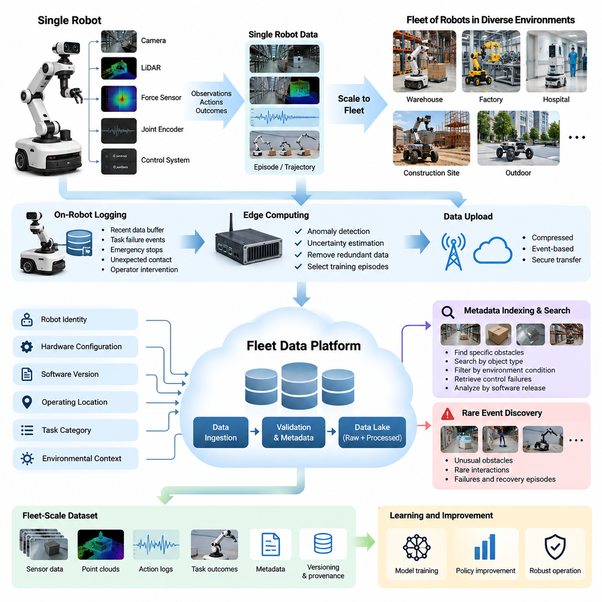{width="7.268055555555556in" height="7.268055555555556in"}

단일 로봇(Single Robot)은 물리적 환경(Physical Environment)과 상호작용하는 과정에서 가치 있는 운영 데이터(Operational Data)를 생성한다. 카메라(Camera), 라이다(LiDAR), 힘 센서(Force Sensor), 관절 엔코더(Joint Encoder), 제어 시스템(Control System)은 관측(Observation), 행동(Action), 결과(Outcome)를 지속적으로 기록한다. 이러한 기록은 로봇이 장애물을 인식하고 작업을 수행하며 외란(Disturbance)에 대응하고 오류에서 복구하는 방식을 보여준다. 그러나 단일 로봇의 경험은 운용 조건과 다양한 상황에 대한 노출 범위에 의해 제한된다.

플릿 규모 데이터 수집(Fleet-Scale Data Collection)은 이러한 과정을 다양한 환경에서 운용되는 다수의 로봇으로 확장한다. 물리 인공지능(Physical AI) 시스템은 개별 궤적(Trajectory)에만 의존하여 학습하는 대신 창고, 공장, 병원, 건설 현장, 실외 환경에서 수집된 경험을 통합할 수 있다. 각 로봇은 서로 다른 객체(Object), 조명 조건(Lighting Condition), 표면(Surface), 인간 행동(Human Behavior), 운영상의 과제(Operational Challenge)에 대한 관측 정보를 제공하며, 이를 통해 더욱 폭넓은 학습 기반을 형성한다.

단일 로봇 데이터(Single-Robot Data)에서 플릿 데이터(Fleet Data)로의 전환은 단순히 저장 용량(Storage Capacity)을 증가시키는 것이 아니다. 이는 로봇 지능(Robotic Intelligence)을 개발하고 개선하는 방식의 근본적인 변화를 의미한다. 단일 로봇은 주로 자신의 운영 이력(Operational History)에 관한 정보를 제공하지만, 로봇 플릿(Robot Fleet)은 여러 배치 환경(Deployment Environment)에서 반복적으로 나타나는 패턴(Pattern), 환경 변화(Environmental Variation), 시스템 한계(System Limitation), 이전에 경험하지 못한 상황에 관한 분산된 증거를 생성한다.

개별 로봇 데이터셋(Robot Dataset)은 일반적으로 시간적으로 동기화된 센서 측정값(Sensor Measurement), 추정 상태(Estimated State), 명령된 행동(Commanded Action), 작업 결과(Task Outcome)를 포함한다. 이러한 기록은 의미 있는 운영 구간을 나타내는 에피소드(Episode) 또는 궤적(Trajectory)으로 구성된다. 플릿 규모에서는 동일한 데이터 구조를 유지하면서 로봇 식별 정보(Robot Identity), 하드웨어 구성(Hardware Configuration), 소프트웨어 버전(Software Version), 운영 위치(Operating Location), 작업 범주(Task Category), 환경 맥락(Environmental Context)을 추가하여 신뢰할 수 있는 데이터 해석을 지원해야 한다.

서로 다른 로봇에서 관측 데이터가 생성되는 경우 데이터 표준화(Data Standardization)가 필수적이다. 동일한 모델의 로봇이라도 센서 보정(Sensor Calibration), 펌웨어 버전(Firmware Version), 샘플링 주파수(Sampling Frequency), 좌표계 규약(Coordinate Convention)이 다를 수 있다. 일관된 데이터 스키마(Data Schema)와 동기화 규칙(Synchronization Rule)이 없으면 기록을 결합하는 과정에서 잘못된 관계가 형성될 수 있다. 따라서 플릿 데이터 인프라(Fleet Data Infrastructure)는 원본 측정값과 구성 메타데이터(Configuration Metadata)를 보존하면서 공통 데이터 표현(Common Data Representation)을 제공해야 한다.

플릿 다양성(Fleet Diversity)은 하나의 로봇에서 동일한 작업을 반복하는 것만으로는 얻을 수 없는 장점을 제공한다. 서로 다른 현장에 배치된 로봇은 바닥 마찰(Floor Friction), 객체 배치(Object Placement), 사람의 이동량(Human Traffic), 조도(Illumination), 기반 시설(Infrastructure)의 차이를 경험한다. 이러한 차이는 실험실 시험(Laboratory Testing)에서는 발견되지 않을 수 있는 인식 정책(Perception Policy)과 제어 정책(Control Policy)의 취약점을 드러내며, 학습 시스템이 더욱 폭넓은 운영 강건성(Operational Robustness)을 확보하도록 지원한다.

플릿 데이터의 가치는 단순한 원시 데이터 양(Raw Data Volume)이 아니라 정보 다양성(Information Diversity)에 의해 결정된다. 수천 대의 로봇이 거의 동일한 성공 궤적(Successful Trajectory)을 반복하여 생성한 데이터보다 소수의 비정상적인 실패(Failure)와 복구 에피소드(Recovery Episode)가 더 유용할 수 있다. 따라서 효과적인 플릿 데이터 엔진(Fleet Data Engine)은 일상적인 운영과 정보 가치가 높은 경험을 구분하고, 행동 범위(Behavioral Coverage)를 확장하거나 기존 모델의 알려지지 않은 한계를 드러내는 관측 데이터를 우선적으로 선택한다.

플릿 규모 데이터 수집은 통신(Communication)과 저장(Storage) 측면에서도 상당한 과제를 발생시킨다. 고해상도 영상(High-Resolution Video), 깊이 측정값(Depth Measurement), 포인트 클라우드(Point Cloud), 제어 로그(Control Log)는 연속적인 운영 과정에서 막대한 데이터 양을 생성할 수 있다. 모든 센서 스트림(Sensor Stream)을 중앙 인프라(Centralized Infrastructure)에 업로드하는 것은 현실적으로 어려울 수 있다. 확장 가능한 아키텍처(Scalable Architecture)는 로컬 기록(Local Recording), 이벤트 기반 선택(Event-Based Selection), 압축(Compression), 네트워크 가용성(Network Availability), 개별 에피소드의 중요성 사이에서 균형을 유지해야 한다.

로봇 내부 로깅(On-Robot Logging)은 이러한 분산 아키텍처(Distributed Architecture)의 첫 번째 단계를 제공한다. 각 로봇은 최근 관측 데이터, 행동, 진단 정보(Diagnostic Information), 시스템 이벤트(System Event)를 포함하는 로컬 버퍼(Local Buffer)를 유지한다. 작업 실패(Task Failure), 비상 정지(Emergency Stop), 예상하지 못한 접촉(Unexpected Contact), 운영자 개입(Operator Intervention)과 같은 중요한 상황이 발생하면 관련 데이터 구간을 보존할 수 있다. 이러한 접근 방식은 모든 운영 데이터를 중단 없이 전송하지 않으면서도 중요한 경험을 수집하도록 지원한다.

엣지 컴퓨팅(Edge Computing)은 데이터가 로봇이나 운영 현장을 벗어나기 전에 추가적인 필터링(Filtering)을 수행할 수 있도록 한다. 로컬 처리(Local Processing)는 이상 현상(Anomaly)을 탐지하고 불확실성(Uncertainty)을 추정하며 중복 프레임(Redundant Frame)을 제거하고 학습에 적합한 에피소드를 식별할 수 있다. 선택된 기록은 대역폭(Bandwidth), 보안(Security), 운영 요구사항(Operational Requirement)에 따라 온프레미스 인프라(On-Premise Infrastructure) 또는 클라우드 서비스(Cloud Service)를 통해 전송된다. 이러한 처리는 불필요한 통신을 줄이면서 가치 있는 정보를 유지한다.

중앙 집중형 플릿 데이터 플랫폼(Centralized Fleet Data Platform)은 분산된 로봇 경험을 통합적으로 확인할 수 있는 환경을 제공한다. 데이터 수집 서비스(Data Ingestion Service)는 수신된 기록을 검증하고 운영 메타데이터(Operational Metadata)와 연결하며 검색 가능한 데이터 집합으로 구성한다. 플릿 데이터 레이크(Fleet Data Lake)는 원시 기록(Raw Recording)과 처리된 에피소드(Processed Episode), 레이블(Label), 임베딩(Embedding), 평가 결과(Evaluation Result)를 함께 보존할 수 있다. 데이터셋 버전 관리(Dataset Versioning)와 데이터 출처 추적(Provenance Tracking)은 학습 사례를 원래 데이터 출처까지 추적할 수 있도록 보장한다.

메타데이터 인덱싱(Metadata Indexing)은 대규모 로봇 기록을 활용 가능한 엔지니어링 자원(Engineering Resource)으로 변환한다. 개발자는 특정 장애물, 객체 유형(Object Type), 환경 조건(Environmental Condition), 제어 실패(Control Failure), 소프트웨어 릴리스(Software Release)와 관련된 에피소드를 검색할 수 있다. 예를 들어 여러 창고에서 발생한 반사 표면(Reflective Surface) 관련 주행 실패(Navigation Failure)를 검색할 수 있다. 이러한 기능은 현장 관측(Field Observation)을 목표 지향적 디버깅(Targeted Debugging), 모델 평가(Model Evaluation), 데이터셋 구축(Dataset Construction)과 연결한다.

플릿 데이터는 희귀 이벤트(Rare Event)를 체계적으로 식별할 수 있도록 한다. 단일 로봇은 특이한 장애물이나 상호작용을 드물게 경험할 수 있으므로 이러한 상황을 분석하기 어렵다. 그러나 수백 또는 수천 대의 로봇이 운용되는 환경에서는 유사한 이벤트가 의미 있는 분석을 수행할 수 있을 만큼 충분히 발생할 수 있다. 이러한 경험을 통합하면 롱테일 시나리오(Long-Tail Scenario), 예상하지 못한 고장 유형(Failure Mode), 추가 학습이 필요한 환경 조건을 발견하는 데 도움이 된다.

로봇 간 비교(Cross-Robot Comparison)는 또 다른 중요한 통찰력(Insight)을 제공한다. 로봇들이 유사한 조건에서 비슷한 작업을 수행할 때 성공률(Success Rate), 실행 시간(Execution Time), 개입(Intervention), 복구 행동(Recovery Behavior)의 차이는 하드웨어 또는 소프트웨어의 한계를 드러낼 수 있다. 분석가는 이러한 차이를 해석하기 전에 작업 난이도(Task Difficulty)와 환경 차이(Environmental Difference)를 고려해야 한다. 적절하게 정규화된 플릿 지표(Normalized Fleet Metrics)는 성능 병목 현상(Performance Bottleneck)을 더욱 신뢰성 있게 식별하도록 지원한다.

플릿 규모 학습(Fleet-Scale Learning)은 수집된 경험을 개선된 로봇 정책(Robot Policy)으로 변환하는 메커니즘(Mechanism)을 필요로 한다. 선택된 에피소드는 학습 데이터셋(Training Dataset)에 포함되기 전에 품질 검증(Quality Validation), 시간 정렬(Temporal Alignment), 레이블링(Labeling), 데이터 큐레이션(Data Curation)을 거친다. 성공적인 시연(Successful Demonstration)은 바람직한 행동을 강화하고, 실패 및 수정 개입(Corrective Intervention)은 개선이 필요한 상황에 관한 사례를 제공한다. 이렇게 구성된 데이터셋은 지도 학습(Supervised Learning), 모방 학습(Imitation Learning), 강화 학습(Reinforcement Learning), 모델 적응(Model Adaptation)을 지원한다.

지속적 평가(Continuous Evaluation)는 모델 개발(Model Development)과 운영 현장의 증거(Operational Evidence)를 연결한다. 새롭게 학습된 모델은 일반적인 작업, 어려운 환경, 이전에 관측된 실패를 포함하는 대표적인 플릿 데이터셋(Representative Fleet Dataset)을 대상으로 시험할 수 있다. 평가에서는 작업 성공(Task Success), 안전성(Safety), 강건성(Robustness), 개입 빈도(Intervention Frequency), 현장 간 일반화(Cross-Site Generalization)를 측정해야 한다. 전체 벤치마크(Aggregate Benchmark)의 성능 향상뿐 아니라 특정 로봇 구성이나 운영 조건에서 발생하는 성능 저하(Regression)도 검토해야 한다.

배포(Deployment)는 플릿 학습 과정에 또 다른 피드백 단계(Feedback Stage)를 도입한다. 후보 모델(Candidate Model)은 실제 로봇을 제어하지 않고 예측 결과만 평가하는 섀도 모드(Shadow Mode)에서 먼저 운용될 수 있다. 이후 제한적인 카나리 배포(Canary Deployment)를 통해 선택된 로봇에 업데이트된 정책(Updated Policy)을 통제된 조건에서 적용할 수 있다. 운영 성능(Operational Performance), 안전 이벤트(Safety Event), 예상하지 못한 행동을 모니터링(Monitoring)하면 더 넓은 범위의 배포 또는 롤백(Rollback) 여부를 결정하는 근거를 확보할 수 있다.

플릿 규모 데이터 시스템은 시간에 따른 운영 조건의 변화도 탐지해야 한다. 새로운 장비, 변경된 배치 구조(Layout), 계절에 따른 조명 변화, 센서 성능 저하(Sensor Degradation), 변화하는 인간 작업 흐름(Human Workflow)은 입력 관측 데이터의 분포(Data Distribution)를 변화시킬 수 있다. 데이터 드리프트(Data Drift)와 행동 드리프트(Behavior Drift)를 모니터링하면 기존 모델이 현재 환경을 충분히 표현하지 못하는 시점을 식별할 수 있다. 이러한 신호는 목표 지향적 데이터 수집(Targeted Data Collection), 재학습(Retraining), 추가 검증(Additional Validation)을 유도할 수 있다.

로봇 간 경험 공유(Experience Sharing)는 집단적 개선(Collective Improvement)의 기회를 제공하지만, 이기종 플랫폼(Heterogeneous Platform)은 추가적인 복잡성을 발생시킨다. 서로 다른 매니퓰레이터(Manipulator), 모바일 베이스(Mobile Base), 휴머노이드(Humanoid), 사족보행 로봇(Quadruped Robot)은 호환되지 않는 행동 공간(Action Space)과 기계적 능력(Mechanical Capability)을 가질 수 있다. 공유 표현(Shared Representation)은 작업 의도(Task Intent), 객체 관계(Object Relationship), 환경 구조(Environmental Structure), 결과를 포착할 수 있으며, 로봇 형태별 변환(Embodiment-Specific Transformation)은 안전한 행동 실행에 필요한 제약조건(Constraint)을 유지한다.

플릿 데이터 거버넌스(Fleet Data Governance)는 분산된 로봇이 사람, 사유 시설(Private Facility), 독점적인 공정(Proprietary Process), 민감한 운영 정보(Sensitive Operational Information)를 관측할 수 있기 때문에 필수적이다. 데이터 수집 정책(Data Collection Policy)은 허용되는 기록 범위, 보존 기간(Retention Period), 접근 권한(Access Permission), 데이터 공유 경계(Data-Sharing Boundary)를 정의해야 한다. 암호화(Encryption), 익명화(Anonymization), 감사(Auditing), 현장별 통제(Site-Specific Control)는 모델 개발과 운영 분석에 필요한 데이터의 유용성을 유지하면서 정보를 보호하는 데 도움이 된다.

성숙한 플릿 데이터 아키텍처(Mature Fleet Data Architecture)는 궁극적으로 배포와 학습 사이에 지속적인 관계를 형성한다. 로봇은 경험을 생성하고, 분산 시스템(Distributed System)은 정보 가치가 높은 이벤트를 식별하며, 중앙 인프라(Centralized Infrastructure)는 증거를 체계적으로 구성하고, 학습 파이프라인(Learning Pipeline)은 개선된 모델을 생성한다. 평가된 업데이트(Evaluated Update)는 다시 로봇 플릿에 적용되며, 이후 운영 과정에서 새로운 피드백이 생성된다. 이러한 폐쇄 루프 과정(Closed-Loop Process)은 일반적인 로봇 배포를 실용적 지능(Practical Intelligence)을 지속적으로 확장하는 원천으로 전환한다.

플릿 규모 데이터(Fleet-Scale Data)의 전략적 중요성(Strategic Importance)은 분산된 물리적 경험(Distributed Physical Experience)을 재사용 가능한 지식(Reusable Knowledge)으로 변환하는 능력에 있다. 로봇 수를 증가시키는 것만으로 지능 향상이 자동으로 보장되지는 않으며, 실제 개선은 데이터 품질(Data Quality), 데이터 범위(Data Coverage), 학습 효과(Learning Effectiveness), 안전한 배포(Safe Deployment)에 달려 있다. 이러한 요소들이 유기적으로 작동하면 플릿 데이터는 적응성(Adaptability), 신뢰성(Reliability), 자기 개선 능력(Self-Improvement)을 지속적으로 발전시키는 물리 인공지능(Physical AI) 시스템의 기반이 된다.

## 09.02. The Fleet Data Flywheel

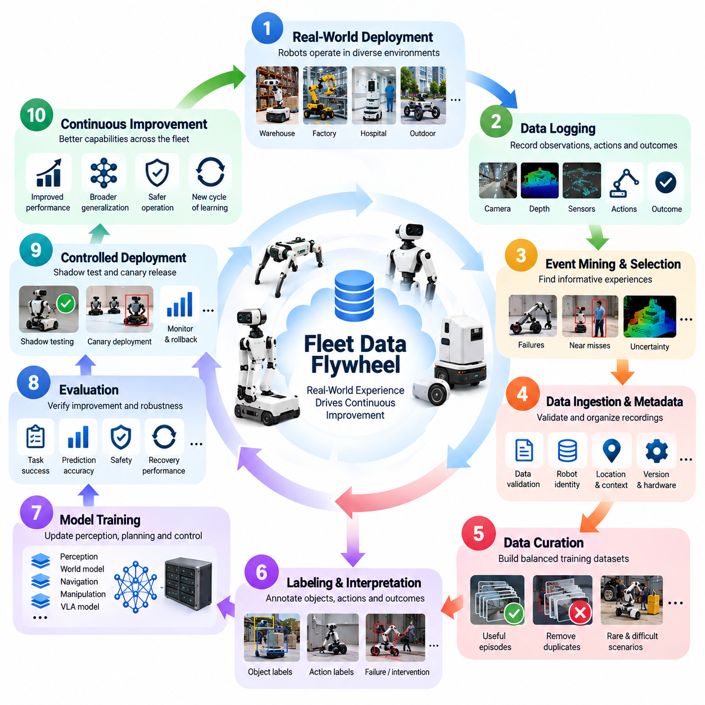{width="7.268055555555556in" height="7.268055555555556in"}

플릿 데이터 플라이휠(Fleet Data Flywheel)은 다수의 로봇에서 생성되는 운영 경험(Operational Experience)을 점진적으로 향상되는 물리 인공지능(Physical AI) 역량으로 변환하는 지속적 학습 메커니즘(Continuous Learning Mechanism)이다. 배포 이전에 수집되는 정적 데이터셋(Static Dataset)과 달리 플릿 데이터 플라이휠은 실제 환경 운영(Real-World Operation), 데이터 수집(Data Collection), 모델 학습(Model Training), 평가(Evaluation), 재배포(Redeployment)를 연결한다. 각 순환 과정은 로봇 행동에 관한 새로운 증거를 생성하며, 개별 로봇이 경험한 상황을 전체 로봇 플릿(Robot Fleet)이 공유하고 활용할 수 있도록 한다.

플릿 데이터 플라이휠의 기본 원리는 로봇 배포(Deployment) 자체가 지속적인 학습의 원천이 된다는 것이다. 로봇은 창고, 공장, 병원, 실외 환경에서 작업을 수행하면서 관측(Observation), 행동(Action), 결과(Outcome)를 생성한다. 이러한 운영 기록(Operational Record)은 성공적인 행동뿐 아니라 예상하지 못한 한계도 보여준다. 기록을 체계적으로 수집하고 분석하면 인식(Perception), 계획(Planning), 조작(Manipulation), 제어 정책(Control Policy)을 개선하는 데 필요한 정보를 확보할 수 있다.

완전한 플릿 데이터 플라이휠은 독립적인 데이터 파이프라인(Data Pipeline)이 아니라 상호 연결된 프로세스(Interconnected Process)로 구성된다. 운영 중인 로봇은 경험을 생성하고, 로깅 시스템(Logging System)은 관련 이벤트(Event)를 기록하며, 데이터 인프라(Data Infrastructure)는 기록을 체계적으로 구성한다. 데이터 큐레이션 시스템(Data Curation System)은 가치 있는 사례를 식별하고, 학습 파이프라인(Training Pipeline)은 이를 업데이트된 모델(Updated Model)로 변환한다. 평가 시스템(Evaluation System)은 배포 전에 개선 여부를 검증하며, 검증된 모델은 다시 플릿에 적용되어 다음 학습 순환을 시작한다.

첫 번째 단계는 실제 환경 로봇 배포(Real-World Robot Deployment)에서 시작되며, 자율 시스템(Autonomous System)은 개발 과정에서 완전히 예측할 수 없는 조건을 경험한다. 조명(Lighting), 객체 형상(Object Geometry), 인간 활동(Human Activity), 바닥 상태(Floor Condition), 장비 구성(Equipment Configuration)의 차이는 다양한 운영 경험을 생성한다. 각 로봇은 분산형 감지 및 실험 플랫폼(Distributed Sensing and Experimentation Platform)이 되어 학습된 정책(Learned Policy)이 실제 물리적 제약조건(Physical Constraint)에서 어떻게 작동하는지에 관한 증거를 제공한다.

지속적 데이터 로깅(Continuous Data Logging)은 플라이휠의 관측 기반(Observational Foundation)을 제공한다. 로봇은 동기화된 카메라 영상(Camera Image), 깊이 측정값(Depth Measurement), 고유수용감각 상태(Proprioceptive State), 명령된 행동(Commanded Action), 실행 결과(Execution Outcome)를 기록한다. 그러나 모든 측정값을 무기한 저장하는 것은 현실적으로 어렵다. 이벤트 기반 기록(Event-Triggered Recording), 로컬 버퍼링(Local Buffering), 선택적 업로드(Selective Upload)는 저장 공간 소비(Storage Consumption), 통신 대역폭(Communication Bandwidth), 처리 비용(Processing Cost)을 제어하면서 정보 가치가 높은 에피소드(Episode)를 보존한다.

다음 단계에서는 학습 가치(Learning Value)가 가장 높은 경험을 식별한다. 일상적인 성공 작업(Routine Successful Operation)은 기준 행동(Baseline Behavior)을 제공하지만, 비정상적인 실패(Unusual Failure), 운영자 개입(Operator Intervention), 아차 사고(Near Miss), 불확실한 예측(Uncertain Prediction)은 더 중요한 한계를 드러내는 경우가 많다. 자동 이벤트 탐지(Automated Event Detection)와 불확실성 추정(Uncertainty Estimation)은 이러한 상황을 식별할 수 있다. 정보 가치가 높은 에피소드를 우선적으로 선택하면 추가적인 학습 가치가 제한적인 반복 사례가 데이터 엔진(Data Engine)을 지배하는 현상을 방지할 수 있다.

데이터 수집 및 적재(Data Ingestion)는 분산된 기록을 구조화되고 추적 가능한 자원(Structured and Traceable Resource)으로 변환한다. 수신된 에피소드는 완전성(Completeness), 타임스탬프 일관성(Timestamp Consistency), 센서 무결성(Sensor Integrity), 메타데이터 정확성(Metadata Correctness)을 기준으로 검증된다. 로봇 식별 정보(Robot Identity), 소프트웨어 버전(Software Version), 작업 맥락(Task Context), 운영 현장(Operating Site), 환경 조건(Environmental Condition)이 각 기록과 연결된다. 이러한 속성은 엔지니어가 실제 모델의 취약점(Model Weakness)과 하드웨어 차이 또는 일관되지 않은 운영 조건으로 발생한 문제를 구분하도록 지원한다.

플릿 규모 데이터 큐레이션(Fleet-Scale Data Curation)은 어떤 경험이 후속 학습(Subsequent Learning)에 영향을 미쳐야 하는지를 결정한다. 중복 궤적(Duplicate Trajectory), 손상된 기록(Corrupted Recording), 관련성이 낮은 구간(Irrelevant Segment)은 제거할 수 있으며, 희귀 이벤트(Rare Event)와 어려운 시나리오(Difficult Scenario)는 더 높은 우선순위를 부여받는다. 또한 데이터셋이 실패 사례에 지나치게 편중되지 않도록 대표적인 성공 사례(Representative Successful Example)를 보존해야 한다. 목표는 정상적인 운영 행동(Normal Operational Behavior)을 왜곡하지 않으면서 강건성(Robustness)을 향상시키는 균형 잡힌 학습 데이터 집합(Balanced Training Collection)을 구축하는 것이다.

레이블링(Labeling)과 해석(Interpretation)은 선택된 에피소드를 의미 있는 학습 신호(Learning Signal)로 변환한다. 인간 검토자(Human Reviewer), 자동 인식 모델(Automated Perception Model), 작업별 평가기(Task-Specific Evaluator)는 객체(Object), 행동(Action), 접촉(Contact), 실패(Failure), 개입(Intervention), 성공 결과(Successful Outcome)를 식별할 수 있다. 시간적 주석(Temporal Annotation)은 의사결정(Decision)과 그 결과를 연결한다. 이러한 레이블은 지도 학습(Supervised Learning), 모방 학습(Imitation Learning), 보상 추정(Reward Estimation), 여러 연속 행동이 포함된 복잡한 행동의 평가를 지원한다.

모델 학습(Model Training)은 플라이휠의 계산적 중심(Computational Center)을 형성한다. 큐레이션된 플릿 데이터(Curated Fleet Data)는 인식 네트워크(Perception Network), 월드 모델(World Model), 내비게이션 정책(Navigation Policy), 조작 제어기(Manipulation Controller), 시각-언어-행동 모델(Vision-Language-Action Model)을 업데이트하는 데 사용된다. 학습 과정에서는 새롭게 수집된 현장 에피소드(Field Episode)를 과거 데이터셋(Historical Dataset), 시뮬레이션 생성 경험(Simulation-Generated Experience), 인간 시연(Human Demonstration)과 결합할 수 있다. 신중한 데이터 혼합 설계(Data Mixture Design)는 최근 관측 데이터가 이전에 학습된 능력을 압도하는 현상을 방지한다.

평가(Evaluation)는 새로운 모델이 실제로 개선되었는지를 판단한다. 오프라인 벤치마크(Offline Benchmark)는 작업 완료(Task Completion), 예측 정확도(Prediction Accuracy), 충돌 위험(Collision Risk), 복구 성능(Recovery Performance), 환경 간 일반화(Generalization Across Environments)를 측정한다. 이전에 관측된 실패 시나리오(Failure Scenario)는 회귀 테스트(Regression Test)로 유지된다. 모델은 자주 발생하는 작업에서 평균 성능(Average Performance)만 높이는 것이 아니라 관련 운영 조건 전반에서 개선되었음을 입증해야 한다.

광범위한 배포 이전에 업데이트된 모델은 섀도 테스트(Shadow Testing)와 통제된 카나리 릴리스(Controlled Canary Release)를 통해 검토할 수 있다. 섀도 모델(Shadow Model)은 실제 센서 입력(Real Sensor Input)을 처리하지만 물리적 행동 명령(Physical Action Command)을 실행하지 않으므로 현재 활성 정책(Active Policy)과 비교할 수 있다. 카나리 배포(Canary Deployment)는 제한된 로봇 집단에 업데이트를 적용하고 통제된 조건에서 성능을 관찰한다. 안전 제약조건(Safety Constraint), 롤백 메커니즘(Rollback Mechanism), 운영 승인 기준(Operational Acceptance Criteria)은 검증되지 않은 개선 사항이 플릿 전체의 위험으로 확대되는 것을 방지한다.

업데이트된 모델이 배포되면 플라이휠은 다시 운영 단계(Operational Stage)로 돌아간다. 로봇은 개선된 능력으로 익숙한 상황에 대응하면서 새로운 환경 변화(Environmental Variation)와 고장 유형(Failure Mode)을 계속 발견한다. 이전의 취약점이 해결됨에 따라 수집되는 데이터 분포(Data Distribution)도 변화한다. 이로 인해 각 세대의 정책(Policy Generation)이 추가적인 증거를 필요로 하는 새로운 한계를 드러내는 이동하는 학습 목표(Moving Learning Target)가 형성된다.

플라이휠의 효과는 데이터 수집(Data Collection)과 모델 오류(Model Error) 사이의 관계에 따라 달라진다. 시스템은 무분별하게 정보를 수집하는 대신 불확실성(Uncertainty), 예측 불일치(Prediction Disagreement), 낮은 작업 성능(Poor Task Performance)과 관련된 조건을 식별할 수 있다. 이러한 신호는 향후 데이터 수집을 안내하는 목표 지향적 데이터 질의(Targeted Data Query)로 변환된다. 이 과정은 운영 경험을 모델 개선에 대한 예상 기여도(Expected Contribution)에 따라 선택하는 능동 학습(Active Learning)과 유사하다.

플릿 전체 배포(Fleet-Wide Deployment)는 여러 위치에 데이터 발견(Data Discovery)을 분산함으로써 이러한 메커니즘을 강화한다. 한 창고에서 관측된 내비게이션 실패(Navigation Failure)는 다른 장소에서 운영되는 로봇에도 관련된 취약점을 드러낼 수 있다. 해당 모델 개선(Model Improvement)이 검증되면 호환 가능한 전체 플릿(Compatible Fleet)에 잠재적으로 혜택을 제공할 수 있다. 이러한 공유 학습 과정(Shared Learning Process)은 각 로봇이 동일한 운영상의 어려움을 독립적으로 경험하고 극복해야 하는 필요성을 줄여준다.

플라이휠은 로봇의 형태(Embodiment)와 하드웨어 구성(Hardware Configuration) 차이도 고려해야 한다. 하나의 모바일 매니퓰레이터(Mobile Manipulator)에서 수집한 데이터는 센서(Sensor), 액추에이터(Actuator), 운동학적 제약조건(Kinematic Constraint)이 다른 플랫폼에 직접 전이되지 않을 수 있다. 공유 작업 표현(Shared Task Representation), 정규화된 관측(Normalized Observation), 로봇 형태별 적응(Embodiment-Specific Adaptation)은 지식 전이(Knowledge Transfer)를 지원할 수 있다. 그러나 하나의 플랫폼에서 성공한 행동이 다른 플랫폼에서도 동일한 성능을 보장하지 않으므로 검증(Validation)이 필요하다.

운영 모니터링(Operational Monitoring)은 기존 학습 지표(Training Metric)를 넘어서는 피드백을 제공한다. 플릿 대시보드(Fleet Dashboard)는 작업 성공률(Task Success Rate), 개입 빈도(Intervention Frequency), 임무 완료 시간(Mission Completion Time), 에너지 소비(Energy Consumption), 안전 이벤트(Safety Event), 복구 효과(Recovery Effectiveness)를 추적할 수 있다. 이러한 측정값의 변화는 모델 성능 저하(Model Regression), 환경 드리프트(Environmental Drift), 하드웨어 성능 저하(Hardware Degradation)를 나타낼 수 있다. 성능 지표(Performance Indicator)를 특정 데이터 에피소드와 연결하면 엔지니어가 문제를 조사하고 수정 학습(Corrective Learning)의 우선순위를 결정할 수 있다.

데이터 거버넌스(Data Governance)는 플라이휠이 작동할 수 있는 경계(Boundary)를 설정한다. 로봇은 일상적인 운영 과정에서 사람, 기밀 산업 공정(Confidential Industrial Process), 위치 민감 정보(Location-Sensitive Information)를 수집할 수 있다. 따라서 개인정보 보호 필터링(Privacy Filtering), 접근 제어(Access Control), 암호화(Encryption), 데이터 보존 정책(Retention Policy), 감사 추적(Audit Trail)을 데이터 수집 및 처리 워크플로(Workflow)에 통합해야 한다. 책임 있는 데이터 관리(Responsible Data Management)는 모든 운영 기록을 자유롭게 중앙 집중화하거나 재사용할 수 있다고 가정하지 않으면서 플릿 학습을 가능하게 한다.

플릿 데이터 플라이휠을 확장하면 경제적 및 계산적 절충 관계(Economic and Computational Tradeoff)가 발생한다. 더 많은 로봇은 추가적인 경험을 생성하지만 저장 요구사항(Storage Requirement), 주석 작업량(Annotation Workload), 학습 비용(Training Cost), 배포 복잡성(Deployment Complexity)도 증가시킨다. 추가 에피소드의 가치는 품질(Quality), 신규성(Novelty), 해결되지 않은 모델 취약점과의 관련성(Relevance)에 따라 결정된다. 따라서 효율적인 확장(Efficient Scaling)은 전체 수집 데이터 양을 최대화하는 것이 아니라 유용한 학습 정보(Useful Learning Information)를 최적화해야 한다.

성숙한 플라이휠(Mature Flywheel)은 운영 증거(Operational Evidence)를 검증된 개선(Verified Improvement)으로 얼마나 효과적으로 전환하는지를 기준으로 평가된다. 중요한 지표에는 실패 발견부터 모델 수정까지 걸리는 시간(Time from Failure Discovery to Model Correction), 반복 사고 감소(Reduction in Repeated Incidents), 해결된 롱테일 시나리오(Long-Tail Scenario)의 수, 배포된 정책의 안정성(Policy Stability)이 포함된다. 학습 주기(Learning Cycle)를 단축하는 것은 신뢰할 수 있는 평가와 안전한 배포가 함께 이루어질 때만 가치가 있다. 지속적 개선(Continuous Improvement)은 측정 가능하고 통제 가능한 상태를 유지해야 한다.

궁극적으로 플릿 데이터 플라이휠은 로봇 플릿을 단순히 배포된 기계들의 집합에서 분산 학습 인프라(Distributed Learning Infrastructure)로 전환한다. 모든 로봇은 경험을 제공하고, 중앙 및 엣지 시스템(Centralized and Edge System)은 유용한 지식을 추출하며, 검증된 모델 업데이트(Validated Model Update)는 개선된 능력을 실제 운영 환경에 다시 적용한다. 데이터 품질(Data Quality), 모델 개발(Model Development), 안전 보증(Safety Assurance), 배포 피드백(Deployment Feedback)이 유기적으로 조정되면 플라이휠은 확장 가능하고 적응적이며 지속적으로 자기 개선(Self-Improvement)하는 물리 인공지능(Physical AI)의 기반이 된다.

## 09.03. On Robot Logging and Event Triggered Recording

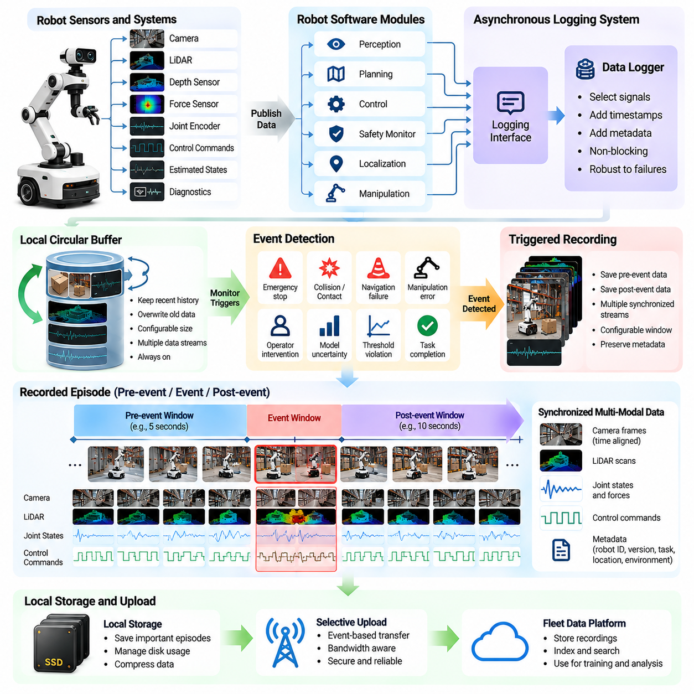{width="7.268055555555556in" height="7.268055555555556in"}

로봇 내부 로깅(On-Robot Logging)은 플릿 규모 데이터 수집(Fleet-Scale Data Collection)의 기반으로, 자율 시스템(Autonomous System)이 운영 과정에서 생성되는 증거를 데이터 발생 지점에서 직접 보존할 수 있도록 한다. 모든 로봇은 작업 수행 중 센서 관측값(Sensor Observation), 제어 명령(Control Command), 추정 상태(Estimated State), 진단 정보(Diagnostic Information)를 지속적으로 생성한다. 구조화된 로깅 시스템(Structured Logging System)은 이러한 신호를 일관된 타임스탬프(Timestamp)와 맥락 메타데이터(Contextual Metadata)와 함께 기록하여 엔지니어가 로봇 행동을 재구성하고 중요한 이벤트 주변의 물리적 조건을 분석할 수 있도록 한다.

현대 로봇은 상당한 양의 다중 모달 데이터(Multimodal Data)를 생성하기 때문에 사용 가능한 모든 센서 스트림(Sensor Stream)을 지속적으로 기록하는 것은 현실적으로 어려운 경우가 많다. 고해상도 카메라(High-Resolution Camera), 라이다 스캐너(LiDAR Scanner), 깊이 센서(Depth Sensor), 관절 엔코더(Joint Encoder), 힘 센서(Force Sensor)는 서로 다른 샘플링 주파수(Sampling Frequency)와 데이터 전송률(Data Rate)로 작동한다. 제한 없는 기록은 저장 요구사항(Storage Requirement), 프로세서 사용률(Processor Utilization), 통신 비용(Communication Cost)을 증가시킨다. 따라서 로봇 내부 로깅 아키텍처(On-Robot Logging Architecture)는 정보의 완전성(Information Completeness)과 제한된 계산 및 저장 자원 사이에서 균형을 유지해야 한다.

일반적인 로깅 아키텍처(Logging Architecture)는 실시간 로봇 운영(Real-Time Robot Operation)과 데이터 기록 작업(Data Recording Activity)을 분리한다. 인식(Perception), 계획(Planning), 제어(Control) 모듈은 통신 인터페이스(Communication Interface)를 통해 관측값과 내부 상태(Internal State)를 발행하고, 전용 로깅 프로세스(Dedicated Logging Process)는 선택된 정보를 비동기적으로(Asynchronously) 수집한다. 이러한 분리는 시간 제약이 엄격한 제어 루프(Time-Critical Control Loop)에 대한 간섭을 줄인다. 로깅 시스템은 저장 지연(Storage Delay)이나 통신 장애(Communication Failure)가 로봇의 운영 안전성(Operational Safety)을 저해하지 않도록 설계해야 한다.

로컬 버퍼링(Local Buffering)은 효율적인 기록을 위한 핵심 메커니즘(Core Mechanism)이다. 순환 버퍼(Circular Buffer)는 최근 센서 측정값(Sensor Measurement), 행동(Action), 시스템 상태(System State)를 설정 가능한 시간 구간 동안 지속적으로 유지한다. 새로운 정보가 도착하면 중요한 이벤트로 인해 보존할 필요가 없는 한 오래된 기록은 덮어쓰인다. 이러한 아키텍처는 모든 관측값을 영구적으로 저장하지 않으면서 최근 운영 이력(Operational History)에 접근할 수 있도록 하며, 장시간 연속 운용되는 로봇에 특히 유용하다.

이벤트 트리거 기록(Event-Triggered Recording)은 사전에 정의된 조건이 발생할 때 데이터를 보존함으로써 로컬 버퍼링을 확장한다. 트리거(Trigger)에는 비상 정지(Emergency Stop), 충돌(Collision), 예상하지 못한 접촉(Unexpected Contact), 내비게이션 실패(Navigation Failure), 조작 오류(Manipulation Error), 운영자 개입(Operator Intervention) 등이 포함될 수 있다. 이벤트가 탐지되면 로거(Logger)는 발생 이전과 이후의 관련 정보를 함께 저장한다. 이러한 시간적 맥락(Temporal Context)은 엔지니어가 직접적인 실패뿐 아니라 실패에 앞서 이루어진 의사결정(Decision)의 순서까지 조사할 수 있도록 한다.

기록 시간 구간(Recording Window)은 모니터링 대상 작업의 동역학(Dynamics)을 반영해야 한다. 장애물에 접근하는 모바일 로봇(Mobile Robot)은 이전 수 초 동안의 센서 및 제어 이력(Sensor and Control History)이 필요할 수 있지만, 고속 조작 이벤트(High-Speed Manipulation Event)는 훨씬 짧은 시간 동안의 정밀한 측정값이 필요할 수 있다. 설정 가능한 이벤트 이전 및 이후 기록 시간(Pre-Event and Post-Event Duration)은 관련 없는 운영 활동을 불필요하게 저장하지 않으면서 의미 있는 인과적 맥락(Causal Context)을 확보하도록 한다.

이벤트 탐지(Event Detection)는 로봇 시스템의 여러 구성요소에서 시작될 수 있다. 안전 제어기(Safety Controller)는 비상 상황(Emergency Condition)을 보고하고, 내비게이션 모듈(Navigation Module)은 위치 추정 실패(Localization Failure)를 탐지하며, 조작 제어기(Manipulation Controller)는 과도한 힘(Excessive Force)이나 파지 실패(Unsuccessful Grasp)를 식별할 수 있다. 인식 모델(Perception Model)은 낮은 신뢰도(Low Confidence) 또는 일관되지 않은 관측값(Inconsistent Observation)을 신호로 제공할 수 있다. 이러한 신호를 결합하면 단일 오류 지표(Error Indicator)에 의존하는 것보다 운영 이상 현상(Operational Anomaly)을 더욱 폭넓게 이해할 수 있다.

임계값 기반 트리거(Threshold-Based Triggering)는 중요한 이벤트를 식별하는 간단한 방법을 제공한다. 위치 추정 불확실성(Localization Uncertainty)이 허용 한계(Acceptable Limit)를 초과하거나, 모터 전류(Motor Current)가 예상과 다르게 증가하거나, 장애물 이격 거리(Obstacle Clearance)가 안전 임계값(Safety Threshold) 아래로 떨어질 때 기록을 시작할 수 있다. 그러나 고정 임계값(Fixed Threshold)은 잡음이 많은 환경(Noisy Environment)에서 과도한 기록을 생성할 수 있다. 히스테리시스(Hysteresis), 시간적 필터링(Temporal Filtering), 상황 의존적 임계값(Context-Dependent Threshold)은 의미 있는 편차(Meaningful Deviation)에 대한 민감도를 유지하면서 잘못된 트리거(False Trigger)를 줄이는 데 도움이 된다.

모델 기반 이벤트 탐지(Model-Based Event Detection)는 로깅 과정에 추가적인 지능(Intelligence)을 도입한다. 로봇은 예측된 관측값(Predicted Observation)이나 작업 결과(Task Outcome)를 실제 측정값(Actual Measurement)과 비교하여 예상하지 못한 행동을 식별할 수 있다. 큰 예측 오류(Prediction Error), 인식 모델 간 불일치(Perception Model Disagreement), 비정상적인 상태 전이(Unusual State Transition)는 정보 가치가 높은 상황을 나타낼 수 있다. 이러한 트리거는 명시적인 시스템 장애(System Failure)가 발생하지 않은 경우에도 학습된 정책(Learned Policy)을 개선하기 위한 데이터 수집을 지원한다.

운영자 개입(Operator Intervention)은 자율 행동(Autonomous Behavior)의 한계를 나타내는 경우가 많기 때문에 특히 가치 있는 기록 트리거(Recording Trigger)이다. 인간이 제어권을 인수하거나 계획된 궤적(Planned Trajectory)을 수정하거나 실패한 조작(Unsuccessful Manipulation)을 교정하면 시스템은 이전의 자율 의사결정(Autonomous Decision)과 이후의 수정 행동(Corrective Action)을 보존할 수 있다. 이러한 에피소드는 모방 학습(Imitation Learning), 정책 개선(Policy Refinement), 자율 지원(Autonomous Assistance)이 여전히 충분하지 않은 상황의 분석에 유용한 사례를 제공한다.

성공적인 작업 수행(Successful Task Execution)도 로깅 전략(Logging Strategy)에 포함되어야 한다. 실패만 기록하면 정상적인 로봇 행동(Normal Robot Behavior)과 운영 조건(Operating Condition)을 충분히 대표하지 못하는 데이터셋(Dataset)이 생성될 수 있다. 주기적 샘플링(Periodic Sampling), 무작위 에피소드 선택(Randomized Episode Selection), 작업 완료 트리거(Task-Completion Trigger)는 대표적인 성공 궤적(Representative Successful Trajectory)을 보존한다. 일상적인 성공 사례와 어려운 이벤트를 결합하면 학습(Training), 평가(Evaluation), 장기적인 플릿 성능 분석(Long-Term Fleet Performance Analysis)을 위한 더욱 균형 잡힌 기반을 구축할 수 있다.

다중 모달 동기화(Multimodal Synchronization)는 기록된 이벤트를 정확하게 재구성하는 데 필수적이다. 카메라 프레임(Camera Frame), 라이다 스캔(LiDAR Scan), 관절 상태(Joint State), 힘 측정값(Force Measurement), 행동 명령(Action Command)은 서로 다른 시계(Clock)와 통신 경로(Communication Pathway)에서 생성될 수 있다. 로깅 인프라(Logging Infrastructure)는 데이터 취득 타임스탬프(Acquisition Timestamp)를 보존하고 동기화 불확실성(Synchronization Uncertainty)을 식별해야 한다. 정확한 시간 정렬(Temporal Alignment)은 로봇이 행동을 선택할 때 어떤 관측 정보를 사용할 수 있었는지, 그리고 환경이 어떻게 반응했는지를 엔지니어가 판단할 수 있도록 한다.

기록 메타데이터(Recording Metadata)는 저장된 센서 스트림(Sensor Stream)을 해석하는 데 필요한 맥락을 제공한다. 각 이벤트에는 로봇 식별 정보(Robot Identification), 하드웨어 구성(Hardware Configuration), 소프트웨어 버전(Software Version), 모델 버전(Model Version), 작업 식별자(Task Identifier), 트리거 범주(Trigger Category), 관련 환경 조건(Environmental Condition)이 연결되어야 한다. 보정 매개변수(Calibration Parameter)와 좌표 프레임 정의(Coordinate-Frame Definition)도 필요할 수 있다. 이러한 정보가 없으면 서로 다른 로봇에서 생성된 유사한 기록을 비교하거나 디버깅(Debugging) 및 모델 평가(Model Evaluation) 과정에서 재현하기 어려울 수 있다.

로봇이 안정적인 연결성(Connectivity) 없이 장시간 운용되는 경우 저장 관리(Storage Management)가 중요해진다. 로컬 시스템(Local System)은 저장 용량 제한(Capacity Limit), 데이터 보존 정책(Retention Policy), 보존 에피소드의 우선순위(Retention Priority)를 적용해야 한다. 가치가 높은 안전 이벤트(Safety Event)와 희귀 실패(Rare Failure)는 일상적인 기록보다 높은 수준의 보존 보장(Retention Guarantee)을 받을 수 있다. 저장 상태 모니터링(Storage Health Monitoring)은 용량 부족(Capacity Exhaustion), 손상된 파일(Corrupted File), 쓰기 실패(Write Failure)를 탐지해야 하며, 로깅 활동이 안전 필수 제어 기능(Safety-Critical Control Function)과 분리된 상태를 유지하도록 해야 한다.

압축(Compression)은 로봇 내부 데이터 보존(On-Robot Data Preservation)에 필요한 자원을 줄인다. 비디오 인코딩(Video Encoding), 포인트 클라우드 압축(Point-Cloud Compression), 효율적인 직렬화(Efficient Serialization)는 기록 크기를 상당히 줄일 수 있다. 그러나 손실 압축(Lossy Compression)은 인식 분석(Perception Analysis)이나 정밀한 재구성(Precise Reconstruction)에 필요한 세부 정보를 제거할 수 있다. 로깅 시스템은 데이터 유형(Data Type)과 사용 목적(Intended Use)에 따라 압축 방법을 선택하고, 후속 학습(Downstream Learning)과 검증(Verification)에 필요한 중요 측정값을 충분한 충실도(Fidelity)로 보존해야 한다.

이벤트 트리거 로깅(Event-Triggered Logging)은 중첩되거나 반복되는 트리거(Overlapping or Repeated Trigger)도 고려해야 한다. 내비게이션 실패(Navigation Failure)는 위치 추정(Localization), 장애물 회피(Obstacle Avoidance), 안전 모니터링(Safety Monitoring) 모듈에서 동시에 경고를 발생시킬 수 있다. 모든 경고를 독립적으로 기록하면 중복 데이터(Redundant Data)와 불필요한 저장 공간 소비가 발생할 수 있다. 이벤트 집계 메커니즘(Event Aggregation Mechanism)은 개별 원인(Cause), 타임스탬프(Timestamp), 심각도 수준(Severity Level), 진단 정보(Diagnostic Information)를 유지하면서 관련 트리거를 하나의 에피소드로 통합할 수 있다.

신뢰할 수 있는 로깅(Reliable Logging)은 예상하지 못한 전원 손실(Power Loss), 프로세스 충돌(Process Crash), 네트워크 중단(Network Interruption)에 대한 보호도 필요하다. 버퍼에 저장된 기록(Buffered Record)은 영구 저장소(Persistent Storage)에 주기적으로 기록되지 않으면 손실될 수 있다. 트랜잭션 기반 파일 쓰기(Transactional File Writing), 무결성 검사(Integrity Check), 복구 절차(Recovery Procedure)는 중요한 에피소드의 내구성(Durability)을 향상시킨다. 로깅 장애(Logging Failure)는 진단 모니터링(Diagnostic Monitoring)을 통해 관측 가능해야 하며, 유지보수 시스템(Maintenance System)이 신뢰할 수 있는 증거를 더 이상 수집하지 못하는 로봇을 식별할 수 있도록 해야 한다.

플릿 규모 운영(Fleet-Scale Operation)은 다수의 로봇에 걸쳐 로깅 정책(Logging Policy)을 조정해야 하는 과제를 도입한다. 중앙 관리 시스템(Central Management System)은 기록 설정(Recording Configuration), 트리거 정의(Trigger Definition), 보존 우선순위(Retention Priority), 샘플링 전략(Sampling Strategy)을 배포할 수 있다. 그러나 연결이 간헐적(Intermittent)일 수 있으므로 로컬 자율성(Local Autonomy)도 중요하다. 로봇은 중요한 이벤트를 독립적으로 탐지하고 보존하는 기능을 계속 수행해야 하며, 통신이 가능해지면 선택된 기록을 동기화(Synchronization)해야 한다.

개인정보 보호(Privacy)와 보안(Security) 요구사항은 로봇 내부 기록(On-Robot Recording)의 초기 설계 단계부터 통합되어야 한다. 카메라(Camera)와 마이크(Microphone)는 사람, 기밀 시설(Confidential Facility), 민감한 운영 정보(Sensitive Operational Information)를 수집할 수 있다. 접근 제어(Access Control), 암호화(Encryption), 선택적 기록(Selective Recording), 적절한 보존 기간 제한(Retention Limit)은 불필요한 정보 노출(Information Exposure)을 줄이는 데 도움이 된다. 가능한 경우 개인정보 보호 필터링(Privacy Filtering)을 중앙 인프라(Centralized Infrastructure)로 데이터를 전송하기 전에 로컬에서 수행하여 민감한 원시 기록(Sensitive Raw Recording)의 이동을 줄일 수 있다.

이벤트 트리거 기록(Event-Triggered Recording)의 효과는 트리거 정밀도(Trigger Precision), 이벤트 재현율(Event Recall), 저장 효율성(Storage Efficiency), 보존된 에피소드의 유용성(Usefulness of Preserved Episodes)을 통해 평가할 수 있다. 과도한 잘못된 트리거(False Trigger)는 처리 비용(Processing Cost)을 증가시키고, 누락된 이벤트(Missed Event)는 중요한 실패에 대한 가시성(Visibility)을 감소시킨다. 엔지니어는 기록된 이벤트를 주기적으로 검토하고 운영 증거(Operational Evidence), 모델 취약점(Model Weakness), 플릿 전반의 변화하는 환경 조건(Environmental Condition)에 따라 트리거 정책(Trigger Policy)을 조정해야 한다.

궁극적으로 로봇 내부 로깅(On-Robot Logging)과 이벤트 트리거 기록(Event-Triggered Recording)은 연속적인 로봇 운영(Continuous Robot Operation)을 높은 학습 가치를 지닌 데이터(High-Value Learning Data)의 선택적 공급원으로 전환한다. 동기화된 관측값(Synchronized Observation), 맥락 메타데이터(Contextual Metadata), 로컬 버퍼링(Local Buffering), 지능형 트리거(Intelligent Trigger), 신뢰할 수 있는 저장(Reliable Storage)을 결합하면 로봇은 디버깅(Debugging), 평가(Evaluation), 모델 개선(Model Improvement)을 지원하는 경험을 보존할 수 있다. 플릿 규모에서 이러한 능력은 지속적 학습(Continuous Learning)과 점점 더 적응적인 물리 인공지능(Physical AI) 시스템을 위한 관측 기반(Observational Foundation)을 제공한다.

## 09.04. Edge Filtering Compression and Prioritization

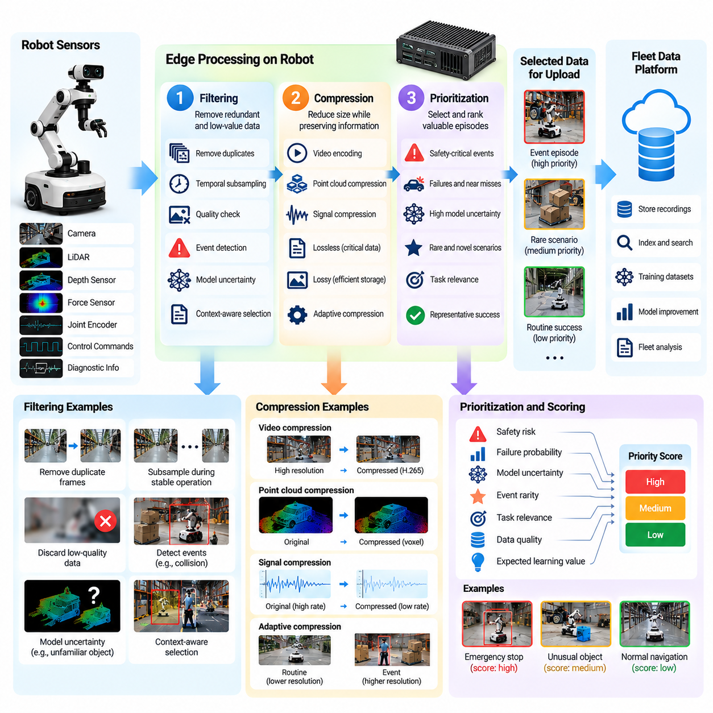{width="7.268055555555556in" height="7.268055555555556in"}

엣지 필터링(Edge Filtering), 압축(Compression), 우선순위 지정(Prioritization)은 대규모 로봇 플릿(Robot Fleet)에서 생성되는 방대한 데이터(Data)를 관리하기 위한 필수 메커니즘(Essential Mechanism)이다. 자율 로봇(Autonomous Robot)은 카메라 영상(Camera Image), 라이다 스캔(LiDAR Scan), 깊이 측정값(Depth Measurement), 고유수용감각 신호(Proprioceptive Signal), 제어 로그(Control Log)를 지속적으로 생성한다. 모든 관측 데이터를 중앙 인프라(Centralized Infrastructure)로 전송하는 것은 현실적으로 어려운 경우가 많다. 엣지 처리(Edge Processing)는 전송 전에 원시 센서 스트림(Raw Sensor Stream)을 선별되고 압축된 가치 있는 정보로 변환한다.

엣지 데이터 처리(Edge Data Processing)의 주요 목표는 통신 비용(Communication Cost), 저장 비용(Storage Cost), 계산 비용(Computational Cost)을 최소화하면서 유용한 학습 정보(Useful Learning Information)를 최대화하는 것이다. 로봇은 로컬 자원(Local Resource)에 과도한 부담을 주지 않으면서 안전(Safety), 실패(Failure), 비정상적인 환경(Unusual Environment), 모델 개선(Model Improvement)과 관련된 증거를 보존해야 한다. 이를 위해 어떤 데이터를 유지할지, 어느 정도의 세부 정보를 보존할지, 언제 정보를 플릿 인프라(Fleet Infrastructure)로 전송할지를 조정하여 결정해야 한다.

엣지 필터링(Edge Filtering)은 데이터 생성 지점(Data Generation Point) 근처에서 수행되며, 일반적으로 임베디드 프로세서(Embedded Processor), 온보드 가속기(Onboard Accelerator), 로컬 컴퓨팅 게이트웨이(Local Computing Gateway)를 활용한다. 클라우드 전송(Cloud Transmission) 전에 데이터를 처리하면 네트워크 의존성(Network Dependency)을 줄이고 중요한 관측값을 즉시 선택할 수 있다. 그러나 필터링 작업량(Filtering Workload)은 안전 필수 제어 기능(Safety-Critical Control Function)과 분리되어야 한다. 데이터 관리(Data Management)가 인식(Perception), 계획(Planning), 액추에이터 제어(Actuator Control)에 허용할 수 없는 지연 시간(Latency)을 발생시켜서는 안 된다.

기본 필터링(Basic Filtering)은 추가적인 정보 가치(Information Value)가 거의 없는 데이터를 제거한다. 반복되는 카메라 프레임(Repeated Camera Frame), 정적인 센서 측정값(Stationary Sensor Reading), 중복 메시지(Duplicate Message), 손상된 패킷(Corrupted Packet)은 저장이나 업로드 이전에 탐지할 수 있다. 시간적 서브샘플링(Temporal Subsampling)은 예측 가능한 운영 중 기록 빈도(Recording Frequency)를 줄이며, 적응형 샘플링(Adaptive Sampling)은 급격한 환경 변화(Environmental Change)가 발생할 때 세부 기록 수준을 높인다. 이러한 메커니즘은 중요한 운영 상태 전이(Operational Transition)를 반드시 제거하지 않으면서 중복성을 감소시킨다.

품질 인식 필터링(Quality-Aware Filtering)은 기록된 정보가 후속 활용(Downstream Use)에 충분히 신뢰할 수 있는지를 평가한다. 흐릿한 영상(Blurred Image), 불완전한 포인트 클라우드(Incomplete Point Cloud), 유효하지 않은 타임스탬프(Invalid Timestamp), 일관되지 않은 센서 측정값(Inconsistent Sensor Measurement)은 응용 요구사항(Application Requirement)에 따라 표시하거나 제외할 수 있다. 그러나 비정상적인 측정값(Unusual Measurement)은 센서 장애(Sensor Failure)나 희귀 물리적 이벤트(Rare Physical Event)를 나타낼 수 있으므로 자동으로 제거해서는 안 된다. 일반적인 데이터 품질(Data Quality)과 함께 진단 관련성(Diagnostic Relevance)을 고려해야 한다.

이벤트 인식 필터링(Event-Aware Filtering)은 운영 맥락(Operational Context)을 활용하여 보존할 가치가 있는 데이터 구간을 식별한다. 비상 정지(Emergency Stop), 내비게이션 실패(Navigation Failure), 예상하지 못한 접촉(Unexpected Contact), 파지 실패(Failed Grasp), 인간 개입(Human Intervention)은 주변 센서 및 행동 이력(Sensor and Action History)의 보존을 유도할 수 있다. 이벤트 이전 및 이후 버퍼(Pre-Event and Post-Event Buffer)는 문제 발생에 이르는 과정과 그 결과를 기록한다. 이러한 맥락 보존(Contextual Preservation)은 오류가 보고된 순간만 유지하는 것보다 더 많은 정보를 제공한다.

모델 기반 필터링(Model-Driven Filtering)은 명시적인 실패(Explicit Failure)를 넘어 이벤트 선택(Event Selection)을 확장한다. 예측 불확실성(Prediction Uncertainty), 모델 간 불일치(Model Disagreement), 예상하지 못한 상태 전이(Unexpected State Transition), 계획된 궤적(Planned Trajectory)에서의 편차(Deviation)는 정보 가치가 높은 경험을 식별할 수 있다. 로봇이 작업에 실패하지 않고 익숙하지 않은 객체(Unfamiliar Object)를 발견하더라도 해당 관측은 향후 학습(Future Learning)에 유용할 수 있다. 이러한 메커니즘은 해결되지 않은 모델 취약점(Model Weakness)에 기반한 능동적 데이터 수집(Active Data Collection)을 지원한다.

압축(Compression)은 분석(Analysis)과 학습(Training)에 필요한 정보를 유지하면서 보존 데이터(Retained Data)의 크기를 줄인다. 비디오 스트림(Video Stream)은 효율적인 인코딩(Efficient Encoding)을 사용할 수 있고, 포인트 클라우드(Point Cloud)는 공간적 중복성(Spatial Redundancy)을 활용할 수 있으며, 수치 신호(Numerical Signal)는 압축된 직렬화(Compact Serialization)를 사용할 수 있다. 압축 전략(Compression Strategy)은 센서 특성(Sensor Characteristic)과 후속 처리 요구사항(Downstream Requirement)을 반영해야 한다. 목표는 단순히 파일 크기를 최소화하는 것이 아니라 충실도(Fidelity), 처리 비용(Processing Cost), 복구 가능성(Recoverability) 사이에서 적절한 균형을 확보하는 것이다.

무손실 압축(Lossless Compression)은 원본 정보(Original Information)를 정확하게 보존하며 정밀한 재구성(Precise Reconstruction)이 필요한 측정값에 적합하다. 제어 명령(Control Command), 이벤트 타임스탬프(Event Timestamp), 보정 매개변수(Calibration Parameter), 일부 안전 기록(Safety Record)은 이러한 특성을 필요로 할 수 있다. 손실 압축(Lossy Compression)은 더 높은 압축률(Compression Ratio)을 제공하지만 시각적 세부 정보(Visual Detail), 기하학적 경계(Geometric Boundary), 미세한 움직임 패턴(Subtle Motion Pattern)을 변경할 수 있다. 적합성은 이러한 변화가 의도된 학습 및 평가 작업에 영향을 미치는지에 따라 결정된다.

적응형 압축(Adaptive Compression)은 운영상의 중요도(Operational Significance)에 따라 기록 충실도(Recording Fidelity)를 변경할 수 있도록 한다. 일상적인 내비게이션(Routine Navigation)에서는 낮은 비디오 해상도(Video Resolution)나 샘플링 주파수(Sampling Rate)를 사용할 수 있지만, 충돌 직전 이벤트(Near-Collision Event)에서는 고해상도 영상(High-Resolution Image)과 상세한 센서 이력(Detailed Sensor History)을 보존할 수 있다. 작은 객체(Small Object)를 다루는 조작 작업(Manipulation Task)은 일반적인 이동 작업(Transit Task)보다 높은 공간 정밀도(Spatial Precision)를 필요로 할 수 있다. 상황 인식 설정(Context-Sensitive Setting)은 어려운 사례에 필요한 정보를 보호하면서 자원 효율성(Resource Efficiency)을 향상시킨다.

다중 모달 압축(Multimodal Compression)은 서로 다른 센서가 물리적 행동(Physical Behavior)의 상호 보완적인 측면을 포착하기 때문에 추가적인 과제를 발생시킨다. 카메라 영상(Camera Image)은 외형(Appearance)을 설명하고, 라이다(LiDAR)는 기하학적 구조(Geometry)를 제공하며, 고유수용감각 측정값(Proprioceptive Measurement)은 내부 움직임(Internal Motion)을 나타낸다. 하나의 모달리티(Modality)를 과도하게 축소하면 다른 모달리티의 해석 능력이 약화될 수 있다. 따라서 엣지 처리(Edge Processing)는 의미 있는 로봇 에피소드(Robot Episode)를 재구성할 수 있도록 동기화 메타데이터(Synchronization Metadata), 좌표 관계(Coordinate Relationship), 충분한 교차 모달 세부 정보(Cross-Modal Detail)를 보존해야 한다.

우선순위 지정(Prioritization)은 자원이 제한된 상황에서 어떤 기록에 저장 및 전송 자원(Storage and Transmission Resource)을 할당할지를 결정한다. 안전 필수 사고(Safety-Critical Incident), 심각한 실패(Severe Failure), 희귀 환경 조건(Rare Environmental Condition)은 일반적으로 반복적인 성공 작업(Repetitive Successful Operation)보다 높은 우선순위를 가진다. 그러나 대표적인 정상 궤적(Representative Normal Trajectory)은 균형 잡힌 학습 데이터셋(Balanced Training Dataset)을 위해 여전히 필요하다. 효과적인 우선순위 지정은 이벤트 심각도(Event Severity)에만 의존하지 않고 운영 중요도(Operational Importance), 신규성(Novelty), 데이터 품질(Data Quality), 예상 학습 가치(Expected Learning Value)를 결합한다.

우선순위 점수(Priority Score)는 모델 불확실성(Model Uncertainty), 실패 확률(Failure Probability), 이벤트 희귀성(Event Rarity), 작업 관련성(Task Relevance), 데이터셋 포괄 범위(Dataset Coverage)와 같은 여러 측정 가능한 신호를 포함할 수 있다. 이러한 요소는 설정 가능한 순위 함수(Configurable Ranking Function)로 결합될 수 있다. 높은 불확실성이 항상 정보 가치가 높은 데이터를 의미하지는 않으므로 점수는 실제 후속 활용 가치(Downstream Usefulness)를 기준으로 보정되어야 한다. 보정이 잘못된 순위 시스템(Ranking System)은 중요하지 않은 잡음 데이터(Noisy Data)를 반복적으로 선택하면서 중요한 운영 패턴(Operational Pattern)을 놓칠 수 있다.

저장 공간 인식 스케줄링(Storage-Aware Scheduling)은 사용 가능한 로컬 저장 용량(Local Storage Capacity)에 따라 선택된 기록을 관리한다. 우선순위가 높은 에피소드(High-Priority Episode)는 자동 삭제(Automatic Deletion)로부터 보호할 수 있으며, 우선순위가 낮은 데이터는 더 짧은 보존 기간(Retention Period) 이후 만료되도록 설정할 수 있다. 순환 버퍼(Circular Buffer), 저장 할당량(Storage Quota), 에피소드 수준 보존 정책(Episode-Level Retention Policy)은 통제되지 않는 데이터 축적을 방지한다. 저장 용량이 심각하게 부족해지면 시스템은 필수 진단 정보(Essential Diagnostic Information)를 보존하고 안전한 로봇 운영(Safe Robot Operation)을 유지하면서 점진적으로 기능을 축소하는 방식(Graceful Degradation)으로 대응해야 한다.

대역폭 인식 전송(Bandwidth-Aware Transmission)은 선택된 데이터가 언제 로봇 외부로 전송되어야 하는지를 결정한다. 네트워크 조건(Network Condition)은 창고, 산업 시설(Industrial Facility), 지하 구조물(Underground Structure), 실외 환경(Outdoor Environment)에 따라 크게 달라질 수 있다. 업로드 스케줄링(Upload Scheduling)은 연결성(Connectivity), 사용 가능한 대역폭(Available Bandwidth), 통신 비용(Communication Cost), 운영 긴급성(Operational Urgency)을 고려할 수 있다. 중요한 이벤트 요약(Critical Event Summary)은 즉시 전송하고, 대용량 센서 기록(Large Sensor Recording)은 안정적인 연결이나 예정된 동기화 시간(Scheduled Synchronization Window)까지 대기시킬 수 있다.

점진적 업로드(Progressive Upload)는 제한된 연결 환경(Limited Connectivity)에 대응하는 실용적인 접근 방식이다. 로봇은 먼저 압축된 메타데이터(Compact Metadata), 이벤트 설명(Event Description), 썸네일(Thumbnail), 통계 요약(Statistical Summary)을 전송할 수 있다. 이후 중앙 시스템(Central System)은 조사(Investigation)나 학습(Training)을 위해 전체 에피소드(Complete Episode)가 필요한지를 평가한다. 요청된 기록은 더 높은 충실도(Higher Fidelity)로 후속 업로드할 수 있다. 이러한 단계적 처리(Staged Process)는 필요한 경우 상세한 증거(Detailed Evidence)에 접근할 수 있도록 유지하면서 불필요한 전송을 줄인다.

엣지 우선순위 지정(Edge Prioritization)은 플릿 전체 데이터 포괄 범위(Fleet-Wide Data Coverage)도 고려해야 한다. 다수의 로봇이 동일한 환경을 반복적으로 경험하는 경우 유사한 에피소드를 모두 업로드하면 상당한 중복성(Redundancy)이 발생한다. 중앙 데이터셋 통계(Centralized Dataset Statistics)는 로봇이 충분히 표현되지 않은 조건(Underrepresented Condition), 객체 범주(Object Category), 고장 유형(Failure Mode)을 수집하도록 안내할 수 있다. 이러한 피드백은 엣지 필터링을 단순한 로컬 최적화(Local Optimization) 과정에서 조정된 플릿 수준 데이터 획득 전략(Coordinated Fleet-Level Data Acquisition Strategy)으로 전환한다.

개인정보 보호 인식 필터링(Privacy-Aware Filtering)은 기록이 운영 현장(Operational Site)을 벗어나기 전에 민감한 정보(Sensitive Information)를 줄일 수 있다. 로컬 처리(Local Processing)는 적용 가능한 정책(Applicable Policy)에 따라 식별 가능한 얼굴(Identifiable Face)을 가리거나 불필요한 오디오(Unnecessary Audio)를 제거하거나 접근이 제한된 공간 영역(Restricted Spatial Region)을 제외할 수 있다. 그러나 개인정보 보호 변환(Privacy Transformation)이 후속 분석(Downstream Analysis)과 안전 조사(Safety Investigation)에 미치는 영향을 평가해야 한다. 필터링만으로 개인정보 보호를 보장할 수 없으므로 접근 제어(Access Control)와 보존 규칙(Retention Rule)은 여전히 필요하다.

신뢰성(Reliability)과 관측 가능성(Observability)은 엣지 데이터 파이프라인(Edge Data Pipeline)의 중요한 요구사항이다. 엔지니어는 어떤 기록이 보존(Preservation), 압축(Compression), 폐기(Discard), 전송(Transmission)되었는지와 그러한 결정이 내려진 이유를 알아야 한다. 처리 로그(Processing Log), 구성 버전(Configuration Version), 무결성 검사(Integrity Check), 전송 확인(Transfer Acknowledgment)은 문제 해결(Troubleshooting)과 감사(Auditing)를 지원한다. 누락된 이벤트(Dropped Event), 압축 실패(Compression Failure), 대기열 적체(Queue Backlog), 저장 공간 압박(Storage Pressure)을 모니터링하면 데이터 수집 인프라(Data Collection Infrastructure)의 취약점을 식별하는 데 도움이 된다.

엣지 처리(Edge Processing)의 효과는 자원 효율성(Resource Efficiency)과 학습 결과(Learning Outcome)를 모두 사용하여 평가해야 한다. 관련 지표(Metric)에는 대역폭 감소(Bandwidth Reduction), 저장 공간 사용률(Storage Utilization), 압축률(Compression Ratio), 이벤트 보존율(Event Retention Rate), 처리 지연 시간(Processing Latency), 후속 모델 개선(Downstream Model Improvement)이 포함된다. 높은 압축률이나 공격적인 필터링(Aggressive Filtering)이 실패를 이해하는 데 필요한 증거를 제거한다면 유익하지 않다. 따라서 평가에서는 데이터 축소 결정(Data Reduction Decision)을 실제 학습 및 진단 성능(Training and Diagnostic Performance)과 연결해야 한다.

궁극적으로 엣지 필터링(Edge Filtering), 압축(Compression), 우선순위 지정(Prioritization)은 연속적인 다중 모달 로봇 스트림(Continuous Multimodal Robot Stream)을 관리 가능하고 정보 밀도가 높은 플릿 데이터셋(Information-Rich Fleet Dataset)으로 변환한다. 필터링은 의미 있는 관측값(Meaningful Observation)을 선택하고, 압축은 데이터 표현 비용(Representation Cost)을 줄이며, 우선순위 지정은 운영 및 학습 가치(Operational and Learning Value)에 따라 제한된 자원을 할당한다. 이러한 메커니즘이 함께 작동하면 로봇 플릿은 신뢰할 수 있고 적응적이며 지속적으로 개선되는 물리 인공지능(Physical AI) 시스템에 필요한 증거를 보존하면서 데이터 수집을 효율적으로 확장할 수 있다.

## 09.05. Edge On Premise and Cloud Data Flow

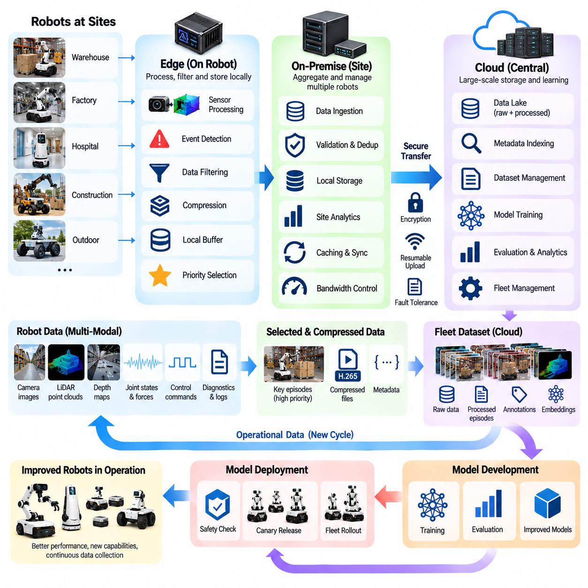{width="7.268055555555556in" height="7.268055555555556in"}

엣지(Edge), 온프레미스(On-Premise), 클라우드(Cloud) 데이터 흐름(Data Flow)은 분산형 물리 인공지능 인프라(Distributed Physical AI Infrastructure)에서 정보가 이동하는 방식을 정의한다. 로봇 플릿(Robot Fleet)은 여러 운영 현장(Operating Site)에서 센서 관측값(Sensor Observation), 제어 신호(Control Signal), 진단 로그(Diagnostic Log), 작업 결과(Task Outcome)를 지속적으로 생성한다. 확장 가능한 데이터 아키텍처(Scalable Data Architecture)는 정보가 처리되고, 임시 저장되며, 전송되고, 영구적으로 보존되는 위치를 결정해야 한다. 이러한 결정은 학습 효율성(Learning Efficiency), 운영 신뢰성(Operational Reliability), 네트워크 활용률(Network Utilization), 데이터 보안(Data Security)에 직접적인 영향을 미친다.

엣지 계층(Edge Layer)은 물리적 로봇 운영(Physical Robot Operation)에 가장 가까운 컴퓨팅 환경(Computing Environment)을 의미한다. 임베디드 프로세서(Embedded Processor), 온보드 가속기(Onboard Accelerator), 로컬 제어기(Local Controller)는 인식(Perception), 계획(Planning), 제어(Control)를 지원하면서 센서 스트림(Sensor Stream)을 처리한다. 엣지 시스템(Edge System)은 이벤트 탐지(Event Detection), 데이터 필터링(Data Filtering), 압축(Compression), 임시 저장(Temporary Storage)도 수행한다. 가장 큰 장점은 원격 인프라(Remote Infrastructure)와의 지속적인 통신에 의존하지 않고 운영 정보(Operational Information)에 즉시 접근할 수 있다는 것이다.

온프레미스 인프라(On-Premise Infrastructure)는 공장, 창고, 병원 또는 기타 운영 시설 내부에서 중간 처리 및 저장 계층(Intermediate Processing and Storage Layer)을 제공한다. 로컬 서버(Local Server)와 게이트웨이(Gateway)는 여러 로봇에서 생성되는 정보를 통합하고, 통신 세션(Communication Session)을 관리하며, 공유 데이터 저장소(Shared Data Repository)를 유지한다. 이러한 아키텍처는 광역 네트워크 전송(Wide-Area Transfer)의 반복을 줄이면서 조직이 현장별 보안 정책(Site-Specific Security Policy), 보존 정책(Retention Policy), 운영 정책(Operational Policy)을 적용할 수 있도록 한다.

클라우드 인프라(Cloud Infrastructure)는 대규모 데이터 통합(Large-Scale Data Aggregation), 인덱싱(Indexing), 모델 학습(Model Training), 평가(Evaluation), 플릿 분석(Fleet Analytics)을 위한 중앙 집중형 자원(Centralized Resource)을 제공한다. 지리적으로 분산된 현장(Geographically Distributed Site)에서 수집된 데이터는 공통 데이터셋(Common Dataset)으로 구성되고 확장 가능한 컴퓨팅 서비스(Scalable Computing Service)를 통해 처리될 수 있다. 클라우드 플랫폼(Cloud Platform)은 개발팀 간 협업(Collaboration)을 지원하고, 적용 가능한 데이터 공유 제한(Data-Sharing Restriction)을 준수하는 범위에서 서로 다른 환경에서 수집된 경험을 활용한 학습을 가능하게 한다.

전체 데이터 흐름(Data Flow)은 일반적으로 로봇 센서(Robot Sensor)가 작업 수행(Task Execution) 중 관측값(Observation)을 생성하면서 시작된다. 온보드 소프트웨어(Onboard Software)는 이러한 관측값을 타임스탬프(Timestamp), 로봇 상태(Robot State), 행동(Action), 맥락 메타데이터(Contextual Metadata)와 연결한다. 선택된 기록(Selected Recording)은 로컬 버퍼(Local Buffer) 또는 영구 저장소(Persistent Storage)에 보존된다. 엣지 필터링(Edge Filtering)은 관련 에피소드(Relevant Episode)를 식별하고, 압축(Compression)은 전송 요구사항(Transfer Requirement)을 줄인다. 이러한 작업은 데이터를 온프레미스 또는 클라우드 인프라로 이동시키기 위한 준비 과정이다.

모든 로봇 기록(Robot Recording)이 동일한 전송 경로(Transmission Path)를 따라야 하는 것은 아니다. 시간 제약이 중요한 안전 정보(Time-Critical Safety Information)는 즉각적인 로컬 처리(Local Handling)가 필요할 수 있으며, 진단 요약(Diagnostic Summary)은 현장 모니터링 시스템(Site Monitoring System)으로 신속하게 전송될 수 있다. 대용량 비디오 기록(Large Video Recording)과 포인트 클라우드(Point Cloud)는 예약된 업로드(Scheduled Upload)를 통해 나중에 전송할 수 있다. 긴급 운영 메시지(Urgent Operational Message)와 대용량 학습 데이터(Bulk Learning Data)를 분리하면 대규모 데이터 전송이 필수적인 로봇 통신(Essential Robot Communication)을 방해하는 것을 방지할 수 있다.

온프레미스 게이트웨이(On-Premise Gateway)는 동일한 네트워크(Network)를 공유하는 다수의 로봇에서 발생하는 업로드(Upload)를 조정할 수 있다. 장치 인증(Device Authentication), 수신 파일 검증(Incoming File Validation), 중복 기록 탐지(Duplicate Recording Detection)를 수행하고, 로봇 식별 정보(Robot Identity)와 작업 맥락(Task Context)에 따라 에피소드를 구성할 수 있다. 로컬 캐싱(Local Caching)은 네트워크 연결(Network Connection)이 불안정할 때 불필요한 재전송(Retransmission)을 줄인다. 또한 게이트웨이는 대역폭 할당량(Bandwidth Quota)을 적용하고 네트워크 혼잡(Network Congestion) 상황에서 중요한 진단 정보(Critical Diagnostic Information)에 우선순위를 부여할 수 있다.

로컬 데이터 통합(Local Aggregation)은 클라우드 전송(Cloud Transfer) 이전에 현장 수준 데이터 처리(Site-Level Data Processing)를 수행할 기회를 제공한다. 여러 로봇의 기록을 비교하여 반복적인 실패(Recurring Failure), 공통 환경 조건(Shared Environmental Condition), 중복 경험(Redundant Experience)을 식별할 수 있다. 로컬 인덱싱(Local Indexing)과 예비 분석(Preliminary Analytics)은 어떤 에피소드가 새로운 정보를 제공하는지 판단하는 데 도움이 된다. 이러한 접근 방식은 시설 내부에서 운영 문제(Operational Problem)를 조사할 수 있는 능력을 유지하면서 통신 비용(Communication Cost)을 줄인다.

인프라 계층(Infrastructure Layer) 사이의 데이터 이동(Data Movement)에는 신뢰할 수 있는 전송 메커니즘(Reliable Transport Mechanism)이 필요하다. 네트워크 중단(Network Interruption), 패킷 손실(Packet Loss), 일시적인 서버 장애(Temporary Server Failure)는 특히 산업 환경(Industrial Environment)에서 데이터 전송을 방해할 수 있다. 재개 가능한 업로드(Resumable Upload), 체크섬(Checksum), 전송 확인(Transfer Acknowledgment), 재시도 정책(Retry Policy)은 전송 신뢰성(Delivery Reliability)을 향상시킨다. 각 기록에는 고유 식별자(Unique Identifier)가 유지되어야 하며, 이를 통해 중단된 전송을 재개하면서 중복 데이터셋 항목(Duplicate Dataset Entry)이 생성되는 것을 방지할 수 있다.

저장 후 전달 통신(Store-and-Forward Communication)은 로봇이 간헐적인 연결성(Intermittent Connectivity) 환경에서 작동할 때 특히 유용하다. 데이터는 적절한 네트워크 연결(Network Connection)이 가능해질 때까지 로컬에 보존된 후 다음 인프라 계층으로 전달된다. 저장 대기열(Storage Queue)은 사용 가능한 용량(Available Capacity), 에피소드 우선순위(Episode Priority), 보존 요구사항(Retention Requirement)을 고려해야 한다. 이러한 메커니즘은 중앙 집중형 서비스(Centralized Service)에 대한 직접 접근이 일시적으로 불가능한 경우에도 지속적인 데이터 수집(Continuous Data Collection)을 가능하게 한다.

엣지, 온프레미스, 클라우드 시스템 간 동기화(Synchronization)에는 일관된 메타데이터(Consistent Metadata)와 버전 관리(Version Management)가 필요하다. 센서 데이터 취득 타임스탬프(Sensor Acquisition Timestamp)는 처리 타임스탬프(Processing Timestamp) 및 업로드 타임스탬프(Upload Timestamp)와 구분되어 유지되어야 한다. 로봇 구성(Robot Configuration), 보정 정보(Calibration Information), 모델 버전(Model Version), 이벤트 식별자(Event Identifier)는 데이터 생명주기(Data Lifecycle) 전체에 걸쳐 함께 전달되어야 한다. 이러한 관계를 보존하면 기록이 여러 처리 단계를 거친 후에도 엔지니어가 운영 이벤트(Operational Event)를 정확하게 재구성할 수 있다.

클라우드 데이터 수집 서비스(Cloud Ingestion Service)는 검증된 데이터 패키지(Validated Data Package)를 수신하여 플릿 규모 저장 시스템(Fleet-Scale Storage System)에 통합한다. 원시 기록(Raw Recording)은 객체 스토리지(Object Storage)에 보존될 수 있으며, 구조화된 메타데이터(Structured Metadata)는 검색 가능한 데이터베이스(Searchable Database)에 인덱싱될 수 있다. 처리된 에피소드(Processed Episode), 주석(Annotation), 임베딩(Embedding), 평가 결과(Evaluation Result)는 원본 기록(Source Recording)과 연결할 수 있다. 이러한 분리는 모든 분석 질의(Analytical Query)가 대용량 원시 센서 파일(Raw Sensor File)을 직접 조사할 필요 없이 효율적인 검색(Efficient Retrieval)을 지원한다.

아키텍처(Architecture)는 운영 데이터(Operational Data)와 학습 데이터(Training Data)를 구분해야 한다. 운영 기록(Operational Record)은 모니터링(Monitoring), 디버깅(Debugging), 사고 조사(Incident Investigation), 유지보수(Maintenance)를 지원하며, 큐레이션된 학습 데이터셋(Curated Training Dataset)은 기계학습(Machine Learning)을 위해 준비된 선택 사례를 포함한다. 두 데이터 집합은 일부 중복될 수 있지만 보존 기간(Retention Period), 품질(Quality), 접근 요구사항(Access Requirement)이 서로 다르다. 이들 사이의 명시적인 관계(Explicit Relationship)를 유지하면 추적 가능성(Traceability)이 향상되고 운영 정보의 통제되지 않은 재사용(Uncontrolled Reuse)을 방지할 수 있다.

데이터 처리 책임(Data Processing Responsibility)은 지연 시간(Latency), 계산 요구량(Computational Demand), 보안 요구사항(Security Requirement)에 따라 분산되어야 한다. 즉각적인 장애물 탐지(Immediate Obstacle Detection)와 액추에이터 제어(Actuator Control)는 예측 가능한 응답 시간(Predictable Response Time)이 필요하므로 로봇 가까이에서 수행되어야 한다. 현장 수준 데이터 통합(Site-Level Aggregation)과 진단(Diagnostics)은 로컬 서버(Local Server)에서 수행할 수 있다. 계산 집약적인 모델 학습(Computationally Intensive Model Training)과 대규모 데이터셋 분석(Large-Scale Dataset Analysis)은 일반적으로 충분한 자원을 갖춘 중앙 집중형 인프라(Centralized Infrastructure)에 더 적합하다.

지속적인 플릿 학습(Continuous Fleet Learning)을 위해서는 양방향 데이터 흐름(Bidirectional Data Flow)이 필요하다. 운영 기록(Operational Recording)은 로봇에서 중앙 학습 시스템(Centralized Learning System)으로 이동하고, 검증된 모델 업데이트(Validated Model Update), 구성 변경(Configuration Change), 데이터 수집 정책(Data Collection Policy)은 반대 방향으로 이동한다. 배포 서비스(Deployment Service)는 승인된 산출물(Approved Artifact)을 호환 가능한 로봇(Compatible Robot)에 배포한다. 버전 검사(Version Check), 무결성 검증(Integrity Verification), 단계적 배포(Staged Rollout), 롤백 기능(Rollback Capability)은 업데이트가 통제되지 않은 운영 위험(Operational Risk)을 발생시키지 않도록 지원한다.

중앙 집중형 분석(Centralized Analytics)의 피드백(Feedback)은 향후 엣지 데이터 수집(Edge Data Collection)에도 영향을 미칠 수 있다. 클라우드 평가(Cloud Evaluation)에서 반사 표면(Reflective Surface)이나 특이한 객체 형상(Unusual Object Geometry)과 관련된 실패가 확인되면 새로운 이벤트 트리거(Event Trigger)를 선택된 로봇에 배포할 수 있다. 이후 해당 로봇은 식별된 취약점(Identified Weakness)과 관련된 추가 관측값(Additional Observation)을 보존할 수 있다. 이러한 목표 지향적 피드백(Targeted Feedback)은 분산 데이터 획득(Distributed Data Acquisition)을 모델 개발 우선순위(Model Development Priority)와 연결하고 불필요한 데이터 수집을 줄인다.

보안 통제(Security Control)는 모든 인프라 경계(Infrastructure Boundary)에서 효과적으로 유지되어야 한다. 로봇, 게이트웨이, 클라우드 서비스는 통신하는 시스템을 인증(Authentication)하고 암호화(Encryption)를 통해 전송 정보를 보호해야 한다. 접근 권한(Access Permission)은 운영 담당자(Operational Personnel), 데이터 엔지니어(Data Engineer), 모델 개발자(Model Developer)를 구분해야 한다. 현장별 제한(Site-Specific Restriction)에 따라 민감한 기록(Sensitive Recording)은 온프레미스에 보관하고 승인된 요약(Approved Summary)이나 파생 표현(Derived Representation)만 외부로 전송해야 할 수 있다.

개인정보 보호(Privacy)와 데이터 주권(Data Sovereignty) 요구사항은 아키텍처 선택(Architecture Selection)에 큰 영향을 미칠 수 있다. 병원, 산업 시설, 공공 환경(Public Environment)은 영상(Image), 오디오(Audio), 위치 정보(Location Information), 기밀 공정(Confidential Process)에 대한 제한을 적용할 수 있다. 로컬 익명화(Local Anonymization), 선택적 추출(Selective Extraction), 통제된 보존(Controlled Retention)은 정보 노출(Information Exposure)을 줄일 수 있다. 일부 배포 환경에서는 원시 데이터 반출(Raw Data Export)이 완전히 금지될 수 있으므로 기존의 중앙 집중형 수집(Conventional Centralized Collection) 대신 로컬 처리(Local Processing) 또는 개인정보 보호 학습(Privacy-Preserving Learning) 접근 방식이 필요할 수 있다.

시스템 관측 가능성(System Observability)은 신뢰할 수 있는 데이터 이동(Reliable Data Movement)을 유지하는 데 필수적이다. 모니터링 서비스(Monitoring Service)는 대기열 길이(Queue Length), 업로드 지연 시간(Upload Latency), 네트워크 활용률(Network Utilization), 저장 용량(Storage Capacity), 전송 실패(Transfer Failure), 처리 처리량(Processing Throughput)을 추적해야 한다. 데이터 계보 기록(Data Lineage Record)은 각 인프라 계층에서 어떤 변환(Transformation)이 수행되었는지를 식별한다. 이러한 측정값은 엔지니어가 병목 현상(Bottleneck)을 찾아내고 누락된 기록(Missing Recording)을 탐지하며 통신 장애(Communication Failure)와 데이터 처리 문제(Data Processing Problem)를 구분하도록 지원한다.

확장성(Scalability)은 불필요한 데이터 이동(Unnecessary Data Movement)과 대규모 데이터셋의 반복 처리(Repeated Processing)를 방지하는 데 달려 있다. 계층형 저장소(Hierarchical Storage), 콘텐츠 기반 중복 제거(Content-Based Deduplication), 선택적 동기화(Selective Synchronization), 분산 캐싱(Distributed Caching)은 인프라 비용(Infrastructure Cost)을 줄일 수 있다. 자원 할당(Resource Allocation)은 각 데이터 범주(Data Category)의 가치(Value)와 긴급성(Urgency)을 반영해야 한다. 성공적인 아키텍처는 로봇 수(Number of Robots)의 증가뿐 아니라 센서 해상도(Sensor Resolution), 운영 다양성(Operational Diversity), 학습 요구사항(Learning Requirement)의 증가에도 대응할 수 있어야 한다.

궁극적으로 엣지, 온프레미스, 클라우드 데이터 흐름(Edge, On-Premise, and Cloud Data Flow)은 플릿 규모 물리 인공지능 데이터 엔진(Fleet-Scale Physical AI Data Engine)을 위한 통신 및 처리 기반(Communication and Processing Foundation)을 제공한다. 엣지 시스템(Edge System)은 즉각적인 운영 맥락(Operational Context)을 보존하고, 온프레미스 인프라(On-Premise Infrastructure)는 현장 수준 정보(Site-Level Information)를 조정하며, 클라우드 플랫폼(Cloud Platform)은 대규모 학습(Large-Scale Learning)과 분석(Analysis)을 지원한다. 이러한 계층이 신뢰할 수 있는 전송(Reliable Transport), 일관된 메타데이터(Consistent Metadata), 보안 통제(Security Control), 양방향 피드백(Bidirectional Feedback)을 통해 연결되면 분산된 로봇 경험(Distributed Robot Experience)은 지속적인 개선(Continuous Improvement)을 지원하는 재사용 가능한 지식(Reusable Knowledge)으로 전환된다.

## 09.06. Fleet Data Lake and Episode Storage

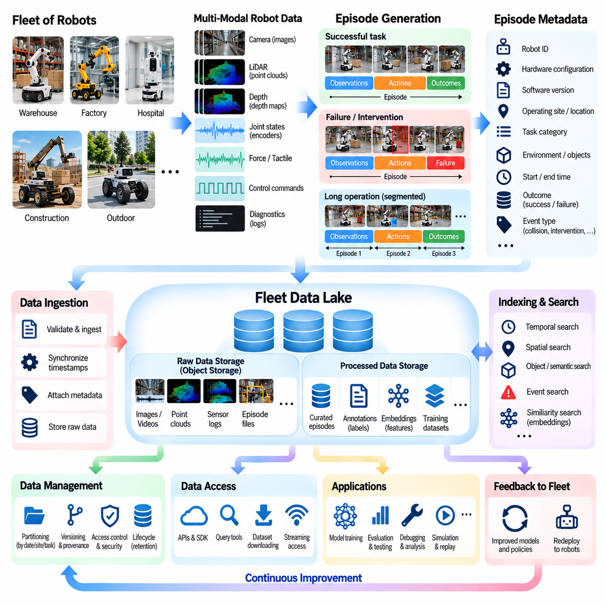{width="7.268055555555556in" height="7.268055555555556in"}

플릿 데이터 레이크(Fleet Data Lake)는 대규모 자율 로봇(Autonomous Robot) 집단에서 생성되는 경험을 수집, 구성, 재사용하기 위한 저장 기반(Storage Foundation)을 제공한다. 주로 구조화된 기록(Structured Record)을 처리하도록 설계된 기존 데이터베이스(Conventional Database)와 달리 데이터 레이크(Data Lake)는 이기종 센서 스트림(Heterogeneous Sensor Stream), 제어 로그(Control Log), 진단 이벤트(Diagnostic Event), 작업 결과(Task Outcome)를 수용한다. 주요 목적은 운영 증거(Operational Evidence)를 대규모로 보존하면서 로봇 경험(Robot Experience)을 학습(Training), 평가(Evaluation), 디버깅(Debugging), 지속적인 개선(Continuous Improvement)에 활용할 수 있도록 하는 것이다.

로봇 플릿 데이터(Robot Fleet Data)는 본질적으로 다중 모달(Multimodal), 시간적(Temporal), 지리적 분산(Geographically Distributed) 특성을 가진다. 카메라(Camera)는 영상 시퀀스(Image Sequence)를 생성하고, 라이다 센서(LiDAR Sensor)는 포인트 클라우드(Point Cloud)를 생성하며, 관절 엔코더(Joint Encoder)는 기계적 움직임(Mechanical Motion)을 기록한다. 제어 시스템(Control System)은 명령(Command), 추정 상태(Estimated State), 실행 결과(Execution Result)를 기록한다. 이러한 신호는 주파수(Frequency), 형식(Format), 데이터 양(Data Volume)이 서로 다르므로 기존 관계형 저장소(Relational Storage)만으로는 원시 관측값(Raw Observation)을 충분히 처리하기 어렵다. 따라서 플릿 데이터 레이크는 유연한 저장 구조(Flexible Storage Structure)와 확장 가능한 검색(Scalable Retrieval)을 지원해야 한다.

로봇 학습(Robot Learning)의 기본 저장 단위(Fundamental Storage Unit)는 일반적으로 에피소드(Episode)이며, 관측값(Observation), 행동(Action), 환경 상호작용(Environmental Interaction)의 경계가 정의된 시퀀스(Bounded Sequence)를 나타낸다. 하나의 에피소드는 완료된 내비게이션 작업(Navigation Task), 조작 시도(Manipulation Attempt), 인간 개입(Human Intervention), 안전 사고(Safety Incident)를 설명할 수 있다. 기록을 에피소드 단위로 구성하면 시간적 관계(Temporal Relationship)와 운영 맥락(Operational Context)이 보존된다. 이러한 구조는 학습 시스템(Learning System)이 개별 센서 측정값(Isolated Sensor Measurement)이 아니라 완전한 행동(Complete Behavior)을 분석할 수 있도록 한다.

에피소드 경계(Episode Boundary)는 작업 실행 상태(Task Execution State), 이벤트 트리거(Event Trigger), 시간 구간(Time Window), 운영 조건 변화(Change in Operating Condition)를 통해 결정할 수 있다. 성공적인 집기 및 배치 작업(Pick-and-Place Operation)은 하나의 에피소드를 형성할 수 있으며, 예상하지 못한 충돌(Unexpected Collision)은 별도의 진단 기록(Diagnostic Recording)을 시작할 수 있다. 장시간 지속되는 활동(Long-Running Activity)은 연속성(Continuity)을 보존하기 위해 중첩 구간(Overlapping Segment)으로 분할할 수 있다. 경계 정의(Boundary Definition)는 서로 다른 로봇 작업을 수용하면서도 비교를 지원할 수 있을 정도로 일관성을 유지해야 한다.

각 에피소드(Episode)에는 동기화된 센서 관측값(Synchronized Sensor Observation), 로봇 상태(Robot State), 행동(Action), 맥락 메타데이터(Contextual Metadata)가 포함되어야 한다. 카메라 프레임(Camera Frame), 포인트 클라우드(Point Cloud), 관절 위치(Joint Position), 힘 측정값(Force Measurement), 제어기 출력(Controller Output)은 시간적으로 정렬(Temporal Alignment)된 상태를 유지해야 한다. 메타데이터(Metadata)는 로봇 식별 정보(Robot Identification), 하드웨어 구성(Hardware Configuration), 소프트웨어 버전(Software Version), 작업 유형(Task Type), 운영 현장(Operating Site), 기록 조건(Recording Condition)을 식별해야 한다. 이러한 연관 관계(Association)는 서로 다른 시스템과 개발 주기(Development Cycle)에서 저장된 경험을 해석하고 재현할 수 있도록 한다.

실용적인 플릿 데이터 레이크(Fleet Data Lake)는 원시 기록(Raw Recording)과 처리된 표현(Processed Representation)을 분리한다. 원시 데이터(Raw Data)는 향후 재처리(Future Reprocessing)를 위해 원본 관측값(Original Observation)을 보존하며, 처리 계층(Processed Layer)은 정제된 궤적(Cleaned Trajectory), 주석(Annotation), 추출된 특징(Extracted Feature), 학습 준비 샘플(Training-Ready Sample)을 포함한다. 이러한 계층을 유지하면 복구할 수 없는 정보 손실(Irreversible Information Loss)을 방지하고 개선된 알고리즘(Improved Algorithm)이 과거 경험(Historical Experience)을 다시 분석할 수 있다. 원시 데이터와 파생 산출물(Derived Artifact) 사이의 관계는 추적 가능한 상태(Traceable State)로 유지되어야 한다.

객체 스토리지(Object Storage)는 확장 가능한 저장 용량(Scalable Capacity)과 비교적 저렴한 보존 비용(Retention Cost)을 제공하기 때문에 대용량 센서 기록(Large Sensor Recording)에 일반적으로 사용된다. 비디오 파일(Video File), 포인트 클라우드 시퀀스(Point-Cloud Sequence), 직렬화된 에피소드 아카이브(Serialized Episode Archive)는 변경 불가능한 객체(Immutable Object)로 저장할 수 있다. 구조화된 메타데이터(Structured Metadata)는 데이터베이스(Database) 또는 검색 가능한 카탈로그(Searchable Catalog)에 별도로 유지된다. 이러한 분리는 엔지니어가 대용량 바이너리 파일(Binary File)을 반복적으로 검색하지 않고도 관련 에피소드를 찾을 수 있도록 한다.

에피소드 식별자(Episode Identifier)는 데이터 인프라(Data Infrastructure) 전반에서 안정적인 참조(Stable Reference)를 제공한다. 각 기록에는 원본 로봇(Source Robot), 수집 시간(Collection Time), 운영 맥락(Operational Context)과 연결된 전역 고유 식별자(Globally Unique Identifier)가 부여되어야 한다. 파생 데이터셋(Derived Dataset), 주석(Annotation), 평가 결과(Evaluation Result)는 이 식별자를 참조할 수 있다. 안정적인 식별 체계(Stable Identity)는 중복 제거(Deduplication), 무결성 검사(Integrity Checking), 중단된 업로드(Interrupted Upload) 이후 복구(Recovery)도 지원하여 엣지 장치(Edge Device)와 중앙 저장소(Centralized Storage) 사이에서 데이터가 이동할 때 발생하는 혼란을 줄인다.

메타데이터 스키마(Metadata Schema)는 이기종 로봇 플릿(Heterogeneous Robot Fleet) 전반에서 일관성을 유지하는 데 필수적이다. 공통 필드(Common Field)는 센서 모달리티(Sensor Modality), 좌표 프레임(Coordinate Frame), 보정 매개변수(Calibration Parameter), 환경 범주(Environment Category), 작업 결과(Task Outcome), 실패 유형(Failure Type), 개입 상태(Intervention Status)를 설명할 수 있다. 표준화된 스키마(Standardized Schema)는 현장 간 필터링(Filtering)과 비교(Comparison)를 가능하게 한다. 그러나 서로 다른 로봇 형태(Embodiment)와 응용 분야(Application)가 특화된 정보를 생성하므로 확장 가능한 필드(Extensible Field)도 필요하다.

시간적 인덱싱(Temporal Indexing)은 특정 운영 시간 구간(Operating Interval)에 발생한 이벤트에 효율적으로 접근할 수 있도록 한다. 엔지니어는 비상 정지(Emergency Stop) 이전, 위치 추정 실패(Localization Failure) 중, 인간 개입(Human Intervention) 직후에 기록된 에피소드를 검색할 수 있다. 시간 기반 인덱스(Time-Based Index)는 센서 데이터 취득 타임스탬프(Sensor Acquisition Timestamp)를 업로드 시간(Upload Time) 및 처리 시간(Processing Time)과 구분해야 한다. 이러한 구분을 유지하면 기록이 늦게 도착하거나 여러 인프라 계층(Infrastructure Layer)을 통과할 때 잘못된 해석이 발생하는 것을 방지할 수 있다.

공간적 인덱싱(Spatial Indexing)과 의미적 인덱싱(Semantic Indexing)은 에피소드 탐색(Episode Discovery)을 더욱 향상시킨다. 위치 메타데이터(Location Metadata)는 운영 영역(Operating Region)을 식별하고, 의미적 레이블(Semantic Label)은 관측된 객체(Object), 작업(Task), 환경 조건(Environmental Condition)을 설명한다. 학습된 임베딩(Learned Embedding)은 시각적 또는 행동적으로 유사한 경험을 찾는 유사도 검색(Similarity Search)을 지원할 수 있다. 시간적, 공간적, 의미적 인덱스를 결합하면 엔지니어가 방대한 원시 기록(Raw Recording)을 수동으로 조사하지 않고도 정보 가치가 높은 에피소드를 검색할 수 있다.

데이터 파티셔닝(Data Partitioning)은 저장소 구성(Storage Organization)과 질의 성능(Query Performance)을 향상시킨다. 에피소드는 수집 날짜(Collection Date), 로봇 플랫폼(Robot Platform), 운영 현장(Operating Site), 작업 범주(Task Category), 데이터 생명주기 단계(Data Lifecycle Stage)에 따라 분할할 수 있다. 그러나 지나치게 세분화된 파티셔닝(Excessive Partitioning)은 데이터셋 단편화(Dataset Fragmentation)와 비효율적인 검색(Inefficient Retrieval)을 초래할 수 있다. 파티션 전략(Partition Strategy)은 일반적인 분석 질의(Analytical Query)와 예상되는 플릿 성장(Fleet Growth)을 반영하면서 현장 간 또는 로봇 간 분석(Cross-Site or Cross-Robot Analysis)을 방해하는 경직된 구조를 피해야 한다.

에피소드 저장소(Episode Storage)는 전체 기록(Complete Recording)과 선택된 하위 시퀀스(Selected Subsequence)를 모두 지원해야 한다. 모델 학습(Model Training)은 짧은 행동 구간(Short Action Window)을 필요로 할 수 있지만, 실패 조사(Failure Investigation)는 이전 수 분 동안의 이력(Preceding History)이 필요할 수 있다. 효율적인 시스템(Efficient System)은 전체 기록을 불필요하게 복제하지 않고 시간적 구간(Temporal Segment)에 대한 참조를 제공한다. 청크 기반 저장소(Chunked Storage)와 구간 수준 인덱스(Segment-Level Index)는 하위 시퀀스와 원본 에피소드(Original Episode)의 관계를 보존하면서 선택적 접근(Selective Access)을 가능하게 한다.

데이터셋 버전 관리(Dataset Versioning)는 학습 데이터 집합(Training Collection)이 지속적으로 변화하기 때문에 필요하다. 새로운 에피소드가 추가되고, 잘못된 레이블(Incorrect Label)이 수정되며, 품질 필터(Quality Filter)가 개선된다. 재현 가능한 학습 실행(Reproducible Training Run)은 변경되는 파일 집합이 아니라 안정적인 데이터셋 스냅샷(Stable Dataset Snapshot)을 참조해야 한다. 버전이 관리되는 매니페스트(Versioned Manifest)는 모델 개발(Model Development)과 평가(Evaluation)에 사용된 정확한 에피소드, 처리 구성(Processing Configuration), 주석 개정 이력(Annotation Revision)을 식별할 수 있다.

데이터 계보(Data Lineage)는 각 학습 사례(Training Example)를 원본 기록(Original Recording) 및 후속 변환(Subsequent Transformation)과 연결한다. 엔지니어는 어떤 로봇이 에피소드를 수집했는지, 어떤 처리 파이프라인(Processing Pipeline)이 데이터를 수정했는지, 어떤 데이터셋이 결과를 포함했는지 확인할 수 있어야 한다. 이러한 추적 가능성(Traceability)은 디버깅(Debugging), 규제 감사(Regulatory Audit), 예상하지 못한 모델 행동(Unexpected Model Behavior)의 조사를 지원한다. 또한 학습 오류(Training Error)가 원시 관측값(Raw Observation), 레이블링(Labeling), 전처리(Preprocessing) 중 어디에서 발생했는지 식별하는 데 도움이 된다.

저장소 생명주기 관리(Storage Lifecycle Management)는 장기적인 학습 가치(Long-Term Learning Value)와 인프라 비용(Infrastructure Cost) 사이의 균형을 유지한다. 자주 접근하는 데이터셋(Frequently Accessed Dataset)은 고성능 저장소(High-Performance Storage)에 유지할 수 있으며, 오래된 기록(Older Recording)은 저비용 아카이브 계층(Lower-Cost Archival Tier)으로 이동할 수 있다. 일상적인 에피소드(Routine Episode)는 희귀 실패(Rare Failure)나 안전 필수 증거(Safety-Critical Evidence)보다 짧은 보존 기간(Retention Period)을 적용받을 수 있다. 보존 결정(Retention Decision)은 향후 재처리 가치(Future Reprocessing Value), 계약상 의무(Contractual Obligation), 적용 가능한 개인정보 보호 요구사항(Privacy Requirement)을 고려해야 한다.

데이터 무결성(Data Integrity)과 신뢰성(Reliability)은 신뢰할 수 있는 플릿 학습(Trustworthy Fleet Learning)의 기본 요소이다. 체크섬(Checksum), 변경 불가능한 기록 객체(Immutable Recording Object), 복제(Replication), 복구 절차(Recovery Procedure)는 데이터 손상(Corruption)이나 우발적인 손실(Accidental Loss)을 방지한다. 데이터 수집 파이프라인(Ingestion Pipeline)은 에피소드를 학습에 사용하도록 제공하기 전에 파일 완전성(File Completeness), 메타데이터 일관성(Metadata Consistency), 동기화 품질(Synchronization Quality)을 검증해야 한다. 불완전하거나 의심스러운 기록을 격리(Quarantine)하면 손상된 증거(Damaged Evidence)가 후속 데이터셋(Downstream Dataset)을 인지하지 못하는 사이에 오염시키는 것을 방지할 수 있다.

접근 제어(Access Control)와 데이터 거버넌스(Data Governance)는 저장된 경험(Stored Experience)을 누가 검색, 수정, 재사용할 수 있는지를 결정한다. 산업 현장 기록(Industrial Recording)에는 기밀 시설 배치(Confidential Layout), 독점 공정(Proprietary Process), 개인정보(Personal Information), 민감한 운영 정보(Sensitive Operational Detail)가 포함될 수 있다. 접근 권한(Permission)은 원시 데이터 접근(Raw Data Access)과 익명화되거나 파생된 데이터셋(Anonymized or Derived Dataset)에 대한 접근을 구분해야 한다. 암호화(Encryption), 감사 로그(Audit Log), 보존 기간 제한(Retention Limit), 현장별 제한(Site-Specific Restriction)은 중앙 집중형 저장소(Centralized Storage)가 통제되지 않은 정보 노출(Uncontrolled Information Exposure)을 발생시키지 않도록 지원한다.

플릿 규모 저장소(Fleet-Scale Storage)는 지속적인 운영 모니터링(Operational Monitoring)도 필요로 한다. 중요한 지표(Metric)에는 데이터 수집 처리량(Ingestion Throughput), 저장 용량 증가(Storage Growth), 질의 지연 시간(Query Latency), 중복 에피소드 비율(Duplicate Episode Rate), 검색 실패(Retrieval Failure), 데이터셋 준비 시간(Dataset Preparation Time)이 포함된다. 모니터링은 로봇 수(Robot Population)와 센서 해상도(Sensor Resolution)가 증가함에 따라 발생하는 병목 현상(Bottleneck)을 식별해야 한다. 용량 예측(Capacity Forecasting)과 자동화된 저장 정책(Automated Storage Policy)은 예상하지 못한 인프라 한계(Infrastructure Limit)가 데이터 수집이나 모델 개발을 중단시키는 것을 방지하는 데 도움이 된다.

궁극적으로 플릿 데이터 레이크(Fleet Data Lake)는 분산된 로봇 기록(Distributed Robot Recording)을 지속적이고 검색 가능한 물리적 경험 저장소(Persistent and Searchable Repository of Physical Experience)로 전환한다. 에피소드 기반 구성(Episode-Based Organization)은 행동 맥락(Behavioral Context)을 보존하며, 메타데이터(Metadata), 인덱싱(Indexing), 버전 관리(Versioning), 데이터 계보(Data Lineage)는 저장된 정보를 재사용 가능하고 신뢰할 수 있도록 만든다. 원시 관측값(Raw Observation)을 큐레이션된 학습 데이터셋(Curated Training Dataset) 및 평가 결과(Evaluation Result)와 연결함으로써 이러한 인프라는 확장 가능한 학습(Scalable Learning)과 지속적으로 개선되는 물리 인공지능 플릿(Physical AI Fleet)을 위한 기반을 구축한다.

## 09.07. Fleet Metadata Indexing and Search

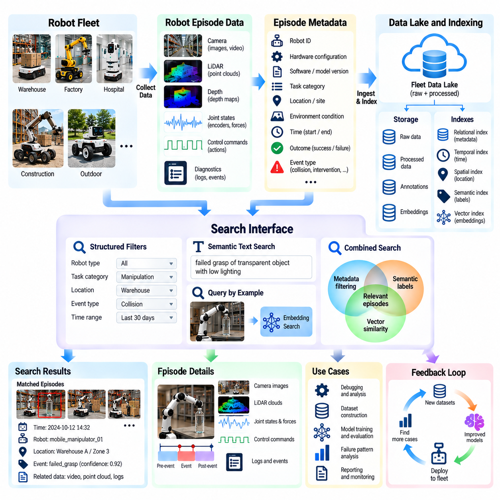{width="7.268055555555556in" height="7.268055555555556in"}

플릿 메타데이터 인덱싱 및 검색(Fleet Metadata Indexing and Search)은 방대한 로봇 기록(Robot Recording)을 접근 가능한 학습 자원(Learning Resource)으로 전환하는 데 필요한 탐색 인프라(Discovery Infrastructure)를 제공한다. 자율 로봇 플릿(Autonomous Robot Fleet)이 확장됨에 따라 수백만 개의 에피소드(Episode)가 다양한 로봇, 작업, 운영 현장에 걸쳐 축적될 수 있다. 구조화된 메타데이터(Structured Metadata)와 효율적인 검색(Efficient Retrieval)이 없으면 가치 있는 경험을 찾아내기 어렵다. 검색 가능한 플릿 카탈로그(Searchable Fleet Catalog)는 엔지니어가 관련 실패(Failure), 성공적인 행동(Successful Behavior), 환경 조건(Environmental Condition)을 식별할 수 있도록 한다.

메타데이터(Metadata)는 기록된 각 로봇 에피소드(Robot Episode)를 둘러싼 운영 맥락(Operational Context)을 설명한다. 일반적인 속성(Attribute)에는 로봇 식별 정보(Robot Identity), 하드웨어 구성(Hardware Configuration), 소프트웨어 버전(Software Version), 모델 버전(Model Version), 작업 식별자(Task Identifier), 타임스탬프(Timestamp), 센서 모달리티(Sensor Modality), 운영 위치(Operating Location)가 포함된다. 추가 필드는 환경 조건(Environmental Condition), 작업 결과(Task Outcome), 안전 이벤트(Safety Event), 인간 개입(Human Intervention)을 설명할 수 있다. 이러한 속성은 원시 센서 기록(Raw Sensor Recording)을 물리적 상호작용(Physical Interaction)이 발생한 상황과 연결한다.

일관된 메타데이터 스키마(Consistent Metadata Schema)는 이기종 로봇(Heterogeneous Robot)이 수집한 경험을 비교하는 데 필수적이다. 서로 다른 플랫폼(Platform)은 각기 다른 센서(Sensor), 좌표계(Coordinate System), 액추에이터 구성(Actuator Configuration), 작업 정의(Task Definition)를 사용할 수 있다. 공통 스키마(Common Schema)는 플랫폼별 확장(Platform-Specific Extension)을 허용하면서 공유 개념(Shared Concept)을 정의한다. 표준화된 용어(Standardized Terminology), 단위(Unit), 타임스탬프(Timestamp), 이벤트 범주(Event Category)는 모호성(Ambiguity)을 줄이고 서로 다른 로봇 형태(Robot Embodiment)와 배포 현장(Deployment Site)에 걸쳐 의미 있는 검색을 가능하게 한다.

메타데이터 수집(Metadata Collection)은 가능한 한 자동화되어야 한다. 로봇 소프트웨어(Robot Software)는 기록 과정에서 식별자(Identifier), 구성 버전(Configuration Version), 타임스탬프(Timestamp), 실행 상태(Execution State)를 첨부할 수 있다. 온프레미스 게이트웨이(On-Premise Gateway)는 현장 정보(Site Information), 네트워크 조건(Network Condition), 운영 일정(Operational Schedule)을 추가하여 기록을 보강할 수 있다. 클라우드 데이터 수집 파이프라인(Cloud Ingestion Pipeline)은 필수 필드(Required Field)를 검증하고 일관되지 않은 값(Inconsistent Value)을 탐지할 수 있다. 자동 생성(Automated Generation)은 수동 주석 작업(Manual Annotation Effort)과 메타데이터 누락(Metadata Omission)을 줄이면서 일관성을 향상시킨다.

각 에피소드(Episode)에는 저장(Storage), 처리(Processing), 데이터셋 생성(Dataset Creation) 전 과정에서 변경되지 않는 안정적인 식별자(Stable Identifier)가 필요하다. 이 식별자는 원시 기록(Raw Recording), 파생 궤적(Derived Trajectory), 주석(Annotation), 임베딩(Embedding), 평가 결과(Evaluation Result)를 연결한다. 부모-자식 관계(Parent-Child Relationship)는 더 작은 시간적 구간(Temporal Segment)으로 분할된 에피소드를 표현할 수 있다. 이러한 참조(Reference)를 유지하면 검색 결과(Search Result)에서 원본 증거(Original Evidence)에 직접 접근할 수 있으며, 데이터 생명주기(Data Lifecycle) 전반에서 재현 가능한 조사(Reproducible Investigation)를 지원한다.

메타데이터 인덱싱(Metadata Indexing)은 설명적 속성(Descriptive Attribute)을 검색에 최적화된 구조(Structure Optimized for Retrieval)로 변환한다. 관계형 데이터베이스(Relational Database)는 구조화된 필터링(Structured Filtering)을 지원하고, 역색인(Inverted Index)은 범주형 필드(Categorical Field)와 텍스트 설명(Textual Description)에 대한 검색을 가속한다. 시계열 인덱스(Time-Series Index)는 이벤트를 시간순으로 구성하며, 공간 인덱스(Spatial Index)는 지리적 또는 시설 수준 질의(Geographic or Facility-Level Query)를 지원한다. 적절한 조합은 플릿 규모(Fleet Size), 질의 패턴(Query Pattern), 메타데이터 복잡도(Metadata Complexity), 예상 검색 지연 시간(Expected Retrieval Latency)에 따라 달라진다.

시간적 검색(Temporal Search)은 로봇 행동(Robot Behavior)이 물리적 상호작용(Physical Interaction)의 연속적인 시퀀스(Sequence)로 전개되기 때문에 특히 중요하다. 엔지니어는 비상 정지(Emergency Stop) 이전 수 초 동안의 기록이나 파지 실패(Failed Grasp) 전후 구간의 기록을 요청할 수 있다. 인덱스(Index)는 센서 데이터 취득 시간(Sensor Acquisition Time), 이벤트 발생 시간(Event Occurrence Time), 업로드 시간(Upload Time)을 구분해야 한다. 정확한 시간 참조(Temporal Reference)는 지연된 전송(Delayed Transmission)이나 비동기 처리(Asynchronous Processing)가 운영 이벤트(Operational Event)의 재구성을 왜곡하는 것을 방지한다.

공간 인덱싱(Spatial Indexing)은 로봇 경험(Robot Experience)을 물리적 운영 환경(Physical Operating Environment)과 연결한다. 위치 속성(Location Attribute)에는 전역 좌표(Global Coordinate), 시설 식별자(Facility Identifier), 층 정보(Floor Level), 지도 영역(Map Region), 로컬 기준 프레임(Local Reference Frame)이 포함될 수 있다. 엔지니어는 좁은 통로(Narrow Passage), 적재 작업대(Loading Station), 반사 표면(Reflective Surface) 주변에 집중된 실패를 검색할 수 있다. 서로 다른 위치 추정 시스템(Localization System)이나 변화하는 현장 배치(Site Layout)에서 수집된 관측값을 비교하려면 좌표 변환(Coordinate Transformation)과 지도 버전 관리(Map Versioning)가 필요하다.

의미적 메타데이터(Semantic Metadata)는 기록된 경험의 기술적 속성(Technical Attribute)뿐 아니라 의미(Meaning)를 설명한다. 레이블(Label)은 객체(Object), 활동(Activity), 환경 특성(Environmental Property), 실패 메커니즘(Failure Mechanism), 인간 상호작용(Human Interaction)을 식별할 수 있다. 조작 에피소드(Manipulation Episode)에는 객체 범주(Object Category), 파지 유형(Grasp Type), 접촉 결과(Contact Outcome), 복구 행동(Recovery Behavior)이 태그(Tag)로 지정될 수 있다. 의미적 인덱싱(Semantic Indexing)은 사용자가 특정 파일 위치(File Location)를 알아야 하는 대신 엔지니어링 질문(Engineering Question)과 모델 취약점(Model Weakness)을 반영한 질의를 지원한다.

벡터 임베딩(Vector Embedding)은 정확한 메타데이터 일치(Exact Metadata Match)를 넘어 검색 기능(Search Capability)을 확장한다. 학습된 표현(Learned Representation)은 시각적 장면(Visual Scene), 움직임 궤적(Motion Trajectory), 객체 상호작용(Object Interaction), 다중 모달 에피소드 특성(Multimodal Episode Characteristic)을 인코딩할 수 있다. 이후 유사도 검색(Similarity Search)은 기준 실패(Reference Failure)나 익숙하지 않은 환경(Unfamiliar Environment)과 유사한 경험을 검색할 수 있다. 그러나 임베딩 품질(Embedding Quality)은 학습 도메인(Training Domain)에 따라 달라지며, 물리적 안전성(Physical Safety)이나 인과적 관련성(Causal Relevance)이 중요한 경우 유사도 점수(Similarity Score)를 신중하게 해석해야 한다.

하이브리드 검색(Hybrid Search)은 구조화된 필터(Structured Filter), 의미적 레이블(Semantic Label), 벡터 유사도(Vector Similarity)를 결합하여 검색 정밀도(Retrieval Precision)를 향상시킨다. 엔지니어는 특정 로봇 플랫폼(Robot Platform)이 저조도 조건(Low Lighting Condition)에서 수행한 투명 객체(Transparent Object)의 파지 실패(Failed Grasp)를 검색할 수 있다. 메타데이터 필터(Metadata Filter)는 후보 집합(Candidate Set)을 좁히고, 임베딩(Embedding)은 행동적으로 유사한 에피소드(Behaviorally Similar Episode)의 순위를 결정한다. 이러한 조합은 기록을 전수 수동 검사(Exhaustive Manual Inspection)하지 않고도 목표 지향적 데이터셋 구성(Targeted Dataset Construction)을 지원한다.

이벤트 기반 인덱싱(Event-Based Indexing)은 운영 이상 현상(Operational Anomaly)과 개입(Intervention)에 직접 접근할 수 있도록 한다. 비상 정지(Emergency Stop), 위치 추정 실패(Localization Failure), 과도한 힘(Excessive Force), 충돌(Collision), 운영자 교정(Operator Correction)은 에피소드 식별자(Episode Identifier)와 연결된 검색 가능한 이벤트(Searchable Event)로 표현할 수 있다. 심각도(Severity), 지속 시간(Duration), 트리거 발생 하위 시스템(Triggering Subsystem), 복구 결과(Recovery Outcome)는 추가적인 검색 차원(Search Dimension)을 제공한다. 이벤트 카탈로그(Event Catalog)는 엔지니어가 반복적인 실패 패턴(Recurring Failure Pattern)과 개별 사고(Isolated Incident)를 구분하고 모델 개선(Model Improvement)에 유용한 사례를 식별하도록 지원한다.

검색 시스템(Search System)은 각 기록을 독립적으로 취급하는 대신 이벤트 간 관계(Relationship Between Events)를 지원해야 한다. 위치 추정 오류(Localization Error)가 내비게이션 실패(Navigation Failure)에 선행하고, 이후 안전 정지(Safety Stop)와 인간에 의한 복구(Human Recovery)가 이어질 수 있다. 이벤트 시퀀스(Event Sequence)를 보존하면 시간적 순서(Temporal Order)와 인과적 가설(Causal Hypothesis)을 포함하는 질의가 가능해진다. 인덱싱된 상관관계(Indexed Correlation)가 인과관계(Causation)를 입증하는 것은 아니지만, 여러 하위 시스템의 행동(Subsystem Behavior)이 운영 실패(Operational Failure)에 어떻게 기여하는지 조사하기 위한 구조화된 증거(Structured Evidence)를 제공한다.

데이터셋 탐색(Dataset Discovery)은 플릿 메타데이터 검색(Fleet Metadata Search)의 또 다른 중요한 응용 분야이다. 학습 엔지니어(Training Engineer)는 특정 객체 유형(Object Type), 환경 조건(Environmental Condition), 로봇 구성(Robot Configuration), 작업 결과(Task Outcome)를 포함하는 사례가 필요할 수 있다. 검색 질의(Search Query)는 후보 에피소드(Candidate Episode)를 식별하고 충분히 표현되지 않은 범주(Underrepresented Category)를 드러낼 수 있다. 포괄 범위 분석(Coverage Analysis)은 기존 데이터셋(Existing Dataset)이 배포 환경 조건(Deployment Condition)을 적절히 대표하는지, 추가 데이터 수집(Additional Data Collection)을 어디에 집중해야 하는지 판단하는 데 도움이 된다.

메타데이터 품질(Metadata Quality)은 검색 신뢰성(Search Reliability)에 직접적인 영향을 미친다. 누락된 로봇 식별자(Missing Robot Identifier), 일관되지 않은 작업 레이블(Inconsistent Task Label), 잘못된 타임스탬프(Incorrect Timestamp), 오래된 보정 참조(Outdated Calibration Reference)는 오해를 유발하는 검색 결과(Misleading Search Result)를 생성할 수 있다. 검증 규칙(Validation Rule), 통제된 어휘 체계(Controlled Vocabulary), 스키마 버전 관리(Schema Versioning), 자동화된 일관성 검사(Automated Consistency Check)는 이러한 문제를 줄인다. 엔지니어가 신뢰할 수 있는 기록(Reliable Record)과 불완전하거나 불확실한 메타데이터(Incomplete or Uncertain Metadata)를 구분할 수 있도록 검색 결과에는 품질 지표(Quality Indicator)가 함께 제공되어야 한다.

플릿 데이터셋(Fleet Dataset)이 증가함에 따라 인덱스 유지관리(Index Maintenance)의 중요성도 커진다. 새로운 에피소드(Episode)가 지속적으로 유입되는 동시에 주석(Annotation), 모델 생성 레이블(Model-Generated Label), 파생 표현(Derived Representation)은 데이터 수집 이후에도 변경될 수 있다. 증분 인덱싱(Incremental Indexing)은 전체 카탈로그(Entire Catalog)를 다시 구축하지 않고도 새로운 정보를 검색 가능하게 만든다. 버전이 관리되는 메타데이터(Versioned Metadata)와 업데이트 이력(Update History)은 변화하는 로봇 경험 집합(Robot Experience Collection)에 대해 검색을 반복할 때 재현성(Reproducibility)을 보존한다.

확장 가능한 검색 아키텍처(Scalable Search Architecture)는 대용량 센서 객체(Large Sensor Object)와 압축된 검색 인덱스(Compact Searchable Index)를 분리한다. 분산 데이터베이스(Distributed Database), 파티션된 인덱스(Partitioned Index), 캐싱(Caching), 질의 최적화(Query Optimization)는 증가하는 플릿 규모(Fleet Size)와 복잡한 분석 작업 부하(Analytical Workload)를 지원할 수 있다. 자주 사용되는 질의(Frequently Used Query)는 사전 계산된 요약(Precomputed Summary)이나 구체화된 뷰(Materialized View)를 활용하면 효율성이 향상될 수 있다. 성능은 데이터 수집률(Ingestion Rate), 질의 지연 시간(Query Latency), 저장 오버헤드(Storage Overhead), 여러 인덱스 유형(Index Type)의 유지관리 비용을 기준으로 평가해야 한다.

보안(Security)과 거버넌스(Governance) 요구사항은 원시 기록(Raw Recording)뿐 아니라 메타데이터(Metadata)에도 적용된다. 위치 식별자(Location Identifier), 시설 설명(Facility Description), 운영 일정(Operational Schedule), 사고 범주(Incident Category)는 센서 영상(Sensor Image)이 없더라도 민감한 정보(Sensitive Information)를 노출할 수 있다. 역할 기반 접근 제어(Role-Based Access Control), 감사 로그(Audit Log), 현장별 접근 권한(Site-Specific Permission)은 승인되지 않은 탐색(Unauthorized Discovery)을 제한해야 한다. 검색 서비스(Search Service)는 간접적인 정보 노출(Indirect Information Exposure)을 방지하기 위해 기본 저장 시스템(Underlying Storage System)과 동일한 데이터 공유 경계(Data-Sharing Boundary)를 적용해야 한다.

검색 효과(Search Effectiveness)는 검색 정밀도(Retrieval Precision), 재현율(Recall), 응답 지연 시간(Response Latency), 메타데이터 완전성(Metadata Completeness), 후속 활용 가치(Downstream Usefulness)를 통해 평가해야 한다. 엔지니어는 질의가 알려진 실패 사례(Known Failure Case)를 얼마나 안정적으로 검색하는지, 대표적인 데이터셋(Representative Dataset)을 구성하는 데 얼마나 많은 수작업(Manual Effort)이 필요한지 측정할 수 있다. 검색 피드백(Search Feedback)은 누락된 레이블(Missing Label), 성능이 부족한 임베딩(Weak Embedding), 비효율적인 인덱싱 전략(Ineffective Indexing Strategy)을 식별할 수 있다. 지속적인 평가(Continuous Evaluation)는 검색 인프라(Retrieval Infrastructure)를 실제 로봇 개발 요구사항(Practical Robotics Development Need)에 맞추도록 한다.

궁극적으로 플릿 메타데이터 인덱싱 및 검색(Fleet Metadata Indexing and Search)은 분산된 로봇 기록(Distributed Robot Recording)을 탐색 가능한 지식 자원(Navigable Knowledge Resource)으로 전환한다. 구조화된 속성(Structured Attribute)은 운영 맥락(Operational Context)을 정의하고, 시간적 및 공간적 인덱스(Temporal and Spatial Index)는 정밀한 검색(Precise Retrieval)을 지원하며, 의미적 표현(Semantic Representation)은 관련 경험(Related Experience)의 탐색을 가능하게 한다. 검색 가능한 에피소드(Searchable Episode)를 학습 데이터셋(Training Dataset), 실패 분석(Failure Analysis), 목표 지향적 데이터 수집(Targeted Data Collection)과 연결함으로써 이러한 인프라는 물리 인공지능 플릿(Physical AI Fleet) 전반의 지속적인 개선(Continuous Improvement)을 이끄는 피드백 루프(Feedback Loop)를 강화한다.

## 09.08. Failure Intervention and Near Miss Mining

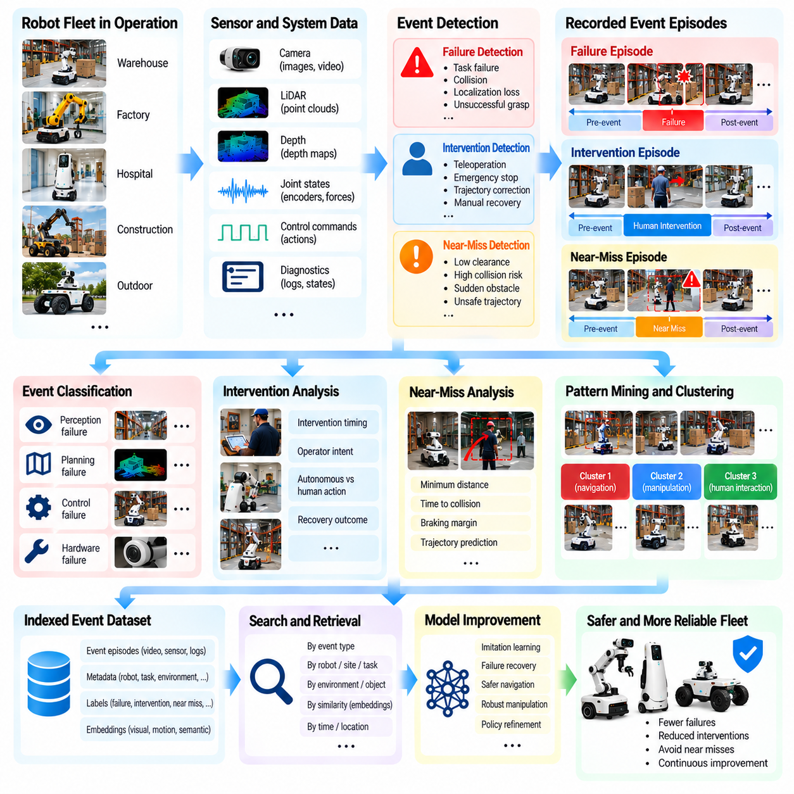{width="7.268055555555556in" height="7.268055555555556in"}

실패, 개입 및 아차 사고 마이닝(Failure, Intervention, and Near-Miss Mining)은 운영 과정에서 발생하는 어려움을 자율 로봇 플릿(Autonomous Robot Fleet)을 위한 가치 있는 학습 신호(Learning Signal)로 전환한다. 실패(Failure)는 작업을 완료할 수 없는 상황을 드러내고, 개입(Intervention)은 인간의 지원이 필요한 자율성의 한계를 보여주며, 아차 사고(Near Miss)는 실제 사고로 이어질 뻔한 위험 조건(Hazardous Condition)을 식별한다. 이러한 경험은 일상적인 성공 작업(Routine Successful Operation)에서는 거의 얻을 수 없는 정보를 제공하므로 신뢰성(Reliability), 안전성(Safety), 자율성(Autonomy)을 개선하는 데 필수적이다.

실패(Failure)는 로봇이 의도한 작업 결과(Intended Task Outcome)를 달성하지 못하거나 운영 요구사항(Operational Requirement)을 위반할 때 발생한다. 대표적인 사례에는 파지 실패(Unsuccessful Grasp), 내비게이션 교착 상태(Navigation Deadlock), 위치 추정 상실(Localization Loss), 물체 낙하(Dropped Object), 예상하지 못한 충돌(Unexpected Collision)이 포함된다. 실패는 인식 오류(Perception Error), 계획 한계(Planning Limitation), 제어 불안정성(Control Instability), 하드웨어 성능 저하(Hardware Degradation), 환경 변화(Environmental Change)에서 비롯될 수 있다. 효과적인 마이닝(Mining)을 위해서는 관측된 실패(Observed Failure)와 그 발생 원인이 되는 근본 메커니즘(Underlying Mechanism)을 구분해야 한다.

인간 개입(Human Intervention)은 플릿 학습 데이터(Fleet Learning Data)의 또 다른 중요한 공급원이다. 로봇이 불확실한 상태에 빠지거나 위험 조건(Hazardous Condition)에 접근하거나 작업 완료에 반복적으로 실패하면 운영자(Operator)가 제어권을 인수할 수 있다. 원격조작(Teleoperation), 비상 정지(Emergency Stopping), 궤적 수정(Trajectory Correction), 수동 복구(Manual Recovery)는 모두 추가적인 주의가 필요한 상황을 나타낸다. 개입 이전의 자율 행동(Autonomous Behavior)과 이후의 인간 대응(Human Response)을 함께 기록하면 정책 개선(Policy Improvement)에 유용한 증거를 확보할 수 있다.

아차 사고(Near Miss)는 확인된 사고(Confirmed Incident)가 발생하지 않았지만 로봇이 안전하지 않거나 바람직하지 않은 결과(Undesirable Outcome)에 근접한 이벤트를 의미한다. 모바일 로봇(Mobile Robot)이 보행자(Pedestrian)와의 충돌을 가까스로 피하거나 로봇 조작기(Manipulator)가 주변 장비(Equipment)에 거의 부딪힐 수 있다. 이러한 이벤트는 실제 손상이 발생하기 전에 취약점(Weakness)을 드러낼 수 있다. 그러나 단순한 근접성(Proximity)이 반드시 위험을 의미하지는 않으며, 특히 공간적 제약이 큰 산업 작업(Industrial Operation)에서는 신중한 해석이 필요하다.

플릿 규모 마이닝(Fleet-Scale Mining)은 배포된 로봇(Deployed Robot) 전반에서 체계적인 이벤트 수집(Systematic Event Collection)을 수행하는 것으로 시작된다. 안전 제어기(Safety Controller), 인식 모듈(Perception Module), 내비게이션 시스템(Navigation System), 조작 제어기(Manipulation Controller), 운영자 인터페이스(Operator Interface)는 이벤트 신호(Event Signal)를 생성할 수 있다. 각 이벤트는 동기화된 관측값(Synchronized Observation), 행동(Action), 추정 상태(Estimated State), 맥락 메타데이터(Contextual Metadata)와 연결되어야 한다. 표준화된 수집(Standardized Collection)은 서로 다른 로봇과 운영 현장(Operating Site)에서 발생한 유사 사고를 일관되게 비교하고 분석할 수 있도록 한다.

이벤트 트리거 기록(Event-Triggered Recording)은 이상 현상(Anomaly)의 발생 전후 상황을 이해하는 데 필요한 정보를 보존한다. 순환 버퍼(Circular Buffer)는 최근 센서 이력(Sensor History)을 유지하고, 트리거(Trigger)는 관련 구간이 삭제되지 않도록 보호한다. 기록 시간 구간(Recording Window)은 로봇의 관측값(Observation), 의사결정(Decision), 행동(Action), 환경 반응(Environmental Response)을 포함해야 한다. 이전 상황에 대한 맥락(Preceding Context)이 없으면 조사자는 최종 오류(Final Error)는 식별할 수 있지만 행동이 악화되도록 만든 초기 조건(Earlier Condition)을 놓칠 수 있다.

실패 분류(Failure Classification)는 운영 이벤트(Operational Event)를 엔지니어링 분석(Engineering Analysis)에 적합한 범주로 구성한다. 인식 실패(Perception Failure)에는 객체 오분류(Object Misclassification)나 장애물 미탐지(Missed Obstacle)가 포함될 수 있으며, 계획 실패(Planning Failure)에는 실행 불가능한 궤적(Infeasible Trajectory)이나 잘못된 작업 순서(Incorrect Task Sequencing)가 포함될 수 있다. 제어 실패(Control Failure)에는 불안정한 움직임(Unstable Motion)이나 과도한 접촉력(Excessive Contact Force)이 포함될 수 있다. 분류 시스템(Classification System)은 실패 증상(Failure Symptom), 기여 요인(Contributing Factor), 확인된 근본 원인(Confirmed Root Cause)을 동일한 레이블로 취급하지 않고 구분해야 한다.

개입 마이닝(Intervention Mining)은 인간이 언제, 왜, 어떻게 자율 행동(Autonomous Behavior)을 수정하는지 분석한다. 유용한 메타데이터(Metadata)에는 개입 시점(Intervention Timing), 운영자 의도(Operator Intent), 로봇 신뢰도(Robot Confidence), 제어 모드(Control Mode), 복구 결과(Recovery Outcome)가 포함된다. 로봇의 계획된 행동(Planned Action)과 운영자의 수정 행동(Operator Correction)을 비교하면 부족한 기능(Missing Capability)이나 부적절한 의사결정(Inappropriate Decision)을 발견할 수 있다. 그러나 인간의 행동이 항상 최적인 것은 아니므로 시연 데이터(Demonstration Data)를 학습 목표(Training Target)로 사용하기 전에 품질 평가(Quality Assessment)를 수행해야 한다.

아차 사고 탐지(Near-Miss Detection)는 일반적으로 기하학적 안전 지표(Geometric Safety Indicator), 시간적 안전 지표(Temporal Safety Indicator), 동적 안전 지표(Dynamic Safety Indicator)에 의존한다. 최소 이격 거리(Minimum Separation Distance), 충돌까지 남은 시간(Time to Collision), 제동 여유(Braking Margin), 접촉력(Contact Force), 궤적 중첩(Trajectory Overlap)은 위험 증가(Elevated Risk)를 나타내는 증거를 제공할 수 있다. 임계값(Threshold)은 로봇 속도(Robot Speed), 정지 능력(Stopping Capability), 불확실성(Uncertainty), 환경 맥락(Environmental Context)을 고려해야 한다. 고정 거리 규칙(Fixed Distance Rule)만 사용하면 운영 조건이 크게 달라질 때 잘못된 분류가 발생할 수 있다.

예측 모델(Predictive Model)은 기존 임계값 규칙(Threshold Rule)이 놓치는 아차 사고(Near Miss)를 식별할 수 있다. 로봇, 인간, 이동 객체(Moving Object)의 미래 궤적(Future Trajectory)을 추정함으로써 작은 변화만으로도 충돌이 발생할 수 있었던 상황을 탐지할 수 있다. 반사실적 시뮬레이션(Counterfactual Simulation)은 대안적 행동(Alternative Action)이나 외란(Disturbance)을 검토할 수 있다. 이러한 예측은 위험 평가(Risk Assessment)에 유용하지만 결론은 모델 정확도(Model Accuracy)에 의존하므로 실제로 관측된 사고(Observed Incident)와 혼동해서는 안 된다.

희귀 실패(Rare Failure)는 발생 빈도(Occurrence Rate)가 낮더라도 결과가 심각할 수 있기 때문에 특히 중요하다. 로봇은 수천 시간 동안 성공적으로 작동한 후 특이한 장애물 배치(Unusual Obstacle Configuration)나 예상하지 못한 기계적 상호작용(Unexpected Mechanical Interaction)을 경험할 수 있다. 플릿 전체의 데이터를 통합(Aggregation)하면 이러한 이벤트를 관측할 기회가 증가한다. 그러나 희귀 이벤트 분석(Rare-Event Analysis)에서는 노출 빈도(Exposure Frequency)를 고려해야 하며, 특이한 조건을 본질적으로 위험도가 높은 행동(Inherently High-Risk Behavior)과 혼동해서는 안 된다.

군집화(Clustering)는 대규모 이벤트 집합(Event Collection)에서 반복적인 실패 패턴(Recurring Failure Pattern)을 식별하는 데 도움이 된다. 에피소드(Episode)는 메타데이터(Metadata), 시각적 임베딩(Visual Embedding), 움직임 궤적(Motion Trajectory), 진단 특징(Diagnostic Signature)을 사용하여 그룹화할 수 있다. 유사한 실패는 공통 환경 조건(Common Environmental Condition), 소프트웨어 결함(Software Defect), 하드웨어 한계(Hardware Limitation)를 드러낼 수 있다. 학습된 유사도 측정(Learned Similarity Measure)은 물리적 원인(Physical Cause)이 서로 다른 시각적으로 유사한 이벤트를 같은 그룹으로 분류할 수 있으므로 엔지니어는 원본 기록(Original Recording)을 통해 군집을 검증해야 한다.

실패 마이닝(Failure Mining)은 연속적인 이벤트(Sequential Event) 사이의 관계도 식별해야 한다. 인식 오류(Perception Error)가 잘못된 위치 추정값(Incorrect Localization Estimate)을 발생시키고, 이후 부적절한 내비게이션 결정(Poor Navigation Decision)과 비상 정지(Emergency Stop)로 이어질 수 있다. 최종 정지만을 유일한 실패로 취급하면 이전에 발생한 기여 요인(Contributing Factor)의 연쇄 관계가 숨겨진다. 시간적 이벤트 그래프(Temporal Event Graph)와 동기화된 에피소드 재구성(Synchronized Episode Reconstruction)은 근거 없는 인과관계 주장(Unsupported Claim of Causation)을 피하면서 이러한 관계를 조사하도록 지원한다.

우선순위 지정(Prioritization)은 마이닝된 이벤트(Mined Event) 중 어떤 사례를 즉시 조사하거나 학습 데이터셋(Training Dataset)에 포함할지 결정한다. 안전 심각도(Safety Severity), 반복 발생 빈도(Recurrence), 운영 중단(Operational Disruption), 모델 불확실성(Model Uncertainty), 예상 학습 가치(Expected Learning Value)는 이벤트 순위(Event Ranking)에 반영될 수 있다. 위험도가 높은 사고(High-Risk Incident)는 신속한 대응이 필요하지만 빈번한 경미한 실패(Minor Failure)도 상당한 생산성 손실(Productivity Loss)을 나타낼 수 있다. 균형 잡힌 전략(Balanced Strategy)은 개별 이벤트의 결과(Consequence)와 플릿 전반의 발생 빈도(Prevalence)를 모두 고려한다.

마이닝 결과(Mining Result)는 목표 지향적 데이터셋 구성(Targeted Dataset Construction)을 안내할 수 있다. 파지 실패(Failed Grasp)는 유사한 객체를 대상으로 한 성공적인 시도(Successful Attempt)와 짝지어 비교할 수 있으며, 내비게이션 실패(Navigation Failure)는 동등한 환경(Equivalent Environment)에서의 성공적인 궤적(Successful Trajectory)과 비교할 수 있다. 이러한 대조(Contrast)는 학습 시스템(Learning System)이 효과적인 행동(Effective Action)과 문제가 있는 의사결정(Problematic Decision)을 구분하도록 돕는다. 데이터셋 준비(Dataset Preparation)는 시간적 맥락(Temporal Context)을 보존하고 학습 데이터(Training Data)와 평가 데이터(Evaluation Data) 사이의 정보 누출(Data Leakage)을 방지해야 한다.

개입 에피소드(Intervention Episode)는 모방 학습(Imitation Learning)과 교정 정책 학습(Corrective Policy Training)에 특히 유용하다. 인간 복구 궤적(Human Recovery Trajectory)은 실패한 자율 행동(Unsuccessful Autonomous Action)에 대한 대안을 보여줄 수 있으며, 개입 시점(Intervention Timing)은 지원이 필요한 상태(State)를 식별할 수 있다. 학습 파이프라인(Training Pipeline)은 이러한 사례를 성공적인 자율 에피소드(Successful Autonomous Episode) 및 시뮬레이션 생성 변형(Simulation-Generated Variation)과 결합할 수 있다. 평가는 학습된 교정 행동(Learned Corrective Behavior)이 새로운 안전 위험(Safety Risk)을 발생시키지 않으면서 행동을 개선하는지 확인해야 한다.

아차 사고 에피소드(Near-Miss Episode)는 안전 중심 시뮬레이션(Safety-Oriented Simulation)과 스트레스 테스트(Stress Testing)를 지원할 수 있다. 재구성된 시나리오(Reconstructed Scenario)는 로봇 속도(Robot Speed), 장애물 움직임(Obstacle Motion), 센서 잡음(Sensor Noise), 환경 조건(Environmental Condition)을 변화시키면서 재실행할 수 있다. 통제된 변형(Controlled Variation)은 시스템이 현실적으로 발생 가능한 외란(Plausible Disturbance)에서도 안전 여유(Safety Margin)를 유지하는지 추정하는 데 도움이 된다. 그러나 실제 환경 안전 성능(Real-World Safety Performance)에 관한 주장을 뒷받침하기 전에 시뮬레이션 충실도(Simulation Fidelity)와 불확실성(Uncertainty)을 평가해야 한다.

신뢰할 수 있는 마이닝(Reliable Mining)을 위해서는 강력한 데이터 품질(Data Quality) 및 거버넌스(Governance) 관리가 필요하다. 누락된 타임스탬프(Missing Timestamp), 불완전한 기록(Incomplete Recording), 일관되지 않은 이벤트 레이블(Inconsistent Event Label), 오래된 보정 정보(Outdated Calibration Information)는 분석 결과를 왜곡할 수 있다. 개인정보에 민감한 기록(Privacy-Sensitive Recording)은 제한된 접근(Restricted Access)이나 로컬 익명화(Local Anonymization)가 필요할 수 있다. 사고 증거(Incident Evidence)는 출처 정보(Provenance), 처리 이력(Processing History), 적절한 보존 보호(Retention Protection)를 유지하여 엔지니어링 결론(Engineering Conclusion)의 추적 가능성(Traceability)과 감사 가능성(Auditability)을 보장해야 한다.

마이닝 효과(Mining Effectiveness)는 이벤트 탐지 재현율(Event Detection Recall), 오탐률(False-Positive Rate), 조사 시간(Investigation Time), 반복 실패 빈도(Recurring Failure Frequency), 개입률(Intervention Rate), 아차 사고 추세(Near-Miss Trend)를 통해 평가할 수 있다. 지표(Metric)는 운영 시간(Operating Hour), 작업량(Task Volume), 관련 노출 조건(Relevant Exposure Condition)을 기준으로 정규화(Normalization)해야 한다. 이벤트 수(Event Count)가 감소하더라도 로깅 범위(Logging Coverage)가 축소되었다면 실제 개선을 의미하지 않을 수 있다. 측정 방식의 변화(Change in Measurement)와 실질적인 성과 개선(Genuine Progress)을 구분하기 위해 지속적인 검증(Continuous Validation)이 필요하다.

궁극적으로 실패, 개입 및 아차 사고 마이닝(Failure, Intervention, and Near-Miss Mining)은 플릿 운영(Fleet Operation)과 로봇 개발(Robot Development) 사이에 피드백 메커니즘(Feedback Mechanism)을 구축한다. 운영 이상 현상(Operational Anomaly)은 검색 가능한 에피소드(Searchable Episode)로 전환되고, 엔지니어링 조사(Engineering Investigation)는 취약점(Weakness)을 식별하며, 선택된 경험(Selected Experience)은 학습(Training), 시험(Testing), 배포 결정(Deployment Decision)에 반영된다. 실제 실패(Actual Failure)와 가까스로 회피한 사고(Narrowly Avoided Incident) 모두에서 체계적으로 학습함으로써 물리 인공지능 플릿(Physical AI Fleet)은 자율성(Autonomy)을 향상시키면서 더욱 신뢰할 수 있고 안전을 중시하는 행동(Safety-Conscious Behavior)을 발전시킬 수 있다.

## 09.09. Rare and Long Tail Scenario Discovery

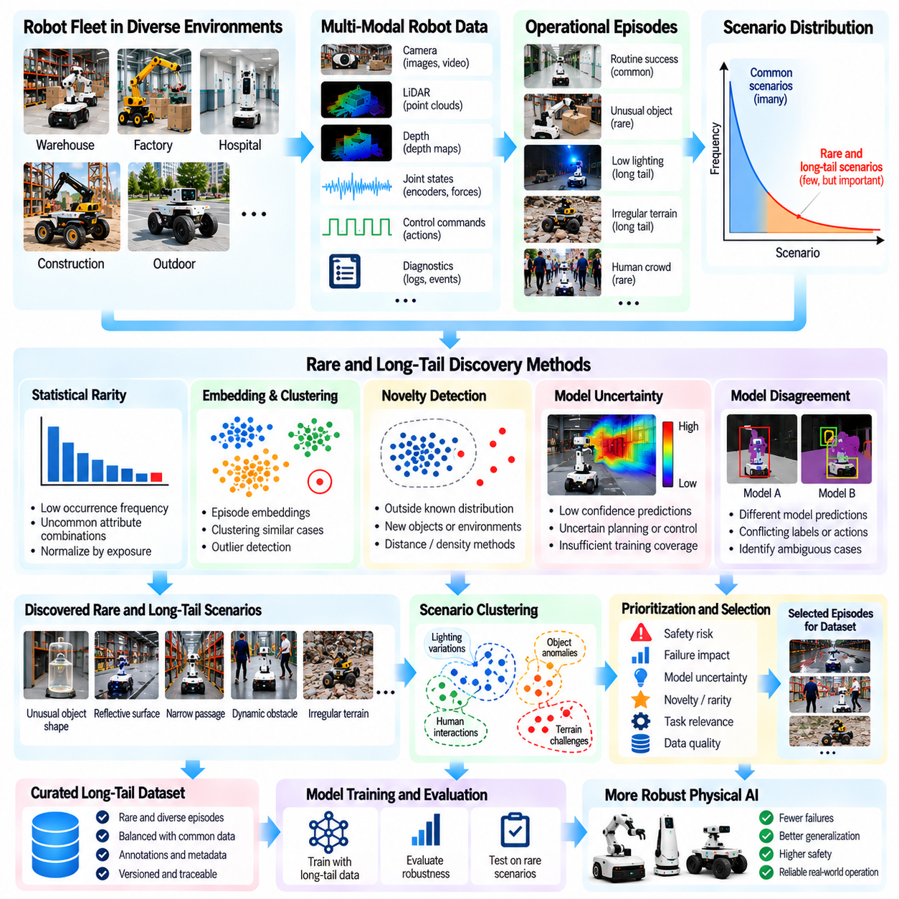{width="7.268055555555556in" height="7.268055555555556in"}

희귀 및 롱테일 시나리오 탐색(Rare and Long-Tail Scenario Discovery)은 예측하기 어려운 실제 환경(Real-World Environment)에서 작동하는 물리 인공지능(Physical AI) 시스템의 강건성(Robustness)을 향상시키는 데 필수적이다. 대부분의 로봇 경험(Robot Experience)은 익숙한 객체(Familiar Object), 반복적인 작업(Repeated Task), 일반적인 환경 조건(Common Environmental Condition)으로 구성된다. 그러나 일부 경험에는 인식(Perception), 계획(Planning), 제어(Control)의 한계를 드러내는 특이한 조건의 조합이 포함된다. 이러한 드문 경험을 발견하면 로봇 플릿(Robot Fleet)은 기존 학습 데이터셋(Training Dataset)에서 자주 간과되는 취약점(Weakness)을 해결할 수 있다.

롱테일(Long Tail)은 개별적으로는 발생 빈도가 낮지만 전체적으로는 상당한 운영 다양성(Operational Diversity)을 나타내는 수많은 상황의 집합을 의미한다. 대표적인 사례에는 예상하지 못한 객체 배치(Unexpected Object Arrangement), 특이한 조명(Unusual Lighting), 불규칙한 표면(Irregular Surface), 익숙하지 않은 장애물(Unfamiliar Obstacle), 드문 인간 행동(Rare Human Behavior)이 포함된다. 각각의 조건은 드물게 발생하더라도 전체 발생 확률(Combined Probability)은 상당할 수 있다. 따라서 신뢰할 수 있는 자율성(Reliable Autonomy)을 확보하려면 과거 데이터(Historical Data)에 주로 포함된 일반적인 시나리오(Common Scenario)를 넘어서는 학습이 필요하다.

희귀 시나리오(Rare Scenario)를 실패(Failure)와 동일하게 취급해서는 안 된다. 로봇은 학습 분포(Training Distribution)에 포함되지 않은 조건을 경험하면서도 익숙하지 않은 환경(Unfamiliar Environment)을 성공적으로 탐색하거나 특이한 객체(Unusual Object)를 조작할 수 있다. 이러한 성공적인 에피소드(Successful Episode)는 새롭게 등장하는 운영 요구사항(Emerging Operational Requirement)과 유용한 일반화 능력(Generalization Capability)을 보여줄 수 있다. 반대로 겉보기에는 일상적인 작업(Routine Task)이라도 다른 환경 요인(Environmental Factor)과 결합할 때 중요해지는 미묘한 이상 현상(Subtle Anomaly)을 포함할 수 있다.

플릿 규모 배포(Fleet-Scale Deployment)는 롱테일 경험(Long-Tail Experience)을 발견할 기회를 증가시킨다. 공장(Factory), 창고(Warehouse), 병원(Hospital), 실외 환경(Outdoor Environment)에서 작동하는 로봇은 서로 다른 객체, 공간 배치(Layout), 조명 조건(Lighting Condition), 인간 상호작용(Human Interaction)을 경험한다. 여러 현장(Site)의 관측값(Observation)을 통합하면 단일 로봇(Single Robot)이 경험할 수 있는 범위를 넘어 시나리오 포괄 범위(Scenario Coverage)가 확대된다. 그러나 탐색 시스템(Discovery System)은 실제로 새로운 조건(Genuinely Novel Condition)과 익숙한 상황을 반복 기록한 데이터(Repeated Recording)를 구분해야 한다.

시나리오 탐색(Scenario Discovery)은 동기화된 센서 관측값(Synchronized Sensor Observation), 로봇 행동(Robot Action), 작업 결과(Task Outcome), 맥락 메타데이터(Contextual Metadata)를 체계적으로 수집하는 것에서 시작된다. 이벤트 트리거 로깅(Event-Triggered Logging)은 특이한 상호작용(Unusual Interaction)을 보존하고, 주기적 샘플링(Periodic Sampling)은 명시적인 오류(Explicit Error)를 발생시키지 않는 희귀 상황(Rare Situation)을 포착한다. 각 에피소드(Episode)는 로봇 구성(Robot Configuration), 환경 정보(Environment Information), 타임스탬프(Timestamp), 모델 버전(Model Version)을 유지해야 한다. 이러한 맥락은 관측값이 의미 있는 신규성(Meaningful Novelty)을 나타내는지 아니면 기록 과정의 인공적 오류(Recording Artifact)인지를 해석하도록 돕는다.

통계적 희귀성(Statistical Rarity)은 특이한 경험(Unusual Experience)을 식별하는 하나의 접근 방법이다. 발생 빈도(Occurrence Frequency)가 낮은 이벤트, 속성의 드문 조합(Uncommon Combination of Attributes), 기준 분포(Reference Distribution)에서의 낮은 발생 가능도(Low Likelihood)를 가진 사례를 후보로 선정할 수 있다. 빈도 추정(Frequency Estimation)은 작업 노출도(Task Exposure), 운영 시간(Operating Hour), 배포 조건(Deployment Condition)을 고려해야 한다. 적절한 정규화(Normalization)가 없으면 특정 환경에서 작동한 로봇 수가 적다는 이유만으로 해당 시나리오가 희귀하게 나타날 수 있다.

임베딩 기반 탐색(Embedding-Based Discovery)은 관측값(Observation)이나 전체 에피소드(Complete Episode)를 학습된 특징 공간(Learned Feature Space)에 표현한다. 시각적 장면(Visual Scene), 움직임 궤적(Motion Trajectory), 접촉 상호작용(Contact Interaction), 작업 결과(Task Outcome)는 압축된 벡터(Compact Vector)로 인코딩될 수 있다. 군집화(Clustering)는 반복적인 패턴(Recurring Pattern)을 식별하고, 이상치 탐지(Outlier Detection)는 기존 군집(Established Group)에서 멀리 떨어진 경험을 강조한다. 그러나 임베딩 거리(Embedding Distance)가 항상 물리적 중요성(Physical Significance)과 일치하는 것은 아니므로 운영 증거(Operational Evidence)를 통한 검증이 필요하다.

신규성 탐지(Novelty Detection)는 새롭게 유입되는 경험(Incoming Experience)을 이전에 관측된 데이터(Previously Observed Data)와 비교한다. 로봇이 새로운 객체 형상(New Object Geometry), 익숙하지 않은 표면 재질(Unfamiliar Surface Material), 특이한 상호작용 시퀀스(Unusual Interaction Sequence)를 만나면 알려진 분포(Known Distribution)를 벗어난 관측값이 생성될 수 있다. 거리 기반 방법(Distance-Based Method), 밀도 추정(Density Estimation), 학습된 신규성 점수(Learned Novelty Score)는 자동화된 탐색(Automated Discovery)을 지원할 수 있다. 센서 잡음(Sensor Noise)과 보정 오류(Calibration Error)가 실제 환경 신규성(Genuine Environmental Novelty)과 유사하게 나타날 수 있으므로 이러한 방법은 신중하게 보정되어야 한다.

모델 불확실성(Model Uncertainty)은 롱테일 탐색(Long-Tail Discovery)을 위한 또 다른 신호를 제공한다. 인식 모델(Perception Model)은 낮은 신뢰도(Low Confidence)를 출력할 수 있고, 계획 시스템(Planning System)은 일관되지 않은 예측(Inconsistent Prediction)을 생성할 수 있으며, 제어 정책(Control Policy)은 익숙하지 않은 상태(Unfamiliar State)에 직면할 수 있다. 높은 불확실성(High Uncertainty)은 학습 데이터 포괄 범위(Training Coverage)의 부족을 나타낼 수 있지만 측정 잡음(Measurement Noise)이나 보정이 부정확한 모델(Poorly Calibrated Model)을 반영할 수도 있다. 불확실성을 작업 맥락(Task Context)과 반복 관측(Repeated Observation)에 결합하면 시나리오 선택(Scenario Selection)의 신뢰성이 향상된다.

독립적으로 학습된 모델(Independently Trained Model) 사이의 불일치(Disagreement)는 사용 가능한 데이터에 의해 학습된 행동(Learned Behavior)이 충분히 제약되지 않은 영역을 드러낼 수 있다. 서로 다른 인식 네트워크(Perception Network)는 충돌하는 객체 레이블(Conflicting Object Label)을 할당하거나 대안적 정책(Alternative Policy)은 서로 다른 행동(Action)을 권장할 수 있다. 이러한 불일치는 로봇이 작업을 완료한 경우에도 추가 조사(Further Investigation)가 필요한 후보를 식별한다. 그러나 모델들이 유사한 학습 편향(Training Bias)을 공유한다면 모델 간 일치(Model Agreement)가 반드시 정확성(Correctness)을 보장하는 것은 아니다.

시간적 신규성(Temporal Novelty)은 희귀 시나리오(Rare Scenario)가 개별 관측값(Isolated Observation)이 아니라 시퀀스(Sequence)를 통해 나타날 수 있기 때문에 중요하다. 내비게이션 시스템(Navigation System)은 익숙한 장애물(Familiar Obstacle)이 낯선 순서(Unfamiliar Order)로 배치된 상황을 만나 어려운 경로 계획 문제(Planning Problem)에 직면할 수 있다. 조작 실패(Manipulation Failure)는 객체 움직임(Object Motion), 접촉 시점(Contact Timing), 파지 조정(Grip Adjustment)의 특이한 조합에서 발생할 수 있다. 시퀀스 인식 표현(Sequence-Aware Representation)은 엔지니어링 분석(Engineering Analysis)에 필요한 인과적 맥락(Causal Context)을 보존하면서 이러한 패턴을 탐지하도록 지원한다.

시나리오 군집화(Scenario Clustering)는 발견된 경험(Discovered Experience)을 의미 있는 그룹으로 구성한다. 에피소드(Episode)는 환경 외관(Environmental Appearance), 작업 구조(Task Structure), 로봇 행동(Robot Behavior), 실패 메커니즘(Failure Mechanism)을 기준으로 그룹화할 수 있다. 이후 엔지니어는 특이한 기록(Unusual Recording)을 개별적으로 모두 검토하는 대신 반복적으로 나타나는 롱테일 범주(Long-Tail Category)를 식별할 수 있다. 시각적으로 유사한 장면(Visually Similar Scene)이 서로 다른 제어 대응(Control Response)을 요구하거나 시각적으로 다른 장면이 동일한 근본 문제(Underlying Challenge)를 공유할 수 있으므로 군집 내부의 숨겨진 변동성(Hidden Variation)을 검토해야 한다.

희귀 이벤트 탐색(Rare-Event Discovery)은 신규성 점수(Novelty Score)에만 의존하지 않고 안전성(Safety)과 운영상 중요성(Operational Importance)을 반영해야 한다. 익숙하지 않지만 무해한 시각적 패턴(Harmless Visual Pattern)은 학습 가치(Learning Value)가 제한적일 수 있지만 드문 충돌 직전 상황(Near-Collision)은 중요한 안전 취약점(Critical Safety Weakness)을 드러낼 수 있다. 우선순위 지정(Prioritization)은 희귀성(Rarity), 심각도(Severity), 불확실성(Uncertainty), 반복 발생(Recurrence), 예상 모델 개선 효과(Expected Model Improvement)를 결합할 수 있다. 이를 통해 데이터 수집 자원(Data Collection Resource)이 특이하지만 관련성이 낮은 관측값(Irrelevant Observation)에 주로 소비되는 것을 방지한다.

포괄 범위 분석(Coverage Analysis)은 작업(Task), 환경(Environment), 로봇 구성(Robot Configuration), 운영 조건(Operating Condition)의 어떤 조합이 충분히 표현되지 않았는지 판단한다. 메타데이터 인덱스(Metadata Index)와 시나리오 분류 체계(Scenario Taxonomy)는 수집된 데이터(Collected Data)와 예상 배포 분포(Expected Deployment Distribution)의 비교를 지원한다. 포괄 범위의 공백(Coverage Gap)은 특정 객체 재질(Object Material), 조명 변화(Lighting Transition), 바닥 상태(Floor Condition), 인간 상호작용 패턴(Human Interaction Pattern)에서 나타날 수 있다. 이러한 공백을 식별하면 추가 기록을 무분별하게 축적하는 대신 목표 지향적 데이터 수집(Targeted Data Collection)을 수행할 수 있다.

능동적 데이터 수집(Active Data Collection)은 탐색 결과(Discovery Result)를 새로운 기록 정책(Recording Policy)으로 전환한다. 중앙 집중식 분석(Centralized Analysis)이 충분히 표현되지 않은 조건(Underrepresented Condition)을 식별하면 선택된 로봇(Selected Robot)에 업데이트된 트리거(Updated Trigger), 샘플링 속도(Sampling Rate), 작업별 수집 요청(Task-Specific Collection Request)을 전달할 수 있다. 이후 엣지 시스템(Edge System)은 해당 조건이 자연스럽게 발생할 때 관련 에피소드(Relevant Episode)를 보존한다. 이러한 접근 방식은 플릿 전체의 지식(Fleet-Wide Knowledge)을 로컬 데이터 획득(Local Data Acquisition)과 연결하면서 불필요한 네트워크 전송(Network Transfer)과 저장 공간 소비(Storage Consumption)를 줄인다.

시뮬레이션(Simulation)은 발견된 롱테일 시나리오(Long-Tail Scenario)를 중심으로 다양한 변형(Variation)을 생성하여 실제 데이터 수집(Physical Collection)을 보완할 수 있다. 희귀 내비게이션 이벤트(Rare Navigation Event)는 장애물 위치(Obstacle Position), 마찰 계수(Friction Coefficient), 센서 외란(Sensor Disturbance)을 변경하여 재구성할 수 있다. 조작 시나리오(Manipulation Scenario)는 객체 형상(Object Geometry), 질량(Mass), 접촉 특성(Contact Property)의 변화를 통해 확장할 수 있다. 합성 변형(Synthetic Variation)은 포괄 범위(Coverage)를 향상시키지만 유용성(Usefulness)은 시뮬레이션 충실도(Simulation Fidelity)와 실제 관측값(Real Observation)에 대한 검증에 달려 있다.

인간 검토(Human Review)는 의미 있는 희귀 시나리오(Meaningful Rare Scenario)와 기술적 인공 오류(Technical Artifact)를 구분하는 데 여전히 중요하다. 엔지니어는 대표적인 기록(Representative Recording)을 검토하여 신규성(Novelty)을 확인하고, 안전상 영향(Safety Implication)을 평가하며, 의미적 레이블(Semantic Label)을 할당할 수 있다. 검토 결과(Review Outcome)는 군집화 모델(Clustering Model), 신규성 임계값(Novelty Threshold), 수집 우선순위(Collection Priority)를 개선하는 데 활용될 수 있다. 인간 전문성(Human Expertise)은 자동화된 유사도 측정(Automated Similarity Measure)으로 신뢰성 있게 해석하기 어려운 복잡한 물리적 상호작용(Complex Physical Interaction)이 포함된 특이한 행동(Unusual Behavior)을 분석할 때 특히 가치가 높다.

롱테일 데이터셋(Long-Tail Dataset)은 신중한 구성(Organization)과 평가 설계(Evaluation Design)가 필요하다. 희귀 에피소드(Rare Episode)는 원래의 맥락(Original Context), 출처 정보(Provenance), 관련 시나리오(Related Scenario)와의 관계를 유지해야 한다. 학습 및 평가 데이터 분할(Training and Evaluation Partition)은 거의 동일한 기록(Nearly Identical Recording)이나 시뮬레이션 변형(Simulation Variant)으로 인한 데이터 누출(Data Leakage)을 방지해야 한다. 전용 도전 과제 평가셋(Dedicated Challenge Set)은 어려운 조건(Difficult Condition)에서의 성능을 측정할 수 있으며, 전체 신뢰성(Overall Reliability)을 평가하고 예외적 사례(Exceptional Case)에 대한 과적합(Overfitting)을 방지하려면 대표적인 운영 데이터셋(Representative Operational Dataset)도 필요하다.

탐색 효과(Discovery Effectiveness)는 신규 시나리오 발견 수율(Novel Scenario Yield), 검증된 희귀성(Validated Rarity), 포괄 범위 개선(Coverage Improvement), 검토 비용(Review Cost), 후속 모델 성능(Downstream Model Performance)을 통해 평가할 수 있다. 엔지니어는 새롭게 수집된 에피소드(Newly Collected Episode)가 이전에 알려지지 않은 실패 유형(Previously Unknown Failure Mode)을 드러내거나 충분히 표현되지 않은 조건(Underrepresented Condition)에서 성능을 개선하는지 측정해야 한다. 지표(Metric)는 변화하는 배포 노출도(Deployment Exposure)와 수집 정책(Collection Policy)도 고려해야 한다. 탐지된 이상치(Detected Outlier)의 수가 증가한다고 해서 반드시 탐색 성능(Discovery Performance)이 향상된 것은 아니다.

궁극적으로 희귀 및 롱테일 시나리오 탐색(Rare and Long-Tail Scenario Discovery)은 분산된 로봇 경험(Distributed Robot Experience)을 자율 지능(Autonomous Intelligence)의 한계를 체계적으로 식별하는 프로세스로 전환한다. 통계 분석(Statistical Analysis), 임베딩(Embedding), 불확실성 추정(Uncertainty Estimation), 시간적 추론(Temporal Reasoning), 인간 검증(Human Validation)은 일반적인 데이터셋(Ordinary Dataset)이 놓치는 상황을 발견하도록 한다. 탐색(Discovery)을 목표 지향적 수집(Targeted Collection), 시뮬레이션(Simulation), 평가(Evaluation), 모델 개선(Model Improvement)과 연결함으로써 물리 인공지능 플릿(Physical AI Fleet)은 운영 역량(Operational Competence)과 회복탄력성(Resilience)을 점진적으로 확장할 수 있다.

## 09.10. Uncertainty Triggered Data Collection

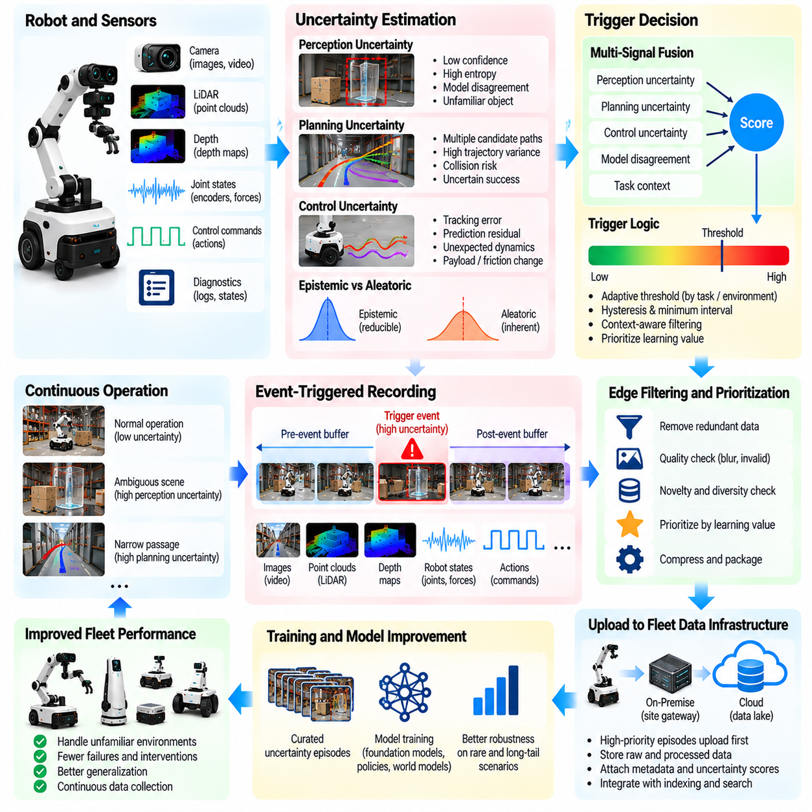{width="7.268055555555556in" height="7.268055555555556in"}

불확실성 기반 데이터 수집(Uncertainty-Triggered Data Collection)은 자율 시스템(Autonomous System)이 익숙하지 않거나 모호한 조건을 만났을 때 물리 인공지능 플릿(Physical AI Fleet)이 유용한 경험을 포착하도록 한다. 모든 센서 스트림(Sensor Stream)을 지속적으로 기록하는 대신 로봇은 불확실성 추정(Uncertainty Estimation)을 활용하여 추가적인 증거가 향후 학습을 개선할 수 있는 순간을 식별한다. 이러한 접근 방식은 인식(Perception), 예측(Prediction), 계획(Planning), 제어(Control) 모델의 신뢰도가 제한적인 상황에 데이터 수집 자원(Data Collection Resource)을 집중시킨다.

불확실성(Uncertainty)은 로봇이 환경(Environment)을 신뢰성 있게 파악하거나 결과(Outcome)를 예측하거나 적절한 행동(Action)을 선택할 수 없는 정도를 나타낸다. 불확실성은 불완전한 관측(Incomplete Observation), 익숙하지 않은 객체(Unfamiliar Object), 모호한 센서 측정값(Ambiguous Sensor Measurement), 부족한 학습 데이터 범위(Insufficient Training Coverage)에서 발생할 수 있다. 모든 불확실성이 즉각적인 실패(Imminent Failure)를 의미하지는 않지만 지속적인 불확실성(Persistent Uncertainty)은 학습된 표현(Learned Representation)과 의사결정 능력(Decision-Making Capability)의 취약점을 드러낼 수 있다.

인식론적 불확실성(Epistemic Uncertainty)과 우연적 불확실성(Aleatoric Uncertainty) 사이에는 근본적인 차이가 존재한다. 인식론적 불확실성은 모델 지식(Model Knowledge)의 한계를 반영하며 관련 학습 사례(Training Example)가 확보되면 감소할 수 있다. 우연적 불확실성은 내재적 무작위성(Inherent Randomness)이나 측정 변동성(Measurement Variability)에서 발생하며 추가 데이터만으로 반드시 제거할 수 있는 것은 아니다. 이러한 불확실성의 원인을 구분하면 더 많은 사례를 수집하는 것이 모델 성능(Model Performance)을 개선할 가능성이 있는지 판단하는 데 도움이 된다.

인식 불확실성(Perception Uncertainty)은 객체 탐지(Object Detection), 분할(Segmentation), 위치 추정(Localization), 장면 이해(Scene Understanding)에서 모호한 예측(Ambiguous Prediction)이 생성될 때 자주 나타난다. 로봇은 투명 객체(Transparent Object), 반사 표면(Reflective Surface), 부분 가림(Partial Occlusion), 익숙하지 않은 조명 조건(Unfamiliar Lighting Condition)을 만날 수 있다. 신뢰도 점수(Confidence Score), 예측 엔트로피(Prediction Entropy), 모델 간 불일치(Model Disagreement)는 이러한 상황을 나타낼 수 있다. 그러나 신경망(Neural Network)은 익숙하지 않은 입력(Unfamiliar Input)에 대해서도 과도한 확신(Overconfidence)을 보일 수 있으므로 신뢰도 값(Confidence Value)의 보정(Calibration)이 필요하다.

계획 불확실성(Planning Uncertainty)은 예측된 행동 결과(Predicted Action Consequence)와 후보 궤적(Candidate Trajectory)의 신뢰성에 관한 것이다. 내비게이션 로봇(Navigation Robot)은 좁은 통로(Narrow Passage)를 통과할 수 있는지 판단하기 어려울 수 있으며, 로봇 조작기(Manipulator)는 파지 안정성(Grasp Stability)을 확신하지 못할 수 있다. 예측 결과의 변동성(Variability Across Predicted Outcomes)이나 계획 모델 간 불일치(Planning Model Disagreement)는 유용한 신호를 제공한다. 이러한 불확실성은 특히 비가역적 행동(Irreversible Action)이나 안전 제약(Safety Constraint)이 포함된 의사결정에서 중요하다.

제어 불확실성(Control Uncertainty)은 명령된 행동(Commanded Action)과 관측된 물리적 반응(Observed Physical Response) 사이의 관계를 예측하기 어려워질 때 발생한다. 예상하지 못한 마찰(Unexpected Friction), 적재 하중 변화(Payload Change), 액추에이터 마모(Actuator Wear), 접촉 동역학(Contact Dynamics)은 예상 움직임(Expected Motion)에서 벗어나는 편차(Deviation)를 발생시킬 수 있다. 예측 잔차(Prediction Residual), 상태 추정 공분산(State-Estimation Covariance), 비정상적인 추종 오차(Abnormal Tracking Error)는 불확실한 운영 조건(Uncertain Operating Condition)을 나타낼 수 있다. 이러한 신호는 즉각적인 유지보수(Maintenance)가 필요한 확인된 하드웨어 결함(Confirmed Hardware Fault)과 구분해야 한다.

불확실성 기반 데이터 수집 시스템(Uncertainty-Triggered Data Collection System)은 로봇 운영 중 선택된 지표(Selected Indicator)를 지속적으로 평가한다. 불확실성이 보정된 임계값(Calibrated Threshold)을 초과하면 시스템은 관련 관측값(Observation), 행동(Action), 내부 예측(Internal Prediction), 환경 맥락(Environmental Context)을 보존한다. 순환 버퍼(Circular Buffer)는 트리거(Trigger) 이전의 정보를 유지하고, 후속 기록(Subsequent Recording)은 결과를 포착한다. 이러한 시간적 맥락(Temporal Context)은 불확실성이 어떻게 발전했는지와 로봇이 성공적으로 복구했는지를 이해하는 데 필요하다.

트리거 설계(Trigger Design)는 학습 가치(Learning Value)와 연산 비용(Computational Cost), 저장 비용(Storage Cost), 통신 비용(Communication Cost) 사이의 균형을 유지해야 한다. 지나치게 민감한 임계값(Threshold)은 과도한 기록(Excessive Recording)을 생성하고, 지나치게 제한적인 임계값은 유용한 경험(Informative Experience)을 놓치게 한다. 적응형 임계값(Adaptive Threshold)은 작업 복잡도(Task Complexity), 환경 조건(Environmental Condition), 가용 자원(Available Resource)을 고려할 수 있다. 히스테리시스(Hysteresis)와 최소 트리거 간격(Minimum Trigger Interval)은 불확실성 추정값(Uncertainty Estimate)의 변동으로 인한 반복 기록을 방지하는 데 도움이 된다.

여러 불확실성 신호(Uncertainty Signal)를 결합하면 데이터 수집 결정(Collection Decision)을 개선할 수 있다. 인식 신뢰도(Perception Confidence), 예측 충돌 확률(Predicted Collision Probability), 궤적 분산(Trajectory Variance), 제어기 잔차(Controller Residual)는 복합 점수(Composite Score)를 구성하는 데 활용될 수 있다. 맥락 정보(Contextual Information)는 불확실한 조건이 운영상 중요한지 판단하도록 한다. 서로 다른 지표는 척도(Scale)가 호환되지 않거나 상관된 오류(Correlated Error)를 포함할 수 있으므로 신호 결합에는 신중한 보정(Calibration)이 필요하다.

모델 앙상블(Model Ensemble)은 예측 불일치(Prediction Disagreement)를 통해 불확실성을 추정하는 방법 중 하나이다. 독립적으로 학습된 여러 모델(Independently Trained Model)이 동일한 관측값(Observation)을 평가하고 대안적인 예측(Alternative Prediction)이나 행동(Action)을 생성한다. 큰 불일치(Large Disagreement)는 상태 공간(State Space)의 특정 영역에서 지식이 부족하다는 것을 나타낼 수 있다. 앙상블은 연산 요구량(Computational Requirement)을 증가시키지만 경량 근사 방법(Lightweight Approximation)이나 선택적 실행(Selective Execution)을 사용하면 자원이 제한된 로봇(Resource-Constrained Robot)에서도 불확실성 추정이 가능해진다.

베이지안 근사(Bayesian Approximation)와 확률적 예측 방법(Probabilistic Prediction Method)은 추가적인 불확실성 추정값(Uncertainty Estimate)을 제공한다. 몬테카를로 드롭아웃(Monte Carlo Dropout), 확률적 신경망(Probabilistic Neural Network), 예측 분포(Predictive Distribution)는 모델 출력(Model Output)의 변동성을 특성화할 수 있다. 이러한 접근 방식은 유용한 지표를 제공하지만 모델링 가정(Modeling Assumption)과 보정 품질(Calibration Quality)에 의존한다. 복잡한 물리 환경(Complex Physical Environment)에서 발생하는 모든 형태의 불확실성을 단일 추정기(Single Estimator)가 신뢰성 있게 포착할 수는 없다.

불확실성 기반 기록(Uncertainty-Triggered Recording)은 단순히 가장 높은 수치 점수(Numerical Score)를 선택하기보다 잠재적인 학습 가치(Potential Learning Value)가 있는 경험을 우선해야 한다. 동일한 모호한 표면(Ambiguous Surface)을 반복적으로 관측하는 것은 충분한 데이터 범위(Coverage)가 확보된 이후에는 추가적인 정보를 거의 제공하지 못할 수 있다. 신규성(Novelty), 다양성(Diversity), 작업 관련성(Task Relevance), 예상 모델 개선 효과(Expected Model Improvement)는 데이터 선택(Data Selection)을 안내할 수 있다. 이는 불확실성 기반 수집(Uncertainty-Based Collection)을 능동 학습(Active Learning) 및 롱테일 시나리오 탐색(Long-Tail Scenario Discovery)과 연결한다.

엣지 처리(Edge Processing)는 원시 기록(Raw Recording)을 업로드하기 전에 불확실성 판단(Uncertainty Decision)을 수행해야 하는 경우가 많기 때문에 필수적이다. 온보드 시스템(Onboard System)은 경량 신뢰도 지표(Lightweight Confidence Indicator)를 계산하고 짧은 센서 기록 구간(Short Sensor Window)을 보존하며 수집 우선순위(Collection Priority)를 지정할 수 있다. 가치가 높은 에피소드(High-Value Episode)는 즉시 업로드하고 긴급성이 낮은 기록(Less Urgent Recording)은 적절한 네트워크 조건(Network Condition)을 기다릴 수 있다. 이를 통해 중요한 증거(Important Evidence)를 잃지 않으면서 대역폭 소비(Bandwidth Consumption)를 줄일 수 있다.

안전 필수 불확실성(Safety-Critical Uncertainty)은 특별한 처리가 필요하다. 불확실성이 충돌 회피(Collision Avoidance), 인간 근접성(Human Proximity), 불안정한 조작(Unstable Manipulation)에 영향을 미칠 때 로봇은 탐색(Exploration)을 계속하기보다 안전한 행동(Safe Behavior)을 우선해야 한다. 데이터 수집 메커니즘(Collection Mechanism)은 안전 제어기(Safety Controller)와 분리되어야 하며 유용한 데이터를 확보하기 위해 위험한 행동(Hazardous Action)을 유도해서는 안 된다. 위험한 상황(Risky Situation)의 기록은 시스템이 적절한 운영 안전장치(Operational Safeguard)를 유지할 때에만 유용하다.

인간 개입(Human Intervention)은 불확실성 기반 에피소드(Uncertainty-Triggered Episode)에 가치 있는 레이블(Label)을 제공할 수 있다. 운영자(Operator)는 로봇이 주저한 이유를 설명하거나 잘못 이해한 객체(Misunderstood Object)를 식별하거나 교정 행동(Corrective Action)을 시연할 수 있다. 불확실성 추정값(Uncertainty Estimate)을 개입 시점(Intervention Timing) 및 복구 결과(Recovery Outcome)와 연결하면 최초 신호(Original Signal)가 실제로 의미 있는 어려움을 예측했는지 판단하는 데 도움이 된다. 인간 피드백(Human Feedback)은 임계값 개선(Threshold Refinement)과 불확실성 보정 검증(Uncertainty Calibration Validation)도 지원한다.

중앙 집중식 플릿 분석(Centralized Fleet Analysis)은 여러 로봇과 운영 현장(Operating Site)에 걸쳐 반복되는 불확실성 패턴(Recurring Uncertainty Pattern)을 식별할 수 있다. 에피소드(Episode)는 객체 범주(Object Category), 환경 조건(Environmental Condition), 모델 버전(Model Version), 작업 단계(Task Phase)에 따라 그룹화할 수 있다. 엔지니어는 플랫폼별 취약점(Platform-Specific Weakness)과 플릿 전체에 공통으로 나타나는 한계(Shared Fleet Limitation)를 구분할 수 있다. 이러한 발견은 목표 지향적 데이터 수집 정책(Targeted Data Collection Policy), 모델 재학습 우선순위(Model Retraining Priority), 센서 구성 변경(Sensor Configuration Change)에 반영될 수 있다.

수집된 에피소드(Collected Episode)는 재현 가능한 학습 파이프라인(Reproducible Learning Pipeline)에 통합되어야 한다. 메타데이터(Metadata)는 트리거 유형(Trigger Type), 불확실성 점수(Uncertainty Score), 모델 버전(Model Version), 로봇 구성(Robot Configuration), 기록 조건(Recording Condition)을 보존해야 한다. 선택된 사례(Selected Example)는 주석 처리(Annotation), 품질 필터링(Quality Filtering)을 거쳐 학습 데이터셋(Training Dataset)에 포함될 수 있다. 반복적인 불확실성 기반 샘플링(Uncertainty-Driven Sampling)이 오해를 유발하는 성능 개선(Misleading Performance Improvement)을 만들어내지 않도록 평가 데이터셋(Evaluation Dataset)은 적절히 분리되어야 한다.

불확실성 추정(Uncertainty Estimation)은 시뮬레이션 기반 데이터 생성(Simulation-Based Data Generation)에도 활용될 수 있다. 익숙하지 않은 물리적 상호작용(Unfamiliar Physical Interaction)을 시뮬레이션(Simulation)에서 재구성하고 객체 특성(Object Property), 접촉 조건(Contact Condition), 센서 외란(Sensor Disturbance)을 다양하게 변경할 수 있다. 이러한 변형(Variation)은 운영 공간(Operating Space)의 불확실한 영역(Uncertain Region) 주변에 대한 데이터 포괄 범위(Data Coverage)를 확장할 수 있다. 그러나 부정확한 시뮬레이션(Inaccurate Simulation)은 잘못된 모델 가정(Incorrect Model Assumption)을 강화할 수 있으므로 합성 사례(Synthetic Example)는 실제 관측값(Real Observation)을 통해 검증해야 한다.

데이터 수집 효과(Collection Effectiveness)는 유용한 에피소드 수율(Useful Episode Yield), 불확실성 보정(Uncertainty Calibration), 데이터셋 다양성(Dataset Diversity), 저장 효율성(Storage Efficiency), 후속 모델 개선(Downstream Model Improvement)을 통해 측정해야 한다. 엔지니어는 유사한 자원 예산(Resource Budget)에서 불확실성 기반 샘플링(Uncertainty-Triggered Sampling)을 무작위 수집(Random Collection)이나 주기적 수집(Periodic Collection)과 비교해야 한다. 작업 성공률(Task Success Rate)이나 안전 성능(Safety Performance)이 개선되지 않는다면 불확실성 감소(Reduced Uncertainty)만으로는 성과를 입증하기 어렵다. 따라서 평가(Evaluation)에는 실제 운영 결과(Real Operational Outcome)가 포함되어야 한다.

궁극적으로 불확실성 기반 데이터 수집(Uncertainty-Triggered Data Collection)은 로봇이 알지 못하는 것(Unknown Knowledge)과 학습 시스템(Learning System)이 다음에 관측해야 할 대상 사이에 직접적인 연결을 구축한다. 불확실한 상태(Uncertain State)를 식별하고 맥락 증거(Contextual Evidence)를 보존하며 유용한 경험(Informative Experience)을 선택함으로써 플릿은 데이터 효율성(Data Efficiency)과 모델 포괄 범위(Model Coverage)를 개선할 수 있다. 안전 제어(Safety Control), 인간 피드백(Human Feedback), 지속적인 평가(Continuous Evaluation)와 통합된 이 메커니즘은 점점 더 높은 역량과 신뢰성을 갖춘 물리 인공지능 시스템(Physical AI System)의 발전을 지원한다.

## 09.11. Model Error to Data Query

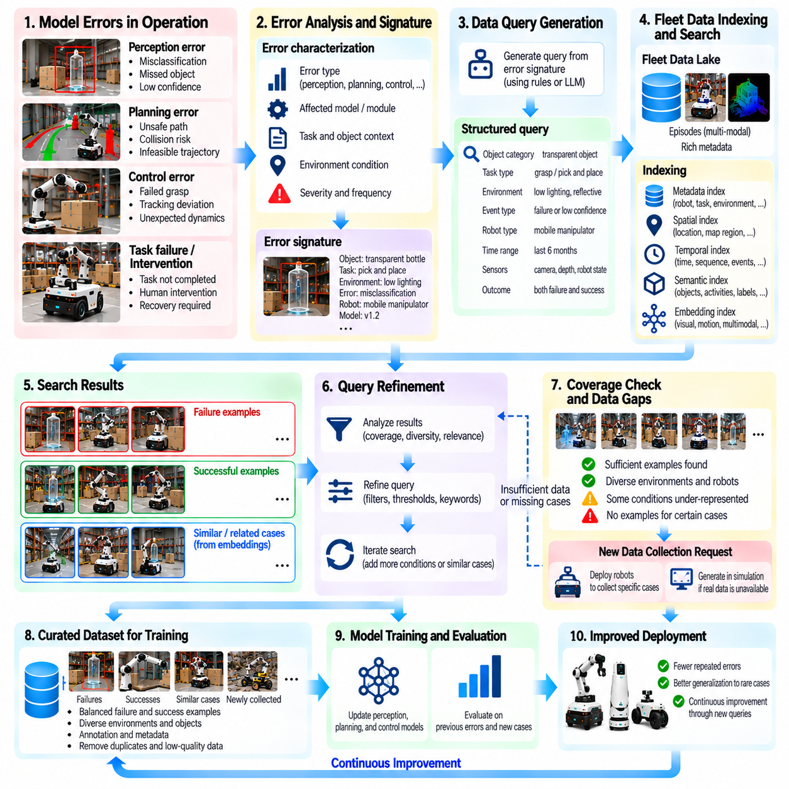{width="7.268055555555556in" height="7.268055555555556in"}

모델 오류 기반 데이터 질의(Model Error-to-Data Query)는 관측된 모델 취약점(Model Weakness)과 이를 개선하는 데 필요한 로봇 경험(Robot Experience) 사이에 체계적인 연결을 구축한다. 물리 인공지능(Physical AI) 시스템은 추가 데이터를 무분별하게 수집하는 대신 예측 오류(Prediction Error), 실행 실패(Execution Failure), 평가 격차(Evaluation Gap)를 분석하여 목표 지향적 검색 요청(Targeted Retrieval Request)을 생성한다. 이러한 과정은 모델의 결함(Model Deficiency)을 실행 가능한 데이터 요구사항(Actionable Data Requirement)으로 전환하여 플릿 규모 학습(Fleet-Scale Learning)과 지속적인 모델 개발(Continuous Model Development)의 효율성을 향상시킨다.

모델 오류(Model Error)는 인식(Perception), 상태 추정(State Estimation), 계획(Planning), 제어(Control), 학습된 행동 정책(Learned Action Policy)에서 발생할 수 있다. 인식 모델(Perception Model)은 투명 객체(Transparent Object)를 잘못 식별할 수 있으며, 내비게이션 정책(Navigation Policy)은 익숙하지 않은 공간 배치(Unfamiliar Layout)에서 안전하지 않은 경로(Unsafe Path)를 선택할 수 있다. 조작 모델(Manipulation Model)은 접촉력(Contact Force)이나 파지 안정성(Grasp Stability)을 잘못 예측할 수 있다. 각 오류에는 학습된 표현(Learned Representation)이나 의사결정 메커니즘(Decision Mechanism)이 신뢰성을 잃는 조건에 관한 정보가 포함되어 있다.

첫 번째 단계는 측정 가능한 증거(Measurable Evidence)를 사용하여 오류(Error)의 특성을 규명하는 것이다. 예측 잔차(Prediction Residual), 작업 성공률(Task Success Rate), 궤적 편차(Trajectory Deviation), 분류 오류(Classification Mistake), 개입 기록(Intervention Record)은 유용한 지표를 제공한다. 오류 분석(Error Analysis)은 영향을 받은 하위 시스템(Subsystem), 운영 맥락(Operating Context), 심각도(Severity), 발생 빈도(Frequency)를 식별해야 한다. 체계적인 취약점(Systematic Weakness)과 개별적인 잡음(Isolated Noise)을 구분하면 불필요한 데이터 수집 요청(Data Collection Request)을 방지하고 검색된 에피소드(Retrieved Episode)의 관련성을 높일 수 있다.

오류 시그니처(Error Signature)는 반복적으로 나타나는 모델 결함(Model Deficiency)과 관련된 특성을 요약한다. 여기에는 작업 유형(Task Type), 객체 범주(Object Category), 환경 조건(Environmental Condition), 로봇 구성(Robot Configuration), 모델 버전(Model Version), 관측된 실패 행동(Observed Failure Behavior)이 포함될 수 있다. 예를 들어 저조도 환경(Low Illumination)에서 반사 객체(Reflective Object)를 대상으로 반복적으로 발생하는 파지 실패(Grasp Failure)는 식별 가능한 시그니처를 형성할 수 있다. 구조화된 시그니처(Structured Signature)를 사용하면 엔지니어가 모호한 성능 문제(Performance Problem)를 검색 가능한 데이터 명세(Searchable Data Specification)로 변환할 수 있다.

데이터 질의(Data Query)는 오류 시그니처(Error Signature)를 명시적인 검색 조건(Explicit Retrieval Condition)으로 변환한다. 질의(Query)는 센서 모달리티(Sensor Modality), 작업 결과(Task Outcome), 로봇 형태(Robot Embodiment), 환경 속성(Environmental Attribute), 시간 구간(Temporal Interval)을 지정할 수 있다. 위치 추정 실패(Localization Failure)를 조사하는 엔지니어는 반사 특성이 있는 복도(Reflective Corridor), 급격한 조명 변화(Rapid Lighting Transition), 높은 자세 추정 불확실성(High Pose-Estimation Uncertainty)이 포함된 에피소드를 요청할 수 있다. 정확한 질의 조건(Precise Query Condition)은 불필요한 결과를 줄이면서 유용한 변형 사례(Useful Variation)를 보존한다.

플릿 메타데이터 인덱스(Fleet Metadata Index)는 이러한 질의를 효율적으로 실행하기 위한 기반을 제공한다. 구조화된 데이터베이스(Structured Database)는 로봇 식별 정보(Robot Identity), 소프트웨어 버전(Software Version), 작업 범주(Task Category), 운영 현장(Operating Site)을 기준으로 에피소드를 필터링한다. 시간적 인덱스(Temporal Index)는 실패 전후의 이벤트를 찾고, 의미적 인덱스(Semantic Index)는 관련 객체와 활동을 식별한다. 이러한 기능을 결합하면 학습 파이프라인(Training Pipeline)은 방대한 원시 기록(Raw Recording)을 반복적으로 검색하지 않고도 운영 증거(Operational Evidence)를 확보할 수 있다.

임베딩 기반 검색(Embedding-Based Retrieval)은 수동으로 정의된 레이블(Manually Defined Label)을 넘어 데이터 질의(Data Query)의 범위를 확장한다. 모델 오류(Model Error)는 시각적 특징(Visual Feature), 움직임 궤적(Motion Trajectory), 잠재 상태(Latent State), 다중 모달 임베딩(Multimodal Embedding)을 사용하여 표현할 수 있다. 이후 유사도 검색(Similarity Search)은 명시적인 주석(Explicit Annotation)이 없는 사례를 포함하여 알려진 실패 사례(Known Failure Case)와 유사한 에피소드를 식별한다. 그러나 시각적으로 유사한 상황이 서로 다른 물리적 메커니즘(Physical Mechanism)을 포함할 수 있으므로 임베딩 유사도(Embedding Similarity)는 반드시 검증되어야 한다.

오류 기반 질의(Error-Driven Query)는 실패 사례(Failure Example)뿐 아니라 성공 사례(Successful Example)도 검색해야 한다. 유사한 조건에서 수행된 실패 행동(Unsuccessful Action)과 성공적인 실행(Successful Execution)을 비교하면 문제가 있는 의사결정(Problematic Decision)과 피할 수 없는 환경적 제약(Unavoidable Environmental Constraint)을 구분하는 데 도움이 된다. 파지 작업(Grasping Task)에서는 긍정 및 부정 사례(Positive and Negative Example)를 통해 접촉 형상(Contact Geometry), 접근 방향(Approach Direction), 객체 움직임(Object Motion)의 차이를 발견할 수 있다. 이러한 대조(Contrast)는 실패 사례만 포함된 데이터보다 풍부한 지도 신호(Supervision)를 제공한다.

시간적 맥락(Temporal Context)은 모델 오류(Model Error)와 관련된 데이터를 검색할 때 필수적이다. 내비게이션 실패(Navigation Failure)는 최종 정지(Final Stop)가 발생하기 수 초 전에 생성된 잘못된 인식 추정값(Incorrect Perception Estimate)에서 비롯될 수 있다. 따라서 질의(Query)는 이전 관측값(Preceding Observation), 중간 의사결정(Intermediate Decision), 후속 복구 행동(Subsequent Recovery Behavior)을 지원해야 한다. 에피소드 수준 검색(Episode-Level Retrieval)은 이러한 관계를 보존하여 엔지니어가 개별 프레임(Isolated Frame)만 조사하는 대신 오류 전파(Error Propagation)를 분석할 수 있도록 한다.

질의 생성(Query Generation)은 평가 결과(Evaluation Result)와 진단 로그(Diagnostic Log)를 사용하여 부분적으로 자동화할 수 있다. 모델이 특정 시나리오 범주(Scenario Category)에서 반복적으로 실패하면 분석 소프트웨어(Analysis Software)는 공통 메타데이터 속성(Common Metadata Attribute)을 추출하고 후보 질의(Candidate Query)를 구성할 수 있다. 언어 모델(Language Model)이나 학습 기반 검색 시스템(Learned Retrieval System)은 진단 설명(Diagnostic Description)을 구조화된 검색 표현(Structured Search Expression)으로 변환하는 데 도움을 줄 수 있다. 그러나 생성된 질의는 잘못된 가정(Incorrect Assumption)이나 관련성이 낮은 검색(Irrelevant Retrieval)을 방지하기 위해 검증되어야 한다.

질의 개선(Query Refinement)은 반복적인 피드백(Iterative Feedback)을 통해 검색 결과를 향상시킨다. 초기 검색(Initial Search)은 지나치게 많은 중복 데이터(Duplicate Data), 관련 없는 에피소드(Unrelated Episode), 목표 조건(Target Condition)에 대한 불충분한 포괄 범위(Insufficient Coverage)를 반환할 수 있다. 엔지니어는 메타데이터 필터(Metadata Filter), 유사도 임계값(Similarity Threshold), 시간 구간(Temporal Window), 다양성 제약(Diversity Constraint)을 조정할 수 있다. 검토된 사례(Reviewed Example)에서 얻은 관련성 피드백(Relevance Feedback)은 후속 검색을 개선하여 검색된 데이터셋(Retrieved Dataset)을 근본적인 모델 취약점(Underlying Model Weakness)에 점진적으로 맞추도록 한다.

플릿 규모 검색(Fleet-Scale Retrieval)은 데이터 중복성(Data Redundancy)과 불균형한 운영 분포(Uneven Operating Distribution)를 고려해야 한다. 하나의 창고(Warehouse)에서 수집된 거의 동일한 수천 개의 에피소드보다 여러 현장과 로봇 구성(Robot Configuration)을 포괄하는 소규모 데이터 집합이 더 높은 학습 가치(Learning Value)를 제공할 수 있다. 다양성 인식 선택(Diversity-Aware Selection)은 작업 조건(Task Condition), 환경(Environment), 로봇 형태(Embodiment), 실패 메커니즘(Failure Mechanism)의 균형을 유지할 수 있다. 이를 통해 대규모 배포 환경(Large Deployment)이 단순히 더 많은 기록을 생성한다는 이유만으로 데이터셋을 지배하는 현상을 방지한다.

기존 플릿 데이터(Existing Fleet Data)가 질의(Query)를 충족하지 못하면 시스템은 부족한 데이터 범위(Missing Coverage)를 명시적으로 식별해야 한다. 희귀 객체 상호작용(Rare Object Interaction)에 대한 요청을 통해 관련 사례가 전혀 기록되지 않았거나 필요한 센서 모달리티(Required Sensor Modality)가 누락되었다는 사실을 발견할 수 있다. 이러한 공백(Gap)은 배포된 로봇(Deployed Robot)이나 시뮬레이션 환경(Simulation Environment)을 위한 새로운 데이터 수집 지시(Collection Instruction)로 전환될 수 있다. 따라서 모델 오류 기반 데이터 질의(Model Error-to-Data Query)는 과거 데이터 검색(Historical Retrieval)을 미래의 목표 지향적 데이터 획득(Future Targeted Acquisition)과 연결한다.

능동적 수집 요청(Active Collection Request)은 기록 트리거(Recording Trigger), 환경 조건(Environmental Condition), 센서 구성(Sensor Configuration), 작업 범주(Task Category)를 지정할 수 있다. 로봇은 운영 중 해당 조건이 자연스럽게 발생하면 관련 경험(Relevant Experience)을 우선적으로 수집할 수 있다. 중앙 집중식 조정(Centralized Coordination)은 적합한 플릿 구성원(Fleet Member)에게 수집 책임(Collection Responsibility)을 분배할 수 있다. 안전 제약(Safety Constraint)은 수집 목표(Collection Objective)와 독립적으로 유지되어야 하며, 로봇이 학습 사례를 생성하기 위해 의도적으로 위험 상태(Hazardous State)에 진입하는 것을 방지해야 한다.

검색된 에피소드(Retrieved Episode)는 학습 파이프라인(Training Pipeline)에 포함되기 전에 품질 필터링(Quality Filtering)을 거쳐야 한다. 손상된 센서 스트림(Corrupted Sensor Stream), 부정확한 타임스탬프(Inaccurate Timestamp), 불완전한 행동 이력(Incomplete Action History), 일관되지 않은 레이블(Inconsistent Label)은 기존 모델 오류(Model Error)를 강화할 수 있다. 자동화된 검사(Automated Check)는 동기화(Synchronization), 메타데이터 완전성(Metadata Completeness), 보정 유효성(Calibration Validity), 기록 무결성(Recording Integrity)을 검증해야 한다. 오류에 모호한 물리적 상호작용(Ambiguous Physical Interaction)이나 불확실한 정답 결과(Uncertain Ground-Truth Outcome)가 포함된 경우 인간 검토(Human Review)가 필요할 수 있다.

데이터셋 구성(Dataset Construction)은 각 모델 오류(Model Error)에서 관련 질의(Associated Query)와 선택된 학습 사례(Selected Training Example)까지의 추적 가능성(Traceability)을 보존해야 한다. 질의 식별자(Query Identifier), 모델 체크포인트(Model Checkpoint), 검색 구성(Retrieval Configuration), 주석 버전(Annotation Version), 데이터셋 매니페스트(Dataset Manifest)는 재현성(Reproducibility)을 지원한다. 이를 통해 엔지니어는 어떤 증거(Evidence)가 데이터셋 업데이트(Dataset Update)의 근거가 되었는지, 선택된 사례가 의도한 취약점(Intended Weakness)을 해결했는지 판단할 수 있다. 이러한 데이터 계보(Data Lineage)는 신뢰할 수 있는 지속 학습(Continuous Learning)에 필수적이다.

평가(Evaluation)는 오류 기반 데이터 선택(Error-Driven Data Selection)이 의미 있는 개선(Meaningful Improvement)을 만들어내는지 판단해야 한다. 업데이트된 모델(Updated Model)은 원래의 실패 범주(Original Failure Category), 관련 운영 조건(Related Operating Condition), 대표적인 범용 벤치마크(Representative General-Purpose Benchmark)를 기준으로 시험해야 한다. 목표 사례(Targeted Example)에서 성능이 개선되더라도 다른 영역에서 성능 저하(Performance Degradation)가 발생한다면 충분하지 않다. 분리된 평가 데이터셋(Separate Evaluation Dataset)과 통제된 비교(Controlled Comparison)는 실제 일반화(Genuine Generalization)를 암기(Memorization)나 데이터 누출(Data Leakage)과 구분하는 데 도움이 된다.

오류 기반 데이터 질의(Error-to-Data Query)의 효과는 검색 정밀도(Retrieval Precision), 유용한 사례 수율(Useful Example Yield), 포괄 범위 개선(Coverage Improvement), 주석 비용(Annotation Cost), 후속 오류 감소(Downstream Error Reduction)를 통해 측정할 수 있다. 플릿이 대규모로 운영될 때는 질의 지연 시간(Query Latency)과 연산 비용(Computational Expense)도 중요하다. 동일한 예산(Equivalent Budget)에서 목표 지향적 검색(Targeted Retrieval)과 무작위 샘플링(Random Sampling)을 비교하면 이러한 접근 방식이 측정 가능한 데이터 효율성(Data Efficiency)을 제공하는지 확인할 수 있다. 지표(Metric)는 검색된 데이터의 양(Retrieved Volume) 자체보다 실제 운영 결과(Operational Outcome)를 강조해야 한다.

지속적인 배포(Continuous Deployment)는 모델 오류(Model Error)와 데이터 요구사항(Data Requirement) 사이에 반복적인 관계(Iterative Relationship)를 형성한다. 현장 모니터링(Field Monitoring)은 취약점(Weakness)을 식별하고, 질의 시스템(Query System)은 관련 경험(Relevant Experience)을 검색하며, 학습 파이프라인(Training Pipeline)은 모델을 업데이트하고, 평가(Evaluation)는 성능 개선 여부를 판단한다. 남아 있는 오류(Remaining Error)는 개선된 질의(Refined Query)나 추가 수집 요청(Additional Collection Request)을 생성한다. 이러한 폐쇄 루프 프로세스(Closed-Loop Process)는 환경(Environment), 작업(Task), 로봇 역량(Robot Capability)이 변화함에 따라 플릿 지식(Fleet Knowledge)이 체계적으로 발전하도록 한다.

궁극적으로 모델 오류 기반 데이터 질의(Model Error-to-Data Query)는 학습된 지능(Learned Intelligence)의 실패를 구조화된 개선 기회(Structured Opportunity for Improvement)로 전환한다. 진단 증거(Diagnostic Evidence), 메타데이터 검색(Metadata Search), 의미적 검색(Semantic Retrieval), 목표 지향적 수집(Targeted Collection), 재현 가능한 평가(Reproducible Evaluation)를 연결함으로써 물리 인공지능 플릿(Physical AI Fleet)은 취약점(Weakness)과 가장 관련성이 높은 경험을 확보할 수 있다. 그 결과 로봇 기록(Robot Recording)을 통제 없이 축적하는 방식에 주로 의존하는 대신 입증된 학습 요구사항(Demonstrated Learning Need)에 대응하는 데이터 엔진(Data Engine)이 구축된다.

## 09.12. Continuous Training and Evaluation

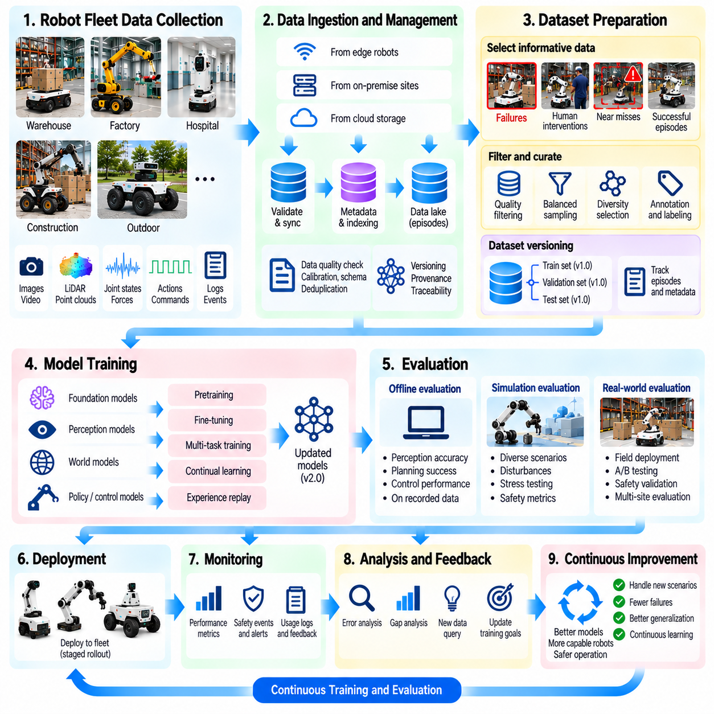{width="7.268055555555556in" height="7.268055555555556in"}

지속적 학습 및 평가(Continuous Training and Evaluation)는 물리 인공지능(Physical AI) 플릿이 축적된 운영 경험(Operational Experience)을 통해 개선될 수 있도록 하는 학습 인프라(Learning Infrastructure)를 구축한다. 로봇이 새로운 환경(Environment), 작업(Task), 실패 조건(Failure Condition)을 경험함에 따라 수집된 데이터는 인식(Perception), 계획(Planning), 제어(Control) 모델을 개선할 기회를 제공한다. 지속적 파이프라인(Continuous Pipeline)은 선택된 플릿 에피소드(Fleet Episode)를 업데이트된 모델(Updated Model)로 전환하면서 다양한 운영 조건(Operating Condition)에서도 개선 효과가 신뢰성 있게 유지되는지 검증한다.

고정된 데이터셋(Fixed Dataset)을 기반으로 하는 기존 모델 개발(Conventional Model Development)과 달리 지속적 학습(Continuous Training)은 반복적인 개발 주기(Development Cycle)를 통해 새롭게 수집된 경험(Newly Collected Experience)을 통합한다. 로봇 기록(Robot Recording), 개입 에피소드(Intervention Episode), 희귀 시나리오(Rare Scenario), 모델 오류 질의(Model-Error Query)는 후보 학습 사례(Candidate Training Example)를 제공한다. 이러한 사례는 학습이 시작되기 전에 검증(Validation), 주석 처리(Annotation), 필터링(Filtering), 데이터셋 구성(Dataset Construction)을 거친다. 목표는 모델을 끊임없이 수정하는 것이 아니라 측정 가능한 증거(Measurable Evidence)를 바탕으로 체계적으로 개선하는 것이다.

데이터 수집 및 유입(Data Ingestion)은 배포된 로봇 플릿(Deployed Robot Fleet)을 중앙 집중식 학습 인프라(Centralized Learning Infrastructure)와 연결한다. 기록된 에피소드(Recorded Episode)는 관련 메타데이터(Metadata) 및 출처 정보(Provenance)와 함께 엣지 장치(Edge Device), 온프레미스 게이트웨이(On-Premise Gateway), 클라우드 저장 시스템(Cloud Storage System)에서 전달된다. 데이터 유입 파이프라인(Ingestion Pipeline)은 기록 무결성(Recording Integrity), 타임스탬프 동기화(Timestamp Synchronization), 센서 보정(Sensor Calibration), 스키마 호환성(Schema Compatibility)을 검증한다. 유효하지 않거나 불완전한 에피소드는 격리(Quarantine)하여 손상된 관측값(Corrupted Observation)이 후속 모델 업데이트(Model Update)에 영향을 미치지 않도록 한다.

데이터셋 준비(Dataset Preparation)는 각 학습 주기(Training Cycle)에 어떤 경험이 포함될지 결정한다. 선택 메커니즘(Selection Mechanism)은 희귀 실패(Rare Failure), 인간 개입(Human Intervention), 불확실한 예측(Uncertain Prediction), 충분히 표현되지 않은 운영 조건(Underrepresented Operating Condition)에 우선순위를 부여할 수 있다. 성공적인 에피소드(Successful Episode) 역시 기존 역량(Established Capability)을 유지하고 비정상 이벤트(Abnormal Event)에 대한 학습 편향(Training Bias)을 방지하는 데 중요하다. 균형 잡힌 샘플링(Balanced Sampling)은 유용한 새로운 사례(Informative New Example)와 대표적인 과거 데이터(Representative Historical Data)를 결합하여 강건한 일반화(Robust Generalization)를 지원한다.

데이터셋 버전 관리(Dataset Versioning)는 모든 학습 실험(Training Experiment)의 재현성(Reproducibility)을 보장한다. 각 데이터셋 스냅샷(Dataset Snapshot)은 구성 에피소드(Constituent Episode), 주석(Annotation), 필터링 규칙(Filtering Rule), 전처리 구성(Preprocessing Configuration), 수집 기간(Collection Period)을 식별한다. 모델 체크포인트(Model Checkpoint)는 학습 과정에서 사용한 정확한 데이터셋 버전(Dataset Version)을 참조해야 한다. 이러한 추적 가능성(Traceability)은 엔지니어가 예상하지 못한 행동(Unexpected Behavior)을 조사하고 성능 변화(Performance Change)가 데이터(Data), 알고리즘(Algorithm), 구성 차이(Configuration Difference) 중 어디에서 비롯되었는지 판단할 수 있도록 한다.

지속적 학습(Continuous Training)은 기존 모델(Existing Model)의 미세조정(Fine-Tuning), 선택된 구성요소(Selected Component)의 주기적 재학습(Periodic Retraining), 확장된 데이터셋(Expanded Dataset)을 활용한 모델 재구축(Model Rebuilding)을 포함할 수 있다. 새로운 경험이 기존 작업(Existing Task)과 유사한 경우 미세조정은 연산 효율성(Computational Efficiency)을 제공하지만 분포 변화(Distribution Change)가 상당한 경우에는 보다 광범위한 재학습(Broader Retraining)이 필요할 수 있다. 학습 전략(Training Strategy)은 모델 아키텍처(Model Architecture), 가용 컴퓨팅 자원(Available Computing Resource), 배포 제약(Deployment Constraint), 기존 학습 역량(Previously Learned Capability)의 성능 저하 위험을 고려해야 한다.

파국적 망각(Catastrophic Forgetting)은 최근 경험(Recent Experience)을 사용하여 모델을 반복적으로 업데이트할 때 발생하는 주요 과제이다. 새롭게 접한 객체(Newly Encountered Object)를 중심으로 집중 학습한 조작 정책(Manipulation Policy)은 이전에 숙달한 작업(Previously Mastered Task)에 대한 수행 능력을 잃을 수 있다. 경험 재생(Experience Replay), 균형 잡힌 과거 데이터 샘플링(Balanced Historical Sampling), 정규화(Regularization), 선택적 매개변수 업데이트(Selective Parameter Update)는 이러한 위험을 줄일 수 있다. 평가(Evaluation)는 새롭게 획득한 역량(Newly Acquired Capability)과 기존 성능(Established Performance)의 유지 여부를 모두 측정해야 한다.

학습 오케스트레이션(Training Orchestration)은 데이터 준비(Data Preparation), 컴퓨팅 자원(Computational Resource), 실험 실행(Experiment Execution), 산출물 관리(Artifact Management)를 조정한다. 자동화된 파이프라인(Automated Pipeline)은 충분한 새로운 데이터가 확보되거나 특정 성능 임계값(Performance Threshold)에 도달하면 학습 작업(Training Job)을 예약할 수 있다. 자원 할당(Resource Allocation)은 모델 복잡도(Model Complexity), 데이터셋 크기(Dataset Size), 운영 우선순위(Operational Priority)를 반영해야 한다. 신뢰할 수 있는 오케스트레이션(Reliable Orchestration)을 위해서는 장애 복구(Failure Recovery), 체크포인트 관리(Checkpoint Management), 연산 비용 모니터링(Computational Cost Monitoring)도 필요하다.

평가(Evaluation)는 개선 효과에 대한 신뢰할 수 있는 증거(Trustworthy Evidence)를 제공하기 위해 학습 과정(Training Process)과 독립적으로 유지되어야 한다. 검증 데이터셋(Validation Dataset)은 모델 선택(Model Selection)과 하이퍼파라미터 튜닝(Hyperparameter Tuning)을 지원하며, 보호된 테스트 데이터셋(Protected Test Dataset)은 최종 성능(Final Performance)을 평가한다. 플릿 기반 평가 데이터셋(Fleet-Derived Evaluation Dataset)은 일반적인 작업(Common Task), 희귀 시나리오(Rare Scenario), 안전 필수 이벤트(Safety-Critical Event), 서로 다른 운영 환경(Operating Environment)을 대표해야 한다. 신중한 데이터 분리(Careful Data Separation)는 평가 사례(Evaluation Example)에 반복적으로 노출되어 오해를 유발하는 결과(Misleading Result)가 생성되는 것을 방지한다.

오프라인 평가(Offline Evaluation)는 물리적 배포(Physical Deployment) 이전에 업데이트된 모델(Updated Model)을 처음으로 평가하는 단계이다. 인식 모델(Perception Model)은 탐지 정확도(Detection Accuracy), 보정(Calibration), 강건성(Robustness)을 기준으로 시험할 수 있으며, 계획 및 제어 정책(Planning and Control Policy)은 기록된 궤적(Recorded Trajectory)이나 적절한 시뮬레이션 환경(Simulation Environment)을 사용하여 평가할 수 있다. 오프라인 지표(Offline Metric)는 모델 버전(Model Version) 간 효율적인 비교를 제공한다. 그러나 기록된 데이터(Recorded Data)는 실제로 실행되지 않은 행동(Unexecuted Action)의 결과를 완전히 반영할 수 없다.

시뮬레이션 기반 평가(Simulation-Based Evaluation)는 시험 범위를 상호작용 조건(Interactive Condition)과 통제된 외란(Controlled Disturbance)으로 확장한다. 디지털 환경(Digital Environment)은 객체 위치(Object Position), 마찰(Friction), 센서 잡음(Sensor Noise), 인간 행동(Human Behavior)을 변화시키면서 과거 실패(Historical Failure)를 재현할 수 있다. 반복 시험(Repeated Trial)은 성능 분포(Performance Distribution)와 환경 변화(Environmental Change)에 대한 민감도(Sensitivity)를 드러낸다. 가상 환경에서의 성공적인 행동(Successful Virtual Behavior)이 실제 물리적 성능(Physical Performance)을 보장하지는 않으므로 시뮬레이션 결과(Simulation Result)는 충실도 한계(Fidelity Limitation)를 함께 고려하여 해석해야 한다.

안전성 평가(Safety Evaluation)는 평균 작업 성공률(Average Task Success Rate)을 넘어서는 명시적인 기준(Explicit Criteria)을 요구한다. 충돌률(Collision Rate), 위험한 근접 상태(Unsafe Proximity), 과도한 힘(Excessive Force), 비상 정지(Emergency Stop), 제약 위반(Constraint Violation)은 생산성(Productivity)이 향상되더라도 허용할 수 없는 행동(Unacceptable Behavior)을 나타낼 수 있다. 중요 시나리오(Critical Scenario)는 보수적인 임계값(Conservative Threshold)과 적절한 안전 절차(Safety Procedure)를 사용하여 시험해야 한다. 후보 모델(Candidate Model)은 통제된 현장 배포(Controlled Field Deployment)의 대상으로 고려되기 전에 정의된 안전 요구사항(Defined Safety Requirement)을 충족해야 한다.

평가(Evaluation)는 로봇 플랫폼(Robot Platform), 운영 현장(Site), 환경 조건(Environmental Condition) 전반의 성능도 검토해야 한다. 업데이트된 모델(Updated Model)은 한 창고(Warehouse)에서 성능을 개선하더라도 조명(Lighting)이나 바닥 특성(Floor Characteristic)이 다른 창고에서는 낮은 성능을 보일 수 있다. 계층화된 성능 지표(Stratified Metric)는 이러한 차이가 플릿 전체 평균(Fleet-Wide Average)에 가려지지 않도록 드러낸다. 현장 간 시험(Cross-Site Testing)과 로봇 형태 간 시험(Cross-Embodiment Testing)은 개선 효과가 학습의 근거가 된 데이터 출처(Data Source)를 넘어 일반화되는지 판단하는 데 도움이 된다.

회귀 테스트(Regression Testing)는 후보 모델(Candidate Model)을 이전에 검증된 기준 모델(Validated Baseline)과 비교한다. 표준화된 테스트 모음(Standardized Test Suite)에는 기존 작업(Established Task), 과거 실패(Historical Failure), 경계 사례(Edge Case), 운영 안전 요구사항(Operational Safety Requirement)이 포함된다. 유의미한 성능 저하(Significant Degradation)가 발견되면 배포 전에 조사를 수행해야 한다. 자동화된 회귀 검증 게이트(Automated Regression Gate)는 중요 임계값(Critical Threshold)을 충족하지 못한 모델을 거부하여 특정 시나리오(Selected Scenario)의 개선이 기존 로봇 역량(Existing Robot Capability)을 은밀하게 손상시키지 않도록 한다.

모델 승격(Model Promotion)은 오프라인 평가(Offline Evaluation)와 시뮬레이션 평가(Simulation Evaluation)가 완료된 후 통제된 절차(Controlled Process)를 따른다. 후보 체크포인트(Candidate Checkpoint)는 데이터셋 계보(Dataset Lineage), 구성(Configuration), 평가 결과(Evaluation Result), 호환성 요구사항(Compatibility Requirement)과 함께 등록된다. 배포 승인(Deployment Approval)에는 엔지니어링 검토(Engineering Review)와 안전 검증(Safety Validation)이 필요할 수 있다. 버전 관리형 모델 레지스트리(Versioned Model Registry)는 재현성(Reproducibility), 롤백(Rollback), 운영 모델(Production Model)과 실험 모델(Experimental Model) 간 비교를 지원한다.

현장 평가(Field Evaluation)는 실제 로봇 운영(Actual Robot Operation)에서 추가적인 증거(Additional Evidence)를 확보한다. 섀도 테스트(Shadow Testing)는 후보 모델(Candidate Model)에 제어 권한(Control Authority)을 부여하지 않고 실행하여 예측 결과(Prediction Result)를 운영 모델의 행동(Production Behavior)과 비교할 수 있도록 한다. 카나리 배포(Canary Deployment)는 승인된 업데이트(Approved Update)를 제한된 로봇 집단(Limited Robot Population)에 적용하고 모니터링(Monitoring)을 수행한다. 점진적 확대(Gradual Expansion)는 예상하지 못한 회귀(Unexpected Regression)의 영향을 줄이면서 실제 환경 성능(Real-World Performance)에 관한 운영 증거(Operational Evidence)를 수집한다.

지속적인 모니터링(Continuous Monitoring)은 배포(Deployment)와 후속 학습 주기(Subsequent Training Cycle) 사이의 연결을 완성한다. 작업 성공률(Task Success Rate), 개입 빈도(Intervention Frequency), 불확실성(Uncertainty), 안전 이벤트(Safety Event), 지연 시간(Latency), 자원 소비(Resource Consumption)는 모델 버전(Model Version)과 운영 맥락(Operating Context)에 따라 추적할 수 있다. 성능 드리프트(Performance Drift)나 반복적인 실패(Recurring Failure)는 새로운 데이터 질의(Data Query)와 수집 우선순위(Collection Priority)를 생성한다. 이러한 신호는 추가 학습(Additional Training)이 필요한지, 어떤 취약점(Weakness)에 주의를 집중해야 하는지 판단하는 데 도움이 된다.

운영 지표(Operational Metric)는 변화하는 노출 조건(Exposure Condition)을 고려해야 한다. 실패 감소(Failure Reduction)는 실제로 모델이 개선되었기 때문이 아니라 작업이 쉬워졌기 때문일 수 있으며, 개입 증가(Increased Intervention)는 더욱 엄격해진 안전 정책(Stricter Safety Policy)의 결과일 수 있다. 비교(Comparison)에서는 운영 시간(Operating Hour), 작업 분포(Task Distribution), 로봇 구성(Robot Configuration), 환경 차이(Environmental Difference)를 고려해야 한다. 관측된 변화(Observed Change)를 모델 업데이트(Model Update)의 효과로 판단하기 전에 통계적 불확실성(Statistical Uncertainty)과 충분한 표본 크기(Sufficient Sample Size)를 확보해야 한다.

거버넌스(Governance)와 재현성(Reproducibility)은 지속 학습(Continuous Learning)의 전 과정에서 필수적이다. 학습 기록(Training Record)은 데이터셋 버전(Dataset Version), 모델 산출물(Model Artifact), 평가 프로토콜(Evaluation Protocol), 승인 결정(Approval Decision), 배포 이력(Deployment History)을 보존해야 한다. 접근 제어(Access Control)는 민감한 운영 데이터(Sensitive Operational Data)를 보호하며, 감사 추적(Audit Trail)은 조사(Investigation)와 책임성(Accountability)을 지원한다. 자동화된 시스템(Automated System)은 개발을 가속할 수 있지만 중요한 배포 결정(Consequential Deployment Decision)은 적절한 검증(Verification)과 감독(Oversight)을 받아야 한다.

궁극적으로 지속적 학습 및 평가(Continuous Training and Evaluation)는 플릿 데이터(Fleet Data)를 체계적인 모델 개선 주기(Disciplined Model Improvement Cycle)로 전환한다. 새로운 경험(New Experience)은 재현 가능한 데이터셋(Reproducible Dataset)으로 정제되고, 학습(Training)은 후보 역량(Candidate Capability)을 생성하며, 다계층 평가(Layered Evaluation)는 업데이트가 안전하고 유익한지 판단한다. 통제된 배포(Controlled Deployment)와 현장 모니터링(Field Monitoring)은 증거를 데이터 엔진(Data Engine)으로 다시 전달하여 물리 인공지능 플릿(Physical AI Fleet)이 신뢰성(Reliability), 추적 가능성(Traceability), 운영 안전성(Operational Safety)을 희생하지 않으면서 발전할 수 있도록 한다.

## 09.13. Shadow Canary and Field Model Monitoring

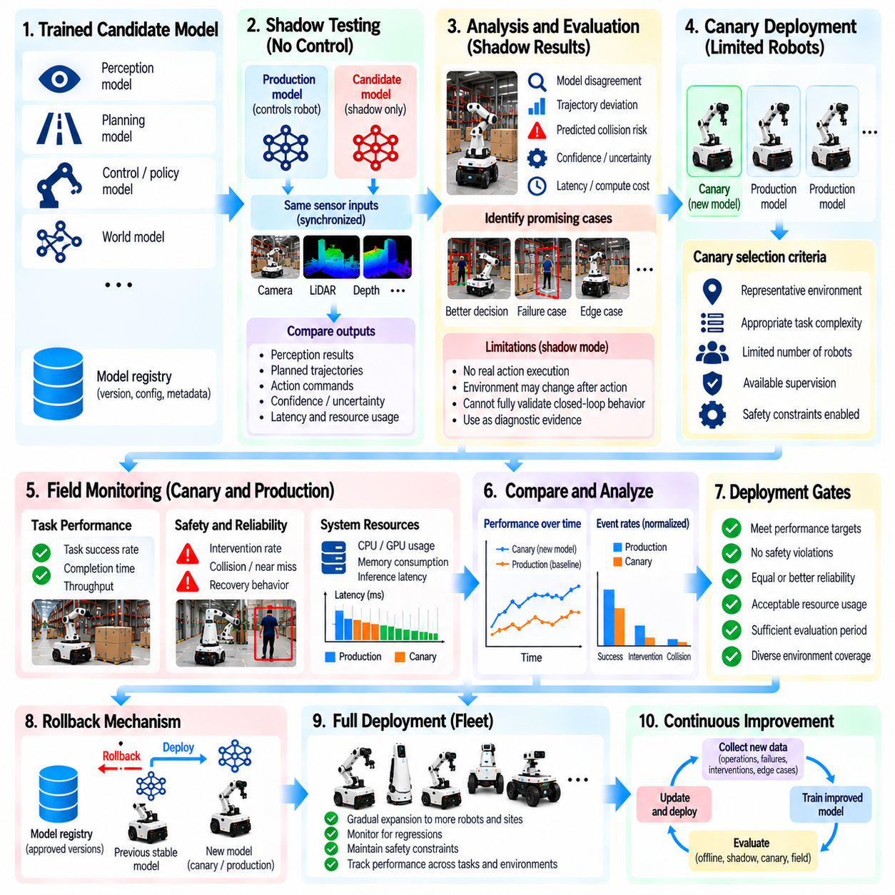{width="7.268055555555556in" height="7.268055555555556in"}

섀도 테스트(Shadow Testing), 카나리 배포(Canary Deployment), 현장 모델 모니터링(Field Model Monitoring)은 업데이트된 모델(Updated Model)을 물리 인공지능 플릿(Physical AI Fleet)에 도입하기 위한 통제된 프레임워크(Controlled Framework)를 구축한다. 이러한 메커니즘은 배포 위험(Deployment Risk)을 제한하면서 오프라인 평가(Offline Evaluation)를 실제 운영 증거(Real-World Operational Evidence)와 연결한다. 엔지니어는 운영 모델(Production Model)을 전체 플릿에서 즉시 교체하는 대신 후보 모델의 행동(Candidate Behavior)을 관찰하고 실제 조건에서 성능을 검증하며 측정 가능한 안전성 및 신뢰성 기준(Safety and Reliability Criteria)에 따라 배포 범위를 점진적으로 확대한다.

섀도 테스트(Shadow Testing)는 후보 모델(Candidate Model)에 로봇 행동(Robot Action)에 대한 제어 권한(Control Authority)을 부여하지 않고 활성 운영 모델(Active Production Model)과 병렬로 평가한다. 두 모델은 동일한 센서 관측값(Sensor Observation)과 운영 맥락(Operating Context)을 입력받을 수 있지만 실제 물리 시스템(Physical System)은 운영 모델만 제어한다. 후보 모델의 예측(Candidate Prediction), 제안 궤적(Proposed Trajectory), 신뢰도 추정값(Confidence Estimate)은 비교를 위해 기록된다. 이러한 구성은 검증되지 않은 제어 결정(Unvalidated Control Decision)에 로봇을 직접 노출하지 않으면서 행동 차이(Behavioral Difference)를 파악할 수 있도록 한다.

섀도 실행 환경(Shadow Execution Environment)은 후보 모델(Candidate Model)이 의도한 입력 조건(Intended Input Condition)을 가능한 한 정확하게 재현해야 한다. 센서 타임스탬프(Sensor Timestamp), 좌표계(Coordinate Frame), 전처리 파이프라인(Preprocessing Pipeline), 로봇 구성 매개변수(Robot Configuration Parameter)는 일관되게 처리되어야 한다. 입력 처리(Input Processing)의 차이는 실제 지능 개선(Intelligence Improvement)과 관계없는 겉보기 모델 불일치(Apparent Model Disagreement)를 발생시킬 수 있다. 따라서 엔지니어는 섀도 평가 결과(Shadow Evaluation Result)를 해석하기 전에 데이터 정렬(Data Alignment)과 실행 일관성(Execution Consistency)을 검증해야 한다.

섀도 모니터링(Shadow Monitoring)은 후보 모델 출력(Candidate Output)을 운영 모델의 결정(Production Decision) 및 이용 가능한 정답 증거(Ground-Truth Evidence)와 비교한다. 관련 지표에는 인식 불일치(Perception Disagreement), 궤적 편차(Trajectory Deviation), 예측 충돌 위험(Predicted Collision Risk), 행동 신뢰도(Action Confidence), 연산 지연 시간(Computational Latency)이 포함된다. 큰 불일치(Large Disagreement)는 추가 조사가 필요한 상황을 식별하지만 불일치 자체만으로 어느 모델이 올바른지 판단할 수는 없다. 인간 검토(Human Review), 후속 관측(Subsequent Observation), 작업별 평가 기준(Task-Specific Evaluation Criteria)은 후보 모델의 행동이 실제 개선을 나타내는지 판단하는 데 도움이 된다.

섀도 테스트(Shadow Testing)는 후보 행동(Candidate Action)이 물리 환경(Physical Environment)에 영향을 미치지 않는다는 중요한 한계를 가진다. 제안된 조작 궤적(Proposed Manipulation Trajectory)은 기록된 관측값(Recorded Observation)에서는 성공할 것으로 보이더라도 실제 실행 중 접촉 동역학(Contact Dynamics)이 변화하면 실패할 수 있다. 마찬가지로 내비게이션 결정(Navigation Decision)은 이후 센서 관측값(Future Sensor Observation)과 이용 가능한 경로(Available Path)를 변화시킬 수 있다. 따라서 섀도 테스트 결과(Shadow Result)는 폐쇄 루프 제어 성능(Closed-Loop Control Performance)에 대한 완전한 증명이 아니라 진단 증거(Diagnostic Evidence)로 해석해야 한다.

카나리 배포(Canary Deployment)는 검증된 후보 모델(Validated Candidate Model)을 통제된 운영 조건(Controlled Operational Condition)에서 제한된 로봇 집단(Limited Robot Subset)에 도입한다. 선택된 로봇은 업데이트된 모델(Updated Model)을 실행하고 나머지 플릿은 기존 운영 버전(Established Production Version)을 계속 사용한다. 초기 배포 집단(Initial Deployment Population)은 예상하지 못한 실패(Unexpected Failure)의 영향을 제한할 만큼 작으면서도 의미 있는 증거(Meaningful Evidence)를 확보할 만큼 대표성을 갖추어야 한다. 배포 확대(Deployment Expansion)는 사전에 정의된 승인 기준(Predefined Acceptance Criteria)을 충족한 이후에만 진행된다.

카나리 대상 선정(Canary Selection)은 로봇 하드웨어(Robot Hardware), 운영 환경(Operating Environment), 작업 복잡도(Task Complexity), 가용 감독 체계(Available Supervision)를 고려해야 한다. 비정상적으로 단순한 현장(Simple Site)에만 배포하면 전체 플릿 성능(Broader Fleet Performance)에 대한 잘못된 확신(Misleading Confidence)을 형성할 수 있다. 반대로 실험 모델(Experimental Model)을 매우 위험한 작업(Highly Hazardous Operation)에 도입하면 허용할 수 없는 위험(Unacceptable Risk)이 발생할 수 있다. 균형 잡힌 선정 전략(Balanced Selection Strategy)은 대표적인 운영 조건(Representative Condition)을 운영 안전장치(Operational Safeguard) 및 명확하게 정의된 배포 경계(Deployment Boundary)와 결합한다.

안전 메커니즘(Safety Mechanism)은 카나리 운영(Canary Operation) 중에도 후보 모델(Candidate Model)과 독립적으로 유지되어야 한다. 비상 정지(Emergency Stopping), 충돌 방지(Collision Prevention), 속도 제한(Speed Limit), 힘 제약(Force Constraint), 감독 제어(Supervisory Control)는 모델 예측(Model Prediction)의 신뢰성이 저하되더라도 계속 작동해야 한다. 후보 모델은 인증된 안전 기능(Certified Safety Function)을 우회하거나 적절한 승인(Appropriate Authorization) 없이 안전 필수 매개변수(Safety-Critical Parameter)를 수정해서는 안 된다. 이러한 안전장치는 통제된 현장 평가(Controlled Field Evaluation)가 수행될 수 있는 경계(Boundary)를 설정한다.

카나리 모니터링(Canary Monitoring)은 예측 결과(Predicted Outcome)에만 의존하지 않고 실제 작업 실행(Actual Task Execution)을 측정한다. 작업 성공률(Task Success Rate), 개입 빈도(Intervention Frequency), 충돌 관련 이벤트(Collision-Related Event), 궤적 추종(Trajectory Tracking), 복구 행동(Recovery Behavior), 실행 시간(Execution Time)은 운영 지표(Operational Indicator)를 제공한다. 메모리 소비(Memory Consumption), 프로세서 활용률(Processor Utilization), 전력 요구량(Power Demand), 추론 지연 시간(Inference Latency)과 같은 자원 지표(Resource Metric)도 중요하다. 의사결정 정확도(Decision Accuracy)가 향상되더라도 하드웨어 한계(Hardware Limit)를 초과하는 모델은 배포에 적합하지 않을 수 있다.

신뢰할 수 있는 카나리 평가(Reliable Canary Evaluation)를 위해서는 의미 있는 기준 모델(Meaningful Baseline)과의 비교가 필요하다. 성능(Performance)은 운영 시간(Operating Hour), 작업 노출(Task Exposure), 환경 조건(Environmental Condition), 로봇 구성(Robot Configuration)을 고려하여 정규화(Normalization)해야 한다. 그렇지 않으면 배포 집단(Deployment Group) 간 차이를 모델 개선(Model Improvement)이나 성능 회귀(Regression)로 잘못 해석할 수 있다. 대응 비교(Matched Comparison), 계층화된 보고(Stratified Reporting), 충분한 관측 기간(Sufficient Observation Period)은 실제 모델 효과(Genuine Model Effect)와 운영 변동성(Operational Variability)을 구분하는 데 도움이 된다.

배포 게이트(Deployment Gate)는 평가 단계(Evaluation Stage) 사이의 진행에 필요한 조건을 정의한다. 후보 모델(Candidate Model)은 오프라인 테스트(Offline Testing)에서 섀도 실행(Shadow Execution), 제한적 카나리 운영(Limited Canary Operation), 점진적으로 확대되는 플릿 배포(Fleet Deployment)로 진행할 수 있다. 각 전환(Transition)에는 관련 성능 및 안전 임계값(Performance and Safety Threshold)을 충족했다는 증거가 필요하다. 평균 생산성(Average Productivity)이나 작업 완료율(Task Completion Rate)이 향상되더라도 중대한 안전 위반(Critical Safety Violation)이 발생하면 다음 단계로의 진행을 차단해야 한다.

롤백 메커니즘(Rollback Mechanism)은 배포된 모델(Deployed Model)이 허용할 수 없는 행동(Unacceptable Behavior)을 보일 때 통제된 대응(Controlled Response)을 제공한다. 모델 레지스트리(Model Registry)는 이전에 검증된 체크포인트(Previously Validated Checkpoint), 호환성 정보(Compatibility Information), 배포 구성(Deployment Configuration)을 보존한다. 플릿 관리 시스템(Fleet Management System)은 전체 소프트웨어를 다시 구축하지 않고도 승인된 버전(Approved Version)을 신속하게 복원할 수 있어야 한다. 실제 사고(Active Incident) 중에는 복구 신뢰성(Recovery Reliability)을 보장할 수 없으므로 롤백 절차(Rollback Procedure)를 사전에 시험해야 한다.

현장 모델 모니터링(Field Model Monitoring)은 후보 모델(Candidate Model)이 주요 운영 모델(Primary Production Model)이 된 이후에도 계속된다. 실제 환경(Real Environment)은 조명 변화(Lighting Variation), 객체 교체(Object Replacement), 바닥 마모(Floor Wear), 센서 성능 저하(Sensor Degradation), 변화하는 작업 요구사항(Evolving Task Requirement)에 따라 달라진다. 모니터링 시스템(Monitoring System)은 이러한 조건에서 모델 행동(Model Behavior)을 추적하여 새롭게 나타나는 취약점(Emerging Weakness)을 식별한다. 성공적인 초기 배포(Initial Deployment)가 모델의 전체 운영 수명(Operational Lifetime) 동안 신뢰할 수 있는 성능을 보장하지는 않으므로 지속적인 관측(Continuous Observation)이 필요하다.

모니터링 아키텍처(Monitoring Architecture)는 온보드 진단(Onboard Diagnostics)과 중앙 집중식 플릿 분석(Centralized Fleet Analysis)을 결합한다. 엣지 시스템(Edge System)은 경량 지표(Lightweight Indicator)를 수집하고 비정상 행동(Abnormal Behavior)을 탐지하며 중요한 이벤트(Significant Event) 전후의 맥락 기록(Contextual Record)을 보존한다. 중앙 집중식 서비스(Centralized Service)는 로봇(Robot), 소프트웨어 버전(Software Version), 작업(Task), 운영 현장(Operating Site)에 걸쳐 지표를 집계한다. 이러한 역할 분담(Division of Responsibilities)은 통신 요구량(Communication Requirement)을 줄이면서 개별 로봇이 관측할 수 없는 플릿 전체 추세(Fleet-Wide Trend)를 엔지니어가 식별할 수 있도록 한다.

성능 모니터링(Performance Monitoring)은 모델 실패(Model Failure)를 하드웨어(Hardware), 보정(Calibration), 인프라(Infrastructure) 문제와 구분해야 한다. 위치 추정 오류(Localization Error)의 증가는 인식 모델(Perception Model)의 결함이 아니라 센서 정렬 불량(Sensor Misalignment)에서 비롯될 수 있다. 행동 지연(Delayed Action)은 프로세서 과부하(Processor Overload), 네트워크 혼잡(Network Congestion), 액추에이터 한계(Actuator Limitation) 때문에 발생할 수 있다. 모델 예측(Model Prediction)과 시스템 상태 지표(System Health Indicator)의 상관관계를 분석하면 불필요한 재학습(Unnecessary Retraining)을 방지하고 정확한 근본 원인 분석(Root-Cause Analysis)을 지원할 수 있다.

통계적 모니터링(Statistical Monitoring)은 미세한 성능 저하(Subtle Degradation)가 운영상 심각한 문제로 발전하기 전에 탐지하는 데 도움이 된다. 이동 평균(Moving Average), 관리 한계(Control Limit), 변화점 탐지(Change-Point Detection), 분포 비교(Distribution Comparison)는 작업 성공률(Task Success Rate)이나 개입률(Intervention Rate)의 변화를 드러낼 수 있다. 경보 임계값(Alert Threshold)은 정상적인 운영 변동성(Normal Operating Variability)과 배포 현장(Deployment Site) 간 차이를 고려해야 한다. 지나치게 민감한 경보(Excessively Sensitive Alert)는 불필요한 조사를 유발하고, 둔감한 임계값(Insensitive Threshold)은 의미 있는 문제(Meaningful Problem)의 발견을 지연시킨다.

현장 관측값(Field Observation)은 모델 버전(Model Version) 및 배포 이력(Deployment History)과 연결되어야 한다. 중요한 에피소드(Significant Episode)는 활성 체크포인트(Active Checkpoint), 로봇 구성(Robot Configuration), 센서 상태(Sensor Status), 운영 맥락(Operating Context), 관련 의사결정(Relevant Decision)을 보존해야 한다. 이러한 정보는 엔지니어가 사고(Incident)를 재현하고 소프트웨어 릴리스(Software Release) 간 행동을 비교할 수 있도록 한다. 일관된 출처 정보(Consistent Provenance)는 감사 가능성(Auditability), 규제 검토(Regulatory Review), 예상하지 못한 플릿 행동(Unexpected Fleet Behavior)에 대한 조사도 지원한다.

섀도 및 카나리 관측(Shadow and Canary Observation)은 후속 학습 주기(Subsequent Training Cycle)를 위한 목표 지향적 데이터 수집 요청(Targeted Data Collection Request)을 생성할 수 있다. 예측 불일치(Prediction Disagreement), 반복적인 개입(Recurring Intervention), 새롭게 발견된 실패 조건(Newly Discovered Failure Condition)은 잠재적인 학습 가치(Potential Learning Value)가 있는 경험을 식별한다. 관련 에피소드(Relevant Episode)는 검색(Retrieval), 주석 처리(Annotation)를 거쳐 업데이트된 데이터셋(Updated Dataset)에 포함될 수 있다. 이러한 연결은 배포 모니터링(Deployment Monitoring)을 수동적인 보고(Passive Reporting)에서 플릿 데이터 엔진(Fleet Data Engine)의 능동적인 구성요소(Active Component)로 전환한다.

모니터링 효과(Monitoring Effectiveness)는 탐지 지연 시간(Detection Delay), 오경보 빈도(False Alert Frequency), 사고 심각도(Incident Severity), 롤백 시간(Rollback Time), 후속 모델 개선(Downstream Model Improvement)을 통해 평가해야 한다. 배포 프로세스(Deployment Process)는 광범위한 릴리스(Broad Release) 이전에 탐지된 성능 회귀(Regression)의 비율도 측정해야 한다. 이러한 지표(Metric)는 단계적 평가(Staged Evaluation)가 실제로 운영 위험(Operational Risk)을 줄이는지 보여준다. 플릿 규모(Fleet Size), 작업 다양성(Task Diversity), 모델 복잡도(Model Complexity)가 증가함에 따라 모니터링 정책(Monitoring Policy)을 지속적으로 개선해야 한다.

궁극적으로 섀도 테스트(Shadow Testing), 카나리 배포(Canary Deployment), 현장 모델 모니터링(Field Model Monitoring)은 지속적으로 발전하는 물리 인공지능 시스템(Physical AI System)을 위한 다계층 보증 프로세스(Layered Assurance Process)를 형성한다. 섀도 실행(Shadow Execution)은 행동 차이(Behavioral Difference)를 식별하고, 카나리 운영(Canary Operation)은 통제된 물리적 성능(Controlled Physical Performance)을 검증하며, 장기 모니터링(Long-Term Monitoring)은 새롭게 나타나는 취약점(Emerging Weakness)을 탐지한다. 독립적인 안전 제어(Independent Safety Control), 재현 가능한 모델 관리(Reproducible Model Management), 피드백 기반 학습(Feedback-Driven Learning)과 결합된 이러한 메커니즘은 신뢰할 수 있는 플릿 규모 모델 발전(Reliable Fleet-Scale Model Evolution)을 지원한다.

## 09.14. Data Behavior and Environment Drift

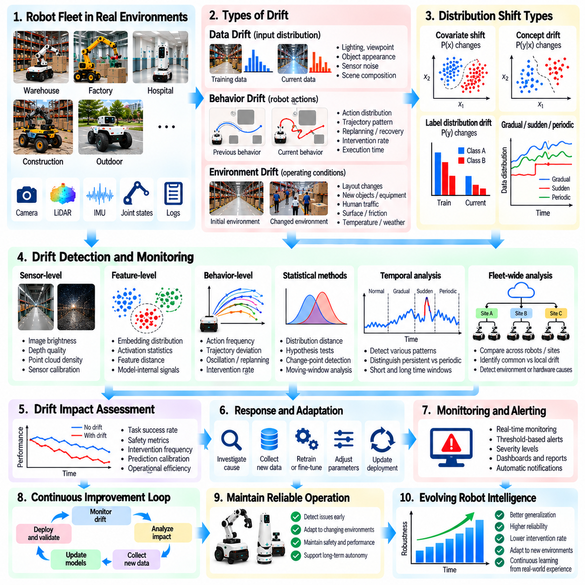{width="7.268055555555556in" height="7.268055555555556in"}

데이터, 행동 및 환경 드리프트(Data, Behavior, and Environment Drift)는 물리 인공지능(Physical AI) 모델의 학습 경험(Training Experience)과 실제 운영 조건(Operating Condition) 사이의 관계를 점진적으로 약화시키는 변화를 의미한다. 로봇 플릿(Robot Fleet)이 다양한 현장(Site), 작업(Task), 하드웨어 구성(Hardware Configuration)으로 확장됨에 따라 기존에 신뢰할 수 있었던 모델도 익숙하지 않은 데이터 분포(Unfamiliar Distribution)를 경험할 수 있다. 이러한 변화를 탐지하는 것은 지속적인 배포(Continuous Deployment) 과정에서 인식 정확도(Perception Accuracy), 의사결정 품질(Decision Quality), 제어 안정성(Control Stability)을 유지하는 데 필수적이다.

데이터 드리프트(Data Drift)는 새롭게 입력되는 관측값(Incoming Observation)의 통계적 특성(Statistical Property)이 학습 데이터셋(Training Dataset)에 포함된 특성과 달라질 때 발생한다. 조명(Lighting), 카메라 시점(Camera Viewpoint), 객체 외관(Object Appearance), 센서 잡음(Sensor Noise), 장면 구성(Scene Composition)의 변화는 입력 분포(Input Distribution)를 변경할 수 있다. 통제된 창고 환경(Controlled Warehouse Environment)에서 학습한 인식 모델(Perception Model)은 실외 시설(Outdoor Facility)에서 예상하지 못한 시각적 패턴(Visual Pattern)을 경험할 수 있다. 이러한 차이는 기본 작업(Underlying Task)이 변하지 않더라도 모델 신뢰성(Model Reliability)을 저하시킬 수 있다.

행동 드리프트(Behavior Drift)는 시간이 지남에 따라 로봇의 행동(Action), 반응(Response), 주변 환경과의 상호작용(Interaction)이 변화하는 현상을 의미한다. 업데이트된 정책(Updated Policy), 액추에이터 마모(Actuator Wear), 변경된 적재 하중(Altered Payload), 운영 절차 변화(Changing Operational Procedure)는 서로 다른 행동 분포(Action Distribution)를 발생시킬 수 있다. 이동 로봇(Mobile Robot)은 내비게이션 성공률(Navigation Success Rate)을 허용 가능한 수준으로 유지하면서도 조향 보정 동작(Corrective Steering Movement)이 점진적으로 증가할 수 있다. 행동 분포 모니터링(Behavior Distribution Monitoring)은 이러한 문제가 명확한 작업 실패(Task Failure)로 나타나기 전에 초기 이상 징후(Emerging Problem)를 발견할 수 있도록 한다.

환경 드리프트(Environment Drift)는 배포된 로봇(Deployed Robot)을 둘러싼 물리적 및 운영 조건(Physical and Operational Condition)의 변화를 의미한다. 창고(Warehouse)에는 새로운 선반 배치(Shelving Layout)가 도입될 수 있고, 공장(Factory)은 생산 장비(Production Equipment)를 교체할 수 있으며, 건설 현장(Construction Site)은 매일 변화할 수 있다. 온도(Temperature), 표면 마찰(Surface Friction), 보행자 통행량(Pedestrian Traffic), 장애물 밀도(Obstacle Density)도 변화할 수 있다. 이러한 변동(Variation)은 센서 관측값(Sensor Observation)뿐 아니라 로봇 행동(Robot Action)의 물리적 결과(Physical Consequence)에도 영향을 미친다.

물리 인공지능(Physical AI)에서는 여러 형태의 분포 변화(Distribution Shift)가 중요하다. 공변량 이동(Covariate Shift)은 관측되는 입력(Input)의 발생 빈도를 변화시키며, 개념 드리프트(Concept Drift)는 관측값(Observation)과 원하는 예측(Desired Prediction) 또는 행동(Action) 사이의 관계를 변화시킨다. 작업 집단(Task Population)이 변화함에 따라 레이블 분포 변화(Label Distribution Change)도 발생할 수 있다. 이러한 메커니즘을 구분하면 문제 해결에 추가 데이터(Additional Data), 수정된 레이블(Revised Label), 모델 적응(Model Adaptation), 운영 변경(Operational Change) 중 무엇이 필요한지 판단할 수 있다.

드리프트 탐지(Drift Detection)는 신뢰할 수 있는 기준 분포(Reference Distribution)를 설정하는 것에서 시작한다. 학습 데이터셋(Training Dataset), 검증된 배포 기간(Validated Deployment Period), 대표적인 운영 환경(Representative Operating Environment)은 기준 통계(Baseline Statistics)를 제공한다. 기준 데이터(Reference Data)는 현장(Site), 로봇 구성(Robot Configuration), 작업 범주(Task Category)에 걸친 정상적인 변동(Normal Variation)을 포함해야 한다. 지나치게 좁은 기준선(Narrow Baseline)은 과도한 경보(Excessive Alert)를 발생시킬 수 있으며, 지나치게 넓은 기준선(Broad Baseline)은 특정 운영 조건(Specific Operating Condition)에서 발생하는 의미 있는 성능 저하(Meaningful Degradation)를 숨길 수 있다.

센서 수준 모니터링(Sensor-Level Monitoring)은 이미지 밝기(Image Brightness), 깊이 품질(Depth Quality), 포인트 클라우드 밀도(Point-Cloud Density), 관성 측정값(Inertial Measurement), 기타 관측 특성(Observation Characteristic)의 변화를 식별한다. 통계적 요약(Statistical Summary)과 품질 지표(Quality Indicator)는 보정 변화(Calibration Shift), 오염(Contamination), 환경 변화(Environmental Change)를 드러낼 수 있다. 그러나 원시 센서 데이터의 차이(Raw Sensor Difference)가 항상 모델 실패(Model Failure)를 의미하는 것은 아니다. 엔지니어는 무해한 변동(Harmless Variation)과 작업 관련 정보(Task-Relevant Information)에 영향을 미치는 변화를 구분해야 한다.

특징 수준 모니터링(Feature-Level Monitoring)은 원시 측정값(Raw Measurement)에만 의존하지 않고 모델 내부 표현(Internal Model Representation)을 분석한다. 임베딩 분포(Embedding Distribution), 활성화 통계(Activation Statistics), 학습된 장면 특징(Learned Scene Feature)은 익숙하지 않은 운영 조건(Unfamiliar Operating Condition)을 드러낼 수 있다. 현재 특징 분포(Current Feature Distribution)와 기준 특징 분포(Reference Feature Distribution) 사이의 거리(Distance)는 조기 경고(Early Warning)를 제공할 수 있다. 특징 기반 지표(Feature-Based Indicator)는 모델 아키텍처(Model Architecture)에 의존하므로 실제 운영 결과(Actual Operational Outcome)를 기준으로 검증해야 한다.

행동 모니터링(Behavioral Monitoring)은 행동 빈도(Action Frequency), 궤적 특성(Trajectory Characteristic), 개입률(Intervention Rate), 제어기 반응(Controller Response)을 평가한다. 진동 증가(Increased Oscillation), 반복적인 재계획(Repeated Replanning), 작업 완료 시간 증가(Longer Completion Time), 비정상적인 복구 기동(Unusual Recovery Maneuver)은 행동 드리프트(Behavioral Drift)를 나타낼 수 있다. 이러한 패턴(Pattern)은 변화하는 환경(Changing Environment)이나 내부 시스템 성능 저하(Internal System Degradation)에서 발생할 수 있다. 행동 변화(Behavior Change)를 인식 진단(Perception Diagnostics) 및 하드웨어 진단(Hardware Diagnostics)과 연관시키면 가능한 원인(Plausible Cause)을 식별하는 데 도움이 된다.

드리프트 탐지 방법(Drift Detection Method)에는 분포 거리 측정(Distribution Distance Measure), 통계적 가설 검정(Statistical Hypothesis Test), 이동 구간 비교(Moving-Window Comparison), 변화점 탐지(Change-Point Detection)가 포함된다. 모집단 안정성 지수(Population Stability Index), 바서슈타인 거리(Wasserstein Distance), 최대 평균 불일치(Maximum Mean Discrepancy)는 선택된 분포 차이(Distribution Difference)를 정량화할 수 있다. 순차적 모니터링(Sequential Monitoring)은 점진적 변화(Gradual Change)와 급격한 변화(Abrupt Change)를 식별할 수 있다. 단일 지표(Single Metric)가 모든 형태의 드리프트를 신뢰성 있게 포착할 수는 없으므로 운영 관련성(Operational Relevance)에 따라 지표를 선택해야 한다.

시간적 분석(Temporal Analysis)은 드리프트(Drift)가 점진적, 갑작스럽게 또는 주기적으로 발생할 수 있기 때문에 중요하다. 계절적 조명 변화(Seasonal Lighting Change)는 반복적인 패턴(Recurring Pattern)을 형성할 수 있으며, 센서 교체(Sensor Replacement)는 급격한 분포 변화(Abrupt Distribution Shift)를 발생시킬 수 있다. 점진적인 액추에이터 마모(Progressive Actuator Wear)는 짧은 관측 구간(Short Observation Window)에서는 발견하기 어려운 느린 행동 변화(Slow Behavioral Change)를 만들어낼 수 있다. 모니터링 시스템(Monitoring System)은 지속적인 성능 저하(Persistent Degradation)를 예상 가능한 일별 또는 계절별 변동(Expected Daily or Seasonal Variability)과 구분해야 한다.

플릿 전체 드리프트 분석(Fleet-Wide Drift Analysis)은 로봇(Robot), 위치(Location), 모델 버전(Model Version)에 걸친 패턴을 비교한다. 한 현장의 모든 로봇에 영향을 미치는 변화는 환경 수정(Environmental Modification)을 의미할 수 있으며, 여러 현장에서 유사한 실패(Similar Failure)가 발생하면 공통 모델 한계(Shared Model Limitation)를 나타낼 수 있다. 단일 로봇에만 제한된 드리프트(Drift)는 하드웨어 성능 저하(Hardware Deterioration)나 보정 문제(Calibration Problem)를 의미할 수 있다. 계층적 분석(Hierarchical Analysis)은 시정 조치(Corrective Action)의 우선순위를 결정하고 불필요한 플릿 전체 재학습(Fleet-Wide Retraining)을 방지하는 데 도움이 된다.

드리프트 심각도(Drift Severity)는 통계적 거리(Statistical Distance) 자체보다 운영상 결과(Operational Consequence)를 기준으로 평가해야 한다. 배경 외관(Background Appearance)의 상당한 변화는 내비게이션(Navigation)에 거의 영향을 미치지 않을 수 있지만, 장애물 인식(Obstacle Perception)의 작은 변화는 충돌 위험(Collision Risk)을 증가시킬 수 있다. 작업 성공률(Task Success Rate), 안전 여유(Safety Margin), 개입 빈도(Intervention Frequency), 예측 보정(Prediction Calibration)은 실질적인 맥락(Practical Context)을 제공한다. 드리프트 경보(Drift Alert)는 로봇 성능(Robot Performance)의 측정 가능한 변화(Measurable Change)와 연결될 때 더욱 유용해진다.

불확실성 추정(Uncertainty Estimation)은 익숙한 운영 영역(Familiar Operating Region)을 벗어난 관측값(Observation)을 식별함으로써 분포 모니터링(Distribution Monitoring)을 보완할 수 있다. 예측 엔트로피(Prediction Entropy), 모델 간 불일치(Model Disagreement), 상태 추정 공분산(State-Estimation Covariance)의 증가는 신뢰도 감소(Reduced Confidence)를 나타낼 수 있다. 그러나 일부 모델은 익숙하지 않은 조건(Unfamiliar Condition)에서도 과도한 확신(Overconfidence)을 유지한다. 보정된 불확실성(Calibrated Uncertainty)을 분포 지표(Distribution Indicator) 및 관측된 실패(Observed Failure)와 결합하면 단일 신호(Single Signal)에 의존하는 것보다 강력한 증거를 확보할 수 있다.

드리프트 모니터링(Drift Monitoring)은 모니터링 시스템(Monitoring System) 자체에서 도입된 변화도 고려해야 한다. 업데이트된 센서 전처리(Updated Sensor Preprocessing), 변경된 로깅 빈도(Altered Logging Frequency), 주석 수정(Annotation Revision), 새로운 모델 아키텍처(New Model Architecture)는 데이터셋(Dataset) 사이에 인위적인 차이(Artificial Difference)를 발생시킬 수 있다. 버전 관리형 메타데이터(Versioned Metadata)와 일관된 측정 정의(Consistent Measurement Definition)는 잘못된 결론(False Conclusion)을 방지하는 데 도움이 된다. 엔지니어는 관측된 변화(Observed Change)를 물리 환경(Physical Environment)이나 로봇 행동(Robot Behavior)의 변화로 판단하기 전에 파이프라인 호환성(Pipeline Compatibility)을 검증해야 한다.

중요한 드리프트(Significant Drift)가 탐지되면 데이터 엔진(Data Engine)은 목표 지향적 조사 및 수집 요청(Targeted Investigation and Collection Request)을 생성해야 한다. 관련 에피소드(Relevant Episode)는 환경 속성(Environmental Attribute), 행동 시그니처(Behavior Signature), 불확실성 점수(Uncertainty Score), 모델 버전(Model Version)을 사용하여 검색할 수 있다. 추가 기록(Additional Recording)은 새롭게 도입된 객체(Newly Introduced Object), 비정상적인 움직임 패턴(Unusual Motion Pattern), 변화하는 표면 조건(Changing Surface Condition)에 집중할 수 있다. 이러한 과정은 드리프트 탐지(Drift Detection)를 능동 학습(Active Learning) 및 모델 오류 기반 데이터 질의(Model Error-to-Data Query)와 연결한다.

시정 대응(Corrective Response)은 드리프트(Drift)의 원인과 결과에 따라 달라진다. 센서 재보정(Sensor Recalibration)이나 하드웨어 유지보수(Hardware Maintenance)는 장비 관련 변화(Equipment-Related Change)를 해결할 수 있으며, 수정된 운영 절차(Revised Operational Procedure)는 작업 흐름 변경(Workflow Modification)에 대응할 수 있다. 실제 모델 한계(Genuine Model Limitation)는 목표 지향적 미세조정(Targeted Fine-Tuning)이나 보다 광범위한 재학습(Broader Retraining)을 필요로 할 수 있다. 안전 필수 성능 저하(Safety-Critical Degradation)가 발생하면 작업 제한(Task Restriction), 운영 속도 감소(Operating Speed Reduction), 이전에 검증된 구성(Previously Validated Configuration)으로의 복귀가 필요할 수 있다.

드리프트 대응을 위한 모델 업데이트(Model Update)는 일반화(Generalization)와 성능 회귀(Regression)를 기준으로 평가해야 한다. 최근 환경(Recent Environment)에 집중하여 학습하면 지역적 성능(Local Performance)은 향상될 수 있지만 이전에 지원하던 조건(Previously Supported Condition)에서의 역량이 약화될 수 있다. 과거 경험 재생(Historical Replay), 균형 잡힌 샘플링(Balanced Sampling), 현장 간 평가(Cross-Site Evaluation)는 기존 역량(Existing Competence)을 유지하는 데 도움이 된다. 섀도 테스트(Shadow Testing)와 제한적 카나리 배포(Limited Canary Deployment)는 업데이트된 모델(Updated Model)을 광범위하게 배포하기 전에 추가적인 증거를 제공한다.

드리프트 관리 효과(Drift Management Effectiveness)는 탐지 지연 시간(Detection Delay), 오경보율(False Alert Rate), 사고 감소(Incident Reduction), 복구 시간(Recovery Time), 적응 이후 모델 성능(Model Performance After Adaptation)을 통해 측정할 수 있다. 현장(Site)과 운영 조건(Operating Condition)에 걸친 모니터링 포괄 범위(Monitoring Coverage)도 중요하다. 엔지니어는 탐지된 변화(Detected Change)가 단순히 더 많은 경보(Alert)를 생성하는 것이 아니라 유용한 시정 조치(Useful Corrective Action)로 이어지는지 평가해야 한다. 모니터링 임계값(Monitoring Threshold)의 지속적인 보정(Continuous Calibration)은 운영 효율성(Operational Efficiency)을 향상시킨다.

궁극적으로 데이터, 행동 및 환경 드리프트 모니터링(Data, Behavior, and Environment Drift Monitoring)은 물리 인공지능 플릿(Physical AI Fleet)이 축적된 지식(Accumulated Knowledge)과 변화하는 물리적 현실(Changing Physical Reality) 사이의 불일치를 인식할 수 있도록 한다. 통계적 탐지(Statistical Detection), 운영 진단(Operational Diagnostics), 목표 지향적 데이터 수집(Targeted Data Collection), 통제된 모델 적응(Controlled Model Adaptation)을 결합함으로써 플릿은 변화하는 조건(Evolving Condition)에 체계적으로 대응할 수 있다. 이러한 역량은 다양한 실제 환경(Real-World Environment)에서 장기적인 신뢰성(Long-Term Reliability), 더욱 안전한 배포(Safer Deployment), 지속 가능한 학습(Sustained Learning)을 지원한다.

## 09.15. Cross Robot and Cross Site Experience Sharing

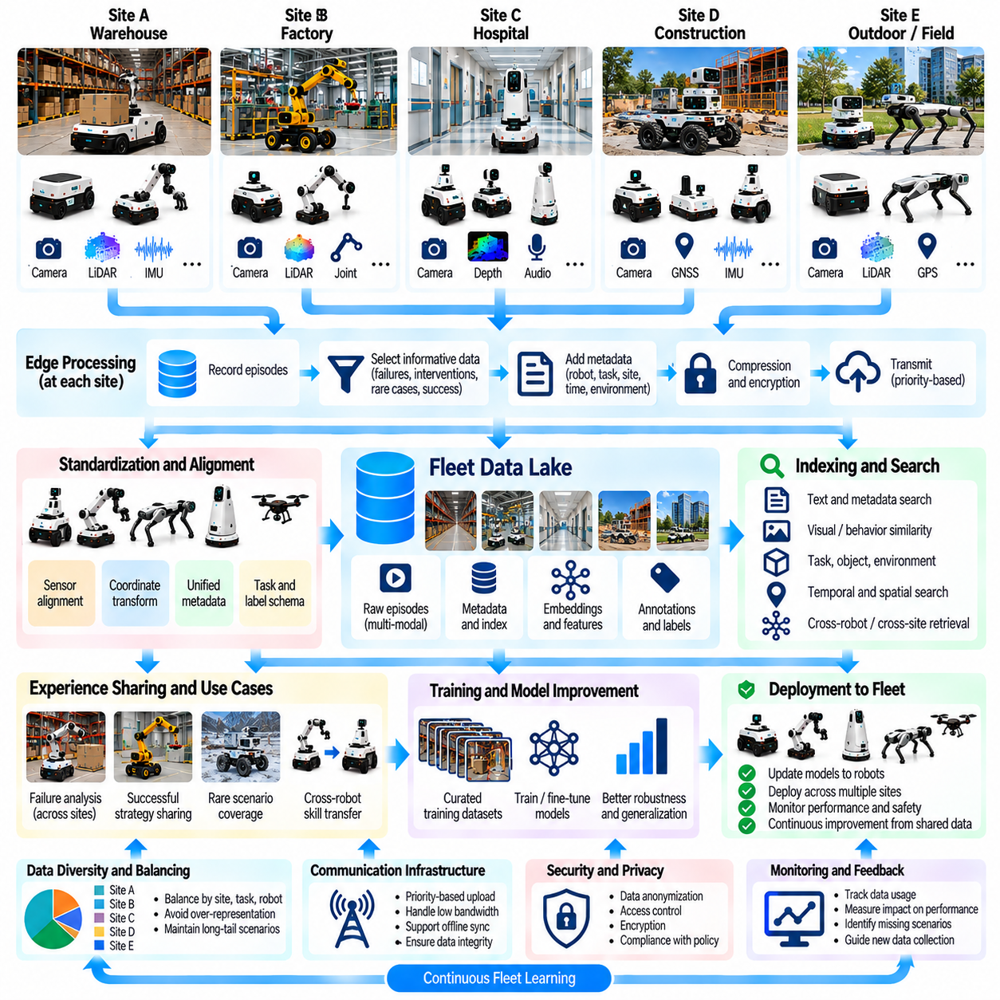{width="7.268055555555556in" height="7.268055555555556in"}

로봇 간 및 현장 간 경험 공유(Cross-Robot and Cross-Site Experience Sharing)는 물리 인공지능 플릿(Physical AI Fleet)이 서로 다른 로봇과 환경에 분산된 운영 이벤트(Operational Event)로부터 집단적으로 학습할 수 있도록 한다. 각 배포 환경(Deployment)을 독립적인 학습 시스템(Isolated Learning System)으로 취급하는 대신 공유 데이터 인프라(Shared Data Infrastructure)는 지역별 관측값(Local Observation), 작업 결과(Task Outcome), 복구 경험(Recovery Experience)을 연결한다. 이러한 접근 방식은 활용 가능한 학습 증거(Training Evidence)의 다양성을 확장하고 한 위치에서 발견된 개선 사항이 다른 배포 환경에도 도움이 되도록 한다.

개별 로봇(Individual Robot)은 대규모 플릿(Large Fleet) 전체에 존재하는 운영 조건(Operating Condition)의 일부만 경험한다. 한 창고 로봇(Warehouse Robot)은 반사 바닥(Reflective Floor)을 경험하는 반면 다른 로봇은 좁은 통로(Narrow Passage)나 특이한 장애물 구성(Unusual Obstacle Configuration)을 경험할 수 있다. 이러한 경험을 공유하면 운영 변동성(Operational Variability)에 대한 포괄 범위(Coverage)가 확대된다. 드물지만 유용한 상황(Rare but Informative Situation)을 보존하고 원래 배포 위치(Original Deployment Location)를 넘어 활용할 수 있도록 하면 플릿 학습(Fleet Learning)의 효과가 더욱 높아진다.

로봇 간 공유(Cross-Robot Sharing)를 위해서는 관측값(Observation), 행동(Action), 작업 결과(Task Outcome)에 대한 일관된 표현(Consistent Representation)이 필요하다. 서로 다른 로봇은 센서 구성(Sensor Configuration), 좌표계(Coordinate Frame), 제어 주파수(Control Frequency), 소프트웨어 버전(Software Version)이 다를 수 있다. 표준화된 메타데이터(Standardized Metadata)와 변환 절차(Transformation Procedure)는 이러한 차이를 정렬하는 데 도움이 된다. 충분한 정규화(Normalization) 없이 여러 플랫폼(Platform)의 기록을 결합하면 학습 품질(Training Quality)을 저하시키고 기록된 행동의 물리적 의미(Physical Meaning)를 불명확하게 만드는 불일치(Inconsistency)가 발생할 수 있다.

현장 간 경험 공유(Cross-Site Experience Sharing)는 환경 배치(Environmental Layout), 조명(Lighting), 표면 특성(Surface Property), 운영 절차(Operating Procedure), 인간 활동(Human Activity)에 추가적인 변동성(Variation)을 도입한다. 이러한 차이는 모델 강건성(Model Robustness)과 일반화(Generalization)를 개선할 기회를 제공한다. 그러나 현장별 특성(Site-Specific Characteristic)은 공유 데이터셋(Shared Dataset) 내에서 계속 식별 가능해야 한다. 환경 맥락(Environmental Context)을 보존하면 학습 시스템(Learning System)이 광범위하게 전이 가능한 패턴(Broadly Transferable Pattern)과 지역적 조건(Local Condition)에 의존하는 행동을 구분할 수 있다.

공유 플릿 데이터 아키텍처(Shared Fleet Data Architecture)는 일반적으로 온보드 기록 시스템(Onboard Recording System), 로컬 저장 게이트웨이(Local Storage Gateway), 중앙 집중식 데이터 서비스(Centralized Data Service)를 연결한다. 로봇은 센서 관측값(Sensor Observation), 실행된 행동(Executed Action), 상태 추정값(State Estimate), 운영 이벤트(Operational Event)를 기록한다. 엣지 처리(Edge Processing)는 관련 에피소드(Relevant Episode)를 선택하고 전송 전에 맥락 메타데이터(Contextual Metadata)를 추가한다. 중앙 집중식 인프라(Centralized Infrastructure)는 유입되는 경험(Incoming Experience)을 인덱싱(Indexing)하고 분석(Analysis), 검색(Retrieval), 주석 처리(Annotation), 모델 학습(Model Training)에 활용할 수 있도록 한다.

경험 패키지(Experience Package)는 이벤트(Event)가 발생한 상황을 재구성할 수 있을 만큼 충분한 정보를 보존해야 한다. 로봇 식별 정보(Robot Identity), 하드웨어 구성(Hardware Configuration), 모델 버전(Model Version), 작업 설명(Task Description), 타임스탬프(Timestamp), 환경 속성(Environmental Attribute), 실행 결과(Execution Outcome)는 필수적인 맥락을 제공한다. 센서 보정(Sensor Calibration)과 좌표 변환(Coordinate Transformation) 정보도 중요하다. 완전한 출처 정보(Complete Provenance)는 모든 로봇이 동일한 방식으로 세계를 관측하거나 상호작용한다고 가정하지 않고도 엔지니어가 경험을 비교할 수 있도록 한다.

공유 메커니즘(Sharing Mechanism)은 모든 기록을 무분별하게 전송하기보다 유용한 경험(Informative Experience)을 우선해야 한다. 희귀 실패(Rare Failure), 성공적인 복구(Successful Recovery), 불확실한 예측(Uncertain Prediction), 익숙하지 않은 환경 조건(Unfamiliar Environmental Condition)은 상당한 학습 가치(Learning Value)를 제공하는 경우가 많다. 선택 정책(Selection Policy)은 신규성(Novelty), 심각도(Severity), 다양성(Diversity), 예상 모델 개선 효과(Expected Model Improvement)를 고려할 수 있다. 이러한 방식은 집단적 플릿 지능(Collective Fleet Intelligence)에 의미 있게 기여하는 에피소드를 보존하면서 통신 비용(Communication Cost)과 저장 비용(Storage Cost)을 줄인다.

의미적 인덱싱(Semantic Indexing)은 로봇과 학습 파이프라인(Learning Pipeline)이 작업 설명(Task Description), 객체 범주(Object Category), 환경 조건(Environmental Condition), 행동 시그니처(Behavioral Signature)를 사용하여 경험을 검색할 수 있도록 한다. 임베딩 기반 검색(Embedding-Based Search)은 명시적인 레이블(Explicit Label)이 불완전하더라도 유사한 상황(Similar Situation)을 식별할 수 있다. 따라서 한 현장에서 관측된 내비게이션 실패(Navigation Failure)를 통해 여러 다른 시설의 관련 에피소드(Related Episode)를 발견할 수 있다. 그러나 의미적 유사성(Semantic Similarity)이 항상 동일한 동역학(Equivalent Dynamics)을 의미하는 것은 아니므로 검색 시스템(Retrieval System)은 물리적 맥락(Physical Context)을 유지해야 한다.

경험 공유(Experience Sharing)는 지리적으로 분산된 배포 환경(Geographically Distributed Deployment) 전반에서 협력적 실패 분석(Collaborative Failure Analysis)을 지원할 수 있다. 여러 로봇이 유사한 위치 추정 오류(Localization Error)를 보이면 엔지니어는 센서 특성(Sensor Characteristic), 환경 조건(Environmental Condition), 모델 예측(Model Prediction)을 비교할 수 있다. 공유된 증거(Shared Evidence)는 문제가 공통 모델 한계(Common Model Limitation)에서 발생하는지 현장별 인프라(Site-Specific Infrastructure)에서 발생하는지 판단하는 데 도움이 된다. 이러한 구분은 목표 지향적 재학습(Targeted Retraining), 재보정(Recalibration), 유지보수(Maintenance), 운영 변경(Operational Change)의 방향을 결정한다.

성공적인 경험(Successful Experience) 역시 어려운 조건(Challenging Condition)에서 신뢰할 수 있는 전략(Reliable Strategy)을 보여주기 때문에 중요하다. 어려운 파지(Difficult Grasp)를 완료하거나 일시적인 위치 추정 불확실성(Temporary Localization Uncertainty)에서 복구한 로봇은 다른 플릿 구성원(Fleet Member)에게 유용한 시연(Demonstration)을 제공할 수 있다. 성공 및 실패 에피소드(Successful and Unsuccessful Episode)를 비교하면 대조 학습(Contrastive Learning)과 정책 개선(Policy Improvement)을 지원할 수 있다. 그러나 전송된 시연(Transferred Demonstration)은 수신 로봇(Receiving Robot)의 역량(Capability)과 호환되는지 평가해야 한다.

플릿 경험 집계(Fleet Experience Aggregation)는 로봇과 현장 간 불균형한 데이터 생산량(Uneven Data Production)을 고려해야 한다. 통행량이 많은 시설(High-Traffic Facility)은 소규모 배포 환경(Smaller Deployment)보다 훨씬 많은 기록을 생성하여 공유 데이터셋(Shared Dataset)이 특정 환경(Particular Environment)을 과도하게 대표하게 만들 수 있다. 다양성 인식 샘플링(Diversity-Aware Sampling)과 현장 균형 가중치(Site-Balanced Weighting)는 이러한 편향(Bias)을 줄일 수 있다. 엔지니어는 단순히 기록량(Recording Volume)에 의존하기보다 작업(Task), 환경(Environment), 하드웨어 구성(Hardware Configuration), 실패 범주(Failure Category)에 걸친 포괄 범위(Coverage)를 측정해야 한다.

통신 인프라(Communication Infrastructure)는 경험(Experience)이 플릿 전체에서 얼마나 빠르게 활용 가능해지는지에 영향을 미친다. 고대역폭 현장(High-Bandwidth Site)은 상세한 기록(Detailed Recording)을 즉시 업로드할 수 있지만 원격 배포 환경(Remote Deployment)은 지연 동기화(Delayed Synchronization)나 압축된 요약(Compressed Summary)이 필요할 수 있다. 우선순위 기반 전송(Priority-Based Transmission)은 중요 이벤트(Critical Event)의 공유를 가속할 수 있다. 신뢰할 수 있는 동기화(Reliable Synchronization)는 간헐적인 연결(Intermittent Connectivity)을 허용하고 실시간 로봇 제어(Real-Time Robot Control)를 방해하지 않으면서 데이터 무결성(Data Integrity)을 보존해야 한다.

개인정보 보호(Privacy), 보안(Security), 소유권 제약(Ownership Constraint)은 현장 간 공유(Cross-Site Sharing)에 포함되어야 한다. 로봇 기록(Robot Recording)에는 식별 가능한 사람(Identifiable Person), 독점적인 시설 배치(Proprietary Facility Layout), 상업적으로 민감한 운영 정보(Commercially Sensitive Operational Information)가 포함될 수 있다. 접근 제어(Access Control), 암호화(Encryption), 보존 정책(Retention Policy), 선택적 익명화(Selective Anonymization)는 부적절한 노출(Inappropriate Exposure)을 제한하는 데 도움이 된다. 데이터 공유 계약(Data-Sharing Agreement)은 특히 서로 다른 조직(Organization)이나 관할권(Jurisdiction)에 걸쳐 플릿이 운영되는 경우 허용된 사용 범위(Permitted Use)와 책임(Responsibility)을 명시해야 한다.

모든 경험(Experience)을 공통 학습 데이터셋(Common Training Dataset)에 직접 전송해서는 안 된다. 센서 품질(Sensor Quality), 작업 정의(Task Definition), 행동 의미(Action Semantics), 하드웨어 동역학(Hardware Dynamics)의 차이는 잘못된 지도 신호(Misleading Supervision)를 생성할 수 있다. 품질 검증(Quality Validation)은 손상된 기록(Corrupted Recording), 호환되지 않는 스키마(Incompatible Schema), 불확실한 결과(Uncertain Outcome)를 식별해야 한다. 데이터셋 구성(Dataset Construction)에는 배포 맥락(Deployment Context) 간 의미 있는 차이를 유지하기 위해 도메인별 변환(Domain-Specific Transformation)이나 분리된 학습 데이터 부분집합(Separate Training Subset)이 필요할 수 있다.

공유된 경험(Shared Experience)은 중앙 집중식 학습(Centralized Training), 분산 학습(Distributed Learning), 선택적 지식 전이(Selective Knowledge Transfer)를 통해 모델을 개선할 수 있다. 중앙 집중식 파이프라인(Centralized Pipeline)은 호환 가능한 데이터셋(Compatible Dataset)을 결합하여 공통 인식 및 계획 구성요소(Common Perception and Planning Component)를 업데이트한다. 연합 학습(Federated Learning)은 원시 데이터 이동(Raw Data Movement)이 제한되는 경우 모델 업데이트(Model Update)를 교환할 수 있지만 통계적 이질성(Statistical Heterogeneity)과 개인정보 보호 위험(Privacy Risk)은 여전히 존재한다. 적절한 접근 방식은 인프라(Infrastructure), 거버넌스 요구사항(Governance Requirement), 모델 호환성(Model Compatibility)에 따라 달라진다.

현장 간 평가(Cross-Site Evaluation)는 공유 학습(Shared Learning)이 전이 가능한 개선(Transferable Improvement)을 만들어내는지 판단하는 데 필요하다. 추가적인 창고 경험(Warehouse Experience)을 사용하여 학습한 모델은 최신 학습 주기(Latest Training Cycle)에 포함되지 않은 위치(Location)에서도 시험해야 한다. 평가(Evaluation)는 작업 성공률(Task Success Rate), 안전 여유(Safety Margin), 개입률(Intervention Rate), 환경 변동(Environmental Variation)에 따른 성능을 검토해야 한다. 업데이트된 모델(Updated Model)이 다른 현장에서 낮은 성능을 보인다면 데이터를 제공한 현장(Contributing Site)에서의 개선만으로는 충분하지 않다.

경험 공유(Experience Sharing)는 새롭게 발견된 운영 위험(Operational Hazard)에 신속하게 대응하는 데도 도움이 된다. 한 로봇이 익숙하지 않은 장애물(Unfamiliar Obstacle)이나 반복적인 실패 조건(Recurring Failure Condition)을 경험하면 해당 이벤트(Event)를 진단 패턴(Diagnostic Pattern)이나 수집 우선순위(Collection Priority)로 배포할 수 있다. 다른 로봇은 제어 정책(Control Policy)을 즉시 변경하지 않고도 유사한 조건(Similar Condition)을 모니터링할 수 있다. 이후 검증된 모델 업데이트(Validated Model Update)는 통제되지 않은 플릿 전체 적응(Uncontrolled Fleet-Wide Adaptation)이 아니라 통제된 배포 절차(Controlled Deployment Procedure)를 통해 도입할 수 있다.

플릿 지식 시스템(Fleet Knowledge System)은 공유된 경험(Shared Experience), 그에 따른 데이터셋 업데이트(Dataset Update), 모델 버전(Model Version), 관측된 성능 변화(Observed Performance Change) 사이의 관계를 유지해야 한다. 이러한 추적 가능성(Traceability)은 엔지니어가 어떤 배포 환경(Deployment)이 유용한 증거(Useful Evidence)를 제공했는지, 후속 개선(Subsequent Improvement)이 성공적으로 일반화되었는지 식별하는 데 도움이 된다. 수신 현장(Receiving Site)의 피드백(Feedback)은 향후 공유 우선순위(Sharing Priority)를 개선할 수 있다. 이렇게 형성된 학습 루프(Learning Loop)는 분산된 운영 환경에서의 발견(Distributed Operational Discovery)을 조정된 모델 개발(Coordinated Model Development)과 연결한다.

경험 공유의 효과(Experience Sharing Effectiveness)는 유용한 에피소드 재사용(Useful Episode Reuse), 현장 간 포괄 범위(Cross-Site Coverage), 검색 관련성(Retrieval Relevance), 전이 성능(Transfer Performance), 반복 실패 감소(Reduction in Repeated Failures)를 통해 측정할 수 있다. 통신 비용(Communication Cost), 주석 작업량(Annotation Effort), 발견에서 검증된 개선까지 소요되는 시간(Time from Discovery to Validated Improvement)도 중요하다. 평가(Evaluation)는 집단 학습(Collective Learning)을 독립적인 현장별 개발(Isolated Site-Specific Development)과 비교해야 한다. 목표는 교환되는 데이터의 양(Quantity of Exchanged Data)을 극대화하는 것이 아니라 플릿 역량(Fleet Capability)의 측정 가능한 개선(Measurable Improvement)을 달성하는 것이다.

궁극적으로 로봇 간 및 현장 간 경험 공유(Cross-Robot and Cross-Site Experience Sharing)는 지리적으로 분산된 배포 환경(Geographically Distributed Deployment)을 조정된 학습 생태계(Coordinated Learning Ecosystem)로 전환한다. 맥락(Context)을 보존하고 표현(Representation)을 표준화하며 유용한 에피소드(Informative Episode)를 선택하고 전이 가능성(Transferability)을 검증함으로써 물리 인공지능 플릿(Physical AI Fleet)은 개별 로봇의 운영 이력(Individual Robot\'s Operating History)을 넘어서는 경험으로부터 이익을 얻을 수 있다. 안전한 데이터 거버넌스(Secure Data Governance) 및 지속적인 평가(Continuous Evaluation)와 결합된 이러한 접근 방식은 확장 가능한 집단 지능(Scalable Collective Intelligence)과 더욱 신뢰할 수 있는 자율 운영(Reliable Autonomous Operation)을 지원한다.

## 09.16. Cross Embodiment Data Sharing

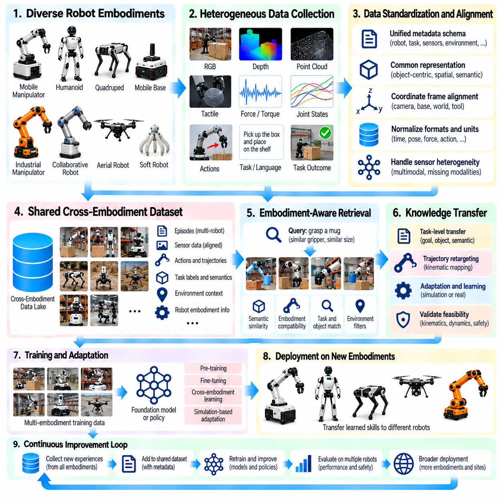{width="7.268055555555556in" height="7.268055555555556in"}

로봇 형태 간 데이터 공유(Cross-Embodiment Data Sharing)는 서로 다른 기계적 구조(Mechanical Structure), 센서(Sensor), 구동 능력(Actuation Capability)을 가진 물리 인공지능 시스템(Physical AI System)이 공통의 운영 경험(Operational Experience)을 활용할 수 있도록 한다. 이동형 조작 로봇(Mobile Manipulator), 휴머노이드 로봇(Humanoid Robot), 산업용 로봇 팔(Industrial Arm)은 서로 다른 물리적 구성(Physical Configuration)을 가지고 있지만 유사한 작업(Related Task)을 수행할 수 있다. 이러한 플랫폼 간 지식 공유(Knowledge Sharing)는 학습 다양성(Training Diversity)을 확대하고 로봇 설계(Robot Design)마다 모든 작업 시연(Task Demonstration)을 독립적으로 수집해야 하는 필요성을 줄인다.

로봇 형태(Robot Embodiment)는 지능(Intelligence)이 환경(Environment)과 상호작용하는 데 사용되는 물리적 특성(Physical Characteristic)을 의미한다. 이러한 특성에는 관절 배치(Joint Arrangement), 자유도(Degrees of Freedom), 액추에이터 능력(Actuator Capability), 센서 배치(Sensor Placement), 몸체 형상(Body Geometry), 이동 메커니즘(Mobility Mechanism)이 포함된다. 로봇 형태는 물리적으로 실현 가능한 행동(Physically Achievable Action)과 관측값(Observation)이 움직임(Movement)에 연결되는 방식을 결정한다. 따라서 데이터 공유(Data Sharing)는 작업 의미(Task Meaning)와 원본 로봇(Originating Robot)의 물리적 제약(Physical Constraint)을 모두 보존해야 한다.

로봇 형태 간 학습(Cross-Embodiment Learning)은 서로 다른 로봇 형태(Robot Morphology)에서도 유용하게 유지되는 정보를 식별하는 것에서 시작한다. 객체 특성(Object Property), 장면 기하구조(Scene Geometry), 작업 목표(Task Objective), 접촉 관계(Contact Relationship), 성공적인 조작 전략(Successful Manipulation Strategy)은 전이 가능한 지식(Transferable Knowledge)을 포함할 수 있다. 반면 관절 토크(Joint Torque), 액추에이터 명령(Actuator Command), 플랫폼별 궤적(Platform-Specific Trajectory)은 하드웨어(Hardware)와 밀접하게 결합되는 경우가 많다. 전이 가능한 개념(Transferable Concept)과 로봇 형태 의존적 세부사항(Embodiment-Dependent Detail)을 분리하는 것은 신뢰할 수 있는 데이터 공유의 기본 조건이다.

공통 표현(Common Representation)은 이기종 로봇 데이터셋(Heterogeneous Robot Dataset) 사이의 인터페이스(Interface)를 제공한다. 관측값(Observation)은 객체 중심 상태(Object-Centric State), 공간 관계(Spatial Relationship), 의미적 작업 설명(Semantic Task Description), 3차원 장면 표현(Three-Dimensional Scene Representation)을 통해 나타낼 수 있다. 행동(Action)은 원하는 말단효과기 자세(Desired End-Effector Pose), 객체 변환(Object Transformation), 작업 수준 목표(Task-Level Goal)로 표현할 수 있다. 이러한 추상화(Abstraction)는 동일한 관절 구성(Joint Configuration)이나 액추에이터 인터페이스(Actuator Interface)를 요구하지 않고도 학습 시스템(Learning System)이 경험을 비교할 수 있도록 한다.

좌표계 정렬(Coordinate Frame Alignment)은 로봇 간 기하학적 정보(Geometric Information)를 전이할 때 필요하다. 카메라 좌표계(Camera Frame), 로봇 베이스 좌표계(Robot Base Frame), 월드 좌표계(World Coordinate), 도구 좌표계(Tool Frame)는 플랫폼에 따라 크게 다를 수 있다. 보정 기록(Calibration Record)과 변환 행렬(Transformation Matrix)은 일관된 공간 관계(Spatial Relationship)를 설정하는 데 도움이 된다. 잘못된 좌표 변환(Incorrect Transformation)은 오해를 유발하는 시연(Misleading Demonstration)이나 안전하지 않은 움직임 목표(Unsafe Motion Target)를 생성할 수 있으므로 공유 데이터가 학습 파이프라인(Training Pipeline)에 포함되기 전에 기하학적 검증(Geometric Validation)이 필수적이다.

행동 표현(Action Representation)은 로봇이 동일한 목표(Objective)를 서로 다른 물리적 움직임(Physical Movement)으로 달성할 수 있기 때문에 중요한 과제이다. 휴머노이드(Humanoid)는 다지형 로봇 손(Multi-Fingered Hand)을 사용하여 객체를 파지할 수 있지만 산업용 로봇 팔(Industrial Arm)은 평행 그리퍼(Parallel Gripper)를 사용할 수 있다. 두 행동은 동일한 객체 수준 목표(Object-Level Goal)를 공유할 수 있지만 서로 다른 접촉 패턴(Contact Pattern)과 힘 제어(Force Control)가 필요하다. 작업 공간 표현(Task-Space Representation)은 의도한 결과(Intended Outcome)를 로봇 형태별 실행 세부사항(Embodiment-Specific Execution Detail)과 분리하는 데 도움이 된다.

운동학적 리타기팅(Kinematic Retargeting)은 한 로봇 구조(Robot Structure)에서 시연된 움직임(Demonstrated Movement)을 다른 구조로 매핑(Mapping)한다. 이 과정은 관절 한계(Joint Limit), 도달 가능 작업 공간(Reachable Workspace), 링크 기하구조(Link Geometry), 말단효과기 제약(End-Effector Constraint)을 고려한다. 최적화 방법(Optimization Method)은 수신 로봇(Receiving Robot)의 관절 구성(Joint Configuration)을 조정하면서 중요한 작업 공간 궤적(Task-Space Trajectory)을 보존할 수 있다. 그러나 기하학적으로 실행 가능한 움직임(Geometrically Feasible Motion)이 동역학적 실행 가능성(Dynamic Feasibility), 안정적인 접촉(Stable Contact), 안전한 실행(Safe Execution)을 보장하지는 않는다.

동역학적 차이(Dynamic Difference)는 경험 전이(Experience Transfer)를 더욱 복잡하게 만든다. 로봇은 질량 분포(Mass Distribution), 액추에이터 대역폭(Actuator Bandwidth), 적재 용량(Payload Capacity), 마찰 특성(Friction Characteristic), 순응성(Compliance)에서 차이가 있을 수 있다. 강력한 산업용 조작기(Industrial Manipulator)에서 성공한 궤적(Trajectory)은 더 작은 협동 로봇(Collaborative Robot)에 과부하(Overload)를 발생시킬 수 있다. 따라서 공유 데이터(Shared Data)에는 관련 힘(Force), 속도(Velocity), 가속도(Acceleration), 접촉 정보(Contact Information)가 포함되어야 한다. 수신 플랫폼(Receiving Platform)은 전이된 행동(Transferred Behavior)을 자체 물리적 한계(Physical Limit)에 따라 검증해야 한다.

센서 이질성(Sensor Heterogeneity)도 공유 경험(Shared Experience)의 해석에 영향을 미친다. 한 로봇은 스테레오 카메라(Stereo Camera)와 촉각 센서(Tactile Sensor)를 사용하는 반면 다른 로봇은 깊이 카메라(Depth Camera)와 힘-토크 측정(Force-Torque Measurement)에 의존할 수 있다. 누락된 모달리티(Missing Modality)는 원래 정책 입력(Original Policy Input)을 직접 재현하지 못하게 할 수 있다. 다중 모달 표현(Multimodal Representation), 센서 독립적 장면 특징(Sensor-Independent Scene Feature), 모달리티별 인코더(Modality-Specific Encoder)는 부분적인 전이(Partial Transfer)를 지원할 수 있지만 센서 부재(Absent Sensor)로 손실된 정보를 항상 복구할 수 있는 것은 아니다.

작업 의미론(Task Semantics)은 로봇 형태 간 지식 공유(Knowledge Sharing)를 위한 또 다른 메커니즘을 제공한다. 서랍 열기(Opening a Drawer), 객체 운반(Transporting an Object), 선반에 물건 배치(Placing an Item on a Shelf)와 같은 지시(Instruction)는 여러 로봇 유형(Robot Type)이 이해할 수 있는 목표를 설명한다. 상위 수준 작업 표현(High-Level Task Representation)은 하드웨어와 독립적으로 사전조건(Precondition), 객체 관계(Object Relationship), 성공 기준(Success Criteria)을 포착할 수 있다. 이후 각 로봇은 자체 계획 및 제어 시스템(Planning and Control System)을 사용하여 이러한 공유 목표(Shared Goal)를 실행 가능한 로컬 행동(Feasible Local Action)으로 변환한다.

로봇 형태 간 데이터셋(Cross-Embodiment Dataset)에는 원본 플랫폼(Originating Platform)과 의도된 전이 맥락(Intended Transfer Context)을 모두 설명하는 메타데이터(Metadata)가 필요하다. 로봇 형태(Robot Morphology), 관절 정의(Joint Definition), 센서 구성(Sensor Configuration), 제어기 주파수(Controller Frequency), 적재 하중 한계(Payload Limit), 작업 제약(Task Constraint)은 기록된 에피소드(Recorded Episode)와 함께 제공되어야 한다. 표준화된 스키마(Standardized Schema)는 이러한 특성을 검색하고 해석할 수 있도록 한다. 이러한 메타데이터가 없으면 학습 시스템(Training System)은 호환되지 않는 시연(Incompatible Demonstration)을 동등한 사례(Equivalent Example)로 잘못 취급할 수 있다.

로봇 형태 인식 인덱싱(Embodiment-Aware Indexing)은 의미적 유사성(Semantic Similarity)과 함께 기계적 호환성(Mechanical Compatibility)을 고려하여 검색 성능을 개선한다. 파지 시연(Grasp Demonstration)을 검색하는 로봇은 유사한 그리퍼 형상(Gripper Geometry), 객체 크기(Object Dimension), 접촉 요구사항(Contact Requirement)을 가진 사례에 우선순위를 부여할 수 있다. 물리적 형태가 크게 다른 로봇(Distant Embodiment)의 경험도 작업 수준 정보(Task-Level Information)를 제공할 수 있다. 검색 시스템(Retrieval System)은 직접 실행 가능한 시연(Directly Executable Demonstration)과 추상화(Abstraction), 적응(Adaptation), 시뮬레이션 기반 리타기팅(Simulation-Based Retargeting)이 필요한 경험을 구분해야 한다.

공유 데이터셋(Shared Dataset)은 일반적인 로봇 구성(Common Robot Configuration)이 과도하게 대표되는 현상을 방지해야 한다. 동일한 조작기(Identical Manipulator)로 구성된 대규모 플릿(Large Fleet)은 특수 이동형 플랫폼(Specialized Mobile Platform)이나 휴머노이드 플랫폼(Humanoid Platform)보다 훨씬 많은 기록을 생성할 수 있다. 단순한 데이터 집계(Naive Aggregation)는 파운데이션 모델(Foundation Model)이 지배적인 로봇 형태(Dominant Embodiment)에 편향되도록 하여 대표성이 낮은 시스템(Less Represented System)의 성능을 저하시킬 수 있다. 로봇 형태 균형 샘플링(Embodiment-Balanced Sampling), 플랫폼별 가중치(Platform-Specific Weighting), 다양성 인식 선택(Diversity-Aware Selection)은 로봇 역량(Robot Capability)에 대한 광범위한 포괄 범위(Broader Coverage)를 유지하는 데 도움이 된다.

학습 아키텍처(Learning Architecture)는 공유 표현(Shared Representation)과 로봇 형태별 구성요소(Embodiment-Specific Component)를 결합할 수 있다. 공통 인식 인코더(Common Perception Encoder)나 작업 추론 모델(Task Reasoning Model)은 여러 플랫폼의 경험을 처리하고, 특화된 행동 디코더(Specialized Action Decoder)는 각 로봇에 적합한 명령(Command)을 생성할 수 있다. 형태 토큰(Morphology Token), 로봇 설명자(Robot Descriptor), 구조화된 운동학 매개변수(Structured Kinematic Parameter)는 모델 행동(Model Behavior)을 조건화할 수 있다. 이러한 설계는 모든 로봇 형태가 동일한 행동(Identical Action)을 지원한다고 가정하지 않으면서 지식 공유를 촉진한다.

로봇 형태 간 전이(Cross-Embodiment Transfer)는 인간 시연(Human Demonstration)과 시뮬레이션 생성 경험(Simulation-Generated Experience)에서도 이점을 얻을 수 있다. 인간 움직임(Human Motion)은 작업 의도(Task Intent)와 객체 상호작용(Object Interaction)의 사례를 제공하지만 직접 재현(Direct Reproduction)하려면 해부학적 구조(Anatomy)와 구동 방식(Actuation)의 차이를 고려해야 한다. 시뮬레이션(Simulation)은 가상 로봇 구성(Virtual Robot Configuration) 간 시연 리타기팅(Demonstration Retargeting)을 가능하게 하고 통제된 조건(Controlled Condition)에서 시험할 수 있도록 한다. 그러나 시뮬레이션상의 실행 가능성(Simulated Feasibility)이 실제 환경에서의 신뢰할 수 있는 성능(Reliable Real-World Performance)을 입증하지는 않으므로 물리적 검증(Physical Validation)이 필요하다.

안전 제약(Safety Constraint)은 수신 로봇 형태(Receiving Embodiment)에 맞게 개별적으로 유지되어야 한다. 전이된 행동(Transferred Action)은 관절 한계(Joint Limit), 충돌 경계(Collision Boundary), 액추에이터 부하(Actuator Load), 안정성 요구사항(Stability Requirement), 인간 근접성 제약(Human Proximity Constraint)에 따라 검사해야 한다. 다른 플랫폼의 성공적인 시연(Successful Demonstration)은 동일한 움직임이 수신 로봇에서도 안전하다는 증거가 아니다. 특히 전이된 지식(Transferred Knowledge)이 물리적 접촉(Physical Contact)이나 이동 운동(Locomotion)에 영향을 미치는 경우 독립적인 안전 제어기(Independent Safety Controller)와 단계적 평가(Staged Evaluation)가 실행을 관리해야 한다.

평가(Evaluation)는 작업 수준 지식 전이(Task-Level Knowledge Transfer)와 성공적인 저수준 행동 전이(Low-Level Action Transfer)를 구분해야 한다. 공유된 인식 또는 계획 지식(Shared Perception or Planning Knowledge)은 직접적인 움직임 모방(Direct Motion Imitation)이 불가능하더라도 객체 인식(Object Recognition)과 작업 순서 결정(Task Sequencing)을 개선할 수 있다. 평가 지표(Metric)에는 작업 성공률(Task Success Rate), 적응 데이터 요구량(Adaptation Data Requirement), 움직임 실행 가능성(Motion Feasibility), 접촉 안정성(Contact Stability), 안전 위반(Safety Violation)이 포함될 수 있다. 학습 과정에서 접하지 않은 로봇 구성(Previously Unseen Robot Configuration)에 대한 시험은 학습된 표현(Learned Representation)이 학습에 사용된 로봇 형태(Training Embodiment)를 넘어 일반화되는지 판단할 증거를 제공한다.

부정적 전이(Negative Transfer)는 공유된 경험(Shared Experience)이 수신 플랫폼(Receiving Platform)에 적합하지 않은 가정(Inappropriate Assumption)을 도입할 때 발생한다. 정책(Policy)은 수신 로봇에 없는 자유도(Unavailable Degrees of Freedom)나 힘 생성 능력(Force Capability)을 요구하는 접촉 전략(Contact Strategy)을 학습할 수 있다. 이러한 실패(Failure)는 학습 데이터량(Training Data Volume)이 증가하더라도 성능을 저하시킬 수 있다. 호환성 필터링(Compatibility Filtering), 로봇 형태 조건부 학습(Embodiment-Conditioned Learning), 통제된 미세조정(Controlled Fine-Tuning)은 유용한 공유 지식(Useful Shared Knowledge)을 유지하면서 부정적 전이를 제한하는 데 도움이 된다.

로봇 형태 간 공유 효과(Cross-Embodiment Sharing Effectiveness)는 시연 데이터 요구량 감소(Reduced Demonstration Requirement), 빠른 적응(Faster Adaptation), 작업 포괄 범위 개선(Improved Task Coverage), 이전에 접하지 않은 플랫폼(Previously Unseen Platform)에서의 성능을 통해 측정할 수 있다. 평가(Evaluation)는 동일한 데이터 및 컴퓨팅 예산(Equivalent Data and Computing Budget)에서 공유 학습(Shared Training)과 로봇 형태별 기준 모델(Embodiment-Specific Baseline)을 비교해야 한다. 통신 비용(Communication Cost), 주석 요구사항(Annotation Requirement), 리타기팅 복잡도(Retargeting Complexity)도 실질적인 가치(Practical Value)에 영향을 미친다. 성공적인 전이(Successful Transfer)는 표현 유사성(Representation Similarity)만이 아니라 실제 운영상 이점(Operational Benefit)을 입증해야 한다.

궁극적으로 로봇 형태 간 데이터 공유(Cross-Embodiment Data Sharing)는 이기종 로봇 플릿(Heterogeneous Robot Fleet)을 더욱 광범위한 학습 생태계(Broader Learning Ecosystem)로 전환한다. 작업 지식(Task Knowledge)을 하드웨어별 실행(Hardware-Specific Execution)과 분리하고, 표현(Representation)을 정렬하며, 로봇 형태 메타데이터(Morphology Metadata)를 보존하고, 전이된 행동(Transferred Behavior)을 검증함으로써 물리 인공지능 시스템(Physical AI System)은 서로 다른 물리적 설계(Physical Design) 사이에서 경험을 재사용할 수 있다. 지속적인 평가(Continuous Evaluation) 및 안전 인식 적응(Safety-Aware Adaptation)과 결합된 이러한 접근 방식은 더욱 확장 가능하고 일반화 능력이 높은 로봇 지능(Scalable and Generalizable Robot Intelligence)을 지원한다.

## 09.17. Fleet World Memory and Shared Experience

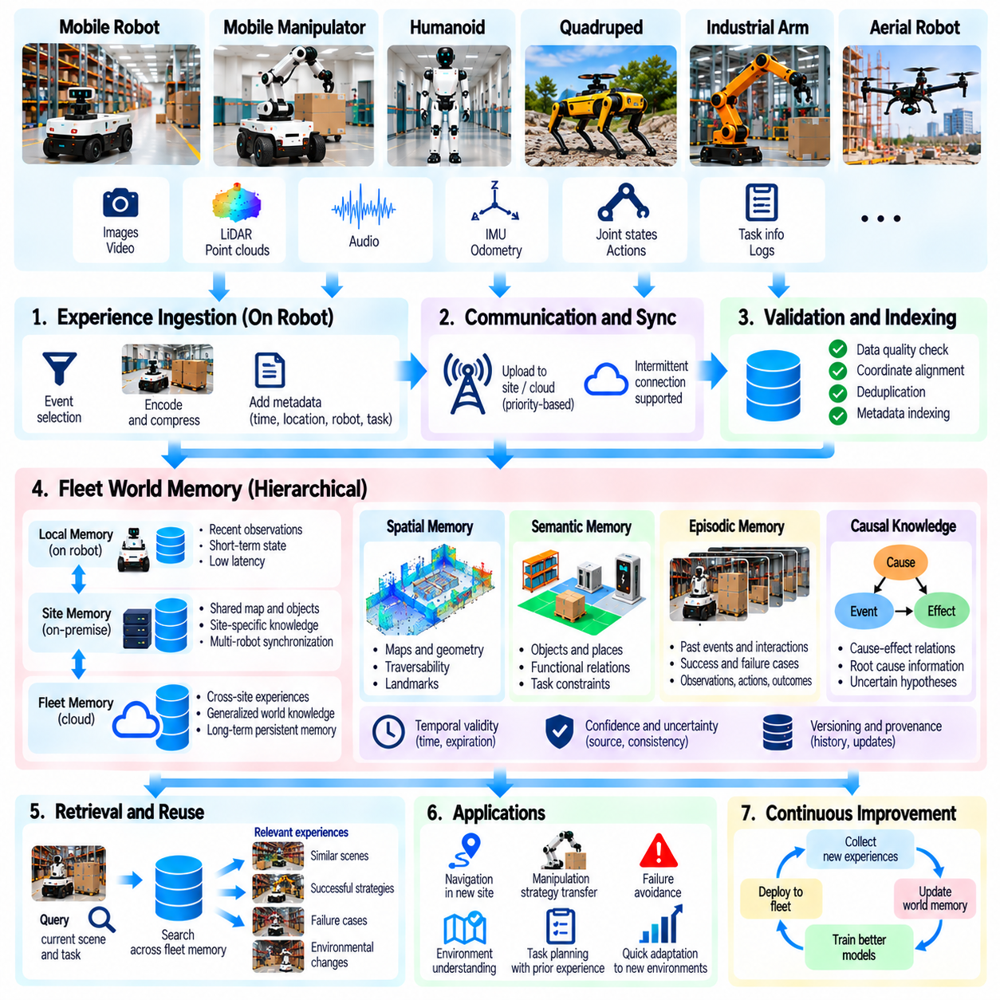{width="7.268055555555556in" height="7.268055555555556in"}

플릿 월드 메모리(Fleet World Memory)는 분산된 로봇(Distributed Robot)이 환경(Environment), 객체(Object), 작업(Task), 이전 상호작용(Previous Interaction)에 관한 정보를 유지하고 재사용할 수 있도록 하는 공유 지식 기반(Shared Knowledge Foundation)을 제공한다. 개별 로봇 메모리(Isolated Robot Memory)와 달리 플릿 메모리(Fleet Memory)는 여러 위치(Location)와 운영 기간(Operating Period)에 걸쳐 수집된 경험(Experience)을 통합한다. 이러한 집단적 표현(Collective Representation)은 로봇이 모든 상황을 직접 경험하지 않고도 다른 플릿 구성원(Fleet Member)의 관측 결과(Observation)를 활용할 수 있도록 한다.

플릿 월드 메모리 시스템(Fleet World Memory System)은 지속적인 지식(Persistent Knowledge)과 일시적인 관측값(Temporary Observation)을 구분해야 한다. 건물 배치(Building Layout), 장비 위치(Equipment Location), 객체 속성(Object Property)은 장기간 안정적으로 유지될 수 있지만 보행자 위치(Pedestrian Position)와 임시 장애물(Temporary Obstacle)은 빠르게 변화한다. 메모리 아키텍처(Memory Architecture)는 이러한 서로 다른 시간 척도(Time Scale)를 명시적으로 표현해야 한다. 안정적인 구조(Stable Structure)와 동적 상태(Dynamic State)를 분리하면 불필요한 업데이트(Unnecessary Update)를 줄이고 오래된 관측값(Outdated Observation)이 현재 의사결정(Current Decision)에 영향을 미치는 것을 방지할 수 있다.

공간 메모리(Spatial Memory)는 공유 월드 지식(Shared World Knowledge)의 중요한 구성요소이다. 로봇은 지도(Map), 기하학적 랜드마크(Geometric Landmark), 주행 가능성 추정값(Traversability Estimate), 운영 공간(Operational Space)에 대한 의미적 설명(Semantic Description)을 제공할 수 있다. 로컬 관측값(Local Observation)은 공유 표현(Shared Representation)에 통합되기 전에 공통 기준 좌표계(Common Reference Frame)에 정렬된다. 부정확한 좌표계(Inconsistent Coordinate System)는 존재하지 않는 장애물(False Obstacle), 중복된 구조물(Duplicated Structure), 잘못된 내비게이션 안내(Incorrect Navigation Guidance)를 발생시킬 수 있으므로 정확한 위치 추정(Accurate Localization)과 지도 정합(Map Registration)이 필수적이다.

의미 메모리(Semantic Memory)는 객체(Object), 위치(Location), 활동(Activity)의 의미와 기능적 관계(Functional Relationship)를 설명한다. 창고 로봇(Warehouse Robot)은 적재 구역(Loading Zone), 보관 선반(Storage Rack), 충전소(Charging Station), 출입 제한 구역(Restricted Area)을 식별할 수 있다. 다른 로봇은 동일한 시설(Facility)에서 작업을 계획할 때 이러한 설명을 재사용할 수 있다. 의미적 관계(Semantic Relationship)는 기하학적 정보(Geometry)만으로 충분히 표현할 수 없는 객체 접근성(Object Accessibility), 작업 의존성(Task Dependency), 운영 제약(Operational Constraint)에 관한 질의(Query)도 지원한다.

에피소드 메모리(Episodic Memory)는 특정 이벤트(Specific Event)와 상호작용(Interaction)에 대한 기록을 보존한다. 로봇은 실패한 파지(Unsuccessful Grasp), 차단된 통로(Blocked Corridor), 위치 추정 실패(Localization Failure)로부터의 성공적인 복구(Successful Recovery)를 기억할 수 있다. 각 에피소드(Episode)에는 관련 관측값(Observation), 행동(Action), 결과(Outcome), 환경 맥락(Environmental Context)이 포함된다. 다른 위치에서 유사한 조건(Similar Condition)이 발생하면 검색 메커니즘(Retrieval Mechanism)이 유용한 선행 사례(Useful Precedent)를 식별하여 로봇이 기존 시행착오(Original Trial)를 반복하지 않고도 의사결정(Decision-Making)을 수행하도록 지원할 수 있다.

공유 경험(Shared Experience)은 단순한 이벤트 유사성(Event Similarity)이 아니라 인과관계(Causal Relationship)를 중심으로 메모리를 구성할 때 더욱 가치가 높아진다. 내비게이션 실패(Navigation Failure)는 반사 표면(Reflective Surface), 잘못된 위치 추정(Incorrect Localization), 예상하지 못한 사람의 움직임(Unexpected Human Movement)으로 인해 발생할 수 있다. 결과(Outcome)와 함께 진단 증거(Diagnostic Evidence)를 기록하면 이러한 원인을 구분하는 데 도움이 된다. 증거(Evidence)가 불완전한 경우 인과적 해석(Causal Interpretation)의 불확실성을 유지하여 플릿 메모리(Fleet Memory)가 추측성 설명(Speculative Explanation)을 확립된 운영 사실(Established Operational Fact)로 취급하지 않도록 해야 한다.

메모리 수집(Memory Ingestion)은 로봇이 보존할 가치가 있는 이벤트(Event)나 관측값(Observation)을 탐지할 때 시작된다. 온보드 시스템(Onboard System)은 특이한 상황(Unusual Situation), 새롭게 발견된 객체(Newly Discovered Object), 환경 변화(Environmental Change), 중요한 작업 결과(Significant Task Outcome)를 선택할 수 있다. 로컬 처리(Local Processing)는 타임스탬프(Timestamp), 위치 추정값(Location Estimate), 로봇 구성(Robot Configuration), 신뢰도 정보(Confidence Information)를 추가한다. 이후 이러한 기록은 공유 인프라(Shared Infrastructure)로 전송되며, 검증(Validation)과 인덱싱(Indexing)을 통해 집단 지식(Collective Knowledge)에 어떻게 기여할지 결정된다.

확장 가능한 메모리 아키텍처(Scalable Memory Architecture)는 일반적으로 로컬 로봇 메모리(Local Robot Memory), 현장 수준 메모리(Site-Level Memory), 플릿 전체 메모리 서비스(Fleet-Wide Memory Service)를 결합한다. 로컬 메모리(Local Memory)는 저지연 제어(Low-Latency Control)와 즉각적인 맥락(Immediate Context)을 지원하며, 현장 메모리(Site Memory)는 인근 로봇을 위한 공유 환경 정보(Shared Environmental Information)를 유지한다. 플릿 전체 서비스(Fleet-Wide Service)는 전이 가능한 경험(Transferable Experience)과 일반화된 지식(Generalized Knowledge)을 집계한다. 계층적 구성(Hierarchical Organization)은 통신 요구량(Communication Requirement)을 줄이고 안전 필수 의사결정(Safety-Critical Decision)이 원격 연결(Remote Connectivity)에 의존하지 않도록 한다.

메모리 동기화(Memory Synchronization)는 지연된 업데이트(Delayed Update), 충돌하는 관측값(Conflicting Observation), 간헐적인 통신(Intermittent Communication)을 처리해야 한다. 두 로봇은 서로 다른 시점에 관측했기 때문에 동일한 위치(Location)에 대해 서로 다른 상태(State)를 보고할 수 있다. 버전 관리(Versioning), 타임스탬프(Timestamp), 출처 신뢰성(Source Reliability), 불확실성 추정값(Uncertainty Estimate)은 이러한 차이를 조정하는 데 도움이 된다. 충돌(Conflict)을 신뢰성 있게 해결할 수 없는 경우 시스템은 성급하게 단일 결론을 강제하는 대신 경쟁 가설(Competing Hypothesis)을 유지하거나 추가 관측(Additional Observation)을 요청해야 한다.

시간적 유효성(Temporal Validity)은 물리적 환경(Physical Environment)이 지속적으로 변화하기 때문에 필수적이다. 이전에 통행할 수 있었던 통로(Accessible Passage)가 차단되거나 장비(Equipment)가 재배치되거나 임시 장애물(Temporary Obstacle)이 사라질 수 있다. 따라서 메모리 항목(Memory Entry)에는 관측 시점(Observation Time), 예상 지속성(Expected Persistence), 만료 또는 재검증 정책(Expiration or Revalidation Policy)이 포함되어야 한다. 시간 인식 검색(Time-Aware Retrieval)은 로봇이 과거 환경 상태(Historical Environmental State)를 현재 조건(Present Condition)에 대한 보장된 설명(Guaranteed Description)으로 취급하지 않도록 한다.

신뢰도 인식 메모리(Confidence-Aware Memory)는 저장된 지식(Stored Knowledge)에 관련된 불확실성(Uncertainty)을 표현한다. 센서 잡음(Sensor Noise), 불완전한 관측(Incomplete Observation), 모호한 객체 식별(Ambiguous Object Identity), 일관되지 않은 보고(Inconsistent Report)는 신뢰성(Reliability)을 저하시킬 수 있다. 독립적인 로봇(Independent Robot)이 기존 기록(Existing Record)을 확인하거나 반박하면 신뢰도 추정값(Confidence Estimate)을 업데이트할 수 있다. 그러나 상관관계가 있는 센서(Correlated Sensor)에서 반복적으로 수집된 관측값을 자동으로 독립적인 증거(Independent Evidence)로 취급해서는 안 된다. 신뢰할 수 있는 융합(Reliable Fusion)을 위해서는 측정값 간 의존성(Measurement Dependency)을 고려해야 한다.

검색 메커니즘(Retrieval Mechanism)은 저장된 경험(Stored Experience)을 현재 인식(Current Perception) 및 작업 맥락(Task Context)과 연결한다. 로봇은 유사한 장면(Similar Scene), 객체 상호작용(Object Interaction), 환경 위험(Environmental Hazard), 복구 전략(Recovery Strategy)을 검색할 수 있다. 공간 인덱싱(Spatial Indexing), 의미적 검색(Semantic Search), 학습된 임베딩(Learned Embedding)은 대규모 메모리 집합(Large Memory Collection)에서 효율적인 검색을 지원한다. 검색된 정보(Retrieved Information)는 관련성(Relevance), 최신성(Freshness), 신뢰성(Reliability), 요청 로봇(Requesting Robot)의 역량(Capability)과의 호환성(Compatibility)에 따라 우선순위를 결정해야 한다.

플릿 월드 메모리(Fleet World Memory)는 협력적 지도 작성(Collaborative Mapping)과 환경 변화 탐지(Environmental Change Detection)를 지원할 수 있다. 여러 로봇이 동일한 시설(Facility)을 이동할 때 관측값(Observation)을 결합하여 공간 포괄 범위(Spatial Coverage)를 개선하고 저장된 지도(Stored Map)와 현재 조건(Current Condition) 사이의 불일치(Discrepancy)를 식별할 수 있다. 확인된 변화(Confirmed Change)는 공유 공간 표현(Shared Spatial Representation)을 업데이트하고 로컬 재계획(Local Replanning)을 유발할 수 있다. 다른 위치에서 운영 중인 로봇도 영향을 받는 구역(Affected Area)에 진입하기 전에 관련 업데이트(Relevant Update)를 수신하여 준비 상태를 개선할 수 있지만 보고된 모든 변화가 여전히 유효하다고 가정해서는 안 된다.

공유 메모리(Shared Memory)는 성공적인 절차(Successful Procedure)와 운영 의존성(Operational Dependency)을 보존함으로써 작업 수준 학습(Task-Level Learning)도 지원한다. 로봇은 장비 검사(Equipment Inspection)나 복잡한 시설(Complex Facility)을 통한 자재 운반(Material Transportation)에 효율적인 작업 순서(Efficient Sequence)를 발견할 수 있다. 다른 로봇은 해당 절차(Procedure)를 검색하고 자체 역량(Capability)에 맞게 적응시킬 수 있다. 작업 메모리(Task Memory)는 목표(Goal), 사전조건(Precondition), 필요한 자원(Required Resource), 관측된 결과(Observed Outcome)를 설명하여 재사용(Reuse)이 수신 환경(Receiving Environment)의 실제 조건에 근거하도록 해야 한다.

메모리 통합(Memory Consolidation)은 반복된 경험(Repeated Experience)을 더욱 간결하고 재사용 가능한 지식(Compact and Reusable Knowledge)으로 변환한다. 유사한 에피소드(Similar Episode)는 안정적인 환경 패턴(Stable Environmental Pattern), 공통 실패 메커니즘(Common Failure Mechanism), 신뢰할 수 있는 작업 전략(Reliable Task Strategy)을 드러낼 수 있다. 요약(Summarization)과 군집화(Clustering)는 저장 요구량(Storage Demand)을 줄이면서 더 광범위한 일반화(Broader Generalization)를 지원한다. 그러나 압축된 메모리(Compressed Memory)는 안전 필수 의사결정(Safety-Critical Decision)에 필요한 중요한 예외(Exception), 불확실성(Uncertainty), 맥락(Context)을 생략할 수 있으므로 원본 증거(Original Evidence)의 추적 가능성(Traceability)을 유지해야 한다.

개인정보 보호 및 보안 요구사항(Privacy and Security Requirement)은 공유 월드 메모리(Shared World Memory)에 어떤 정보를 저장할 수 있는지에 영향을 미친다. 환경 기록(Environmental Recording)은 개인 활동(Personal Activity), 출입 제한 시설 배치(Restricted Facility Layout), 민감한 운영 절차(Sensitive Operational Procedure)를 노출할 수 있다. 접근 제어(Access Control), 암호화(Encryption), 데이터 최소화(Data Minimization), 보존 정책(Retention Policy)은 저장(Storage)과 검색(Retrieval)을 관리해야 한다. 메모리 공유(Memory Sharing)는 조직 간 경계(Organizational Boundary)를 존중하여 유용한 집단 학습(Collective Learning)이 허가된 목적(Authorized Purpose)을 넘어 정보를 노출하지 않도록 해야 한다.

메모리 품질(Memory Quality)은 축적된 정보(Accumulated Information)가 계속 유용하다고 가정하기보다 지속적인 평가(Continuous Evaluation)를 통해 관리해야 한다. 평가 지표(Metric)에는 검색 정확도(Retrieval Accuracy), 지도 일관성(Map Consistency), 시간적 최신성(Temporal Freshness), 작업 개선(Task Improvement), 반복 실패 감소(Reduction in Repeated Failures)가 포함될 수 있다. 엔지니어는 잘못된 메모리(False Memory), 중복 항목(Duplicate Entry), 오래된 지식(Outdated Knowledge)도 모니터링해야 한다. 평가는 검색된 경험(Retrieved Experience)이 공유 메모리 없이 운영하는 경우(Operation Without Shared Memory)와 비교하여 의사결정(Decision)을 개선하는지 판단해야 한다.

모델 학습(Model Training)과의 통합(Integration)은 저장된 경험(Stored Experience)과 학습된 역량(Learned Capability) 사이에 피드백 루프(Feedback Loop)를 형성한다. 자주 검색되는 실패(Frequently Retrieved Failure)는 기존 정책(Existing Policy)의 부족한 부분을 식별할 수 있으며, 성공적인 에피소드(Successful Episode)는 학습을 위한 후보 시연(Candidate Demonstration)을 제공한다. 업데이트된 모델(Updated Model)은 메모리를 더욱 정교하게 만드는 새로운 관측값(New Observation)을 생성할 수 있다. 메모리 업데이트(Memory Update)를 모델 매개변수 변경(Model Parameter Change)과 분리하면 학습된 행동(Learned Behavior)에 대한 통제된 검증(Controlled Validation)을 유지하면서 지식(Knowledge)을 더 빠르게 수정할 수 있다.

궁극적으로 플릿 월드 메모리(Fleet World Memory)는 개별 로봇 경험(Individual Robot Experience)을 물리적 환경(Physical Environment)과 운영 지식(Operational Knowledge)에 대한 지속적인 집단 표현(Persistent Collective Representation)으로 확장한다. 그 효과는 정확한 맥락(Accurate Context), 시간적 유효성(Temporal Validity), 불확실성 관리(Uncertainty Management), 확장 가능한 검색(Scalable Retrieval), 안전한 거버넌스(Secure Governance)에 달려 있다. 로컬 자율성(Local Autonomy)과 신중하게 검증된 공유 경험(Validated Shared Experience)을 결합함으로써 물리 인공지능 플릿(Physical AI Fleet)은 협력(Coordination)을 개선하고 반복적인 실수(Repeated Mistake)를 줄이며 여러 배포 환경(Deployment)에 걸쳐 지식(Knowledge)을 축적할 수 있다.

## 09.18. Event Mining and Drift Monitoring [w/Code]

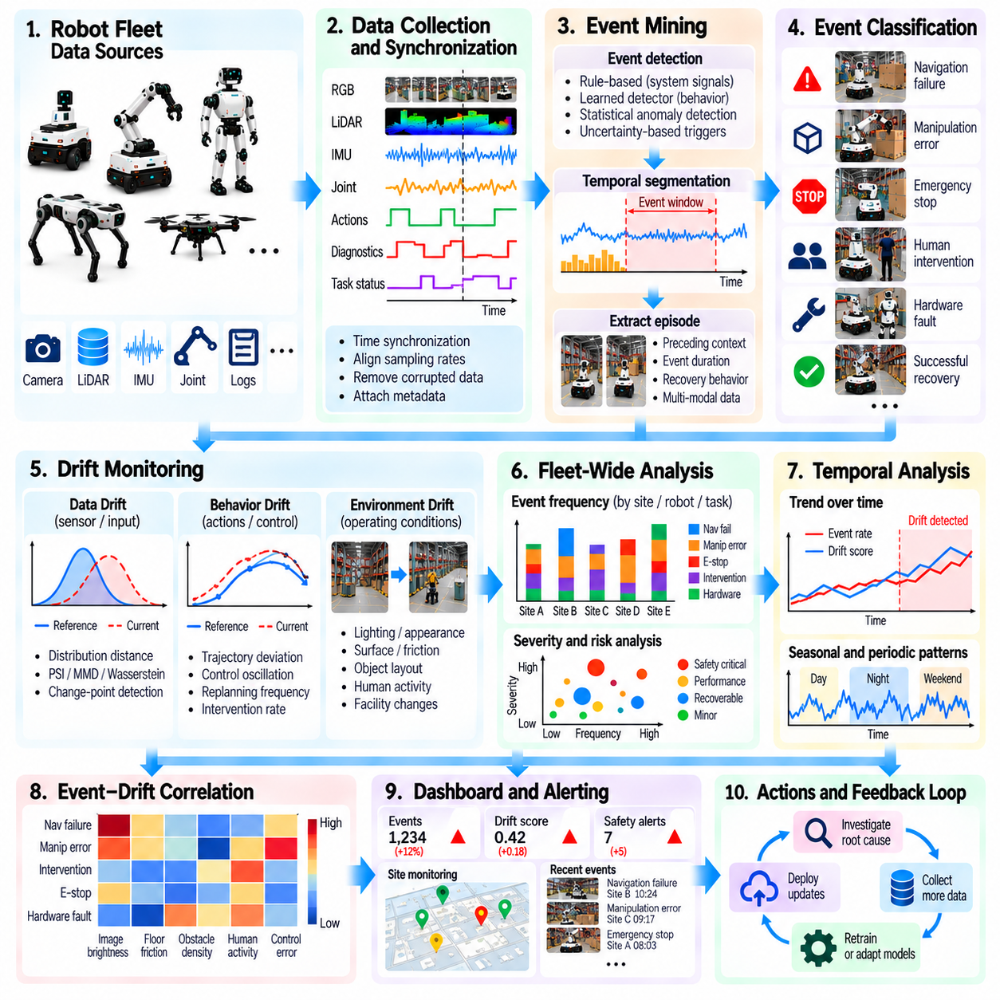{width="7.268055555555556in" height="7.268055555555556in"}

이벤트 마이닝(Event Mining)과 드리프트 모니터링(Drift Monitoring)은 물리 인공지능 플릿(Physical AI Fleet)이 의미 있는 운영 패턴(Operational Pattern)을 발견하고 성능(Performance), 안전성(Safety), 신뢰성(Reliability)에 영향을 미칠 수 있는 변화를 탐지하도록 한다. 로봇은 센서 관측값(Sensor Observation), 행동 이력(Action History), 시스템 진단 정보(System Diagnostics), 작업 결과(Task Outcome)를 지속적으로 생성한다. 여러 배포 환경(Deployment)에 걸쳐 이러한 기록을 분석하면 반복적인 실패(Recurring Failure), 새롭게 나타나는 이상 현상(Emerging Anomaly), 환경 변화(Environmental Change)를 발견할 수 있다. 목표는 대규모 플릿 데이터(Fleet Data)를 시스템 개선(System Improvement)에 활용할 수 있는 실행 가능한 증거(Actionable Evidence)로 변환하는 것이다.

이벤트 마이닝(Event Mining)은 연속적인 로봇 운영(Continuous Robot Operation)에서 중요한 사건(Significant Occurrence)을 식별한다. 이벤트(Event)에는 내비게이션 실패(Navigation Failure), 예상하지 못한 충돌(Unexpected Collision), 조작 오류(Manipulation Error), 비상 정지(Emergency Stop), 인간 개입(Human Intervention), 성공적인 복구 기동(Successful Recovery Maneuver)이 포함될 수 있다. 많은 중요한 이벤트는 정상적인 기록(Routine Recording) 속에 숨겨져 있다. 자동 탐지(Automated Detection)는 관련 시간 구간(Relevant Time Interval)과 맥락 정보(Contextual Information)를 추출하여 엔지니어가 전체 데이터 스트림(Data Stream)을 수동으로 검토하지 않고도 운영 행동(Operational Behavior)을 조사할 수 있도록 한다.

이벤트 마이닝 파이프라인(Event Mining Pipeline)은 센서(Sensor), 제어기(Controller), 계획 시스템(Planning System), 진단 모듈(Diagnostic Module)에서 동기화된 데이터 수집(Synchronized Data Collection)으로 시작한다. 타임스탬프(Timestamp)는 관측값(Observation)을 로봇 행동(Robot Action) 및 실행 결과(Execution Outcome)와 연결한다. 전처리(Preprocessing)는 손상된 측정값(Corrupted Measurement)을 제거하고 샘플링 속도(Sampling Rate)를 정렬하며 메타데이터 일관성(Metadata Consistency)을 검증한다. 잘못된 시간적 관계(Incorrect Temporal Relationship)는 실패(Failure)나 예상하지 못한 행동(Unexpected Behavior)에 대한 잘못된 설명을 만들어낼 수 있으므로 신뢰할 수 있는 동기화(Reliable Synchronization)가 필수적이다.

이벤트 정의(Event Definition)는 명시적인 시스템 신호(Explicit System Signal)와 학습된 행동 지표(Learned Behavioral Indicator)를 결합할 수 있다. 비상 정지(Emergency Stop)와 제어기 결함(Controller Fault)은 구조화된 트리거(Structured Trigger)를 제공하지만 비정상적인 궤적(Unusual Trajectory)이나 불확실한 예측(Uncertain Prediction)은 통계적 방법(Statistical Method) 또는 기계학습 방법(Machine Learning Method)이 필요하다. 규칙 기반 탐지(Rule-Based Detection)는 해석 가능성(Interpretability)을 제공하지만 익숙하지 않은 실패(Unfamiliar Failure)를 놓칠 수 있다. 학습 기반 탐지기(Learned Detector)는 복잡한 패턴(Complex Pattern)을 발견할 수 있지만 그 출력(Output)은 운영 증거(Operational Evidence)를 기준으로 검증해야 한다.

시간적 분할(Temporal Segmentation)은 이벤트(Event)의 시작 시점(Beginning), 지속 시간(Duration), 종료 시점(Conclusion)을 결정한다. 내비게이션 실패(Navigation Failure)는 로봇이 정지하기 전 몇 초 동안의 위치 추정 불확실성(Localization Uncertainty)을 포함할 수 있다. 최종 오류 메시지(Final Error Message)만 수집하면 실패의 원인이 된 조건(Condition)이 누락될 수 있다. 따라서 이벤트 구간(Event Window)은 불필요한 기록량(Unnecessary Recording Volume)을 피하면서 관련된 이전 관측값(Preceding Observation), 실행된 행동(Executed Action), 복구 시도(Recovery Attempt)를 포함해야 한다.

이벤트 분류(Event Classification)는 탐지된 에피소드(Detected Episode)를 의미 있는 운영 범주(Operational Category)로 구성한다. 레이블(Label)은 장애물 조우(Obstacle Encounter), 인식 실패(Perception Failure), 제어 불안정성(Control Instability), 하드웨어 결함(Hardware Fault), 환경 교란(Environmental Disturbance)을 설명할 수 있다. 계층적 분류 체계(Hierarchical Taxonomy)는 상세한 실패 메커니즘(Failure Mechanism)을 보존하면서 광범위한 분석(Broad Analysis)을 가능하게 한다. 성급한 레이블 지정(Premature Labeling)은 후속 학습 데이터셋(Downstream Training Dataset)에 체계적 오류(Systematic Error)를 유발할 수 있으므로 분류 신뢰도(Classification Confidence)와 모호한 사례(Ambiguous Case)를 유지해야 한다.

플릿 전체 이벤트 집계(Fleet-Wide Event Aggregation)는 개별 로봇 분석(Isolated Robot Analysis)으로는 발견하기 어려운 패턴을 드러낸다. 한 로봇에서 드물게 발생하는 실패(Rare Failure)도 수백 개의 배포 환경(Deployment)에서 유사한 이벤트가 발생하면 통계적으로 중요해질 수 있다. 집계 분석(Aggregated Analysis)은 위치(Location), 작업(Task), 로봇 모델(Robot Model), 소프트웨어 버전(Software Version)에 따른 이벤트 빈도(Event Frequency)를 비교할 수 있다. 이러한 비교는 공통적인 취약점(Shared Weakness)을 식별하고 광범위한 문제(Widespread Problem)와 국지적인 운영 교란(Localized Operational Disturbance)을 구분하는 데 도움이 된다.

이벤트 빈도(Event Frequency)만으로는 운영상 중요도(Operational Importance)를 판단하기에 충분하지 않다. 일반적인 복구 기동(Common Recovery Maneuver)은 안전에 거의 영향을 미치지 않을 수 있지만 드물게 발생하는 충돌 직전 상황(Near-Collision)은 심각한 위험(Serious Hazard)을 나타낼 수 있다. 심각도(Severity), 노출 정도(Exposure), 복구 비용(Recovery Cost), 잠재적 결과(Potential Consequence)는 이벤트 우선순위(Event Prioritization)에 영향을 미쳐야 한다. 위험 인식 마이닝(Risk-Aware Mining)은 시정 조치(Corrective Action)가 가장 큰 운영상 이점(Operational Benefit)을 제공할 수 있는 상황에 엔지니어링 자원(Engineering Resource)을 집중하도록 한다.

드리프트 모니터링(Drift Monitoring)은 시간에 따른 데이터 분포(Data Distribution), 로봇 행동(Robot Behavior), 환경 조건(Environmental Condition)의 변화를 탐지함으로써 이벤트 마이닝(Event Mining)을 보완한다. 센서 특성(Sensor Characteristic), 행동 패턴(Action Pattern), 작업 완료 시간(Task Completion Time), 개입 빈도(Intervention Frequency)는 검증된 기준선(Validated Baseline)에서 점진적으로 벗어날 수 있다. 이러한 변화는 명확한 실패(Obvious Failure)가 발생하기 전에 나타날 수 있다. 지속적인 모니터링(Continuous Monitoring)은 운영 조건(Operating Condition)이나 시스템 성능(System Performance)이 더 이상 이전의 기대 수준(Previous Expectation)과 일치하지 않는다는 조기 증거(Early Evidence)를 제공한다.

통계적 드리프트 지표(Statistical Drift Indicator)는 현재 관측값(Current Observation)을 학습(Training) 또는 검증된 배포(Validated Deployment) 과정에서 설정된 기준 분포(Reference Distribution)와 비교한다. 바서슈타인 거리(Wasserstein Distance), 모집단 안정성 지수(Population Stability Index), 최대 평균 불일치(Maximum Mean Discrepancy)와 같은 측정 방법은 선택된 변화(Selected Change)를 정량화할 수 있다. 이동 구간(Moving Window)과 변화점 탐지(Change-Point Detection)는 점진적 변화(Gradual Shift) 또는 급격한 변화(Abrupt Shift)를 식별한다. 통계적 차이(Statistical Difference)가 반드시 운영 성능 저하(Operational Degradation)를 의미하는 것은 아니므로 지표는 작업 결과(Task Outcome)를 기준으로 보정해야 한다.

행동 드리프트 분석(Behavioral Drift Analysis)은 궤적(Trajectory), 제어 보정(Control Correction), 재계획 빈도(Replanning Frequency), 복구 전략(Recovery Strategy)의 변화를 조사한다. 조향 진동(Steering Oscillation)의 증가는 위치 추정 문제(Localization Problem), 기계적 마모(Mechanical Wear), 변경된 바닥 조건(Altered Floor Condition)을 나타낼 수 있다. 유사한 증상(Similar Symptom)은 서로 다른 원인(Different Cause)에서 발생할 수 있다. 행동 신호(Behavioral Signal)를 하드웨어 진단(Hardware Diagnostics), 환경 메타데이터(Environmental Metadata), 모델 예측(Model Prediction)과 결합하면 해석(Interpretation)을 개선하고 불필요한 재학습(Unnecessary Retraining)을 줄일 수 있다.

환경 드리프트 모니터링(Environmental Drift Monitoring)은 조명(Lighting), 표면 특성(Surface Property), 장애물 구성(Obstacle Configuration), 인간 활동(Human Activity), 시설 배치(Facility Layout)의 변화를 식별한다. 창고(Warehouse)에는 새로운 장비(New Equipment)가 도입될 수 있으며 실외 로봇(Outdoor Robot)은 계절적 기상 패턴(Seasonal Weather Pattern)을 경험할 수 있다. 맥락 기반 모니터링(Contextual Monitoring)은 예상 가능한 환경 변동(Expected Environmental Variation)과 모델 신뢰성(Model Reliability)을 위협하는 익숙하지 않은 조건(Unfamiliar Condition)을 구분하는 데 도움이 된다. 정상적인 운영 조건(Normal Operating Condition)은 배포 환경에 따라 다르므로 현장별 기준선(Site-Specific Baseline)이 중요하다.

이벤트 마이닝(Event Mining)과 드리프트 모니터링(Drift Monitoring)은 함께 분석할 때 특히 강력한 효과를 발휘한다. 조작 실패율(Manipulation Failure Rate)의 증가는 객체 외관(Object Appearance)이나 그리퍼 힘 측정값(Gripper Force Measurement)의 변화와 동시에 발생할 수 있다. 시간적 상관관계(Temporal Correlation)는 환경 변화(Environmental Shift)와 운영 결과(Operational Outcome) 사이의 가능한 관계(Plausible Relationship)를 드러낼 수 있다. 그러나 상관관계(Correlation)만으로 인과관계(Causality)가 입증되는 것은 아니므로 진단 시험(Diagnostic Testing)과 통제된 비교(Controlled Comparison)가 여전히 필요하다.

이상 현상 군집화(Anomaly Clustering)는 행동 시그니처(Behavioral Signature), 센서 특징(Sensor Feature), 작업 맥락(Task Context), 실패 결과(Failure Outcome)를 사용하여 관련 이벤트(Related Event)를 그룹화한다. 임베딩 기반 검색(Embedding-Based Retrieval)은 서로 다른 로봇과 현장에 걸쳐 이전에 인식하지 못했던 실패 유형(Failure Family)을 발견할 수 있다. 군집(Cluster)은 관련성이 없는 배경 특징(Irrelevant Background Feature)으로 인해 발생한 잘못된 유사성(Misleading Similarity)이 있는지 검사해야 한다. 검증된 군집(Validated Cluster)은 새로운 이벤트 범주(Event Category)가 되어 목표 지향적 데이터 수집(Targeted Data Collection)이나 모델 평가(Model Evaluation)를 안내할 수 있다.

모니터링 시스템(Monitoring System)은 오경보(False Alert)와 탐지 누락(Missed Detection)을 관리해야 한다. 지나치게 민감한 임계값(Excessively Sensitive Threshold)은 무해한 변동(Harmless Variation)으로 엔지니어에게 과도한 경보를 발생시킬 수 있으며 보수적인 임계값(Conservative Threshold)은 새롭게 나타나는 안전 위험(Emerging Safety Risk)을 놓칠 수 있다. 경보 정책(Alert Policy)은 이벤트 심각도(Event Severity), 지속성(Persistence), 신뢰도(Confidence), 운영 맥락(Operational Context)을 고려해야 한다. 조사 결과(Investigation Result)에서 얻은 피드백(Feedback)은 플릿 조건(Fleet Condition)이 변화함에 따라 임계값을 개선하고 탐지기 보정(Detector Calibration)을 향상시킬 수 있다.

자동화된 이벤트-데이터 파이프라인(Automated Event-to-Data Pipeline)은 모니터링 결과(Monitoring Result)를 광범위한 물리 인공지능 데이터 엔진(Physical AI Data Engine)과 연결한다. 가치가 높은 에피소드(High-Value Episode)는 추출(Extraction), 필요한 경우 익명화(Anonymization), 인덱싱(Indexing)을 거쳐 주석 처리(Annotation) 또는 모델 평가(Model Evaluation)로 전달될 수 있다. 반복적인 실패(Repeated Failure)는 목표 지향적 수집 요청(Targeted Collection Request)을 유발할 수 있으며 새로운 이벤트(Novel Event)는 회귀 테스트 사례(Regression Test Case)가 될 수 있다. 이러한 과정은 운영 모니터링(Operational Monitoring)을 구조화된 학습 및 검증 증거(Structured Training and Validation Evidence)의 원천으로 변환한다.

현장 간 비교(Cross-Site Comparison)는 탐지된 변화(Detected Change)에 로컬 유지보수(Local Maintenance)가 필요한지 플릿 전체 모델 개선(Fleet-Wide Model Improvement)이 필요한지 판단하는 데 도움이 된다. 하나의 로봇에만 제한된 드리프트(Drift)는 센서 정렬 불량(Sensor Misalignment)이나 액추에이터 성능 저하(Actuator Deterioration)를 나타낼 수 있다. 서로 다른 환경(Different Environment)에서 유사한 이벤트 패턴(Event Pattern)이 나타나면 공유 인식 모델(Shared Perception Model)이나 계획 모델(Planning Model)의 한계가 드러날 수 있다. 계층적 분석(Hierarchical Analysis)은 국지적인 문제(Localized Problem)가 자동으로 비용이 많이 드는 전역 재학습(Global Retraining)을 유발하지 않도록 한다.

모니터링 인프라(Monitoring Infrastructure)는 이벤트 정의(Event Definition), 탐지기 버전(Detector Version), 로봇 구성(Robot Configuration), 모델 릴리스(Model Release)에 걸친 추적 가능성(Traceability)을 보존해야 한다. 로깅 파이프라인(Logging Pipeline)의 변경이나 소프트웨어 업데이트(Software Update)는 환경 드리프트(Environmental Drift)와 유사한 인위적인 변화(Artificial Shift)를 생성할 수 있다. 버전 관리된 기록(Versioned Record)과 일관된 측정 정의(Consistent Measurement Definition)는 신뢰할 수 있는 과거 비교(Historical Comparison)를 지원한다. 감사 가능성(Auditability)은 엔지니어가 경보(Alert)가 생성된 이유와 이후 어떤 시정 조치(Corrective Action)가 수행되었는지 재구성할 수 있도록 한다.

이벤트 마이닝 및 드리프트 모니터링의 효과(Event Mining and Drift Monitoring Effectiveness)는 탐지 지연 시간(Detection Latency), 이벤트 분류 정확도(Event Classification Accuracy), 오경보율(False Alert Rate), 사고 감소(Incident Reduction), 복구 시간(Recovery Time)을 통해 측정할 수 있다. 추가적인 지표(Additional Metric)에는 유용한 에피소드 산출량(Useful Episode Yield), 데이터 수집 효율성(Data Collection Efficiency), 시정 조치 이후 개선 효과(Improvement After Corrective Action)가 포함된다. 평가는 모니터링이 단순히 탐지된 이벤트 수(Number of Detected Events)를 증가시키는 것이 아니라 측정 가능한 운영상 이점(Measurable Operational Benefit)을 만들어내는지 판단해야 한다.

궁극적으로 이벤트 마이닝(Event Mining)과 드리프트 모니터링(Drift Monitoring)은 플릿 운영(Fleet Operation)을 구조화된 학습 신호(Structured Learning Signal)의 지속적인 원천으로 전환한다. 동기화된 이벤트 추출(Synchronized Event Extraction), 통계적 변화 탐지(Statistical Change Detection), 맥락 기반 진단(Contextual Diagnosis), 목표 지향적 데이터 수집(Targeted Data Collection)을 결합함으로써 물리 인공지능 시스템(Physical AI System)은 취약점(Weakness)이 여러 배포 환경(Deployment)으로 확산되기 전에 식별할 수 있다. 이러한 통합 피드백 메커니즘(Integrated Feedback Mechanism)은 더욱 안전한 자율성(Safer Autonomy), 신속한 엔지니어링 대응(Faster Engineering Response), 플릿 수명주기(Fleet Lifecycle) 전반에 걸친 지속적인 개선(Sustained Improvement)을 지원한다.

## 09.19. Toward Self Improving Physical AI Fleets

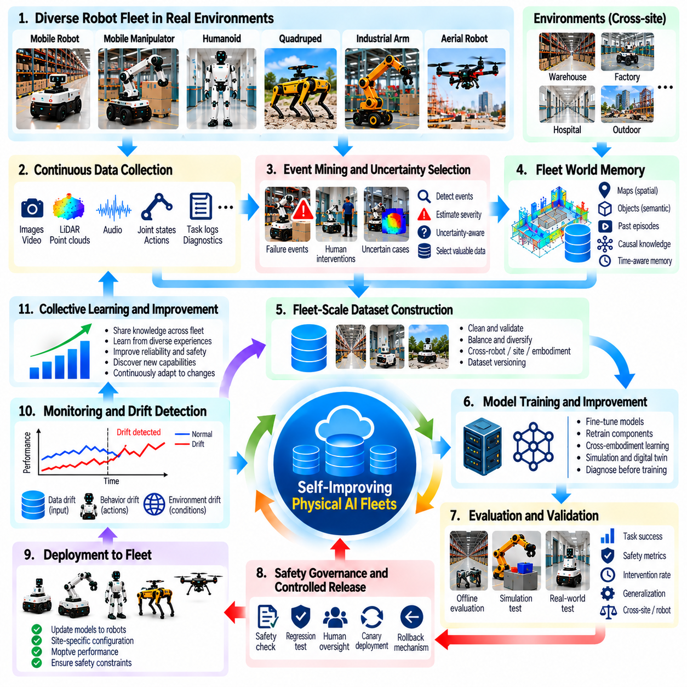{width="7.268055555555556in" height="7.268055555555556in"}

자가 개선형 물리 인공지능 플릿(Self-Improving Physical AI Fleet)은 개별적으로 프로그래밍된 로봇(Individually Programmed Robot)에서 운영 경험(Operational Experience)을 통해 지속적으로 개선되는 협력 시스템(Coordinated System)으로의 전환을 의미한다. 각 로봇은 관측값(Observation), 행동(Action), 실패(Failure), 성공적인 복구(Successful Recovery)를 공유 학습 과정(Shared Learning Process)에 제공한다. 플릿은 분산된 학습 증거(Distributed Training Evidence)의 원천이 되며, 배포 과정(Deployment)에서 발견된 개선 사항이 향후 인식(Perception), 계획(Planning), 제어(Control) 역량에 반영될 수 있도록 한다.

자가 개선(Self-Improvement)의 기반은 배포(Deployment), 데이터 수집(Data Collection), 모델 개발(Model Development), 평가(Evaluation), 통제된 릴리스(Controlled Release) 사이의 폐쇄 루프 관계(Closed-Loop Relationship)이다. 로봇은 작업(Task)을 실행하고 운영 기록(Operational Record)을 생성하며, 데이터 엔진(Data Engine)은 취약점(Weakness)이나 새로운 역량(New Capability)을 드러내는 경험을 식별한다. 선택된 에피소드(Selected Episode)는 학습 및 검증 증거(Training and Validation Evidence)가 된다. 업데이트된 모델(Updated Model)은 허용할 수 없는 성능 회귀(Unacceptable Regression) 없이 측정 가능한 개선(Measurable Improvement)을 입증한 후에만 다시 배포된다.

플릿 규모 학습(Fleet-Scale Learning)은 지식(Knowledge)이 위치(Location), 작업(Task), 하드웨어 구성(Hardware Configuration)을 넘어 전파될 수 있다는 점에서 개별 로봇 적응(Isolated Robot Adaptation)과 다르다. 한 창고(Warehouse)에서 발견된 내비게이션 실패(Navigation Failure)는 다른 시설의 로봇에도 영향을 미치는 한계(Limitation)를 드러낼 수 있다. 공유 분석(Shared Analysis)은 광범위한 실패(Widespread Failure)가 발생하기 전에 관련 조건(Related Condition)을 식별할 수 있다. 이러한 집단 학습 메커니즘(Collective Learning Mechanism)은 중복 실험(Duplicated Experimentation)을 줄이고 운영 경험(Operational Experience)의 가치를 높인다.

지속적인 관측(Continuous Observation)은 개선 방향을 결정하는 데 필요한 증거(Evidence)를 제공한다. 센서 측정값(Sensor Measurement), 상태 추정값(State Estimate), 행동 이력(Action History), 작업 결과(Task Outcome), 인간 개입(Human Intervention), 시스템 진단 정보(System Diagnostics)는 로봇이 변화하는 환경(Changing Environment)과 어떻게 상호작용하는지 설명한다. 신뢰할 수 있는 타임스탬프(Timestamp)와 맥락 메타데이터(Contextual Metadata)는 이러한 기록을 의미 있는 에피소드(Meaningful Episode)로 연결한다. 정확한 데이터 출처 정보(Data Provenance)가 없으면 엔지니어는 모델 한계(Model Limitation)를 하드웨어 결함(Hardware Fault)이나 환경 교란(Environmental Disturbance)과 신뢰성 있게 구분할 수 없다.

자동화된 이벤트 마이닝(Automated Event Mining)은 연속적인 기록(Continuous Recording)을 구조화된 학습 기회(Structured Learning Opportunity)로 변환한다. 시스템은 예상하지 못한 장애물(Unexpected Obstacle), 조작 실패(Manipulation Failure), 위치 추정 오류(Localization Error), 충돌 직전 상황(Near-Collision), 성공적인 복구 전략(Successful Recovery Strategy)을 식별한다. 이벤트 분류(Event Classification)와 심각도 평가(Severity Assessment)는 어떤 에피소드가 추가 조사(Further Investigation)를 필요로 하는지 결정하는 데 도움이 된다. 목표는 모든 기록을 보존하는 것이 아니라 중요한 운영 한계(Operational Limitation)나 전이 가능한 지식(Transferable Knowledge)을 드러내는 경험을 유지하는 것이다.

불확실성 인식 데이터 선택(Uncertainty-Aware Data Selection)은 기존 모델(Existing Model)의 지식이 충분하지 않은 상황에 데이터 수집(Data Collection)을 집중한다. 예측 불일치(Prediction Disagreement), 익숙하지 않은 시각적 특징(Unfamiliar Visual Feature), 불안정한 제어 반응(Unstable Control Response), 반복적인 재계획(Repeated Replanning)은 가치 있는 학습 기회(Valuable Learning Opportunity)를 나타낼 수 있다. 그러나 불확실성(Uncertainty)만으로 유용한 정보(Useful Information)가 보장되는 것은 아니다. 선택 메커니즘(Selection Mechanism)은 불확실성을 작업 관련성(Task Relevance), 안전 영향(Safety Impact), 신규성(Novelty), 예상 개선 효과(Expected Improvement)와 결합해야 한다.

공유 플릿 메모리(Shared Fleet Memory)는 개별 로봇 세션(Individual Robot Session)을 넘어 운영 지식(Operational Knowledge)을 보존한다. 공간 지도(Spatial Map), 의미적 객체 관계(Semantic Object Relationship), 성공적인 절차(Successful Procedure), 실패 이력(Failure History)은 권한이 부여된 플릿 구성원(Authorized Fleet Member)이 접근할 수 있는 정보가 된다. 시간 인식 검색(Time-Aware Retrieval)은 오래된 정보(Outdated Information)가 현재의 현실(Current Reality)로 취급되는 것을 방지한다. 메모리 시스템(Memory System)은 즉각적인 의사결정(Immediate Decision-Making)을 지원하는 동시에 장기적인 모델 업데이트(Long-Term Model Update)가 필요한 반복 패턴(Recurring Pattern)을 식별할 수 있다.

로봇 간 및 현장 간 학습(Cross-Robot and Cross-Site Learning)은 학습 경험(Training Experience)의 다양성을 확대한다. 서로 다른 시설(Facility)은 로봇을 조명(Lighting), 표면(Surface), 장애물(Obstacle), 작업 흐름(Workflow), 인간 활동(Human Activity)의 다양한 변화에 노출시킨다. 공유 데이터셋(Shared Dataset)은 모델이 개별 위치(Individual Location)에 존재하는 조건을 넘어 일반화(Generalization)하도록 지원한다. 그러나 무분별한 데이터 집계(Indiscriminate Aggregation)는 편향(Bias)을 유발하거나 국지적인 성능 저하(Localized Performance Degradation)를 숨길 수 있으므로 현장별 메타데이터(Site-Specific Metadata)와 균형 잡힌 샘플링(Balanced Sampling)이 필수적이다.

로봇 형태 간 학습(Cross-Embodiment Learning)은 집단적 개선(Collective Improvement)을 서로 다른 물리적 구조(Physical Structure)를 가진 로봇으로 확장한다. 공통 작업 설명(Common Task Description), 객체 중심 표현(Object-Centered Representation), 공간 관계(Spatial Relationship)는 이동형 조작 로봇(Mobile Manipulator), 휴머노이드(Humanoid), 산업용 로봇 팔(Industrial Arm) 사이에서 전이될 수 있다. 그러나 하드웨어별 명령(Hardware-Specific Command)은 항상 직접 전이할 수 있는 것은 아니다. 공유 경험(Shared Experience)이 다른 플랫폼의 실행(Execution)에 영향을 미치기 전에 로봇 형태 인식 적응(Morphology-Aware Adaptation)과 물리적 실행 가능성 검사(Physical Feasibility Check)가 필요하다.

모델 개선(Model Improvement)에는 목표 지향적 미세조정(Targeted Fine-Tuning), 광범위한 재학습(Broader Retraining), 정책 적응(Policy Adaptation), 인식 및 계획 구성요소(Perception and Planning Component)의 업데이트가 포함될 수 있다. 적절한 방법은 근본적인 실패 메커니즘(Underlying Failure Mechanism)과 활용 가능한 증거(Available Evidence)에 따라 달라진다. 센서 재보정(Sensor Recalibration)이나 기계적 유지보수(Mechanical Maintenance)는 학습(Learning)으로 해결할 수 없는 문제를 해결할 수 있다. 따라서 효과적인 자가 개선(Effective Self-Improvement)은 모든 운영 실패(Operational Failure)에 새로운 모델이 필요하다고 가정하기보다 학습 전에 진단(Diagnosis)을 수행해야 한다.

시뮬레이션(Simulation)과 디지털 트윈(Digital Twin)은 후보 개선 사항(Candidate Improvement)을 평가하기 위한 통제된 환경(Controlled Environment)을 제공한다. 기록된 실패(Recorded Failure)를 재구성하고 환경 조건(Environmental Condition)을 변경하며 대체 정책(Alternative Policy)을 시험함으로써 실제 로봇(Physical Robot)을 불필요한 위험(Unnecessary Risk)에 노출시키지 않을 수 있다. 도메인 무작위화(Domain Randomization)는 불확실한 조건(Uncertain Condition)에 대한 강건성(Robustness)을 평가하는 데 도움이 된다. 그러나 모델링 오류(Modeling Error)가 실제 환경의 실패 메커니즘(Real-World Failure Mechanism)을 숨길 수 있으므로 시뮬레이션 결과(Simulation Result)는 물리적 시험(Physical Testing)을 통해 확인해야 한다.

안전 거버넌스(Safety Governance)는 자율적 개선(Autonomous Improvement)의 경계(Boundary)를 설정한다. 로봇은 최근 경험(Recent Experience)이 더 나은 성능을 시사한다는 이유만으로 검증되지 않은 정책(Unvalidated Policy)을 독립적으로 배포해서는 안 된다. 후보 업데이트(Candidate Update)는 안전 검사(Safety Check), 회귀 테스트(Regression Testing), 운영 제약(Operational Constraint), 정의된 롤백 절차(Defined Rollback Procedure)를 필요로 한다. 중대한 변경(Consequential Change)에는 인간 감독(Human Oversight)이 여전히 중요하며, 독립적인 안전 제어기(Independent Safety Controller)는 불확실한 학습 행동(Uncertain Learned Behavior)으로부터 물리적 운영(Physical Operation)을 보호한다.

평가(Evaluation)는 최근 학습 사례(Recent Training Example)의 제한된 집합이 아니라 플릿 전체(Entire Fleet)에 걸친 개선을 측정해야 한다. 작업 성공률(Task Success Rate), 개입 빈도(Intervention Frequency), 안전 여유(Safety Margin), 완료 시간(Completion Time), 복구 신뢰성(Recovery Reliability)은 상호 보완적인 지표(Complementary Indicator)를 제공한다. 현장 간 및 로봇 형태 간 시험(Cross-Site and Cross-Embodiment Testing)은 개선 사항이 익숙하지 않은 조건(Unfamiliar Condition)으로 전이되는지 보여준다. 과거 회귀 테스트 모음(Historical Regression Suite)은 새롭게 학습된 역량(Newly Learned Capability)이 이전에 신뢰할 수 있었던 행동(Previously Reliable Behavior)을 손상시키지 않도록 하는 데 도움이 된다.

통제된 배포(Controlled Deployment)는 검증된 개발 결과(Validated Development Result)를 실제 운영 피드백(Operational Feedback)과 연결한다. 섀도 평가(Shadow Evaluation)는 후보 모델(Candidate Model)이 로봇 행동(Robot Action)을 제어하지 않고 예측(Prediction)을 생성하도록 한다. 이후 제한적 카나리 배포(Limited Canary Deployment)는 선택된 로봇(Selected Robot)에 업데이트된 정책(Updated Policy)을 적용하고 모니터링된 조건(Monitored Condition)에서 운영하도록 한다. 안전 및 성능 요구사항(Safety and Performance Requirement)이 충족되면 점진적 롤아웃(Gradual Rollout)을 통해 적용 범위를 확대한다. 예상하지 못한 성능 저하(Unexpected Degradation)가 나타나면 롤백 메커니즘(Rollback Mechanism)을 통해 이전에 검증된 버전(Previously Validated Version)으로 복구한다.

드리프트 모니터링(Drift Monitoring)은 자가 개선형 플릿(Self-Improving Fleet)이 변화하는 환경(Changing Environment)과 운영 조건(Operating Condition)에 지속적으로 대응할 수 있도록 한다. 센서 분포(Sensor Distribution), 로봇 행동(Robot Behavior), 작업 요구사항(Task Requirement), 하드웨어 성능(Hardware Performance)은 시간이 지남에 따라 변화할 수 있다. 통계적 지표(Statistical Indicator)와 운영 지표(Operational Metric)는 검증된 기준선(Validated Baseline)에서 벗어나는 변화를 탐지한다. 중요한 변화(Significant Change)는 플릿 전체의 신뢰성(Reliability)이 저하되기 전에 목표 지향적 데이터 수집(Targeted Data Collection), 진단 조사(Diagnostic Investigation), 모델 평가(Model Evaluation)를 유발할 수 있다.

학습 우선순위(Learning Priority)는 데이터량(Data Volume)만이 아니라 운영 가치(Operational Value)를 반영해야 한다. 드물게 발생하는 안전 필수 실패(Rare Safety-Critical Failure)는 빈번하게 관측되는 무해한 변동(Frequently Observed Harmless Variation)보다 더 높은 우선순위를 가질 수 있다. 엔지니어는 실패 감소(Failure Reduction), 작업 포괄 범위(Task Coverage), 적응 비용(Adaptation Cost), 배포 위험(Deployment Risk)을 통해 예상 이점(Expected Benefit)을 추정할 수 있다. 우선순위 결정(Prioritization)은 대표성이 낮은 현장(Underrepresented Site)과 로봇 유형(Robot Type)도 고려하여 개선 효과가 가장 많은 데이터를 제공하는 대상(Largest Data Contributor)에 불균형하게 집중되지 않도록 해야 한다.

추적 가능성(Traceability)은 수집된 경험(Collected Experience)을 데이터셋 버전(Dataset Version), 학습 구성(Training Configuration), 모델 릴리스(Model Release), 운영 결과(Operational Outcome)와 연결한다. 엔지니어는 어떤 증거(Evidence)가 업데이트(Update)를 유발했는지, 이후 배포(Subsequent Deployment)가 그 이점을 확인했는지 판단할 수 있어야 한다. 재현 가능한 파이프라인(Reproducible Pipeline)은 감사(Auditing)와 롤백(Rollback)을 지원한다. 이러한 책임성(Accountability)은 여러 팀(Team)과 조직(Organization)이 공유 플릿 학습 인프라(Shared Fleet Learning Infrastructure)에 데이터를 제공하는 경우 특히 중요하다.

자가 개선 효과(Self-Improvement Effectiveness)는 학습 주기 시간(Learning Cycle Time), 유용한 데이터 산출량(Useful Data Yield), 반복 실패 감소(Reduction in Repeated Failures), 적응 효율성(Adaptation Efficiency), 여러 배포 환경(Deployment)에 걸친 지속적인 성능(Sustained Performance)을 통해 측정할 수 있다. 추가적인 지표(Additional Measure)에는 모델 성능 회귀율(Model Regression Rate), 개입 감소(Intervention Reduction), 검증된 개선(Validated Improvement)을 달성하는 데 필요한 비용(Cost)이 포함된다. 평가는 플릿 학습(Fleet Learning)을 고정 정책 운영(Fixed-Policy Operation)과 비교하여 지속적인 적응(Continuous Adaptation)이 의미 있는 이점(Meaningful Benefit)을 제공하는지 확인해야 한다.

실질적인 한계(Practical Limitation)에는 통신 비용(Communication Cost), 일관되지 않은 데이터 품질(Inconsistent Data Quality), 이기종 하드웨어(Heterogeneous Hardware), 개인정보 보호 제약(Privacy Restriction), 반복 학습(Repeated Training)에 필요한 계산 비용(Computational Expense)이 포함된다. 자동화된 파이프라인(Automated Pipeline)은 수작업(Manual Effort)을 줄일 수 있지만 불확실성(Uncertainty)을 제거하거나 유익한 업데이트(Beneficial Update)를 보장할 수는 없다. 확장 가능한 시스템(Scalable System)은 중앙 집중식 조정(Centralized Coordination)과 로컬 자율성(Local Autonomy) 사이의 균형을 유지해야 한다. 피드백 루프(Feedback Loop)가 오류(Error)를 증폭하거나 편향된 경험 분포(Biased Experience Distribution)를 강화하지 않도록 강건한 엔지니어링 프로세스(Robust Engineering Process)가 필요하다.

궁극적으로 자가 개선형 물리 인공지능 플릿(Self-Improving Physical AI Fleet)은 분산 경험 수집(Distributed Experience Collection), 공유 월드 메모리(Shared World Memory), 이벤트 마이닝(Event Mining), 드리프트 탐지(Drift Detection), 모델 적응(Model Adaptation), 통제된 배포(Controlled Deployment)를 조정된 학습 시스템(Coordinated Learning System)으로 통합한다. 핵심 역량(Defining Capability)은 제한 없는 자율적 수정(Unrestricted Autonomous Modification)이 아니라 측정 가능한 안전 및 성능 제약(Measurable Safety and Performance Constraint) 아래에서 이루어지는 증거 기반 개선(Evidence-Driven Improvement)이다. 이러한 메커니즘(Mechanism)이 성숙함에 따라 플릿은 운영 역량(Operational Competence)을 축적하고 변화하는 환경(Changing Environment)에 적응하며 점점 더 신뢰할 수 있는 물리 지능(Physical Intelligence)을 구현할 수 있다.
