**Volume 04. Data Engines and Scaling for Physical AI**


# Chapter 10. Case Studies

##  

## 10.01. Autonomous Driving Data Engines

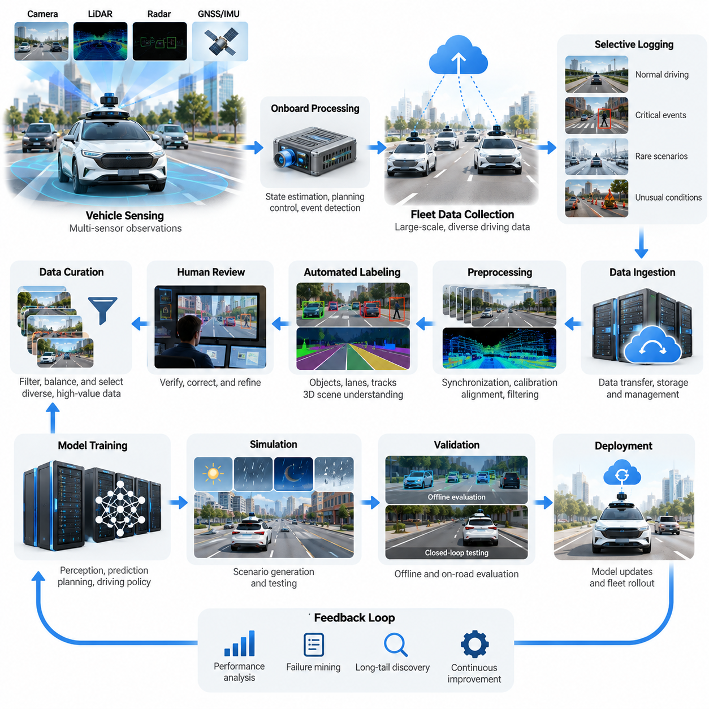{width="7.268055555555556in" height="7.268055555555556in"}

Autonomous driving represents one of the most mature applications of large-scale Physical AI data engines. Unlike conventional machine learning systems trained on static datasets, autonomous vehicles continuously generate observations, predictions, actions, and outcomes while interacting with dynamic road environments. Their data engines transform operational experience into reusable training information, enabling improvements in perception, prediction, planning, and driving behavior.

The fundamental architecture of an autonomous driving data engine connects vehicle sensing, onboard computation, fleet data collection, centralized processing, model training, validation, and deployment. Cameras, LiDAR, radar, GNSS, and inertial sensors provide complementary observations of the driving environment. Vehicle control signals, localization estimates, planned trajectories, and safety interventions provide additional information about decisions and their consequences.

A driving episode typically contains synchronized sensor measurements, vehicle states, surrounding traffic conditions, predicted object trajectories, and executed control commands. Temporal consistency is essential because driving decisions depend on how situations evolve rather than on isolated images. Accurate timestamps and coordinate transformations allow engineers to reconstruct interactions between vehicles, pedestrians, cyclists, road geometry, and traffic signals.

Fleet-scale data collection distinguishes autonomous driving from laboratory-scale robotics. Thousands of vehicles can encounter diverse road configurations, weather conditions, traffic behaviors, and infrastructure characteristics. However, recording every sensor stream continuously creates enormous storage and communication requirements. Practical data engines therefore combine selective logging, onboard compression, event-triggered recording, and prioritized data transmission.

Event-triggered collection concentrates resources on situations that provide high learning value. Examples include unexpected pedestrian crossings, aggressive vehicle merging, unusual construction zones, emergency braking, and uncertain object classifications. The system can preserve sensor observations before and after a triggering event, together with model predictions and control decisions, allowing engineers to investigate the complete sequence of events.

Long-tail scenario discovery is particularly important because rare situations can create disproportionate safety risks. Ordinary highway driving may generate millions of repetitive observations, while unusual combinations of weather, road geometry, and human behavior remain underrepresented. Automated mining systems search fleet logs for unusual motion patterns, prediction disagreements, safety interventions, and statistically uncommon environmental configurations.

Tesla provides a prominent example of a vision-centered autonomous driving development approach supported by fleet data. Its publicly described engineering methods include video-based perception, automated labeling, neural network training, and simulation. Fleet observations can help identify difficult scenarios and support model improvement, although the precise internal data selection algorithms, training mixtures, and deployment procedures are not fully public.

Waymo illustrates another approach in which multimodal sensing, detailed environmental understanding, simulation, and operational feedback contribute to autonomous driving development. Its publicly described systems integrate cameras, LiDAR, radar, and onboard computing. Real-world driving experience and simulated scenarios support testing and refinement, while operational design domains define the environmental conditions under which autonomous services are intended to operate.

Although their sensor strategies differ, these approaches share a central engineering principle: valuable training information must be selected, interpreted, and evaluated systematically. Raw driving distance alone is not a sufficient measure of data quality. A smaller collection of difficult, diverse, and accurately annotated episodes may contribute more to model improvement than a substantially larger collection of repetitive driving observations.

Automated labeling is essential for processing autonomous driving datasets at scale. Modern pipelines can generate object detections, semantic segmentation, lane geometry, motion tracks, depth estimates, and three-dimensional scene representations. Temporal information from multiple frames helps resolve ambiguities that cannot be addressed reliably using individual images, while sensor fusion provides additional geometric and motion constraints.

Offline reconstruction can improve label consistency by using observations collected after the original driving decision. For example, an object partially hidden behind another vehicle may become clearly visible several seconds later. A labeling pipeline can use the extended sequence to estimate earlier object positions and trajectories, provided uncertainty and visibility limitations are represented appropriately.

Human reviewers remain important when automated labels are uncertain, inconsistent, or safety critical. Human-in-the-loop workflows prioritize ambiguous intersections, unusual objects, complex traffic interactions, and conflicting model predictions. Reviewers correct annotations, establish consistent interpretation rules, and identify previously unknown scenario categories that automated systems may not recognize.

Data curation determines which collected episodes enter training, validation, and testing datasets. Filtering removes corrupted sensor recordings, synchronization errors, redundant observations, and unreliable annotations. Diversity-aware sampling balances geographic regions, lighting conditions, road types, weather, traffic density, and driving behaviors, reducing the risk that frequent operating conditions dominate the learning process.

Dataset partitioning requires particular attention because neighboring frames and repeated journeys are highly correlated. Randomly distributing individual frames across training and testing sets can produce misleading performance estimates. More reliable evaluation separates complete driving sequences and, when appropriate, geographic regions, collection periods, vehicles, or environmental conditions to measure generalization beyond previously observed situations.

Simulation expands the data engine by generating controlled scenarios that are difficult, dangerous, or expensive to collect repeatedly on public roads. Synthetic environments can vary pedestrian behavior, vehicle trajectories, visibility, road friction, and sensor characteristics. Simulation also provides automatically generated ground truth, although simulated results must be checked against real-world behavior because modeling inaccuracies can create misleading confidence.

Scenario replay connects real-world fleet observations with simulation-based evaluation. Engineers reconstruct difficult driving situations from recorded trajectories, map information, and environmental context, then modify selected parameters to create related test cases. This process enables systematic exploration of alternative behaviors and helps determine whether a revised model performs robustly across variations of the original event.

Model training uses curated driving data to improve perception networks, motion prediction systems, planning policies, and integrated driving models. Supervised learning can reproduce expert annotations or reference trajectories, while imitation learning derives behavior from demonstrated driving actions. Other approaches incorporate self-supervised representation learning, predictive world models, and optimization against defined driving objectives.

Closed-loop evaluation is necessary because accurate predictions do not automatically produce safe driving behavior. A planning model may generate trajectories that appear reasonable when compared with recorded examples but behave poorly when its own actions change subsequent traffic interactions. Interactive simulation and controlled vehicle testing reveal these feedback effects and expose failures that open-loop metrics cannot capture.

Evaluation metrics should cover perception accuracy, trajectory prediction, collision risk, traffic rule compliance, passenger comfort, route completion, and operational reliability. Safety-critical assessment also examines near misses, intervention frequency, uncertainty calibration, and performance under degraded sensing conditions. No single metric adequately represents driving capability, making scenario-specific and system-level evaluation essential.

Deployment closes the data engine feedback loop by introducing validated models into controlled operational environments. Shadow evaluation can compare a candidate model against an active system without granting it vehicle control. Limited deployments, staged rollouts, and monitored operational trials provide additional evidence before broader release, subject to the applicable safety case and regulatory requirements.

After deployment, monitoring systems detect changes in road environments, sensor performance, traffic patterns, and model behavior. Construction activity, new road layouts, seasonal weather, and unfamiliar vehicle types can shift the operational data distribution. Drift detection and uncertainty monitoring identify conditions requiring additional data collection, targeted retraining, or operational restrictions.

Data governance is another critical component because autonomous vehicles capture information about public spaces, pedestrians, license plates, and geographic movement. Responsible data engines incorporate access controls, retention policies, privacy protection, audit trails, and jurisdiction-specific compliance requirements. Dataset provenance and model versioning also support incident investigation, reproducibility, and traceability throughout the development lifecycle.

The economics of autonomous driving data engines depend on more than the number of vehicles or recorded kilometers. Sensor bandwidth, onboard storage, network transmission, annotation labor, computing infrastructure, simulation capacity, and validation effort all contribute to operational cost. Efficient systems allocate resources according to expected learning value while preserving the evidence required for safety evaluation.

A central lesson from autonomous driving is that scaling data volume must be accompanied by scaling data intelligence. Selective collection, automated labeling, long-tail mining, simulation, and systematic evaluation convert operational experience into measurable development progress. Increasing data quantity without improving coverage, reliability, and feedback quality can produce diminishing returns and leave important safety limitations unresolved.

Autonomous driving data engines also provide a reference architecture for broader Physical AI applications. Mobile robots, humanoids, industrial manipulators, and autonomous inspection systems face similar challenges involving multimodal sensing, rare events, action-outcome recording, and continuous learning. Their environments and control requirements differ, but the underlying process of collecting experience, discovering weaknesses, and improving policies remains closely related.

The long-term direction is toward increasingly automated, fleet-connected learning infrastructure that can identify performance gaps, request relevant data, generate evaluation scenarios, and recommend model updates. Nevertheless, autonomous driving demonstrates that self-improvement must remain constrained by rigorous validation and operational safety controls. The ultimate objective is not simply continuous learning, but a traceable and dependable process that converts real-world experience into safer and more capable Physical AI systems.

자율주행(Autonomous Driving)은 대규모 피지컬 인공지능(Physical AI) 데이터 엔진(Data Engine)이 가장 성숙하게 적용된 분야 중 하나이다. 정적 데이터셋(Static Dataset)으로 학습하는 기존 기계학습(Machine Learning) 시스템과 달리, 자율주행 차량은 동적인 도로 환경과 상호작용하면서 관측(Observation), 예측(Prediction), 행동(Action), 결과(Outcome)를 지속적으로 생성한다. 데이터 엔진은 이러한 운행 경험을 재사용 가능한 학습 정보로 변환하여 인지(Perception), 예측, 경로 계획(Planning), 주행 행동(Driving Behavior)의 성능을 개선한다.

자율주행 데이터 엔진의 기본 아키텍처(Architecture)는 차량 센싱(Vehicle Sensing), 온보드 컴퓨팅(Onboard Computing), 차량군 데이터 수집(Fleet Data Collection), 중앙 집중식 처리(Centralized Processing), 모델 학습(Model Training), 검증(Validation), 배포(Deployment)를 연결한다. 카메라(Camera), 라이다(LiDAR), 레이더(Radar), 위성항법시스템(GNSS), 관성 센서(Inertial Sensor)는 주행 환경에 대한 상호 보완적인 관측 정보를 제공한다. 차량 제어 신호, 위치 추정값, 계획된 궤적, 안전 개입 정보는 의사결정과 그 결과를 분석하기 위한 추가 정보를 제공한다.

주행 에피소드(Driving Episode)는 일반적으로 시간 동기화된 센서 측정값, 차량 상태(Vehicle State), 주변 교통 상황, 예측된 객체 궤적(Object Trajectory), 실행된 제어 명령(Control Command)을 포함한다. 주행 의사결정은 개별 이미지보다 상황이 시간에 따라 어떻게 변화하는지에 의존하므로 시간적 일관성(Temporal Consistency)이 필수적이다. 정확한 타임스탬프(Timestamp)와 좌표 변환(Coordinate Transformation)을 통해 차량, 보행자, 자전거 이용자, 도로 형상, 교통 신호 사이의 상호작용을 재구성할 수 있다.

차량군 규모의 데이터 수집(Fleet-Scale Data Collection)은 자율주행을 실험실 규모의 로보틱스(Robotics)와 구별하는 중요한 특징이다. 수천 대의 차량은 다양한 도로 구조, 기상 조건, 교통 행동, 인프라 환경을 경험할 수 있다. 그러나 모든 센서 스트림(Sensor Stream)을 지속적으로 기록하면 막대한 저장 공간과 통신 자원이 필요하다. 따라서 실제 데이터 엔진은 선택적 로깅(Selective Logging), 온보드 압축(Onboard Compression), 이벤트 기반 기록(Event-Triggered Recording), 우선순위 기반 데이터 전송(Prioritized Data Transmission)을 결합한다.

이벤트 기반 데이터 수집(Event-Triggered Data Collection)은 학습 가치가 높은 상황에 자원을 집중한다. 대표적인 사례로는 예상하지 못한 보행자 횡단, 공격적인 차량 끼어들기, 비정상적인 공사 구간, 긴급 제동(Emergency Braking), 불확실한 객체 분류(Object Classification)가 있다. 시스템은 이벤트 발생 전후의 센서 관측값과 모델 예측, 제어 결정을 함께 보존할 수 있으며, 이를 통해 엔지니어는 사건의 전체 진행 과정을 분석할 수 있다.

롱테일 시나리오 발견(Long-Tail Scenario Discovery)은 드물게 발생하는 상황이 상대적으로 큰 안전 위험을 초래할 수 있기 때문에 특히 중요하다. 일반적인 고속도로 주행은 수백만 개의 반복적인 관측 데이터를 생성하지만, 날씨와 도로 구조 및 인간 행동이 비정상적으로 결합된 상황은 충분히 표현되지 않을 수 있다. 자동 마이닝 시스템(Automated Mining System)은 차량군 로그(Fleet Log)에서 비정상적인 움직임, 예측 불일치, 안전 개입, 통계적으로 드문 환경 구성을 탐색한다.

테슬라(Tesla)는 차량군 데이터(Fleet Data)를 활용하는 비전 중심(Vision-Centered) 자율주행 개발 접근법의 대표적인 사례이다. 공개된 엔지니어링 방법에는 영상 기반 인지(Video-Based Perception), 자동 라벨링(Automated Labeling), 신경망 학습(Neural Network Training), 시뮬레이션(Simulation)이 포함된다. 차량군 관측 데이터는 어려운 시나리오를 식별하고 모델 개선을 지원할 수 있지만, 내부 데이터 선택 알고리즘과 학습 데이터 혼합 방식, 배포 절차의 정확한 세부 사항은 완전히 공개되어 있지 않다.

웨이모(Waymo)는 다중 모달 센싱(Multimodal Sensing), 정밀한 환경 이해(Environment Understanding), 시뮬레이션, 운영 피드백(Operational Feedback)을 자율주행 개발에 활용하는 또 다른 접근법을 보여준다. 공개된 시스템은 카메라, 라이다, 레이더, 온보드 컴퓨팅을 통합한다. 실제 주행 경험과 시뮬레이션 시나리오는 테스트와 성능 개선을 지원하며, 운영 설계 영역(Operational Design Domain, ODD)은 자율주행 서비스가 작동하도록 설계된 환경 조건을 정의한다.

두 접근법은 센서 전략(Sensor Strategy)에서 차이가 있지만 중요한 엔지니어링 원칙을 공유한다. 가치 있는 학습 정보는 체계적으로 선택하고 해석하며 평가해야 한다는 것이다. 단순한 누적 주행 거리(Raw Driving Distance)만으로는 데이터 품질(Data Quality)을 충분히 평가할 수 없다. 어렵고 다양하며 정확하게 주석 처리된 소규모 에피소드 집합이 반복적인 주행 관측으로 구성된 훨씬 큰 데이터 집합보다 모델 개선에 더 크게 기여할 수 있다.

자동 라벨링(Automated Labeling)은 대규모 자율주행 데이터셋(Autonomous Driving Dataset)을 처리하는 데 필수적이다. 최신 파이프라인(Pipeline)은 객체 검출(Object Detection), 의미론적 분할(Semantic Segmentation), 차선 형상(Lane Geometry), 움직임 추적(Motion Tracking), 깊이 추정(Depth Estimation), 3차원 장면 표현(3D Scene Representation)을 생성할 수 있다. 여러 프레임(Frame)의 시간적 정보는 개별 이미지로 해결하기 어려운 모호성을 줄이고, 센서 융합(Sensor Fusion)은 추가적인 기하학적 제약과 운동 제약을 제공한다.

오프라인 재구성(Offline Reconstruction)은 최초 주행 결정 이후에 수집된 관측 정보를 활용하여 라벨의 일관성을 개선할 수 있다. 예를 들어 다른 차량 뒤에 부분적으로 가려진 객체가 몇 초 후 명확하게 나타날 수 있다. 라벨링 파이프라인은 확장된 시간 구간의 데이터를 사용하여 이전 객체 위치와 궤적을 추정할 수 있으며, 이 과정에서는 불확실성(Uncertainty)과 가시성 제한(Visibility Limitation)을 적절하게 표현해야 한다.

자동 생성된 라벨이 불확실하거나 일관성이 부족하거나 안전상 중요한 경우에는 인간 검토자(Human Reviewer)의 역할이 여전히 중요하다. 인간 참여형 워크플로(Human-in-the-Loop Workflow)는 모호한 교차로, 비정상적인 객체, 복잡한 교통 상호작용, 상충하는 모델 예측을 우선적으로 처리한다. 검토자는 주석(Annotation)을 수정하고 일관된 해석 규칙을 수립하며, 자동화 시스템이 인식하지 못할 수 있는 새로운 시나리오 범주를 식별한다.

데이터 큐레이션(Data Curation)은 수집된 에피소드 중 어떤 데이터를 학습(Training), 검증(Validation), 테스트(Testing) 데이터셋에 포함할지 결정한다. 필터링(Filtering)은 손상된 센서 기록, 동기화 오류, 중복 관측, 신뢰할 수 없는 주석을 제거한다. 다양성 인식 샘플링(Diversity-Aware Sampling)은 지역, 조명 조건, 도로 유형, 날씨, 교통 밀도, 주행 행동의 균형을 조정하여 자주 발생하는 운행 조건이 학습 과정을 지배하는 위험을 줄인다.

데이터셋 분할(Dataset Partitioning)은 인접한 프레임과 반복 주행 경로 사이에 높은 상관관계(Correlation)가 존재하기 때문에 특별한 주의가 필요하다. 개별 프레임을 학습 데이터와 테스트 데이터에 무작위로 분배하면 실제보다 과도하게 높은 성능 평가 결과가 나타날 수 있다. 신뢰성 있는 평가는 전체 주행 시퀀스(Driving Sequence)를 분리하고, 필요에 따라 지역, 수집 기간, 차량, 환경 조건을 구분하여 기존에 관측하지 않은 상황에 대한 일반화(Generalization) 성능을 측정한다.

시뮬레이션(Simulation)은 공공도로에서 반복적으로 수집하기 어렵거나 위험하거나 비용이 많이 드는 시나리오를 생성하여 데이터 엔진의 범위를 확장한다. 합성 환경(Synthetic Environment)에서는 보행자 행동, 차량 궤적, 가시성, 노면 마찰(Road Friction), 센서 특성을 변화시킬 수 있다. 또한 시뮬레이션은 자동으로 생성된 정답 데이터(Ground Truth)를 제공하지만, 모델링 오류가 잘못된 신뢰도를 형성할 수 있으므로 시뮬레이션 결과를 실제 환경의 행동과 비교하여 검증해야 한다.

시나리오 재생(Scenario Replay)은 실제 차량군 관측 데이터와 시뮬레이션 기반 평가(Simulation-Based Evaluation)를 연결한다. 엔지니어는 기록된 궤적, 지도 정보, 환경 맥락을 이용하여 어려운 주행 상황을 재구성하고, 선택한 매개변수(Parameter)를 변경하여 관련 테스트 사례를 생성한다. 이 과정은 대안적인 행동을 체계적으로 탐색하고 수정된 모델이 원래 이벤트의 다양한 변형 상황에서도 강건하게 작동하는지 판단하도록 지원한다.

모델 학습(Model Training)은 큐레이션된 주행 데이터를 활용하여 인지 네트워크(Perception Network), 움직임 예측 시스템(Motion Prediction System), 경로 계획 정책(Planning Policy), 통합 주행 모델(Integrated Driving Model)을 개선한다. 지도학습(Supervised Learning)은 전문가 주석이나 기준 궤적을 재현할 수 있으며, 모방학습(Imitation Learning)은 시연된 주행 행동으로부터 정책을 학습한다. 다른 접근법에는 자기지도 표현학습(Self-Supervised Representation Learning), 예측 세계 모델(Predictive World Model), 정의된 주행 목표에 따른 최적화(Optimization)가 포함된다.

폐루프 평가(Closed-Loop Evaluation)는 정확한 예측이 자동으로 안전한 주행 행동을 보장하지 않기 때문에 필요하다. 경로 계획 모델은 기록된 사례와 비교했을 때 합리적인 궤적을 생성하더라도, 자신의 행동이 이후 교통 상호작용을 변화시키는 상황에서는 부적절하게 작동할 수 있다. 상호작용형 시뮬레이션(Interactive Simulation)과 통제된 차량 테스트(Controlled Vehicle Testing)는 이러한 피드백 효과를 드러내고 개루프 지표(Open-Loop Metric)만으로 발견하기 어려운 실패를 식별한다.

평가 지표(Evaluation Metric)는 인지 정확도(Perception Accuracy), 궤적 예측(Trajectory Prediction), 충돌 위험(Collision Risk), 교통법규 준수(Traffic Rule Compliance), 승차감(Passenger Comfort), 경로 완수(Route Completion), 운영 신뢰성(Operational Reliability)을 포함해야 한다. 안전 필수 평가(Safety-Critical Assessment)는 근접 사고(Near Miss), 개입 빈도(Intervention Frequency), 불확실성 보정(Uncertainty Calibration), 센싱 성능이 저하된 조건에서의 동작도 검토한다. 단일 지표만으로 주행 능력을 충분히 나타낼 수 없으므로 시나리오별 평가와 시스템 수준 평가가 모두 필요하다.

배포(Deployment)는 검증된 모델을 통제된 운영 환경에 도입함으로써 데이터 엔진의 피드백 루프(Feedback Loop)를 완성한다. 섀도 평가(Shadow Evaluation)는 후보 모델에 차량 제어 권한을 부여하지 않고 현재 운영 시스템과 성능을 비교할 수 있다. 제한적 배포(Limited Deployment), 단계적 출시(Staged Rollout), 모니터링 기반 운영 시험(Monitored Operational Trial)은 적용 가능한 안전성 입증(Safety Case)과 규제 요구사항에 따라 광범위한 배포 이전에 추가적인 검증 근거를 제공한다.

배포 이후 모니터링 시스템(Monitoring System)은 도로 환경, 센서 성능, 교통 패턴, 모델 행동의 변화를 탐지한다. 건설 활동, 새로운 도로 배치, 계절별 기상 변화, 익숙하지 않은 차량 유형은 운영 데이터 분포(Operational Data Distribution)를 변화시킬 수 있다. 드리프트 탐지(Drift Detection)와 불확실성 모니터링(Uncertainty Monitoring)은 추가 데이터 수집, 목표 지향적 재학습(Targeted Retraining), 운영 제한(Operational Restriction)이 필요한 조건을 식별한다.

데이터 거버넌스(Data Governance)도 자율주행 차량이 공공장소, 보행자, 차량 번호판, 지리적 이동에 관한 정보를 수집하기 때문에 중요한 구성 요소이다. 책임 있는 데이터 엔진은 접근 제어(Access Control), 보존 정책(Retention Policy), 개인정보 보호(Privacy Protection), 감사 추적(Audit Trail), 관할 지역별 규제 준수(Compliance Requirement)를 포함한다. 데이터셋 출처 추적(Dataset Provenance)과 모델 버전 관리(Model Versioning)는 사고 조사, 재현 가능성(Reproducibility), 개발 생명주기 전반의 추적 가능성(Traceability)도 지원한다.

자율주행 데이터 엔진의 경제성(Economics)은 차량 수나 기록된 주행 거리만으로 결정되지 않는다. 센서 대역폭(Sensor Bandwidth), 온보드 저장 공간(Onboard Storage), 네트워크 전송(Network Transmission), 주석 작업 인력(Annotation Labor), 컴퓨팅 인프라(Computing Infrastructure), 시뮬레이션 용량(Simulation Capacity), 검증 작업(Validation Effort)이 모두 운영 비용에 영향을 미친다. 효율적인 시스템은 안전성 평가에 필요한 근거를 보존하면서 예상 학습 가치(Expected Learning Value)에 따라 자원을 배분한다.

자율주행에서 얻을 수 있는 핵심 교훈은 데이터 규모 확장(Data Scaling)이 데이터 지능(Data Intelligence)의 확장과 함께 이루어져야 한다는 것이다. 선택적 수집(Selective Collection), 자동 라벨링, 롱테일 마이닝(Long-Tail Mining), 시뮬레이션, 체계적인 평가는 운영 경험을 측정 가능한 개발 성과로 전환한다. 데이터의 양만 늘리고 적용 범위(Coverage), 신뢰성(Reliability), 피드백 품질(Feedback Quality)을 개선하지 않으면 수확 체감(Diminishing Returns)이 발생하고 중요한 안전성 한계가 해결되지 않은 상태로 남을 수 있다.

자율주행 데이터 엔진은 더 넓은 피지컬 인공지능(Physical AI) 응용 분야를 위한 참조 아키텍처(Reference Architecture)도 제공한다. 이동 로봇(Mobile Robot), 휴머노이드(Humanoid), 산업용 매니퓰레이터(Industrial Manipulator), 자율 점검 시스템(Autonomous Inspection System)은 다중 모달 센싱, 희귀 이벤트, 행동 및 결과 기록, 지속 학습(Continuous Learning)과 관련하여 유사한 과제에 직면한다. 환경과 제어 요구사항은 다르지만 경험을 수집하고 약점을 발견하며 정책을 개선하는 기본 과정은 밀접하게 연관되어 있다.

장기적인 발전 방향은 성능 격차(Performance Gap)를 식별하고 관련 데이터를 요청하며 평가 시나리오를 생성하고 모델 업데이트(Model Update)를 제안할 수 있는 고도화된 자동화 차량군 연결 학습 인프라(Fleet-Connected Learning Infrastructure)로 향하고 있다. 그러나 자율주행 사례는 자기 개선(Self-Improvement)이 엄격한 검증과 운영 안전 제어(Operational Safety Control)에 의해 제한되어야 한다는 점을 보여준다. 궁극적인 목표는 단순한 지속 학습이 아니라 실제 환경의 경험을 더욱 안전하고 유능한 피지컬 인공지능 시스템으로 전환하는 추적 가능하고 신뢰할 수 있는 프로세스를 구축하는 것이다.

##  

## 10.02. Robot Manipulation Data Engines

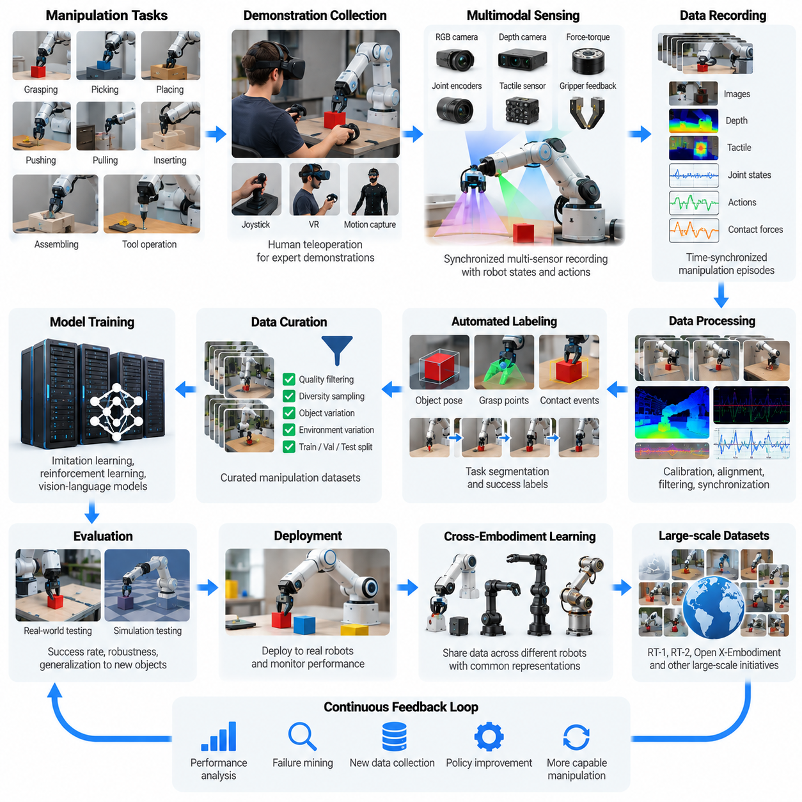{width="7.268055555555556in" height="7.268055555555556in"}

Robot manipulation data engines provide the infrastructure required to transform physical interaction experience into reusable learning resources. Unlike autonomous driving, manipulation involves direct contact with objects, complex force interactions, and precise motion control. A successful data engine must capture not only visual observations but also robot states, actions, contact conditions, task objectives, and outcomes across diverse manipulation environments.

Manipulation tasks include grasping, picking, placing, pushing, pulling, inserting, assembling, and tool operation. Each task introduces different geometric, dynamic, and contact constraints. A robot may successfully grasp a rigid object but fail when handling deformable materials or unfamiliar surfaces. Consequently, manipulation data engines must represent variations in object properties, environmental conditions, and interaction strategies.

A typical manipulation data engine integrates demonstration collection, multimodal recording, data synchronization, annotation, quality filtering, policy training, evaluation, and deployment feedback. These components form a closed learning loop in which robot execution generates new observations and failure cases. The collected experience is processed into training episodes that improve subsequent manipulation policies.

Teleoperation is a major source of manipulation demonstrations because human operators can guide robots through complex actions before autonomous policies become reliable. Interfaces may include joysticks, virtual reality controllers, motion capture systems, and bilateral master-slave manipulators. The resulting demonstrations provide coordinated sequences of observations, joint movements, end-effector trajectories, and gripper commands.

Demonstration quality depends on operator skill, interface responsiveness, robot morphology, and task complexity. Communication delays or poorly calibrated controllers can produce unnatural trajectories that are difficult for autonomous policies to imitate. Data engines therefore monitor motion smoothness, task completion, intervention frequency, and operator consistency while preserving useful corrective behaviors and recovery actions.

A manipulation episode generally begins with an initial scene configuration and a defined task objective. The robot observes its environment, executes a sequence of actions, and reaches a successful, unsuccessful, or interrupted outcome. Each episode should preserve initial conditions, object identities, robot configuration, action timestamps, and completion criteria so that training and evaluation remain reproducible.

Multimodal sensing is particularly important because visual information alone cannot fully describe physical contact. RGB cameras and depth sensors estimate object geometry and spatial relationships, while joint encoders provide proprioceptive measurements. Force-torque sensors, tactile arrays, and gripper feedback reveal contact forces, slip conditions, and interaction stability that may be invisible in camera images.

Temporal synchronization connects observations with the actions responsible for physical changes. A grasping policy must associate gripper closure with the object position and contact state observed at the corresponding moment. Even small timing errors can distort relationships between actions and outcomes, particularly during fast insertion, dynamic manipulation, or force-controlled assembly.

Action representation strongly influences how manipulation datasets support learning across robots. Joint-space commands describe individual actuator targets, while Cartesian-space actions represent end-effector positions, orientations, and relative movements. Gripper states, control frequencies, reference frames, and action horizons must be documented because identical numerical commands can produce different behaviors across hardware platforms.

Object diversity is a central requirement for manipulation generalization. Training collections should include variations in shape, size, texture, mass, friction, rigidity, and deformability. Environmental diversity introduces additional changes in lighting, background clutter, workspace geometry, and object arrangement. Without sufficient variation, policies may memorize familiar configurations rather than learn transferable manipulation skills.

Large-scale robot learning initiatives such as RT-1, RT-2, and Open X-Embodiment demonstrate different approaches to collecting and exploiting manipulation experience. RT-1 emphasized learning from large collections of real robot demonstrations, while RT-2 explored transferring vision-language knowledge into robotic actions. Open X-Embodiment investigated combining datasets collected from different robotic platforms to support broader policy generalization.

Cross-embodiment learning introduces challenges because manipulators differ in joint structures, reachability, gripper geometry, sensing capabilities, and control interfaces. A trajectory recorded on one robot cannot necessarily be executed directly on another. Data engines address this problem through standardized metadata, common task descriptions, coordinate transformations, and embodiment-aware action representations.

Automated labeling transforms raw manipulation recordings into structured information about objects, actions, and outcomes. Labels may describe object poses, grasp locations, contact events, task phases, and success conditions. Vision models can estimate geometric relationships, while robot telemetry provides direct measurements of joint motion and actuator behavior. Human review remains necessary when labels are uncertain.

Task segmentation divides long manipulation demonstrations into meaningful subtasks such as approaching an object, establishing contact, lifting, transporting, and releasing. These temporal boundaries support hierarchical policy learning and failure localization. Language annotations can additionally connect manipulation episodes with natural-language instructions, enabling vision-language-action models to associate goals with physical behavior.

Failure data is especially valuable because manipulation policies frequently encounter unexpected contact dynamics and object behavior. Examples include failed grasps, object slipping, collisions, unstable placement, and insertion misalignment. Rather than discarding unsuccessful episodes, advanced data engines preserve failure context and recovery attempts to improve robustness and support corrective policy learning.

Data curation must distinguish informative failures from corrupted or unusable recordings. Sensor dropouts, incorrect calibration, inconsistent coordinate frames, and incomplete trajectories can undermine learning quality. Automated validation checks identify these problems, while quality scoring evaluates task relevance, trajectory consistency, observation completeness, and the reliability of success annotations.

Dataset balancing prevents frequently demonstrated tasks from dominating model behavior. A collection containing thousands of simple pick-and-place episodes but few precision assembly demonstrations may produce strong basic grasping performance without comparable insertion capability. Task-aware sampling and diversity-based selection help allocate training resources across manipulation skills and environmental conditions.

Simulation provides an additional source of manipulation experience by generating object interactions under controlled physical conditions. Physics engines can model rigid-body motion, contact constraints, gravity, and friction while producing synchronized synthetic observations. Domain randomization varies object properties, sensor noise, and scene configurations to increase training diversity and reduce dependence on specific simulated environments.

However, contact-rich manipulation presents substantial simulation-to-reality challenges. Small inaccuracies in friction coefficients, object compliance, collision geometry, or actuator dynamics can change task outcomes. Deformable materials and complex tactile interactions are particularly difficult to reproduce faithfully. Effective data engines therefore combine synthetic experience with real-world demonstrations and targeted physical validation.

Policy learning may use behavioral cloning, diffusion-based action generation, reinforcement learning, or vision-language-action architectures. Behavioral cloning learns action patterns from demonstrations, while diffusion policies model complex distributions of possible action sequences. Reinforcement learning can optimize behavior through interaction, although reward design, exploration safety, and simulation fidelity influence practical effectiveness.

Evaluation must measure more than whether a robot completes a task once. Important metrics include success rate, execution time, positioning accuracy, contact stability, object damage, recovery capability, and performance under unfamiliar conditions. Repeated trials across varied objects and environments reveal whether improvements reflect genuine generalization or overfitting to familiar demonstrations.

Deployment feedback completes the manipulation data flywheel. Robots operating in warehouses, laboratories, and manufacturing facilities encounter new objects, workspace arrangements, and unexpected failures. Event-triggered recording captures difficult episodes, while uncertainty estimation identifies situations requiring human assistance. These observations can guide targeted data collection and subsequent policy updates.

Scaling manipulation data engines requires coordinated investment in robot hardware, teleoperation infrastructure, storage, annotation systems, simulation, and distributed training. Unlike passive internet data collection, physical demonstrations consume equipment time and operational resources. Improving data efficiency through active learning, automated quality assessment, and selective episode collection is therefore essential.

The broader significance of manipulation data engines lies in their ability to convert individual robot experiences into shared physical knowledge. Standardized episode formats, reusable task descriptions, cross-robot representations, and continuous evaluation support increasingly general manipulation policies. Their long-term objective is a reliable learning infrastructure through which robots progressively acquire transferable skills while maintaining safety, traceability, and operational robustness.

로봇 조작 데이터 엔진(Robot Manipulation Data Engine)은 물리적 상호작용 경험(Physical Interaction Experience)을 재사용 가능한 학습 자원(Reusable Learning Resource)으로 변환하는 데 필요한 인프라(Infrastructure)를 제공한다. 자율주행(Autonomous Driving)과 달리 로봇 조작(Manipulation)은 객체와의 직접적인 접촉(Direct Contact), 복잡한 힘의 상호작용(Force Interaction), 정밀한 운동 제어(Motion Control)를 포함한다. 성공적인 데이터 엔진은 시각적 관측뿐만 아니라 다양한 조작 환경에서 로봇 상태, 행동, 접촉 조건, 작업 목표, 실행 결과까지 수집해야 한다.

로봇 조작 작업(Manipulation Task)에는 파지(Grasping), 집기(Picking), 배치(Placing), 밀기(Pushing), 당기기(Pulling), 삽입(Inserting), 조립(Assembling), 도구 조작(Tool Operation)이 포함된다. 각 작업은 서로 다른 기하학적 제약(Geometric Constraint), 동역학적 제약(Dynamic Constraint), 접촉 제약(Contact Constraint)을 가진다. 로봇은 강체 객체(Rigid Object)를 성공적으로 파지하더라도 변형 가능한 재료(Deformable Material)나 익숙하지 않은 표면을 다룰 때 실패할 수 있다. 따라서 조작 데이터 엔진은 객체 특성, 환경 조건, 상호작용 전략의 다양성을 표현해야 한다.

일반적인 조작 데이터 엔진은 시연 데이터 수집(Demonstration Collection), 다중 모달 기록(Multimodal Recording), 데이터 동기화(Data Synchronization), 주석 처리(Annotation), 품질 필터링(Quality Filtering), 정책 학습(Policy Training), 평가(Evaluation), 배포 피드백(Deployment Feedback)을 통합한다. 이러한 구성 요소는 로봇 실행 과정에서 새로운 관측 데이터와 실패 사례를 생성하는 폐루프 학습 구조(Closed Learning Loop)를 형성한다. 수집된 경험은 후속 조작 정책의 성능을 개선하기 위한 학습 에피소드(Training Episode)로 처리된다.

원격조작(Teleoperation)은 자율 정책(Autonomous Policy)이 충분한 신뢰성을 확보하기 전에 인간 작업자가 복잡한 행동을 수행하도록 로봇을 안내할 수 있기 때문에 조작 시연 데이터(Manipulation Demonstration)의 주요 수집 방법이다. 인터페이스(Interface)에는 조이스틱(Joystick), 가상현실 컨트롤러(Virtual Reality Controller), 동작 포착 시스템(Motion Capture System), 양방향 마스터-슬레이브 매니퓰레이터(Bilateral Master-Slave Manipulator)가 포함될 수 있다. 수집된 시연은 관측, 관절 움직임, 말단효과기 궤적(End-Effector Trajectory), 그리퍼 명령(Gripper Command)이 조정된 시퀀스를 제공한다.

시연 품질(Demonstration Quality)은 작업자 숙련도(Operator Skill), 인터페이스 응답성(Interface Responsiveness), 로봇 형태(Robot Morphology), 작업 복잡도(Task Complexity)에 따라 달라진다. 통신 지연(Communication Delay)이나 부정확하게 보정된 컨트롤러는 자율 정책이 모방하기 어려운 부자연스러운 궤적을 생성할 수 있다. 따라서 데이터 엔진은 유용한 교정 행동(Corrective Behavior)과 복구 행동(Recovery Action)을 보존하면서 움직임의 부드러움(Motion Smoothness), 작업 완료 여부, 개입 빈도, 작업자 일관성을 모니터링한다.

조작 에피소드(Manipulation Episode)는 일반적으로 초기 장면 구성(Initial Scene Configuration)과 정의된 작업 목표(Task Objective)에서 시작된다. 로봇은 주변 환경을 관측하고 일련의 행동을 실행한 후 성공, 실패 또는 중단 상태에 도달한다. 각 에피소드는 학습과 평가의 재현 가능성(Reproducibility)을 확보할 수 있도록 초기 조건(Initial Condition), 객체 식별 정보(Object Identity), 로봇 구성(Robot Configuration), 행동 타임스탬프(Action Timestamp), 작업 완료 기준(Completion Criteria)을 보존해야 한다.

다중 모달 센싱(Multimodal Sensing)은 시각 정보만으로 물리적 접촉(Physical Contact)을 완전히 설명할 수 없기 때문에 특히 중요하다. RGB 카메라(RGB Camera)와 깊이 센서(Depth Sensor)는 객체 형상(Object Geometry)과 공간적 관계(Spatial Relationship)를 추정하며, 관절 엔코더(Joint Encoder)는 고유수용감각 측정값(Proprioceptive Measurement)을 제공한다. 힘-토크 센서(Force-Torque Sensor), 촉각 센서 배열(Tactile Array), 그리퍼 피드백(Gripper Feedback)은 카메라 영상에서 확인하기 어려운 접촉력(Contact Force), 미끄러짐 상태(Slip Condition), 상호작용 안정성(Interaction Stability)을 나타낸다.

시간 동기화(Temporal Synchronization)는 관측 데이터와 물리적 변화를 발생시킨 행동을 연결한다. 파지 정책(Grasping Policy)은 그리퍼가 닫히는 동작을 해당 시점에 관측된 객체 위치 및 접촉 상태와 연관시켜야 한다. 작은 시간 오차(Timing Error)도 행동과 결과 사이의 관계를 왜곡할 수 있으며, 특히 고속 삽입(Fast Insertion), 동적 조작(Dynamic Manipulation), 힘 제어 조립(Force-Controlled Assembly)에서 이러한 문제가 두드러진다.

행동 표현(Action Representation)은 조작 데이터셋이 서로 다른 로봇의 학습을 지원하는 방식에 큰 영향을 미친다. 관절 공간 명령(Joint-Space Command)은 개별 액추에이터(Actuator)의 목표값을 기술하며, 직교좌표 공간 행동(Cartesian-Space Action)은 말단효과기의 위치, 방향, 상대적 움직임을 표현한다. 그리퍼 상태(Gripper State), 제어 주파수(Control Frequency), 기준 좌표계(Reference Frame), 행동 시간 범위(Action Horizon)는 동일한 수치 명령이라도 하드웨어 플랫폼에 따라 서로 다른 행동을 생성할 수 있으므로 명확하게 문서화해야 한다.

객체 다양성(Object Diversity)은 조작 일반화(Manipulation Generalization)를 위한 핵심 요구사항이다. 학습 데이터에는 형상, 크기, 질감(Texture), 질량(Mass), 마찰(Friction), 강성(Rigidity), 변형 가능성(Deformability)의 변화가 포함되어야 한다. 환경 다양성(Environmental Diversity)은 조명, 배경의 복잡도(Background Clutter), 작업 공간 형상(Workspace Geometry), 객체 배치(Object Arrangement)의 변화를 추가한다. 충분한 다양성이 없으면 정책은 전이 가능한 조작 기술(Transferable Manipulation Skill)을 학습하기보다 익숙한 구성만 암기할 수 있다.

RT-1, RT-2, 오픈 X-엠보디먼트(Open X-Embodiment)와 같은 대규모 로봇 학습 프로젝트(Large-Scale Robot Learning Initiative)는 조작 경험을 수집하고 활용하는 서로 다른 접근법을 보여준다. RT-1은 대규모 실제 로봇 시연 데이터(Real Robot Demonstration)를 활용한 학습을 강조했으며, RT-2는 시각-언어 지식(Vision-Language Knowledge)을 로봇 행동으로 전이하는 방법을 탐구했다. 오픈 X-엠보디먼트는 다양한 로봇 플랫폼에서 수집한 데이터셋을 결합하여 더 폭넓은 정책 일반화를 지원하는 방법을 연구했다.

교차 형태 학습(Cross-Embodiment Learning)은 매니퓰레이터마다 관절 구조(Joint Structure), 도달 가능 영역(Reachability), 그리퍼 형상(Gripper Geometry), 센싱 능력(Sensing Capability), 제어 인터페이스(Control Interface)가 다르기 때문에 여러 과제를 발생시킨다. 한 로봇에서 기록된 궤적을 다른 로봇에서 반드시 직접 실행할 수 있는 것은 아니다. 데이터 엔진은 표준화된 메타데이터(Standardized Metadata), 공통 작업 설명(Common Task Description), 좌표 변환(Coordinate Transformation), 로봇 형태 인식 행동 표현(Embodiment-Aware Action Representation)을 통해 이러한 문제를 해결한다.

자동 라벨링(Automated Labeling)은 원시 조작 기록(Raw Manipulation Recording)을 객체, 행동, 결과에 관한 구조화된 정보(Structured Information)로 변환한다. 라벨(Label)은 객체 자세(Object Pose), 파지 위치(Grasp Location), 접촉 이벤트(Contact Event), 작업 단계(Task Phase), 성공 조건(Success Condition)을 기술할 수 있다. 비전 모델(Vision Model)은 기하학적 관계를 추정하고, 로봇 텔레메트리(Robot Telemetry)는 관절 운동과 액추에이터 동작에 대한 직접적인 측정값을 제공한다. 라벨이 불확실한 경우에는 여전히 인간 검토(Human Review)가 필요하다.

작업 분할(Task Segmentation)은 긴 조작 시연을 객체 접근(Approaching), 접촉 형성(Establishing Contact), 들어 올리기(Lifting), 운반(Transporting), 놓기(Releasing)와 같은 의미 있는 하위 작업(Subtask)으로 구분한다. 이러한 시간적 경계(Temporal Boundary)는 계층적 정책 학습(Hierarchical Policy Learning)과 실패 위치 식별(Failure Localization)을 지원한다. 언어 주석(Language Annotation)은 조작 에피소드와 자연어 명령(Natural-Language Instruction)을 연결하여 시각-언어-행동 모델(Vision-Language-Action Model)이 목표와 물리적 행동을 연관시키도록 한다.

실패 데이터(Failure Data)는 조작 정책이 예상하지 못한 접촉 동역학(Contact Dynamics)과 객체 행동(Object Behavior)을 자주 경험하기 때문에 특히 가치가 높다. 대표적인 사례에는 파지 실패(Failed Grasp), 객체 미끄러짐(Object Slipping), 충돌(Collision), 불안정한 배치(Unstable Placement), 삽입 정렬 오류(Insertion Misalignment)가 포함된다. 고도화된 데이터 엔진은 실패한 에피소드를 폐기하는 대신 실패 상황의 맥락(Failure Context)과 복구 시도(Recovery Attempt)를 보존하여 강건성(Robustness)을 개선하고 교정 정책 학습(Corrective Policy Learning)을 지원한다.

데이터 큐레이션(Data Curation)은 유용한 실패 데이터와 손상되었거나 사용할 수 없는 기록을 구분해야 한다. 센서 데이터 누락(Sensor Dropout), 잘못된 보정(Incorrect Calibration), 일관되지 않은 좌표계(Inconsistent Coordinate Frame), 불완전한 궤적(Incomplete Trajectory)은 학습 품질을 저하시킬 수 있다. 자동 검증 검사(Automated Validation Check)는 이러한 문제를 식별하며, 품질 점수화(Quality Scoring)는 작업 관련성(Task Relevance), 궤적 일관성(Trajectory Consistency), 관측 완전성(Observation Completeness), 성공 주석의 신뢰성(Reliability)을 평가한다.

데이터셋 균형화(Dataset Balancing)는 자주 시연된 작업이 모델 행동을 지배하는 현상을 방지한다. 수천 개의 단순한 집기 및 배치(Pick-and-Place) 에피소드가 포함되어 있지만 정밀 조립(Precision Assembly) 시연이 거의 없는 데이터셋은 기본적인 파지 성능은 우수하더라도 삽입 작업에서는 비슷한 수준의 성능을 보장하지 못할 수 있다. 작업 인식 샘플링(Task-Aware Sampling)과 다양성 기반 선택(Diversity-Based Selection)은 조작 기술과 환경 조건 전반에 학습 자원을 배분하도록 지원한다.

시뮬레이션(Simulation)은 통제된 물리적 조건에서 객체 상호작용을 생성함으로써 조작 경험의 추가적인 공급원이 된다. 물리 엔진(Physics Engine)은 강체 운동(Rigid-Body Motion), 접촉 제약(Contact Constraint), 중력(Gravity), 마찰(Friction)을 모델링하면서 동기화된 합성 관측 데이터(Synthetic Observation)를 생성할 수 있다. 도메인 무작위화(Domain Randomization)는 객체 특성, 센서 노이즈(Sensor Noise), 장면 구성(Scene Configuration)을 변화시켜 학습 다양성을 높이고 특정 시뮬레이션 환경에 대한 의존성을 줄인다.

그러나 접촉 중심 조작(Contact-Rich Manipulation)은 시뮬레이션에서 현실로의 전이(Simulation-to-Reality Transfer)에 상당한 어려움을 가진다. 마찰 계수(Friction Coefficient), 객체 순응성(Object Compliance), 충돌 형상(Collision Geometry), 액추에이터 동역학(Actuator Dynamics)의 작은 부정확성도 작업 결과를 변화시킬 수 있다. 변형 가능한 재료와 복잡한 촉각 상호작용(Tactile Interaction)은 특히 충실하게 재현하기 어렵다. 따라서 효과적인 데이터 엔진은 합성 경험(Synthetic Experience)을 실제 시연 데이터(Real-World Demonstration) 및 목표 지향적 물리 검증(Targeted Physical Validation)과 결합한다.

정책 학습(Policy Learning)은 행동 복제(Behavioral Cloning), 확산 기반 행동 생성(Diffusion-Based Action Generation), 강화학습(Reinforcement Learning), 시각-언어-행동 아키텍처(Vision-Language-Action Architecture)를 활용할 수 있다. 행동 복제는 시연으로부터 행동 패턴(Action Pattern)을 학습하며, 확산 정책(Diffusion Policy)은 가능한 행동 시퀀스의 복잡한 분포를 모델링한다. 강화학습은 상호작용을 통해 행동을 최적화할 수 있지만, 보상 설계(Reward Design), 탐색 안전성(Exploration Safety), 시뮬레이션 충실도(Simulation Fidelity)가 실제 효과에 영향을 미친다.

평가(Evaluation)는 로봇이 작업을 한 번 완료했는지만 측정해서는 안 된다. 중요한 지표에는 성공률(Success Rate), 실행 시간(Execution Time), 위치 정확도(Positioning Accuracy), 접촉 안정성(Contact Stability), 객체 손상(Object Damage), 복구 능력(Recovery Capability), 익숙하지 않은 조건에서의 성능이 포함된다. 다양한 객체와 환경에서 반복적으로 수행하는 시험(Repeated Trial)은 성능 개선이 실제 일반화에 따른 것인지, 익숙한 시연 데이터에 대한 과적합(Overfitting) 때문인지를 구분하는 데 도움이 된다.

배포 피드백(Deployment Feedback)은 조작 데이터 플라이휠(Manipulation Data Flywheel)을 완성한다. 창고(Warehouse), 실험실(Laboratory), 제조 시설(Manufacturing Facility)에서 운영되는 로봇은 새로운 객체, 작업 공간 배치, 예상하지 못한 실패를 경험한다. 이벤트 기반 기록(Event-Triggered Recording)은 어려운 에피소드를 수집하며, 불확실성 추정(Uncertainty Estimation)은 인간의 지원이 필요한 상황을 식별한다. 이러한 관측 데이터는 목표 지향적 데이터 수집(Targeted Data Collection)과 후속 정책 업데이트(Policy Update)를 안내할 수 있다.

조작 데이터 엔진의 확장(Scaling)에는 로봇 하드웨어(Robot Hardware), 원격조작 인프라(Teleoperation Infrastructure), 저장 시스템(Storage System), 주석 시스템(Annotation System), 시뮬레이션, 분산 학습(Distributed Training)에 대한 조정된 투자가 필요하다. 수동적인 인터넷 데이터 수집(Passive Internet Data Collection)과 달리 물리적 시연(Physical Demonstration)은 장비 사용 시간과 운영 자원을 소비한다. 따라서 능동학습(Active Learning), 자동 품질 평가(Automated Quality Assessment), 선택적 에피소드 수집(Selective Episode Collection)을 통한 데이터 효율성(Data Efficiency) 개선이 필수적이다.

조작 데이터 엔진의 더 넓은 중요성은 개별 로봇의 경험을 공유 가능한 물리적 지식(Shared Physical Knowledge)으로 전환하는 능력에 있다. 표준화된 에피소드 형식(Standardized Episode Format), 재사용 가능한 작업 설명(Reusable Task Description), 로봇 간 공통 표현(Cross-Robot Representation), 지속적인 평가(Continuous Evaluation)는 점점 더 범용적인 조작 정책(General Manipulation Policy)을 지원한다. 장기적인 목표는 안전성(Safety), 추적 가능성(Traceability), 운영 강건성(Operational Robustness)을 유지하면서 로봇이 전이 가능한 기술(Transferable Skill)을 점진적으로 습득할 수 있도록 하는 신뢰성 있는 학습 인프라(Reliable Learning Infrastructure)를 구축하는 것이다.

##  

## 10.03. Generalist Robot and VLA Datasets

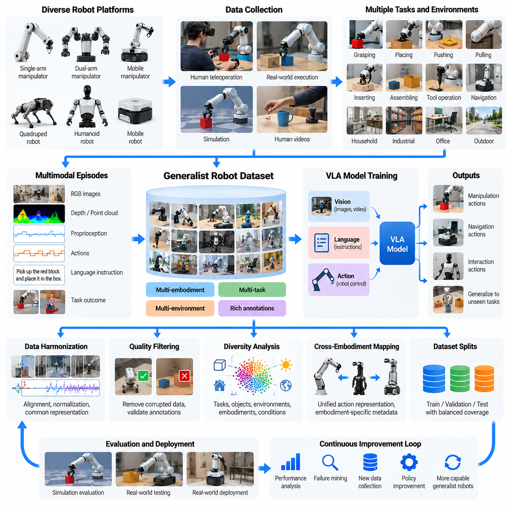{width="7.268055555555556in" height="7.268055555555556in"}

Generalist robot datasets represent a fundamental shift from task-specific robot learning toward broadly transferable physical intelligence. Traditional datasets focus on individual tasks, robots, or environments, while generalist datasets combine diverse experiences across manipulation, navigation, and interaction. Their objective is to support models that can interpret unfamiliar situations, understand instructions, and generate appropriate physical actions.

Vision-Language-Action models, commonly called VLA models, extend vision-language learning by connecting visual observations and natural-language instructions with executable robot actions. Their training datasets must represent relationships among perception, task intent, robot state, and physical behavior. Unlike image-text datasets, VLA datasets require temporally aligned action sequences that describe how robots interact with their environments.

A typical generalist robot dataset contains camera observations, language instructions, proprioceptive measurements, robot configurations, action trajectories, and task outcomes. Each episode describes a sequence of interactions rather than an isolated observation. Metadata identifies the robot platform, sensor configuration, coordinate frames, control frequency, task category, and environmental context required for meaningful interpretation.

The Open X-Embodiment initiative illustrates the importance of combining robotic experiences from heterogeneous platforms. Its dataset collection brought together demonstrations involving different robot embodiments, tasks, and research environments. This approach supports investigation of whether shared representations can transfer knowledge between robots, although differences in hardware, control interfaces, and data quality remain substantial challenges.

The RT-X research direction demonstrates how cross-embodiment datasets can support generalist policy development. Instead of training every robot exclusively on its own demonstrations, researchers investigate models trained on combined experience from multiple platforms. Such training may improve task transfer and robustness, but successful deployment still requires compatibility between learned actions and the target robot\'s physical capabilities.

RT-1 demonstrated the potential of large-scale real-world manipulation datasets for learning versatile robotic behaviors. Its training approach connected visual observations and language instructions with discretized robot actions. By learning from many task demonstrations, the model could perform multiple manipulation behaviors within its supported robot configuration, providing an influential reference for later generalist robot learning systems.

RT-2 extended this direction by investigating how vision-language models could incorporate robotic action generation. The central idea was to represent actions in a form compatible with language-model training, allowing knowledge acquired from visual and textual information to contribute to robot behavior. This approach highlighted the possibility of transferring semantic understanding into physical interaction capabilities.

The DROID dataset provides another important example of large-scale manipulation data collection across varied environments. Its collection strategy emphasizes real robot demonstrations gathered by multiple operators in diverse physical settings. Such datasets help researchers examine generalization across object arrangements, backgrounds, and task conditions, while also revealing the operational complexity of distributed robotic data collection.

Cross-embodiment dataset construction requires careful handling of differences in robot morphology and action spaces. Manipulators may have different joint counts, gripper mechanisms, reachability constraints, and coordinate conventions. A command expressed as joint positions on one platform cannot be transferred directly to another. Standardized action representations and embodiment-specific metadata are therefore essential.

Language annotation provides the connection between human task intent and robotic execution. Instructions may describe goals such as placing an object inside a container, opening a drawer, or arranging items on a surface. High-quality annotations should identify intended outcomes without introducing ambiguity or describing actions that are inconsistent with the recorded demonstration.

Temporal structure is equally important because generalist policies must understand how actions unfold over time. A manipulation episode may contain approach, grasp, transport, placement, and recovery phases. Accurate synchronization between video frames, proprioceptive measurements, and control commands enables models to associate observed changes with the actions that produced them.

Data harmonization transforms heterogeneous robot recordings into a common training representation. This process includes timestamp alignment, coordinate normalization, action conversion, camera calibration metadata, and consistent episode boundaries. However, normalization must preserve meaningful physical distinctions, because excessive standardization can remove information about robot dynamics or control limitations.

Dataset quality strongly influences the effectiveness of generalist robot training. Corrupted observations, inconsistent task descriptions, incomplete trajectories, and unreliable success labels can introduce conflicting learning signals. Automated validation and human review help identify these problems, while provenance tracking records how each episode was collected, processed, and incorporated into training.

Diversity is a central requirement for generalization, but diversity must be measured across meaningful dimensions. Task variety alone does not guarantee broad capability if object categories, environments, or action patterns remain repetitive. Effective datasets balance task complexity, object properties, robot embodiments, camera viewpoints, operator behavior, and environmental conditions.

Data mixture design determines how different sources contribute to generalist policy learning. Real robot demonstrations provide physically grounded action examples, while simulation offers scalable scenario generation. Human videos may contribute semantic and procedural knowledge, although they generally lack directly executable robot commands. Combining these sources requires careful treatment of differences in embodiment and supervision.

Large vision-language datasets can provide useful representations of objects, relationships, and instructions, but they cannot independently establish reliable motor control. Physical actions depend on contact dynamics, actuator constraints, timing, and feedback. Consequently, VLA training must integrate semantic knowledge with robot-specific experience and evaluation in interactive environments.

Action tokenization is an important design choice in VLA architectures. Continuous control commands may be discretized into tokens or represented through structured action vectors. The representation determines how the model expresses position, orientation, gripper state, and temporal action sequences. Quantization resolution and control frequency influence precision, smoothness, and compatibility across platforms.

Generalist models must also account for uncertainty when encountering unfamiliar tasks or environments. A language instruction may be clear while the corresponding physical action remains unsafe or infeasible. Training datasets should therefore include unsuccessful attempts, corrective demonstrations, intervention records, and explicit constraints that help models recognize limitations rather than blindly execute predicted actions.

Evaluation of generalist robot datasets requires separating memorization from genuine transfer. Models should be tested on unseen object combinations, novel instructions, unfamiliar environments, and, where appropriate, different robot platforms. Success rates should be accompanied by measures of safety, execution efficiency, recovery capability, and robustness to changes in observation conditions.

Dataset splitting is particularly challenging when demonstrations share objects, operators, environments, or repeated task configurations. Random episode splitting may allow closely related experiences to appear in both training and evaluation sets. More rigorous protocols isolate selected tasks, scenes, objects, or embodiments to provide stronger evidence of generalization beyond the training distribution.

Scaling generalist robot datasets introduces practical limitations that differ from conventional internet-scale machine learning. Physical demonstrations require robot hardware, trained operators, maintenance, calibration, and controlled workspaces. Data collection costs increase with task complexity and embodiment diversity, making automated curation, active learning, and targeted demonstration acquisition important for efficient scaling.

Governance becomes increasingly important when datasets combine contributions from multiple institutions and operational environments. Licensing conditions, data ownership, privacy requirements, and permitted model uses may differ between sources. Dataset documentation should preserve provenance, collection permissions, processing history, and access restrictions to support reproducibility and responsible reuse.

A sustainable generalist robot data engine extends beyond publishing a large dataset. It continuously identifies model weaknesses, collects targeted demonstrations, updates annotations, retrains policies, and evaluates improvements. Deployment feedback reveals new objects, unexpected failures, and previously unseen task conditions, transforming the dataset into an evolving learning infrastructure.

The long-term significance of generalist robot and VLA datasets lies in establishing shared foundations for transferable physical intelligence. Progress depends not only on increasing episode counts but also on improving task coverage, embodiment compatibility, action representations, and evaluation quality. Well-designed data engines can progressively connect semantic understanding with reliable physical execution across diverse robotic systems.

범용 로봇 데이터셋(Generalist Robot Dataset)은 작업별 로봇 학습(Task-Specific Robot Learning)에서 광범위하게 전이 가능한 물리적 지능(Transferable Physical Intelligence)으로 발전하는 근본적인 전환을 의미한다. 기존 데이터셋은 개별 작업, 로봇 또는 환경에 집중하는 반면, 범용 데이터셋은 조작(Manipulation), 내비게이션(Navigation), 상호작용(Interaction)에 걸친 다양한 경험을 결합한다. 이러한 데이터셋의 목적은 익숙하지 않은 상황을 해석하고 명령을 이해하며 적절한 물리적 행동을 생성할 수 있는 모델을 지원하는 것이다.

일반적으로 VLA 모델이라고 부르는 시각-언어-행동 모델(Vision-Language-Action Model, VLA)은 시각적 관측(Visual Observation)과 자연어 명령(Natural-Language Instruction)을 실행 가능한 로봇 행동(Executable Robot Action)에 연결함으로써 시각-언어 학습(Vision-Language Learning)을 확장한다. 이러한 모델의 학습 데이터셋은 인지(Perception), 작업 의도(Task Intent), 로봇 상태(Robot State), 물리적 행동(Physical Behavior) 사이의 관계를 표현해야 한다. 이미지-텍스트 데이터셋(Image-Text Dataset)과 달리 VLA 데이터셋은 로봇이 환경과 상호작용하는 과정을 설명하는 시간적으로 정렬된 행동 시퀀스(Temporally Aligned Action Sequence)를 필요로 한다.

일반적인 범용 로봇 데이터셋에는 카메라 관측(Camera Observation), 언어 명령(Language Instruction), 고유수용감각 측정값(Proprioceptive Measurement), 로봇 구성(Robot Configuration), 행동 궤적(Action Trajectory), 작업 결과(Task Outcome)가 포함된다. 각 에피소드(Episode)는 독립적인 관측이 아니라 일련의 상호작용을 설명한다. 메타데이터(Metadata)는 의미 있는 데이터 해석에 필요한 로봇 플랫폼(Robot Platform), 센서 구성(Sensor Configuration), 좌표계(Coordinate Frame), 제어 주파수(Control Frequency), 작업 범주(Task Category), 환경 맥락(Environmental Context)을 식별한다.

오픈 X-엠보디먼트(Open X-Embodiment) 프로젝트는 이기종 로봇 플랫폼(Heterogeneous Robot Platform)에서 수집된 경험을 결합하는 것이 얼마나 중요한지를 보여준다. 이 프로젝트의 데이터셋은 서로 다른 로봇 형태(Robot Embodiment), 작업(Task), 연구 환경(Research Environment)에서 수행된 시연 데이터를 통합했다. 이러한 접근법은 공유 표현(Shared Representation)이 로봇 간 지식 전이(Knowledge Transfer)를 지원할 수 있는지 연구하도록 하지만, 하드웨어(Hardware), 제어 인터페이스(Control Interface), 데이터 품질(Data Quality)의 차이는 여전히 중요한 과제로 남아 있다.

RT-X 연구 방향은 교차 형태 데이터셋(Cross-Embodiment Dataset)이 범용 정책 개발(Generalist Policy Development)을 지원하는 방식을 보여준다. 연구자들은 각 로봇을 자체 시연 데이터만으로 학습시키는 대신 여러 플랫폼에서 수집한 경험을 결합하여 모델을 학습하는 방법을 탐구한다. 이러한 학습은 작업 전이(Task Transfer)와 강건성(Robustness)을 개선할 수 있지만, 성공적인 배포(Deployment)를 위해서는 학습된 행동과 대상 로봇의 물리적 능력(Physical Capability) 사이의 호환성이 여전히 필요하다.

RT-1은 대규모 실제 환경 조작 데이터셋(Large-Scale Real-World Manipulation Dataset)을 활용하여 다양한 로봇 행동을 학습할 수 있는 가능성을 보여주었다. RT-1의 학습 접근법은 시각적 관측과 언어 명령을 이산화된 로봇 행동(Discretized Robot Action)에 연결했다. 다수의 작업 시연(Task Demonstration)으로부터 학습함으로써 모델은 지원되는 로봇 구성 내에서 여러 조작 행동을 수행할 수 있었으며, 이후 범용 로봇 학습 시스템(Generalist Robot Learning System)에 중요한 참고 사례를 제공했다.

RT-2는 시각-언어 모델(Vision-Language Model)이 로봇 행동 생성(Robot Action Generation)을 통합할 수 있는 방법을 연구함으로써 이러한 방향을 확장했다. 핵심 아이디어는 행동을 언어 모델 학습(Language-Model Training)과 호환되는 형태로 표현하여 시각 및 텍스트 정보에서 습득한 지식이 로봇 행동에 기여하도록 하는 것이었다. 이러한 접근법은 의미론적 이해(Semantic Understanding)를 물리적 상호작용 능력(Physical Interaction Capability)으로 전이할 수 있는 가능성을 강조했다.

드로이드 데이터셋(DROID Dataset)은 다양한 환경에서 대규모 조작 데이터를 수집한 또 다른 중요한 사례이다. 데이터 수집 전략(Collection Strategy)은 여러 작업자가 다양한 물리적 환경에서 수집한 실제 로봇 시연 데이터(Real Robot Demonstration)를 강조한다. 이러한 데이터셋은 객체 배치(Object Arrangement), 배경(Background), 작업 조건(Task Condition)에 걸친 일반화(Generalization)를 연구하도록 지원하며, 동시에 분산형 로봇 데이터 수집(Distributed Robotic Data Collection)의 운영상 복잡성을 보여준다.

교차 형태 데이터셋 구축(Cross-Embodiment Dataset Construction)은 로봇 형태(Robot Morphology)와 행동 공간(Action Space)의 차이를 신중하게 처리해야 한다. 매니퓰레이터(Manipulator)는 관절 수(Joint Count), 그리퍼 메커니즘(Gripper Mechanism), 도달 가능 영역 제약(Reachability Constraint), 좌표계 규약(Coordinate Convention)이 서로 다를 수 있다. 한 플랫폼에서 관절 위치(Joint Position)로 표현된 명령을 다른 플랫폼에 직접 전이할 수는 없다. 따라서 표준화된 행동 표현(Standardized Action Representation)과 로봇 형태별 메타데이터(Embodiment-Specific Metadata)가 필수적이다.

언어 주석(Language Annotation)은 인간의 작업 의도(Human Task Intent)와 로봇 실행(Robotic Execution)을 연결한다. 명령은 객체를 용기 안에 넣거나 서랍을 열거나 물체를 표면 위에 정렬하는 것과 같은 목표를 설명할 수 있다. 고품질 주석(High-Quality Annotation)은 모호성을 유발하거나 기록된 시연과 일치하지 않는 행동을 설명하지 않으면서 의도된 결과(Intended Outcome)를 명확하게 식별해야 한다.

시간적 구조(Temporal Structure)도 범용 정책(Generalist Policy)이 행동이 시간에 따라 어떻게 전개되는지 이해해야 하므로 매우 중요하다. 하나의 조작 에피소드(Manipulation Episode)에는 접근(Approach), 파지(Grasp), 운반(Transport), 배치(Placement), 복구(Recovery) 단계가 포함될 수 있다. 비디오 프레임(Video Frame), 고유수용감각 측정값(Proprioceptive Measurement), 제어 명령(Control Command) 사이의 정확한 동기화(Synchronization)는 모델이 관측된 변화와 이를 발생시킨 행동을 연결하도록 한다.

데이터 조화(Data Harmonization)는 이기종 로봇 기록(Heterogeneous Robot Recording)을 공통 학습 표현(Common Training Representation)으로 변환한다. 이 과정에는 타임스탬프 정렬(Timestamp Alignment), 좌표 정규화(Coordinate Normalization), 행동 변환(Action Conversion), 카메라 보정 메타데이터(Camera Calibration Metadata), 일관된 에피소드 경계(Consistent Episode Boundary)가 포함된다. 그러나 과도한 표준화(Excessive Standardization)는 로봇 동역학(Robot Dynamics)이나 제어 한계(Control Limitation)에 관한 중요한 정보를 제거할 수 있으므로 정규화 과정에서도 의미 있는 물리적 차이를 보존해야 한다.

데이터셋 품질(Dataset Quality)은 범용 로봇 학습(Generalist Robot Training)의 효과에 큰 영향을 미친다. 손상된 관측 데이터(Corrupted Observation), 일관되지 않은 작업 설명(Inconsistent Task Description), 불완전한 궤적(Incomplete Trajectory), 신뢰할 수 없는 성공 라벨(Unreliable Success Label)은 상충하는 학습 신호(Conflicting Learning Signal)를 발생시킬 수 있다. 자동 검증(Automated Validation)과 인간 검토(Human Review)는 이러한 문제를 식별하도록 지원하며, 출처 추적(Provenance Tracking)은 각 에피소드가 수집되고 처리되어 학습에 포함된 과정을 기록한다.

다양성(Diversity)은 일반화(Generalization)를 위한 핵심 요구사항이지만, 의미 있는 여러 차원에서 측정되어야 한다. 객체 범주(Object Category), 환경(Environment), 행동 패턴(Action Pattern)이 반복적으로 유지된다면 작업 종류(Task Variety)가 많다는 사실만으로 광범위한 능력을 보장할 수 없다. 효과적인 데이터셋은 작업 복잡도(Task Complexity), 객체 특성(Object Property), 로봇 형태(Robot Embodiment), 카메라 시점(Camera Viewpoint), 작업자 행동(Operator Behavior), 환경 조건(Environmental Condition)의 균형을 유지한다.

데이터 혼합 설계(Data Mixture Design)는 서로 다른 데이터 소스(Data Source)가 범용 정책 학습에 기여하는 방식을 결정한다. 실제 로봇 시연(Real Robot Demonstration)은 물리적으로 검증된 행동 사례를 제공하며, 시뮬레이션(Simulation)은 확장 가능한 시나리오 생성(Scalable Scenario Generation)을 지원한다. 인간 비디오(Human Video)는 의미론적 지식(Semantic Knowledge)과 절차적 지식(Procedural Knowledge)을 제공할 수 있지만, 일반적으로 직접 실행 가능한 로봇 명령은 포함하지 않는다. 이러한 데이터 소스를 결합하려면 로봇 형태와 감독 신호(Supervision)의 차이를 신중하게 처리해야 한다.

대규모 시각-언어 데이터셋(Large Vision-Language Dataset)은 객체, 관계, 명령에 관한 유용한 표현(Representation)을 제공할 수 있지만, 그것만으로 신뢰성 있는 운동 제어(Reliable Motor Control)를 확립할 수는 없다. 물리적 행동은 접촉 동역학(Contact Dynamics), 액추에이터 제약(Actuator Constraint), 타이밍(Timing), 피드백(Feedback)에 의존한다. 따라서 VLA 학습은 의미론적 지식과 로봇별 경험(Robot-Specific Experience)을 통합하고, 상호작용형 환경(Interactive Environment)에서 평가해야 한다.

행동 토큰화(Action Tokenization)는 VLA 아키텍처(VLA Architecture)에서 중요한 설계 선택 사항이다. 연속 제어 명령(Continuous Control Command)은 토큰(Token)으로 이산화하거나 구조화된 행동 벡터(Structured Action Vector)로 표현할 수 있다. 이러한 표현 방식은 모델이 위치(Position), 방향(Orientation), 그리퍼 상태(Gripper State), 시간적 행동 시퀀스(Temporal Action Sequence)를 표현하는 방법을 결정한다. 양자화 해상도(Quantization Resolution)와 제어 주파수(Control Frequency)는 정밀도(Precision), 움직임의 부드러움(Smoothness), 플랫폼 간 호환성(Cross-Platform Compatibility)에 영향을 미친다.

범용 모델(Generalist Model)은 익숙하지 않은 작업이나 환경을 만났을 때 발생하는 불확실성(Uncertainty)도 고려해야 한다. 언어 명령은 명확하더라도 그에 대응하는 물리적 행동은 안전하지 않거나 실행 불가능할 수 있다. 따라서 학습 데이터셋에는 실패한 시도(Unsuccessful Attempt), 교정 시연(Corrective Demonstration), 개입 기록(Intervention Record), 명시적 제약(Explicit Constraint)을 포함하여 모델이 예측된 행동을 무조건 실행하기보다 자신의 한계를 인식하도록 지원해야 한다.

범용 로봇 데이터셋의 평가(Evaluation)는 암기(Memorization)와 실제 전이(Genuine Transfer)를 구분해야 한다. 모델은 학습에서 보지 못한 객체 조합(Unseen Object Combination), 새로운 명령(Novel Instruction), 익숙하지 않은 환경(Unfamiliar Environment), 필요한 경우 서로 다른 로봇 플랫폼에서 테스트해야 한다. 성공률(Success Rate)과 함께 안전성(Safety), 실행 효율성(Execution Efficiency), 복구 능력(Recovery Capability), 관측 조건 변화에 대한 강건성(Robustness)을 측정해야 한다.

데이터셋 분할(Dataset Splitting)은 시연 데이터가 객체, 작업자, 환경 또는 반복적인 작업 구성을 공유하는 경우 특히 어렵다. 무작위 에피소드 분할(Random Episode Splitting)은 밀접하게 관련된 경험이 학습 데이터와 평가 데이터에 동시에 포함되도록 할 수 있다. 더욱 엄격한 평가 프로토콜(Evaluation Protocol)은 특정 작업, 장면(Scene), 객체 또는 로봇 형태를 분리하여 학습 분포(Training Distribution)를 벗어난 일반화 능력에 대한 더 강력한 근거를 제공한다.

범용 로봇 데이터셋의 규모 확장(Scaling)은 기존 인터넷 규모 기계학습(Internet-Scale Machine Learning)과 다른 실질적인 한계를 가진다. 물리적 시연(Physical Demonstration)에는 로봇 하드웨어(Robot Hardware), 숙련된 작업자(Trained Operator), 유지보수(Maintenance), 보정(Calibration), 통제된 작업 공간(Controlled Workspace)이 필요하다. 데이터 수집 비용(Data Collection Cost)은 작업 복잡도와 로봇 형태 다양성이 증가함에 따라 높아지므로 자동 큐레이션(Automated Curation), 능동학습(Active Learning), 목표 지향적 시연 데이터 확보(Targeted Demonstration Acquisition)가 효율적인 확장에 중요하다.

데이터셋이 여러 기관과 운영 환경에서 제공된 데이터를 결합할수록 거버넌스(Governance)의 중요성이 커진다. 라이선스 조건(Licensing Condition), 데이터 소유권(Data Ownership), 개인정보 보호 요구사항(Privacy Requirement), 허용된 모델 사용 범위(Permitted Model Use)는 데이터 소스마다 다를 수 있다. 데이터셋 문서화(Dataset Documentation)는 재현 가능성(Reproducibility)과 책임 있는 재사용(Responsible Reuse)을 지원하기 위해 출처(Provenance), 수집 허가(Collection Permission), 처리 이력(Processing History), 접근 제한(Access Restriction)을 보존해야 한다.

지속 가능한 범용 로봇 데이터 엔진(Sustainable Generalist Robot Data Engine)은 단순히 대규모 데이터셋을 공개하는 수준을 넘어선다. 데이터 엔진은 모델의 약점(Model Weakness)을 지속적으로 식별하고, 목표 지향적 시연(Targeted Demonstration)을 수집하며, 주석(Annotation)을 업데이트하고, 정책(Policy)을 재학습하며, 개선 효과를 평가한다. 배포 피드백(Deployment Feedback)은 새로운 객체, 예상하지 못한 실패, 이전에 경험하지 못한 작업 조건을 드러내어 데이터셋을 지속적으로 발전하는 학습 인프라(Evolving Learning Infrastructure)로 전환한다.

범용 로봇 및 VLA 데이터셋의 장기적인 중요성은 전이 가능한 물리적 지능(Transferable Physical Intelligence)을 위한 공유 기반(Shared Foundation)을 구축하는 데 있다. 발전은 에피소드 수(Episode Count)를 늘리는 것뿐만 아니라 작업 적용 범위(Task Coverage), 로봇 형태 호환성(Embodiment Compatibility), 행동 표현(Action Representation), 평가 품질(Evaluation Quality)을 개선하는 데 달려 있다. 잘 설계된 데이터 엔진은 다양한 로봇 시스템 전반에서 의미론적 이해(Semantic Understanding)와 신뢰성 있는 물리적 실행(Reliable Physical Execution)을 점진적으로 연결할 수 있다.

##  

## 10.04. Humanoid Data Engines

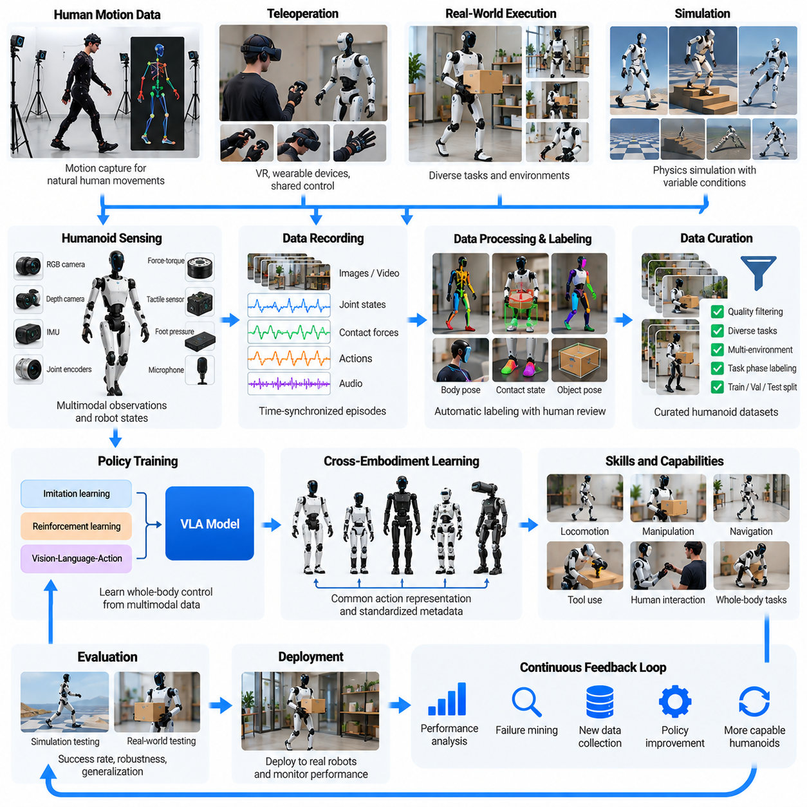{width="7.268055555555556in" height="7.268055555555556in"}

Humanoid data engines provide the infrastructure for collecting, processing, and transforming human-like robot experiences into scalable learning resources. Unlike fixed manipulators or wheeled robots, humanoids must coordinate locomotion, balance, manipulation, and whole-body interaction. Their data engines therefore capture synchronized observations, joint states, contact forces, actions, and outcomes across diverse tasks and environments.

Humanoid learning requires data that reflects the interaction between body morphology, physical dynamics, and environmental constraints. A reaching movement may change the robot\'s center of mass, while carrying an object can alter balance and walking stability. Consequently, humanoid datasets must represent coordinated whole-body behavior rather than treating arm manipulation and leg locomotion as completely independent activities.

A typical humanoid data engine integrates teleoperation, motion capture, onboard sensing, simulation, episode storage, automated labeling, policy training, and deployment feedback. These components form a continuous learning loop in which physical execution produces new training information. Successful demonstrations, failures, human interventions, and recovery behaviors all contribute to improving robot capabilities.

Human motion data represents an important source of humanoid learning information because humanoid bodies share certain structural similarities with humans. Motion capture systems can record walking, reaching, bending, lifting, and coordinated manipulation. However, differences in joint geometry, mass distribution, actuator characteristics, and balance constraints prevent direct reproduction of human movements without adaptation.

Motion retargeting transforms recorded human movements into trajectories compatible with humanoid robot morphology. This process maps human skeletal poses onto robot joints while respecting joint limits, collision constraints, contact conditions, and dynamic feasibility. High-quality retargeting preserves task-relevant movement patterns without assuming that human and robot bodies possess identical physical capabilities.

Teleoperation provides another major source of humanoid training data. Operators may control robot arms, hands, upper bodies, or whole-body motion through virtual reality interfaces, wearable devices, or motion capture systems. Shared-control architectures can combine human task guidance with autonomous balance stabilization, reducing operator workload while maintaining physically feasible robot behavior.

Humanoid teleoperation introduces challenges involving latency, operator embodiment, and control coordination. Human operators may issue movements that exceed robot joint limits or destabilize its posture. Safety controllers must constrain these commands while preserving useful task information. Recording both operator intentions and executed robot actions helps distinguish demonstration objectives from hardware-limited behavior.

Multimodal sensing is essential because humanoids interact with environments through multiple contact points. Cameras and depth sensors provide visual scene understanding, while joint encoders and inertial measurement units describe body configuration and motion. Foot pressure sensors, force-torque sensors, and tactile feedback reveal support conditions, grasp stability, and physical interactions that visual observations alone cannot explain.

Whole-body data representation must capture relationships among torso orientation, limb configurations, center of mass, contact locations, and external forces. Walking while carrying an object requires coordinated adjustments across the legs, trunk, and arms. Dataset formats should therefore preserve synchronized kinematic and dynamic information rather than reducing complex movements to isolated end-effector trajectories.

Humanoid episodes may involve locomotion, object manipulation, navigation, tool use, and human interaction within a single task sequence. For example, a robot may approach a shelf, stabilize its posture, grasp an object, turn, and transport it to another location. Such episodes require long-horizon temporal structure and explicit representations of task phases, transitions, and completion conditions.

Contact events are particularly important for humanoid learning because locomotion depends on repeated transitions between support configurations. Heel contact, toe-off, double support, and single-leg support influence stability and motion planning. Manipulation adds further contact relationships involving hands, objects, and surrounding surfaces, making accurate contact labeling essential for learning coordinated physical behavior.

Automated labeling pipelines can derive joint trajectories, body poses, contact states, object locations, and task outcomes from recorded sensor streams. Physics-based estimation and temporal reconstruction help infer quantities that are difficult to observe directly. However, labeling errors in contact timing, coordinate transformations, or force estimates can significantly affect the quality of learned locomotion and manipulation policies.

Simulation plays a central role in humanoid data generation because physical experimentation can be expensive and risky. Physics engines allow repeated training of walking, balancing, turning, recovering, and object interaction under controlled conditions. Parallel simulation environments can generate large quantities of experience while varying terrain, friction, disturbances, payloads, and actuator characteristics.

Reinforcement learning is frequently used to develop humanoid locomotion and stabilization policies in simulation. Reward functions may encourage velocity tracking, energy efficiency, balance preservation, and smooth movement. Domain randomization introduces variations in physical parameters to improve robustness, although successful simulation performance does not automatically guarantee reliable behavior on physical hardware.

Simulation-to-reality transfer remains challenging because humanoid systems exhibit complex contact dynamics and tightly coupled motion. Small differences in actuator response, joint friction, structural compliance, or ground contact can destabilize learned behaviors. Effective data engines combine simulated experience with real robot measurements, system identification, controlled testing, and targeted policy adaptation.

Failure and recovery data are especially valuable for humanoid robots because instability can propagate across the entire body. Slipping, stumbling, unexpected contact, object dropping, and failed grasping can produce cascading failures. Recording precursor conditions, corrective actions, and recovery outcomes helps learning systems distinguish recoverable disturbances from situations requiring protective shutdown.

Data curation must evaluate both task achievement and physical safety. A demonstration may complete an object transfer while producing excessive joint torque, unstable posture, or dangerous contact forces. Quality assessment should therefore consider success rate, motion smoothness, balance margins, actuator limits, energy consumption, and collision risk alongside conventional task performance metrics.

Cross-embodiment learning is difficult because humanoid platforms differ in height, mass, joint arrangements, hand dexterity, actuator strength, and sensing capabilities. A policy trained on one platform may not transfer directly to another. Embodiment-aware representations, morphology metadata, and standardized task descriptions can improve data reuse while preserving platform-specific physical constraints.

Vision-Language-Action models offer a pathway for connecting humanoid perception, natural-language instructions, and physical behavior. Language can specify high-level goals, while learned policies translate those goals into coordinated movement sequences. However, VLA-generated actions must remain compatible with real-time balance control, collision avoidance, and hardware safety constraints.

Hierarchical control architectures can separate task reasoning from high-frequency physical stabilization. A high-level policy may select navigation, grasping, or placement objectives, while lower-level controllers manage joint trajectories, contact forces, and balance. Humanoid data engines should record information across these control layers so that training can connect task intentions with physical execution.

Evaluation of humanoid data engines requires measuring generalization across tasks, objects, terrain, and environmental conditions. Important metrics include task completion, locomotion stability, manipulation precision, recovery success, energy efficiency, and intervention frequency. Long-horizon evaluations reveal whether individually successful skills remain reliable when combined into extended autonomous activities.

Fleet-scale deployment creates opportunities to collect humanoid experiences from factories, warehouses, laboratories, and service environments. Robots operating at different sites encounter variations in objects, layouts, surfaces, and human behavior. Event-triggered logging and uncertainty-based sampling can prioritize informative episodes while reducing unnecessary storage and communication costs.

Data governance becomes important because humanoids frequently operate near people and may record identifiable visual, audio, and behavioral information. Responsible collection systems require appropriate permissions, privacy safeguards, access controls, and retention policies. Operational datasets should also preserve provenance, hardware configuration, software versions, and intervention histories to support reproducibility and safety investigations.

Scaling humanoid data engines involves substantial hardware and operational costs. Physical demonstrations require robots, operators, maintenance, calibration, and safe testing facilities. Simulation can reduce some collection expenses, but real-world contact experience remains necessary. Efficient scaling therefore depends on combining human demonstrations, synthetic trajectories, active data selection, and automated quality assessment.

The long-term objective of humanoid data engines is to establish a continuous learning infrastructure that converts diverse whole-body experiences into transferable physical skills. Progress depends on integrating motion understanding, contact-rich interaction, multimodal sensing, simulation, and safety-aware evaluation. Such systems can support increasingly capable humanoid robots while maintaining the reliability required for operation in human environments.

휴머노이드 데이터 엔진(Humanoid Data Engine)은 인간과 유사한 로봇의 경험을 수집하고 처리하여 확장 가능한 학습 자원(Scalable Learning Resource)으로 변환하기 위한 인프라(Infrastructure)를 제공한다. 고정형 매니퓰레이터(Fixed Manipulator)나 바퀴형 로봇(Wheeled Robot)과 달리 휴머노이드(Humanoid)는 이동(Locomotion), 균형(Balance), 조작(Manipulation), 전신 상호작용(Whole-Body Interaction)을 통합적으로 조정해야 한다. 따라서 데이터 엔진은 다양한 작업과 환경에서 동기화된 관측 데이터, 관절 상태, 접촉력, 행동, 실행 결과를 수집한다.

휴머노이드 학습(Humanoid Learning)에는 신체 형태(Body Morphology), 물리적 동역학(Physical Dynamics), 환경적 제약(Environmental Constraint) 사이의 상호작용을 반영하는 데이터가 필요하다. 팔을 뻗는 동작은 로봇의 질량중심(Center of Mass)을 변화시킬 수 있으며, 물체를 운반하는 행동은 균형과 보행 안정성(Walking Stability)에 영향을 미칠 수 있다. 따라서 휴머노이드 데이터셋(Humanoid Dataset)은 팔 조작과 다리 이동을 완전히 독립적인 활동으로 취급하기보다 전신의 협응 행동(Coordinated Whole-Body Behavior)을 표현해야 한다.

일반적인 휴머노이드 데이터 엔진은 원격조작(Teleoperation), 동작 포착(Motion Capture), 온보드 센싱(Onboard Sensing), 시뮬레이션(Simulation), 에피소드 저장(Episode Storage), 자동 라벨링(Automated Labeling), 정책 학습(Policy Training), 배포 피드백(Deployment Feedback)을 통합한다. 이러한 구성 요소는 물리적 실행(Physical Execution)이 새로운 학습 정보를 생성하는 지속 학습 루프(Continuous Learning Loop)를 형성한다. 성공적인 시연, 실패, 인간의 개입, 복구 행동은 모두 로봇의 능력을 개선하는 데 기여한다.

인간 동작 데이터(Human Motion Data)는 휴머노이드 신체가 인간과 일정한 구조적 유사성(Structural Similarity)을 공유하기 때문에 중요한 학습 정보의 원천이다. 동작 포착 시스템(Motion Capture System)은 걷기, 팔 뻗기, 몸 굽히기, 들어 올리기, 협응 조작(Coordinated Manipulation)을 기록할 수 있다. 그러나 관절 형상(Joint Geometry), 질량 분포(Mass Distribution), 액추에이터 특성(Actuator Characteristic), 균형 제약(Balance Constraint)의 차이로 인해 인간 동작을 별도의 적응 과정 없이 직접 재현할 수는 없다.

동작 리타기팅(Motion Retargeting)은 기록된 인간 동작을 휴머노이드 로봇의 신체 형태에 적합한 궤적(Trajectory)으로 변환한다. 이 과정은 관절 한계(Joint Limit), 충돌 제약(Collision Constraint), 접촉 조건(Contact Condition), 동역학적 실행 가능성(Dynamic Feasibility)을 준수하면서 인간 골격 자세(Human Skeletal Pose)를 로봇 관절에 매핑(Mapping)한다. 고품질 리타기팅(High-Quality Retargeting)은 인간과 로봇의 신체가 동일한 물리적 능력을 가진다고 가정하지 않으면서 작업과 관련된 움직임 패턴을 보존한다.

원격조작(Teleoperation)은 휴머노이드 학습 데이터를 확보하는 또 다른 주요 방법이다. 작업자는 가상현실 인터페이스(Virtual Reality Interface), 웨어러블 장치(Wearable Device), 동작 포착 시스템을 통해 로봇 팔, 손, 상체 또는 전신 움직임을 제어할 수 있다. 공유 제어 아키텍처(Shared-Control Architecture)는 인간의 작업 지시(Human Task Guidance)와 자율 균형 안정화(Autonomous Balance Stabilization)를 결합하여 물리적으로 실행 가능한 로봇 행동을 유지하면서 작업자의 부담을 줄일 수 있다.

휴머노이드 원격조작은 지연시간(Latency), 작업자 신체 대응(Operator Embodiment), 제어 협응(Control Coordination)과 관련된 문제를 발생시킨다. 인간 작업자는 로봇의 관절 한계를 초과하거나 자세를 불안정하게 만드는 움직임을 지시할 수 있다. 안전 제어기(Safety Controller)는 유용한 작업 정보를 보존하면서 이러한 명령을 제한해야 한다. 작업자의 의도(Operator Intention)와 실제 실행된 로봇 행동(Executed Robot Action)을 모두 기록하면 시연 목표와 하드웨어 제약으로 제한된 행동을 구분할 수 있다.

다중 모달 센싱(Multimodal Sensing)은 휴머노이드가 여러 접촉 지점(Contact Point)을 통해 환경과 상호작용하기 때문에 필수적이다. 카메라와 깊이 센서(Depth Sensor)는 시각적 장면 이해(Visual Scene Understanding)를 제공하며, 관절 엔코더(Joint Encoder)와 관성측정장치(Inertial Measurement Unit, IMU)는 신체 구성과 움직임을 나타낸다. 발 압력 센서(Foot Pressure Sensor), 힘-토크 센서(Force-Torque Sensor), 촉각 피드백(Tactile Feedback)은 시각적 관측만으로 설명할 수 없는 지지 조건(Support Condition), 파지 안정성(Grasp Stability), 물리적 상호작용을 나타낸다.

전신 데이터 표현(Whole-Body Data Representation)은 몸통 방향(Torso Orientation), 사지 구성(Limb Configuration), 질량중심(Center of Mass), 접촉 위치(Contact Location), 외력(External Force) 사이의 관계를 포착해야 한다. 물체를 운반하면서 걷는 행동은 다리, 몸통, 팔 전체에 걸친 협응 조정을 필요로 한다. 따라서 데이터셋 형식(Dataset Format)은 복잡한 움직임을 개별 말단효과기 궤적(End-Effector Trajectory)으로 단순화하기보다 동기화된 운동학적 정보(Kinematic Information)와 동역학적 정보(Dynamic Information)를 보존해야 한다.

휴머노이드 에피소드(Humanoid Episode)는 하나의 작업 시퀀스(Task Sequence) 안에서 이동, 객체 조작(Object Manipulation), 내비게이션(Navigation), 도구 사용(Tool Use), 인간과의 상호작용(Human Interaction)을 포함할 수 있다. 예를 들어 로봇은 선반에 접근하고 자세를 안정화한 후 물체를 파지하고 방향을 전환하여 다른 위치로 운반할 수 있다. 이러한 에피소드는 장기 시간 구조(Long-Horizon Temporal Structure)와 작업 단계(Task Phase), 전환(Transition), 완료 조건(Completion Condition)에 대한 명시적 표현을 필요로 한다.

접촉 이벤트(Contact Event)는 휴머노이드 이동이 지지 구성(Support Configuration) 사이의 반복적인 전환에 의존하기 때문에 특히 중요하다. 발뒤꿈치 접촉(Heel Contact), 발끝 이탈(Toe-Off), 양발 지지(Double Support), 한발 지지(Single-Leg Support)는 안정성과 운동 계획(Motion Planning)에 영향을 미친다. 조작 행동은 손, 객체, 주변 표면 사이의 추가적인 접촉 관계를 발생시키므로 정확한 접촉 라벨링(Contact Labeling)은 협응된 물리적 행동을 학습하는 데 필수적이다.

자동 라벨링 파이프라인(Automated Labeling Pipeline)은 기록된 센서 스트림(Sensor Stream)으로부터 관절 궤적(Joint Trajectory), 신체 자세(Body Pose), 접촉 상태(Contact State), 객체 위치(Object Location), 작업 결과(Task Outcome)를 추출할 수 있다. 물리 기반 추정(Physics-Based Estimation)과 시간적 재구성(Temporal Reconstruction)은 직접 관측하기 어려운 물리량을 추론하는 데 도움이 된다. 그러나 접촉 시점(Contact Timing), 좌표 변환(Coordinate Transformation), 힘 추정(Force Estimation)의 라벨링 오류는 학습된 이동 및 조작 정책의 품질에 상당한 영향을 미칠 수 있다.

시뮬레이션(Simulation)은 실제 휴머노이드 실험이 비용이 많이 들고 위험할 수 있기 때문에 데이터 생성(Data Generation)에서 핵심적인 역할을 한다. 물리 엔진(Physics Engine)은 통제된 조건에서 걷기, 균형 유지, 방향 전환, 복구, 객체 상호작용을 반복적으로 학습할 수 있도록 한다. 병렬 시뮬레이션 환경(Parallel Simulation Environment)은 지형(Terrain), 마찰(Friction), 외란(Disturbance), 탑재 하중(Payload), 액추에이터 특성을 변화시키면서 대량의 경험 데이터를 생성할 수 있다.

강화학습(Reinforcement Learning)은 시뮬레이션에서 휴머노이드 이동 정책(Locomotion Policy)과 안정화 정책(Stabilization Policy)을 개발하는 데 자주 사용된다. 보상 함수(Reward Function)는 속도 추종(Velocity Tracking), 에너지 효율(Energy Efficiency), 균형 유지(Balance Preservation), 부드러운 움직임(Smooth Movement)을 장려하도록 설계할 수 있다. 도메인 무작위화(Domain Randomization)는 강건성(Robustness)을 높이기 위해 물리적 매개변수(Physical Parameter)에 변화를 도입하지만, 시뮬레이션에서의 성공적인 성능이 실제 하드웨어에서의 신뢰성 있는 행동을 자동으로 보장하지는 않는다.

시뮬레이션에서 현실로의 전이(Simulation-to-Reality Transfer)는 휴머노이드 시스템이 복잡한 접촉 동역학(Contact Dynamics)과 강하게 결합된 움직임(Coupled Motion)을 나타내기 때문에 여전히 어려운 과제이다. 액추에이터 응답(Actuator Response), 관절 마찰(Joint Friction), 구조적 순응성(Structural Compliance), 지면 접촉(Ground Contact)의 작은 차이도 학습된 행동을 불안정하게 만들 수 있다. 효과적인 데이터 엔진은 시뮬레이션 경험과 실제 로봇 측정값, 시스템 식별(System Identification), 통제된 시험(Controlled Testing), 목표 지향적 정책 적응(Targeted Policy Adaptation)을 결합한다.

실패 및 복구 데이터(Failure and Recovery Data)는 불안정성이 신체 전체로 전파될 수 있기 때문에 휴머노이드 로봇에서 특히 가치가 높다. 미끄러짐(Slipping), 비틀거림(Stumbling), 예상하지 못한 접촉(Unexpected Contact), 객체 낙하(Object Dropping), 파지 실패(Failed Grasping)는 연쇄적인 실패(Cascading Failure)를 발생시킬 수 있다. 실패 이전 조건(Precursor Condition), 교정 행동(Corrective Action), 복구 결과(Recovery Outcome)를 기록하면 학습 시스템이 복구 가능한 외란(Recoverable Disturbance)과 보호 정지(Protective Shutdown)가 필요한 상황을 구분하는 데 도움이 된다.

데이터 큐레이션(Data Curation)은 작업 달성(Task Achievement)과 물리적 안전성(Physical Safety)을 모두 평가해야 한다. 시연이 객체 전달(Object Transfer)을 완료하더라도 과도한 관절 토크(Joint Torque), 불안정한 자세(Unstable Posture), 위험한 접촉력(Dangerous Contact Force)을 발생시킬 수 있다. 따라서 품질 평가(Quality Assessment)는 기존의 작업 성능 지표(Task Performance Metric)와 함께 성공률(Success Rate), 움직임의 부드러움(Motion Smoothness), 균형 여유도(Balance Margin), 액추에이터 한계(Actuator Limit), 에너지 소비(Energy Consumption), 충돌 위험(Collision Risk)을 고려해야 한다.

교차 형태 학습(Cross-Embodiment Learning)은 휴머노이드 플랫폼마다 신장(Height), 질량(Mass), 관절 배열(Joint Arrangement), 손의 정교한 조작 능력(Hand Dexterity), 액추에이터 출력(Actuator Strength), 센싱 능력(Sensing Capability)이 다르기 때문에 어렵다. 한 플랫폼에서 학습된 정책이 다른 플랫폼으로 직접 전이되지 않을 수 있다. 로봇 형태 인식 표현(Embodiment-Aware Representation), 형태 메타데이터(Morphology Metadata), 표준화된 작업 설명(Standardized Task Description)은 플랫폼별 물리적 제약을 보존하면서 데이터 재사용성을 개선할 수 있다.

시각-언어-행동 모델(Vision-Language-Action Model, VLA)은 휴머노이드의 인지(Perception), 자연어 명령(Natural-Language Instruction), 물리적 행동(Physical Behavior)을 연결하는 방법을 제공한다. 언어는 상위 수준 목표(High-Level Goal)를 지정할 수 있으며, 학습된 정책(Learned Policy)은 이러한 목표를 협응된 움직임 시퀀스(Coordinated Movement Sequence)로 변환한다. 그러나 VLA가 생성한 행동은 실시간 균형 제어(Real-Time Balance Control), 충돌 회피(Collision Avoidance), 하드웨어 안전 제약(Hardware Safety Constraint)과 호환되어야 한다.

계층적 제어 아키텍처(Hierarchical Control Architecture)는 작업 추론(Task Reasoning)과 고주파 물리적 안정화(High-Frequency Physical Stabilization)를 분리할 수 있다. 상위 수준 정책(High-Level Policy)은 내비게이션, 파지, 배치 목표를 선택하고, 하위 수준 제어기(Low-Level Controller)는 관절 궤적, 접촉력, 균형을 관리할 수 있다. 휴머노이드 데이터 엔진은 학습 과정에서 작업 의도(Task Intention)와 물리적 실행(Physical Execution)을 연결할 수 있도록 이러한 제어 계층(Control Layer) 전반의 정보를 기록해야 한다.

휴머노이드 데이터 엔진의 평가(Evaluation)는 작업, 객체, 지형, 환경 조건 전반에 걸친 일반화(Generalization)를 측정해야 한다. 중요한 지표에는 작업 완료(Task Completion), 이동 안정성(Locomotion Stability), 조작 정밀도(Manipulation Precision), 복구 성공률(Recovery Success), 에너지 효율(Energy Efficiency), 개입 빈도(Intervention Frequency)가 포함된다. 장기 작업 평가(Long-Horizon Evaluation)는 개별적으로 성공한 기술들이 장시간 자율 활동(Extended Autonomous Activity)으로 결합되었을 때도 신뢰성 있게 유지되는지 확인한다.

차량군 규모의 배포(Fleet-Scale Deployment)는 공장(Factory), 창고(Warehouse), 실험실(Laboratory), 서비스 환경(Service Environment)에서 휴머노이드 경험을 수집할 기회를 제공한다. 서로 다른 현장에서 운영되는 로봇은 객체, 공간 배치(Layout), 표면(Surface), 인간 행동(Human Behavior)의 변화를 경험한다. 이벤트 기반 로깅(Event-Triggered Logging)과 불확실성 기반 샘플링(Uncertainty-Based Sampling)은 불필요한 저장 및 통신 비용을 줄이면서 정보 가치가 높은 에피소드를 우선적으로 수집할 수 있다.

데이터 거버넌스(Data Governance)는 휴머노이드가 사람 가까이에서 자주 작동하며 식별 가능한 시각, 음성, 행동 정보를 기록할 수 있기 때문에 중요해진다. 책임 있는 데이터 수집 시스템(Responsible Data Collection System)은 적절한 허가(Permission), 개인정보 보호 조치(Privacy Safeguard), 접근 제어(Access Control), 데이터 보존 정책(Retention Policy)을 필요로 한다. 운영 데이터셋(Operational Dataset)은 재현 가능성(Reproducibility)과 안전성 조사(Safety Investigation)를 지원하기 위해 데이터 출처(Provenance), 하드웨어 구성(Hardware Configuration), 소프트웨어 버전(Software Version), 개입 이력(Intervention History)도 보존해야 한다.

휴머노이드 데이터 엔진의 규모 확장(Scaling)에는 상당한 하드웨어 비용(Hardware Cost)과 운영 비용(Operational Cost)이 수반된다. 물리적 시연(Physical Demonstration)에는 로봇, 작업자, 유지보수(Maintenance), 보정(Calibration), 안전한 시험 시설(Safe Testing Facility)이 필요하다. 시뮬레이션은 일부 데이터 수집 비용을 줄일 수 있지만 실제 환경의 접촉 경험(Real-World Contact Experience)은 여전히 필요하다. 따라서 효율적인 확장은 인간 시연(Human Demonstration), 합성 궤적(Synthetic Trajectory), 능동적 데이터 선택(Active Data Selection), 자동 품질 평가(Automated Quality Assessment)를 결합하는 데 달려 있다.

휴머노이드 데이터 엔진의 장기적인 목표는 다양한 전신 경험(Whole-Body Experience)을 전이 가능한 물리적 기술(Transferable Physical Skill)로 변환하는 지속 학습 인프라(Continuous Learning Infrastructure)를 구축하는 것이다. 발전은 동작 이해(Motion Understanding), 접촉 중심 상호작용(Contact-Rich Interaction), 다중 모달 센싱(Multimodal Sensing), 시뮬레이션, 안전성 인식 평가(Safety-Aware Evaluation)를 통합하는 데 달려 있다. 이러한 시스템은 인간 환경(Human Environment)에서 작동하는 데 필요한 신뢰성(Reliability)을 유지하면서 점점 더 높은 능력을 갖춘 휴머노이드 로봇의 개발을 지원할 수 있다.

##  

## 10.05. Mobile Manipulator Data Engines

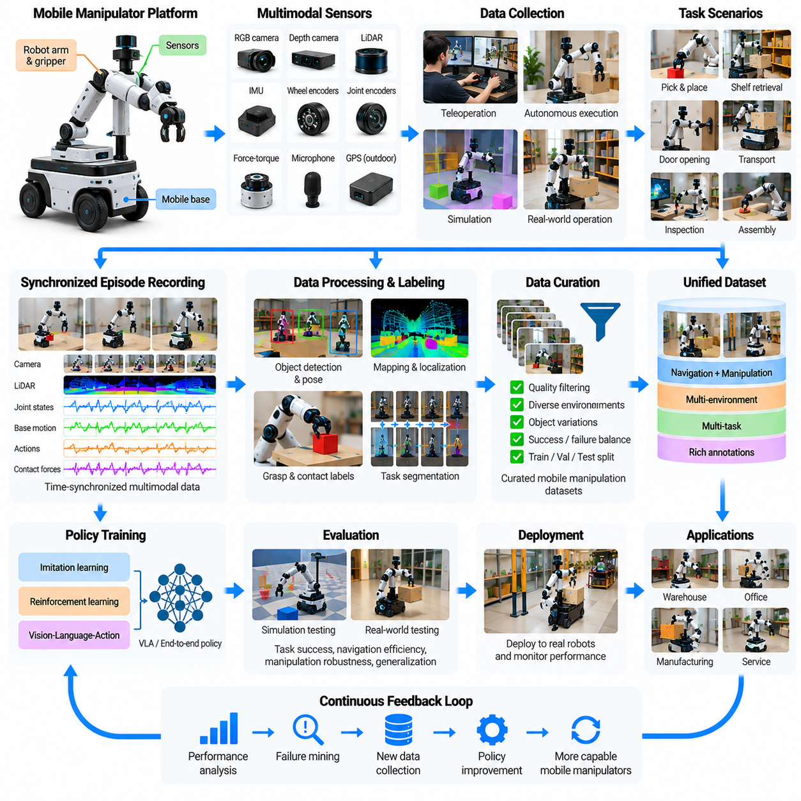{width="7.268055555555556in" height="7.268055555555556in"}

Mobile manipulator data engines provide the infrastructure for learning robotic behaviors that combine autonomous mobility with physical object manipulation. Unlike fixed robotic arms or navigation-only mobile robots, mobile manipulators must coordinate base movement, arm positioning, perception, and contact interactions. Their datasets capture how navigation decisions influence manipulation feasibility and how object interactions affect subsequent robot movement.

A mobile manipulator typically consists of a wheeled or tracked mobile base, one or more robotic arms, grippers, and multimodal sensors. Its operational tasks include approaching workstations, retrieving objects, opening doors, transporting materials, and performing inspection or assembly. Data engines must represent the complete relationship between environmental observations, robot configuration, task objectives, executed actions, and physical outcomes.

The fundamental data engine architecture integrates teleoperation, autonomous execution logging, simulation, multimodal synchronization, episode storage, labeling, policy training, and evaluation. These components establish a closed-loop learning process in which deployed robots continuously encounter new situations. Successful operations, failed attempts, human interventions, and recovery trajectories become reusable training information.

Mobile manipulation introduces a coupled decision problem because the robot must determine both where to position its base and how to execute manipulation. A base position that provides good visibility may produce poor arm reachability, while an optimal grasping pose may obstruct navigation. Training data must therefore preserve relationships among base pose, arm configuration, object geometry, and environmental constraints.

Teleoperation is an important source of mobile manipulation demonstrations. Human operators can control navigation and arm movements using joysticks, virtual reality interfaces, or shared-control systems. Demonstrations may include approaching an object, adjusting the base position, extending the arm, establishing contact, grasping, and transporting the object. Recording the complete sequence preserves coordination between mobility and manipulation.

Shared autonomy can reduce teleoperation complexity by assigning low-level stabilization and collision avoidance to autonomous controllers. Operators specify task goals or corrective actions while the robot manages feasible trajectories. Data engines should record operator commands, autonomous adjustments, and final executed actions separately so that learning systems can distinguish human intent from controller-generated corrections.

A mobile manipulation episode begins with a defined environment, robot state, and task objective. The robot navigates toward a target, establishes a suitable manipulation configuration, performs physical interaction, and completes or abandons the task. Episode records should include initial conditions, maps, localization estimates, joint states, gripper commands, object poses, timestamps, and outcome labels.

Multimodal sensing combines cameras, depth sensors, LiDAR, wheel encoders, inertial measurements, joint encoders, and force-torque feedback. These sensors provide complementary information about navigation, robot configuration, object geometry, and contact dynamics. Accurate calibration and synchronization are necessary because errors in localization or sensor alignment can produce incorrect grasp targets and unsafe manipulation trajectories.

Coordinate frame management is particularly important because mobile manipulators operate across multiple moving reference systems. Object positions may be estimated relative to cameras, robot bases, manipulators, or global maps. Data engines must preserve transformations among these frames and document their uncertainties. Without consistent spatial references, recorded demonstrations cannot reliably support policy training or cross-platform transfer.

Action representations must capture both mobile base commands and manipulator control. Base actions may describe linear and angular velocities or target poses, while arm actions may specify joint positions, Cartesian trajectories, or end-effector movements. Gripper commands and force-control parameters complete the action description. Unified representations enable models to learn coordinated behaviors across different control frequencies.

Temporal alignment is essential when base movement and arm motion occur simultaneously. A robot reaching toward an object while repositioning its base must continuously update the relationship between the target and end effector. Delayed observations or mismatched timestamps can distort this relationship. Synchronized recordings allow learning systems to reconstruct the causal sequence connecting perception, movement, contact, and task outcomes.

Navigation and manipulation datasets have traditionally been developed separately, but mobile manipulation requires their integration. Navigation data describes traversability, obstacle avoidance, and route selection, while manipulation data emphasizes object interaction and contact. A unified data engine connects these domains through task-centered episodes that represent transitions from movement to interaction and back to movement.

Task segmentation helps organize complex mobile manipulation demonstrations into meaningful phases. A warehouse retrieval episode may contain target identification, route planning, navigation, base alignment, grasp execution, object verification, and delivery. These phases support hierarchical learning and allow engineers to identify whether failures originate from perception, localization, navigation, grasping, or task coordination.

Object and environment diversity strongly influence generalization. Mobile manipulators encounter shelves, drawers, doors, carts, containers, and workstations with different dimensions and accessibility constraints. Training datasets should include variations in object geometry, placement, lighting, floor conditions, workspace clutter, and approach directions. Such diversity reduces dependence on fixed layouts and repetitive demonstrations.

Simulation enables scalable generation of mobile manipulation episodes under controlled conditions. Virtual environments can vary robot starting positions, obstacle configurations, object arrangements, and manipulation targets. Physics-based simulation supports contact interactions, while procedural scene generation creates diverse navigation challenges. Synthetic data can complement real demonstrations, particularly during early policy development.

Simulation-to-reality transfer remains difficult because both mobility and manipulation introduce physical uncertainties. Wheel slip, localization drift, actuator delays, object friction, and contact compliance can change task outcomes. A simulated grasp may succeed even when real-world positioning errors prevent contact. Effective data engines combine simulation with real robot measurements, calibration, and targeted physical testing.

Automated labeling pipelines generate information about objects, robot poses, navigation trajectories, grasp events, and task completion. Mapping systems provide environmental structure, while perception models estimate object locations and semantic categories. Contact sensors and gripper feedback help identify successful grasps. Human review remains valuable for ambiguous failures and complex interaction sequences.

Failure data provides important information about the coupling between navigation and manipulation. A robot may fail to grasp an object because its base stopped too far away, its localization estimate drifted, or an obstacle restricted arm movement. Recording these causal relationships helps distinguish manipulation policy failures from positioning and perception errors, enabling more targeted improvements.

Data curation evaluates episode completeness, sensor reliability, trajectory consistency, task relevance, and safety. Corrupted localization records, missing joint states, or inconsistent coordinate transformations can invalidate otherwise useful demonstrations. Quality scoring should also consider unnecessary base movement, excessive manipulation forces, collision risk, and recovery behavior rather than relying exclusively on task success.

Policy learning can combine imitation learning, reinforcement learning, hierarchical planning, and vision-language-action architectures. High-level policies select navigation and interaction objectives, while lower-level controllers execute feasible base and arm motions. Joint policies may learn coordinated whole-system actions, although training complexity increases with the combined mobility and manipulation action space.

Evaluation must consider complete task execution rather than isolated navigation or grasping performance. Important metrics include task completion rate, navigation efficiency, base positioning accuracy, grasp success, execution time, collision frequency, and recovery capability. Long-horizon tests reveal whether individual skills remain reliable when combined into extended operational sequences.

Fleet-scale deployment creates opportunities for collecting mobile manipulation experiences across warehouses, hospitals, laboratories, and industrial facilities. Different sites introduce new layouts, objects, obstacles, and operating procedures. Event-triggered logging and uncertainty-based sampling prioritize informative episodes, while centralized processing enables models to benefit from experiences collected by multiple robots.

Data governance is important because mobile manipulators may record sensitive workplace information, human activity, and proprietary industrial processes. Responsible systems require access controls, retention policies, privacy safeguards, and traceable dataset provenance. Hardware configurations, software versions, calibration parameters, and intervention histories should remain associated with recorded episodes to support reproducibility and operational accountability.

Scaling mobile manipulator data engines requires balancing physical collection costs against learning value. Teleoperation, robot maintenance, workspace preparation, simulation, labeling, and computing infrastructure all consume resources. Automated quality assessment, active learning, and selective collection can reduce redundant data while improving coverage of difficult tasks and previously unseen environmental conditions.

The long-term objective is to establish a continuous learning infrastructure that unifies mobility, manipulation, perception, and task reasoning. By connecting real-world experience with simulation, structured datasets, policy training, and deployment feedback, mobile manipulator data engines can support increasingly adaptable robots. Their success depends on reliable coordination, transferable representations, and systematic safety-aware evaluation across diverse physical environments.

모바일 매니퓰레이터 데이터 엔진(Mobile Manipulator Data Engine)은 자율 이동(Autonomous Mobility)과 물리적 객체 조작(Physical Object Manipulation)을 결합한 로봇 행동을 학습하기 위한 인프라(Infrastructure)를 제공한다. 고정형 로봇 팔(Fixed Robotic Arm)이나 내비게이션 전용 이동 로봇(Navigation-Only Mobile Robot)과 달리 모바일 매니퓰레이터(Mobile Manipulator)는 이동 베이스(Base Movement), 로봇 팔 위치 제어(Arm Positioning), 인지(Perception), 접촉 상호작용(Contact Interaction)을 협응해야 한다. 데이터셋은 이동 결정이 조작 가능성에 미치는 영향과 객체 상호작용이 이후 로봇 이동에 미치는 영향을 기록한다.

모바일 매니퓰레이터는 일반적으로 바퀴형 또는 궤도형 이동 베이스(Wheeled or Tracked Mobile Base), 하나 이상의 로봇 팔(Robotic Arm), 그리퍼(Gripper), 다중 모달 센서(Multimodal Sensor)로 구성된다. 주요 작업에는 작업대 접근(Workstation Approach), 객체 회수(Object Retrieval), 문 열기(Door Opening), 자재 운반(Material Transport), 점검(Inspection), 조립(Assembly)이 포함된다. 데이터 엔진은 환경 관측(Environmental Observation), 로봇 구성(Robot Configuration), 작업 목표(Task Objective), 실행된 행동(Executed Action), 물리적 결과(Physical Outcome) 사이의 전체 관계를 표현해야 한다.

기본적인 데이터 엔진 아키텍처(Data Engine Architecture)는 원격조작(Teleoperation), 자율 실행 로깅(Autonomous Execution Logging), 시뮬레이션(Simulation), 다중 모달 동기화(Multimodal Synchronization), 에피소드 저장(Episode Storage), 라벨링(Labeling), 정책 학습(Policy Training), 평가(Evaluation)를 통합한다. 이러한 구성 요소는 배포된 로봇이 새로운 상황을 지속적으로 경험하는 폐루프 학습 과정(Closed-Loop Learning Process)을 구축한다. 성공적인 작업, 실패한 시도, 인간의 개입(Human Intervention), 복구 궤적(Recovery Trajectory)은 재사용 가능한 학습 정보가 된다.

모바일 조작(Mobile Manipulation)은 로봇이 베이스를 어디에 배치할 것인지와 조작을 어떻게 수행할 것인지를 동시에 결정해야 하므로 결합된 의사결정 문제(Coupled Decision Problem)를 발생시킨다. 시야 확보에 유리한 베이스 위치(Base Position)가 로봇 팔의 도달 가능성(Arm Reachability)에는 불리할 수 있으며, 최적의 파지 자세(Grasping Pose)가 이동을 방해할 수도 있다. 따라서 학습 데이터는 베이스 자세(Base Pose), 로봇 팔 구성(Arm Configuration), 객체 형상(Object Geometry), 환경 제약(Environmental Constraint) 사이의 관계를 보존해야 한다.

원격조작(Teleoperation)은 모바일 조작 시연(Mobile Manipulation Demonstration)의 중요한 데이터 공급원이다. 인간 작업자는 조이스틱(Joystick), 가상현실 인터페이스(Virtual Reality Interface), 공유 제어 시스템(Shared-Control System)을 사용하여 이동과 로봇 팔 움직임을 제어할 수 있다. 시연에는 객체 접근, 베이스 위치 조정, 로봇 팔 확장, 접촉 형성, 파지, 객체 운반이 포함될 수 있다. 전체 시퀀스(Sequence)를 기록하면 이동과 조작 사이의 협응 관계(Coordination Relationship)를 보존할 수 있다.

공유 자율성(Shared Autonomy)은 저수준 안정화(Low-Level Stabilization)와 충돌 회피(Collision Avoidance)를 자율 제어기(Autonomous Controller)에 할당함으로써 원격조작의 복잡성을 줄일 수 있다. 작업자는 작업 목표나 교정 행동(Corrective Action)을 지정하고 로봇은 실행 가능한 궤적(Feasible Trajectory)을 관리한다. 데이터 엔진은 작업자 명령(Operator Command), 자율 조정(Autonomous Adjustment), 최종 실행 행동(Final Executed Action)을 별도로 기록하여 학습 시스템이 인간의 의도(Human Intent)와 제어기가 생성한 수정 행동을 구분할 수 있도록 해야 한다.

모바일 조작 에피소드(Mobile Manipulation Episode)는 정의된 환경, 로봇 상태(Robot State), 작업 목표(Task Objective)에서 시작된다. 로봇은 목표 지점으로 이동하고 적절한 조작 구성(Manipulation Configuration)을 확보한 후 물리적 상호작용을 수행하며 작업을 완료하거나 중단한다. 에피소드 기록(Episode Record)에는 초기 조건(Initial Condition), 지도(Map), 위치 추정값(Localization Estimate), 관절 상태(Joint State), 그리퍼 명령(Gripper Command), 객체 자세(Object Pose), 타임스탬프(Timestamp), 결과 라벨(Outcome Label)이 포함되어야 한다.

다중 모달 센싱(Multimodal Sensing)은 카메라(Camera), 깊이 센서(Depth Sensor), 라이다(LiDAR), 휠 엔코더(Wheel Encoder), 관성 측정값(Inertial Measurement), 관절 엔코더(Joint Encoder), 힘-토크 피드백(Force-Torque Feedback)을 결합한다. 이러한 센서는 내비게이션(Navigation), 로봇 구성, 객체 형상, 접촉 동역학(Contact Dynamics)에 관한 상호 보완적인 정보를 제공한다. 위치 추정이나 센서 정렬(Sensor Alignment)의 오류는 잘못된 파지 목표(Grasp Target)와 위험한 조작 궤적을 생성할 수 있으므로 정확한 보정(Calibration)과 동기화(Synchronization)가 필요하다.

좌표계 관리(Coordinate Frame Management)는 모바일 매니퓰레이터가 여러 이동 기준 좌표계(Moving Reference Frame)를 사용하기 때문에 특히 중요하다. 객체 위치(Object Position)는 카메라, 로봇 베이스, 매니퓰레이터 또는 전역 지도(Global Map)를 기준으로 추정될 수 있다. 데이터 엔진은 이러한 좌표계 사이의 변환(Transformation)을 보존하고 관련 불확실성(Uncertainty)을 문서화해야 한다. 일관된 공간 기준(Spatial Reference)이 없으면 기록된 시연을 정책 학습이나 플랫폼 간 전이(Cross-Platform Transfer)에 신뢰성 있게 활용할 수 없다.

행동 표현(Action Representation)은 이동 베이스 명령(Mobile Base Command)과 매니퓰레이터 제어(Manipulator Control)를 모두 포착해야 한다. 베이스 행동(Base Action)은 선속도(Linear Velocity), 각속도(Angular Velocity), 목표 자세(Target Pose)를 나타낼 수 있으며, 로봇 팔 행동(Arm Action)은 관절 위치(Joint Position), 직교좌표 궤적(Cartesian Trajectory), 말단효과기 움직임(End-Effector Movement)을 지정할 수 있다. 그리퍼 명령과 힘 제어 매개변수(Force-Control Parameter)는 행동 설명을 완성한다. 통합 표현(Unified Representation)은 서로 다른 제어 주파수(Control Frequency)에서 협응 행동을 학습할 수 있도록 한다.

시간 정렬(Temporal Alignment)은 베이스 이동과 로봇 팔 움직임이 동시에 발생할 때 필수적이다. 로봇이 베이스 위치를 조정하면서 객체를 향해 팔을 뻗는 경우 목표와 말단효과기(End Effector) 사이의 관계를 지속적으로 갱신해야 한다. 지연된 관측(Delayed Observation)이나 일치하지 않는 타임스탬프(Mismatched Timestamp)는 이러한 관계를 왜곡할 수 있다. 동기화된 기록(Synchronized Recording)은 학습 시스템이 인지, 이동, 접촉, 작업 결과를 연결하는 인과적 시퀀스(Causal Sequence)를 재구성하도록 한다.

내비게이션 데이터셋(Navigation Dataset)과 조작 데이터셋(Manipulation Dataset)은 전통적으로 별도로 개발되었지만 모바일 조작은 두 영역의 통합을 요구한다. 내비게이션 데이터는 주행 가능성(Traversability), 장애물 회피(Obstacle Avoidance), 경로 선택(Route Selection)을 설명하며, 조작 데이터는 객체 상호작용(Object Interaction)과 접촉(Contact)을 강조한다. 통합 데이터 엔진(Unified Data Engine)은 이동에서 상호작용으로, 다시 이동으로 전환되는 과정을 표현하는 작업 중심 에피소드(Task-Centered Episode)를 통해 두 영역을 연결한다.

작업 분할(Task Segmentation)은 복잡한 모바일 조작 시연을 의미 있는 단계로 구성하는 데 도움이 된다. 창고 객체 회수 에피소드(Warehouse Retrieval Episode)에는 목표 식별(Target Identification), 경로 계획(Route Planning), 내비게이션, 베이스 정렬(Base Alignment), 파지 실행(Grasp Execution), 객체 확인(Object Verification), 배송(Delivery)이 포함될 수 있다. 이러한 단계는 계층적 학습(Hierarchical Learning)을 지원하고 실패가 인지, 위치 추정, 이동, 파지 또는 작업 협응(Task Coordination) 중 어디에서 발생했는지 식별하도록 한다.

객체 및 환경 다양성(Object and Environment Diversity)은 일반화(Generalization)에 큰 영향을 미친다. 모바일 매니퓰레이터는 서로 다른 크기와 접근 제약(Accessibility Constraint)을 가진 선반(Shelf), 서랍(Drawer), 문(Door), 카트(Cart), 컨테이너(Container), 작업대(Workstation)를 다룬다. 학습 데이터셋에는 객체 형상, 배치, 조명(Lighting), 바닥 조건(Floor Condition), 작업 공간의 복잡도(Workspace Clutter), 접근 방향(Approach Direction)의 변화가 포함되어야 한다. 이러한 다양성은 고정된 공간 배치와 반복적인 시연에 대한 의존성을 줄인다.

시뮬레이션(Simulation)은 통제된 조건에서 모바일 조작 에피소드를 대규모로 생성할 수 있도록 한다. 가상 환경(Virtual Environment)은 로봇 시작 위치(Robot Starting Position), 장애물 구성(Obstacle Configuration), 객체 배치(Object Arrangement), 조작 목표(Manipulation Target)를 변화시킬 수 있다. 물리 기반 시뮬레이션(Physics-Based Simulation)은 접촉 상호작용(Contact Interaction)을 지원하며, 절차적 장면 생성(Procedural Scene Generation)은 다양한 내비게이션 문제를 만든다. 합성 데이터(Synthetic Data)는 특히 초기 정책 개발(Early Policy Development)에서 실제 시연 데이터를 보완할 수 있다.

시뮬레이션에서 현실로의 전이(Simulation-to-Reality Transfer)는 이동과 조작 모두 물리적 불확실성(Physical Uncertainty)을 발생시키기 때문에 여전히 어렵다. 바퀴 미끄러짐(Wheel Slip), 위치 추정 드리프트(Localization Drift), 액추에이터 지연(Actuator Delay), 객체 마찰(Object Friction), 접촉 순응성(Contact Compliance)은 작업 결과를 변화시킬 수 있다. 시뮬레이션에서 성공한 파지도 실제 환경에서는 위치 오차로 인해 접촉에 실패할 수 있다. 효과적인 데이터 엔진은 시뮬레이션을 실제 로봇 측정값, 보정, 목표 지향적 물리 시험(Targeted Physical Testing)과 결합한다.

자동 라벨링 파이프라인(Automated Labeling Pipeline)은 객체, 로봇 자세(Robot Pose), 이동 궤적(Navigation Trajectory), 파지 이벤트(Grasp Event), 작업 완료(Task Completion)에 관한 정보를 생성한다. 매핑 시스템(Mapping System)은 환경 구조(Environmental Structure)를 제공하며, 인지 모델(Perception Model)은 객체 위치와 의미론적 범주(Semantic Category)를 추정한다. 접촉 센서(Contact Sensor)와 그리퍼 피드백은 성공적인 파지를 식별하는 데 도움이 된다. 인간 검토(Human Review)는 모호한 실패와 복잡한 상호작용 시퀀스를 분석할 때 여전히 가치가 있다.

실패 데이터(Failure Data)는 내비게이션과 조작 사이의 결합 관계(Coupling Relationship)에 관한 중요한 정보를 제공한다. 로봇은 베이스가 너무 멀리 정지했거나 위치 추정값이 드리프트되었거나 장애물이 로봇 팔 움직임을 제한했기 때문에 객체 파지에 실패할 수 있다. 이러한 인과관계(Causal Relationship)를 기록하면 조작 정책 실패(Manipulation Policy Failure)를 위치 제어 오류(Positioning Error) 및 인지 오류(Perception Error)와 구분할 수 있으며, 더욱 목표 지향적인 성능 개선(Targeted Improvement)이 가능해진다.

데이터 큐레이션(Data Curation)은 에피소드 완전성(Episode Completeness), 센서 신뢰성(Sensor Reliability), 궤적 일관성(Trajectory Consistency), 작업 관련성(Task Relevance), 안전성(Safety)을 평가한다. 손상된 위치 추정 기록(Corrupted Localization Record), 누락된 관절 상태(Missing Joint State), 일관되지 않은 좌표 변환(Inconsistent Coordinate Transformation)은 다른 측면에서 유용한 시연도 무효화할 수 있다. 품질 점수화(Quality Scoring)는 작업 성공뿐 아니라 불필요한 베이스 이동, 과도한 조작력(Manipulation Force), 충돌 위험(Collision Risk), 복구 행동(Recovery Behavior)도 고려해야 한다.

정책 학습(Policy Learning)은 모방학습(Imitation Learning), 강화학습(Reinforcement Learning), 계층적 계획(Hierarchical Planning), 시각-언어-행동 아키텍처(Vision-Language-Action Architecture)를 결합할 수 있다. 상위 수준 정책(High-Level Policy)은 이동 및 상호작용 목표를 선택하고, 하위 수준 제어기(Low-Level Controller)는 실행 가능한 베이스 및 로봇 팔 움직임을 수행한다. 통합 정책(Joint Policy)은 전체 시스템의 협응 행동을 학습할 수 있지만, 이동과 조작이 결합된 행동 공간(Action Space)이 커질수록 학습 복잡도(Training Complexity)도 증가한다.

평가(Evaluation)는 개별적인 내비게이션 또는 파지 성능이 아니라 전체 작업 실행(Complete Task Execution)을 고려해야 한다. 중요한 지표에는 작업 완료율(Task Completion Rate), 이동 효율성(Navigation Efficiency), 베이스 위치 정확도(Base Positioning Accuracy), 파지 성공률(Grasp Success Rate), 실행 시간(Execution Time), 충돌 빈도(Collision Frequency), 복구 능력(Recovery Capability)이 포함된다. 장기 작업 시험(Long-Horizon Test)은 개별 기술이 확장된 운영 시퀀스(Extended Operational Sequence)로 결합되었을 때도 신뢰성 있게 유지되는지 확인한다.

차량군 규모의 배포(Fleet-Scale Deployment)는 창고(Warehouse), 병원(Hospital), 실험실(Laboratory), 산업 시설(Industrial Facility) 전반에서 모바일 조작 경험을 수집할 기회를 제공한다. 서로 다른 현장(Site)은 새로운 공간 배치(Layout), 객체(Object), 장애물(Obstacle), 운영 절차(Operating Procedure)를 도입한다. 이벤트 기반 로깅(Event-Triggered Logging)과 불확실성 기반 샘플링(Uncertainty-Based Sampling)은 정보 가치가 높은 에피소드를 우선적으로 수집하며, 중앙 집중식 처리(Centralized Processing)는 여러 로봇에서 수집한 경험을 모델 개선에 활용할 수 있도록 한다.

데이터 거버넌스(Data Governance)는 모바일 매니퓰레이터가 민감한 작업장 정보(Sensitive Workplace Information), 인간 활동(Human Activity), 독점적인 산업 공정(Proprietary Industrial Process)을 기록할 수 있기 때문에 중요하다. 책임 있는 시스템은 접근 제어(Access Control), 데이터 보존 정책(Retention Policy), 개인정보 보호 조치(Privacy Safeguard), 추적 가능한 데이터셋 출처(Traceable Dataset Provenance)를 필요로 한다. 재현 가능성(Reproducibility)과 운영 책임성(Operational Accountability)을 지원하기 위해 하드웨어 구성(Hardware Configuration), 소프트웨어 버전(Software Version), 보정 매개변수(Calibration Parameter), 개입 이력(Intervention History)을 기록된 에피소드와 연결하여 유지해야 한다.

모바일 매니퓰레이터 데이터 엔진의 규모 확장(Scaling)은 물리적 데이터 수집 비용(Physical Collection Cost)과 학습 가치(Learning Value) 사이의 균형을 필요로 한다. 원격조작, 로봇 유지보수(Robot Maintenance), 작업 공간 준비(Workspace Preparation), 시뮬레이션, 라벨링, 컴퓨팅 인프라(Computing Infrastructure)는 모두 자원을 소비한다. 자동 품질 평가(Automated Quality Assessment), 능동학습(Active Learning), 선택적 데이터 수집(Selective Collection)은 중복 데이터를 줄이면서 어려운 작업과 이전에 경험하지 못한 환경 조건에 대한 적용 범위(Coverage)를 개선할 수 있다.

장기적인 목표는 이동(Mobility), 조작(Manipulation), 인지(Perception), 작업 추론(Task Reasoning)을 통합하는 지속 학습 인프라(Continuous Learning Infrastructure)를 구축하는 것이다. 모바일 매니퓰레이터 데이터 엔진은 실제 환경 경험(Real-World Experience)을 시뮬레이션, 구조화된 데이터셋(Structured Dataset), 정책 학습, 배포 피드백과 연결함으로써 적응성이 높은 로봇(Adaptable Robot)의 개발을 지원할 수 있다. 이러한 시스템의 성공은 다양한 물리적 환경에서 신뢰성 있는 협응(Reliable Coordination), 전이 가능한 표현(Transferable Representation), 체계적인 안전성 인식 평가(Systematic Safety-Aware Evaluation)를 확보하는 데 달려 있다.

##  

## 10.06. AMR and Autonomous Mobility Data Engines

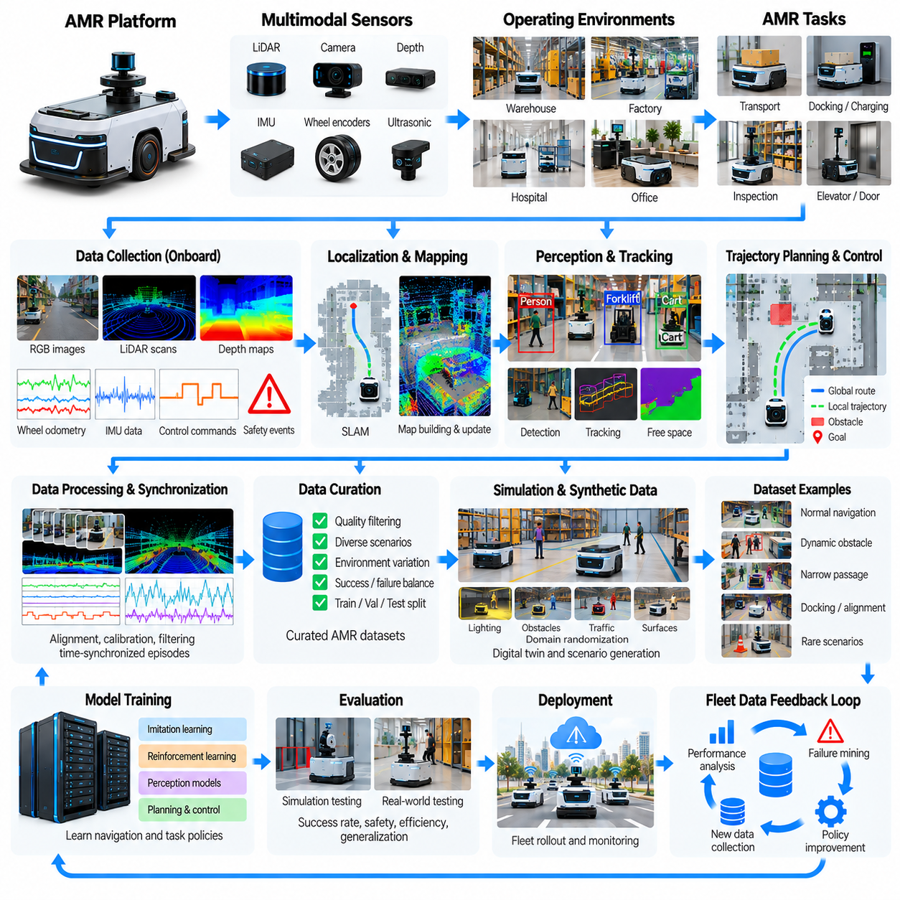{width="7.268055555555556in" height="7.268055555555556in"}

Autonomous Mobile Robot (AMR) data engines provide the infrastructure for collecting, processing, and transforming mobility experiences into reliable autonomous navigation capabilities. Unlike robots operating along fixed routes, AMRs must perceive changing environments, estimate their positions, plan safe trajectories, and respond to unexpected obstacles. Their data engines integrate sensor observations, motion commands, environmental maps, operational events, and navigation outcomes.

An AMR data engine connects onboard perception, localization, mapping, planning, control, and fleet management through a continuous learning pipeline. Each operational mission produces information about environmental conditions, robot behavior, and task performance. Successful navigation, localization failures, obstacle encounters, and human interventions become valuable data for improving autonomy across different facilities and operating conditions.

Typical AMR datasets contain LiDAR scans, camera images, depth measurements, inertial data, wheel odometry, localization estimates, planned paths, velocity commands, and safety events. Each recording must preserve timestamps, coordinate frames, calibration parameters, and robot configuration metadata. These relationships allow engineers to reconstruct navigation decisions and determine whether observed failures originated from sensing, estimation, planning, or control.

Localization and mapping data form the foundation of autonomous mobility learning. Simultaneous Localization and Mapping (SLAM) systems estimate robot trajectories while constructing representations of surrounding environments. Data engines store sensor measurements, pose estimates, map updates, and uncertainty information. These records support map maintenance, localization evaluation, and detection of environmental changes that affect navigation reliability.

Environmental maps may contain geometric occupancy information, traversability estimates, semantic labels, and operational restrictions. Warehouses, hospitals, and factories introduce different requirements for corridors, intersections, elevators, and restricted zones. Data engines should maintain map versions and document environmental changes so that navigation policies can distinguish temporary obstacles from permanent modifications to the operating environment.

Perception datasets describe how AMRs identify obstacles, free space, moving objects, and navigable surfaces. LiDAR provides geometric measurements, while cameras contribute semantic understanding of people, vehicles, signs, and environmental features. Combining these observations improves situational awareness, but sensor fusion requires accurate calibration and synchronization to prevent inconsistent interpretations of the surrounding scene.

Dynamic obstacle interaction is a major challenge because AMRs frequently operate near pedestrians, forklifts, carts, and other robots. Training data should capture object trajectories, relative velocities, predicted motion, and robot responses. Episodes involving crossing traffic, narrow passages, or sudden obstructions provide important examples for developing collision avoidance and socially appropriate navigation behaviors.

Trajectory planning datasets connect environmental perception with intended robot movement. Recorded information includes global routes, local trajectories, obstacle constraints, velocity profiles, and controller outputs. Comparing planned and executed trajectories reveals deviations caused by wheel slip, localization uncertainty, actuator limitations, or unexpected interactions. Such comparisons help improve planning consistency and motion control performance.

Wheel odometry and inertial measurements provide essential information about mobile robot motion, but their accuracy can deteriorate under challenging conditions. Slippery floors, uneven surfaces, payload changes, and wheel wear introduce estimation errors. Data engines should record these operating conditions alongside localization residuals and motion outcomes to support calibration, fault detection, and robust state estimation.

Navigation episodes should represent complete missions rather than isolated sensor frames. A warehouse delivery mission may include route assignment, departure, corridor navigation, intersection handling, obstacle avoidance, docking, and task completion. Recording the full sequence preserves relationships between local navigation decisions and mission-level objectives, enabling analysis of long-horizon reliability and operational efficiency.

Docking and precision positioning require specialized datasets because small localization errors can prevent successful charging, loading, or workstation alignment. Sensor observations, relative target poses, final positioning errors, and corrective movements should be recorded. These examples support learning and calibration of fine positioning behaviors that differ from ordinary corridor navigation.

Simulation provides scalable environments for generating AMR navigation data without interrupting physical operations. Digital twins can reproduce facility layouts, traffic patterns, sensor characteristics, and robot dynamics. Procedural scenario generation introduces obstacles, congestion, blocked routes, and changing environmental conditions. Synthetic episodes complement real-world recordings and support systematic testing of rare operational situations.

Domain randomization improves robustness by varying lighting, surface friction, sensor noise, obstacle placement, and pedestrian behavior during simulation. However, simulated navigation success does not automatically transfer to physical environments. Real-world data remains necessary to capture unmodeled sensor effects, wheel dynamics, human behavior, and operational constraints that influence autonomous mobility.

Automated labeling pipelines transform raw navigation logs into structured training and evaluation datasets. Perception models identify obstacles and semantic objects, while tracking algorithms estimate motion trajectories. Localization systems provide pose histories, and operational software supplies mission outcomes. Label validation must address sensor uncertainty, tracking discontinuities, and inconsistent event timestamps.

Failure data is especially important because navigation problems often emerge from interactions among multiple subsystems. A robot may stop unexpectedly because of localization drift, false obstacle detection, route blockage, or controller instability. Recording sensor evidence, system diagnostics, safety triggers, and recovery actions enables engineers to identify underlying causes rather than treating every unsuccessful mission as the same failure.

Event-triggered recording improves data collection efficiency by prioritizing informative situations. Robots may preserve high-resolution logs when localization confidence decreases, obstacle avoidance activates, emergency braking occurs, or a mission exceeds its expected duration. Normal operations can be summarized at lower resolution, reducing storage requirements while retaining the detailed evidence needed for failure analysis.

Data curation evaluates sensor completeness, timestamp consistency, localization quality, trajectory validity, and event relevance. Corrupted scans, missing odometry, outdated maps, or inconsistent coordinate transformations can produce misleading training signals. Quality assessment should also consider operational diversity so that frequently repeated routes do not overwhelm rare but safety-critical navigation scenarios.

Learning-based navigation can complement conventional SLAM, planning, and control architectures. Machine learning models may improve obstacle classification, traversability prediction, pedestrian motion estimation, and local policy selection. However, safety-critical motion should remain subject to validated constraints and independent protective mechanisms, particularly in environments shared with workers and other equipment.

Fleet-scale data engines combine experiences from multiple AMRs operating across facilities and shifts. Centralized analytics can identify recurring bottlenecks, difficult intersections, localization weaknesses, and inefficient routes. Fleet learning becomes more effective when robots share compatible data schemas while preserving hardware-specific characteristics, sensor configurations, and environmental differences.

Fleet management records provide operational context beyond onboard sensor data. Mission assignments, traffic coordination decisions, charging schedules, battery states, payload information, and robot availability influence navigation performance. Connecting these records with motion logs allows data engines to distinguish autonomy limitations from scheduling inefficiencies, infrastructure constraints, or fleet coordination problems.

Evaluation requires metrics that reflect both navigation capability and operational performance. Important measures include mission completion rate, localization accuracy, collision avoidance effectiveness, intervention frequency, travel time, path efficiency, docking precision, and energy consumption. Testing should cover unseen layouts, moving obstacles, degraded sensors, and changes in traffic density to assess generalization and robustness.

Safety evaluation must examine near misses, emergency stops, protective field activations, and interactions with vulnerable road users or facility personnel. Recorded safety events should be interpreted with appropriate environmental context and system configuration. Data-driven improvements must complement formal risk assessment, validated safety functions, and applicable operational safety requirements rather than replace them.

Data governance is necessary because AMRs may record identifiable people, sensitive facility layouts, and proprietary operational information. Collection policies should address privacy, access permissions, retention periods, and secure transmission. Dataset provenance must preserve robot identity, software versions, map revisions, sensor calibration, and processing history to support reproducibility and incident investigations.

Scaling AMR data engines requires balancing collection volume against information value. Large fleets can generate enormous quantities of repetitive navigation data, while critical failures may occur infrequently. Active data selection, event-based sampling, automated quality checks, and targeted simulation help prioritize difficult scenarios. Efficient scaling depends on improving environmental coverage and failure understanding rather than merely increasing stored data.

The long-term objective of AMR and autonomous mobility data engines is to establish a continuously improving navigation infrastructure. By integrating real-world fleet experience, simulation, structured datasets, learning-based perception, and systematic evaluation, these systems can improve autonomy across changing environments. Their effectiveness ultimately depends on reliable localization, safe motion, operational adaptability, and disciplined feedback from deployment to development.

자율이동로봇(Autonomous Mobile Robot, AMR) 데이터 엔진(Data Engine)은 이동 경험(Mobility Experience)을 수집하고 처리하여 신뢰성 있는 자율 내비게이션(Autonomous Navigation) 능력으로 변환하기 위한 인프라(Infrastructure)를 제공한다. 고정 경로(Fixed Route)를 따라 운행하는 로봇과 달리 AMR은 변화하는 환경을 인지하고, 자신의 위치를 추정하며, 안전한 궤적을 계획하고, 예상하지 못한 장애물에 대응해야 한다. 데이터 엔진은 센서 관측(Sensor Observation), 이동 명령(Motion Command), 환경 지도(Environmental Map), 운영 이벤트(Operational Event), 내비게이션 결과(Navigation Outcome)를 통합한다.

AMR 데이터 엔진은 온보드 인지(Onboard Perception), 위치 추정(Localization), 지도 작성(Mapping), 경로 계획(Planning), 제어(Control), 플릿 관리(Fleet Management)를 지속적인 학습 파이프라인(Continuous Learning Pipeline)으로 연결한다. 각각의 운영 임무(Operational Mission)는 환경 조건, 로봇 행동, 작업 성능에 관한 정보를 생성한다. 성공적인 내비게이션, 위치 추정 실패(Localization Failure), 장애물 조우(Obstacle Encounter), 인간 개입(Human Intervention)은 다양한 시설과 운영 조건에서 자율성을 개선하기 위한 중요한 데이터가 된다.

일반적인 AMR 데이터셋에는 라이다 스캔(LiDAR Scan), 카메라 이미지(Camera Image), 깊이 측정값(Depth Measurement), 관성 데이터(Inertial Data), 바퀴 주행거리 측정값(Wheel Odometry), 위치 추정값(Localization Estimate), 계획 경로(Planned Path), 속도 명령(Velocity Command), 안전 이벤트(Safety Event)가 포함된다. 각 기록은 타임스탬프(Timestamp), 좌표계(Coordinate Frame), 보정 매개변수(Calibration Parameter), 로봇 구성 메타데이터(Robot Configuration Metadata)를 보존해야 한다. 이러한 관계를 통해 엔지니어는 내비게이션 의사결정을 재구성하고 관측된 실패가 센싱, 추정, 계획 또는 제어 중 어디에서 발생했는지 판단할 수 있다.

위치 추정 및 지도 작성 데이터(Localization and Mapping Data)는 자율 이동 학습(Autonomous Mobility Learning)의 기반을 형성한다. 동시적 위치 추정 및 지도 작성(Simultaneous Localization and Mapping, SLAM) 시스템은 주변 환경의 표현을 구축하면서 로봇 궤적(Robot Trajectory)을 추정한다. 데이터 엔진은 센서 측정값(Sensor Measurement), 자세 추정값(Pose Estimate), 지도 업데이트(Map Update), 불확실성 정보(Uncertainty Information)를 저장한다. 이러한 기록은 지도 유지관리(Map Maintenance), 위치 추정 평가(Localization Evaluation), 내비게이션 신뢰성에 영향을 미치는 환경 변화 감지를 지원한다.

환경 지도(Environmental Map)에는 기하학적 점유 정보(Geometric Occupancy Information), 주행 가능성 추정값(Traversability Estimate), 의미론적 라벨(Semantic Label), 운영 제한사항(Operational Restriction)이 포함될 수 있다. 창고(Warehouse), 병원(Hospital), 공장(Factory)은 복도(Corridor), 교차로(Intersection), 엘리베이터(Elevator), 출입 제한 구역(Restricted Zone)에 대해 서로 다른 요구사항을 가진다. 데이터 엔진은 지도 버전(Map Version)을 관리하고 환경 변화를 문서화하여 내비게이션 정책(Navigation Policy)이 일시적인 장애물과 운영 환경의 영구적인 변경을 구분할 수 있도록 해야 한다.

인지 데이터셋(Perception Dataset)은 AMR이 장애물(Obstacle), 자유 공간(Free Space), 이동 객체(Moving Object), 주행 가능한 표면(Navigable Surface)을 식별하는 방법을 설명한다. 라이다(LiDAR)는 기하학적 측정값(Geometric Measurement)을 제공하며, 카메라는 사람, 차량, 표지판, 환경 특징(Environmental Feature)에 대한 의미론적 이해(Semantic Understanding)를 지원한다. 이러한 관측을 결합하면 상황 인식(Situational Awareness)이 향상되지만, 센서 융합(Sensor Fusion)은 주변 장면에 대한 일관되지 않은 해석을 방지하기 위해 정확한 보정(Calibration)과 동기화(Synchronization)를 필요로 한다.

동적 장애물 상호작용(Dynamic Obstacle Interaction)은 AMR이 보행자(Pedestrian), 지게차(Forklift), 카트(Cart), 다른 로봇 근처에서 자주 운행하기 때문에 중요한 과제이다. 학습 데이터는 객체 궤적(Object Trajectory), 상대 속도(Relative Velocity), 예측 움직임(Predicted Motion), 로봇 대응(Robot Response)을 기록해야 한다. 교차 통행(Crossing Traffic), 좁은 통로(Narrow Passage), 갑작스러운 장애물(Sudden Obstruction)이 발생하는 에피소드는 충돌 회피(Collision Avoidance)와 사회적으로 적절한 내비게이션 행동(Socially Appropriate Navigation Behavior)을 개발하는 데 중요한 사례를 제공한다.

궤적 계획 데이터셋(Trajectory Planning Dataset)은 환경 인지(Environmental Perception)를 로봇의 의도된 움직임(Intended Robot Movement)과 연결한다. 기록 정보에는 전역 경로(Global Route), 지역 궤적(Local Trajectory), 장애물 제약(Obstacle Constraint), 속도 프로파일(Velocity Profile), 제어기 출력(Controller Output)이 포함된다. 계획 궤적(Planned Trajectory)과 실행 궤적(Executed Trajectory)을 비교하면 바퀴 미끄러짐(Wheel Slip), 위치 추정 불확실성(Localization Uncertainty), 액추에이터 한계(Actuator Limitation), 예상하지 못한 상호작용으로 발생한 편차를 확인할 수 있다. 이러한 비교는 계획 일관성과 이동 제어 성능을 개선하는 데 도움이 된다.

바퀴 주행거리 측정(Wheel Odometry)과 관성 측정(Inertial Measurement)은 이동 로봇의 움직임에 관한 필수 정보를 제공하지만, 어려운 조건에서는 정확도가 저하될 수 있다. 미끄러운 바닥(Slippery Floor), 고르지 않은 표면(Uneven Surface), 탑재 하중 변화(Payload Change), 바퀴 마모(Wheel Wear)는 추정 오차(Estimation Error)를 발생시킨다. 데이터 엔진은 보정(Calibration), 고장 감지(Fault Detection), 강건한 상태 추정(Robust State Estimation)을 지원하기 위해 이러한 운영 조건을 위치 추정 잔차(Localization Residual) 및 이동 결과(Motion Outcome)와 함께 기록해야 한다.

내비게이션 에피소드(Navigation Episode)는 개별 센서 프레임(Isolated Sensor Frame)이 아니라 전체 임무(Complete Mission)를 표현해야 한다. 창고 배송 임무(Warehouse Delivery Mission)에는 경로 할당(Route Assignment), 출발(Departure), 복도 주행(Corridor Navigation), 교차로 통과(Intersection Handling), 장애물 회피, 도킹(Docking), 작업 완료(Task Completion)가 포함될 수 있다. 전체 시퀀스를 기록하면 지역 내비게이션 결정(Local Navigation Decision)과 임무 수준 목표(Mission-Level Objective) 사이의 관계를 보존하여 장기 신뢰성(Long-Horizon Reliability)과 운영 효율성(Operational Efficiency)을 분석할 수 있다.

도킹(Docking)과 정밀 위치 제어(Precision Positioning)는 작은 위치 추정 오차도 충전(Charging), 적재(Loading), 작업대 정렬(Workstation Alignment)의 실패를 초래할 수 있으므로 특화된 데이터셋을 필요로 한다. 센서 관측, 상대 목표 자세(Relative Target Pose), 최종 위치 오차(Final Positioning Error), 교정 움직임(Corrective Movement)을 기록해야 한다. 이러한 사례는 일반적인 복도 주행과 다른 정밀 위치 제어 행동(Fine Positioning Behavior)의 학습 및 보정을 지원한다.

시뮬레이션(Simulation)은 실제 운영을 중단하지 않고 AMR 내비게이션 데이터를 생성할 수 있는 확장 가능한 환경을 제공한다. 디지털 트윈(Digital Twin)은 시설 배치(Facility Layout), 교통 패턴(Traffic Pattern), 센서 특성(Sensor Characteristic), 로봇 동역학(Robot Dynamics)을 재현할 수 있다. 절차적 시나리오 생성(Procedural Scenario Generation)은 장애물, 혼잡(Congestion), 차단된 경로(Blocked Route), 변화하는 환경 조건을 도입한다. 합성 에피소드(Synthetic Episode)는 실제 기록을 보완하며 드물게 발생하는 운영 상황을 체계적으로 시험할 수 있도록 지원한다.

도메인 무작위화(Domain Randomization)는 시뮬레이션 과정에서 조명(Lighting), 표면 마찰(Surface Friction), 센서 잡음(Sensor Noise), 장애물 배치(Obstacle Placement), 보행자 행동(Pedestrian Behavior)을 변화시켜 강건성(Robustness)을 향상시킨다. 그러나 시뮬레이션에서 성공한 내비게이션이 실제 물리적 환경으로 자동 전이되는 것은 아니다. 자율 이동에 영향을 미치는 모델링되지 않은 센서 효과(Unmodeled Sensor Effect), 바퀴 동역학(Wheel Dynamics), 인간 행동(Human Behavior), 운영 제약(Operational Constraint)을 포착하려면 실제 환경 데이터(Real-World Data)가 여전히 필요하다.

자동 라벨링 파이프라인(Automated Labeling Pipeline)은 원시 내비게이션 로그(Raw Navigation Log)를 구조화된 학습 및 평가 데이터셋(Structured Training and Evaluation Dataset)으로 변환한다. 인지 모델(Perception Model)은 장애물과 의미론적 객체(Semantic Object)를 식별하고, 추적 알고리즘(Tracking Algorithm)은 이동 궤적(Motion Trajectory)을 추정한다. 위치 추정 시스템(Localization System)은 자세 이력(Pose History)을 제공하며, 운영 소프트웨어(Operational Software)는 임무 결과(Mission Outcome)를 제공한다. 라벨 검증(Label Validation)은 센서 불확실성, 추적 불연속성(Tracking Discontinuity), 일관되지 않은 이벤트 타임스탬프(Event Timestamp)를 처리해야 한다.

실패 데이터(Failure Data)는 내비게이션 문제가 여러 하위 시스템(Subsystem) 사이의 상호작용에서 발생하는 경우가 많기 때문에 특히 중요하다. 로봇은 위치 추정 드리프트(Localization Drift), 잘못된 장애물 감지(False Obstacle Detection), 경로 차단(Route Blockage), 제어기 불안정성(Controller Instability)으로 인해 예상하지 못하게 정지할 수 있다. 센서 증거(Sensor Evidence), 시스템 진단(System Diagnostic), 안전 트리거(Safety Trigger), 복구 행동(Recovery Action)을 기록하면 모든 실패 임무를 동일하게 취급하지 않고 근본 원인(Underlying Cause)을 식별할 수 있다.

이벤트 기반 기록(Event-Triggered Recording)은 정보 가치가 높은 상황을 우선적으로 수집함으로써 데이터 수집 효율성(Data Collection Efficiency)을 개선한다. 로봇은 위치 추정 신뢰도(Localization Confidence)가 감소하거나 장애물 회피가 활성화되거나 비상 제동(Emergency Braking)이 발생하거나 임무가 예상 시간을 초과할 때 고해상도 로그(High-Resolution Log)를 보존할 수 있다. 정상 운영(Normal Operation)은 낮은 해상도로 요약하여 저장 요구량(Storage Requirement)을 줄이면서 실패 분석(Failure Analysis)에 필요한 상세 증거를 유지할 수 있다.

데이터 큐레이션(Data Curation)은 센서 데이터 완전성(Sensor Completeness), 타임스탬프 일관성(Timestamp Consistency), 위치 추정 품질(Localization Quality), 궤적 유효성(Trajectory Validity), 이벤트 관련성(Event Relevance)을 평가한다. 손상된 스캔(Corrupted Scan), 누락된 주행거리 측정값(Missing Odometry), 오래된 지도(Outdated Map), 일관되지 않은 좌표 변환(Inconsistent Coordinate Transformation)은 잘못된 학습 신호(Misleading Training Signal)를 생성할 수 있다. 품질 평가(Quality Assessment)는 반복적으로 운행되는 경로가 드물지만 안전상 중요한 내비게이션 시나리오를 압도하지 않도록 운영 다양성(Operational Diversity)도 고려해야 한다.

학습 기반 내비게이션(Learning-Based Navigation)은 기존의 SLAM, 경로 계획, 제어 아키텍처(Control Architecture)를 보완할 수 있다. 기계학습 모델(Machine Learning Model)은 장애물 분류(Obstacle Classification), 주행 가능성 예측(Traversability Prediction), 보행자 움직임 추정(Pedestrian Motion Estimation), 지역 정책 선택(Local Policy Selection)을 개선할 수 있다. 그러나 특히 작업자와 다른 장비가 함께 사용하는 환경에서는 안전 필수 이동(Safety-Critical Motion)이 검증된 제약(Validated Constraint)과 독립적인 보호 메커니즘(Independent Protective Mechanism)의 적용을 받아야 한다.

플릿 규모 데이터 엔진(Fleet-Scale Data Engine)은 여러 시설과 교대 근무 시간(Shift)에 걸쳐 운영되는 AMR의 경험을 결합한다. 중앙 집중식 분석(Centralized Analytics)은 반복적인 병목 구간(Bottleneck), 통과하기 어려운 교차로(Difficult Intersection), 위치 추정 취약점(Localization Weakness), 비효율적인 경로(Inefficient Route)를 식별할 수 있다. 플릿 학습(Fleet Learning)은 로봇들이 호환 가능한 데이터 스키마(Data Schema)를 공유하면서 하드웨어별 특성(Hardware-Specific Characteristic), 센서 구성(Sensor Configuration), 환경적 차이(Environmental Difference)를 보존할 때 더욱 효과적이다.

플릿 관리 기록(Fleet Management Record)은 온보드 센서 데이터(Onboard Sensor Data)를 넘어서는 운영 맥락(Operational Context)을 제공한다. 임무 할당(Mission Assignment), 교통 조정 결정(Traffic Coordination Decision), 충전 일정(Charging Schedule), 배터리 상태(Battery State), 탑재 하중 정보(Payload Information), 로봇 가용성(Robot Availability)은 내비게이션 성능에 영향을 미친다. 이러한 기록을 이동 로그(Motion Log)와 연결하면 데이터 엔진이 자율성 한계(Autonomy Limitation)를 일정 관리 비효율성(Scheduling Inefficiency), 인프라 제약(Infrastructure Constraint), 플릿 협응 문제(Fleet Coordination Problem)와 구분할 수 있다.

평가(Evaluation)에는 내비게이션 능력(Navigation Capability)과 운영 성능(Operational Performance)을 모두 반영하는 지표가 필요하다. 중요한 측정 항목에는 임무 완료율(Mission Completion Rate), 위치 추정 정확도(Localization Accuracy), 충돌 회피 효과(Collision Avoidance Effectiveness), 개입 빈도(Intervention Frequency), 이동 시간(Travel Time), 경로 효율성(Path Efficiency), 도킹 정밀도(Docking Precision), 에너지 소비(Energy Consumption)가 포함된다. 일반화(Generalization)와 강건성(Robustness)을 평가하려면 학습하지 않은 공간 배치(Unseen Layout), 이동 장애물(Moving Obstacle), 성능이 저하된 센서(Degraded Sensor), 교통 밀도(Traffic Density)의 변화도 시험해야 한다.

안전성 평가(Safety Evaluation)는 아차 사고(Near Miss), 비상 정지(Emergency Stop), 보호 영역 활성화(Protective Field Activation), 취약한 도로 이용자(Vulnerable Road User) 또는 시설 작업자(Facility Personnel)와의 상호작용을 조사해야 한다. 기록된 안전 이벤트(Safety Event)는 적절한 환경 맥락(Environmental Context)과 시스템 구성(System Configuration)을 고려하여 해석해야 한다. 데이터 기반 개선(Data-Driven Improvement)은 공식적인 위험성 평가(Formal Risk Assessment), 검증된 안전 기능(Validated Safety Function), 적용 가능한 운영 안전 요구사항(Operational Safety Requirement)을 대체하는 것이 아니라 보완해야 한다.

데이터 거버넌스(Data Governance)는 AMR이 식별 가능한 사람(Identifiable Person), 민감한 시설 배치(Sensitive Facility Layout), 독점적인 운영 정보(Proprietary Operational Information)를 기록할 수 있기 때문에 필요하다. 데이터 수집 정책(Collection Policy)은 개인정보 보호(Privacy), 접근 권한(Access Permission), 보존 기간(Retention Period), 안전한 전송(Secure Transmission)을 다루어야 한다. 데이터셋 출처(Dataset Provenance)는 재현 가능성(Reproducibility)과 사고 조사(Incident Investigation)를 지원하기 위해 로봇 식별 정보(Robot Identity), 소프트웨어 버전(Software Version), 지도 개정 이력(Map Revision), 센서 보정(Sensor Calibration), 처리 이력(Processing History)을 보존해야 한다.

AMR 데이터 엔진의 규모 확장(Scaling)은 데이터 수집량(Collection Volume)과 정보 가치(Information Value) 사이의 균형을 필요로 한다. 대규모 플릿(Large Fleet)은 엄청난 양의 반복적인 내비게이션 데이터를 생성할 수 있지만, 중요한 실패는 드물게 발생할 수 있다. 능동적 데이터 선택(Active Data Selection), 이벤트 기반 샘플링(Event-Based Sampling), 자동 품질 검사(Automated Quality Check), 목표 지향적 시뮬레이션(Targeted Simulation)은 어려운 시나리오를 우선적으로 처리하는 데 도움이 된다. 효율적인 확장은 단순히 저장 데이터량을 늘리는 것이 아니라 환경 적용 범위(Environmental Coverage)와 실패 원인에 대한 이해(Failure Understanding)를 개선하는 데 달려 있다.

AMR 및 자율 이동 데이터 엔진의 장기적인 목표는 지속적으로 개선되는 내비게이션 인프라(Continuously Improving Navigation Infrastructure)를 구축하는 것이다. 실제 플릿 운영 경험(Real-World Fleet Experience), 시뮬레이션, 구조화된 데이터셋(Structured Dataset), 학습 기반 인지(Learning-Based Perception), 체계적인 평가(Systematic Evaluation)를 통합함으로써 이러한 시스템은 변화하는 환경 전반에서 자율성을 향상시킬 수 있다. 궁극적인 효과는 신뢰성 있는 위치 추정(Reliable Localization), 안전한 이동(Safe Motion), 운영 적응성(Operational Adaptability), 배포에서 개발로 이어지는 체계적인 피드백(Disciplined Deployment-to-Development Feedback)에 달려 있다.

##  

## 10.07. Quadruped and Aerial Robot Data Engines

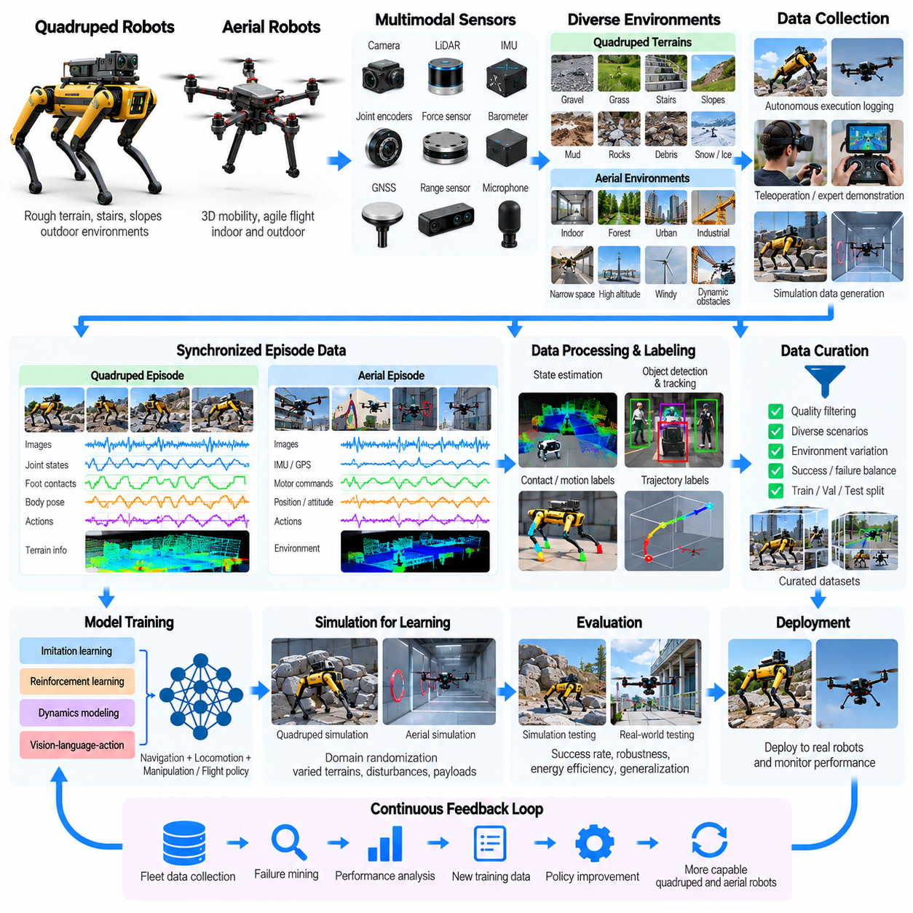{width="7.268055555555556in" height="7.268055555555556in"}

Quadruped and aerial robot data engines support the development of autonomous systems operating in environments that challenge conventional wheeled robots. Quadrupeds traverse uneven terrain through coordinated leg movements, while aerial robots navigate three-dimensional space using controlled flight. Their data engines transform sensor observations, motion trajectories, environmental interactions, and operational outcomes into reusable learning resources.

Although quadruped and aerial robots have different physical structures, their data engines share several fundamental requirements. Both platforms require accurate state estimation, dynamic control, environmental perception, and continuous adaptation to disturbances. Data pipelines must preserve relationships among robot dynamics, sensor measurements, control commands, and environmental conditions to support reliable autonomy.

Quadruped datasets typically contain joint positions, joint velocities, actuator torques, inertial measurements, foot contact states, body poses, and terrain observations. Cameras and LiDAR provide information about obstacles and traversability. These synchronized measurements allow learning systems to associate locomotion decisions with stability, energy consumption, and successful traversal across different surfaces.

Aerial robot datasets emphasize position, orientation, angular velocity, acceleration, motor commands, altitude, and flight trajectories. Cameras, inertial measurement units, GNSS receivers, barometers, and range sensors provide complementary navigation information. Accurate timestamp alignment is essential because small sensing or control delays can significantly affect high-speed flight stability and obstacle avoidance.

Quadruped locomotion depends on coordinated contact between multiple legs and the supporting terrain. Walking, trotting, climbing, and recovering from disturbances require different contact patterns and control strategies. Data engines must capture gait transitions, foot placement, ground reaction forces, and body stabilization to support learning policies capable of adapting to changing terrain conditions.

Terrain diversity is a critical factor in quadruped data collection. Robots may encounter gravel, grass, stairs, slopes, mud, debris, and slippery surfaces. Training datasets should represent variations in friction, surface compliance, elevation, and obstacle geometry. Recording terrain properties alongside locomotion outcomes helps models learn relationships between environmental conditions and feasible movement strategies.

Aerial robots face disturbances that differ fundamentally from terrestrial contact dynamics. Wind gusts, aerodynamic drag, payload variation, and changing air density can influence flight performance. Data engines should record environmental measurements and controller responses when available. Such information supports disturbance estimation, adaptive control, and improved trajectory tracking under uncertain flight conditions.

Teleoperation and expert demonstrations provide important training data for both robot categories. Quadruped operators may guide robots across difficult terrain, while aerial vehicle pilots demonstrate navigation through constrained spaces. Recording expert commands, autonomous corrections, and executed trajectories allows learning systems to distinguish intended motion from stabilization actions generated by onboard controllers.

Simulation is particularly valuable because physical experimentation can involve substantial equipment damage or safety risks. Physics engines generate quadruped locomotion experiences across randomized terrains, while flight simulators reproduce vehicle dynamics and environmental disturbances. Parallel environments support large-scale policy training, systematic scenario variation, and evaluation before physical deployment.

Reinforcement learning has demonstrated considerable potential for quadruped locomotion control. Policies can learn coordinated leg movements through rewards associated with velocity tracking, stability, energy efficiency, and terrain traversal. However, learned behaviors depend on simulator fidelity and reward design. Real-world validation remains necessary to identify unsafe strategies and unmodeled physical effects.

Aerial reinforcement learning and imitation learning can support trajectory tracking, obstacle avoidance, and agile flight maneuvers. Training environments may introduce randomized obstacles, disturbances, and sensor noise. Nevertheless, flight policies must respect actuator saturation, vehicle dynamics, battery limitations, and safety constraints. High simulation performance alone does not establish operational reliability.

Simulation-to-reality transfer requires careful treatment of platform-specific physical uncertainties. Quadrupeds experience variations in joint friction, actuator response, and ground contact, while aerial robots encounter aerodynamic modeling errors and propulsion differences. Domain randomization, system identification, and real-world calibration help reduce these gaps, although their effectiveness depends on representative physical testing.

Multimodal synchronization is essential for reconstructing dynamic robot behavior. Quadruped data pipelines align camera frames, joint states, contact events, and inertial measurements. Aerial pipelines synchronize visual observations, inertial signals, navigation estimates, and motor outputs. Accurate temporal alignment enables models to associate environmental changes with control decisions and resulting physical responses.

State estimation data is especially important when external positioning systems become unreliable. Quadrupeds may operate in tunnels or industrial structures where GNSS is unavailable, while aerial robots may fly indoors or near obstacles that interfere with positioning. Visual-inertial odometry, LiDAR-based localization, and sensor fusion provide alternative estimates whose uncertainties must be preserved.

Perception data supports terrain understanding for quadrupeds and free-space estimation for aerial robots. Semantic segmentation, depth estimation, obstacle detection, and traversability prediction can improve autonomous planning. However, perception errors can produce dangerous control decisions. Data engines should therefore retain confidence estimates, sensor quality indicators, and examples of degraded observation conditions.

Automated labeling pipelines convert raw recordings into structured episodes describing robot states, environmental features, motion phases, and task outcomes. Quadruped labels may identify gait modes, contact transitions, slips, and terrain categories. Aerial labels may describe flight phases, obstacle encounters, wind disturbances, and landing events. Consistent labeling supports training, debugging, and comparative evaluation.

Failure data provides valuable information about the boundaries of learned autonomy. Quadrupeds may slip, stumble, lose balance, or fail to climb obstacles. Aerial robots may experience tracking errors, unstable flight, localization loss, or unsuccessful landings. Recording precursor conditions, control responses, and recovery outcomes enables engineers to investigate failures and develop more robust behaviors.

Safety requirements differ between terrestrial and aerial platforms. Quadruped systems must consider falls, contact forces, and interactions with nearby people or equipment. Aerial systems additionally face risks involving altitude, uncontrolled descent, rotor contact, and airspace restrictions. Data-driven improvements must operate alongside independent safety mechanisms, operational procedures, and applicable regulatory requirements.

Task-oriented datasets extend beyond basic locomotion and flight control. Quadrupeds may perform industrial inspection, environmental monitoring, or autonomous patrols, while aerial robots conduct mapping, infrastructure inspection, and search operations. Data engines should connect navigation trajectories with task observations, mission objectives, and completion outcomes to support integrated autonomy.

Evaluation should measure both control performance and mission effectiveness. Quadruped metrics include traversal success, stability, slip frequency, energy consumption, and recovery capability. Aerial metrics include trajectory tracking error, flight endurance, obstacle clearance, landing precision, and disturbance rejection. Testing across unfamiliar environments helps distinguish genuine generalization from memorized behavior.

Fleet-scale deployment enables robots to gather diverse experiences across sites, terrain types, weather conditions, and mission profiles. Centralized data processing can identify recurring failures and environmental weaknesses. Event-triggered recording prioritizes informative situations such as slips, unexpected impacts, localization degradation, emergency maneuvers, and abnormal energy consumption.

Data governance must account for operational sensitivity, privacy, and platform-specific regulatory obligations. Aerial imagery may capture private property or identifiable individuals, while quadruped inspection logs may reveal sensitive industrial layouts. Dataset documentation should preserve collection permissions, provenance, hardware configurations, software versions, and access restrictions to support responsible reuse.

Scaling these data engines requires balancing simulation volume with the cost and risk of physical experimentation. Large synthetic datasets can improve scenario coverage, but they cannot fully reproduce complex terrain contacts or aerodynamic disturbances. Active learning, targeted field trials, automated quality assessment, and failure-driven collection help prioritize experiences with high learning value.

The long-term objective is to create continuously improving data infrastructures that connect perception, dynamics, control, and mission-level reasoning. Quadruped and aerial robots illustrate how physical embodiment determines data requirements and learning challenges. Their successful scaling depends on realistic simulation, representative field experience, reliable safety mechanisms, and systematic feedback from deployment into model development.

사족보행 로봇 및 항공 로봇 데이터 엔진(Quadruped and Aerial Robot Data Engine)은 기존 바퀴형 로봇(Wheeled Robot)이 운행하기 어려운 환경에서 작동하는 자율 시스템(Autonomous System)의 개발을 지원한다. 사족보행 로봇(Quadruped Robot)은 협응된 다리 움직임(Coordinated Leg Movement)을 통해 불규칙한 지형을 이동하며, 항공 로봇(Aerial Robot)은 제어된 비행(Controlled Flight)을 통해 3차원 공간을 탐색한다. 데이터 엔진은 센서 관측(Sensor Observation), 이동 궤적(Motion Trajectory), 환경 상호작용(Environmental Interaction), 운영 결과(Operational Outcome)를 재사용 가능한 학습 자원(Learning Resource)으로 변환한다.

사족보행 로봇과 항공 로봇은 서로 다른 물리적 구조(Physical Structure)를 가지지만, 데이터 엔진에는 몇 가지 공통적인 기본 요구사항이 존재한다. 두 플랫폼 모두 정확한 상태 추정(State Estimation), 동적 제어(Dynamic Control), 환경 인지(Environmental Perception), 외란에 대한 지속적인 적응(Continuous Adaptation to Disturbances)이 필요하다. 데이터 파이프라인(Data Pipeline)은 신뢰성 있는 자율성을 지원하기 위해 로봇 동역학(Robot Dynamics), 센서 측정값(Sensor Measurement), 제어 명령(Control Command), 환경 조건(Environmental Condition) 사이의 관계를 보존해야 한다.

사족보행 로봇 데이터셋(Quadruped Dataset)에는 일반적으로 관절 위치(Joint Position), 관절 속도(Joint Velocity), 액추에이터 토크(Actuator Torque), 관성 측정값(Inertial Measurement), 발 접촉 상태(Foot Contact State), 몸체 자세(Body Pose), 지형 관측(Terrain Observation)이 포함된다. 카메라(Camera)와 라이다(LiDAR)는 장애물(Obstacle)과 주행 가능성(Traversability)에 관한 정보를 제공한다. 이러한 동기화된 측정값은 학습 시스템이 이동 결정(Locomotion Decision)을 안정성(Stability), 에너지 소비(Energy Consumption), 다양한 표면에서의 성공적인 이동과 연결하도록 한다.

항공 로봇 데이터셋(Aerial Robot Dataset)은 위치(Position), 방향(Orientation), 각속도(Angular Velocity), 가속도(Acceleration), 모터 명령(Motor Command), 고도(Altitude), 비행 궤적(Flight Trajectory)을 중점적으로 다룬다. 카메라, 관성측정장치(Inertial Measurement Unit, IMU), 위성항법시스템 수신기(GNSS Receiver), 기압계(Barometer), 거리 센서(Range Sensor)는 상호 보완적인 내비게이션 정보(Navigation Information)를 제공한다. 작은 센싱 또는 제어 지연도 고속 비행 안정성(High-Speed Flight Stability)과 장애물 회피(Obstacle Avoidance)에 상당한 영향을 미칠 수 있으므로 정확한 타임스탬프 정렬(Timestamp Alignment)이 필수적이다.

사족보행 이동(Quadruped Locomotion)은 여러 다리와 지지 지형(Supporting Terrain) 사이의 협응된 접촉(Coordinated Contact)에 의존한다. 걷기(Walking), 속보(Trotting), 등반(Climbing), 외란으로부터의 복구(Disturbance Recovery)는 서로 다른 접촉 패턴(Contact Pattern)과 제어 전략(Control Strategy)을 필요로 한다. 데이터 엔진은 변화하는 지형 조건에 적응할 수 있는 학습 정책(Learned Policy)을 지원하기 위해 보행 패턴 전환(Gait Transition), 발 배치(Foot Placement), 지면 반력(Ground Reaction Force), 몸체 안정화(Body Stabilization)를 기록해야 한다.

지형 다양성(Terrain Diversity)은 사족보행 로봇 데이터 수집에서 중요한 요소이다. 로봇은 자갈(Gravel), 잔디(Grass), 계단(Stairs), 경사면(Slope), 진흙(Mud), 잔해(Debris), 미끄러운 표면(Slippery Surface)을 만날 수 있다. 학습 데이터셋은 마찰(Friction), 표면 순응성(Surface Compliance), 고도(Elevation), 장애물 형상(Obstacle Geometry)의 변화를 표현해야 한다. 이동 결과(Locomotion Outcome)와 함께 지형 특성(Terrain Property)을 기록하면 모델이 환경 조건과 실행 가능한 이동 전략(Feasible Movement Strategy) 사이의 관계를 학습하는 데 도움이 된다.

항공 로봇은 지상 로봇의 접촉 동역학(Terrestrial Contact Dynamics)과 근본적으로 다른 외란(Disturbance)에 직면한다. 돌풍(Wind Gust), 공기역학적 항력(Aerodynamic Drag), 탑재 하중 변화(Payload Variation), 공기 밀도 변화(Changing Air Density)는 비행 성능(Flight Performance)에 영향을 미칠 수 있다. 데이터 엔진은 가능한 경우 환경 측정값(Environmental Measurement)과 제어기 응답(Controller Response)을 기록해야 한다. 이러한 정보는 불확실한 비행 조건에서 외란 추정(Disturbance Estimation), 적응 제어(Adaptive Control), 궤적 추종(Trajectory Tracking) 성능 개선을 지원한다.

원격조작(Teleoperation)과 전문가 시연(Expert Demonstration)은 두 로봇 유형 모두에 중요한 학습 데이터를 제공한다. 사족보행 로봇 작업자는 어려운 지형을 통과하도록 로봇을 안내할 수 있으며, 항공기 조종사(Aerial Vehicle Pilot)는 제한된 공간(Constrained Space)을 통과하는 내비게이션을 시연할 수 있다. 전문가 명령(Expert Command), 자율 보정(Autonomous Correction), 실행 궤적(Executed Trajectory)을 기록하면 학습 시스템이 의도된 움직임(Intended Motion)과 온보드 제어기(Onboard Controller)가 생성한 안정화 행동(Stabilization Action)을 구분할 수 있다.

시뮬레이션(Simulation)은 실제 물리적 실험(Physical Experimentation)이 상당한 장비 손상(Equipment Damage)이나 안전 위험(Safety Risk)을 수반할 수 있기 때문에 특히 중요하다. 물리 엔진(Physics Engine)은 무작위화된 지형(Randomized Terrain)에서 사족보행 이동 경험을 생성하며, 비행 시뮬레이터(Flight Simulator)는 기체 동역학(Vehicle Dynamics)과 환경 외란(Environmental Disturbance)을 재현한다. 병렬 환경(Parallel Environment)은 대규모 정책 학습(Large-Scale Policy Training), 체계적인 시나리오 변화(Systematic Scenario Variation), 실제 배포 이전의 평가를 지원한다.

강화학습(Reinforcement Learning)은 사족보행 이동 제어(Quadruped Locomotion Control)에서 상당한 가능성을 보여주었다. 정책(Policy)은 속도 추종(Velocity Tracking), 안정성(Stability), 에너지 효율(Energy Efficiency), 지형 통과(Terrain Traversal)와 관련된 보상(Reward)을 통해 협응된 다리 움직임을 학습할 수 있다. 그러나 학습된 행동은 시뮬레이터 충실도(Simulator Fidelity)와 보상 설계(Reward Design)에 의존한다. 안전하지 않은 전략(Unsafe Strategy)과 모델링되지 않은 물리적 영향(Unmodeled Physical Effect)을 식별하기 위해 실제 환경 검증(Real-World Validation)이 여전히 필요하다.

항공 강화학습(Aerial Reinforcement Learning)과 모방학습(Imitation Learning)은 궤적 추종(Trajectory Tracking), 장애물 회피(Obstacle Avoidance), 민첩한 비행 기동(Agile Flight Maneuver)을 지원할 수 있다. 학습 환경(Training Environment)에는 무작위 장애물(Randomized Obstacle), 외란(Disturbance), 센서 잡음(Sensor Noise)이 도입될 수 있다. 그러나 비행 정책(Flight Policy)은 액추에이터 포화(Actuator Saturation), 기체 동역학(Vehicle Dynamics), 배터리 한계(Battery Limitation), 안전 제약(Safety Constraint)을 준수해야 한다. 높은 시뮬레이션 성능만으로 운영 신뢰성(Operational Reliability)이 확보되는 것은 아니다.

시뮬레이션에서 현실로의 전이(Simulation-to-Reality Transfer)는 플랫폼별 물리적 불확실성(Platform-Specific Physical Uncertainty)을 신중하게 처리해야 한다. 사족보행 로봇은 관절 마찰(Joint Friction), 액추에이터 응답(Actuator Response), 지면 접촉(Ground Contact)의 변화를 경험하며, 항공 로봇은 공기역학적 모델링 오차(Aerodynamic Modeling Error)와 추진 시스템 차이(Propulsion Difference)에 직면한다. 도메인 무작위화(Domain Randomization), 시스템 식별(System Identification), 실제 환경 보정(Real-World Calibration)은 이러한 차이를 줄이는 데 도움이 되지만, 효과는 대표성 있는 물리적 시험(Representative Physical Testing)에 달려 있다.

다중 모달 동기화(Multimodal Synchronization)는 동적인 로봇 행동(Dynamic Robot Behavior)을 재구성하는 데 필수적이다. 사족보행 데이터 파이프라인(Quadruped Data Pipeline)은 카메라 프레임(Camera Frame), 관절 상태(Joint State), 접촉 이벤트(Contact Event), 관성 측정값(Inertial Measurement)을 정렬한다. 항공 데이터 파이프라인(Aerial Data Pipeline)은 시각적 관측(Visual Observation), 관성 신호(Inertial Signal), 내비게이션 추정값(Navigation Estimate), 모터 출력(Motor Output)을 동기화한다. 정확한 시간 정렬(Temporal Alignment)은 모델이 환경 변화와 제어 결정(Control Decision), 그에 따른 물리적 응답(Physical Response)을 연결하도록 한다.

상태 추정 데이터(State Estimation Data)는 외부 위치 측정 시스템(External Positioning System)의 신뢰성이 낮아질 때 특히 중요하다. 사족보행 로봇은 위성항법시스템(GNSS)을 사용할 수 없는 터널이나 산업 구조물(Industrial Structure)에서 작동할 수 있으며, 항공 로봇은 실내 또는 위치 측정을 방해하는 장애물 근처에서 비행할 수 있다. 시각-관성 주행거리 추정(Visual-Inertial Odometry), 라이다 기반 위치 추정(LiDAR-Based Localization), 센서 융합(Sensor Fusion)은 대체 추정값(Alternative Estimate)을 제공하며, 이러한 추정값의 불확실성(Uncertainty)은 반드시 보존되어야 한다.

인지 데이터(Perception Data)는 사족보행 로봇의 지형 이해(Terrain Understanding)와 항공 로봇의 자유 공간 추정(Free-Space Estimation)을 지원한다. 의미론적 분할(Semantic Segmentation), 깊이 추정(Depth Estimation), 장애물 감지(Obstacle Detection), 주행 가능성 예측(Traversability Prediction)은 자율 계획(Autonomous Planning)을 개선할 수 있다. 그러나 인지 오류(Perception Error)는 위험한 제어 결정(Dangerous Control Decision)을 초래할 수 있다. 따라서 데이터 엔진은 신뢰도 추정값(Confidence Estimate), 센서 품질 지표(Sensor Quality Indicator), 관측 조건이 악화된 사례(Degraded Observation Condition)를 보존해야 한다.

자동 라벨링 파이프라인(Automated Labeling Pipeline)은 원시 기록(Raw Recording)을 로봇 상태(Robot State), 환경 특징(Environmental Feature), 이동 단계(Motion Phase), 작업 결과(Task Outcome)를 설명하는 구조화된 에피소드(Structured Episode)로 변환한다. 사족보행 라벨(Quadruped Label)은 보행 모드(Gait Mode), 접촉 전환(Contact Transition), 미끄러짐(Slip), 지형 범주(Terrain Category)를 식별할 수 있다. 항공 라벨(Aerial Label)은 비행 단계(Flight Phase), 장애물 조우(Obstacle Encounter), 바람 외란(Wind Disturbance), 착륙 이벤트(Landing Event)를 설명할 수 있다. 일관된 라벨링(Consistent Labeling)은 학습, 디버깅(Debugging), 비교 평가(Comparative Evaluation)를 지원한다.

실패 데이터(Failure Data)는 학습된 자율성(Learned Autonomy)의 한계를 이해하는 데 중요한 정보를 제공한다. 사족보행 로봇은 미끄러지거나(Slip), 비틀거리거나(Stumble), 균형을 잃거나(Lose Balance), 장애물 등반에 실패할 수 있다. 항공 로봇은 궤적 추종 오차(Tracking Error), 불안정한 비행(Unstable Flight), 위치 추정 상실(Localization Loss), 착륙 실패(Unsuccessful Landing)를 경험할 수 있다. 실패 이전 조건(Precursor Condition), 제어 응답(Control Response), 복구 결과(Recovery Outcome)를 기록하면 엔지니어가 실패를 조사하고 더욱 강건한 행동(Robust Behavior)을 개발할 수 있다.

안전 요구사항(Safety Requirement)은 지상 플랫폼(Terrestrial Platform)과 항공 플랫폼(Aerial Platform) 사이에서 서로 다르다. 사족보행 시스템은 넘어짐(Fall), 접촉력(Contact Force), 주변 사람이나 장비와의 상호작용을 고려해야 한다. 항공 시스템은 고도(Altitude), 통제되지 않은 하강(Uncontrolled Descent), 회전익 접촉(Rotor Contact), 공역 제한(Airspace Restriction)과 관련된 추가적인 위험에 직면한다. 데이터 기반 개선(Data-Driven Improvement)은 독립적인 안전 메커니즘(Independent Safety Mechanism), 운영 절차(Operational Procedure), 적용 가능한 규제 요구사항(Regulatory Requirement)과 함께 작동해야 한다.

작업 지향 데이터셋(Task-Oriented Dataset)은 기본적인 이동 및 비행 제어를 넘어선다. 사족보행 로봇은 산업 시설 점검(Industrial Inspection), 환경 모니터링(Environmental Monitoring), 자율 순찰(Autonomous Patrol)을 수행할 수 있으며, 항공 로봇은 지도 작성(Mapping), 인프라 점검(Infrastructure Inspection), 수색 작업(Search Operation)을 수행할 수 있다. 데이터 엔진은 통합 자율성(Integrated Autonomy)을 지원하기 위해 내비게이션 궤적(Navigation Trajectory)을 작업 관측(Task Observation), 임무 목표(Mission Objective), 완료 결과(Completion Outcome)와 연결해야 한다.

평가(Evaluation)는 제어 성능(Control Performance)과 임무 효과성(Mission Effectiveness)을 모두 측정해야 한다. 사족보행 지표(Quadruped Metric)에는 지형 통과 성공률(Traversal Success), 안정성(Stability), 미끄러짐 빈도(Slip Frequency), 에너지 소비(Energy Consumption), 복구 능력(Recovery Capability)이 포함된다. 항공 지표(Aerial Metric)에는 궤적 추종 오차(Trajectory Tracking Error), 비행 지속시간(Flight Endurance), 장애물 이격거리(Obstacle Clearance), 착륙 정밀도(Landing Precision), 외란 억제 능력(Disturbance Rejection)이 포함된다. 익숙하지 않은 환경에서의 시험은 실제 일반화(Genuine Generalization)와 암기된 행동(Memorized Behavior)을 구분하는 데 도움이 된다.

플릿 규모 배포(Fleet-Scale Deployment)는 로봇이 서로 다른 현장(Site), 지형 유형(Terrain Type), 기상 조건(Weather Condition), 임무 유형(Mission Profile)에서 다양한 경험을 수집하도록 한다. 중앙 집중식 데이터 처리(Centralized Data Processing)는 반복적인 실패(Recurring Failure)와 환경적 취약점(Environmental Weakness)을 식별할 수 있다. 이벤트 기반 기록(Event-Triggered Recording)은 미끄러짐, 예상하지 못한 충격(Unexpected Impact), 위치 추정 성능 저하(Localization Degradation), 비상 기동(Emergency Maneuver), 비정상적인 에너지 소비(Abnormal Energy Consumption)와 같이 정보 가치가 높은 상황을 우선적으로 수집한다.

데이터 거버넌스(Data Governance)는 운영 정보의 민감성(Operational Sensitivity), 개인정보 보호(Privacy), 플랫폼별 규제 의무(Platform-Specific Regulatory Obligation)를 고려해야 한다. 항공 영상(Aerial Imagery)은 사유 재산(Private Property)이나 식별 가능한 개인(Identifiable Individual)을 촬영할 수 있으며, 사족보행 점검 로그(Quadruped Inspection Log)는 민감한 산업 시설 배치(Sensitive Industrial Layout)를 드러낼 수 있다. 데이터셋 문서화(Dataset Documentation)는 책임 있는 재사용(Responsible Reuse)을 지원하기 위해 수집 허가(Collection Permission), 데이터 출처(Provenance), 하드웨어 구성(Hardware Configuration), 소프트웨어 버전(Software Version), 접근 제한(Access Restriction)을 보존해야 한다.

이러한 데이터 엔진의 규모 확장(Scaling)은 시뮬레이션 데이터량(Simulation Volume)과 실제 물리적 실험(Physical Experimentation)의 비용 및 위험 사이의 균형을 필요로 한다. 대규모 합성 데이터셋(Large Synthetic Dataset)은 시나리오 적용 범위(Scenario Coverage)를 개선할 수 있지만 복잡한 지형 접촉(Complex Terrain Contact)이나 공기역학적 외란(Aerodynamic Disturbance)을 완전히 재현할 수는 없다. 능동학습(Active Learning), 목표 지향적 현장 시험(Targeted Field Trial), 자동 품질 평가(Automated Quality Assessment), 실패 중심 데이터 수집(Failure-Driven Collection)은 학습 가치(Learning Value)가 높은 경험을 우선적으로 확보하는 데 도움이 된다.

장기적인 목표는 인지(Perception), 동역학(Dynamics), 제어(Control), 임무 수준 추론(Mission-Level Reasoning)을 연결하는 지속적으로 개선되는 데이터 인프라(Continuously Improving Data Infrastructure)를 구축하는 것이다. 사족보행 로봇과 항공 로봇은 물리적 신체 형태(Physical Embodiment)가 데이터 요구사항(Data Requirement)과 학습 과제(Learning Challenge)를 어떻게 결정하는지 보여준다. 성공적인 규모 확장(Scaling)은 현실적인 시뮬레이션(Realistic Simulation), 대표성 있는 현장 경험(Representative Field Experience), 신뢰성 있는 안전 메커니즘(Reliable Safety Mechanism), 배포에서 모델 개발로 이어지는 체계적인 피드백(Systematic Deployment-to-Development Feedback)에 달려 있다.

##  

## 10.08. Teleoperation Data Factory Case Study

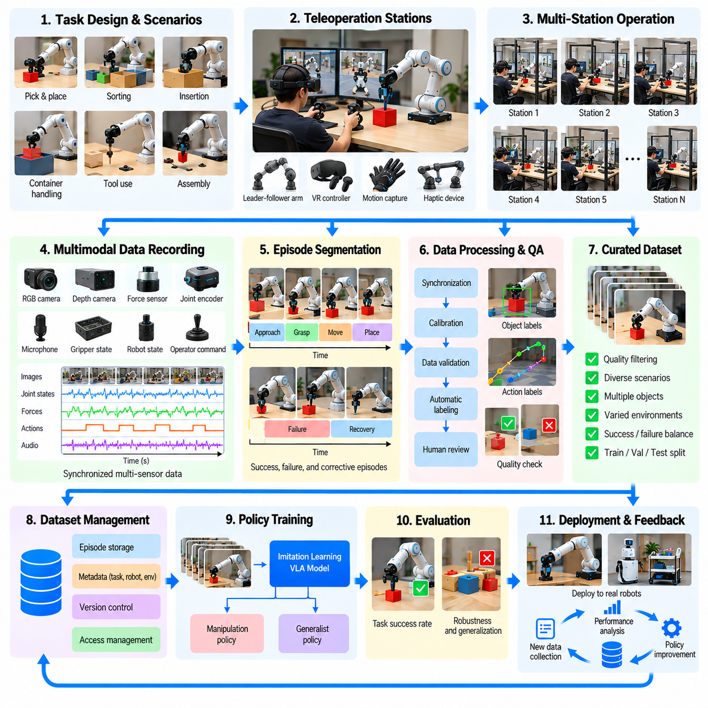{width="7.268055555555556in" height="7.268055555555556in"}

A teleoperation data factory is an organized infrastructure for producing large volumes of high-quality robot demonstrations through human-controlled physical interaction. Unlike conventional laboratory collection, a data factory treats demonstration acquisition as a repeatable production process. It integrates robot hardware, operator interfaces, standardized tasks, recording systems, quality assurance, and data management into a coordinated learning pipeline.

A representative teleoperation data factory may operate multiple robotic manipulation stations under centralized supervision. Each station includes a robot arm, gripper, cameras, force sensors, control interfaces, and a configurable workspace. Human operators execute predefined tasks while recording synchronized observations and actions. The resulting episodes become training resources for imitation learning and generalist robot policies.

The factory begins with task portfolio design, which determines the behaviors that robots must learn. Tasks may include object picking, sorting, insertion, container handling, tool manipulation, and multi-step assembly. Designers balance common operational activities with difficult edge cases. Task specifications define initial conditions, target outcomes, object configurations, acceptable behaviors, and failure criteria.

Workspace standardization improves data consistency while preserving environmental diversity. Collection stations use documented camera positions, coordinate frames, lighting conditions, and robot calibration procedures. However, identical workspaces can produce overfitted policies. Data factories therefore introduce controlled variations in object placement, backgrounds, materials, and task configurations to support generalization.

Operator interfaces strongly influence demonstration quality and collection throughput. Common interfaces include leader-follower robot arms, virtual reality controllers, motion capture systems, and haptic devices. The interface must provide intuitive control while respecting robot constraints. Ergonomic design, low communication latency, and reliable feedback reduce operator fatigue and improve trajectory consistency.

Leader-follower teleoperation enables operators to guide a leader device while a follower robot reproduces corresponding movements. This arrangement can generate precise manipulation demonstrations with natural human control. However, differences in kinematics, mechanical friction, and gripper response may introduce tracking errors. Recording both commanded and executed trajectories helps preserve these distinctions.

A standardized collection protocol ensures that operators produce comparable demonstrations across shifts and stations. Before each episode, the system verifies robot readiness, sensor synchronization, object placement, and task configuration. During execution, it records actions, observations, interventions, and abnormal events. After completion, the episode receives outcome labels and preliminary quality checks.

A typical recording pipeline captures RGB images, depth measurements, joint positions, joint velocities, end-effector poses, gripper states, force measurements, and operator commands. All streams require consistent timestamps and calibration metadata. The data schema should identify robot models, software versions, control frequencies, coordinate conventions, task identifiers, and environmental configurations.

Episode segmentation converts continuous operating sessions into meaningful training examples. Start and end markers may be generated through operator controls, task-state transitions, or automated event detection. Segmentation must preserve preparation movements, contact events, corrective actions, and task completion. Poor boundaries can remove important causal information or introduce unrelated behavior into training sequences.

Quality assurance is essential because large demonstration volumes do not automatically produce effective learning datasets. Automated checks identify missing sensor frames, timestamp drift, incomplete trajectories, inconsistent coordinate transformations, and invalid robot states. Additional checks examine task success, collision events, excessive forces, and unexpected control interruptions before accepting episodes into the curated dataset.

Human reviewers provide contextual judgments that automated validators may miss. A successful object placement might involve unnecessary movements, unstable grasping, or accidental contact with surrounding objects. Reviewers classify demonstrations according to task correctness, motion quality, safety, and instructional value. Consistent review guidelines reduce disagreement and improve annotation reliability.

Demonstration diversity must be deliberately managed rather than left to operator preference. Operators naturally develop efficient routines that can produce repetitive trajectories. Data factories counter this tendency through randomized object positions, varying grasp approaches, alternative task sequences, and different workspace conditions. Diversity targets help ensure coverage of behaviors required for unfamiliar situations.

Operator training and performance monitoring contribute directly to data quality. Training programs establish consistent task interpretation, interface operation, safety procedures, and recovery protocols. Performance indicators may include accepted episodes per hour, task success rate, intervention frequency, and quality rejection rate. These measures should guide process improvements rather than encourage unsafe collection speed.

Throughput analysis distinguishes raw demonstration volume from usable training output. A station may record many episodes, but calibration failures, incomplete tasks, or poor synchronization can reduce accepted yield. Effective throughput is measured through validated episodes and useful trajectory duration. Factory management should track rejection causes, operator utilization, station downtime, and processing delays.

Data storage architecture must support high-bandwidth multimodal recordings from many collection stations. Local buffers protect against temporary network interruptions, while centralized storage provides versioned access to validated episodes. Compression and selective retention reduce costs without discarding essential control information. Dataset manifests connect raw recordings, processed trajectories, labels, and provenance metadata.

Automated processing transforms raw demonstrations into standardized learning representations. Typical operations include timestamp alignment, coordinate conversion, image preprocessing, action normalization, episode indexing, and annotation generation. Processing pipelines must preserve original recordings for traceability. Versioned transformations allow engineers to reproduce datasets and identify errors introduced during preprocessing.

A teleoperation factory becomes more valuable when integrated with an active learning loop. Initial demonstrations train a robot policy, which is then evaluated on held-out tasks and physical test scenarios. Failure analysis identifies weak behaviors, uncertain states, and missing task variations. New collection requests target these deficiencies instead of repeatedly acquiring already well-represented demonstrations.

Human intervention during autonomous execution creates another important data source. When a robot encounters uncertainty or begins to fail, an operator can assume control and demonstrate corrective behavior. Recording the transition from autonomous action to human recovery provides information about policy limitations. These intervention episodes can support corrective imitation learning and improved recovery strategies.

Simulation can complement physical teleoperation by generating variations around recorded demonstrations. Object positions, camera viewpoints, lighting, friction, and environmental geometry may be modified in virtual environments. However, synthetic transformations must preserve physically meaningful actions and contact relationships. Real demonstrations remain necessary for validating simulated behavior and maintaining physical grounding.

A representative factory deployment may begin with a small number of manipulation stations and a limited task portfolio. Engineers first establish reliable synchronization, repeatable calibration, and clear acceptance criteria. Once collection quality stabilizes, additional stations and operators can increase capacity. Expansion should follow measured data yield and learning improvements rather than hardware count alone.

Operational economics depend on equipment costs, operator labor, maintenance, workspace preparation, storage, and processing infrastructure. Cost per accepted episode is more informative than cost per raw recording. Additional measures include cost per useful action hour and improvement in policy performance per collection budget. These metrics connect factory productivity with actual learning value.

Safety management is essential because operators and robots share physical workspaces. Emergency stops, force limits, collision monitoring, guarded operating zones, and documented recovery procedures reduce operational risks. Data collection software should preserve safety events and intervention records. Production targets must never override protective mechanisms or established safety procedures.

Data governance addresses ownership, privacy, licensing, and traceability across collection operations. Recorded scenes may contain proprietary objects, confidential processes, or identifiable personnel. Access controls, retention policies, consent procedures, and secure transfer mechanisms protect sensitive information. Provenance records connect each episode to its collection station, operator authorization, task specification, and processing history.

Scaling a teleoperation data factory requires coordinated improvements in hardware reliability, operator efficiency, automated validation, and dataset diversity. Simply adding stations can multiply defective recordings if quality processes remain weak. Centralized monitoring, standardized interfaces, predictive maintenance, and automated data selection help maintain consistent production quality across expanding operations.

The central lesson of the teleoperation data factory case study is that robot learning data must be engineered as a production system rather than collected as isolated demonstrations. Sustainable performance depends on measurable quality, repeatable operations, targeted diversity, and feedback from trained policies. A mature data factory continuously converts human expertise into structured robotic experience that supports increasingly reliable physical intelligence.

원격조작 데이터 팩토리(Teleoperation Data Factory)는 인간이 제어하는 물리적 상호작용(Human-Controlled Physical Interaction)을 통해 대량의 고품질 로봇 시연 데이터(Robot Demonstration Data)를 생산하기 위한 체계적인 인프라(Infrastructure)이다. 기존의 실험실 데이터 수집(Conventional Laboratory Collection)과 달리 데이터 팩토리는 시연 데이터 확보(Demonstration Acquisition)를 반복 가능한 생산 공정(Repeatable Production Process)으로 취급한다. 로봇 하드웨어(Robot Hardware), 작업자 인터페이스(Operator Interface), 표준화된 작업(Standardized Task), 기록 시스템(Recording System), 품질 보증(Quality Assurance), 데이터 관리(Data Management)를 통합된 학습 파이프라인(Learning Pipeline)으로 연결한다.

대표적인 원격조작 데이터 팩토리는 중앙 집중식 감독(Centralized Supervision) 아래 여러 로봇 조작 스테이션(Robotic Manipulation Station)을 운영할 수 있다. 각 스테이션은 로봇 팔(Robot Arm), 그리퍼(Gripper), 카메라(Camera), 힘 센서(Force Sensor), 제어 인터페이스(Control Interface), 구성 가능한 작업 공간(Configurable Workspace)으로 구성된다. 인간 작업자(Human Operator)는 동기화된 관측 데이터와 행동을 기록하면서 사전에 정의된 작업을 수행한다. 이렇게 생성된 에피소드(Episode)는 모방학습(Imitation Learning)과 범용 로봇 정책(Generalist Robot Policy)을 위한 학습 자원이 된다.

데이터 팩토리는 로봇이 학습해야 할 행동을 결정하는 작업 포트폴리오 설계(Task Portfolio Design)에서 시작된다. 작업에는 객체 집기(Object Picking), 분류(Sorting), 삽입(Insertion), 컨테이너 취급(Container Handling), 도구 조작(Tool Manipulation), 다단계 조립(Multi-Step Assembly)이 포함될 수 있다. 설계자는 일반적인 운영 활동(Common Operational Activity)과 어려운 예외 사례(Edge Case) 사이의 균형을 유지한다. 작업 명세(Task Specification)는 초기 조건(Initial Condition), 목표 결과(Target Outcome), 객체 구성(Object Configuration), 허용 가능한 행동(Acceptable Behavior), 실패 기준(Failure Criteria)을 정의한다.

작업 공간 표준화(Workspace Standardization)는 환경 다양성(Environmental Diversity)을 유지하면서 데이터 일관성(Data Consistency)을 개선한다. 데이터 수집 스테이션(Collection Station)은 문서화된 카메라 위치(Camera Position), 좌표계(Coordinate Frame), 조명 조건(Lighting Condition), 로봇 보정 절차(Robot Calibration Procedure)를 사용한다. 그러나 동일한 작업 공간은 과적합된 정책(Overfitted Policy)을 생성할 수 있다. 따라서 데이터 팩토리는 일반화(Generalization)를 지원하기 위해 객체 배치(Object Placement), 배경(Background), 재료(Material), 작업 구성(Task Configuration)에 통제된 변화(Controlled Variation)를 도입한다.

작업자 인터페이스(Operator Interface)는 시연 데이터 품질(Demonstration Quality)과 데이터 수집 처리량(Collection Throughput)에 큰 영향을 미친다. 일반적인 인터페이스에는 리더-팔로워 로봇 팔(Leader-Follower Robot Arm), 가상현실 제어기(Virtual Reality Controller), 동작 포착 시스템(Motion Capture System), 햅틱 장치(Haptic Device)가 포함된다. 인터페이스는 로봇 제약(Robot Constraint)을 준수하면서 직관적인 제어(Intuitive Control)를 제공해야 한다. 인체공학적 설계(Ergonomic Design), 낮은 통신 지연시간(Low Communication Latency), 신뢰성 있는 피드백(Reliable Feedback)은 작업자 피로(Operator Fatigue)를 줄이고 궤적 일관성(Trajectory Consistency)을 개선한다.

리더-팔로워 원격조작(Leader-Follower Teleoperation)은 작업자가 리더 장치(Leader Device)를 조작하면 팔로워 로봇(Follower Robot)이 이에 대응하는 움직임을 재현하도록 한다. 이러한 구성은 자연스러운 인간 제어(Human Control)를 통해 정밀한 조작 시연(Precise Manipulation Demonstration)을 생성할 수 있다. 그러나 운동학(Kinematics), 기계적 마찰(Mechanical Friction), 그리퍼 응답(Gripper Response)의 차이는 추종 오차(Tracking Error)를 발생시킬 수 있다. 명령 궤적(Commanded Trajectory)과 실행 궤적(Executed Trajectory)을 모두 기록하면 이러한 차이를 보존할 수 있다.

표준화된 데이터 수집 프로토콜(Standardized Collection Protocol)은 작업자들이 서로 다른 교대 근무 시간(Shift)과 스테이션에서 비교 가능한 시연 데이터를 생성하도록 보장한다. 각 에피소드가 시작되기 전에 시스템은 로봇 준비 상태(Robot Readiness), 센서 동기화(Sensor Synchronization), 객체 배치, 작업 구성을 확인한다. 실행 중에는 행동(Action), 관측(Observation), 개입(Intervention), 비정상 이벤트(Abnormal Event)를 기록한다. 완료 후에는 에피소드에 결과 라벨(Outcome Label)을 부여하고 예비 품질 검사(Preliminary Quality Check)를 수행한다.

일반적인 기록 파이프라인(Recording Pipeline)은 RGB 이미지(RGB Image), 깊이 측정값(Depth Measurement), 관절 위치(Joint Position), 관절 속도(Joint Velocity), 말단효과기 자세(End-Effector Pose), 그리퍼 상태(Gripper State), 힘 측정값(Force Measurement), 작업자 명령(Operator Command)을 수집한다. 모든 데이터 스트림(Data Stream)은 일관된 타임스탬프(Timestamp)와 보정 메타데이터(Calibration Metadata)를 필요로 한다. 데이터 스키마(Data Schema)는 로봇 모델(Robot Model), 소프트웨어 버전(Software Version), 제어 주파수(Control Frequency), 좌표계 규약(Coordinate Convention), 작업 식별자(Task Identifier), 환경 구성(Environmental Configuration)을 식별해야 한다.

에피소드 분할(Episode Segmentation)은 연속적인 운영 세션(Continuous Operating Session)을 의미 있는 학습 사례(Training Example)로 변환한다. 시작 및 종료 마커(Start and End Marker)는 작업자 제어(Operator Control), 작업 상태 전환(Task-State Transition), 자동 이벤트 감지(Automated Event Detection)를 통해 생성할 수 있다. 분할 과정은 준비 동작(Preparation Movement), 접촉 이벤트(Contact Event), 교정 행동(Corrective Action), 작업 완료(Task Completion)를 보존해야 한다. 부정확한 경계(Poor Boundary)는 중요한 인과 정보(Causal Information)를 제거하거나 관련 없는 행동을 학습 시퀀스(Training Sequence)에 포함시킬 수 있다.

품질 보증(Quality Assurance)은 대량의 시연 데이터가 자동으로 효과적인 학습 데이터셋(Effective Learning Dataset)을 생성하는 것은 아니기 때문에 필수적이다. 자동 검사(Automated Check)는 누락된 센서 프레임(Missing Sensor Frame), 타임스탬프 드리프트(Timestamp Drift), 불완전한 궤적(Incomplete Trajectory), 일관되지 않은 좌표 변환(Inconsistent Coordinate Transformation), 유효하지 않은 로봇 상태(Invalid Robot State)를 식별한다. 추가 검사는 작업 성공(Task Success), 충돌 이벤트(Collision Event), 과도한 힘(Excessive Force), 예상하지 못한 제어 중단(Unexpected Control Interruption)을 확인한 후 에피소드를 정제된 데이터셋(Curated Dataset)에 포함한다.

인간 검토자(Human Reviewer)는 자동 검증기(Automated Validator)가 놓칠 수 있는 맥락적 판단(Contextual Judgment)을 제공한다. 성공적인 객체 배치(Object Placement)라도 불필요한 움직임(Unnecessary Movement), 불안정한 파지(Unstable Grasping), 주변 객체와의 우발적 접촉(Accidental Contact)을 포함할 수 있다. 검토자는 작업 정확성(Task Correctness), 움직임 품질(Motion Quality), 안전성(Safety), 교육적 가치(Instructional Value)에 따라 시연 데이터를 분류한다. 일관된 검토 지침(Consistent Review Guideline)은 평가자 간 불일치(Reviewer Disagreement)를 줄이고 주석 신뢰성(Annotation Reliability)을 개선한다.

시연 다양성(Demonstration Diversity)은 작업자의 선호에 맡기기보다 의도적으로 관리해야 한다. 작업자는 자연스럽게 효율적인 작업 루틴(Efficient Routine)을 개발하며, 이로 인해 반복적인 궤적(Repetitive Trajectory)이 생성될 수 있다. 데이터 팩토리는 무작위 객체 위치(Randomized Object Position), 다양한 파지 접근 방식(Grasp Approach), 대체 작업 시퀀스(Alternative Task Sequence), 서로 다른 작업 공간 조건(Workspace Condition)을 통해 이러한 경향에 대응한다. 다양성 목표(Diversity Target)는 익숙하지 않은 상황에 필요한 행동을 충분히 포함하도록 지원한다.

작업자 교육(Operator Training)과 성능 모니터링(Performance Monitoring)은 데이터 품질에 직접적으로 기여한다. 교육 프로그램(Training Program)은 일관된 작업 해석(Task Interpretation), 인터페이스 운영(Interface Operation), 안전 절차(Safety Procedure), 복구 프로토콜(Recovery Protocol)을 확립한다. 성능 지표(Performance Indicator)에는 시간당 승인된 에피소드(Accepted Episodes per Hour), 작업 성공률(Task Success Rate), 개입 빈도(Intervention Frequency), 품질 거부율(Quality Rejection Rate)이 포함될 수 있다. 이러한 지표는 위험한 데이터 수집 속도를 장려하기보다 공정 개선(Process Improvement)을 유도해야 한다.

처리량 분석(Throughput Analysis)은 원시 시연 데이터량(Raw Demonstration Volume)과 실제 활용 가능한 학습 데이터(Usable Training Output)를 구분한다. 하나의 스테이션이 많은 에피소드를 기록하더라도 보정 실패(Calibration Failure), 불완전한 작업(Incomplete Task), 불량한 동기화(Poor Synchronization)는 승인 수율(Accepted Yield)을 낮출 수 있다. 유효 처리량(Effective Throughput)은 검증된 에피소드(Validated Episode)와 유용한 궤적 시간(Useful Trajectory Duration)을 기준으로 측정한다. 팩토리 관리는 거부 원인(Rejection Cause), 작업자 활용률(Operator Utilization), 스테이션 가동 중단 시간(Station Downtime), 처리 지연(Processing Delay)을 추적해야 한다.

데이터 저장 아키텍처(Data Storage Architecture)는 여러 수집 스테이션에서 생성되는 고대역폭 다중 모달 기록(High-Bandwidth Multimodal Recording)을 지원해야 한다. 로컬 버퍼(Local Buffer)는 일시적인 네트워크 중단(Network Interruption)에 대응하며, 중앙 집중식 저장소(Centralized Storage)는 검증된 에피소드에 대한 버전 관리 접근(Versioned Access)을 제공한다. 압축(Compression)과 선택적 보존(Selective Retention)은 필수적인 제어 정보를 삭제하지 않으면서 비용을 줄인다. 데이터셋 매니페스트(Dataset Manifest)는 원시 기록(Raw Recording), 처리된 궤적(Processed Trajectory), 라벨(Label), 출처 메타데이터(Provenance Metadata)를 연결한다.

자동 처리(Automated Processing)는 원시 시연 데이터를 표준화된 학습 표현(Standardized Learning Representation)으로 변환한다. 일반적인 작업에는 타임스탬프 정렬(Timestamp Alignment), 좌표 변환(Coordinate Conversion), 이미지 전처리(Image Preprocessing), 행동 정규화(Action Normalization), 에피소드 인덱싱(Episode Indexing), 주석 생성(Annotation Generation)이 포함된다. 처리 파이프라인(Processing Pipeline)은 추적 가능성(Traceability)을 위해 원본 기록(Original Recording)을 보존해야 한다. 버전 관리된 변환(Versioned Transformation)은 엔지니어가 데이터셋을 재현하고 전처리(Preprocessing) 과정에서 발생한 오류를 식별하도록 한다.

원격조작 데이터 팩토리는 능동학습 루프(Active Learning Loop)와 통합될 때 더욱 높은 가치를 가진다. 초기 시연 데이터(Initial Demonstration)는 로봇 정책(Robot Policy)을 학습하는 데 사용되며, 이후 별도로 분리된 작업(Held-Out Task)과 실제 물리적 시험 시나리오(Physical Test Scenario)에서 평가된다. 실패 분석(Failure Analysis)은 취약한 행동(Weak Behavior), 불확실한 상태(Uncertain State), 누락된 작업 변형(Missing Task Variation)을 식별한다. 새로운 데이터 수집 요청(Collection Request)은 이미 충분히 확보된 시연을 반복하기보다 이러한 부족한 부분을 목표로 한다.

자율 실행(Autonomous Execution) 중 인간의 개입(Human Intervention)은 또 다른 중요한 데이터 공급원을 형성한다. 로봇이 불확실성(Uncertainty)에 직면하거나 실패하기 시작하면 작업자가 제어권을 넘겨받아 교정 행동(Corrective Behavior)을 시연할 수 있다. 자율 행동(Autonomous Action)에서 인간 복구(Human Recovery)로 전환되는 과정을 기록하면 정책의 한계(Policy Limitation)에 관한 정보를 제공한다. 이러한 개입 에피소드(Intervention Episode)는 교정 모방학습(Corrective Imitation Learning)과 복구 전략(Recovery Strategy) 개선을 지원할 수 있다.

시뮬레이션(Simulation)은 기록된 시연 데이터를 기반으로 다양한 변형을 생성하여 물리적 원격조작(Physical Teleoperation)을 보완할 수 있다. 객체 위치(Object Position), 카메라 시점(Camera Viewpoint), 조명(Lighting), 마찰(Friction), 환경 형상(Environmental Geometry)을 가상 환경(Virtual Environment)에서 변경할 수 있다. 그러나 합성 변환(Synthetic Transformation)은 물리적으로 의미 있는 행동(Physically Meaningful Action)과 접촉 관계(Contact Relationship)를 보존해야 한다. 시뮬레이션 행동(Simulated Behavior)을 검증하고 물리적 기반(Physical Grounding)을 유지하려면 실제 시연(Real Demonstration)이 여전히 필요하다.

대표적인 데이터 팩토리 구축(Factory Deployment)은 소수의 조작 스테이션(Manipulation Station)과 제한된 작업 포트폴리오(Task Portfolio)로 시작할 수 있다. 엔지니어는 먼저 신뢰성 있는 동기화(Reliable Synchronization), 반복 가능한 보정(Repeatable Calibration), 명확한 승인 기준(Acceptance Criteria)을 확립한다. 데이터 수집 품질(Collection Quality)이 안정화되면 추가 스테이션과 작업자를 투입하여 생산 능력(Capacity)을 확대할 수 있다. 확장은 단순한 하드웨어 수량(Hardware Count)이 아니라 측정된 데이터 수율(Data Yield)과 학습 성능 개선(Learning Improvement)을 기준으로 진행해야 한다.

운영 경제성(Operational Economics)은 장비 비용(Equipment Cost), 작업자 인건비(Operator Labor), 유지보수(Maintenance), 작업 공간 준비(Workspace Preparation), 저장소(Storage), 처리 인프라(Processing Infrastructure)에 따라 결정된다. 승인된 에피소드당 비용(Cost per Accepted Episode)은 원시 기록당 비용(Cost per Raw Recording)보다 더 유용한 지표이다. 추가적인 측정 항목에는 유효 행동 시간당 비용(Cost per Useful Action Hour)과 데이터 수집 예산 대비 정책 성능 개선(Policy Performance Improvement per Collection Budget)이 포함된다. 이러한 지표는 팩토리 생산성(Factory Productivity)을 실제 학습 가치(Actual Learning Value)와 연결한다.

안전 관리(Safety Management)는 작업자와 로봇이 물리적 작업 공간(Physical Workspace)을 공유하기 때문에 필수적이다. 비상 정지(Emergency Stop), 힘 제한(Force Limit), 충돌 모니터링(Collision Monitoring), 보호된 작업 구역(Guarded Operating Zone), 문서화된 복구 절차(Documented Recovery Procedure)는 운영 위험(Operational Risk)을 줄인다. 데이터 수집 소프트웨어(Data Collection Software)는 안전 이벤트(Safety Event)와 개입 기록(Intervention Record)을 보존해야 한다. 생산 목표(Production Target)가 보호 메커니즘(Protective Mechanism)이나 확립된 안전 절차(Safety Procedure)보다 우선해서는 안 된다.

데이터 거버넌스(Data Governance)는 데이터 수집 운영 전반의 소유권(Ownership), 개인정보 보호(Privacy), 라이선스(Licensing), 추적 가능성(Traceability)을 다룬다. 기록된 장면(Recorded Scene)에는 독점적인 객체(Proprietary Object), 기밀 공정(Confidential Process), 식별 가능한 인력(Identifiable Personnel)이 포함될 수 있다. 접근 제어(Access Control), 보존 정책(Retention Policy), 동의 절차(Consent Procedure), 안전한 전송 메커니즘(Secure Transfer Mechanism)은 민감한 정보를 보호한다. 출처 기록(Provenance Record)은 각 에피소드를 수집 스테이션(Collection Station), 작업자 권한(Operator Authorization), 작업 명세(Task Specification), 처리 이력(Processing History)과 연결한다.

원격조작 데이터 팩토리의 규모 확장(Scaling)은 하드웨어 신뢰성(Hardware Reliability), 작업자 효율성(Operator Efficiency), 자동 검증(Automated Validation), 데이터셋 다양성(Dataset Diversity)을 함께 개선해야 한다. 품질 관리 공정(Quality Process)이 취약한 상태에서 단순히 스테이션을 추가하면 결함이 있는 기록(Defective Recording)도 함께 증가할 수 있다. 중앙 집중식 모니터링(Centralized Monitoring), 표준화된 인터페이스(Standardized Interface), 예지보전(Predictive Maintenance), 자동 데이터 선택(Automated Data Selection)은 운영 규모가 확대되는 상황에서도 일관된 생산 품질(Consistent Production Quality)을 유지하는 데 도움이 된다.

원격조작 데이터 팩토리 사례 연구(Teleoperation Data Factory Case Study)의 핵심 교훈은 로봇 학습 데이터(Robot Learning Data)를 개별적인 시연으로 수집하는 것이 아니라 생산 시스템(Production System)으로 설계하고 관리해야 한다는 것이다. 지속 가능한 성능(Sustainable Performance)은 측정 가능한 품질(Measurable Quality), 반복 가능한 운영(Repeatable Operation), 목표 지향적 다양성(Targeted Diversity), 학습된 정책(Trained Policy)으로부터의 피드백(Feedback)에 달려 있다. 성숙한 데이터 팩토리(Mature Data Factory)는 인간의 전문성(Human Expertise)을 구조화된 로봇 경험(Structured Robotic Experience)으로 지속적으로 변환하여 더욱 신뢰성 있는 물리적 지능(Physical Intelligence)의 발전을 지원한다.

##  

## 10.09. Human Video to Robot Learning Case Study

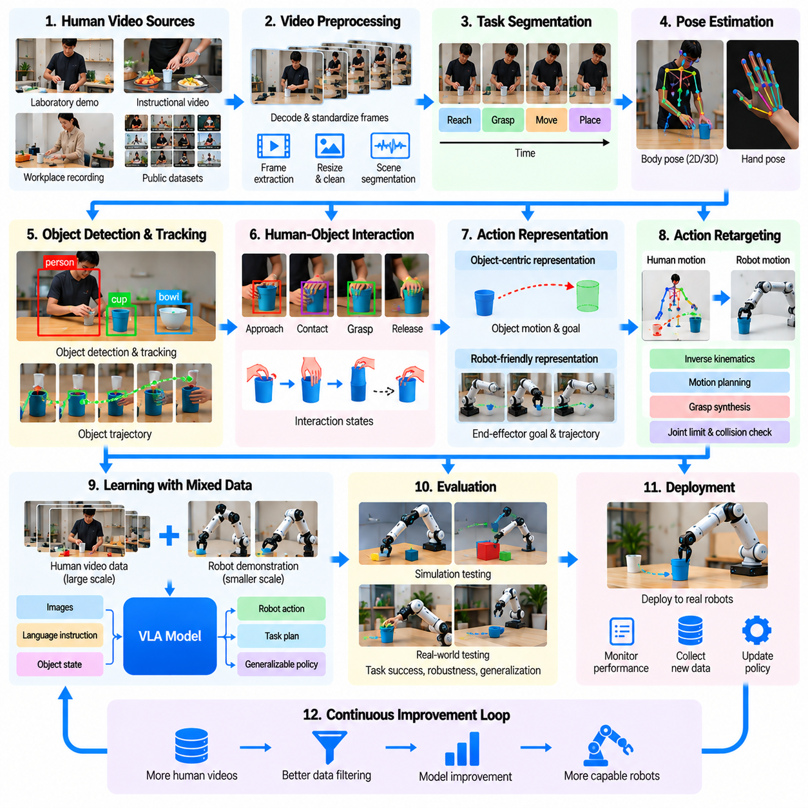{width="7.268055555555556in" height="7.268055555555556in"}

Human video-to-robot learning transforms recordings of human activities into training resources for robotic perception, planning, and manipulation. Unlike teleoperation datasets, human videos usually contain no direct robot commands, joint trajectories, or actuator measurements. A data engine must infer task structure, object interactions, and motion intentions from visual observations before transferring useful behaviors to robotic systems.

A representative case study involves teaching a robot to perform tabletop manipulation tasks using videos of people handling everyday objects. Demonstrations may include picking up containers, arranging tools, opening drawers, or placing objects into designated locations. The objective is not to reproduce human movements exactly, but to extract task knowledge that can guide robots with different physical structures.

Human video collection can draw from controlled laboratory demonstrations, workplace recordings, instructional videos, and appropriately licensed public datasets. Each source provides different levels of camera stability, visual quality, and task diversity. Collection policies must consider privacy, consent, copyright, and permitted usage. Source documentation helps determine which recordings are suitable for training and evaluation.

Video preprocessing establishes consistent representations from heterogeneous recordings. Pipelines decode frames, standardize resolution, estimate timestamps, identify scene boundaries, and remove unusable segments. Camera motion, occlusion, compression artifacts, and inconsistent frame rates complicate analysis. Preserving original videos alongside processed versions supports reproducibility and correction of preprocessing errors.

Task segmentation divides continuous human activities into meaningful behavioral units. A drawer-opening demonstration may contain reaching, grasping the handle, pulling, releasing, and repositioning. Temporal segmentation models identify action boundaries using changes in object motion, hand position, and contact patterns. These segments provide a structured basis for learning reusable manipulation skills.

Hand and body pose estimation reconstructs approximate human movement from visual observations. Models detect joints, estimate hand configurations, and track motion through time. However, monocular video introduces depth ambiguity, self-occlusion, and scale uncertainty. Multi-view recordings and calibrated cameras can improve reconstruction, but estimated poses should retain uncertainty rather than be treated as exact measurements.

Object detection and tracking identify the entities involved in each demonstration. Data engines estimate object positions, orientations, trajectories, and relationships with human hands. Semantic labels describe object categories and functional roles, while geometric representations support manipulation planning. Tracking errors must be detected because incorrect object histories can produce misleading action supervision.

Human-object interaction modeling connects observed movement with task meaning. Contact estimation identifies when hands touch, grasp, release, push, or support objects. Changes in object state reveal the consequences of these interactions. A successful grasp may be inferred from coordinated hand-object motion, although visual evidence alone cannot always establish contact forces or grasp stability.

A central challenge is converting human actions into robot-compatible representations. Human hands possess different joint structures, compliance, and manipulation capabilities from robotic grippers. Directly copying human joint trajectories is therefore often infeasible. Instead, learning systems extract object-relative movements, end-effector goals, contact sequences, and task constraints that can transfer across embodiments.

Action retargeting maps reconstructed demonstrations onto the robot\'s kinematic and mechanical capabilities. Inverse kinematics, motion planning, and grasp synthesis generate feasible robot actions from desired object interactions. Retargeting must respect joint limits, collision constraints, workspace reachability, and gripper geometry. Invalid mappings should be rejected or revised rather than introduced into training datasets.

Object-centric representations provide an important bridge between human and robotic behavior. Rather than describing every human joint movement, a model can represent how an object moves relative to a table, container, or target location. These relationships remain meaningful across different robot morphologies. Object-centric learning can therefore reduce embodiment mismatch while preserving essential task structure.

Visual affordance learning identifies how objects can be manipulated to achieve desired outcomes. A handle suggests pulling, a button suggests pressing, and an open container permits insertion. Video demonstrations provide evidence about these possibilities through observed interactions. However, affordances depend on geometry, material properties, and context, so models must avoid assuming that visually similar objects behave identically.

A practical data engine combines video-derived supervision with smaller amounts of robot demonstration data. Human recordings provide broad task diversity, while robot trajectories establish physically executable action patterns. Joint training can align visual task representations with robot observations and commands. This approach reduces dependence on extensive teleoperation while retaining grounding in robot dynamics.

Imitation learning can use reconstructed goals, object trajectories, or action sequences as supervision. Behavioral cloning learns mappings from observations to actions, while sequence models capture longer task dependencies. Diffusion-based policies may represent multiple feasible manipulation trajectories. Training objectives should account for uncertain labels and avoid treating inferred human actions as precise robot commands.

Simulation supports validation of transferred behaviors before physical execution. Reconstructed object configurations and task sequences can initialize virtual manipulation scenarios. Robot policies are tested for reachability, collision avoidance, grasp feasibility, and task completion. Simulation also enables controlled variations in object placement and geometry, although contact modeling errors may limit transfer accuracy.

Real-world deployment reveals limitations that may remain hidden in video reconstruction. Robots encounter friction, object deformation, grasp uncertainty, and actuator constraints that are not directly observable in human videos. Closed-loop execution must use current sensor feedback rather than replaying reconstructed trajectories blindly. Physical trials provide essential evidence for correcting learned behaviors.

Failure analysis links unsuccessful robot executions back to their originating video demonstrations. Errors may arise from incorrect depth estimation, object tracking failures, inaccurate contact inference, or unsuitable action retargeting. Data engines should preserve intermediate representations and transformation histories. This traceability allows engineers to determine whether failures originate from perception, representation, planning, or control.

Human correction can improve the quality of video-derived robot training data. Operators may verify object tracks, adjust contact labels, refine task boundaries, or demonstrate feasible robot alternatives. Active learning systems prioritize uncertain segments for review. Concentrating human effort on ambiguous or failure-prone examples can improve dataset quality without requiring exhaustive manual annotation.

Evaluation requires separating visual understanding from physical execution capability. Video interpretation metrics include pose estimation accuracy, object tracking consistency, temporal segmentation quality, and interaction recognition. Robot metrics include task completion, grasp success, trajectory feasibility, recovery performance, and generalization to unfamiliar objects. Strong video understanding does not automatically imply reliable robotic manipulation.

Dataset diversity determines whether learned behaviors transfer beyond the original demonstrations. Training collections should vary camera viewpoints, human demonstrators, object appearances, backgrounds, lighting, and task sequences. However, visual diversity alone is insufficient. Physical variation in object mass, friction, dimensions, and manipulation constraints must also be represented through robot data or validated simulation.

Scaling the pipeline requires automated video indexing, task discovery, annotation generation, quality filtering, and representation alignment. Large collections may contain repetitive, irrelevant, or misleading demonstrations. Semantic search and embedding-based clustering can identify useful task variations. Selection should prioritize behavioral coverage and physical relevance rather than total video duration.

Data governance is particularly important because human recordings may contain identifiable individuals, private environments, and copyrighted materials. Collection and processing must follow applicable permissions, privacy obligations, and licensing conditions. Provenance records should connect derived annotations and robot training examples to authorized source videos. Sensitive information may require restricted access or removal before reuse.

A representative deployment can begin with a limited set of tabletop tasks and carefully recorded human demonstrations. Engineers establish video quality requirements, validate pose and object tracking, and construct robot-compatible task representations. A small robot dataset then supports policy alignment and physical testing. Expansion follows measured improvements in task transfer rather than video collection volume alone.

The central lesson of human video-to-robot learning is that abundant human demonstrations provide valuable task knowledge but incomplete physical supervision. Reliable transfer requires reconstructing interactions, resolving embodiment differences, and validating executable actions. A mature data engine combines human video understanding, robot-grounded learning, simulation, and failure feedback to convert observed human behavior into increasingly capable robotic intelligence.

인간 영상 기반 로봇 학습(Human Video-to-Robot Learning)은 인간 활동을 기록한 영상을 로봇 인지(Robotic Perception), 계획(Planning), 조작(Manipulation)을 위한 학습 자원(Training Resource)으로 변환한다. 원격조작 데이터셋(Teleoperation Dataset)과 달리 인간 영상에는 일반적으로 직접적인 로봇 명령(Robot Command), 관절 궤적(Joint Trajectory), 액추에이터 측정값(Actuator Measurement)이 포함되지 않는다. 데이터 엔진(Data Engine)은 유용한 행동을 로봇 시스템으로 전이하기 전에 시각적 관측(Visual Observation)으로부터 작업 구조(Task Structure), 객체 상호작용(Object Interaction), 동작 의도(Motion Intention)를 추론해야 한다.

대표적인 사례 연구(Case Study)는 일상적인 객체를 다루는 사람들의 영상을 활용하여 로봇에 탁상 조작 작업(Tabletop Manipulation Task)을 학습시키는 것이다. 시연(Demonstration)에는 용기 집기(Picking Up Containers), 도구 정리(Arranging Tools), 서랍 열기(Opening Drawers), 지정된 위치에 객체 배치(Placing Objects into Designated Locations)가 포함될 수 있다. 목표는 인간의 움직임을 정확하게 재현하는 것이 아니라 서로 다른 물리적 구조(Physical Structure)를 가진 로봇을 안내할 수 있는 작업 지식(Task Knowledge)을 추출하는 것이다.

인간 영상 수집(Human Video Collection)은 통제된 실험실 시연(Controlled Laboratory Demonstration), 작업 현장 기록(Workplace Recording), 교육용 영상(Instructional Video), 적절한 라이선스가 부여된 공개 데이터셋(Public Dataset)을 활용할 수 있다. 각 데이터 출처(Data Source)는 카메라 안정성(Camera Stability), 영상 품질(Visual Quality), 작업 다양성(Task Diversity) 측면에서 서로 다른 수준을 제공한다. 수집 정책(Collection Policy)은 개인정보 보호(Privacy), 동의(Consent), 저작권(Copyright), 허용된 사용 범위(Permitted Usage)를 고려해야 한다. 출처 문서화(Source Documentation)는 학습과 평가에 적합한 기록을 결정하는 데 도움이 된다.

영상 전처리(Video Preprocessing)는 이질적인 기록(Heterogeneous Recording)으로부터 일관된 표현(Consistent Representation)을 구축한다. 파이프라인(Pipeline)은 프레임 디코딩(Frame Decoding), 해상도 표준화(Resolution Standardization), 타임스탬프 추정(Timestamp Estimation), 장면 경계 식별(Scene Boundary Identification), 사용 불가능한 구간 제거를 수행한다. 카메라 움직임(Camera Motion), 가려짐(Occlusion), 압축 아티팩트(Compression Artifact), 불규칙한 프레임 속도(Inconsistent Frame Rate)는 분석을 어렵게 만든다. 처리된 버전(Processed Version)과 함께 원본 영상(Original Video)을 보존하면 재현 가능성(Reproducibility)을 확보하고 전처리 오류(Preprocessing Error)를 수정할 수 있다.

작업 분할(Task Segmentation)은 연속적인 인간 활동(Continuous Human Activity)을 의미 있는 행동 단위(Behavioral Unit)로 나눈다. 서랍 열기 시연(Drawer-Opening Demonstration)에는 손 뻗기(Reaching), 손잡이 파지(Grasping the Handle), 당기기(Pulling), 놓기(Releasing), 위치 재조정(Repositioning)이 포함될 수 있다. 시간적 분할 모델(Temporal Segmentation Model)은 객체 움직임(Object Motion), 손 위치(Hand Position), 접촉 패턴(Contact Pattern)의 변화를 활용하여 행동 경계(Action Boundary)를 식별한다. 이러한 구간은 재사용 가능한 조작 기술(Reusable Manipulation Skill)을 학습하기 위한 구조화된 기반을 제공한다.

손 및 신체 자세 추정(Hand and Body Pose Estimation)은 시각적 관측(Visual Observation)으로부터 인간의 움직임을 근사적으로 재구성한다. 모델은 관절(Joint)을 감지하고 손의 구성(Hand Configuration)을 추정하며 시간에 따른 움직임을 추적한다. 그러나 단안 영상(Monocular Video)은 깊이 모호성(Depth Ambiguity), 자기 가림(Self-Occlusion), 크기 불확실성(Scale Uncertainty)을 발생시킨다. 다중 시점 기록(Multi-View Recording)과 보정된 카메라(Calibrated Camera)는 재구성 정확도를 개선할 수 있지만, 추정된 자세(Estimated Pose)는 정확한 측정값으로 취급하기보다 불확실성(Uncertainty)을 유지해야 한다.

객체 감지 및 추적(Object Detection and Tracking)은 각 시연에 포함된 객체(Entity)를 식별한다. 데이터 엔진은 객체 위치(Object Position), 방향(Orientation), 궤적(Trajectory), 인간의 손과의 관계(Relationship)를 추정한다. 의미론적 라벨(Semantic Label)은 객체 범주(Object Category)와 기능적 역할(Functional Role)을 설명하며, 기하학적 표현(Geometric Representation)은 조작 계획(Manipulation Planning)을 지원한다. 잘못된 객체 이력(Object History)은 오해를 유발하는 행동 감독 신호(Misleading Action Supervision)를 생성할 수 있으므로 추적 오류(Tracking Error)를 감지해야 한다.

인간-객체 상호작용 모델링(Human-Object Interaction Modeling)은 관측된 움직임을 작업의 의미(Task Meaning)와 연결한다. 접촉 추정(Contact Estimation)은 손이 객체를 접촉(Touch), 파지(Grasp), 해제(Release), 밀기(Push), 지지(Support)하는 시점을 식별한다. 객체 상태 변화(Object State Change)는 이러한 상호작용의 결과를 나타낸다. 성공적인 파지(Successful Grasp)는 손과 객체의 협응된 움직임(Coordinated Hand-Object Motion)으로부터 추론할 수 있지만, 시각적 증거(Visual Evidence)만으로는 접촉력(Contact Force)이나 파지 안정성(Grasp Stability)을 항상 확인할 수는 없다.

핵심 과제는 인간 행동(Human Action)을 로봇과 호환되는 표현(Robot-Compatible Representation)으로 변환하는 것이다. 인간의 손(Human Hand)은 로봇 그리퍼(Robotic Gripper)와 관절 구조(Joint Structure), 순응성(Compliance), 조작 능력(Manipulation Capability)이 서로 다르다. 따라서 인간의 관절 궤적(Human Joint Trajectory)을 직접 복사하는 것은 대부분 실행하기 어렵다. 대신 학습 시스템은 서로 다른 신체 형태(Embodiment) 사이에서 전이할 수 있는 객체 상대 움직임(Object-Relative Movement), 말단효과기 목표(End-Effector Goal), 접촉 시퀀스(Contact Sequence), 작업 제약(Task Constraint)을 추출한다.

행동 재매핑(Action Retargeting)은 재구성된 시연(Reconstructed Demonstration)을 로봇의 운동학적 및 기계적 능력(Kinematic and Mechanical Capability)에 대응시킨다. 역기구학(Inverse Kinematics), 동작 계획(Motion Planning), 파지 합성(Grasp Synthesis)은 원하는 객체 상호작용(Desired Object Interaction)으로부터 실행 가능한 로봇 행동(Feasible Robot Action)을 생성한다. 재매핑은 관절 한계(Joint Limit), 충돌 제약(Collision Constraint), 작업 공간 도달 가능성(Workspace Reachability), 그리퍼 형상(Gripper Geometry)을 준수해야 한다. 유효하지 않은 매핑(Invalid Mapping)은 학습 데이터셋에 포함하기보다 거부하거나 수정해야 한다.

객체 중심 표현(Object-Centric Representation)은 인간 행동과 로봇 행동 사이의 중요한 연결 수단(Bridge)을 제공한다. 모든 인간 관절 움직임(Human Joint Movement)을 설명하는 대신 모델은 객체가 테이블(Table), 용기(Container), 목표 위치(Target Location)에 대해 상대적으로 어떻게 이동하는지를 표현할 수 있다. 이러한 관계는 서로 다른 로봇 형태(Robot Morphology)에서도 의미를 유지한다. 따라서 객체 중심 학습(Object-Centric Learning)은 필수적인 작업 구조(Essential Task Structure)를 보존하면서 신체 형태 불일치(Embodiment Mismatch)를 줄일 수 있다.

시각적 어포던스 학습(Visual Affordance Learning)은 원하는 결과를 달성하기 위해 객체를 어떻게 조작할 수 있는지 식별한다. 손잡이(Handle)는 당기기(Pulling)를, 버튼(Button)은 누르기(Pressing)를, 열린 용기(Open Container)는 삽입(Insertion)을 가능하게 하는 특성을 나타낸다. 영상 시연(Video Demonstration)은 관측된 상호작용을 통해 이러한 가능성에 관한 증거를 제공한다. 그러나 어포던스(Affordance)는 형상(Geometry), 재료 특성(Material Property), 맥락(Context)에 따라 달라지므로 모델은 시각적으로 유사한 객체가 동일하게 작동한다고 가정해서는 안 된다.

실용적인 데이터 엔진(Practical Data Engine)은 영상에서 추출한 감독 정보(Video-Derived Supervision)를 상대적으로 적은 양의 로봇 시연 데이터(Robot Demonstration Data)와 결합한다. 인간 기록(Human Recording)은 폭넓은 작업 다양성(Task Diversity)을 제공하고, 로봇 궤적(Robot Trajectory)은 물리적으로 실행 가능한 행동 패턴(Physically Executable Action Pattern)을 확립한다. 공동 학습(Joint Training)은 시각적 작업 표현(Visual Task Representation)을 로봇 관측(Robot Observation) 및 명령(Command)과 정렬할 수 있다. 이러한 접근 방식은 로봇 동역학(Robot Dynamics)에 기반한 학습을 유지하면서 대규모 원격조작(Teleoperation)에 대한 의존도를 줄인다.

모방학습(Imitation Learning)은 재구성된 목표(Reconstructed Goal), 객체 궤적(Object Trajectory), 행동 시퀀스(Action Sequence)를 감독 신호(Supervision)로 활용할 수 있다. 행동 복제(Behavioral Cloning)는 관측에서 행동으로의 매핑(Observation-to-Action Mapping)을 학습하며, 시퀀스 모델(Sequence Model)은 장기적인 작업 의존성(Longer Task Dependency)을 포착한다. 확산 기반 정책(Diffusion-Based Policy)은 여러 개의 실행 가능한 조작 궤적(Feasible Manipulation Trajectory)을 표현할 수 있다. 학습 목표(Training Objective)는 불확실한 라벨(Uncertain Label)을 고려해야 하며, 추론된 인간 행동(Inferred Human Action)을 정확한 로봇 명령(Precise Robot Command)으로 취급하지 않아야 한다.

시뮬레이션(Simulation)은 물리적 실행(Physical Execution) 이전에 전이된 행동(Transferred Behavior)을 검증하는 데 사용된다. 재구성된 객체 구성(Reconstructed Object Configuration)과 작업 시퀀스(Task Sequence)는 가상 조작 시나리오(Virtual Manipulation Scenario)의 초기 조건을 설정할 수 있다. 로봇 정책(Robot Policy)은 도달 가능성(Reachability), 충돌 회피(Collision Avoidance), 파지 실행 가능성(Grasp Feasibility), 작업 완료(Task Completion)에 대해 시험된다. 시뮬레이션은 객체 배치(Object Placement)와 형상(Geometry)의 통제된 변화도 지원하지만, 접촉 모델링 오류(Contact Modeling Error)는 전이 정확도(Transfer Accuracy)를 제한할 수 있다.

실제 환경 배포(Real-World Deployment)는 영상 재구성(Video Reconstruction) 과정에서 드러나지 않았던 한계를 보여준다. 로봇은 인간 영상에서 직접 관측하기 어려운 마찰(Friction), 객체 변형(Object Deformation), 파지 불확실성(Grasp Uncertainty), 액추에이터 제약(Actuator Constraint)에 직면한다. 폐루프 실행(Closed-Loop Execution)은 재구성된 궤적(Reconstructed Trajectory)을 무조건 재생하는 대신 현재 센서 피드백(Current Sensor Feedback)을 활용해야 한다. 물리적 시험(Physical Trial)은 학습된 행동(Learned Behavior)을 수정하는 데 필요한 핵심 증거를 제공한다.

실패 분석(Failure Analysis)은 성공하지 못한 로봇 실행(Unsuccessful Robot Execution)을 원본 영상 시연(Originating Video Demonstration)과 연결한다. 오류는 부정확한 깊이 추정(Incorrect Depth Estimation), 객체 추적 실패(Object Tracking Failure), 잘못된 접촉 추론(Inaccurate Contact Inference), 부적절한 행동 재매핑(Unsuitable Action Retargeting)에서 발생할 수 있다. 데이터 엔진은 중간 표현(Intermediate Representation)과 변환 이력(Transformation History)을 보존해야 한다. 이러한 추적 가능성(Traceability)은 엔지니어가 실패 원인이 인지(Perception), 표현(Representation), 계획(Planning), 제어(Control) 중 어디에서 발생했는지 판단하도록 한다.

인간 교정(Human Correction)은 영상 기반 로봇 학습 데이터(Video-Derived Robot Training Data)의 품질을 개선할 수 있다. 작업자는 객체 추적 결과(Object Track)를 검증하고, 접촉 라벨(Contact Label)을 조정하며, 작업 경계(Task Boundary)를 정교화하거나, 실행 가능한 로봇 대안 행동(Feasible Robot Alternative)을 시연할 수 있다. 능동학습 시스템(Active Learning System)은 불확실한 구간(Uncertain Segment)을 우선적으로 검토하도록 한다. 인간의 노력을 모호하거나 실패 가능성이 높은 사례(Ambiguous or Failure-Prone Example)에 집중하면 모든 데이터에 수동 주석(Manual Annotation)을 수행하지 않고도 데이터셋 품질(Dataset Quality)을 개선할 수 있다.

평가(Evaluation)는 시각적 이해(Visual Understanding)와 물리적 실행 능력(Physical Execution Capability)을 분리해야 한다. 영상 해석 지표(Video Interpretation Metric)에는 자세 추정 정확도(Pose Estimation Accuracy), 객체 추적 일관성(Object Tracking Consistency), 시간적 분할 품질(Temporal Segmentation Quality), 상호작용 인식(Interaction Recognition)이 포함된다. 로봇 지표(Robot Metric)에는 작업 완료(Task Completion), 파지 성공(Grasp Success), 궤적 실행 가능성(Trajectory Feasibility), 복구 성능(Recovery Performance), 익숙하지 않은 객체에 대한 일반화(Generalization)가 포함된다. 뛰어난 영상 이해 능력이 반드시 신뢰성 있는 로봇 조작(Robotic Manipulation)을 의미하는 것은 아니다.

데이터셋 다양성(Dataset Diversity)은 학습된 행동(Learned Behavior)이 원본 시연(Original Demonstration)을 넘어 전이될 수 있는지를 결정한다. 학습 데이터는 카메라 시점(Camera Viewpoint), 인간 시연자(Human Demonstrator), 객체 외형(Object Appearance), 배경(Background), 조명(Lighting), 작업 시퀀스(Task Sequence)를 다양하게 포함해야 한다. 그러나 시각적 다양성(Visual Diversity)만으로는 충분하지 않다. 객체 질량(Object Mass), 마찰(Friction), 치수(Dimension), 조작 제약(Manipulation Constraint)의 물리적 변화(Physical Variation)도 로봇 데이터나 검증된 시뮬레이션(Validated Simulation)을 통해 표현해야 한다.

파이프라인 규모 확장(Pipeline Scaling)에는 자동 영상 인덱싱(Automated Video Indexing), 작업 발견(Task Discovery), 주석 생성(Annotation Generation), 품질 필터링(Quality Filtering), 표현 정렬(Representation Alignment)이 필요하다. 대규모 영상 컬렉션(Large Video Collection)에는 반복적이거나 관련성이 없거나 오해를 유발하는 시연이 포함될 수 있다. 의미론적 검색(Semantic Search)과 임베딩 기반 군집화(Embedding-Based Clustering)는 유용한 작업 변형(Task Variation)을 식별할 수 있다. 데이터 선택(Data Selection)은 전체 영상 길이(Total Video Duration)보다 행동 적용 범위(Behavioral Coverage)와 물리적 관련성(Physical Relevance)을 우선해야 한다.

데이터 거버넌스(Data Governance)는 인간 기록(Human Recording)에 식별 가능한 개인(Identifiable Individual), 사적인 환경(Private Environment), 저작권 보호 자료(Copyrighted Material)가 포함될 수 있기 때문에 특히 중요하다. 데이터 수집과 처리(Collection and Processing)는 적용 가능한 허가(Permission), 개인정보 보호 의무(Privacy Obligation), 라이선스 조건(Licensing Condition)을 준수해야 한다. 출처 기록(Provenance Record)은 파생 주석(Derived Annotation)과 로봇 학습 사례(Robot Training Example)를 사용이 허가된 원본 영상(Authorized Source Video)에 연결해야 한다. 민감한 정보(Sensitive Information)는 재사용 이전에 접근 제한(Restricted Access)이나 제거(Removal)가 필요할 수 있다.

대표적인 시스템 배포(Representative Deployment)는 제한된 탁상 작업(Tabletop Task)과 신중하게 기록된 인간 시연(Carefully Recorded Human Demonstration)으로 시작할 수 있다. 엔지니어는 영상 품질 요구사항(Video Quality Requirement)을 확립하고, 자세 및 객체 추적(Pose and Object Tracking)을 검증하며, 로봇과 호환되는 작업 표현(Robot-Compatible Task Representation)을 구축한다. 이후 소규모 로봇 데이터셋(Small Robot Dataset)은 정책 정렬(Policy Alignment)과 물리적 시험(Physical Testing)을 지원한다. 확장은 단순한 영상 수집량(Video Collection Volume)이 아니라 측정된 작업 전이 성능(Task Transfer Performance)의 개선에 따라 진행된다.

인간 영상 기반 로봇 학습(Human Video-to-Robot Learning)의 핵심 교훈은 풍부한 인간 시연(Abundant Human Demonstration)이 가치 있는 작업 지식(Task Knowledge)을 제공하지만 물리적 감독 정보(Physical Supervision)는 불완전하다는 것이다. 신뢰성 있는 전이(Reliable Transfer)를 위해서는 상호작용 재구성(Interaction Reconstruction), 신체 형태 차이(Embodiment Difference)의 해결, 실행 가능한 행동(Executable Action)의 검증이 필요하다. 성숙한 데이터 엔진(Mature Data Engine)은 인간 영상 이해(Human Video Understanding), 로봇 기반 학습(Robot-Grounded Learning), 시뮬레이션(Simulation), 실패 피드백(Failure Feedback)을 결합하여 관측된 인간 행동(Observed Human Behavior)을 점점 더 높은 능력을 갖춘 로봇 지능(Robotic Intelligence)으로 변환한다.

##  

## 10.10. Synthetic Data Factory Case Study

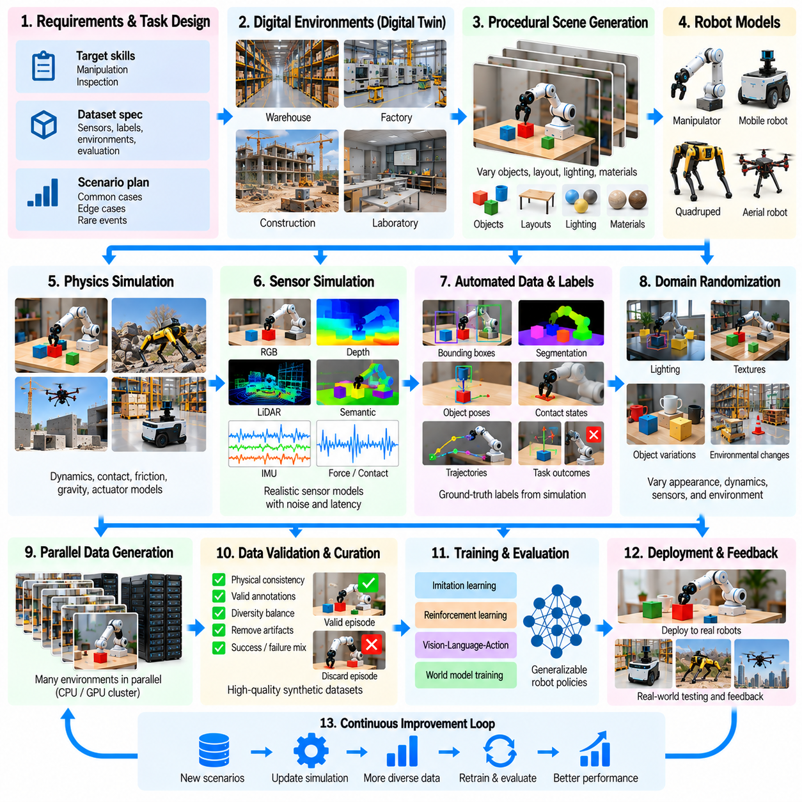{width="7.268055555555556in" height="7.268055555555556in"}

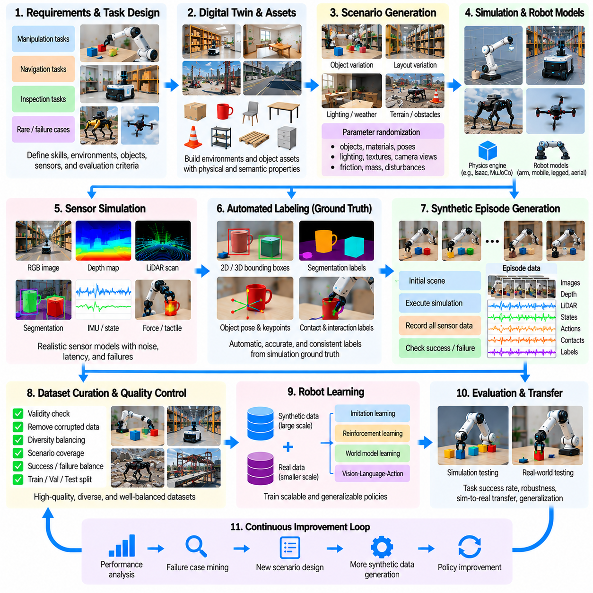{width="7.268055555555556in" height="7.268055555555556in"}

A synthetic data factory is an automated infrastructure that generates large-scale training datasets through simulation, procedural scene creation, and controlled physical modeling. Unlike conventional data collection, synthetic generation can systematically vary environments, objects, robot configurations, and task conditions. Its primary objective is to produce diverse, accurately labeled experiences that improve robot learning while reducing dependence on expensive physical experiments.

A representative synthetic data factory may support robotic manipulation, autonomous navigation, and industrial inspection. The system combines digital environments, physics engines, robot models, sensor simulators, scenario generators, and dataset processing services. Each component contributes to a repeatable production pipeline that converts configurable virtual experiments into structured training and evaluation resources.

Factory design begins with defining target learning capabilities and operational requirements. Engineers identify perception tasks, manipulation skills, navigation behaviors, and failure conditions that require additional data. Dataset specifications describe sensor modalities, annotation formats, environment categories, robot configurations, and evaluation criteria. These requirements determine which synthetic scenarios provide meaningful learning value.

Digital twin construction establishes the virtual environments used for data generation. Factories, warehouses, construction sites, and laboratories can be represented through geometric models, semantic maps, and physical properties. Accurate dimensions and spatial relationships support realistic interactions. However, digital twins must also represent uncertainty and operational variation rather than reproducing only idealized environments.

Procedural scene generation automatically creates variations in object placement, geometry, lighting, materials, and environmental layout. A warehouse scenario may contain different shelf arrangements, pallet locations, obstacles, and traffic patterns. Parameterized scene templates allow thousands of related but distinct environments to be generated. This diversity helps reduce overfitting to a limited set of virtual configurations.

Physics simulation provides the dynamic foundation for synthetic robot experiences. Rigid-body dynamics, contact forces, friction, gravity, and actuator behavior determine how robots interact with objects and surfaces. Manipulation tasks require accurate grasping and collision models, while mobile robots require realistic motion and terrain interactions. Simulation errors can introduce systematic biases into learned policies.

Sensor simulation converts virtual physical states into observations resembling real robot measurements. Rendered RGB images, depth maps, LiDAR scans, inertial signals, and force readings can be generated from the same simulated episode. Sensor models should include calibration characteristics, measurement noise, latency, and failure conditions. These variations help learning systems tolerate imperfections encountered during deployment.

Domain randomization is a central technique for improving transfer from synthetic to real environments. Randomized textures, illumination, camera viewpoints, object masses, friction coefficients, and sensor noise expose models to diverse conditions. However, excessive randomization may create unrealistic combinations. Parameter ranges should be informed by physical measurements and validated against representative real-world observations.

Synthetic data factories can generate labels directly from simulation ground truth. Object poses, segmentation masks, depth values, contact states, trajectories, and collision events are available without manual annotation. This capability reduces labeling costs and supports precise supervision. Nevertheless, generated labels remain dependent on the correctness of scene models, coordinate transformations, and simulation assumptions.

A typical generation pipeline begins by selecting a scenario template and sampling its configuration parameters. The system initializes virtual objects, robot states, environmental conditions, and sensor settings before executing a simulation. During execution, it records observations, actions, physical states, and task outcomes. Automated validation determines whether the episode satisfies dataset quality requirements.

Parallel simulation enables substantial increases in synthetic data production throughput. Multiple virtual environments can execute simultaneously across CPUs and GPUs, depending on simulation complexity. Lightweight scenarios may support large parallel batches, while detailed contact simulation and high-fidelity rendering require more resources. Scheduling systems must balance simulation speed, physical accuracy, and dataset diversity.

Synthetic manipulation datasets may contain object picking, insertion, stacking, assembly, and tool-use episodes. Each scenario varies grasp configurations, object geometry, initial poses, and contact conditions. Successful and unsuccessful attempts provide complementary supervision. Recording complete interaction sequences helps models learn not only intended actions but also the physical consequences of incorrect decisions.

Synthetic navigation datasets support autonomous mobile robots, quadrupeds, and aerial platforms. Generated environments introduce blocked routes, moving obstacles, uneven terrain, narrow passages, and environmental disturbances. Navigation episodes record localization estimates, planned paths, executed trajectories, and safety events. These datasets enable systematic evaluation of difficult situations that may be costly or dangerous to reproduce physically.

Rare-event generation is particularly valuable for safety-critical learning and evaluation. Scenarios can deliberately introduce sensor degradation, unexpected obstacles, actuator faults, or communication interruptions. Controlled simulation allows engineers to examine robot responses without exposing people or equipment to unnecessary risk. Such experiments complement, but cannot replace, validated physical safety testing.

Quality assurance must distinguish technically valid synthetic recordings from physically meaningful training examples. Automated checks examine simulation stability, sensor synchronization, annotation consistency, collision validity, and task outcome correctness. Episodes containing numerical instability, impossible geometry, or unrealistic contact behavior should be rejected. Quality filters prevent simulation artifacts from becoming misleading learning signals.

Data curation organizes generated episodes according to task type, environment characteristics, difficulty, and failure categories. Large-scale generation can produce redundant examples if sampling distributions remain poorly designed. Coverage analysis identifies underrepresented scenarios and excessive repetition. Balanced selection improves dataset efficiency and helps ensure that rare but important behaviors receive sufficient representation.

Real-world calibration connects the synthetic factory to physical robot measurements. Engineers compare simulated sensor outputs, motion trajectories, contact responses, and task outcomes with recorded physical experiments. Differences reveal modeling errors and missing environmental factors. System identification and parameter adjustment reduce discrepancies, while validation datasets measure whether synthetic improvements transfer to actual robots.

A closed-loop synthetic data factory uses trained model performance to guide subsequent generation. Initial synthetic datasets support policy training, followed by evaluation in simulation and physical environments. Failure analysis identifies weak object categories, difficult terrain, or unstable control conditions. Scenario generators then increase coverage of these deficiencies, creating a targeted data improvement cycle.

Active scenario selection improves efficiency by prioritizing examples that offer high expected learning value. Uncertainty estimates, failure frequency, model disagreement, and coverage gaps can guide generation requests. Instead of producing uniformly random episodes, the factory concentrates resources on challenging situations. This strategy is especially useful when detailed simulation and rendering are computationally expensive.

Dataset management requires consistent schemas, metadata, version control, and traceable generation configurations. Each episode should preserve simulator versions, random seeds, scene parameters, robot models, sensor settings, and processing histories. Reproducible configurations allow engineers to regenerate scenarios and investigate unexpected results. Dataset lineage also supports comparisons between simulation revisions and model releases.

Operational economics depend on compute infrastructure, rendering costs, simulation engineering, asset development, and validation effort. Cost per generated episode is useful but insufficient because many episodes may provide little learning value. More meaningful indicators include cost per validated episode, scenario coverage, and model performance improvement per compute budget. These measures connect production efficiency with downstream robotic capability.

A representative deployment can begin with a limited digital environment and a small portfolio of manipulation or navigation tasks. Engineers first verify physical parameters, sensor models, annotation accuracy, and generation reproducibility. The factory then expands scenario diversity and parallel execution capacity. Physical evaluation checkpoints determine whether additional synthetic production delivers measurable improvements.

Data governance remains important even when recordings are generated virtually. Digital assets may originate from proprietary CAD models, licensed textures, confidential facility layouts, or restricted simulation components. Dataset documentation should preserve asset permissions, generation provenance, access controls, and permitted reuse conditions. Synthetic origin does not automatically eliminate intellectual property or confidentiality obligations.

The central lesson of the synthetic data factory case study is that scalable simulation must be connected to physical evidence and learning outcomes. High generation volume alone cannot guarantee useful robotic intelligence. A mature factory combines procedural diversity, physics validation, automated labeling, quality filtering, and real-world feedback to produce synthetic experiences that systematically improve physical AI capabilities.

합성 데이터 팩토리(Synthetic Data Factory)는 시뮬레이션(Simulation), 절차적 장면 생성(Procedural Scene Generation), 제어된 물리 모델링(Controlled Physical Modeling)을 통해 대규모 학습 데이터셋(Training Dataset)을 생성하는 자동화 인프라(Automated Infrastructure)이다. 기존 데이터 수집(Conventional Data Collection)과 달리 합성 데이터 생성(Synthetic Data Generation)은 환경, 객체, 로봇 구성, 작업 조건을 체계적으로 변화시킬 수 있다. 주요 목표는 비용이 많이 드는 물리적 실험(Physical Experiment)에 대한 의존도를 줄이면서 로봇 학습(Robot Learning)을 개선하는 다양하고 정확하게 라벨링된 경험(Diverse and Accurately Labeled Experience)을 생산하는 것이다.

대표적인 합성 데이터 팩토리는 로봇 조작(Robotic Manipulation), 자율 내비게이션(Autonomous Navigation), 산업 시설 점검(Industrial Inspection)을 지원할 수 있다. 시스템은 디지털 환경(Digital Environment), 물리 엔진(Physics Engine), 로봇 모델(Robot Model), 센서 시뮬레이터(Sensor Simulator), 시나리오 생성기(Scenario Generator), 데이터셋 처리 서비스(Dataset Processing Service)를 결합한다. 각 구성요소는 설정 가능한 가상 실험(Configurable Virtual Experiment)을 구조화된 학습 및 평가 자원(Structured Training and Evaluation Resource)으로 변환하는 반복 가능한 생산 파이프라인(Repeatable Production Pipeline)에 기여한다.

팩토리 설계(Factory Design)는 목표 학습 능력(Target Learning Capability)과 운영 요구사항(Operational Requirement)을 정의하는 것에서 시작된다. 엔지니어는 추가 데이터가 필요한 인지 작업(Perception Task), 조작 기술(Manipulation Skill), 내비게이션 행동(Navigation Behavior), 실패 조건(Failure Condition)을 식별한다. 데이터셋 명세(Dataset Specification)는 센서 모달리티(Sensor Modality), 주석 형식(Annotation Format), 환경 범주(Environment Category), 로봇 구성(Robot Configuration), 평가 기준(Evaluation Criteria)을 설명한다. 이러한 요구사항은 어떤 합성 시나리오(Synthetic Scenario)가 의미 있는 학습 가치(Learning Value)를 제공하는지 결정한다.

디지털 트윈 구축(Digital Twin Construction)은 데이터 생성에 사용되는 가상 환경(Virtual Environment)을 확립한다. 공장(Factory), 창고(Warehouse), 건설 현장(Construction Site), 실험실(Laboratory)은 기하학적 모델(Geometric Model), 의미론적 지도(Semantic Map), 물리적 특성(Physical Property)을 통해 표현할 수 있다. 정확한 치수(Accurate Dimension)와 공간적 관계(Spatial Relationship)는 현실적인 상호작용(Realistic Interaction)을 지원한다. 그러나 디지털 트윈(Digital Twin)은 이상화된 환경(Idealized Environment)만 재현하는 것이 아니라 불확실성(Uncertainty)과 운영 변동성(Operational Variation)도 표현해야 한다.

절차적 장면 생성(Procedural Scene Generation)은 객체 배치(Object Placement), 형상(Geometry), 조명(Lighting), 재질(Material), 환경 배치(Environmental Layout)의 변형을 자동으로 생성한다. 창고 시나리오(Warehouse Scenario)에는 서로 다른 선반 배치(Shelf Arrangement), 팔레트 위치(Pallet Location), 장애물(Obstacle), 교통 패턴(Traffic Pattern)이 포함될 수 있다. 매개변수화된 장면 템플릿(Parameterized Scene Template)을 사용하면 서로 연관되어 있으면서도 구별되는 수천 개의 환경을 생성할 수 있다. 이러한 다양성(Diversity)은 제한된 가상 구성(Virtual Configuration)에 대한 과적합(Overfitting)을 줄이는 데 도움이 된다.

물리 시뮬레이션(Physics Simulation)은 합성 로봇 경험(Synthetic Robot Experience)의 동적 기반(Dynamic Foundation)을 제공한다. 강체 동역학(Rigid-Body Dynamics), 접촉력(Contact Force), 마찰(Friction), 중력(Gravity), 액추에이터 동작(Actuator Behavior)은 로봇이 객체 및 표면과 상호작용하는 방식을 결정한다. 조작 작업(Manipulation Task)에는 정확한 파지 모델(Grasping Model)과 충돌 모델(Collision Model)이 필요하며, 이동 로봇(Mobile Robot)에는 현실적인 이동 및 지형 상호작용(Motion and Terrain Interaction)이 필요하다. 시뮬레이션 오류(Simulation Error)는 학습된 정책(Learned Policy)에 체계적인 편향(Systematic Bias)을 발생시킬 수 있다.

센서 시뮬레이션(Sensor Simulation)은 가상의 물리적 상태(Virtual Physical State)를 실제 로봇 측정값과 유사한 관측 데이터(Observation)로 변환한다. 렌더링된 RGB 이미지(Rendered RGB Image), 깊이 지도(Depth Map), 라이다 스캔(LiDAR Scan), 관성 신호(Inertial Signal), 힘 측정값(Force Reading)은 동일한 시뮬레이션 에피소드(Simulated Episode)에서 생성할 수 있다. 센서 모델(Sensor Model)에는 보정 특성(Calibration Characteristic), 측정 잡음(Measurement Noise), 지연시간(Latency), 고장 조건(Failure Condition)이 포함되어야 한다. 이러한 변화는 학습 시스템이 실제 배포(Deployment) 과정에서 발생하는 불완전성(Imperfection)을 견딜 수 있도록 돕는다.

도메인 무작위화(Domain Randomization)는 합성 환경에서 실제 환경으로의 전이(Synthetic-to-Real Transfer)를 개선하는 핵심 기술이다. 무작위화된 텍스처(Texture), 조도(Illumination), 카메라 시점(Camera Viewpoint), 객체 질량(Object Mass), 마찰계수(Friction Coefficient), 센서 잡음(Sensor Noise)은 모델을 다양한 조건에 노출한다. 그러나 과도한 무작위화(Excessive Randomization)는 비현실적인 조합(Unrealistic Combination)을 생성할 수 있다. 매개변수 범위(Parameter Range)는 물리적 측정값(Physical Measurement)을 바탕으로 설정하고 대표적인 실제 환경 관측(Representative Real-World Observation)을 통해 검증해야 한다.

합성 데이터 팩토리는 시뮬레이션의 정답 데이터(Simulation Ground Truth)로부터 라벨(Label)을 직접 생성할 수 있다. 객체 자세(Object Pose), 분할 마스크(Segmentation Mask), 깊이 값(Depth Value), 접촉 상태(Contact State), 궤적(Trajectory), 충돌 이벤트(Collision Event)는 수동 주석(Manual Annotation) 없이 확보할 수 있다. 이러한 능력은 라벨링 비용(Labeling Cost)을 줄이고 정밀한 감독 학습(Precise Supervision)을 지원한다. 그러나 생성된 라벨(Generated Label)의 정확성은 장면 모델(Scene Model), 좌표 변환(Coordinate Transformation), 시뮬레이션 가정(Simulation Assumption)의 정확성에 의존한다.

일반적인 생성 파이프라인(Generation Pipeline)은 시나리오 템플릿(Scenario Template)을 선택하고 구성 매개변수(Configuration Parameter)를 샘플링하는 것으로 시작된다. 시스템은 시뮬레이션을 실행하기 전에 가상 객체(Virtual Object), 로봇 상태(Robot State), 환경 조건(Environmental Condition), 센서 설정(Sensor Setting)을 초기화한다. 실행 중에는 관측 데이터(Observation), 행동(Action), 물리적 상태(Physical State), 작업 결과(Task Outcome)를 기록한다. 자동 검증(Automated Validation)은 해당 에피소드가 데이터셋 품질 요구사항(Dataset Quality Requirement)을 충족하는지 판단한다.

병렬 시뮬레이션(Parallel Simulation)은 합성 데이터 생산 처리량(Synthetic Data Production Throughput)을 크게 증가시킬 수 있다. 시뮬레이션 복잡도(Simulation Complexity)에 따라 여러 가상 환경(Virtual Environment)을 CPU와 GPU에서 동시에 실행할 수 있다. 경량 시나리오(Lightweight Scenario)는 대규모 병렬 배치(Large Parallel Batch)를 지원할 수 있지만, 상세한 접촉 시뮬레이션(Detailed Contact Simulation)과 고충실도 렌더링(High-Fidelity Rendering)은 더 많은 자원을 필요로 한다. 스케줄링 시스템(Scheduling System)은 시뮬레이션 속도(Simulation Speed), 물리적 정확도(Physical Accuracy), 데이터셋 다양성(Dataset Diversity) 사이의 균형을 유지해야 한다.

합성 조작 데이터셋(Synthetic Manipulation Dataset)에는 객체 집기(Object Picking), 삽입(Insertion), 적층(Stacking), 조립(Assembly), 도구 사용(Tool Use) 에피소드가 포함될 수 있다. 각 시나리오는 파지 구성(Grasp Configuration), 객체 형상(Object Geometry), 초기 자세(Initial Pose), 접촉 조건(Contact Condition)을 변화시킨다. 성공 및 실패 시도(Successful and Unsuccessful Attempt)는 상호 보완적인 감독 정보(Complementary Supervision)를 제공한다. 전체 상호작용 시퀀스(Complete Interaction Sequence)를 기록하면 모델이 의도된 행동뿐 아니라 잘못된 결정(Incorrect Decision)의 물리적 결과(Physical Consequence)도 학습할 수 있다.

합성 내비게이션 데이터셋(Synthetic Navigation Dataset)은 자율이동로봇(Autonomous Mobile Robot, AMR), 사족보행 로봇(Quadruped Robot), 항공 플랫폼(Aerial Platform)을 지원한다. 생성된 환경(Generated Environment)에는 차단된 경로(Blocked Route), 이동 장애물(Moving Obstacle), 불규칙한 지형(Uneven Terrain), 좁은 통로(Narrow Passage), 환경 외란(Environmental Disturbance)이 도입된다. 내비게이션 에피소드(Navigation Episode)는 위치 추정값(Localization Estimate), 계획 경로(Planned Path), 실행 궤적(Executed Trajectory), 안전 이벤트(Safety Event)를 기록한다. 이러한 데이터셋은 실제로 재현하기에 비용이 많이 들거나 위험할 수 있는 어려운 상황을 체계적으로 평가하도록 한다.

희귀 이벤트 생성(Rare-Event Generation)은 안전 필수 학습 및 평가(Safety-Critical Learning and Evaluation)에서 특히 중요하다. 시나리오는 센서 성능 저하(Sensor Degradation), 예상하지 못한 장애물(Unexpected Obstacle), 액추에이터 고장(Actuator Fault), 통신 중단(Communication Interruption)을 의도적으로 도입할 수 있다. 제어된 시뮬레이션(Controlled Simulation)을 통해 엔지니어는 사람이나 장비를 불필요한 위험에 노출하지 않고 로봇 응답(Robot Response)을 조사할 수 있다. 이러한 실험은 검증된 물리적 안전 시험(Validated Physical Safety Testing)을 보완하지만 대체할 수는 없다.

품질 보증(Quality Assurance)은 기술적으로 유효한 합성 기록(Technically Valid Synthetic Recording)과 물리적으로 의미 있는 학습 사례(Physically Meaningful Training Example)를 구분해야 한다. 자동 검사(Automated Check)는 시뮬레이션 안정성(Simulation Stability), 센서 동기화(Sensor Synchronization), 주석 일관성(Annotation Consistency), 충돌 유효성(Collision Validity), 작업 결과 정확성(Task Outcome Correctness)을 평가한다. 수치적 불안정성(Numerical Instability), 불가능한 형상(Impossible Geometry), 비현실적인 접촉 행동(Unrealistic Contact Behavior)이 포함된 에피소드는 거부해야 한다. 품질 필터(Quality Filter)는 시뮬레이션 아티팩트(Simulation Artifact)가 잘못된 학습 신호(Misleading Learning Signal)로 전환되는 것을 방지한다.

데이터 큐레이션(Data Curation)은 생성된 에피소드(Generated Episode)를 작업 유형(Task Type), 환경 특성(Environment Characteristic), 난이도(Difficulty), 실패 범주(Failure Category)에 따라 구성한다. 샘플링 분포(Sampling Distribution)가 적절하게 설계되지 않으면 대규모 데이터 생성(Large-Scale Generation)은 중복된 사례(Redundant Example)를 생산할 수 있다. 적용 범위 분석(Coverage Analysis)은 충분히 표현되지 않은 시나리오(Underrepresented Scenario)와 과도한 반복(Excessive Repetition)을 식별한다. 균형 잡힌 데이터 선택(Balanced Selection)은 데이터셋 효율성(Dataset Efficiency)을 개선하고 드물지만 중요한 행동(Rare but Important Behavior)이 충분히 표현되도록 한다.

실제 환경 보정(Real-World Calibration)은 합성 데이터 팩토리를 물리적 로봇 측정값(Physical Robot Measurement)과 연결한다. 엔지니어는 시뮬레이션 센서 출력(Simulated Sensor Output), 이동 궤적(Motion Trajectory), 접촉 응답(Contact Response), 작업 결과(Task Outcome)를 기록된 물리적 실험(Physical Experiment)과 비교한다. 차이는 모델링 오류(Modeling Error)와 누락된 환경 요인(Missing Environmental Factor)을 드러낸다. 시스템 식별(System Identification)과 매개변수 조정(Parameter Adjustment)은 불일치를 줄이며, 검증 데이터셋(Validation Dataset)은 합성 환경에서의 개선이 실제 로봇으로 전이되는지를 측정한다.

폐루프 합성 데이터 팩토리(Closed-Loop Synthetic Data Factory)는 학습된 모델 성능(Trained Model Performance)을 활용하여 후속 데이터 생성을 안내한다. 초기 합성 데이터셋(Initial Synthetic Dataset)은 정책 학습(Policy Training)을 지원하며, 이후 시뮬레이션 및 물리적 환경(Physical Environment)에서 평가된다. 실패 분석(Failure Analysis)은 취약한 객체 범주(Weak Object Category), 어려운 지형(Difficult Terrain), 불안정한 제어 조건(Unstable Control Condition)을 식별한다. 이후 시나리오 생성기(Scenario Generator)는 이러한 부족한 영역의 적용 범위를 확대하여 목표 지향적 데이터 개선 주기(Targeted Data Improvement Cycle)를 형성한다.

능동적 시나리오 선택(Active Scenario Selection)은 높은 예상 학습 가치(Expected Learning Value)를 제공하는 사례를 우선하여 효율성을 개선한다. 불확실성 추정값(Uncertainty Estimate), 실패 빈도(Failure Frequency), 모델 간 불일치(Model Disagreement), 적용 범위 부족(Coverage Gap)은 데이터 생성 요청(Generation Request)을 결정하는 데 활용할 수 있다. 팩토리는 균일하게 무작위화된 에피소드(Uniformly Random Episode)를 생성하는 대신 어려운 상황(Challenging Situation)에 자원을 집중한다. 이러한 전략은 상세한 시뮬레이션과 렌더링(Rendering)에 많은 계산 비용(Computational Cost)이 필요한 경우 특히 유용하다.

데이터셋 관리(Dataset Management)에는 일관된 스키마(Schema), 메타데이터(Metadata), 버전 관리(Version Control), 추적 가능한 생성 구성(Traceable Generation Configuration)이 필요하다. 각 에피소드는 시뮬레이터 버전(Simulator Version), 난수 시드(Random Seed), 장면 매개변수(Scene Parameter), 로봇 모델(Robot Model), 센서 설정(Sensor Setting), 처리 이력(Processing History)을 보존해야 한다. 재현 가능한 구성(Reproducible Configuration)은 엔지니어가 시나리오를 다시 생성하고 예상하지 못한 결과를 조사하도록 한다. 데이터셋 계보(Dataset Lineage)는 시뮬레이션 개정(Simulation Revision)과 모델 릴리스(Model Release) 사이의 비교도 지원한다.

운영 경제성(Operational Economics)은 컴퓨팅 인프라(Compute Infrastructure), 렌더링 비용(Rendering Cost), 시뮬레이션 엔지니어링(Simulation Engineering), 자산 개발(Asset Development), 검증 노력(Validation Effort)에 따라 결정된다. 생성된 에피소드당 비용(Cost per Generated Episode)은 유용한 지표이지만, 많은 에피소드가 학습 가치(Learning Value)를 거의 제공하지 않을 수 있으므로 충분하지 않다. 더 의미 있는 지표에는 검증된 에피소드당 비용(Cost per Validated Episode), 시나리오 적용 범위(Scenario Coverage), 컴퓨팅 예산 대비 모델 성능 개선(Model Performance Improvement per Compute Budget)이 포함된다. 이러한 지표는 생산 효율성(Production Efficiency)을 후속 로봇 능력(Downstream Robotic Capability)과 연결한다.

대표적인 시스템 구축(Representative Deployment)은 제한된 디지털 환경(Digital Environment)과 소규모 조작 또는 내비게이션 작업 포트폴리오(Task Portfolio)로 시작할 수 있다. 엔지니어는 먼저 물리 매개변수(Physical Parameter), 센서 모델(Sensor Model), 주석 정확도(Annotation Accuracy), 데이터 생성 재현성(Generation Reproducibility)을 검증한다. 이후 팩토리는 시나리오 다양성(Scenario Diversity)과 병렬 실행 능력(Parallel Execution Capacity)을 확대한다. 물리적 평가 체크포인트(Physical Evaluation Checkpoint)는 추가적인 합성 데이터 생산이 측정 가능한 개선(Measurable Improvement)을 제공하는지 판단한다.

데이터 거버넌스(Data Governance)는 기록이 가상으로 생성되는 경우에도 중요하다. 디지털 자산(Digital Asset)은 독점적인 CAD 모델(Proprietary CAD Model), 라이선스가 적용된 텍스처(Licensed Texture), 기밀 시설 배치(Confidential Facility Layout), 사용이 제한된 시뮬레이션 구성요소(Restricted Simulation Component)에서 유래할 수 있다. 데이터셋 문서화(Dataset Documentation)는 자산 사용 권한(Asset Permission), 생성 출처(Generation Provenance), 접근 제어(Access Control), 허용된 재사용 조건(Permitted Reuse Condition)을 보존해야 한다. 합성 데이터라는 사실만으로 지식재산권(Intellectual Property)이나 기밀 유지 의무(Confidentiality Obligation)가 자동으로 사라지는 것은 아니다.

합성 데이터 팩토리 사례 연구(Synthetic Data Factory Case Study)의 핵심 교훈은 확장 가능한 시뮬레이션(Scalable Simulation)이 물리적 증거(Physical Evidence) 및 학습 결과(Learning Outcome)와 연결되어야 한다는 것이다. 높은 데이터 생성량(High Generation Volume)만으로 유용한 로봇 지능(Robotic Intelligence)을 보장할 수는 없다. 성숙한 데이터 팩토리(Mature Data Factory)는 절차적 다양성(Procedural Diversity), 물리 검증(Physics Validation), 자동 라벨링(Automated Labeling), 품질 필터링(Quality Filtering), 실제 환경 피드백(Real-World Feedback)을 결합하여 피지컬 AI(Physical AI)의 능력을 체계적으로 개선하는 합성 경험(Synthetic Experience)을 생산한다.

##  

## 10.11. Fleet Data Flywheel Case Study

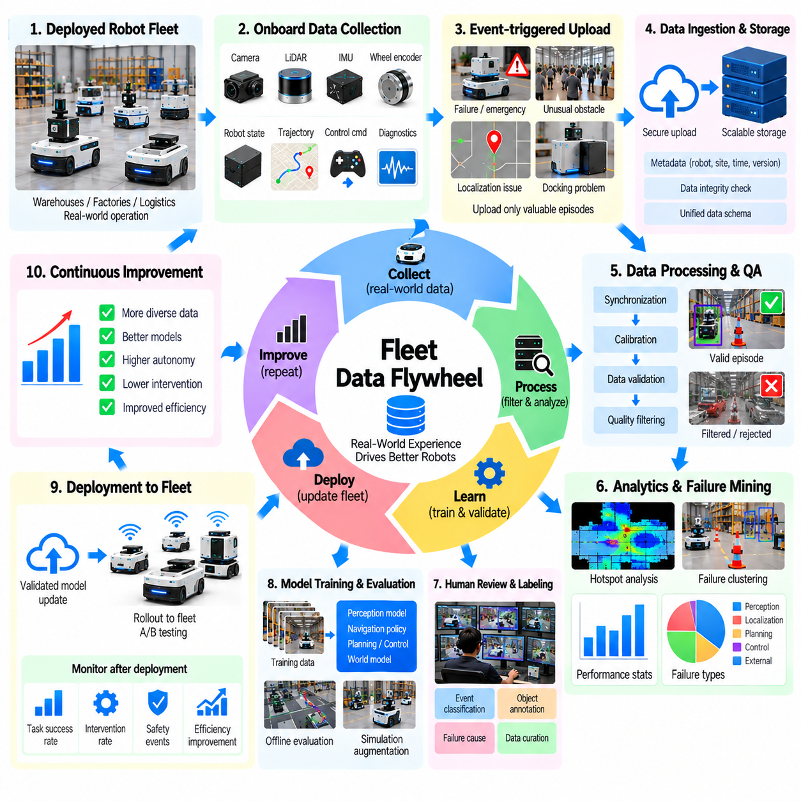{width="7.268055555555556in" height="7.268055555555556in"}

A fleet data flywheel is a continuous improvement mechanism that transforms operational experiences from deployed robots into better autonomous capabilities. As robots perform tasks across real environments, they generate observations, actions, failures, and performance measurements. A centralized data engine collects these experiences, identifies valuable learning opportunities, updates robot models, and returns validated improvements to the operating fleet.

A representative case study involves a fleet of autonomous mobile robots operating across warehouses, factories, and logistics facilities. Each robot performs transportation missions while encountering different layouts, obstacles, traffic patterns, and operating conditions. The fleet collectively produces a diverse stream of navigation data that would be difficult to obtain from a single robot or controlled laboratory environment.

The flywheel begins with standardized onboard data collection. Robots record camera images, LiDAR scans, localization estimates, planned trajectories, executed motions, control commands, and system diagnostics. Mission identifiers, robot configurations, software versions, and timestamps provide operational context. Consistent schemas allow recordings from different robots and facilities to be compared and combined reliably.

Fleet management systems contribute information that onboard sensors cannot capture independently. Mission assignments, route scheduling, charging operations, traffic coordination, and task completion records explain how robots interact with operational infrastructure. Integrating these records with navigation logs allows engineers to distinguish autonomy failures from scheduling inefficiencies, infrastructure limitations, or coordination problems.

Continuous data collection does not require uploading every sensor frame from every robot. Large fleets generate substantial quantities of repetitive information during normal operation. Event-triggered recording and selective transmission prioritize unusual conditions, safety interventions, localization degradation, and unexpected mission delays. This approach reduces communication and storage costs while preserving informative operational evidence.

Data ingestion infrastructure transfers selected recordings from robots to centralized storage and processing services. Edge buffers accommodate intermittent connectivity, while secure transmission protects operational information. Each uploaded episode receives identifiers, integrity checks, and provenance metadata. Ingestion services must handle different network conditions, recording formats, and software versions without compromising data consistency.

Automated quality assessment filters recordings before they enter the learning pipeline. Validation checks examine sensor completeness, timestamp alignment, coordinate transformations, calibration status, and trajectory continuity. Corrupted logs and inconsistent metadata are rejected or quarantined. Quality indicators help determine whether an episode is suitable for model training, evaluation, incident analysis, or further human review.

Fleet analytics converts large collections of operational logs into structured performance insights. Aggregated statistics reveal recurring navigation failures, difficult intersections, congestion hotspots, and inefficient routes. Engineers can compare mission completion rates, intervention frequencies, localization confidence, and travel efficiency across sites. These comparisons help identify problems that individual robot logs may not reveal.

Failure mining is a central component of the fleet data flywheel. Algorithms search for emergency stops, unexpected obstacles, localization loss, repeated replanning, excessive wheel slip, and unsuccessful docking. Candidate events are grouped by environmental context and failure characteristics. Clustering related failures helps engineers prioritize recurring weaknesses rather than investigating every isolated incident independently.

Uncertainty-based sampling identifies situations where deployed models exhibit limited confidence or inconsistent predictions. Perception uncertainty, localization covariance, planning disagreement, and unusual control responses may indicate informative episodes. However, uncertainty scores require calibration because high uncertainty does not always correspond to operational risk. Selected examples should be evaluated for relevance and diversity.

Human review complements automated failure discovery by providing contextual interpretation. Reviewers examine sensor evidence, system states, environmental conditions, and recovery actions. They determine whether incidents originate from perception errors, map inconsistencies, planning limitations, control instability, or external interference. Consistent failure taxonomies improve annotation quality and support targeted development.

The data engine converts selected episodes into curated training and evaluation datasets. Automated labeling generates obstacle tracks, semantic annotations, trajectory histories, and event classifications. Human verification addresses ambiguous situations and safety-critical examples. Dataset versions preserve the relationship between original recordings, derived labels, processing configurations, and intended learning objectives.

Active learning connects fleet observations with specific model improvement requests. When evaluation reveals poor performance in crowded intersections, the system searches existing logs for similar situations and requests additional targeted recordings. Rare events may be supplemented through simulation. Collection priorities therefore follow demonstrated model weaknesses rather than relying exclusively on uniform data accumulation.

Simulation expands fleet experience by generating controlled variations of observed failures. A recorded route blockage can become multiple scenarios with different obstacle positions, traffic densities, and sensor conditions. Digital twins reproduce relevant facility geometry and robot dynamics. Synthetic scenarios support systematic testing, but physical evidence remains necessary to verify that improvements transfer to deployed robots.

Model training integrates curated fleet data with existing robot learning resources. Updated perception models may improve obstacle classification, while navigation policies may learn better local decisions. Training procedures should prevent recent high-volume routes from overwhelming rare but important scenarios. Balanced sampling, dataset versioning, and reproducible experiments support meaningful comparisons between model generations.

Offline evaluation provides the first checkpoint before deploying updated models. Held-out datasets measure perception accuracy, localization performance, trajectory prediction, and navigation decision quality. Evaluation sets should include different facilities, environmental conditions, and failure categories. Improvements on training distributions alone are insufficient evidence of better operational autonomy.

Simulation-based regression testing examines whether new models introduce failures in previously successful scenarios. Test suites include normal missions, difficult intersections, sensor degradation, blocked paths, and recovery situations. Performance is compared against established baselines. Safety-critical regressions should prevent deployment even when aggregate learning metrics improve.

Physical validation introduces candidate models into controlled robot tests before fleet-wide release. Engineers evaluate mission success, intervention frequency, obstacle avoidance, docking precision, and recovery behavior. Hardware-specific differences must be considered because identical software can behave differently across robot configurations. Independent safety functions remain active throughout experimental testing.

Deployment management closes the loop between model development and fleet operations. Validated updates may be introduced through staged rollouts, beginning with limited robots or operating areas. Monitoring compares updated systems against existing baselines under comparable conditions. Rollback mechanisms restore previous versions when unexpected regressions, safety concerns, or reliability problems appear.

Fleet monitoring continues after deployment to measure whether model improvements persist under real operational conditions. Performance dashboards track mission completion, travel efficiency, intervention rates, fault frequency, and system availability. Changes must be interpreted alongside facility layouts, traffic density, robot utilization, and software configuration. This prevents operational variation from being mistaken for model improvement.

A mature flywheel also learns from successful operations rather than collecting only failures. Efficient routes, stable obstacle avoidance, accurate docking, and successful recovery episodes provide useful reference behaviors. Comparing successful and unsuccessful outcomes under similar conditions helps identify decisions associated with robust performance. Positive examples also reduce the risk of training datasets becoming dominated by abnormal situations.

Fleet diversity creates both opportunities and challenges for shared learning. Different robot models may use distinct sensors, actuators, payload capacities, and navigation architectures. Data normalization enables common analysis, but platform-specific characteristics must remain accessible. Transfer learning can reuse shared environmental knowledge while retaining specialized control models for different hardware configurations.

Data governance becomes increasingly important as fleet operations expand across organizations and facilities. Robot logs may contain identifiable individuals, sensitive maps, proprietary workflows, and operational schedules. Access permissions, encryption, retention policies, and dataset provenance protect these records. Cross-site learning must respect contractual boundaries and applicable privacy requirements.

The economic value of the flywheel depends on improvements in operational performance relative to collection and development costs. Useful measures include cost per informative episode, reduction in interventions, improvement in mission completion, and decreased robot downtime. Increasing data volume is not itself a business outcome. Investment should prioritize learning activities that deliver measurable reliability and productivity gains.

The central lesson of the fleet data flywheel case study is that deployed robots can become continuous sources of learning rather than static automation products. Operational data becomes valuable when systematic selection, validation, training, evaluation, and controlled deployment form a closed loop. A successful flywheel compounds fleet experience into safer, more adaptable, and increasingly reliable physical AI systems.

로봇 군집 데이터 플라이휠(Fleet Data Flywheel)은 배포된 로봇(Deployed Robot)의 운영 경험(Operational Experience)을 더 나은 자율 기능(Autonomous Capability)으로 전환하는 지속적 개선 메커니즘(Continuous Improvement Mechanism)이다. 로봇은 실제 환경에서 작업을 수행하면서 관측 데이터(Observation), 행동(Action), 실패(Failure), 성능 측정값(Performance Measurement)을 생성한다. 중앙 집중식 데이터 엔진(Centralized Data Engine)은 이러한 경험을 수집하고, 가치 있는 학습 기회(Learning Opportunity)를 식별하며, 로봇 모델(Robot Model)을 업데이트하고, 검증된 개선 사항(Validated Improvement)을 운영 중인 로봇 군집(Operating Fleet)에 다시 적용한다.

대표적인 사례 연구(Case Study)는 창고(Warehouse), 공장(Factory), 물류 시설(Logistics Facility)에서 운영되는 자율이동로봇(Autonomous Mobile Robot, AMR) 군집을 대상으로 한다. 각 로봇은 서로 다른 시설 배치(Layout), 장애물(Obstacle), 교통 패턴(Traffic Pattern), 운영 조건(Operating Condition)에 대응하면서 운송 임무(Transportation Mission)를 수행한다. 로봇 군집은 단일 로봇이나 통제된 실험실 환경(Controlled Laboratory Environment)에서는 확보하기 어려운 다양한 내비게이션 데이터(Navigation Data)를 공동으로 생산한다.

플라이휠(Flywheel)은 표준화된 로봇 탑재 데이터 수집(Standardized Onboard Data Collection)에서 시작된다. 로봇은 카메라 영상(Camera Image), 라이다 스캔(LiDAR Scan), 위치 추정값(Localization Estimate), 계획 궤적(Planned Trajectory), 실행 동작(Executed Motion), 제어 명령(Control Command), 시스템 진단 정보(System Diagnostic)를 기록한다. 임무 식별자(Mission Identifier), 로봇 구성(Robot Configuration), 소프트웨어 버전(Software Version), 타임스탬프(Timestamp)는 운영 맥락(Operational Context)을 제공한다. 일관된 스키마(Consistent Schema)는 서로 다른 로봇과 시설에서 수집된 기록을 신뢰성 있게 비교하고 결합하도록 한다.

군집 관리 시스템(Fleet Management System)은 로봇 탑재 센서(Onboard Sensor)만으로는 독립적으로 확보할 수 없는 정보를 제공한다. 임무 할당(Mission Assignment), 경로 일정 관리(Route Scheduling), 충전 운영(Charging Operation), 교통 조정(Traffic Coordination), 작업 완료 기록(Task Completion Record)은 로봇이 운영 인프라(Operational Infrastructure)와 상호작용하는 방식을 설명한다. 이러한 기록을 내비게이션 로그(Navigation Log)와 통합하면 엔지니어는 자율주행 실패(Autonomy Failure)를 일정 관리 비효율(Scheduling Inefficiency), 인프라 한계(Infrastructure Limitation), 조정 문제(Coordination Problem)와 구분할 수 있다.

지속적인 데이터 수집(Continuous Data Collection)이 모든 로봇의 모든 센서 프레임(Sensor Frame)을 업로드해야 한다는 의미는 아니다. 대규모 로봇 군집(Large Fleet)은 정상 운영 중에도 상당한 양의 반복 정보(Repetitive Information)를 생성한다. 이벤트 기반 기록(Event-Triggered Recording)과 선택적 전송(Selective Transmission)은 비정상적인 조건(Unusual Condition), 안전 개입(Safety Intervention), 위치 추정 성능 저하(Localization Degradation), 예상하지 못한 임무 지연(Unexpected Mission Delay)을 우선적으로 처리한다. 이러한 접근 방식은 유용한 운영 증거(Operational Evidence)를 보존하면서 통신 및 저장 비용(Communication and Storage Cost)을 줄인다.

데이터 수집 인프라(Data Ingestion Infrastructure)는 선택된 기록을 로봇에서 중앙 집중식 저장소(Centralized Storage)와 처리 서비스(Processing Service)로 전송한다. 엣지 버퍼(Edge Buffer)는 간헐적인 연결(Intermittent Connectivity)에 대응하며, 보안 전송(Secure Transmission)은 운영 정보(Operational Information)를 보호한다. 업로드된 각 에피소드(Episode)에는 식별자(Identifier), 무결성 검사(Integrity Check), 출처 메타데이터(Provenance Metadata)가 부여된다. 데이터 수집 서비스(Ingestion Service)는 데이터 일관성(Data Consistency)을 손상시키지 않으면서 다양한 네트워크 조건(Network Condition), 기록 형식(Recording Format), 소프트웨어 버전(Software Version)을 처리해야 한다.

자동 품질 평가(Automated Quality Assessment)는 기록이 학습 파이프라인(Learning Pipeline)에 입력되기 전에 필터링한다. 검증 검사(Validation Check)는 센서 데이터 완전성(Sensor Completeness), 타임스탬프 정렬(Timestamp Alignment), 좌표 변환(Coordinate Transformation), 보정 상태(Calibration Status), 궤적 연속성(Trajectory Continuity)을 평가한다. 손상된 로그(Corrupted Log)와 일관성이 없는 메타데이터(Inconsistent Metadata)는 거부하거나 격리한다. 품질 지표(Quality Indicator)는 해당 에피소드가 모델 학습(Model Training), 평가(Evaluation), 사고 분석(Incident Analysis), 추가적인 인간 검토(Human Review) 중 어디에 적합한지 결정하는 데 도움이 된다.

로봇 군집 분석(Fleet Analytics)은 대규모 운영 로그(Operational Log)를 구조화된 성능 통찰(Structured Performance Insight)로 변환한다. 집계 통계(Aggregated Statistics)는 반복되는 내비게이션 실패(Navigation Failure), 어려운 교차로(Difficult Intersection), 혼잡 집중 구역(Congestion Hotspot), 비효율적인 경로(Inefficient Route)를 드러낸다. 엔지니어는 시설별 임무 완료율(Mission Completion Rate), 개입 빈도(Intervention Frequency), 위치 추정 신뢰도(Localization Confidence), 이동 효율성(Travel Efficiency)을 비교할 수 있다. 이러한 비교는 개별 로봇 로그에서는 드러나지 않는 문제를 식별하는 데 도움이 된다.

실패 마이닝(Failure Mining)은 로봇 군집 데이터 플라이휠의 핵심 구성요소이다. 알고리즘은 비상 정지(Emergency Stop), 예상하지 못한 장애물(Unexpected Obstacle), 위치 추정 상실(Localization Loss), 반복적인 재계획(Repeated Replanning), 과도한 바퀴 미끄러짐(Excessive Wheel Slip), 도킹 실패(Unsuccessful Docking)를 검색한다. 후보 이벤트(Candidate Event)는 환경 맥락(Environmental Context)과 실패 특성(Failure Characteristic)에 따라 그룹화된다. 관련 실패를 군집화(Clustering)하면 엔지니어는 모든 개별 사고를 독립적으로 조사하기보다 반복적으로 나타나는 취약점(Recurring Weakness)을 우선적으로 처리할 수 있다.

불확실성 기반 샘플링(Uncertainty-Based Sampling)은 배포된 모델(Deployed Model)이 낮은 신뢰도(Limited Confidence)나 일관되지 않은 예측(Inconsistent Prediction)을 나타내는 상황을 식별한다. 인지 불확실성(Perception Uncertainty), 위치 추정 공분산(Localization Covariance), 계획 불일치(Planning Disagreement), 비정상적인 제어 응답(Unusual Control Response)은 유용한 에피소드(Informative Episode)를 나타낼 수 있다. 그러나 높은 불확실성(High Uncertainty)이 항상 운영 위험(Operational Risk)을 의미하지는 않으므로 불확실성 점수(Uncertainty Score)를 보정해야 한다. 선택된 사례는 관련성(Relevance)과 다양성(Diversity)을 기준으로 평가해야 한다.

인간 검토(Human Review)는 상황에 대한 맥락적 해석(Contextual Interpretation)을 제공하여 자동 실패 탐지(Automated Failure Discovery)를 보완한다. 검토자는 센서 증거(Sensor Evidence), 시스템 상태(System State), 환경 조건(Environmental Condition), 복구 행동(Recovery Action)을 조사한다. 이를 통해 사고가 인지 오류(Perception Error), 지도 불일치(Map Inconsistency), 계획 한계(Planning Limitation), 제어 불안정성(Control Instability), 외부 간섭(External Interference) 중 어디에서 발생했는지 판단한다. 일관된 실패 분류 체계(Failure Taxonomy)는 주석 품질(Annotation Quality)을 개선하고 목표 지향적 개발(Targeted Development)을 지원한다.

데이터 엔진(Data Engine)은 선택된 에피소드(Selected Episode)를 정제된 학습 및 평가 데이터셋(Curated Training and Evaluation Dataset)으로 변환한다. 자동 라벨링(Automated Labeling)은 장애물 추적 정보(Obstacle Track), 의미론적 주석(Semantic Annotation), 궤적 이력(Trajectory History), 이벤트 분류(Event Classification)를 생성한다. 인간 검증(Human Verification)은 모호한 상황(Ambiguous Situation)과 안전 필수 사례(Safety-Critical Example)를 처리한다. 데이터셋 버전(Dataset Version)은 원본 기록(Original Recording), 파생 라벨(Derived Label), 처리 구성(Processing Configuration), 의도된 학습 목표(Intended Learning Objective) 사이의 관계를 보존한다.

능동학습(Active Learning)은 로봇 군집 관측(Fleet Observation)을 구체적인 모델 개선 요청(Model Improvement Request)과 연결한다. 평가 결과 혼잡한 교차로(Crowded Intersection)에서 성능이 낮게 나타나면 시스템은 기존 로그에서 유사한 상황을 검색하고 추가적인 목표 지향적 기록(Targeted Recording)을 요청한다. 희귀 이벤트(Rare Event)는 시뮬레이션(Simulation)을 통해 보완할 수 있다. 따라서 데이터 수집 우선순위(Collection Priority)는 균일한 데이터 축적(Uniform Data Accumulation)에만 의존하지 않고 확인된 모델 취약점(Demonstrated Model Weakness)을 따른다.

시뮬레이션(Simulation)은 관측된 실패(Observed Failure)를 제어된 방식으로 변형하여 로봇 군집 경험(Fleet Experience)을 확장한다. 기록된 경로 차단(Route Blockage)은 서로 다른 장애물 위치(Obstacle Position), 교통 밀도(Traffic Density), 센서 조건(Sensor Condition)을 가진 여러 시나리오로 변환할 수 있다. 디지털 트윈(Digital Twin)은 관련 시설 형상(Facility Geometry)과 로봇 동역학(Robot Dynamics)을 재현한다. 합성 시나리오(Synthetic Scenario)는 체계적인 시험(Systematic Testing)을 지원하지만, 개선 사항이 실제 로봇으로 전이되는지 검증하려면 물리적 증거(Physical Evidence)가 여전히 필요하다.

모델 학습(Model Training)은 정제된 로봇 군집 데이터(Curated Fleet Data)를 기존 로봇 학습 자원(Robot Learning Resource)과 통합한다. 업데이트된 인지 모델(Perception Model)은 장애물 분류(Obstacle Classification)를 개선할 수 있으며, 내비게이션 정책(Navigation Policy)은 더 나은 국소 의사결정(Local Decision)을 학습할 수 있다. 학습 절차(Training Procedure)는 최근에 대량으로 수집된 경로 데이터(High-Volume Route Data)가 드물지만 중요한 시나리오(Rare but Important Scenario)를 압도하지 않도록 해야 한다. 균형 잡힌 샘플링(Balanced Sampling), 데이터셋 버전 관리(Dataset Versioning), 재현 가능한 실험(Reproducible Experiment)은 모델 세대(Model Generation) 간 의미 있는 비교를 지원한다.

오프라인 평가(Offline Evaluation)는 업데이트된 모델을 배포하기 전 첫 번째 검증 단계(Checkpoint)를 제공한다. 별도로 보관된 평가 데이터셋(Held-Out Dataset)은 인지 정확도(Perception Accuracy), 위치 추정 성능(Localization Performance), 궤적 예측(Trajectory Prediction), 내비게이션 의사결정 품질(Navigation Decision Quality)을 측정한다. 평가 데이터셋(Evaluation Set)에는 서로 다른 시설(Facility), 환경 조건(Environmental Condition), 실패 범주(Failure Category)가 포함되어야 한다. 학습 데이터 분포(Training Distribution)에서의 개선만으로는 운영 자율성(Operational Autonomy)이 향상되었다는 충분한 증거가 되지 않는다.

시뮬레이션 기반 회귀 시험(Simulation-Based Regression Testing)은 새로운 모델이 이전에 성공했던 시나리오(Previously Successful Scenario)에서 새로운 실패를 유발하는지 조사한다. 시험 모음(Test Suite)에는 정상 임무(Normal Mission), 어려운 교차로(Difficult Intersection), 센서 성능 저하(Sensor Degradation), 차단된 경로(Blocked Path), 복구 상황(Recovery Situation)이 포함된다. 성능은 기존 기준선(Established Baseline)과 비교된다. 안전 필수 회귀 문제(Safety-Critical Regression)는 전체 학습 지표(Aggregate Learning Metric)가 개선되더라도 배포를 차단해야 한다.

물리적 검증(Physical Validation)은 로봇 군집 전체에 배포하기 전에 후보 모델(Candidate Model)을 통제된 로봇 시험(Controlled Robot Test)에 적용한다. 엔지니어는 임무 성공(Mission Success), 개입 빈도(Intervention Frequency), 장애물 회피(Obstacle Avoidance), 도킹 정밀도(Docking Precision), 복구 행동(Recovery Behavior)을 평가한다. 동일한 소프트웨어(Software)라도 로봇 구성(Robot Configuration)에 따라 다르게 작동할 수 있으므로 하드웨어별 차이(Hardware-Specific Difference)를 고려해야 한다. 독립적인 안전 기능(Independent Safety Function)은 실험 시험(Experimental Testing) 전반에 걸쳐 활성 상태를 유지한다.

배포 관리(Deployment Management)는 모델 개발(Model Development)과 로봇 군집 운영(Fleet Operation) 사이의 순환 구조를 완성한다. 검증된 업데이트(Validated Update)는 제한된 로봇이나 운영 구역(Operating Area)에서 시작하는 단계적 배포(Staged Rollout)를 통해 도입할 수 있다. 모니터링(Monitoring)은 비교 가능한 조건(Comparable Condition)에서 업데이트된 시스템을 기존 기준선(Existing Baseline)과 비교한다. 롤백 메커니즘(Rollback Mechanism)은 예상하지 못한 성능 회귀(Unexpected Regression), 안전 문제(Safety Concern), 신뢰성 문제(Reliability Problem)가 발생하면 이전 버전(Previous Version)을 복원한다.

로봇 군집 모니터링(Fleet Monitoring)은 배포 이후에도 모델 개선(Model Improvement)이 실제 운영 조건(Real Operational Condition)에서 지속되는지 측정한다. 성능 대시보드(Performance Dashboard)는 임무 완료(Mission Completion), 이동 효율성(Travel Efficiency), 개입률(Intervention Rate), 고장 빈도(Fault Frequency), 시스템 가용성(System Availability)을 추적한다. 변화는 시설 배치(Facility Layout), 교통 밀도(Traffic Density), 로봇 활용률(Robot Utilization), 소프트웨어 구성(Software Configuration)과 함께 해석해야 한다. 이를 통해 운영 조건의 변화(Operational Variation)를 모델 개선으로 잘못 판단하는 것을 방지한다.

성숙한 플라이휠(Mature Flywheel)은 실패만 수집하는 것이 아니라 성공적인 운영(Successful Operation)에서도 학습한다. 효율적인 경로(Efficient Route), 안정적인 장애물 회피(Stable Obstacle Avoidance), 정확한 도킹(Accurate Docking), 성공적인 복구 에피소드(Successful Recovery Episode)는 유용한 기준 행동(Reference Behavior)을 제공한다. 유사한 조건에서 성공과 실패 결과(Successful and Unsuccessful Outcome)를 비교하면 견고한 성능(Robust Performance)과 관련된 의사결정(Decision)을 식별할 수 있다. 긍정적인 사례(Positive Example)는 학습 데이터셋이 비정상적인 상황(Abnormal Situation)에 지나치게 편중되는 위험도 줄인다.

로봇 군집 다양성(Fleet Diversity)은 공유 학습(Shared Learning)에 기회와 과제를 동시에 제공한다. 서로 다른 로봇 모델(Robot Model)은 센서(Sensor), 액추에이터(Actuator), 적재 용량(Payload Capacity), 내비게이션 아키텍처(Navigation Architecture)가 다를 수 있다. 데이터 정규화(Data Normalization)는 공통 분석(Common Analysis)을 가능하게 하지만, 플랫폼별 특성(Platform-Specific Characteristic)은 계속 접근할 수 있도록 유지해야 한다. 전이학습(Transfer Learning)은 공유된 환경 지식(Shared Environmental Knowledge)을 재사용하면서 서로 다른 하드웨어 구성(Hardware Configuration)에 맞는 특화된 제어 모델(Specialized Control Model)을 유지할 수 있다.

데이터 거버넌스(Data Governance)는 로봇 군집 운영이 여러 조직과 시설로 확장됨에 따라 더욱 중요해진다. 로봇 로그(Robot Log)에는 식별 가능한 개인(Identifiable Individual), 민감한 지도(Sensitive Map), 독점적인 작업 절차(Proprietary Workflow), 운영 일정(Operational Schedule)이 포함될 수 있다. 접근 권한(Access Permission), 암호화(Encryption), 데이터 보존 정책(Retention Policy), 데이터셋 출처(Dataset Provenance)는 이러한 기록을 보호한다. 시설 간 학습(Cross-Site Learning)은 계약상 경계(Contractual Boundary)와 적용 가능한 개인정보 보호 요구사항(Privacy Requirement)을 준수해야 한다.

플라이휠의 경제적 가치(Economic Value)는 데이터 수집 및 개발 비용(Collection and Development Cost) 대비 운영 성능(Operational Performance)의 개선에 따라 결정된다. 유용한 지표에는 정보 가치가 높은 에피소드당 비용(Cost per Informative Episode), 개입 감소(Reduction in Intervention), 임무 완료율 개선(Improvement in Mission Completion), 로봇 가동 중단 시간 감소(Decreased Robot Downtime)가 포함된다. 데이터 양의 증가(Increasing Data Volume) 자체가 사업 성과(Business Outcome)는 아니다. 투자는 측정 가능한 신뢰성(Reliability)과 생산성(Productivity) 향상을 제공하는 학습 활동(Learning Activity)에 우선적으로 집중해야 한다.

로봇 군집 데이터 플라이휠 사례 연구(Fleet Data Flywheel Case Study)의 핵심 교훈은 배포된 로봇(Deployed Robot)이 정적인 자동화 제품(Static Automation Product)에 머무르지 않고 지속적인 학습 자원(Continuous Learning Source)이 될 수 있다는 것이다. 운영 데이터(Operational Data)는 체계적인 선택(Systematic Selection), 검증(Validation), 학습(Training), 평가(Evaluation), 통제된 배포(Controlled Deployment)가 폐루프(Closed Loop)를 형성할 때 가치를 갖는다. 성공적인 플라이휠(Successful Flywheel)은 축적된 로봇 군집 경험(Fleet Experience)을 더욱 안전하고 적응력이 높으며 신뢰성이 지속적으로 향상되는 피지컬 AI 시스템(Physical AI System)으로 발전시킨다.

##  

## 10.12. End to End Physical AI Data Engine [w/Code]

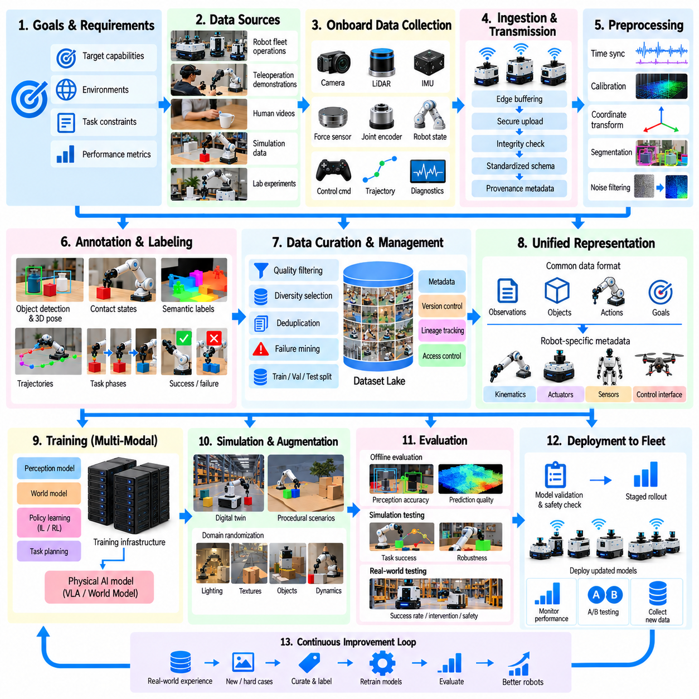{width="7.268055555555556in" height="7.268055555555556in"}

An end-to-end Physical AI data engine is an integrated system that transforms physical experiences into continuously improving robotic intelligence. It connects data collection, ingestion, processing, annotation, curation, training, evaluation, and deployment within a unified architecture. Rather than treating datasets as static resources, the engine manages information as a continuously evolving asset driven by real-world robot performance.

The architecture begins with clearly defined operational objectives and learning requirements. Engineers identify target robot capabilities, environmental conditions, task constraints, and measurable performance indicators. These specifications determine which experiences must be collected and how they should be represented. A well-designed data engine connects every collection activity to a learning objective or evaluation requirement.

Data acquisition combines complementary sources, including robot fleet logs, teleoperation demonstrations, human videos, simulation episodes, and controlled laboratory experiments. Each source contributes different information about perception, actions, dynamics, and task outcomes. Integrating these sources increases behavioral coverage, but their limitations and differences must remain explicit throughout the pipeline.

Onboard data collection captures synchronized observations and robot states during physical execution. Cameras, LiDAR, depth sensors, inertial units, force sensors, and joint encoders provide multimodal measurements. Control commands, planned trajectories, safety interventions, and task outcomes add behavioral context. Accurate timestamps and calibration records are essential for reconstructing relationships between perception and action.

The ingestion layer transfers collected information into a scalable data infrastructure. Edge buffering, secure communication, integrity verification, and standardized metadata support reliable operation across distributed robots. Data schemas identify sensor modalities, coordinate frames, robot configurations, and software versions. Provenance records preserve the origin and processing history of every dataset component.

Preprocessing converts heterogeneous raw recordings into consistent learning representations. Operations include timestamp alignment, sensor calibration, coordinate transformation, trajectory reconstruction, video segmentation, and noise filtering. Automated validation detects missing measurements, corrupted sequences, and inconsistent metadata. Raw observations should remain accessible so that processing errors can be investigated and corrected.

Annotation transforms sensor observations into structured supervision for machine learning. Object identities, semantic classes, poses, contact states, trajectories, task phases, and failure categories may be labeled automatically or through human review. Simulation provides ground-truth annotations, while physical recordings often require estimation. Label confidence and uncertainty should be preserved rather than hidden.

Data curation determines which examples deserve inclusion in training and evaluation datasets. Selection considers quality, diversity, task relevance, physical feasibility, and failure importance. Redundant recordings may be downsampled, while rare or difficult situations receive greater attention. Dataset composition should reflect intended operational coverage without simply reproducing the frequency of common events.

A unified representation layer connects different robots, environments, and data sources. Common descriptions of objects, spatial relationships, actions, goals, and task outcomes support cross-platform learning. However, robot-specific kinematics, actuator limits, sensor characteristics, and control interfaces must remain available. Standardization should enable transfer without erasing important physical differences.

Dataset management provides version control, reproducibility, and traceability throughout development. Each dataset release records source identifiers, annotation versions, filtering rules, sampling configurations, and permitted usage conditions. Training and evaluation partitions must prevent leakage between closely related episodes. Reliable lineage allows engineers to connect model behavior to the data that influenced it.

The training infrastructure converts curated datasets into perception models, world models, control policies, and task-planning capabilities. Supervised learning, imitation learning, reinforcement learning, and self-supervised learning may contribute complementary functions. Training configurations should preserve model architecture, initialization, optimization settings, and data versions to support reproducible comparisons.

Simulation provides an intermediate environment for expanding experience and testing candidate behaviors. Digital twins and procedural scenarios introduce variations in object geometry, lighting, friction, obstacles, and robot dynamics. Synthetic data can address gaps in physical recordings, while simulated evaluation exposes potential failures. Real-world calibration is necessary to prevent simulation artifacts from misleading learning.

Evaluation operates at multiple levels, from individual perception components to complete robotic tasks. Offline benchmarks measure prediction accuracy and representation quality, while simulation tests examine behavior under controlled conditions. Physical trials assess task success, intervention frequency, recovery performance, and safety. Improvements must generalize across environments rather than depend on narrow evaluation conditions.

Deployment connects validated models to operating robots through controlled software release processes. Candidate updates undergo compatibility checks, regression testing, safety verification, and staged rollout. Runtime monitoring records performance changes and unexpected failures. Rollback mechanisms protect operations when new models behave worse than established versions, ensuring that learning progress does not compromise reliability.

The feedback loop closes when deployed robot experiences influence future data collection and training. Failure mining identifies recurring weaknesses, uncertainty analysis highlights ambiguous situations, and fleet analytics reveals operational bottlenecks. These findings generate targeted collection requests or synthetic scenarios. The engine therefore prioritizes information according to demonstrated learning needs rather than collection volume.

Human expertise remains essential throughout the automated pipeline. Operators provide demonstrations, reviewers verify uncertain labels, engineers investigate failures, and safety specialists assess deployment readiness. Human intervention should focus on decisions requiring contextual judgment or physical understanding. Automation improves throughput, while structured human oversight helps maintain data integrity and operational accountability.

Data governance establishes the rules for responsible collection, processing, sharing, and retention. Robot recordings may contain identifiable individuals, confidential facility information, and proprietary operational data. Access controls, encryption, licensing checks, retention schedules, and deletion procedures protect these resources. Governance must extend to derived annotations, synthetic assets, trained models, and downstream datasets.

Scalability depends on coordinating computing, storage, networking, simulation, and robotic infrastructure. Distributed processing handles large sensor recordings, while parallel simulation generates additional experiences. Resource scheduling balances processing latency, dataset freshness, training throughput, and operating costs. Architectural modularity allows individual services to evolve without disrupting the entire data engine.

Operational observability measures the health and effectiveness of the data pipeline itself. Dashboards track ingestion reliability, annotation quality, processing failures, dataset coverage, training efficiency, and deployment outcomes. Monitoring should connect technical metrics with robot performance improvements. This makes it possible to identify whether bottlenecks originate in data availability, processing quality, or model capability.

Economic optimization requires evaluating the learning value produced by each stage of the engine. Cost per recorded hour or generated episode does not fully represent dataset usefulness. More meaningful measures include cost per validated example, reduction in robot interventions, and performance improvement per training cycle. Investment decisions should prioritize activities that deliver measurable operational benefits.

A practical implementation can begin with a limited robot fleet, a small set of tasks, and standardized data logging. Engineers establish ingestion, validation, annotation, dataset versioning, and baseline model evaluation before expanding automation. Simulation and active learning are introduced as specific data gaps emerge. Incremental development reduces integration risk and makes system improvements easier to measure.

As the engine matures, learning cycles become increasingly automated and responsive. Deployment failures trigger event extraction, similar examples are retrieved, and targeted datasets are assembled for retraining. Candidate models pass through reproducible evaluation and controlled release procedures. Human approval remains necessary where safety or operational consequences demand independent judgment.

The central principle of an end-to-end Physical AI data engine is that data quality, model capability, and physical deployment must form a single coordinated system. Effective intelligence emerges from repeated interaction between real experience, structured learning, and rigorous validation. A mature engine converts operational evidence into progressively safer, more adaptable, and more reliable robotic behavior.

엔드투엔드 피지컬 AI 데이터 엔진(End-to-End Physical AI Data Engine)은 물리적 경험(Physical Experience)을 지속적으로 개선되는 로봇 지능(Robotic Intelligence)으로 변환하는 통합 시스템(Integrated System)이다. 이 시스템은 데이터 수집(Data Collection), 수집 및 적재(Ingestion), 처리(Processing), 주석(Annotation), 데이터 큐레이션(Data Curation), 학습(Training), 평가(Evaluation), 배포(Deployment)를 통합 아키텍처(Unified Architecture) 내에서 연결한다. 데이터셋(Dataset)을 정적인 자원(Static Resource)으로 취급하는 대신 실제 로봇 성능(Real-World Robot Performance)에 따라 지속적으로 발전하는 자산(Evolving Asset)으로 관리한다.

아키텍처(Architecture)는 명확하게 정의된 운영 목표(Operational Objective)와 학습 요구사항(Learning Requirement)에서 시작된다. 엔지니어는 목표 로봇 능력(Target Robot Capability), 환경 조건(Environmental Condition), 작업 제약(Task Constraint), 측정 가능한 성능 지표(Measurable Performance Indicator)를 식별한다. 이러한 명세(Specification)는 어떤 경험을 수집해야 하며 어떻게 표현해야 하는지를 결정한다. 잘 설계된 데이터 엔진(Data Engine)은 모든 데이터 수집 활동(Collection Activity)을 학습 목표(Learning Objective) 또는 평가 요구사항(Evaluation Requirement)과 연결한다.

데이터 획득(Data Acquisition)은 로봇 군집 로그(Robot Fleet Log), 원격조작 시연(Teleoperation Demonstration), 인간 영상(Human Video), 시뮬레이션 에피소드(Simulation Episode), 통제된 실험실 실험(Controlled Laboratory Experiment) 등 상호 보완적인 데이터 소스(Data Source)를 결합한다. 각 데이터 소스는 인지(Perception), 행동(Action), 동역학(Dynamics), 작업 결과(Task Outcome)에 관한 서로 다른 정보를 제공한다. 이러한 소스를 통합하면 행동 적용 범위(Behavioral Coverage)가 확대되지만, 각 소스의 한계(Limitation)와 차이(Difference)는 파이프라인(Pipeline) 전반에서 명확하게 유지되어야 한다.

로봇 탑재 데이터 수집(Onboard Data Collection)은 물리적 실행(Physical Execution) 중 동기화된 관측 데이터(Synchronized Observation)와 로봇 상태(Robot State)를 확보한다. 카메라(Camera), 라이다(LiDAR), 깊이 센서(Depth Sensor), 관성 측정 장치(Inertial Measurement Unit), 힘 센서(Force Sensor), 관절 인코더(Joint Encoder)는 다중 모달 측정값(Multimodal Measurement)을 제공한다. 제어 명령(Control Command), 계획 궤적(Planned Trajectory), 안전 개입(Safety Intervention), 작업 결과(Task Outcome)는 행동 맥락(Behavioral Context)을 추가한다. 정확한 타임스탬프(Timestamp)와 보정 기록(Calibration Record)은 인지와 행동 사이의 관계를 재구성하는 데 필수적이다.

데이터 수집 계층(Ingestion Layer)은 수집된 정보를 확장 가능한 데이터 인프라(Scalable Data Infrastructure)로 전송한다. 엣지 버퍼링(Edge Buffering), 보안 통신(Secure Communication), 무결성 검증(Integrity Verification), 표준화된 메타데이터(Standardized Metadata)는 분산된 로봇(Distributed Robot) 환경에서 신뢰성 있는 운영을 지원한다. 데이터 스키마(Data Schema)는 센서 모달리티(Sensor Modality), 좌표계(Coordinate Frame), 로봇 구성(Robot Configuration), 소프트웨어 버전(Software Version)을 식별한다. 출처 기록(Provenance Record)은 모든 데이터셋 구성요소(Dataset Component)의 원본 출처(Origin)와 처리 이력(Processing History)을 보존한다.

전처리(Preprocessing)는 이질적인 원시 기록(Heterogeneous Raw Recording)을 일관된 학습 표현(Consistent Learning Representation)으로 변환한다. 주요 작업에는 타임스탬프 정렬(Timestamp Alignment), 센서 보정(Sensor Calibration), 좌표 변환(Coordinate Transformation), 궤적 재구성(Trajectory Reconstruction), 영상 분할(Video Segmentation), 잡음 필터링(Noise Filtering)이 포함된다. 자동 검증(Automated Validation)은 누락된 측정값(Missing Measurement), 손상된 시퀀스(Corrupted Sequence), 일관되지 않은 메타데이터(Inconsistent Metadata)를 감지한다. 처리 오류(Processing Error)를 조사하고 수정할 수 있도록 원시 관측 데이터(Raw Observation)에 대한 접근성을 유지해야 한다.

주석 작업(Annotation)은 센서 관측 데이터(Sensor Observation)를 기계학습(Machine Learning)을 위한 구조화된 감독 정보(Structured Supervision)로 변환한다. 객체 식별 정보(Object Identity), 의미론적 클래스(Semantic Class), 자세(Pose), 접촉 상태(Contact State), 궤적(Trajectory), 작업 단계(Task Phase), 실패 범주(Failure Category)는 자동으로 라벨링하거나 인간 검토(Human Review)를 통해 지정할 수 있다. 시뮬레이션(Simulation)은 정답 주석(Ground-Truth Annotation)을 제공하지만, 물리적 기록(Physical Recording)은 추정(Estimation)이 필요한 경우가 많다. 라벨 신뢰도(Label Confidence)와 불확실성(Uncertainty)은 숨기지 않고 보존해야 한다.

데이터 큐레이션(Data Curation)은 학습 및 평가 데이터셋(Training and Evaluation Dataset)에 포함할 가치가 있는 사례를 결정한다. 데이터 선택(Data Selection)은 품질(Quality), 다양성(Diversity), 작업 관련성(Task Relevance), 물리적 실행 가능성(Physical Feasibility), 실패 중요도(Failure Importance)를 고려한다. 중복 기록(Redundant Recording)은 다운샘플링(Downsampling)할 수 있으며, 드물거나 어려운 상황(Rare or Difficult Situation)에는 더 많은 주의를 기울인다. 데이터셋 구성(Dataset Composition)은 일반적인 이벤트(Common Event)의 발생 빈도를 단순히 재현하는 것이 아니라 목표 운영 적용 범위(Intended Operational Coverage)를 반영해야 한다.

통합 표현 계층(Unified Representation Layer)은 서로 다른 로봇(Robot), 환경(Environment), 데이터 소스(Data Source)를 연결한다. 객체(Object), 공간적 관계(Spatial Relationship), 행동(Action), 목표(Goal), 작업 결과(Task Outcome)에 대한 공통 표현(Common Representation)은 플랫폼 간 학습(Cross-Platform Learning)을 지원한다. 그러나 로봇별 운동학(Robot-Specific Kinematics), 액추에이터 한계(Actuator Limit), 센서 특성(Sensor Characteristic), 제어 인터페이스(Control Interface)는 계속 활용할 수 있어야 한다. 표준화(Standardization)는 중요한 물리적 차이(Physical Difference)를 제거하지 않으면서 지식 전이(Transfer)를 가능하게 해야 한다.

데이터셋 관리(Dataset Management)는 개발 과정 전반에서 버전 관리(Version Control), 재현 가능성(Reproducibility), 추적 가능성(Traceability)을 제공한다. 각 데이터셋 릴리스(Dataset Release)는 데이터 소스 식별자(Source Identifier), 주석 버전(Annotation Version), 필터링 규칙(Filtering Rule), 샘플링 구성(Sampling Configuration), 허용된 사용 조건(Permitted Usage Condition)을 기록한다. 학습 및 평가 데이터 분할(Training and Evaluation Partition)은 밀접하게 관련된 에피소드 사이의 데이터 누출(Data Leakage)을 방지해야 한다. 신뢰성 있는 데이터 계보(Data Lineage)는 엔지니어가 모델 행동(Model Behavior)을 해당 행동에 영향을 준 데이터와 연결하도록 한다.

학습 인프라(Training Infrastructure)는 정제된 데이터셋(Curated Dataset)을 인지 모델(Perception Model), 월드 모델(World Model), 제어 정책(Control Policy), 작업 계획 능력(Task-Planning Capability)으로 변환한다. 지도학습(Supervised Learning), 모방학습(Imitation Learning), 강화학습(Reinforcement Learning), 자기지도학습(Self-Supervised Learning)은 상호 보완적인 기능을 수행할 수 있다. 학습 구성(Training Configuration)은 재현 가능한 비교(Reproducible Comparison)를 지원하도록 모델 아키텍처(Model Architecture), 초기화(Initialization), 최적화 설정(Optimization Setting), 데이터 버전(Data Version)을 보존해야 한다.

시뮬레이션(Simulation)은 경험을 확장하고 후보 행동(Candidate Behavior)을 시험하기 위한 중간 환경(Intermediate Environment)을 제공한다. 디지털 트윈(Digital Twin)과 절차적 시나리오(Procedural Scenario)는 객체 형상(Object Geometry), 조명(Lighting), 마찰(Friction), 장애물(Obstacle), 로봇 동역학(Robot Dynamics)에 다양한 변화를 도입한다. 합성 데이터(Synthetic Data)는 물리적 기록(Physical Recording)의 부족한 부분을 보완할 수 있으며, 시뮬레이션 평가(Simulated Evaluation)는 잠재적인 실패(Potential Failure)를 드러낸다. 시뮬레이션 아티팩트(Simulation Artifact)가 학습을 왜곡하지 않도록 실제 환경 보정(Real-World Calibration)이 필요하다.

평가(Evaluation)는 개별 인지 구성요소(Perception Component)부터 완전한 로봇 작업(Complete Robotic Task)에 이르기까지 여러 수준에서 수행된다. 오프라인 벤치마크(Offline Benchmark)는 예측 정확도(Prediction Accuracy)와 표현 품질(Representation Quality)을 측정하며, 시뮬레이션 시험(Simulation Test)은 통제된 조건에서 행동을 조사한다. 물리적 시험(Physical Trial)은 작업 성공(Task Success), 개입 빈도(Intervention Frequency), 복구 성능(Recovery Performance), 안전성(Safety)을 평가한다. 개선된 성능은 제한된 평가 조건(Narrow Evaluation Condition)에 의존하지 않고 다양한 환경으로 일반화(Generalization)되어야 한다.

배포(Deployment)는 통제된 소프트웨어 릴리스 프로세스(Controlled Software Release Process)를 통해 검증된 모델(Validated Model)을 운영 중인 로봇(Operating Robot)에 연결한다. 후보 업데이트(Candidate Update)는 호환성 검사(Compatibility Check), 회귀 시험(Regression Testing), 안전 검증(Safety Verification), 단계적 배포(Staged Rollout)를 거친다. 런타임 모니터링(Runtime Monitoring)은 성능 변화(Performance Change)와 예상하지 못한 실패(Unexpected Failure)를 기록한다. 롤백 메커니즘(Rollback Mechanism)은 새로운 모델이 기존 버전(Established Version)보다 나쁜 성능을 보일 경우 운영을 보호하여 학습 진전(Learning Progress)이 신뢰성(Reliability)을 손상시키지 않도록 한다.

피드백 루프(Feedback Loop)는 배포된 로봇의 경험(Deployed Robot Experience)이 향후 데이터 수집(Data Collection)과 학습(Training)에 영향을 미칠 때 완성된다. 실패 마이닝(Failure Mining)은 반복되는 취약점(Recurring Weakness)을 식별하고, 불확실성 분석(Uncertainty Analysis)은 모호한 상황(Ambiguous Situation)을 강조하며, 로봇 군집 분석(Fleet Analytics)은 운영 병목 현상(Operational Bottleneck)을 드러낸다. 이러한 결과는 목표 지향적 데이터 수집 요청(Targeted Collection Request)이나 합성 시나리오(Synthetic Scenario)를 생성한다. 따라서 데이터 엔진은 수집량(Collection Volume)이 아니라 확인된 학습 필요성(Demonstrated Learning Need)에 따라 정보의 우선순위를 결정한다.

인간의 전문성(Human Expertise)은 자동화된 파이프라인(Automated Pipeline) 전반에서 여전히 필수적이다. 작업자(Operator)는 시연(Demonstration)을 제공하고, 검토자(Reviewer)는 불확실한 라벨(Uncertain Label)을 검증하며, 엔지니어(Engineer)는 실패(Failure)를 조사하고, 안전 전문가(Safety Specialist)는 배포 준비 상태(Deployment Readiness)를 평가한다. 인간 개입(Human Intervention)은 맥락적 판단(Contextual Judgment)이나 물리적 이해(Physical Understanding)가 필요한 의사결정(Decision)에 집중해야 한다. 자동화(Automation)는 처리량(Throughput)을 개선하고, 구조화된 인간 감독(Structured Human Oversight)은 데이터 무결성(Data Integrity)과 운영 책임성(Operational Accountability)을 유지하도록 돕는다.

데이터 거버넌스(Data Governance)는 책임 있는 데이터 수집(Collection), 처리(Processing), 공유(Sharing), 보존(Retention)을 위한 규칙을 수립한다. 로봇 기록(Robot Recording)에는 식별 가능한 개인(Identifiable Individual), 기밀 시설 정보(Confidential Facility Information), 독점적인 운영 데이터(Proprietary Operational Data)가 포함될 수 있다. 접근 제어(Access Control), 암호화(Encryption), 라이선스 검사(Licensing Check), 보존 일정(Retention Schedule), 삭제 절차(Deletion Procedure)는 이러한 자원을 보호한다. 거버넌스는 파생 주석(Derived Annotation), 합성 자산(Synthetic Asset), 학습된 모델(Trained Model), 후속 데이터셋(Downstream Dataset)까지 확장되어야 한다.

확장성(Scalability)은 컴퓨팅(Computing), 저장소(Storage), 네트워킹(Networking), 시뮬레이션(Simulation), 로봇 인프라(Robotic Infrastructure)를 조정하는 능력에 달려 있다. 분산 처리(Distributed Processing)는 대규모 센서 기록(Large Sensor Recording)을 처리하며, 병렬 시뮬레이션(Parallel Simulation)은 추가적인 경험(Additional Experience)을 생성한다. 자원 스케줄링(Resource Scheduling)은 처리 지연시간(Processing Latency), 데이터셋 최신성(Dataset Freshness), 학습 처리량(Training Throughput), 운영 비용(Operating Cost)의 균형을 유지한다. 아키텍처 모듈성(Architectural Modularity)은 전체 데이터 엔진을 중단하지 않고 개별 서비스(Individual Service)를 발전시킬 수 있도록 한다.

운영 관측 가능성(Operational Observability)은 데이터 파이프라인(Data Pipeline) 자체의 상태(Health)와 효과성(Effectiveness)을 측정한다. 대시보드(Dashboard)는 데이터 수집 신뢰성(Ingestion Reliability), 주석 품질(Annotation Quality), 처리 실패(Processing Failure), 데이터셋 적용 범위(Dataset Coverage), 학습 효율성(Training Efficiency), 배포 결과(Deployment Outcome)를 추적한다. 모니터링(Monitoring)은 기술적 지표(Technical Metric)를 로봇 성능 개선(Robot Performance Improvement)과 연결해야 한다. 이를 통해 병목 현상(Bottleneck)이 데이터 가용성(Data Availability), 처리 품질(Processing Quality), 모델 능력(Model Capability) 중 어디에서 발생하는지 식별할 수 있다.

경제적 최적화(Economic Optimization)를 위해서는 데이터 엔진의 각 단계에서 생산되는 학습 가치(Learning Value)를 평가해야 한다. 기록 시간당 비용(Cost per Recorded Hour)이나 생성된 에피소드당 비용(Cost per Generated Episode)만으로는 데이터셋의 유용성(Dataset Usefulness)을 충분히 나타낼 수 없다. 더 의미 있는 지표에는 검증된 사례당 비용(Cost per Validated Example), 로봇 개입 감소(Reduction in Robot Intervention), 학습 주기당 성능 개선(Performance Improvement per Training Cycle)이 포함된다. 투자 결정(Investment Decision)은 측정 가능한 운영 편익(Measurable Operational Benefit)을 제공하는 활동에 우선순위를 두어야 한다.

실용적인 구현(Practical Implementation)은 제한된 로봇 군집(Limited Robot Fleet), 소규모 작업 집합(Small Set of Tasks), 표준화된 데이터 로깅(Standardized Data Logging)으로 시작할 수 있다. 엔지니어는 자동화(Automation)를 확대하기 전에 데이터 수집 및 적재(Ingestion), 검증(Validation), 주석(Annotation), 데이터셋 버전 관리(Dataset Versioning), 기준 모델 평가(Baseline Model Evaluation)를 확립한다. 시뮬레이션(Simulation)과 능동학습(Active Learning)은 구체적인 데이터 부족(Data Gap)이 나타날 때 도입한다. 점진적 개발(Incremental Development)은 통합 위험(Integration Risk)을 줄이고 시스템 개선(System Improvement)을 더욱 쉽게 측정하도록 한다.

데이터 엔진(Data Engine)이 성숙해짐에 따라 학습 주기(Learning Cycle)는 점점 더 자동화되고 상황 변화에 민감하게 반응한다. 배포 실패(Deployment Failure)는 이벤트 추출(Event Extraction)을 유발하고, 유사한 사례(Similar Example)를 검색하며, 재학습(Retraining)을 위한 목표 지향적 데이터셋(Targeted Dataset)을 구성한다. 후보 모델(Candidate Model)은 재현 가능한 평가(Reproducible Evaluation)와 통제된 릴리스 절차(Controlled Release Procedure)를 통과해야 한다. 안전(Safety)이나 운영상 결과(Operational Consequence)에 독립적인 판단(Independent Judgment)이 필요한 경우에는 인간 승인(Human Approval)이 여전히 필요하다.

엔드투엔드 피지컬 AI 데이터 엔진(End-to-End Physical AI Data Engine)의 핵심 원칙(Central Principle)은 데이터 품질(Data Quality), 모델 능력(Model Capability), 물리적 배포(Physical Deployment)가 하나의 조정된 시스템(Coordinated System)을 형성해야 한다는 것이다. 효과적인 지능(Effective Intelligence)은 실제 경험(Real Experience), 구조화된 학습(Structured Learning), 엄격한 검증(Rigorous Validation) 사이의 반복적인 상호작용(Repeated Interaction)을 통해 발전한다. 성숙한 데이터 엔진(Mature Data Engine)은 운영 증거(Operational Evidence)를 점진적으로 더욱 안전하고 적응력이 높으며 신뢰성 있는 로봇 행동(Robotic Behavior)으로 변환한다.
